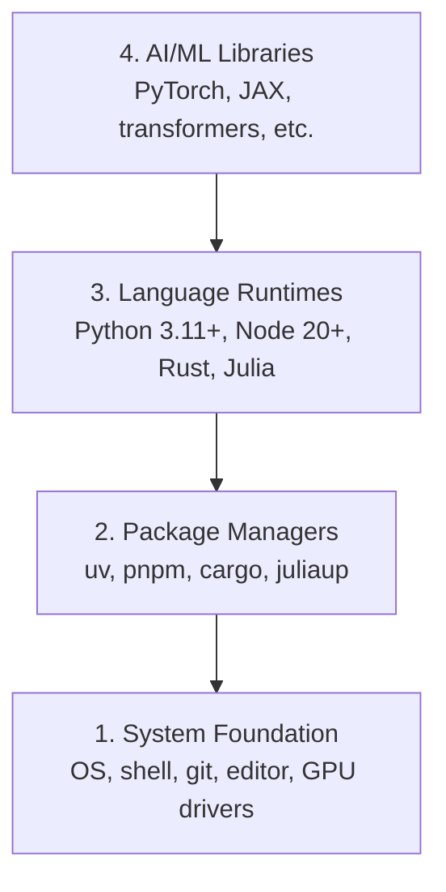

# Dev Environment

> Công cụ của bạn định hình tư duy của bạn. Hãy thiết lập chúng một lần, thiết lập cho đúng.

**Type:** Build
**Languages:** Python, Node.js, Rust
**Prerequisites:** None
**Time:** ~45 minutes

## Learning Objectives

- Thiết lập các bộ công cụ Python 3.11+, Node.js 20+ và Rust từ đầu
- Cấu hình môi trường ảo và trình quản lý gói để có các bản dựng có thể tái lập
- Xác minh quyền truy cập GPU bằng CUDA/MPS và chạy thử một phép toán tensor
- Hiểu ngăn xếp bốn lớp: hệ thống, gói, môi trường chạy, thư viện AI

## The Problem

Bạn sắp học kỹ thuật AI qua 500+ bài học sử dụng Python, TypeScript, Rust và Julia. Nếu môi trường của bạn bị hỏng, mỗi bài học đều trở thành một cuộc chiến với công cụ thay vì việc học.

Hầu hết mọi người bỏ qua việc thiết lập môi trường. Sau đó họ dành hàng giờ để gỡ lỗi import, xung đột phiên bản và thiếu trình điều khiển CUDA. Chúng ta sẽ làm việc này một lần, đúng cách.

## The Concept

Một môi trường kỹ thuật AI có bốn lớp:



Chúng ta cài đặt từ dưới lên. Mỗi lớp phụ thuộc vào lớp bên dưới nó.

```figure
s0-env-stack
```

## Build It

### Step 1: System Foundation

Kiểm tra hệ thống của bạn và cài đặt những thành phần cơ bản.

```bash
# macOS
xcode-select --install
brew install git curl wget

# Ubuntu/Debian
sudo apt update && sudo apt install -y build-essential git curl wget unzip

# Windows (use WSL2)
wsl --install -d Ubuntu-24.04
```

### Step 2: Python with uv

Chúng ta dùng `uv` — nó nhanh hơn pip 10-100 lần và tự động xử lý các môi trường ảo.

```bash
curl -LsSf https://astral.sh/uv/install.sh | sh

uv python install 3.12

uv venv
source .venv/bin/activate  # or .venv\Scripts\activate on Windows

uv pip install numpy matplotlib jupyter
```

Xác minh:

```python
import sys
print(f"Python {sys.version}")

import numpy as np
print(f"NumPy {np.__version__}")
a = np.array([1, 2, 3])
print(f"Vector: {a}, dot product with itself: {np.dot(a, a)}")
```

### Step 3: Node.js with pnpm

Dành cho các bài học TypeScript (agent, máy chủ MCP, ứng dụng web).

```bash
curl -fsSL https://fnm.vercel.app/install | bash
fnm install 22
fnm use 22

npm install -g pnpm

node -e "console.log('Node', process.version)"
```

Trình cài đặt fnm kiểm tra `unzip` trước và thoát với thông báo `Not installing fnm due to missing dependencies.` khi thiếu nó: trên Linux, trình cài đặt giải nén một tệp zip; trên macOS, nó cài đặt thông qua Homebrew. macOS có sẵn `unzip`; Ubuntu, Debian và WSL2 nhận nó từ dòng lệnh apt ở Bước 1 (`sudo apt install -y unzip` nếu bạn đã bỏ qua bước đó).

**macOS / Apple Silicon (M1/M2/M3/M4):** Nếu trình cài đặt dừng với `Error: Cannot install under Rosetta 2 in ARM default prefix (/opt/homebrew)`, terminal của bạn đang chạy dưới Rosetta 2 (`arch` in ra `i386`) trong khi Homebrew là bản dựng arm64 gốc. Cài đặt fnm bằng cách buộc dùng arm64, tích hợp nó vào shell của bạn, rồi chạy lại các lệnh bên trên từ `fnm install 22`:

```bash
arch -arm64 brew install fnm
echo 'eval "$(fnm env --use-on-cd)"' >> ~/.zshrc
source ~/.zshrc
```

### Step 4: Rust

Dành cho các bài học mà hiệu năng đóng vai trò then chốt (suy luận, hệ thống).

```bash
curl --proto '=https' --tlsv1.2 -sSf https://sh.rustup.rs | sh

rustc --version
cargo --version
```

### Step 5: Julia (Optional)

Dành cho các bài học nặng về toán, nơi Julia tỏa sáng.

```bash
curl -fsSL https://install.julialang.org | sh

julia -e 'println("Julia ", VERSION)'
```

### Step 6: GPU Setup (If You Have One)

**NVIDIA (Linux / Windows):**

```bash
nvidia-smi

# Install PyTorch with CUDA
uv pip install torch torchvision torchaudio --index-url https://download.pytorch.org/whl/cu124
```

**macOS / Apple Silicon (M1/M2/M3/M4):** Mac không có CUDA — điều đó là bình thường, không phải lỗi. **Không** truyền `--index-url .../cuXXX` (các gói wheel đó chỉ dành cho Linux/Windows, nên việc cài đặt sẽ thất bại). Cài bản dựng thông thường, có chứa backend GPU MPS (Metal) của Apple:

```bash
uv pip install torch torchvision torchaudio
```

Xác minh (hoạt động trên mọi nền tảng):

```python
import torch
print(f"CUDA available: {torch.cuda.is_available()}")           # False on macOS — expected
print(f"MPS available:  {torch.backends.mps.is_available()}")   # True on Apple Silicon
if torch.cuda.is_available():
    print(f"GPU: {torch.cuda.get_device_name(0)}")
```

Không có GPU? Không sao. Hầu hết bài học hoạt động trên CPU. Với các bài học nặng về huấn luyện, hãy dùng Google Colab hoặc GPU đám mây.

### Step 7: Verify the route you want to start

Chạy mọi lệnh trong bài học này từ thư mục gốc của kho mã, thư mục
chứa `README.md` và `phases/`. Kiểm tra sơ bộ chỉ kiểm tra những gì bạn cần để
bắt đầu lộ trình đã chọn. Theo mặc định, nó bỏ qua các công cụ dùng về sau để người mới học nhận được
một câu trả lời rõ ràng thay vì một bức tường cảnh báo.

Bắt đầu toàn bộ chuỗi bài dành cho người mới:

```bash
python3 phases/00-setup-and-tooling/01-dev-environment/code/verify.py --route beginner
```

Hoặc chỉ kiểm tra lộ trình bạn muốn:

```bash
python3 phases/00-setup-and-tooling/01-dev-environment/code/verify.py --route ml-foundations
python3 phases/00-setup-and-tooling/01-dev-environment/code/verify.py --route llm-engineering
python3 phases/00-setup-and-tooling/01-dev-environment/code/verify.py --route agents
python3 phases/00-setup-and-tooling/01-dev-environment/code/verify.py --route mcp
python3 phases/00-setup-and-tooling/01-dev-environment/code/verify.py --route agent-skills
python3 phases/00-setup-and-tooling/01-dev-environment/code/verify.py --route certification
```

Thêm `--show-later` khi bạn muốn cùng phép kiểm tra sơ bộ đó xem xét các công cụ tùy chọn
và những phần phụ thuộc được các bài học về sau sử dụng. Một công cụ dùng về sau bị thiếu không bao giờ chặn
lộ trình đã chọn.

Mỗi kiểm tra bắt buộc bị lỗi đều kèm đường dẫn được phát hiện hoặc lỗi import và một
lệnh khắc phục chính xác. Các lộ trình Agent Skills và chứng nhận cũng hiển thị
những kiểm tra thủ công trên host vì một script Python không thể chứng minh rằng một AI host đã
phát hiện một skill hoặc phạm vi skill bạn chọn có thể ghi được.

Khi kiểm tra sơ bộ dành cho người mới đạt, nó in ra chính xác bài học đầu tiên có thể chạy:

```text
Ready to start Beginner course.
Next: python3 phases/01-math-foundations/01-linear-algebra-intuition/code/vectors.py
```

## Use It

Môi trường của bạn đã sẵn sàng để bắt đầu lộ trình bạn vừa kiểm tra. Cài các công cụ dùng về sau
khi bài học yêu cầu chúng thay vì để toàn bộ ngăn xếp cản trở bài học đầu tiên
của bạn. Đây là những gì bạn sẽ sử dụng xuyên suốt chương trình:

| Language | Used In | Package Manager |
|----------|---------|-----------------|
| Python | Phases 1-12 (ML, DL, NLP, Vision, Audio, LLMs) | uv |
| TypeScript | Phases 13-17 (Tools, Agents, Swarms, Infra) | pnpm |
| Rust | Phases 12, 15-17 (Performance-critical systems) | cargo |
| Julia | Phase 1 (Math foundations) | Pkg |

## Ship It

Bài học này tạo ra một script xác minh mà bất kỳ ai cũng có thể chạy để kiểm tra thiết lập của mình.

Xem `outputs/prompt-env-check.md` để có một prompt giúp trợ lý AI chẩn đoán các vấn đề về môi trường.

## Exercises

1. Chạy script xác minh và khắc phục mọi lỗi
2. Tạo một môi trường ảo Python cho khóa học này và cài đặt PyTorch
3. Viết một chương trình "hello world" bằng cả bốn ngôn ngữ và chạy từng chương trình

### Hints

**Bài tập 1.** Chạy `python3 phases/00-setup-and-tooling/01-dev-environment/code/verify.py --route beginner` từ thư mục gốc của kho mã và sửa dòng thất bại đầu tiên trước khi xem dòng tiếp theo. Việc kiểm tra hoàn tất khi bạn chạy lại script và mọi phép thăm dò bắt buộc đều đạt.

**Bài tập 2.** Tạo môi trường bằng `uv venv` trong thư mục gốc của kho mã, kích hoạt nó, rồi cài PyTorch bằng lệnh ở Bước 6 phù hợp với phần cứng của bạn. Chạy `python -c "import torch; print(torch.__version__)"` bên trong môi trường; một số phiên bản có nghĩa là việc cài đặt đã thành công.

**Bài tập 3.** Sử dụng bốn runtime trong ngăn xếp ở The Concept: Python, TypeScript trên Node.js, Rust và Julia. Viết một tệp nhỏ cho mỗi runtime và chạy nó bằng `python3`, `npx tsx` (Node.js không thể chạy trực tiếp một tệp `.ts`), `cargo run` hoặc `rustc`, và `julia`. Mỗi lần chạy phải in thông điệp của bạn và thoát với mã 0.
