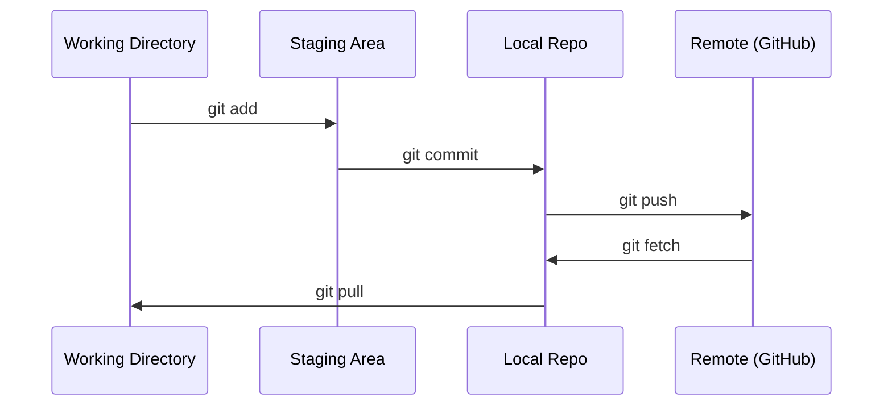

# Git & Collaboration

> Quản lý phiên bản không phải là tùy chọn. Mọi thử nghiệm, mọi mô hình, mọi bài học bạn xây dựng ở đây đều được theo dõi.

**Type:** Learn
**Languages:** --
**Prerequisites:** Phase 0, Lesson 01
**Time:** ~30 minutes

## Learning Objectives

- Cấu hình danh tính git và sử dụng quy trình hằng ngày gồm add, commit và push
- Tạo và hợp nhất các nhánh cho thử nghiệm biệt lập mà không làm hỏng main
- Viết một `.gitignore` loại trừ các checkpoint mô hình và tệp nhị phân lớn
- Duyệt lịch sử commit bằng `git log` để hiểu sự phát triển của dự án

## The Problem

Bạn sắp viết hàng trăm tệp mã qua 20 giai đoạn. Nếu không có quản lý phiên bản, bạn sẽ mất phần việc đã làm, làm hỏng những thứ không thể hoàn tác và không có cách nào cộng tác với người khác.

Git là công cụ. GitHub là nơi mã được lưu. Bài học này bao gồm những gì bạn cần cho khóa học này và không hơn.

## The Concept



Ba điều cần nhớ:
1. Lưu thường xuyên (`git commit`)
2. Đẩy lên kho từ xa (`git push`)
3. Tạo nhánh cho các thử nghiệm (`git checkout -b experiment`)

```figure
s0-commit-dag
```

## Build It

### Step 1: Configure git

```bash
git config --global user.name "Your Name"
git config --global user.email "you@example.com"
```

### Step 2: The daily workflow

```bash
git status
git add file.py
git commit -m "Add perceptron implementation"
git push origin main
```

### Step 3: Branching for experiments

```bash
git checkout -b experiment/new-optimizer

# ... make changes, commit ...

git checkout main
git merge experiment/new-optimizer
```

### Step 4: Working with this course repo

Bạn không thể đẩy lên chính kho mã của khóa học — chỉ những người bảo trì có quyền ghi. Trước tiên hãy fork nó trên GitHub (nút Fork ở trên cùng bên phải) để `origin` trỏ đến bản sao của riêng bạn:

```bash
git clone https://github.com/YOUR-USERNAME/ai-engineering-from-scratch.git
cd ai-engineering-from-scratch

git checkout -b my-progress
# work through lessons, commit your code
git push origin my-progress
```

## Use It

Đối với khóa học này, bạn cần đúng những lệnh sau:

| Command | When |
|---------|------|
| `git clone` | Get the course repo |
| `git add` + `git commit` | Save your work |
| `git push` | Back it up to GitHub |
| `git checkout -b` | Try something without breaking main |
| `git log --oneline` | See what you've done |

Chỉ vậy thôi. Bạn không cần rebase, cherry-pick hay submodule cho khóa học này.

## Exercises

1. Fork kho mã này, clone bản fork của bạn, tạo một nhánh tên `my-progress`, tạo một tệp, commit tệp đó, đẩy nó lên
2. Tạo một `.gitignore` loại trừ các tệp checkpoint mô hình (`.pt`, `.pth`, `.safetensors`)
3. Xem lịch sử commit của kho mã này bằng `git log --oneline` và đọc cách các bài học được thêm vào

## Key Terms

| Thuật ngữ | Cách mọi người nói | Ý nghĩa thực sự |
|------|----------------|----------------------|
| Commit | "Lưu" | Một ảnh chụp toàn bộ dự án của bạn tại một thời điểm |
| Branch (Nhánh) | "Một bản sao" | Một con trỏ đến một commit, dịch chuyển về phía trước khi bạn làm việc |
| Merge (Hợp nhất) | "Kết hợp mã" | Lấy các thay đổi từ một nhánh và áp dụng chúng vào một nhánh khác |
| Remote (Kho từ xa) | "Đám mây" | Một bản sao kho mã của bạn được lưu trữ ở nơi khác (GitHub, GitLab) |
