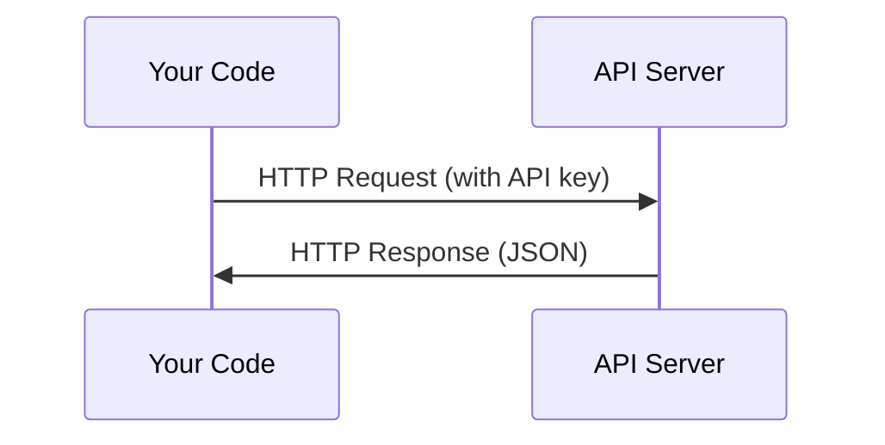

# APIs & Keys

> Mọi API AI đều hoạt động theo cùng một cách: gửi yêu cầu, nhận phản hồi. Chi tiết thay đổi, còn mẫu hoạt động thì không.

**Type:** Build
**Languages:** Python, TypeScript
**Prerequisites:** Phase 0, Lesson 01
**Time:** ~30 minutes

## Learning Objectives

- Lưu khóa API an toàn bằng biến môi trường và tệp `.env`
- Gọi API LLM bằng cả SDK Python của Anthropic lẫn HTTP thuần
- So sánh định dạng yêu cầu/phản hồi giữa cách dùng SDK và HTTP thuần để gỡ lỗi
- Xác định và xử lý các lỗi API thường gặp, bao gồm xác thực và giới hạn tốc độ

## The Problem

Bắt đầu từ Giai đoạn 11, bạn sẽ gọi các API LLM (Anthropic, OpenAI, Google). Trong Giai đoạn 13-16, bạn sẽ xây dựng các agent dùng những API này trong các vòng lặp. Bạn cần biết khóa API hoạt động thế nào, cách lưu trữ an toàn và cách thực hiện lần gọi API đầu tiên.

## The Concept



Mỗi lần gọi API có:
1. Một endpoint (URL)
2. Một khóa API (xác thực)
3. Một phần thân yêu cầu (điều bạn muốn)
4. Một phần thân phản hồi (điều bạn nhận lại)

```figure
s0-secret-inject
```

## Build It

### Step 1: Store API keys safely

Không bao giờ đặt khóa API trong mã. Hãy dùng biến môi trường.

```bash
export ANTHROPIC_API_KEY="sk-ant-..."
export OPENAI_API_KEY="sk-..."
```

Hoặc dùng tệp `.env` (thêm nó vào `.gitignore`):

```
ANTHROPIC_API_KEY=sk-ant-...
OPENAI_API_KEY=sk-...
```

### Step 2: First API call (Python)

```python
import os

import anthropic

client = anthropic.Anthropic()

MODEL = os.environ.get("LLM_MODEL", "claude-sonnet-5")

response = client.messages.create(
    model=MODEL,
    max_tokens=256,
    messages=[{"role": "user", "content": "What is a neural network in one sentence?"}]
)

print(response.content[0].text)
```

`LLM_MODEL` chọn id mô hình Anthropic, và giá trị mặc định là bí danh Sonnet không gắn ngày. Các nhà cung cấp khác (OpenAI, Google và những nhà cung cấp khác) theo cùng mẫu khóa cộng với id mô hình, nhưng mỗi nhà cung cấp có SDK, endpoint và schema yêu cầu/phản hồi riêng.

### Step 3: First API call (TypeScript)

```typescript
import Anthropic from "@anthropic-ai/sdk";

const client = new Anthropic();

const MODEL = process.env.LLM_MODEL ?? "claude-sonnet-5";

const response = await client.messages.create({
  model: MODEL,
  max_tokens: 256,
  messages: [{ role: "user", content: "What is a neural network in one sentence?" }],
});

console.log(response.content[0].text);
```

### Step 4: Raw HTTP (no SDK)

```python
import os
import urllib.request
import json

url = "https://api.anthropic.com/v1/messages"
headers = {
    "Content-Type": "application/json",
    "x-api-key": os.environ["ANTHROPIC_API_KEY"],
    "anthropic-version": "2023-06-01",
}
body = json.dumps({
    "model": os.environ.get("LLM_MODEL", "claude-sonnet-5"),
    "max_tokens": 256,
    "messages": [{"role": "user", "content": "What is a neural network in one sentence?"}],
}).encode()

req = urllib.request.Request(url, data=body, headers=headers, method="POST")
with urllib.request.urlopen(req) as resp:
    result = json.loads(resp.read())
    print(result["content"][0]["text"])
```

Đây là những gì SDK thực hiện bên dưới. Hiểu lần gọi HTTP thuần giúp ích khi gỡ lỗi.

## Use It

Đối với khóa học này:

| API | When you need it | Free tier |
|-----|-----------------|-----------|
| Anthropic (Claude) | Phases 11-16 (agents, tools) | $5 credit on signup |
| OpenAI | Phase 11 (comparison) | $5 credit on signup |
| Hugging Face | Phases 4-10 (models, datasets) | Free |

Bạn chưa cần tất cả ngay bây giờ. Hãy thiết lập chúng khi bài học yêu cầu.

## Ship It

Bài học này tạo ra:
- `outputs/prompt-api-troubleshooter.md` - chẩn đoán các lỗi API thường gặp

## Exercises

1. Lấy một khóa API Anthropic và thực hiện lần gọi API đầu tiên
2. Thử phiên bản HTTP thuần và so sánh định dạng phản hồi với phiên bản SDK
3. Cố ý dùng khóa API sai và đọc thông báo lỗi

### Hints

**Bài tập 1.** Tạo một khóa trong Anthropic Console, đặt nó vào `ANTHROPIC_API_KEY` như được trình bày trong bài học và chạy `code/first_api_call.py`. Lệnh gọi hoạt động khi script in câu trả lời của mô hình và không có lỗi.

**Bài tập 2.** Cả hai hàm trong `code/first_api_call.py` chỉ in văn bản và số lượng token. Thêm `print(response)` trong `call_with_sdk()` và `print(result)` trong `call_raw_http()`, rồi chạy script để xem cả hai phản hồi đầy đủ. So sánh tên các trường: JSON thô có cùng các trường `content`, `usage` và `stop_reason` mà SDK chuyển thành các thuộc tính đối tượng.

**Bài tập 3.** Đặt `ANTHROPIC_API_KEY` thành một giá trị giả chỉ trong một terminal, rồi chạy lại script. Tìm mã trạng thái HTTP và loại lỗi trong đầu ra; lỗi xác thực trả về trạng thái 401.

## Key Terms

| Thuật ngữ | Cách mọi người nói | Ý nghĩa thực sự |
|------|----------------|----------------------|
| API key (Khóa API) | "Mật khẩu cho API" | Một chuỗi duy nhất xác định tài khoản của bạn và cấp quyền cho các yêu cầu |
| Rate limit (Giới hạn tốc độ) | "Họ đang hạn chế tôi" | Số yêu cầu tối đa mỗi phút/giờ để ngăn chặn lạm dụng và bảo đảm sử dụng công bằng |
| Token | "Một từ" (trong ngữ cảnh API) | Một đơn vị tính phí: token đầu vào và đầu ra được đếm và tính phí riêng biệt |
| Streaming (Truyền theo luồng) | "Phản hồi theo thời gian thực" | Nhận phản hồi từng từ một thay vì chờ phản hồi đầy đủ |
