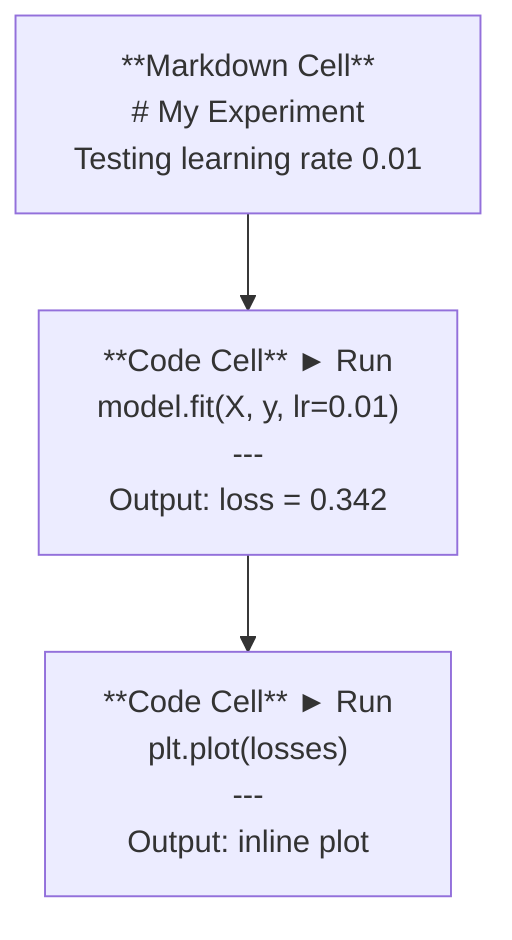
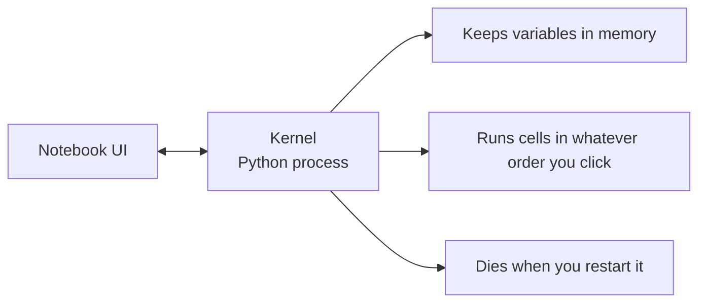

# Jupyter Notebooks

> Notebook là bàn thí nghiệm của kỹ thuật AI. Bạn tạo mẫu thử ở đây, rồi đưa những gì hoạt động vào môi trường sản xuất.

**Type:** Build
**Languages:** Python
**Prerequisites:** Phase 0, Lesson 01
**Time:** ~30 minutes

## Learning Objectives

- Cài đặt và khởi chạy JupyterLab, Jupyter Notebook hoặc VS Code với phần mở rộng Jupyter
- Dùng các lệnh magic (`%timeit`, `%%time`, `%matplotlib inline`) để đo hiệu năng và trực quan hóa ngay trong notebook
- Phân biệt khi nào dùng notebook hay script và áp dụng quy trình "khám phá trong notebook, phát hành bằng script"
- Nhận diện và tránh các bẫy notebook thường gặp: thực thi sai thứ tự, trạng thái ẩn và rò rỉ bộ nhớ

## The Problem

Mọi bài báo AI, hướng dẫn và cuộc thi Kaggle đều sử dụng notebook Jupyter. Chúng cho phép bạn chạy mã theo từng phần, xem đầu ra ngay tại chỗ, kết hợp mã với giải thích và lặp lại nhanh chóng. Nếu bạn cố học AI mà không có notebook, bạn đang làm bài tập toán mà không có giấy nháp.

Nhưng notebook có những cái bẫy thực sự. Mọi người dùng chúng cho mọi thứ, kể cả những việc mà chúng làm rất tệ. Biết khi nào dùng notebook và khi nào dùng script sẽ giúp bạn tránh những cơn ác mộng gỡ lỗi về sau.

## The Concept

Notebook là một danh sách các ô. Mỗi ô là mã hoặc văn bản.



Kernel là một tiến trình Python chạy nền. Khi bạn chạy một ô, nó gửi mã đến kernel, kernel thực thi và gửi lại kết quả. Tất cả các ô dùng chung một kernel, nên các biến vẫn tồn tại giữa các ô.



Phần "bất kỳ thứ tự nào bạn nhấp" đó vừa là siêu năng lực vừa là một cái bẫy tự gây hại.

```figure
s0-cell-order
```

## Build It

### Step 1: Pick your interface

Ba lựa chọn, một định dạng:

| Interface | Install | Best for |
|-----------|---------|----------|
| JupyterLab | `pip install jupyterlab` then `jupyter lab` | Full IDE experience, multiple tabs, file browser, terminal |
| Jupyter Notebook | `pip install notebook` then `jupyter notebook` | Simple, lightweight, one notebook at a time |
| VS Code | Install "Jupyter" extension | Already in your editor, git integration, debugging |

Cả ba đều đọc và ghi cùng tệp `.ipynb`. Hãy chọn bất cứ thứ gì bạn thích. JupyterLab phổ biến nhất trong công việc AI.

```bash
pip install jupyterlab
jupyter lab
```

### Step 2: Keyboard shortcuts that matter

Bạn thao tác ở hai chế độ. Nhấn `Escape` để vào chế độ lệnh (thanh màu xanh dương bên trái), `Enter` để vào chế độ chỉnh sửa (thanh màu xanh lá).

**Chế độ lệnh (dùng nhiều nhất):**

| Key | Action |
|-----|--------|
| `Shift+Enter` | Run cell, move to next |
| `A` | Insert cell above |
| `B` | Insert cell below |
| `DD` | Delete cell |
| `M` | Convert to markdown |
| `Y` | Convert to code |
| `Z` | Undo cell operation |
| `Ctrl+Shift+H` | Show all shortcuts |

**Chế độ chỉnh sửa:**

| Key | Action |
|-----|--------|
| `Tab` | Autocomplete |
| `Shift+Tab` | Show function signature |
| `Ctrl+/` | Toggle comment |

`Shift+Enter` là phím tắt bạn sẽ dùng một nghìn lần mỗi ngày. Hãy học nó trước.

### Step 3: Cell types

**Ô mã** chạy Python và hiển thị đầu ra:

```python
import numpy as np
data = np.random.randn(1000)
data.mean(), data.std()
```

Đầu ra: `(0.0032, 0.9987)`

**Ô Markdown** hiển thị văn bản đã định dạng. Dùng chúng để ghi lại bạn đang làm gì và vì sao. Hỗ trợ tiêu đề, chữ đậm, chữ nghiêng, toán LaTeX (`$E = mc^2$`), bảng và hình ảnh.

### Step 4: Magic commands

Đây không phải Python. Chúng là các lệnh riêng của Jupyter bắt đầu bằng `%` (magic dòng) hoặc `%%` (magic ô).

**Đo thời gian mã của bạn:**

```python
%timeit np.random.randn(10000)
```

Đầu ra: `45.2 us +/- 1.3 us per loop`

```python
%%time
model.fit(X_train, y_train, epochs=10)
```

Đầu ra: `Wall time: 2.34 s`

`%timeit` chạy mã nhiều lần và lấy trung bình. `%%time` chạy một lần. Dùng `%timeit` cho microbenchmark, `%%time` cho các lượt huấn luyện.

**Bật biểu đồ ngay trong notebook:**

```python
%matplotlib inline
```

Mỗi `plt.plot()` hoặc `plt.show()` giờ được hiển thị trực tiếp trong notebook.

**Cài đặt gói mà không rời notebook:**

```python
!pip install scikit-learn
```

Tiền tố `!` chạy bất kỳ lệnh shell nào.

**Kiểm tra biến môi trường:**

```python
%env CUDA_VISIBLE_DEVICES
```

### Step 5: Display rich output inline

Notebook tự động hiển thị biểu thức cuối cùng trong một ô. Nhưng bạn có thể điều khiển điều đó:

```python
import pandas as pd

df = pd.DataFrame({
    "model": ["Linear", "Random Forest", "Neural Net"],
    "accuracy": [0.72, 0.89, 0.94],
    "training_time": [0.1, 2.3, 45.6]
})
df
```

Điều này hiển thị một bảng HTML đã định dạng, không phải một khối văn bản xuất thô. Biểu đồ cũng vậy:

```python
import matplotlib.pyplot as plt

plt.figure(figsize=(8, 4))
plt.plot([1, 2, 3, 4], [1, 4, 2, 3])
plt.title("Inline Plot")
plt.show()
```

Biểu đồ xuất hiện ngay bên dưới ô. Đây là lý do notebook chiếm ưu thế trong công việc AI. Bạn thấy dữ liệu, biểu đồ và mã cùng nhau.

Đối với hình ảnh:

```python
from IPython.display import Image, display
display(Image(filename="architecture.png"))
```

### Step 6: Google Colab

Colab là một notebook Jupyter miễn phí trên đám mây. Nó cung cấp GPU, thư viện được cài sẵn và tích hợp Google Drive. Không cần thiết lập.

1. Truy cập [colab.research.google.com](https://colab.research.google.com)
2. Tải lên bất kỳ tệp `.ipynb` nào từ khóa học này
3. Runtime > Change runtime type > T4 GPU (miễn phí)

Những điểm khác nhau giữa Colab và Jupyter cục bộ:
- Tệp không được giữ lại giữa các phiên (lưu vào Drive hoặc tải xuống)
- Được cài sẵn: numpy, pandas, matplotlib, torch, tensorflow, sklearn
- `from google.colab import files` để tải tệp lên/xuống
- `from google.colab import drive; drive.mount('/content/drive')` để lưu trữ bền vững
- Các phiên hết thời gian sau 90 phút không hoạt động (gói miễn phí)

## Use It

### Notebooks vs Scripts: When to use which

| Use notebooks for | Use scripts for |
|-------------------|-----------------|
| Exploring a dataset | Training pipelines |
| Prototyping a model | Reusable utilities |
| Visualizing results | Anything with `if __name__` |
| Explaining your work | Code that runs on a schedule |
| Quick experiments | Production code |
| Course exercises | Packages and libraries |

Quy tắc: **khám phá trong notebook, phát hành bằng script**.

Một quy trình phổ biến trong AI:
1. Khám phá dữ liệu trong một notebook
2. Tạo mẫu thử cho mô hình trong notebook
3. Khi nó hoạt động, chuyển mã sang các tệp `.py`
4. Import những tệp `.py` đó trở lại notebook để thử nghiệm thêm

### Common traps

**Thực thi sai thứ tự.** Bạn chạy ô 5, rồi ô 2, rồi ô 7. Notebook hoạt động trên máy của bạn nhưng bị hỏng khi người khác chạy từ trên xuống dưới. Cách khắc phục: Kernel > Restart & Run All trước khi chia sẻ.

**Trạng thái ẩn.** Bạn xóa một ô nhưng biến mà nó tạo ra vẫn ở trong bộ nhớ. Notebook trông gọn gàng nhưng phụ thuộc vào một ô ma. Cách khắc phục: Khởi động lại kernel thường xuyên.

**Rò rỉ bộ nhớ.** Tải một tập dữ liệu 4GB, huấn luyện mô hình, tải một tập dữ liệu khác. Không có gì được giải phóng. Cách khắc phục: `del variable_name` và `gc.collect()`, hoặc khởi động lại kernel.

## Ship It

Bài học này tạo ra:
- `outputs/prompt-notebook-helper.md` để gỡ lỗi các vấn đề notebook

## Exercises

1. Mở JupyterLab, tạo một notebook và dùng `%timeit` để so sánh list comprehension với numpy khi tạo một mảng 100,000 số ngẫu nhiên
2. Tạo một notebook có cả ô markdown lẫn ô mã để tải một CSV, hiển thị dataframe và vẽ biểu đồ. Sau đó chạy Kernel > Restart & Run All để xác minh nó hoạt động từ trên xuống dưới
3. Lấy mã từ `code/notebook_tips.py`, dán vào notebook Colab và chạy bằng GPU miễn phí

### Hints

**Bài tập 1.** Khởi động JupyterLab bằng `jupyter lab`, rồi đặt mỗi phiên bản trong một ô riêng bắt đầu bằng `%timeit`. Sử dụng cùng kích thước 100,000 trong cả hai ô để hai thời gian đo cùng một công việc.

**Bài tập 2.** Sử dụng `pd.read_csv` cho dữ liệu, hiển thị dataframe ở dòng cuối của một ô và vẽ biểu đồ bằng `df.plot()` hoặc matplotlib. Sau Kernel > Restart & Run All, mọi ô phải hiển thị một số trong bộ đếm thực thi của nó và không ô nào được hiển thị lỗi.

**Bài tập 3.** Trong Colab, chọn Runtime > Change runtime type > GPU trước khi dán mã. Lần chạy là đúng khi mỗi hàm trong `code/notebook_tips.py` in phần của nó và `torch.cuda.is_available()` trả về `True` trong một ô.

## Key Terms

| Thuật ngữ | Cách mọi người nói | Ý nghĩa thực sự |
|------|----------------|----------------------|
| Kernel | "Thứ chạy mã của tôi" | Một tiến trình Python riêng biệt thực thi các ô và giữ các biến trong bộ nhớ |
| Cell (Ô) | "Một khối mã" | Một đơn vị có thể chạy độc lập trong notebook, là mã hoặc markdown |
| Magic command (Lệnh magic) | "Các thủ thuật Jupyter" | Các lệnh đặc biệt có tiền tố `%` hoặc `%%` điều khiển môi trường notebook |
| `.ipynb` | "Tệp notebook" | Một tệp JSON chứa các ô, đầu ra và siêu dữ liệu. Là viết tắt của IPython Notebook |

## Further Reading

- [JupyterLab Docs](https://jupyterlab.readthedocs.io/) để xem bộ tính năng đầy đủ
- [Google Colab FAQ](https://research.google.com/colaboratory/faq.html) để xem các giới hạn và tính năng riêng của Colab
- [28 Jupyter Notebook Tips](https://www.dataquest.io/blog/jupyter-notebook-tips-tricks-shortcuts/) để xem các phím tắt dành cho người dùng thành thạo
