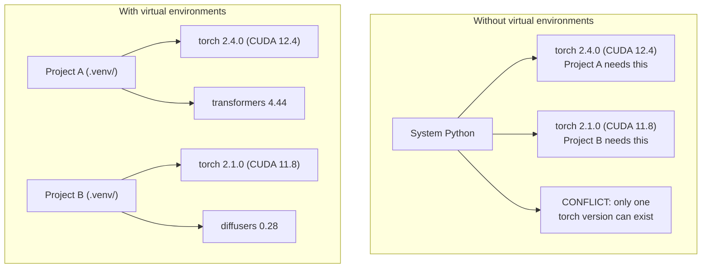

# Python Environments

> Địa ngục phụ thuộc là có thật. Môi trường ảo là phương thuốc.

**Type:** Build
**Languages:** Shell
**Prerequisites:** Phase 0, Lesson 01
**Time:** ~30 minutes

## Learning Objectives

- Tạo các môi trường ảo biệt lập bằng `uv`, `venv` hoặc `conda`
- Viết một `pyproject.toml` với các nhóm phụ thuộc tùy chọn và tạo tệp khóa để có khả năng tái lập
- Chẩn đoán và khắc phục các bẫy thường gặp: cài đặt toàn cục, trộn pip/conda, phiên bản CUDA không khớp
- Triển khai chiến lược môi trường theo từng giai đoạn cho các dự án có phần phụ thuộc xung đột

## The Problem

Bạn cài PyTorch 2.4 cho một dự án fine-tuning. Tuần sau, một dự án khác cần PyTorch 2.1 vì bản dựng CUDA của nó đã được cố định. Bạn nâng cấp toàn cục, và dự án đầu tiên bị hỏng. Bạn hạ cấp, và dự án thứ hai bị hỏng.

Đây là địa ngục phụ thuộc. Nó xảy ra liên tục trong công việc AI/ML vì:

- PyTorch, JAX và TensorFlow đều đi kèm các binding CUDA riêng
- Các thư viện mô hình cố định những phiên bản framework cụ thể
- Một lệnh `pip install` toàn cục ghi đè bất cứ thứ gì đã có trước đó
- Các bản dựng CUDA 11.8 không hoạt động với trình điều khiển CUDA 12.x (và ngược lại)

Cách khắc phục: mỗi dự án có môi trường biệt lập riêng với các gói riêng.

## The Concept



```figure
s0-env-isolation
```

## Build It

### Option 1: uv venv (Recommended)

`uv` là trình quản lý gói Python nhanh nhất (nhanh hơn pip 10-100 lần). Nó xử lý môi trường ảo, phiên bản Python và giải quyết phần phụ thuộc trong một công cụ.

```bash
curl -LsSf https://astral.sh/uv/install.sh | sh

uv python install 3.12

cd your-project
uv venv
source .venv/bin/activate
```

Cài đặt các gói:

```bash
uv pip install torch numpy
```

Tạo một dự án có `pyproject.toml` trong một bước:

```bash
uv init my-ai-project
cd my-ai-project
uv add torch numpy matplotlib
```

### Option 2: venv (Built-in)

Nếu bạn không thể cài `uv`, Python có sẵn `venv`:

```bash
python3 -m venv .venv
source .venv/bin/activate  # Linux/macOS
.venv\Scripts\activate     # Windows

pip install torch numpy
```

Chậm hơn `uv`, nhưng hoạt động ở mọi nơi có cài Python.

### Option 3: conda (When You Need It)

Conda quản lý các phần phụ thuộc không phải Python như bộ công cụ CUDA, cuDNN và thư viện C. Dùng nó khi:

- Bạn cần một phiên bản bộ công cụ CUDA cụ thể mà không cài trên toàn hệ thống
- Bạn đang ở một cụm dùng chung nơi không thể cài các gói hệ thống
- Hướng dẫn cài đặt của một thư viện nói "dùng conda"

```bash
# Install miniconda (not the full Anaconda)
curl -LsSf https://repo.anaconda.com/miniconda/Miniconda3-latest-Linux-x86_64.sh -o miniconda.sh
bash miniconda.sh -b

conda create -n myproject python=3.12
conda activate myproject

conda install pytorch torchvision torchaudio pytorch-cuda=12.4 -c pytorch -c nvidia
```

Một quy tắc: nếu bạn dùng conda cho một môi trường, hãy dùng conda cho mọi gói trong môi trường đó. Trộn `pip install` vào môi trường conda gây ra xung đột phụ thuộc rất khó gỡ lỗi.

### For This Course: Per-Phase Strategy

Bạn có thể tạo một môi trường cho toàn bộ khóa học. Đừng làm vậy. Các giai đoạn khác nhau cần các phần phụ thuộc khác nhau (đôi khi xung đột).

Chiến lược:

```
ai-engineering-from-scratch/
├── .venv/                    <-- shared lightweight env for phases 0-3
├── phases/
│   ├── 04-neural-networks/
│   │   └── .venv/            <-- PyTorch env
│   ├── 05-cnns/
│   │   └── .venv/            <-- same PyTorch env (symlink or shared)
│   ├── 08-transformers/
│   │   └── .venv/            <-- might need different transformer versions
│   └── 11-llm-apis/
│       └── .venv/            <-- API SDKs, no torch needed
```

Script trong `code/env_setup.sh` tạo môi trường cơ sở cho khóa học này.

## pyproject.toml Basics

Mỗi dự án Python nên có một `pyproject.toml`. Nó thay thế `setup.py`, `setup.cfg` và `requirements.txt` trong một tệp.

```toml
[project]
name = "ai-engineering-from-scratch"
version = "0.1.0"
requires-python = ">=3.11"
dependencies = [
    "numpy>=1.26",
    "matplotlib>=3.8",
    "jupyter>=1.0",
    "scikit-learn>=1.4",
]

[project.optional-dependencies]
torch = ["torch>=2.3", "torchvision>=0.18"]
llm = ["anthropic>=0.39", "openai>=1.50"]
```

Sau đó cài đặt:

```bash
uv pip install -e ".[torch]"    # base + PyTorch
uv pip install -e ".[llm]"     # base + LLM SDKs
uv pip install -e ".[torch,llm]" # everything
```

## Lockfiles

Tệp khóa cố định mọi phần phụ thuộc (kể cả các phần phụ thuộc bắc cầu) ở những phiên bản chính xác. Điều này bảo đảm khả năng tái lập: bất kỳ ai cài từ tệp khóa đều nhận đúng cùng các gói.

```bash
# uv generates uv.lock automatically when using uv add
uv add numpy

# pip-tools approach
uv pip compile pyproject.toml -o requirements.lock
uv pip install -r requirements.lock
```

Commit tệp khóa của bạn vào git. Khi ai đó clone kho mã, họ cài từ tệp khóa và nhận các phiên bản giống hệt nhau.

## Common Mistakes

### 1. Installing globally

```bash
pip install torch  # BAD: installs to system Python

source .venv/bin/activate
pip install torch  # GOOD: installs to virtual environment
```

Kiểm tra các gói của bạn được đưa vào đâu:

```bash
which python       # should show .venv/bin/python, not /usr/bin/python
which pip           # should show .venv/bin/pip
```

### 2. Mixing pip and conda

```bash
conda create -n myenv python=3.12
conda activate myenv
conda install pytorch -c pytorch
pip install some-other-package   # BAD: can break conda's dependency tracking
conda install some-other-package # GOOD: let conda manage everything
```

Nếu bạn buộc phải dùng pip bên trong conda (một số gói chỉ có trên pip), hãy cài tất cả gói conda trước, rồi cài các gói pip sau cùng.

### 3. Forgetting to activate

```bash
python train.py           # uses system Python, missing packages
source .venv/bin/activate
python train.py           # uses project Python, packages found
```

Dấu nhắc shell của bạn phải hiển thị tên môi trường:

```
(.venv) $ python train.py
```

### 4. Committing .venv to git

```bash
echo ".venv/" >> .gitignore
```

Môi trường ảo có dung lượng 200MB-2GB. Chúng là cục bộ, không thể chuyển dùng giữa các máy. Thay vào đó, hãy commit `pyproject.toml` và tệp khóa.

### 5. CUDA version mismatch

```bash
nvidia-smi                # shows driver CUDA version (e.g., 12.4)
python -c "import torch; print(torch.version.cuda)"  # shows PyTorch CUDA version

# These must be compatible.
# PyTorch CUDA version must be <= driver CUDA version.
```

## Use It

Chạy script thiết lập để tạo môi trường khóa học của bạn:

```bash
bash phases/00-setup-and-tooling/06-python-environments/code/env_setup.sh
```

Lệnh này tạo một `.venv` ở gốc kho mã với các phần phụ thuộc cốt lõi đã được cài đặt và xác minh.

## Exercises

1. Chạy `env_setup.sh` và xác minh mọi kiểm tra đều đạt
2. Tạo môi trường ảo thứ hai, cài một phiên bản numpy khác vào đó và xác nhận hai môi trường được biệt lập
3. Viết một `pyproject.toml` cho dự án cần cả PyTorch lẫn SDK Anthropic
4. Cố ý cài một gói toàn cục (không kích hoạt venv), chú ý nơi nó được đưa vào, rồi gỡ cài đặt

## Key Terms

| Thuật ngữ | Cách mọi người nói | Ý nghĩa thực sự |
|------|----------------|----------------------|
| Virtual environment (Môi trường ảo) | "Một venv" | Một thư mục biệt lập chứa một trình thông dịch Python và các gói, tách biệt với Python hệ thống |
| Lockfile (Tệp khóa) | "Các phần phụ thuộc được ghim" | Một tệp liệt kê mọi gói và phiên bản chính xác của nó, bảo đảm các bản cài đặt giống hệt nhau trên các máy |
| pyproject.toml | "setup.py mới" | Tệp cấu hình dự án Python tiêu chuẩn, thay thế setup.py/setup.cfg/requirements.txt |
| Transitive dependency (Phần phụ thuộc bắc cầu) | "Một phần phụ thuộc của một phần phụ thuộc" | Gói B phụ thuộc vào C; nếu bạn cài đặt A phụ thuộc vào B, C là một phần phụ thuộc bắc cầu của A |
| CUDA mismatch (CUDA không khớp) | "GPU của tôi không hoạt động" | PyTorch được biên dịch cho một phiên bản CUDA khác với phiên bản mà trình điều khiển GPU của bạn hỗ trợ |
