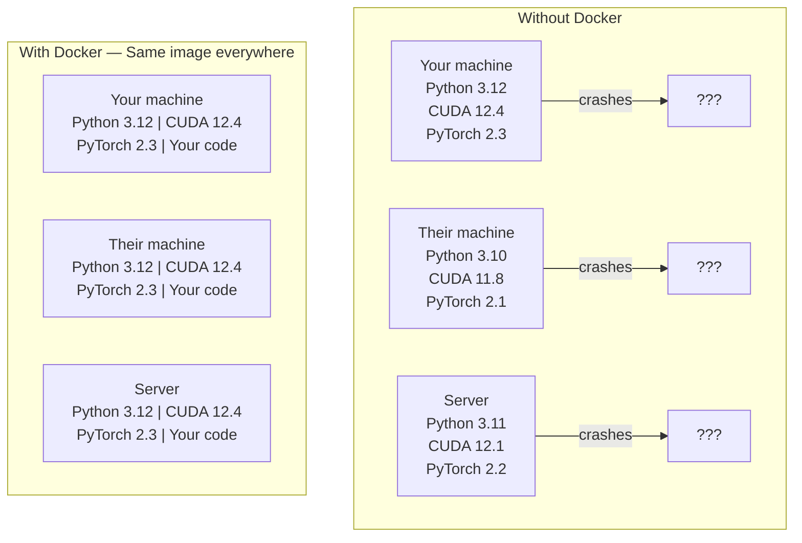

# Docker for AI

> Container biến "hoạt động trên máy của tôi" thành chuyện của quá khứ.

**Type:** Build
**Languages:** Docker
**Prerequisites:** Phase 0, Lessons 01 and 03
**Time:** ~60 minutes

## Learning Objectives

- Dựng một image Docker hỗ trợ GPU với CUDA, PyTorch và thư viện AI từ một Dockerfile
- Gắn các thư mục của máy host thành volume để giữ lại mô hình, tập dữ liệu và mã qua các lần dựng lại container
- Cấu hình NVIDIA Container Toolkit để cung cấp GPU bên trong container
- Điều phối các ứng dụng AI nhiều dịch vụ (máy chủ suy luận + cơ sở dữ liệu vector) bằng Docker Compose

## The Problem

Bạn đã huấn luyện một mô hình trên laptop bằng PyTorch 2.3, CUDA 12.4 và Python 3.12. Đồng nghiệp của bạn có PyTorch 2.1, CUDA 11.8 và Python 3.10. Mô hình của bạn bị lỗi trên máy của họ. Dockerfile của bạn hoạt động trên cả hai.

Các dự án AI là cơn ác mộng phụ thuộc. Một ngăn xếp điển hình gồm Python, PyTorch, trình điều khiển CUDA, cuDNN, thư viện C cấp hệ thống và các gói chuyên biệt như flash-attn cần phiên bản trình biên dịch chính xác. Docker đóng gói tất cả vào một image duy nhất chạy giống hệt nhau ở mọi nơi.

## The Concept

Docker gói mã, môi trường chạy, thư viện và công cụ hệ thống của bạn vào một đơn vị biệt lập gọi là container. Hãy coi nó như một máy ảo nhẹ, ngoại trừ việc nó dùng chung nhân hệ điều hành của máy host thay vì chạy nhân riêng, nên khởi động trong vài giây thay vì vài phút.



### Why AI projects need Docker more than most

1. **Trình điều khiển GPU rất dễ trục trặc.** Mã CUDA 12.4 không chạy trên CUDA 11.8. Docker biệt lập bộ công cụ CUDA bên trong container trong khi dùng chung trình điều khiển GPU của máy host thông qua NVIDIA Container Toolkit.

2. **Trọng số mô hình có dung lượng lớn.** Một mô hình 7B tham số có dung lượng 14 GB ở fp16. Bạn không muốn tải lại nó mỗi khi dựng lại. Volume Docker cho phép bạn gắn một thư mục mô hình từ máy host.

3. **Kiến trúc nhiều dịch vụ rất phổ biến.** Một ứng dụng AI thực sự không chỉ là một script Python. Nó là một máy chủ suy luận, một cơ sở dữ liệu vector cho RAG, có thể có cả giao diện web. Docker Compose điều phối tất cả bằng một lệnh.

### Key vocabulary

| Term | What it means |
|------|---------------|
| Image | A read-only template. Your recipe. Built from a Dockerfile. |
| Container | A running instance of an image. Your kitchen. |
| Dockerfile | Instructions to build an image. Layer by layer. |
| Volume | Persistent storage that survives container restarts. |
| docker-compose | A tool for defining multi-container applications in YAML. |

### Common container patterns in AI

```
Dev Container
  Full toolkit. Editor support. Jupyter. Debugging tools.
  Used during development and experimentation.

Training Container
  Minimal. Just the training script and dependencies.
  Runs on GPU clusters. No editor, no Jupyter.

Inference Container
  Optimized for serving. Small image. Fast cold start.
  Runs behind a load balancer in production.
```

```figure
s0-image-layers
```

## Build It

### Step 1: Install Docker

```bash
# macOS
brew install --cask docker
open /Applications/Docker.app

# Ubuntu
curl -fsSL https://get.docker.com | sh
sudo usermod -aG docker $USER
# Log out and back in for group change to take effect
```

Xác minh:

```bash
docker --version
docker run hello-world
```

### Step 2: Install NVIDIA Container Toolkit (Linux with NVIDIA GPU)

Điều này cho phép container Docker truy cập GPU của bạn. Người dùng macOS và Windows (WSL2) có thể bỏ qua bước này; Docker Desktop xử lý việc chuyển tiếp GPU khác nhau trên những nền tảng đó.

```bash
distribution=$(. /etc/os-release;echo $ID$VERSION_ID)
curl -fsSL https://nvidia.github.io/libnvidia-container/gpgkey | sudo gpg --dearmor -o /usr/share/keyrings/nvidia-container-toolkit-keyring.gpg
curl -s -L https://nvidia.github.io/libnvidia-container/$distribution/libnvidia-container.list | \
    sed 's#deb https://#deb [signed-by=/usr/share/keyrings/nvidia-container-toolkit-keyring.gpg] https://#g' | \
    sudo tee /etc/apt/sources.list.d/nvidia-container-toolkit.list

sudo apt-get update
sudo apt-get install -y nvidia-container-toolkit
sudo nvidia-ctk runtime configure --runtime=docker
sudo systemctl restart docker
```

Kiểm tra quyền truy cập GPU bên trong một container:

```bash
docker run --rm --gpus all nvidia/cuda:12.4.1-base-ubuntu22.04 nvidia-smi
```

Nếu bạn thấy thông tin GPU, bộ công cụ đang hoạt động.

### Step 3: Understand base images

Chọn đúng image nền giúp tiết kiệm hàng giờ gỡ lỗi.

```
nvidia/cuda:12.4.1-devel-ubuntu22.04
  Full CUDA toolkit. Compilers included.
  Use for: building packages that need nvcc (flash-attn, bitsandbytes)
  Size: ~4 GB

nvidia/cuda:12.4.1-runtime-ubuntu22.04
  CUDA runtime only. No compilers.
  Use for: running pre-built code
  Size: ~1.5 GB

pytorch/pytorch:2.6.0-cuda12.4-cudnn9-runtime
  PyTorch pre-installed on top of CUDA.
  Use for: skipping the PyTorch install step
  Size: ~6 GB

python:3.12-slim
  No CUDA. CPU only.
  Use for: inference on CPU, lightweight tools
  Size: ~150 MB
```

### Step 4: Write a Dockerfile for AI development

Đây là Dockerfile trong `code/Dockerfile`. Hãy xem qua nó:

```dockerfile
FROM --platform=linux/amd64 nvidia/cuda:12.4.1-devel-ubuntu22.04

ENV DEBIAN_FRONTEND=noninteractive
ENV PYTHONUNBUFFERED=1

RUN apt-get update && apt-get install -y --no-install-recommends \
    software-properties-common \
    git \
    curl \
    build-essential \
    && add-apt-repository -y ppa:deadsnakes/ppa \
    && apt-get update && apt-get install -y --no-install-recommends \
    python3.12 \
    python3.12-venv \
    python3.12-dev \
    && rm -rf /var/lib/apt/lists/*

RUN update-alternatives --install /usr/bin/python python /usr/bin/python3.12 1

RUN curl -sSL https://raw.githubusercontent.com/pypa/get-pip/3b73145063be545b649ad9ca83ea8da5fc915a4f/public/get-pip.py -o /tmp/get-pip.py \
    && echo "a341e1a43e38001c551a1508a73ff23636a11970b61d901d9a1cad2a18f57055  /tmp/get-pip.py" | sha256sum -c - \
    && python /tmp/get-pip.py \
    && rm /tmp/get-pip.py \
    && update-alternatives --install /usr/bin/pip pip /usr/local/bin/pip3.12 1

RUN python -m pip install --no-cache-dir --upgrade pip setuptools wheel

RUN python -m pip install --no-cache-dir \
    torch==2.6.0+cu124 \
    torchvision==0.21.0+cu124 \
    torchaudio==2.6.0+cu124 \
    --index-url https://download.pytorch.org/whl/cu124

RUN python -m pip install --no-cache-dir \
    numpy \
    pandas \
    scikit-learn \
    matplotlib \
    jupyter \
    transformers \
    datasets \
    accelerate \
    safetensors

WORKDIR /workspace

VOLUME ["/workspace", "/models"]

EXPOSE 8888

CMD ["python"]
```

Dựng image:

```bash
docker build -t ai-dev -f phases/00-setup-and-tooling/07-docker-for-ai/code/Dockerfile .
```

Lần đầu việc này mất một lúc (tải image nền CUDA + PyTorch). Các lần dựng tiếp theo dùng các lớp đã được lưu vào bộ nhớ đệm.

**macOS / Apple Silicon (M1/M2/M3/M4):** `--platform=linux/amd64` trên dòng `FROM` là điều giúp bản dựng này thành công trên Mac. Image nền CUDA cũng có một biến thể arm64 và Docker Desktop tự động chọn nó trên Apple Silicon, nhưng PyTorch chỉ phát hành các gói wheel `cu124` cho x86_64, nên lớp `pip install torch==2.6.0+cu124` thất bại với `No matching distribution found for torch==2.6.0+cu124`. Cố định nền tảng sẽ kéo image x86_64 và chạy nó dưới giả lập: quá trình dựng chậm hơn và container không có GPU (dù theo cách nào thì Mac cũng không có CUDA). Bỏ `--gpus all` khỏi các lệnh `docker run` bên dưới trên Mac. Để làm việc với GPU trên Apple Silicon, chạy các bài học trực tiếp với bản dựng MPS từ Bài học 01 và giữ image này cho các máy host Linux x86_64 có GPU NVIDIA.

Chạy image:

```bash
docker run --rm -it --gpus all \
    -v $(pwd):/workspace \
    -v ~/models:/models \
    ai-dev python -c "import torch; print(f'PyTorch {torch.__version__}, CUDA: {torch.cuda.is_available()}')"
```

Chạy Jupyter bên trong container:

```bash
docker run --rm -it --gpus all \
    -v $(pwd):/workspace \
    -v ~/models:/models \
    -p 8888:8888 \
    ai-dev jupyter notebook --ip=0.0.0.0 --port=8888 --no-browser --allow-root
```

### Step 5: Volume mounts for data and models

Việc gắn volume rất quan trọng cho công việc AI. Nếu không có chúng, các tệp mô hình 14 GB bạn tải xuống sẽ biến mất khi container dừng.

```bash
# Mount your code
-v $(pwd):/workspace

# Mount a shared models directory
-v ~/models:/models

# Mount datasets
-v ~/datasets:/data
```

Bên trong script huấn luyện, tải từ đường dẫn đã gắn:

```python
from transformers import AutoModel

model = AutoModel.from_pretrained("/models/llama-7b")
```

Mô hình nằm trên hệ thống tệp của máy host. Dựng lại container bao nhiêu lần tùy ý mà không cần tải lại.

### Step 6: Docker Compose for multi-service AI apps

Một ứng dụng RAG thực sự cần máy chủ suy luận và cơ sở dữ liệu vector. Docker Compose chạy cả hai bằng một lệnh.

Xem `code/docker-compose.yml`:

```yaml
services:
  ai-dev:
    build:
      context: .
      dockerfile: Dockerfile
    deploy:
      resources:
        reservations:
          devices:
            - driver: nvidia
              count: all
              capabilities: [gpu]
    volumes:
      - ../../../:/workspace
      - ~/models:/models
      - ~/datasets:/data
    ports:
      - "8888:8888"
    stdin_open: true
    tty: true
    command: jupyter notebook --ip=0.0.0.0 --port=8888 --no-browser --allow-root

  qdrant:
    image: qdrant/qdrant:v1.12.5
    ports:
      - "6333:6333"
      - "6334:6334"
    volumes:
      - qdrant_data:/qdrant/storage

volumes:
  qdrant_data:
```

Khởi động mọi thứ:

```bash
cd phases/00-setup-and-tooling/07-docker-for-ai/code
docker compose up -d
```

Giờ container phát triển AI của bạn có thể truy cập cơ sở dữ liệu vector tại `http://qdrant:6333` bằng tên dịch vụ. Docker Compose tự động tạo một mạng dùng chung.

Kiểm tra kết nối từ bên trong container AI:

```python
from qdrant_client import QdrantClient

client = QdrantClient(host="qdrant", port=6333)
print(client.get_collections())
```

Dừng mọi thứ:

```bash
docker compose down
```

Thêm `-v` để xóa cả volume qdrant:

```bash
docker compose down -v
```

### Step 7: Useful Docker commands for AI work

```bash
# List running containers
docker ps

# List all images and their sizes
docker images

# Remove unused images (reclaim disk space)
docker system prune -a

# Check GPU usage inside a running container
docker exec -it <container_id> nvidia-smi

# Copy a file from container to host
docker cp <container_id>:/workspace/results.csv ./results.csv

# View container logs
docker logs -f <container_id>
```

## Use It

Giờ bạn có một môi trường phát triển AI có thể tái lập. Đối với phần còn lại của khóa học này:

- Dùng `docker compose up` để khởi động môi trường phát triển và cơ sở dữ liệu vector cùng nhau
- Gắn mã, mô hình và dữ liệu thành các volume để không mất gì giữa những lần dựng lại
- Khi bài học yêu cầu một gói Python mới, thêm nó vào Dockerfile và dựng lại
- Chia sẻ Dockerfile với đồng đội. Họ nhận được môi trường giống hệt.

### No GPU?

Bỏ cờ `--gpus all` và khối deploy NVIDIA. Container vẫn hoạt động cho các bài học dựa trên CPU. PyTorch phát hiện việc không có CUDA và tự động chuyển sang CPU.

## Exercises

1. Dựng Dockerfile và chạy `python -c "import torch; print(torch.__version__)"` bên trong container
2. Khởi động ngăn xếp docker-compose và xác minh có thể truy cập Qdrant từ container AI tại `http://qdrant:6333/collections`
3. Thêm `flask` vào Dockerfile, dựng lại và chạy một máy chủ API đơn giản trên cổng 5000. Ánh xạ cổng bằng `-p 5000:5000`
4. Đo kích thước image bằng `docker images`. Thử đổi image nền từ `devel` sang `runtime` và so sánh kích thước

## Key Terms

| Thuật ngữ | Cách mọi người nói | Ý nghĩa thực sự |
|------|----------------|----------------------|
| Container | "Máy ảo nhẹ" | Một tiến trình biệt lập sử dụng kernel của máy chủ, với hệ thống tệp và mạng riêng |
| Image layer (Lớp image) | "Bước được lưu đệm" | Mỗi chỉ thị Dockerfile tạo ra một lớp. Các lớp không thay đổi được lưu đệm, nên việc dựng lại diễn ra nhanh. |
| NVIDIA Container Toolkit | "GPU trong Docker" | Một hook lúc chạy cho phép các container truy cập GPU của máy chủ thông qua cờ `--gpus` |
| Volume mount (Gắn volume) | "Thư mục chia sẻ" | Một thư mục trên máy chủ được ánh xạ vào container. Các thay đổi vẫn tồn tại sau khi container dừng. |
| Base image (Image cơ sở) | "Điểm bắt đầu" | Image `FROM` mà Dockerfile của bạn dựng dựa trên đó. Quyết định những gì được cài đặt sẵn. |
