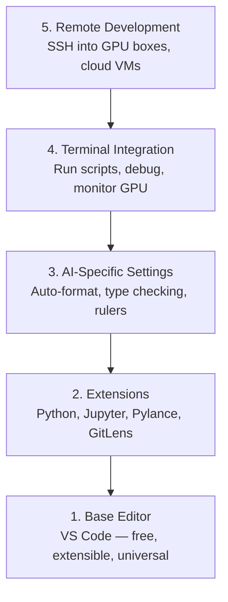

# Editor Setup

> Trình soạn thảo là phi công phụ của bạn. Hãy cấu hình nó một lần để nó không cản trở bạn và bắt đầu làm tròn phần việc của mình.

**Type:** Build
**Languages:** --
**Prerequisites:** Phase 0, Lesson 01
**Time:** ~20 minutes

## Learning Objectives

- Cài VS Code với các phần mở rộng thiết yếu cho Python, Jupyter, linting và SSH từ xa
- Cấu hình định dạng khi lưu, kiểm tra kiểu và cuộn đầu ra notebook cho các quy trình AI
- Thiết lập Remote SSH để chỉnh sửa và gỡ lỗi mã trên máy GPU từ xa như thể chúng là máy cục bộ
- Đánh giá các trình soạn thảo thay thế (Cursor, Windsurf, Neovim) và những đánh đổi của chúng trong công việc AI

## The Problem

Bạn sẽ dành hàng nghìn giờ trong trình soạn thảo để viết Python, chạy notebook, gỡ lỗi vòng lặp huấn luyện và SSH vào các máy GPU. Trình soạn thảo cấu hình sai biến mỗi phiên làm việc thành sự cản trở: không tự động hoàn tất, không gợi ý kiểu, không báo lỗi ngay trong mã, định dạng thủ công và quy trình terminal vụng về.

Thiết lập đúng mất 20 phút. Bỏ qua nó khiến bạn mất 20 phút mỗi ngày.

## The Concept

Một thiết lập trình soạn thảo cho kỹ thuật AI cần năm thứ:



```figure
s0-lsp-roundtrip
```

## Build It

### Step 1: Install VS Code

VS Code là trình soạn thảo được khuyến nghị. Nó miễn phí, chạy trên mọi hệ điều hành, hỗ trợ notebook Jupyter ở mức hàng đầu và hệ sinh thái phần mở rộng bao phủ mọi thứ bạn cần cho công việc AI.

Tải xuống từ [code.visualstudio.com](https://code.visualstudio.com/).

Xác minh từ terminal:

```bash
code --version
```

Nếu không tìm thấy `code` trên macOS, mở VS Code, nhấn `Cmd+Shift+P`, gõ "Shell Command" và chọn "Install 'code' command in PATH".

### Step 2: Install Essential Extensions

Mở terminal tích hợp trong VS Code (`` Ctrl+` `` trên mọi nền tảng) và cài các phần mở rộng quan trọng cho công việc AI:

```bash
code --install-extension ms-python.python
code --install-extension ms-python.vscode-pylance
code --install-extension ms-toolsai.jupyter
code --install-extension eamodio.gitlens
code --install-extension ms-vscode-remote.remote-ssh
code --install-extension ms-python.debugpy
code --install-extension ms-python.black-formatter
code --install-extension charliermarsh.ruff
```

Chức năng của từng phần mở rộng:

| Extension | Why |
|-----------|-----|
| Python | Language support, virtual env detection, run/debug |
| Pylance | Fast type checking, autocomplete, import resolution |
| Jupyter | Run notebooks inside VS Code, variable explorer |
| GitLens | See who changed what, inline git blame |
| Remote SSH | Open a folder on a remote GPU box as if it were local |
| Debugpy | Step-through debugging for Python |
| Black Formatter | Auto-format on save, consistent style |
| Ruff | Fast linting, catches common mistakes |

Tệp `code/vscode/extensions.json` trong bài học này chứa danh sách khuyến nghị đầy đủ. Sao chép nó vào `.vscode/extensions.json` trong thư mục dự án của bạn, và VS Code nhắc bạn cài chúng khi mở thư mục đó.

### Step 3: Configure Settings

Sao chép các thiết lập từ `code/vscode/settings.json` trong bài học này, hoặc áp dụng chúng thủ công thông qua `Settings > Open Settings (JSON)`.

Các thiết lập then chốt cho công việc AI:

```jsonc
{
    "python.analysis.typeCheckingMode": "basic",
    "editor.formatOnSave": true,
    "editor.rulers": [88, 120],
    "notebook.output.scrolling": true,
    "files.autoSave": "afterDelay"
}
```

Vì sao chúng quan trọng:

- **Kiểm tra kiểu ở mức basic**: Phát hiện kiểu đối số sai trước khi bạn chạy. Tiết kiệm thời gian gỡ lỗi khi hình dạng tensor không khớp và tham số API sai.
- **Định dạng khi lưu**: Không bao giờ phải nghĩ về định dạng nữa. Black xử lý việc đó.
- **Thước ở 88 và 120**: Black ngắt dòng ở 88. Mốc 120 cho biết khi docstring và chú thích trở nên quá dài.
- **Cuộn đầu ra notebook**: Vòng lặp huấn luyện in ra hàng nghìn dòng. Nếu không cuộn, bảng đầu ra phình to.
- **Tự động lưu**: Bạn sẽ quên lưu. Script huấn luyện sẽ chạy mã cũ. Tự động lưu ngăn điều đó.

### Step 4: Terminal Integration

Terminal tích hợp của VS Code là nơi bạn chạy script huấn luyện, giám sát GPU và quản lý môi trường.

Thiết lập nó đúng cách:

```jsonc
{
    "terminal.integrated.defaultProfile.osx": "zsh",
    "terminal.integrated.defaultProfile.linux": "bash",
    "terminal.integrated.fontSize": 13,
    "terminal.integrated.scrollback": 10000
}
```

Các phím tắt hữu ích:

| Action | macOS | Linux/Windows |
|--------|-------|---------------|
| Toggle terminal | `` Ctrl+` `` | `` Ctrl+` `` |
| New terminal | `` Ctrl+Shift+` `` | `` Ctrl+Shift+` `` |
| Split terminal | `Cmd+\` | `Ctrl+Shift+5` |

Chia terminal rất hữu ích: một để chạy script, một để giám sát GPU bằng `nvidia-smi -l 1` hoặc `watch -n 1 nvidia-smi`.

### Step 5: Remote Development (SSH into GPU Boxes)

Đây là phần mở rộng quan trọng nhất cho công việc AI. Bạn sẽ chạy huấn luyện trên máy từ xa (máy ảo đám mây, máy chủ phòng thí nghiệm, Lambda, Vast.ai). Remote SSH cho phép bạn mở hệ thống tệp từ xa, chỉnh sửa tệp, chạy terminal và gỡ lỗi như thể mọi thứ đều là cục bộ.

Thiết lập:

1. Cài phần mở rộng Remote SSH (đã làm ở Bước 2).
2. Nhấn `Ctrl+Shift+P` (hoặc `Cmd+Shift+P`), gõ "Remote-SSH: Connect to Host".
3. Nhập `user@your-gpu-box-ip`.
4. VS Code tự động cài thành phần máy chủ của nó lên máy từ xa.

Để truy cập không cần mật khẩu, thiết lập khóa SSH:

```bash
ssh-keygen -t ed25519 -C "your-email@example.com"
ssh-copy-id user@your-gpu-box-ip
```

Thêm host vào `~/.ssh/config` cho thuận tiện:

```
Host gpu-box
    HostName 203.0.113.50
    User ubuntu
    IdentityFile ~/.ssh/id_ed25519
    ForwardAgent yes
```

Giờ `Remote-SSH: Connect to Host > gpu-box` kết nối ngay lập tức.

## Alternatives

### Cursor

[cursor.com](https://cursor.com) là một bản fork của VS Code có tính năng tạo mã AI tích hợp. Nó dùng cùng hệ sinh thái phần mở rộng và định dạng thiết lập. Nếu bạn dùng Cursor, mọi thứ trong bài học này vẫn áp dụng. Import cùng các tệp `settings.json` và `extensions.json`.

### Windsurf

[windsurf.com](https://windsurf.com) là một bản fork VS Code khác đặt AI lên hàng đầu. Cũng như vậy: cùng phần mở rộng, cùng định dạng thiết lập, cùng hỗ trợ Remote SSH.

### Vim/Neovim

Nếu bạn đã dùng Vim hoặc Neovim và làm việc hiệu quả với nó, hãy tiếp tục dùng. Thiết lập tối thiểu cho công việc Python AI:

- **pyright** hoặc **pylsp** để kiểm tra kiểu (qua Mason hoặc cài thủ công)
- **nvim-lspconfig** để tích hợp máy chủ ngôn ngữ
- **jupyter-vim** hoặc **molten-nvim** để thực thi theo kiểu notebook
- **telescope.nvim** để tìm tệp/ký hiệu
- **none-ls.nvim** với black và ruff để định dạng/linting

Nếu bạn chưa dùng Vim, đừng bắt đầu bây giờ. Quá trình học nó sẽ cạnh tranh với việc học kỹ thuật AI. Hãy dùng VS Code.

## Use It

Với thiết lập này, quy trình hằng ngày của bạn như sau:

1. Mở thư mục dự án trong VS Code (hoặc kết nối qua Remote SSH đến một máy GPU).
2. Viết Python trong trình soạn thảo với tự động hoàn tất, gợi ý kiểu và lỗi ngay trong mã.
3. Chạy notebook Jupyter ngay tại chỗ bằng phần mở rộng Jupyter.
4. Dùng terminal tích hợp cho script huấn luyện, `uv pip install` và giám sát GPU.
5. Rà soát thay đổi bằng GitLens trước khi commit.

## Exercises

1. Cài VS Code và mọi phần mở rộng được liệt kê ở Bước 2
2. Sao chép `settings.json` từ bài học này vào cấu hình VS Code của bạn
3. Mở một tệp Python và xác minh Pylance hiển thị gợi ý kiểu và Black định dạng khi lưu
4. Nếu bạn có quyền truy cập máy từ xa, thiết lập Remote SSH và mở một thư mục trên đó

### Hints

**Bài tập 1.** Cài các extension từ bảng ở Bước 2, hoặc cài từng ID trong `code/vscode/extensions.json` bằng `code --install-extension <id>`. Chạy `code --list-extensions` và đối chiếu từng ID với tệp.

**Bài tập 2.** Mở Settings > Open Settings (JSON) và sao chép nội dung của `code/vscode/settings.json` vào đó. Nếu tệp đã có các thiết lập, gộp các khóa và giữ JSON hợp lệ; VS Code đánh dấu một tệp bị lỗi bằng một dòng đỏ.

**Bài tập 3.** Viết một hàm có chú thích kiểu, rồi di chuột lên một lệnh gọi nó; Pylance hiển thị kiểu được suy ra. Thêm các dấu cách thừa trong một dòng và lưu tệp; Black phải định dạng lại dòng đó khi lưu.

**Bài tập 4.** Trước tiên thêm máy chủ vào `~/.ssh/config` và xác nhận `ssh <host>` hoạt động trong một terminal. Sau đó dùng lệnh Remote SSH để kết nối; thanh trạng thái hiển thị tên host khi VS Code chạy trên máy từ xa.

## Key Terms

| Thuật ngữ | Cách mọi người nói | Ý nghĩa thực sự |
|------|----------------|----------------------|
| LSP | "Bộ máy tự động hoàn thành" | Giao thức Máy chủ Ngôn ngữ: một tiêu chuẩn để các trình soạn thảo lấy thông tin kiểu, các gợi ý hoàn thành và thông tin chẩn đoán từ một máy chủ dành riêng cho ngôn ngữ |
| Pylance | "Plugin Python" | Máy chủ ngôn ngữ Python của Microsoft sử dụng Pyright để kiểm tra kiểu và IntelliSense |
| Remote SSH | "Làm việc trên máy chủ" | Tiện ích mở rộng VS Code chạy một máy chủ nhẹ trên một máy từ xa và truyền giao diện người dùng đến trình soạn thảo cục bộ của bạn |
| Format on save (Định dạng khi lưu) | "Tự động làm đẹp" | Trình soạn thảo chạy một công cụ định dạng (Black, Ruff) mỗi khi bạn lưu, nên phong cách mã luôn nhất quán |
