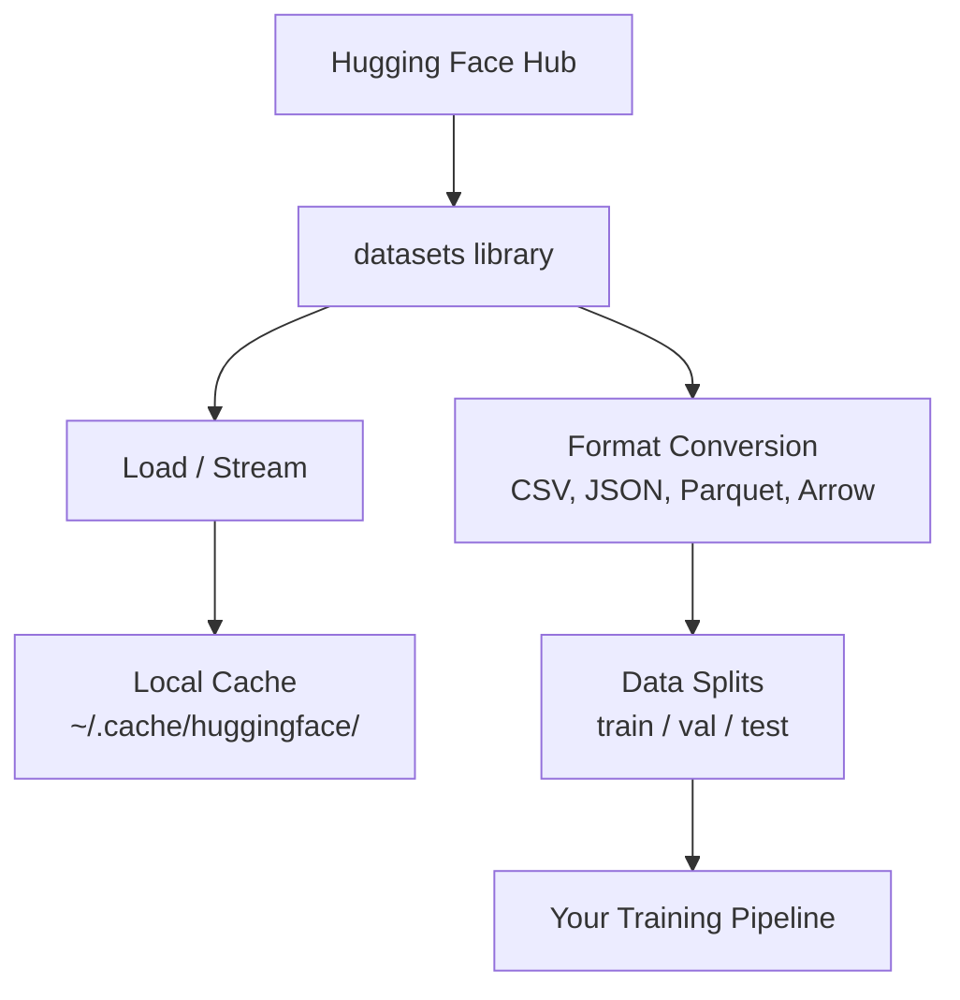

# Data Management

> Dữ liệu là nhiên liệu. Cách bạn quản lý nó quyết định bạn đi nhanh đến đâu.

**Type:** Build
**Language:** Python
**Prerequisites:** Phase 0, Lesson 01
**Time:** ~45 minutes

## Learning Objectives

- Tải, truyền luồng và lưu đệm tập dữ liệu bằng thư viện `datasets` của Hugging Face
- Chuyển đổi giữa định dạng CSV, JSON, Parquet và Arrow và giải thích các đánh đổi của chúng
- Tạo các phần chia huấn luyện/kiểm định/kiểm thử có thể tái lập với seed ngẫu nhiên cố định
- Quản lý các tệp mô hình và tập dữ liệu lớn bằng `.gitignore`, Git LFS hoặc DVC

## The Problem

Mọi dự án AI bắt đầu bằng dữ liệu. Bạn cần tìm tập dữ liệu, tải xuống, chuyển đổi giữa các định dạng, chia chúng để huấn luyện và đánh giá, rồi quản lý phiên bản để các thử nghiệm có thể tái lập. Làm thủ công mỗi lần vừa chậm vừa dễ lỗi. Bạn cần một quy trình có thể lặp lại.

## The Concept



Thư viện `datasets` của Hugging Face là cách tiêu chuẩn để tải dữ liệu cho công việc AI. Nó xử lý sẵn việc tải xuống, lưu đệm, chuyển đổi định dạng và truyền luồng.

```figure
s0-data-pipeline
```

## Build It

### Step 1: Install the datasets library

```bash
pip install datasets huggingface_hub
```

### Step 2: Load a dataset

```python
from datasets import load_dataset

dataset = load_dataset("stanfordnlp/imdb")
print(dataset)
print(dataset["train"][0])
```

Lệnh này tải xuống tập dữ liệu đánh giá phim IMDB. Sau lần tải đầu tiên, nó tải từ bộ nhớ đệm tại `~/.cache/huggingface/datasets/`.

### Step 3: Stream large datasets

Một số tập dữ liệu quá lớn để vừa trên đĩa. Truyền luồng tải chúng từng hàng mà không tải xuống toàn bộ.

```python
dataset = load_dataset("wikimedia/wikipedia", "20231101.en", split="train", streaming=True)

for i, example in enumerate(dataset):
    print(example["title"])
    if i >= 4:
        break
```

Truyền luồng cung cấp một `IterableDataset`. Bạn xử lý các hàng khi chúng đến. Mức dùng bộ nhớ không đổi bất kể kích thước tập dữ liệu.

### Step 4: Dataset formats

Thư viện `datasets` sử dụng Apache Arrow bên dưới. Bạn có thể chuyển đổi sang định dạng khác tùy nhu cầu của pipeline.

```python
dataset = load_dataset("stanfordnlp/imdb", split="train")

dataset.to_csv("imdb_train.csv")
dataset.to_json("imdb_train.json")
dataset.to_parquet("imdb_train.parquet")
```

So sánh định dạng:

| Format | Size | Read Speed | Best For |
|--------|------|-----------|----------|
| CSV | Large | Slow | Human readability, spreadsheets |
| JSON | Large | Slow | APIs, nested data |
| Parquet | Small | Fast | Analytics, columnar queries |
| Arrow | Small | Fastest | In-memory processing (what `datasets` uses internally) |

Đối với công việc AI, Parquet là định dạng lưu trữ tốt nhất. Arrow là thứ bạn làm việc với trong bộ nhớ. CSV và JSON dùng để trao đổi.

### Step 5: Data splits

Mọi dự án ML cần ba phần chia:

- **Huấn luyện**: Mô hình học từ phần này (thường là 80%)
- **Kiểm định**: Bạn kiểm tra tiến độ trong quá trình huấn luyện (thường là 10%)
- **Kiểm thử**: Đánh giá cuối cùng sau khi huấn luyện hoàn tất (thường là 10%)

Một số tập dữ liệu đã được chia sẵn. Nếu không, hãy tự chia:

```python
dataset = load_dataset("stanfordnlp/imdb", split="train")

split = dataset.train_test_split(test_size=0.2, seed=42)
train_val = split["train"].train_test_split(test_size=0.125, seed=42)

train_ds = train_val["train"]
val_ds = train_val["test"]
test_ds = split["test"]

print(f"Train: {len(train_ds)}, Val: {len(val_ds)}, Test: {len(test_ds)}")
```

Luôn đặt seed để có khả năng tái lập. Cùng một seed tạo ra cùng một cách chia mỗi lần.

### Step 6: Download and cache models

Mô hình là những tệp lớn. Thư viện `huggingface_hub` xử lý việc tải xuống và lưu đệm.

```python
from huggingface_hub import hf_hub_download, snapshot_download

model_path = hf_hub_download(
    repo_id="sentence-transformers/all-MiniLM-L6-v2",
    filename="config.json"
)
print(f"Cached at: {model_path}")

model_dir = snapshot_download("sentence-transformers/all-MiniLM-L6-v2")
print(f"Full model at: {model_dir}")
```

Mô hình được lưu đệm vào `~/.cache/huggingface/hub/`. Khi đã tải xuống, chúng tải ngay lập tức ở các lần chạy sau.

### Step 7: Handle large files

Trọng số mô hình và tập dữ liệu lớn không nên đưa vào git. Ba lựa chọn:

**Lựa chọn A: .gitignore (đơn giản nhất)**

```
*.bin
*.safetensors
*.pt
*.onnx
data/*.parquet
data/*.csv
models/
```

**Lựa chọn B: Git LFS (theo dõi tệp lớn trong git)**

```bash
git lfs install
git lfs track "*.bin"
git lfs track "*.safetensors"
git add .gitattributes
```

Git LFS lưu các con trỏ trong kho mã và các tệp thực sự trên một máy chủ riêng. GitHub cho bạn 1 GB miễn phí.

**Lựa chọn C: DVC (quản lý phiên bản dữ liệu)**

```bash
pip install dvc
dvc init
dvc add data/training_set.parquet
git add data/training_set.parquet.dvc data/.gitignore
git commit -m "Track training data with DVC"
```

DVC tạo các tệp `.dvc` nhỏ trỏ đến dữ liệu của bạn. Bản thân dữ liệu nằm trong S3, GCS hoặc một backend lưu trữ từ xa khác.

| Approach | Complexity | Best For |
|----------|-----------|----------|
| .gitignore | Low | Personal projects, downloaded data you can re-fetch |
| Git LFS | Medium | Teams sharing model weights via git |
| DVC | High | Reproducible experiments, large datasets, teams |

Đối với khóa học này, `.gitignore` là đủ. Dùng DVC khi bạn cần tái lập chính xác các thử nghiệm giữa nhiều máy.

### Step 8: Storage patterns

**Lưu trữ cục bộ** phù hợp với tập dữ liệu dưới ~10 GB. Bộ nhớ đệm HF tự động xử lý việc này.

**Lưu trữ đám mây** dành cho bất cứ thứ gì lớn hơn hoặc được chia sẻ giữa nhiều máy:

```python
import os

local_path = os.path.expanduser("~/.cache/huggingface/datasets/")

# s3_path = "s3://my-bucket/datasets/"
# gcs_path = "gs://my-bucket/datasets/"
```

DVC tích hợp trực tiếp với S3 và GCS:

```bash
dvc remote add -d myremote s3://my-bucket/dvc-store
dvc push
```

Đối với khóa học này, lưu trữ cục bộ là đủ. Lưu trữ đám mây trở nên liên quan khi bạn fine-tune trên các máy GPU từ xa.

## Datasets Used in This Course

| Dataset | Lessons | Size | What It Teaches |
|---------|---------|------|----------------|
| IMDB | Tokenization, classification | 84 MB | Text classification basics |
| WikiText | Language modeling | 181 MB | Next-token prediction |
| SQuAD | QA systems | 35 MB | Question answering, spans |
| Common Crawl (subset) | Embeddings | Varies | Large-scale text processing |
| MNIST | Vision basics | 21 MB | Image classification fundamentals |
| COCO (subset) | Multimodal | Varies | Image-text pairs |

Bạn chưa cần tải tất cả những thứ này ngay bây giờ. Mỗi bài học nêu rõ những gì nó cần.

## Use It

Chạy script tiện ích để xác minh mọi thứ hoạt động:

```bash
python code/data_utils.py
```

Lệnh này tải xuống một tập dữ liệu nhỏ, chuyển đổi, chia nó và in bản tóm tắt.

## Ship It

Bài học này tạo ra:
- `code/data_utils.py` - tiện ích tải và lưu đệm dữ liệu có thể tái sử dụng
- `outputs/prompt-data-helper.md` - prompt để tìm tập dữ liệu phù hợp cho tác vụ

## Exercises

1. Tải tập dữ liệu `glue` với cấu hình `mrpc` và kiểm tra 5 ví dụ đầu tiên
2. Truyền luồng tập dữ liệu `c4` và đếm số ví dụ bạn có thể xử lý trong 10 giây
3. Chuyển đổi tập dữ liệu sang Parquet và so sánh kích thước tệp với CSV
4. Tạo phần chia huấn luyện/kiểm định/kiểm thử 70/15/15 với seed cố định và xác minh kích thước

### Hints

**Bài tập 1.** Gọi `load_and_inspect("glue", "mrpc")` từ `code/data_utils.py`, hoặc gọi trực tiếp `load_dataset("glue", "mrpc")`, và in `ds["train"][:5]`. Mỗi ví dụ phải có các trường `sentence1`, `sentence2` và `label`.

**Bài tập 2.** Tải tập dữ liệu với `streaming=True`, như `stream_dataset` thực hiện, và đọc các ví dụ trong một vòng lặp dừng khi `time.time()` vượt thời điểm bắt đầu cộng 10 giây. In số lượng; chạy hai lần, vì lần chạy đầu tiên bao gồm việc khởi động kết nối.

**Bài tập 3.** Lưu cùng tập dữ liệu bằng `to_csv` và `to_parquet`, như `convert_format` thực hiện, rồi so sánh kích thước bằng `ls -lh` hoặc `os.path.getsize`. Tải lại tệp Parquet bằng `load_from_parquet` và kiểm tra số hàng không thay đổi.

**Bài tập 4.** Sử dụng `train_test_split` hai lần với một `seed` cố định: trước tiên tách ra 30 phần trăm, rồi chia đôi 30 phần trăm đó. Ba độ dài phải cộng lại bằng độ dài ban đầu, và một lần chạy thứ hai với cùng seed phải cho cùng hàng đầu tiên trong mỗi phần chia.

## Key Terms

| Thuật ngữ | Cách mọi người nói | Ý nghĩa thực sự |
|------|----------------|----------------------|
| Dataset split (Phần chia tập dữ liệu) | "Dữ liệu huấn luyện" | Một tập con có tên (train/val/test) được sử dụng ở các giai đoạn khác nhau trong vòng đời ML |
| Streaming (Truyền theo luồng) | "Tải nó một cách lười biếng" | Xử lý dữ liệu từng hàng một từ một nguồn từ xa mà không tải xuống toàn bộ tập dữ liệu |
| Parquet | "CSV được nén" | Một định dạng tệp theo cột được tối ưu hóa cho các truy vấn phân tích và hiệu quả lưu trữ |
| Arrow | "Dataframe nhanh" | Một định dạng theo cột trong bộ nhớ được thư viện datasets sử dụng nội bộ cho việc đọc không sao chép |
| Git LFS | "Git cho các tệp lớn" | Một phần mở rộng lưu trữ các tệp lớn bên ngoài kho git trong khi vẫn giữ các con trỏ trong hệ thống quản lý phiên bản |
| DVC | "Git cho dữ liệu" | Một hệ thống quản lý phiên bản cho các tập dữ liệu và mô hình, tích hợp với lưu trữ đám mây |
| Cache (Bộ nhớ đệm) | "Đã tải xuống" | Một bản sao cục bộ của dữ liệu đã được lấy trước đó, được lưu tại ~/.cache/huggingface/ theo mặc định |
