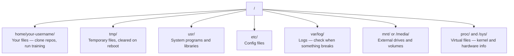

# Linux for AI

> Hầu hết AI chạy trên Linux. Bạn cần biết đủ để không bị mắc kẹt.

**Type:** Learn
**Languages:** --
**Prerequisites:** Phase 0, Lesson 01
**Time:** ~30 minutes

## Learning Objectives

- Điều hướng hệ thống tệp Linux và thực hiện các thao tác tệp thiết yếu từ dòng lệnh
- Quản lý quyền tệp bằng `chmod` và `chown` để xử lý các lỗi "Permission denied"
- Cài các gói hệ thống bằng `apt` và thiết lập một máy GPU mới cho công việc AI
- Nhận diện những khác biệt từ macOS sang Linux thường làm khó các nhà phát triển làm việc trên máy từ xa

## The Problem

Bạn phát triển trên macOS hoặc Windows. Nhưng ngay khi SSH vào một máy GPU đám mây, thuê một instance Lambda hoặc khởi chạy máy EC2, bạn đến với Ubuntu. Terminal là giao diện duy nhất của bạn. Không có Finder, không có Explorer, không có GUI. Nếu bạn không thể điều hướng hệ thống tệp, cài gói và quản lý tiến trình từ dòng lệnh, bạn sẽ mắc kẹt trả tiền cho những giờ GPU nhàn rỗi trong khi tìm Google "cách giải nén một tệp trong Linux."

Đây là hướng dẫn sinh tồn. Nó bao gồm đúng những gì bạn cần để thao tác trên một máy Linux từ xa cho công việc AI. Không hơn.

## File System Layout

Linux tổ chức mọi thứ dưới một thư mục gốc duy nhất `/`. Không có `C:\` hoặc `/Volumes`. Những thư mục bạn sẽ thực sự chạm đến:



Thư mục nhà của bạn là `~` hoặc `/home/your-username`. Hầu hết mọi việc bạn làm diễn ra ở đây.

## Essential Commands

Đây là 13 lệnh bao quát phần lớn những gì bạn sẽ làm trên một máy GPU từ xa.

### Moving Around

```bash
pwd                         # Where am I?
ls                          # What's here?
ls -la                      # What's here, including hidden files with details?
cd /path/to/dir             # Go there
cd ~                        # Go home
cd ..                       # Go up one level
```

### Files and Directories

```bash
mkdir my-project            # Create a directory
mkdir -p a/b/c              # Create nested directories in one shot

cp file.txt backup.txt      # Copy a file
cp -r src/ src-backup/      # Copy a directory (recursive)

mv old.txt new.txt          # Rename a file
mv file.txt /tmp/           # Move a file

rm file.txt                 # Delete a file (no trash, it's gone)
rm -rf my-dir/              # Delete a directory and everything inside
```

`rm -rf` là vĩnh viễn. Không có hoàn tác. Kiểm tra kỹ đường dẫn trước khi nhấn enter.

### Reading Files

```bash
cat file.txt                # Print entire file
head -20 file.txt           # First 20 lines
tail -20 file.txt           # Last 20 lines
tail -f log.txt             # Follow a log file in real time (Ctrl+C to stop)
less file.txt               # Scroll through a file (q to quit)
```

### Searching

```bash
grep "error" training.log           # Find lines containing "error"
grep -r "learning_rate" .           # Search all files in current directory
grep -i "cuda" config.yaml          # Case-insensitive search

find . -name "*.py"                 # Find all Python files under current dir
find . -name "*.ckpt" -size +1G     # Find checkpoint files larger than 1GB
```

## Permissions

Mọi tệp trong Linux đều có chủ sở hữu và các bit quyền. Bạn sẽ gặp điều này khi script không thực thi hoặc bạn không thể ghi vào thư mục.

```bash
ls -l train.py
# -rwxr-xr-- 1 user group 2048 Mar 19 10:00 train.py
#  ^^^             owner permissions: read, write, execute
#     ^^^          group permissions: read, execute
#        ^^        everyone else: read only
```

Các cách khắc phục thường gặp:

```bash
chmod +x train.sh           # Make a script executable
chmod 755 deploy.sh         # Owner: full, others: read+execute
chmod 644 config.yaml       # Owner: read+write, others: read only

chown user:group file.txt   # Change who owns a file (needs sudo)
```

Khi có thông báo "Permission denied," đó gần như luôn là vấn đề quyền hạn. `chmod +x` hoặc `sudo` sẽ khắc phục hầu hết trường hợp.

## Package Management (apt)

Ubuntu dùng `apt`. Đây là cách bạn cài phần mềm cấp hệ thống.

```bash
sudo apt update             # Refresh the package list (always do this first)
sudo apt install -y htop    # Install a package (-y skips confirmation)
sudo apt install -y build-essential  # C compiler, make, etc. Needed by many Python packages
sudo apt install -y tmux    # Terminal multiplexer (keep sessions alive after disconnect)

apt list --installed        # What's installed?
sudo apt remove htop        # Uninstall
```

Các gói thường cài trên máy GPU mới:

```bash
sudo apt update && sudo apt install -y \
    build-essential \
    git \
    curl \
    wget \
    tmux \
    htop \
    unzip \
    python3-venv
```

## Users and sudo

Bạn thường đăng nhập với tư cách người dùng thông thường. Một số thao tác cần quyền root (quản trị viên).

```bash
whoami                      # What user am I?
sudo command                # Run a single command as root
sudo su                     # Become root (exit to go back, use sparingly)
```

Trên các instance GPU đám mây, bạn thường là người dùng duy nhất và đã có quyền sudo. Đừng chạy mọi thứ với quyền root. Chỉ dùng sudo khi cần.

## Processes and systemd

Khi quá trình huấn luyện bị treo, hoặc bạn cần kiểm tra những gì đang chạy:

```bash
htop                        # Interactive process viewer (q to quit)
ps aux | grep python        # Find running Python processes
kill 12345                  # Gracefully stop process with PID 12345
kill -9 12345               # Force kill (use when graceful doesn't work)
nvidia-smi                  # GPU processes and memory usage
```

systemd quản lý các dịch vụ (daemon chạy nền). Bạn sẽ dùng nó nếu chạy các máy chủ suy luận:

```bash
sudo systemctl start nginx          # Start a service
sudo systemctl stop nginx           # Stop it
sudo systemctl restart nginx        # Restart it
sudo systemctl status nginx         # Check if it's running
sudo systemctl enable nginx         # Start automatically on boot
```

## Disk Space

Máy GPU thường có dung lượng đĩa giới hạn. Mô hình và tập dữ liệu lấp đầy đĩa nhanh chóng.

```bash
df -h                       # Disk usage for all mounted drives
df -h /home                 # Disk usage for /home specifically

du -sh *                    # Size of each item in current directory
du -sh ~/.cache             # Size of your cache (pip, huggingface models land here)
du -sh /data/checkpoints/   # Check how big your checkpoints are

# Find the biggest space hogs
du -h --max-depth=1 / 2>/dev/null | sort -hr | head -20
```

Các cách tiết kiệm dung lượng thường gặp:

```bash
# Clear pip cache
pip cache purge

# Clear apt cache
sudo apt clean

# Remove old checkpoints you don't need
rm -rf checkpoints/epoch_01/ checkpoints/epoch_02/
```

## Networking

Bạn sẽ tải mô hình, truyền tệp và gọi API từ dòng lệnh.

```bash
# Download files
wget https://example.com/model.bin                   # Download a file
curl -O https://example.com/data.tar.gz              # Same thing with curl
curl -s https://api.example.com/health | python3 -m json.tool  # Hit an API, pretty-print JSON

# Transfer files between machines
scp model.bin user@remote:/data/                     # Copy file to remote machine
scp user@remote:/data/results.csv .                  # Copy file from remote to local
scp -r user@remote:/data/checkpoints/ ./local-dir/   # Copy directory

# Sync directories (faster than scp for large transfers, resumes on failure)
rsync -avz --progress ./data/ user@remote:/data/
rsync -avz --progress user@remote:/results/ ./results/
```

Dùng `rsync` thay cho `scp` với bất cứ thứ gì lớn. Nó chỉ truyền các byte đã thay đổi và xử lý kết nối bị gián đoạn.

## tmux: Keep Sessions Alive

Khi bạn SSH vào máy từ xa, đóng laptop sẽ kết thúc lượt huấn luyện. tmux ngăn điều này.

```bash
tmux new -s train           # Start a new session named "train"
# ... start your training, then:
# Ctrl+B, then D            # Detach (training keeps running)

tmux ls                     # List sessions
tmux attach -t train        # Reattach to session

# Inside tmux:
# Ctrl+B, then %            # Split pane vertically
# Ctrl+B, then "            # Split pane horizontally
# Ctrl+B, then arrow keys   # Switch between panes
```

Luôn chạy các tác vụ huấn luyện dài bên trong tmux. Luôn luôn.

## WSL2 for Windows Users

Nếu bạn dùng Windows, WSL2 cung cấp một môi trường Linux thực sự mà không cần khởi động kép.

```bash
# In PowerShell (admin)
wsl --install -d Ubuntu-24.04

# After restart, open Ubuntu from Start menu
sudo apt update && sudo apt upgrade -y
```

WSL2 chạy một nhân Linux thực sự. Mọi thứ trong bài học này hoạt động bên trong nó. Từ bên trong WSL, các tệp Windows của bạn ở `/mnt/c/Users/YourName/`.

Chuyển tiếp GPU hoạt động với trình điều khiển NVIDIA được cài phía Windows. Cài trình điều khiển NVIDIA cho Windows (không phải bản Linux), và CUDA sẽ có sẵn bên trong WSL2.

## Gotchas: macOS to Linux

Những điều sẽ làm bạn vướng mắc nếu chuyển từ macOS sang:

| macOS | Linux | Notes |
|-------|-------|-------|
| `brew install` | `sudo apt install` | Different package names sometimes. `brew install htop` vs `sudo apt install htop` works the same, but `brew install readline` vs `sudo apt install libreadline-dev` does not. |
| `open file.txt` | `xdg-open file.txt` | But you won't have a GUI on a remote box. Use `cat` or `less`. |
| `pbcopy` / `pbpaste` | Not available | Pipe to/from clipboard doesn't exist over SSH. |
| `~/.zshrc` | `~/.bashrc` | macOS defaults to zsh. Most Linux servers use bash. |
| `/opt/homebrew/` | `/usr/bin/`, `/usr/local/bin/` | Binaries live in different places. |
| `sed -i '' 's/a/b/' file` | `sed -i 's/a/b/' file` | macOS sed needs an empty string after `-i`. Linux does not. |
| Case-insensitive filesystem | Case-sensitive filesystem | `Model.py` and `model.py` are two different files on Linux. |
| Line endings `\n` | Line endings `\n` | Same. But Windows uses `\r\n`, which breaks bash scripts. Run `dos2unix` to fix. |

## Quick Reference Card

```
Navigation:     pwd, ls, cd, find
Files:          cp, mv, rm, mkdir, cat, head, tail, less
Search:         grep, find
Permissions:    chmod, chown, sudo
Packages:       apt update, apt install
Processes:      htop, ps, kill, nvidia-smi
Services:       systemctl start/stop/restart/status
Disk:           df -h, du -sh
Network:        curl, wget, scp, rsync
Sessions:       tmux new/attach/detach
```

```figure
s0-process-fork
```

## Exercises

1. SSH vào bất kỳ máy Linux nào (hoặc mở WSL2) và đi đến thư mục nhà. Tạo thư mục dự án, tạo ba tệp trống bên trong bằng `touch`, rồi liệt kê bằng `ls -la`.
2. Cài `htop` bằng apt, chạy nó và xác định tiến trình nào đang dùng nhiều bộ nhớ nhất.
3. Bắt đầu một phiên tmux, chạy `sleep 300` bên trong, tách phiên, liệt kê các phiên và gắn lại.
4. Dùng `df -h` để kiểm tra dung lượng đĩa còn trống, rồi dùng `du -sh ~/.cache/*` để tìm thứ đang chiếm dung lượng trong bộ nhớ đệm.
5. Truyền một tệp từ máy cục bộ sang máy từ xa bằng `scp`, rồi truyền tương tự bằng `rsync` và so sánh trải nghiệm.

### Hints

**Bài tập 1.** Sử dụng `cd ~`, `mkdir` và `cd` vào thư mục mới, rồi chạy `touch` với ba tên tệp. Trong đầu ra `ls -la`, kiểm tra ba tệp hiển thị kích thước 0 và tên người dùng của bạn là chủ sở hữu.

**Bài tập 2.** Cài bằng `sudo apt install -y htop`, khởi động nó và nhấn `F6` (hoặc nhấp tên cột) để sắp xếp theo `MEM%`. Tiến trình ở đầu danh sách sử dụng nhiều bộ nhớ nhất.

**Bài tập 3.** Sử dụng `tmux new -s train` từ bài học, chạy `sleep 300` và tách ra bằng `Ctrl+B` rồi `d`. Chạy `tmux ls` để xem phiên, rồi `tmux attach -t train`; `sleep` vẫn phải chạy.

**Bài tập 4.** Chạy `df -h` và đọc cột `Avail` cho hệ thống tệp chứa thư mục home của bạn. Sau đó chạy `du -sh ~/.cache/* | sort -h` để thư mục lớn nhất nằm ở dòng cuối.

**Bài tập 5.** Sao chép một tệp bằng `scp file.txt user@host:~/`, rồi chạy `rsync -avP file.txt user@host:~/` cho cùng tệp đó. Chạy lệnh `rsync` lần thứ hai: nó gần như không gửi gì, vì tệp ở phía từ xa không thay đổi.
