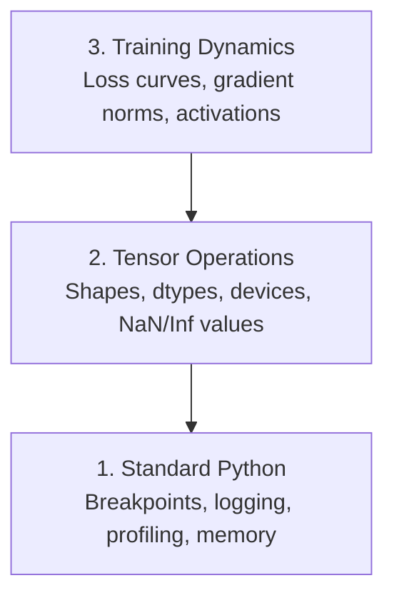

# Debugging and Profiling

> Những lỗi AI tệ nhất không gây sập. Chúng âm thầm huấn luyện trên dữ liệu rác và báo cáo một đường cong mất mát đẹp mắt.

**Type:** Build
**Language:** Python
**Prerequisites:** Lesson 1 (Dev Environment), basic PyTorch familiarity
**Time:** ~60 minutes

## Learning Objectives

- Sử dụng `breakpoint()` có điều kiện và `debug_print` để kiểm tra hình dạng tensor, kiểu dữ liệu và giá trị NaN giữa quá trình huấn luyện
- Phân tích hiệu năng các vòng lặp huấn luyện bằng `cProfile`, `line_profiler` và `tracemalloc` để tìm các điểm nghẽn
- Phát hiện các lỗi AI phổ biến: hình dạng không khớp, mất mát NaN, rò rỉ dữ liệu và tensor nằm trên sai thiết bị
- Thiết lập TensorBoard để trực quan hóa các đường cong mất mát, biểu đồ tần suất trọng số và phân phối gradient

## The Problem

Mã AI gặp lỗi khác với mã thông thường. Một ứng dụng web bị sập kèm theo dấu vết ngăn xếp. Một vòng lặp huấn luyện được cấu hình sai chạy trong 8 giờ, tiêu tốn $200 thời gian GPU và tạo ra một mô hình dự đoán giá trị trung bình của mọi đầu vào. Mã chưa bao giờ báo lỗi. Lỗi là một tensor nằm trên sai thiết bị, một `.detach()` bị quên hoặc nhãn rò rỉ vào các đặc trưng.

Bạn cần các công cụ gỡ lỗi phát hiện những lỗi âm thầm này trước khi chúng lãng phí thời gian và tài nguyên tính toán của bạn.

## The Concept

Việc gỡ lỗi AI hoạt động ở ba cấp độ:



Hầu hết mọi người nhảy thẳng đến cấp độ 3 (nhìn chằm chằm vào TensorBoard). Nhưng 80% lỗi AI nằm ở cấp độ 1 và 2.

```figure
s0-flame-hot
```

## Build It

### Part 1: Print Debugging (Yes, It Works)

Gỡ lỗi bằng lệnh in thường bị xem nhẹ. Điều đó không nên xảy ra. Đối với mã tensor, một lệnh in có mục tiêu tốt hơn việc bước qua từng lệnh trong trình gỡ lỗi vì bạn cần thấy hình dạng, kiểu dữ liệu và phạm vi giá trị cùng một lúc.

```python
def debug_print(name, tensor):
    print(f"{name}: shape={tensor.shape}, dtype={tensor.dtype}, "
          f"device={tensor.device}, "
          f"min={tensor.min().item():.4f}, max={tensor.max().item():.4f}, "
          f"mean={tensor.mean().item():.4f}, "
          f"has_nan={tensor.isnan().any().item()}")
```

Gọi hàm này sau mỗi thao tác đáng ngờ. Khi tìm thấy lỗi, hãy xóa các lệnh in. Đơn giản.

### Part 2: Python Debugger (pdb and breakpoint)

Trình gỡ lỗi tích hợp sẵn bị đánh giá thấp trong công việc AI. Chèn `breakpoint()` vào vòng lặp huấn luyện của bạn và kiểm tra các tensor một cách tương tác.

```python
def training_step(model, batch, criterion, optimizer):
    inputs, labels = batch
    outputs = model(inputs)
    loss = criterion(outputs, labels)

    if loss.item() > 100 or torch.isnan(loss):
        breakpoint()

    loss.backward()
    optimizer.step()
```

Khi trình gỡ lỗi đưa bạn vào, các lệnh hữu ích:

- `p outputs.shape` để kiểm tra hình dạng
- `p loss.item()` để xem giá trị mất mát
- `p torch.isnan(outputs).sum()` để đếm các giá trị NaN
- `p model.fc1.weight.grad` để kiểm tra gradient
- `c` để tiếp tục, `q` để thoát

Đây là gỡ lỗi có điều kiện. Bạn chỉ dừng khi có thứ gì đó trông sai. Đối với một lần huấn luyện 10,000 bước, điều đó có ý nghĩa.

### Part 3: Python Logging

Thay các lệnh in bằng việc ghi nhật ký khi việc gỡ lỗi của bạn vượt ra ngoài một lần kiểm tra nhanh.

```python
import logging

logging.basicConfig(
    level=logging.INFO,
    format="%(asctime)s [%(levelname)s] %(message)s",
    handlers=[
        logging.FileHandler("training.log"),
        logging.StreamHandler()
    ]
)
logger = logging.getLogger(__name__)

logger.info("Starting training: lr=%.4f, batch_size=%d", lr, batch_size)
logger.warning("Loss spike detected: %.4f at step %d", loss.item(), step)
logger.error("NaN loss at step %d, stopping", step)
```

Việc ghi nhật ký cung cấp cho bạn dấu thời gian, mức độ nghiêm trọng và đầu ra tệp. Khi một lần huấn luyện thất bại lúc 3 giờ sáng, bạn muốn có một tệp nhật ký, không phải đầu ra terminal đã cuộn khỏi màn hình.

### Part 4: Timing Code Sections

Biết thời gian được dùng ở đâu là bước đầu tiên để tối ưu hóa.

```python
import time

class Timer:
    def __init__(self, name=""):
        self.name = name

    def __enter__(self):
        self.start = time.perf_counter()
        return self

    def __exit__(self, *args):
        elapsed = time.perf_counter() - self.start
        print(f"[{self.name}] {elapsed:.4f}s")

with Timer("data loading"):
    batch = next(dataloader_iter)

with Timer("forward pass"):
    outputs = model(batch)

with Timer("backward pass"):
    loss.backward()
```

Phát hiện phổ biến: việc tải dữ liệu chiếm 60% thời gian huấn luyện. Cách khắc phục là `num_workers > 0` trong DataLoader của bạn, không phải một GPU nhanh hơn.

### Part 5: cProfile and line_profiler

Khi bạn cần nhiều hơn các bộ đo thời gian thủ công:

```bash
python -m cProfile -s cumtime train.py
```

Điều này hiển thị mọi lời gọi hàm được sắp xếp theo thời gian tích lũy. Để phân tích hiệu năng theo từng dòng:

```bash
pip install line_profiler
```

```python
@profile
def train_step(model, data, target):
    output = model(data)
    loss = F.cross_entropy(output, target)
    loss.backward()
    return loss

# Run with: kernprof -l -v train.py
```

### Part 6: Memory Profiling

#### CPU Memory with tracemalloc

```python
import tracemalloc

tracemalloc.start()

# your code here
model = build_model()
data = load_dataset()

snapshot = tracemalloc.take_snapshot()
top_stats = snapshot.statistics("lineno")
for stat in top_stats[:10]:
    print(stat)
```

#### CPU Memory with memory_profiler

```bash
pip install memory_profiler
```

```python
from memory_profiler import profile

@profile
def load_data():
    raw = read_csv("data.csv")       # watch memory jump here
    processed = preprocess(raw)       # and here
    return processed
```

Chạy bằng `python -m memory_profiler your_script.py` để xem mức sử dụng bộ nhớ theo từng dòng.

#### GPU Memory with PyTorch

```python
import torch

if torch.cuda.is_available():
    print(torch.cuda.memory_summary())

    print(f"Allocated: {torch.cuda.memory_allocated() / 1e9:.2f} GB")
    print(f"Cached: {torch.cuda.memory_reserved() / 1e9:.2f} GB")
```

Khi bạn gặp OOM (Hết bộ nhớ):

1. Giảm kích thước batch (luôn là điều đầu tiên cần thử)
2. Sử dụng `torch.cuda.empty_cache()` để giải phóng bộ nhớ đệm
3. Sử dụng `del tensor` rồi đến `torch.cuda.empty_cache()` cho các giá trị trung gian lớn
4. Sử dụng độ chính xác hỗn hợp (`torch.cuda.amp`) để giảm một nửa mức sử dụng bộ nhớ
5. Sử dụng gradient checkpointing cho các mô hình rất sâu

### Part 7: Common AI Bugs and How to Catch Them

#### Shape Mismatch

Lỗi thường gặp nhất. Một tensor có hình dạng `[batch, features]` khi mô hình yêu cầu `[batch, channels, height, width]`.

```python
def check_shapes(model, sample_input):
    print(f"Input: {sample_input.shape}")
    hooks = []

    def make_hook(name):
        def hook(module, inp, out):
            in_shape = inp[0].shape if isinstance(inp, tuple) else inp.shape
            out_shape = out.shape if hasattr(out, "shape") else type(out)
            print(f"  {name}: {in_shape} -> {out_shape}")
        return hook

    for name, module in model.named_modules():
        hooks.append(module.register_forward_hook(make_hook(name)))

    with torch.no_grad():
        model(sample_input)

    for h in hooks:
        h.remove()
```

Chạy hàm này một lần với một batch mẫu. Nó lập bản đồ mọi phép biến đổi hình dạng trong mô hình của bạn.

#### NaN Loss

Mất mát NaN có nghĩa là thứ gì đó đã bùng nổ. Các nguyên nhân phổ biến:

- Tốc độ học quá cao
- Phép chia cho không trong hàm mất mát tùy chỉnh
- Logarit của không hoặc số âm
- Gradient bùng nổ trong RNN

```python
def detect_nan(model, loss, step):
    if torch.isnan(loss):
        print(f"NaN loss at step {step}")
        for name, param in model.named_parameters():
            if param.grad is not None:
                if torch.isnan(param.grad).any():
                    print(f"  NaN gradient in {name}")
                if torch.isinf(param.grad).any():
                    print(f"  Inf gradient in {name}")
        return True
    return False
```

#### Data Leakage

Mô hình của bạn đạt độ chính xác 99% trên tập kiểm tra. Nghe rất tuyệt. Đó là một lỗi.

```python
def check_data_leakage(train_set, test_set, id_column="id"):
    train_ids = set(train_set[id_column].tolist())
    test_ids = set(test_set[id_column].tolist())
    overlap = train_ids & test_ids
    if overlap:
        print(f"DATA LEAKAGE: {len(overlap)} samples in both train and test")
        return True
    return False
```

Đồng thời kiểm tra rò rỉ theo thời gian: sử dụng dữ liệu tương lai để dự đoán quá khứ. Sắp xếp theo dấu thời gian trước khi chia.

#### Wrong Device

Các tensor trên những thiết bị khác nhau (CPU so với GPU) gây lỗi khi chạy. Nhưng đôi khi một tensor âm thầm ở lại trên CPU trong khi mọi thứ khác nằm trên GPU, và quá trình huấn luyện chỉ đơn giản là chạy chậm.

```python
def check_devices(model, *tensors):
    model_device = next(model.parameters()).device
    print(f"Model device: {model_device}")
    for i, t in enumerate(tensors):
        if t.device != model_device:
            print(f"  WARNING: tensor {i} on {t.device}, model on {model_device}")
```

### Part 8: TensorBoard Basics

TensorBoard cho bạn thấy những gì đang diễn ra bên trong quá trình huấn luyện theo thời gian.

```bash
pip install tensorboard
```

```python
from torch.utils.tensorboard import SummaryWriter

writer = SummaryWriter("runs/experiment_1")

for step in range(num_steps):
    loss = train_step(model, batch)

    writer.add_scalar("loss/train", loss.item(), step)
    writer.add_scalar("lr", optimizer.param_groups[0]["lr"], step)

    if step % 100 == 0:
        for name, param in model.named_parameters():
            writer.add_histogram(f"weights/{name}", param, step)
            if param.grad is not None:
                writer.add_histogram(f"grads/{name}", param.grad, step)

writer.close()
```

Khởi chạy nó:

```bash
tensorboard --logdir=runs
```

Những điều cần chú ý:

- **Mất mát không giảm**: Tốc độ học quá thấp hoặc vấn đề về kiến trúc mô hình
- **Mất mát dao động dữ dội**: Tốc độ học quá cao
- **Mất mát trở thành NaN**: Sự bất ổn định số học (xem phần NaN ở trên)
- **Mất mát huấn luyện giảm, mất mát xác thực tăng**: Khớp quá mức
- **Biểu đồ tần suất trọng số co về không**: Gradient tiêu biến
- **Biểu đồ tần suất gradient bùng nổ**: Cần cắt gradient

### Part 9: VS Code Debugger

Để gỡ lỗi tương tác, hãy cấu hình VS Code bằng một `launch.json`:

```json
{
    "version": "0.2.0",
    "configurations": [
        {
            "name": "Debug Training",
            "type": "debugpy",
            "request": "launch",
            "program": "${file}",
            "console": "integratedTerminal",
            "justMyCode": false
        }
    ]
}
```

Đặt các điểm dừng bằng cách nhấp vào lề. Sử dụng ngăn Variables để kiểm tra các thuộc tính tensor. Debug Console cho phép bạn chạy các biểu thức Python tùy ý giữa quá trình thực thi.

Hữu ích cho việc bước qua các quy trình tiền xử lý dữ liệu khi bạn muốn xem từng phép biến đổi.

## Use It

Đây là quy trình gỡ lỗi phát hiện hầu hết các lỗi AI:

1. **Trước khi huấn luyện**: Chạy `check_shapes` với một batch mẫu. Xác minh các chiều đầu vào và đầu ra khớp với kỳ vọng.
2. **10 bước đầu tiên**: Sử dụng `debug_print` trên mất mát, đầu ra và gradient. Xác nhận không có gì là NaN và các giá trị nằm trong phạm vi hợp lý.
3. **Trong khi huấn luyện**: Ghi nhật ký mất mát, tốc độ học và chuẩn gradient. Sử dụng TensorBoard để trực quan hóa.
4. **Khi có thứ gì đó bị lỗi**: Chèn `breakpoint()` tại điểm xảy ra lỗi. Kiểm tra các tensor một cách tương tác.
5. **Về hiệu năng**: Đo thời gian tải dữ liệu so với lượt truyền xuôi so với lượt truyền ngược. Phân tích mức sử dụng bộ nhớ nếu bạn gần hết bộ nhớ.

## Ship It

Chạy tập lệnh bộ công cụ gỡ lỗi:

```bash
python phases/00-setup-and-tooling/12-debugging-and-profiling/code/debug_tools.py
```

Xem `outputs/prompt-debug-ai-code.md` để có một prompt giúp chẩn đoán các lỗi đặc thù của AI.

## Exercises

1. Chạy `debug_tools.py` và đọc đầu ra của từng phần. Sửa mô hình giả để đưa vào một giá trị NaN (gợi ý: chia cho không trong lượt truyền xuôi) và xem bộ phát hiện bắt được nó.
2. Phân tích hiệu năng một vòng lặp huấn luyện bằng `cProfile` và xác định hàm chậm nhất.
3. Sử dụng `tracemalloc` để tìm dòng nào trong quy trình tải dữ liệu của bạn cấp phát nhiều bộ nhớ nhất.
4. Thiết lập TensorBoard cho một lần huấn luyện đơn giản và xác định xem mô hình có khớp quá mức hay không.
5. Sử dụng `breakpoint()` bên trong một vòng lặp huấn luyện. Thực hành kiểm tra hình dạng, thiết bị và giá trị gradient của tensor từ dấu nhắc của trình gỡ lỗi.
