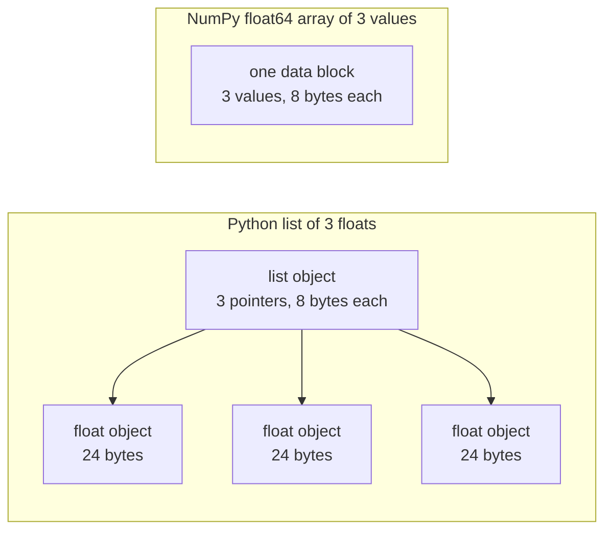

# Python for AI Engineering

> Hầu hết mã trong khóa học này sử dụng cùng một tập nhỏ các cách viết Python. Học tập đó ở đây, trước khi các bài toán và mô hình phụ thuộc vào nó.

**Type:** Build
**Languages:** Python
**Prerequisites:** Dev Environment, Python Environments
**Time:** ~120 minutes

## Learning Objectives

- Đọc và viết các cách viết mà hầu hết mã khóa học sử dụng, từ unpacking và f-string đến dataclass và comprehension.
- Tìm ba lỗi Python cho kết quả sai mà không có lỗi: danh sách dùng chung, giá trị mặc định có thể thay đổi và generator đã dùng hết.
- Xây dựng một loader CSV và JSON, một phép chia có seed và một generator mini-batch chỉ với thư viện chuẩn.
- Viết tích vô hướng, trung bình và độ lệch chuẩn bằng Python thuần, và đo tốc độ cùng mức sử dụng bộ nhớ của chúng.
- Giải thích vì sao một vòng lặp Python thuần trên các số lại chậm, và cách NumPy broadcasting chuyển vòng lặp vào mã đã biên dịch.

## The Problem

Các bài học sau giai đoạn này sử dụng Python thuần cho toán học và các mô hình. Trong 541 tệp Python trong các bài học, 276 import `dataclasses`. Ngoài ra, 187 tệp gọi `random.seed` hoặc tạo một generator `random.Random`. Nếu những cách viết đó mới với bạn, bạn đọc cú pháp khi bạn muốn đọc toán học.

Python cũng có những hành vi cho kết quả sai mà không có thông báo lỗi. Hai tên có thể tham chiếu đến một danh sách, nên thay đổi qua một tên cũng thay đổi tên kia. Một đối số mặc định giữ giá trị của nó từ lần gọi này sang lần gọi tiếp theo. Một generator rỗng sau một lượt, nên epoch huấn luyện thứ hai không có dữ liệu và hàm mất mát không thay đổi.

Vấn đề cuối cùng là tốc độ. Trên laptop kiểm thử của chúng tôi, một vòng lặp Python thuần trên một triệu số float mất khoảng 30 mili giây. NumPy tính cùng tích vô hướng trong ít hơn một mili giây. Bạn cần biết lý do, để bạn có thể chọn giữa một vòng lặp rõ ràng và một phép toán mảng.

## The Concept

### What the course code uses

Chúng tôi phân tích cả 541 tệp Python trong `phases/*/*/code/` bằng mô-đun `ast`. Bảng đếm các tệp sử dụng mỗi cấu trúc ít nhất một lần. Các số đếm là từ ngày chúng tôi viết bài học này, và chúng thay đổi khi các bài học được thêm vào.

| Cấu trúc | Tệp | Tỷ lệ |
|-----------|-------|-------|
| Định nghĩa hàm | 541 | 100% |
| `if __name__ == "__main__":` | 529 | 98% |
| f-string | 517 | 96% |
| Unpacking tuple | 448 | 83% |
| Lớp | 379 | 70% |
| List comprehension | 375 | 69% |
| Gợi ý kiểu trên hàm | 342 | 63% |
| Biểu thức generator | 326 | 60% |
| Lát cắt | 314 | 58% |
| `lambda` | 175 | 32% |
| `try` và `except` | 120 | 22% |
| Câu lệnh `with` | 96 | 18% |
| Dict comprehension | 93 | 17% |
| Hàm generator với `yield` | 14 | 3% |

Các import cho thấy những mô-đun chuẩn nào quan trọng. Trong 541 tệp, 340 bắt đầu bằng `from __future__ import annotations`, và 276 import `dataclasses`. Các mô-đun `math`, `random` và `json` xuất hiện trong 187, 175 và 126 tệp. Mô-đun `collections` xuất hiện trong 70 tệp, và `itertools` chỉ xuất hiện trong 4.

Không bài học nào gọi `map()` hoặc `filter()`. Comprehension làm công việc đó. Các lần gọi `sorted`, `min`, `max` hoặc `.sort` với một hàm `key=` xuất hiện trong hơn 140 tệp. Bài học này dành nhiều thời gian nhất cho các cách viết ở đầu những danh sách này.

### Names refer to objects

Trong Python, một biến là một tên tham chiếu đến một đối tượng. Phép gán gắn một tên với một đối tượng. Nó không sao chép đối tượng. Khi hai tên tham chiếu đến một danh sách, thay đổi qua bất kỳ tên nào đều thấy được qua cả hai. Số, chuỗi và tuple không thể thay đổi, nên quy tắc này không gây vấn đề cho chúng. List, dict và set có thể thay đổi, nên tạo một bản sao khi bạn cần một phiên bản độc lập.

### A list holds pointers, an array holds numbers

Một list Python không lưu số trực tiếp. Nó lưu các con trỏ, và mỗi con trỏ tham chiếu đến một đối tượng Python đầy đủ. Trên một bản dựng CPython 64 bit, mỗi con trỏ chiếm 8 byte và mỗi đối tượng `float` chiếm 24 byte. Một mảng NumPy `float64` lưu các giá trị 8 byte thô cạnh nhau trong một khối bộ nhớ.



Một vòng lặp trên một list làm nhiều việc cho mỗi phần tử. Trình thông dịch chạy từng chỉ lệnh bytecode một. Với mỗi phần tử, nó đi theo một con trỏ và kiểm tra kiểu của mỗi toán hạng. Rồi nó gọi mã nhân float và tạo một đối tượng float Python để chứa kết quả.

NumPy làm cùng phép toán trong một vòng lặp mã đã biên dịch trên các giá trị thô. Nó kiểm tra kiểu dữ liệu một lần cho toàn mảng, và không tạo đối tượng Python cho mỗi phần tử. Mã vector hóa mô tả một phép toán trên toàn mảng, chẳng hạn `(x - mean) / std`, và một thư viện chạy vòng lặp. Các hàm vector trong bài học này theo quy tắc đó. Mỗi hàm làm một phép toán mảng, nên bạn có thể thay nó bằng một lần gọi NumPy sau này.

### A list holds every item, a generator holds one

Một list comprehension xây dựng mọi mục trước khi dòng tiếp theo chạy. Một generator xây dựng một mục mỗi lần bên gọi yêu cầu mục tiếp theo. Bộ nhớ cho một list tăng theo số mục. Bộ nhớ cho một generator giữ gần như giống nhau với mọi số mục.

Một generator chỉ có thể chạy một lần. Sau mục cuối cùng, nó phát sinh `StopIteration` với mỗi yêu cầu, nên một vòng lặp `for` thứ hai trên nó không nhận được mục nào. Mã huấn luyện đọc dataset một lần mỗi epoch, nên nó phải tạo một generator mới cho mỗi epoch.

Các hàm generator hiếm trong mã bài học. Các data loader mà bài deep learning sử dụng là các iterable của batch, nên ý tưởng có trong mọi vòng lặp huấn luyện. Hình cho thấy cả hai cách tiếp cận trên cùng tám hàng.

```figure
s0-list-vs-generator
```

## The Idioms You Need

Mỗi khối trong phần này chạy độc lập. Lưu nó vào một tệp và chạy bằng `python3`. Các khối cần Python 3.11 hoặc mới hơn, phiên bản mà chúng ta đã cài trong bài môi trường phát triển.

### 1. Values, collections, and unpacking

Python có bốn collection tích hợp sẵn. Học khi nào sử dụng mỗi loại.

| Kiểu | Ví dụ | Có thứ tự | Có thể thay đổi | Cách dùng điển hình trong khóa học |
|------|---------|---------|------------|---------------------------|
| `list` | `[0.5, 1.2]` | Có | Có | Mẫu, hàm mất mát, trọng số |
| `tuple` | `(32, 784)` | Có | Không | Hình dạng, bản ghi cố định, khóa dict |
| `dict` | `{"lr": 0.01}` | Thứ tự chèn | Có | Cấu hình, từ vựng, hàng JSON |
| `set` | `{"cat", "dog"}` | Không | Có | Token duy nhất, kiểm tra chồng lấp |

Khối này cho thấy phép gán không sao chép một list.

```python
weights = [0.5, -1.2, 3.0]
alias = weights
alias[0] = 99.0
print(weights)

independent = list(weights)
independent[1] = 0.0
print(weights, independent)

grid = [[0] * 3] * 2
grid[0][0] = 1
print(grid)

grid = [[0] * 3 for _ in range(2)]
grid[0][0] = 1
print(grid)
```

```text
[99.0, -1.2, 3.0]
[99.0, -1.2, 3.0] [99.0, 0.0, 3.0]
[[1, 0, 0], [1, 0, 0]]
[[1, 0, 0], [0, 0, 0]]
```

Biểu thức `[[0] * 3] * 2` tạo một list bên ngoài với hai tham chiếu đến một list bên trong. Comprehension tạo một list bên trong mới cho mỗi hàng. Giai đoạn toán xây dựng ma trận từ list, nên sử dụng dạng comprehension.

Unpacking gán các mục của một chuỗi cho nhiều tên trong một dòng. Một tên có dấu sao thu thập các mục còn lại. Một f-string đặt giá trị của một biểu thức vào một chuỗi, với định dạng tùy chọn sau dấu hai chấm.

```python
shape = (32, 784)
batch_size, n_features = shape
first, *middle, last = [1, 2, 3, 4, 5]
x, y = 1.0, 3.0
x, y = y, x

config = {"lr": 0.01, "epochs": 5}
config["seed"] = 7
tokens = ["the", "cat", "sat", "on", "the", "mat"]
vocab = set(tokens)

print(batch_size, n_features, first, middle, last, x, y)
print(config.get("momentum", 0.9), "cat" in vocab, len(vocab))
print(f"lr={config['lr']:.0e} loss={0.123456:.3f} n={60_000:,} {batch_size=}")
```

```text
32 784 1 [2, 3, 4] 5 3.0 1.0
0.9 True 5
lr=1e-02 loss=0.123 n=60,000 batch_size=32
```

`dict.get` trả về một giá trị mặc định khi thiếu khóa. Phép kiểm tra `in` trên một set mất thời gian gần như bằng nhau với mọi kích thước set. Dạng `{batch_size=}` in tên và giá trị, giúp ích khi bạn gỡ lỗi.

Một lát `a[start:stop:step]` bao gồm `start` và loại trừ `stop`. Chỉ số âm đếm từ cuối. Một lát của một list là một list mới, nên một lát của một list lớn sao chép tất cả các con trỏ của nó.

```python
tokens = ["<s>", "the", "cat", "sat", "on", "the", "mat", "</s>"]
print(tokens[1:-1])
print(tokens[:3], tokens[-3:])
print(tokens[::2])
print(tokens[::-1][:2])
windows = [tokens[i:i + 3] for i in range(len(tokens) - 2)]
print(len(windows), windows[0])
```

```text
['the', 'cat', 'sat', 'on', 'the', 'mat']
['<s>', 'the', 'cat'] ['the', 'mat', '</s>']
['<s>', 'cat', 'on', 'mat']
['</s>', 'mat']
6 ['<s>', 'the', 'cat']
```

### 2. Comprehensions

Một comprehension xây dựng một list, dict hoặc set từ một iterable trong một biểu thức. Nó đọc như phép toán mà nó mô tả.

```python
scores = [0.91, 0.42, 0.77, 0.15, 0.66]
labels = [1 if s >= 0.5 else 0 for s in scores]
high = [s for s in scores if s > 0.6]
squares = {i: i * i for i in range(4)}
lengths = {len(word) for word in ["a", "bb", "cc", "ddd"]}
sum_sq = sum(s * s for s in scores)

matrix = [[1, 2, 3], [4, 5, 6]]
transposed = [list(column) for column in zip(*matrix)]
flat = [v for row in matrix for v in row]

print(labels, high, squares, lengths, round(sum_sq, 4))
print(transposed, flat)
```

```text
[1, 0, 1, 0, 1] [0.91, 0.77, 0.66] {0: 0, 1: 1, 2: 4, 3: 9} {1, 2, 3} 2.0555
[[1, 4], [2, 5], [3, 6]] [1, 2, 3, 4, 5, 6]
```

Một `if` ở cuối chỉ giữ một số mục. Biểu thức trước `for` có thể là một biểu thức điều kiện, `a if condition else b`. Hai mệnh đề `for` chạy theo cùng thứ tự như hai vòng lặp lồng nhau.

Dấu ngoặc tròn tạo một biểu thức generator. Trong `sum(s * s for s in scores)`, `sum` đọc từng bình phương một, và Python không xây dựng list nào. Trong `zip(*matrix)`, dấu sao truyền mỗi hàng như một đối số riêng, và `zip` ghép các mục ở mỗi vị trí.

### 3. Functions, arguments, and closures

Một giá trị mặc định làm một đối số thành tùy chọn. Một đối số từ khóa nêu tên tham số tại lần gọi. Một `*` đứng riêng trong danh sách tham số làm các tham số tiếp theo chỉ được truyền bằng từ khóa.

```python
def clip(value, low=0.0, high=1.0):
    return max(low, min(high, value))


def train(data, *, lr=0.01, epochs=3):
    return f"{len(data)} samples, lr={lr}, epochs={epochs}"


def make_scaler(factor):
    def scale(values):
        return [v * factor for v in values]
    return scale


print(clip(1.7), clip(-3.0, low=-1.0), clip(0.4, high=0.3))
print(train([1, 2, 3], lr=0.1))
to_percent = make_scaler(100)
print(to_percent([0.25, 0.5]))
```

```text
1.0 -1.0 0.3
3 samples, lr=0.1, epochs=3
[25.0, 50.0]
```

Với các đối số chỉ bằng từ khóa, một lần gọi như `train(data, 0.1, 3)` phát sinh `TypeError`. Bên gọi phải viết `lr=0.1`, nên hai số không thể vô tình đổi chỗ.

Hàm bên trong `scale` sử dụng `factor` từ hàm tạo ra nó. Python giữ `factor` chừng nào `scale` còn tồn tại. Một hàm giữ các biến từ bên tạo ra nó là một closure. Standardizer trong Build It sử dụng một closure để giữ các thống kê huấn luyện.

Một `lambda` là một hàm một biểu thức không có tên. Mã khóa học sử dụng nó chủ yếu như một hàm `key=`, điều phần 8 cho thấy.

Python đánh giá một giá trị mặc định một lần, khi nó chạy câu lệnh `def`. Mọi lần gọi sử dụng giá trị mặc định nhận cùng một đối tượng.

```python
def add_bad(item, bucket=[]):
    bucket.append(item)
    return bucket


def add_good(item, bucket=None):
    if bucket is None:
        bucket = []
    bucket.append(item)
    return bucket


add_bad("a")
print(add_bad("b"))
add_good("a")
print(add_good("b"))
```

```text
['a', 'b']
['b']
```

Sử dụng `None` làm giá trị mặc định cho một list, dict hoặc set. Tạo đối tượng mới bên trong hàm.

### 4. Classes and dataclasses

Decorator `@dataclass` viết `__init__`, `__repr__` và `__eq__` từ các trường được chú thích. Với `frozen=True`, đối tượng không thể thay đổi sau khi tạo, và bạn có thể sử dụng nó như một khóa dict hoặc đặt nó trong một set.

```python
from dataclasses import dataclass, field


@dataclass(frozen=True)
class Example:
    features: tuple[float, ...]
    label: int


@dataclass
class TrainConfig:
    lr: float = 0.01
    epochs: int = 5
    hidden: list[int] = field(default_factory=lambda: [64, 32])

    def describe(self):
        return f"lr={self.lr} epochs={self.epochs} hidden={self.hidden}"


ex = Example((1.5, 2.0), 1)
print(ex)
print(ex == Example((1.5, 2.0), 1), len({ex, Example((1.5, 2.0), 1)}))
print(TrainConfig(epochs=10).describe())
try:
    ex.label = 0
except AttributeError as err:
    print(type(err).__name__)
```

```text
Example(features=(1.5, 2.0), label=1)
True 1
lr=0.01 epochs=10 hidden=[64, 32]
FrozenInstanceError
```

`field(default_factory=...)` cho mỗi instance một list mới. Nó giải quyết vấn đề giá trị mặc định dùng chung từ phần 3 bên trong một dataclass.

Các phương thức đặc biệt kết nối một lớp với cú pháp Python. `len(ds)` gọi `__len__`, và `ds[2]` gọi `__getitem__`.

```python
class SquaresDataset:
    def __init__(self, n):
        self.n = n

    def __len__(self):
        return self.n

    def __getitem__(self, index):
        if not 0 <= index < self.n:
            raise IndexError(index)
        return index, index * index


ds = SquaresDataset(4)
print(len(ds), ds[2])
print(list(ds))
```

```text
4 (2, 4)
[(0, 0), (1, 1), (2, 4), (3, 9)]
```

Vòng lặp `for` bên trong `list(ds)` hoạt động mà không có phương thức `__iter__`. Python gọi `__getitem__` với 0, 1, 2 và tiếp tục cho đến khi nhận `IndexError`. Các dataset kiểu map của PyTorch sử dụng cùng hai phương thức, `__len__` và `__getitem__`.

### 5. Iterators and generators

Một iterable là bất kỳ đối tượng nào mà một vòng lặp `for` chấp nhận. `iter()` lấy một iterator từ nó, và `next()` yêu cầu iterator một mục. Khi iterator không còn mục nào, nó phát sinh `StopIteration`. Một vòng lặp `for` gọi `next()` cho bạn và dừng tại `StopIteration`.

```python
numbers = [10, 20, 30]
it = iter(numbers)
print(next(it), next(it), next(it))
try:
    next(it)
except StopIteration:
    print("no more items")


def countdown(n):
    while n > 0:
        yield n
        n -= 1


gen = countdown(3)
print(type(gen).__name__)
print(list(gen))
print(list(gen))
```

```text
10 20 30
no more items
generator
[3, 2, 1]
[]
```

Một hàm có `yield` trong thân là một hàm generator. Một lần gọi nó không chạy mã nào của nó và trả về một đối tượng generator. Mỗi `next()` chạy thân đến `yield` tiếp theo và tạm dừng ở đó. `list(gen)` thứ hai rỗng vì lần đầu đã dùng hết generator.

Một generator có thể đọc một tệp từng dòng một.

```python
import os
import tempfile


def read_rows(path):
    with open(path, encoding="utf-8") as fh:
        header = fh.readline().rstrip("\n").split(",")
        for line in fh:
            yield dict(zip(header, line.rstrip("\n").split(",")))


with tempfile.TemporaryDirectory() as tmp:
    path = os.path.join(tmp, "rows.csv")
    with open(path, "w", encoding="utf-8") as fh:
        fh.write("x,label\n")
        fh.writelines(f"{i * 0.5},{i % 2}\n" for i in range(5))
    rows = read_rows(path)
    print(next(rows))
    print(sum(1 for _ in rows))
```

```text
{'x': '0.0', 'label': '0'}
4
```

`read_rows` giữ một dòng của tệp trong bộ nhớ tại một thời điểm. Nó là `read_rows` trong hình. Nó tách theo dấu phẩy để giữ ví dụ ngắn. Tệp CSV thật có thể chứa dấu phẩy bên trong các trường được trích dẫn, nên Build It sử dụng mô-đun `csv`.

```python
import sys

as_list = [i * i for i in range(1_000_000)]
as_generator = (i * i for i in range(1_000_000))
print(sys.getsizeof(as_list), sys.getsizeof(as_generator))
print(sum(as_list) == sum(as_generator))
```

Trên CPython 64 bit, list báo cáo khoảng 8 MB và generator khoảng 200 byte. `sys.getsizeof` chỉ đếm các con trỏ của list, và các đối tượng số nguyên sử dụng thêm bộ nhớ. Build It đo đỉnh thực bằng `tracemalloc`, mà chúng ta đã sử dụng trong bài gỡ lỗi và profiling.

### 6. Context managers and exceptions

Một câu lệnh `with` chạy mã thiết lập, rồi thân của nó, rồi mã dọn dẹp. Phần dọn dẹp chạy ngay cả khi thân phát sinh một ngoại lệ. Đối tượng tệp từ `open()` là một context manager đóng tệp.

Trong bài gỡ lỗi và profiling, chúng ta đã viết một lớp `Timer` với `__enter__` và `__exit__`. Decorator `contextlib.contextmanager` tạo cùng loại đối tượng từ một generator. Mã trước `yield` là phần thiết lập, và khối `finally` là phần dọn dẹp.

```python
import time
from contextlib import contextmanager


@contextmanager
def timer(label):
    start = time.perf_counter()
    try:
        yield
    finally:
        print(f"{label}: {(time.perf_counter() - start) * 1000:.1f} ms")


def parse_label(text):
    try:
        return int(text)
    except ValueError:
        raise ValueError(f"label must be an integer, got {text!r}") from None


with timer("sum of squares"):
    total = sum(i * i for i in range(200_000))

print(parse_label("3"))
try:
    parse_label("cat")
except ValueError as err:
    print("rejected:", err)
```

```text
sum of squares: 9.4 ms
3
rejected: label must be an integer, got 'cat'
```

Thời gian trên máy bạn sẽ khác. Nêu tên chính xác ngoại lệ bạn kỳ vọng trong mệnh đề `except`, chẳng hạn `ValueError` hoặc `KeyError`. Một mệnh đề `except:` không có kiểu ngoại lệ cũng xử lý `KeyboardInterrupt`, nên Ctrl+C có thể không dừng được một vòng lặp chứa nó. Phát sinh một ngoại lệ với thông báo rõ ràng khi đầu vào sai. Thêm `from None` khi thông báo của bạn thay thế traceback ban đầu.

### 7. Type hints, modules, and the main guard

Gợi ý kiểu cho người đọc biết một hàm nhận và trả về gì. Python không kiểm tra chúng khi mã chạy. Một bộ kiểm tra kiểu, chẳng hạn mypy, đọc chúng trước khi mã chạy.

```python
from __future__ import annotations

from collections.abc import Iterable, Sequence


def mean(values: Sequence[float]) -> float:
    if not values:
        raise ValueError("mean() needs at least one value")
    return sum(values) / len(values)


def count_tokens(docs: Iterable[str]) -> int:
    return sum(len(doc.split()) for doc in docs)


def main() -> None:
    print(mean([1.0, 2.0, 4.0]))
    print(count_tokens(["the cat sat", "on the mat"]))
    print(mean.__annotations__)


if __name__ == "__main__":
    main()
```

```text
2.3333333333333335
6
{'values': 'Sequence[float]', 'return': 'float'}
```

Với `from __future__ import annotations`, Python lưu mỗi gợi ý dưới dạng một chuỗi, như dòng cuối cho thấy. `Sequence` nghĩa là bất kỳ đối tượng nào có `len()` và chỉ số, chẳng hạn một list hoặc một tuple. `Iterable` nghĩa là bất kỳ đối tượng nào mà một vòng lặp `for` chấp nhận. Nhiều tệp khóa học import cùng các tên từ `typing`, cách đó cũng hoạt động.

Mỗi tệp `.py` là một mô-đun. Khi bạn chạy một tệp bằng `python3 file.py`, Python đặt `__name__` của nó thành `"__main__"`. Khi một tệp khác import nó, `__name__` là tên mô-đun. Điều kiện bảo vệ chỉ gọi `main()` trong trường hợp đầu tiên. Nhờ điều kiện bảo vệ, các bài kiểm tra trong `code/tests/` có thể import `main.py` mà không khởi động demo.

### 8. Files, JSON, CSV, and sorting

`pathlib.Path` nối các đường dẫn bằng `/` và có thể đọc hoặc ghi toàn bộ một tệp trong một lần gọi. Luôn cung cấp `encoding="utf-8"`, vì encoding mặc định phụ thuộc hệ điều hành.

```python
import csv
import json
import tempfile
from pathlib import Path

rows = [
    {"text": "great movie", "label": 1, "score": 0.93},
    {"text": "boring plot", "label": 0, "score": 0.12},
    {"text": "fine acting", "label": 1, "score": 0.58},
]

with tempfile.TemporaryDirectory() as tmp:
    json_path = Path(tmp) / "reviews.json"
    json_path.write_text(json.dumps(rows, indent=2), encoding="utf-8")
    from_json = json.loads(json_path.read_text(encoding="utf-8"))

    csv_path = Path(tmp) / "reviews.csv"
    with csv_path.open("w", newline="", encoding="utf-8") as fh:
        writer = csv.DictWriter(fh, fieldnames=["text", "label", "score"])
        writer.writeheader()
        writer.writerows(rows)
    with csv_path.open(newline="", encoding="utf-8") as fh:
        from_csv = list(csv.DictReader(fh))

print(from_json == rows)
print(from_csv[0])

by_score = sorted(rows, key=lambda r: r["score"], reverse=True)
print([r["text"] for r in by_score])
print(max(rows, key=lambda r: r["score"])["text"])
print([r["text"] for r in sorted(rows, key=lambda r: (-r["label"], r["text"]))])
```

```text
True
{'text': 'great movie', 'label': '1', 'score': '0.93'}
['great movie', 'fine acting', 'boring plot']
great movie
['fine acting', 'great movie', 'boring plot']
```

JSON giữ số là số. CSV trả mọi trường về dạng chuỗi, nên bạn phải chuyển đổi mỗi trường. Mở các tệp CSV với `newline=""`, như tài liệu `csv` hướng dẫn.

Một hàm `key=` trả về giá trị mà Python so sánh cho mỗi mục. `sorted`, `min` và `max` đều chấp nhận một hàm như vậy. Một khóa tuple sắp xếp theo giá trị đầu tiên, và nó chỉ sử dụng giá trị thứ hai khi hòa. Dấu trừ đặt nhãn lớn hơn trước. Phép sắp xếp của Python là ổn định, nên các mục có khóa bằng nhau giữ thứ tự ban đầu của chúng.

### 9. Counting, grouping, and iterator tools

Hai mô-đun này chứa các cấu trúc dữ liệu và công cụ iterator mà list và dict thông thường không cung cấp cho bạn.

```python
from collections import Counter, defaultdict, deque
from itertools import chain, islice, product

labels = ["cat", "dog", "cat", "bird", "cat", "dog"]
counts = Counter(labels)
print(counts.most_common(2))

positions = defaultdict(list)
for i, label in enumerate(labels):
    positions[label].append(i)
print(dict(positions))

recent = deque(maxlen=3)
for loss in [2.0, 1.5, 1.2, 1.1, 0.9]:
    recent.append(loss)
print(list(recent), round(sum(recent) / len(recent), 3))

print(list(product([0.1, 0.01], [16, 32])))
print(list(chain([1, 2], [3], [4, 5])))
print(list(islice(range(100), 5, 10)))
```

```text
[('cat', 3), ('dog', 2)]
{'cat': [0, 2, 4], 'dog': [1, 5], 'bird': [3]}
[1.2, 1.1, 0.9] 1.067
[(0.1, 16), (0.1, 32), (0.01, 16), (0.01, 32)]
[1, 2, 3, 4, 5]
[5, 6, 7, 8, 9]
```

`Counter` đếm các mục có thể hash, chẳng hạn nhãn hoặc token. `defaultdict(list)` tạo một list rỗng lần đầu bạn sử dụng một khóa mới, nên một vòng lặp nhóm không cần kiểm tra khóa. `deque(maxlen=3)` loại mục cũ nhất khi bạn thêm mục thứ tư, tạo một cửa sổ di chuyển trên các giá trị hàm mất mát gần đây. `enumerate` cung cấp mỗi mục cùng chỉ số của nó.

`product` cung cấp mọi tổ hợp của các đầu vào của nó, tức một lưới siêu tham số. `chain` nối các iterable từ đầu đến cuối. `islice` lấy một lát của bất kỳ iterator nào, bao gồm một generator. Generator mini-batch trong Build It sử dụng `islice`.

### 10. Why loops over numbers are slow

Mô-đun `dis` in các chỉ lệnh bytecode mà trình thông dịch chạy cho một hàm.

```python
import dis


def dot(a, b):
    total = 0.0
    for x, y in zip(a, b):
        total += x * y
    return total


dis.dis(dot)
```

Các chỉ lệnh từ `FOR_ITER` đến lệnh nhảy trở lại nó chạy một lần cho mỗi phần tử. Đó là khoảng mười chỉ lệnh cho mỗi phép nhân và cộng. Tên chỉ lệnh chính xác thay đổi giữa các phiên bản Python.

Một vòng lặp nhanh hơn khi ít bước của nó chạy dưới dạng bytecode hơn. Các hàm tích hợp như `sum`, `map` và `zip` được viết bằng C. Build It đo hiệu ứng này bằng Python thuần, và Use It chuyển toàn bộ vòng lặp vào NumPy.

## Build It

Bây giờ xây dựng các mảnh mà các bài sau cần. Phiên bản đầy đủ là `code/main.py`, và `code/tests/test_main.py` kiểm tra nó. Mỗi khối bên dưới chạy độc lập.

### Step 1: A record type and a dataset loader

Loader đọc một tệp CSV hoặc một tệp JSON thành một dạng: một tuple các đặc trưng float và một nhãn số nguyên.

```python
import csv
import json
import tempfile
from dataclasses import dataclass
from pathlib import Path


@dataclass(frozen=True)
class Record:
    features: tuple[float, ...]
    label: int


def row_to_record(row, names, label_field="label"):
    if label_field not in row:
        raise ValueError(f"row has no {label_field!r} field: {row}")
    if set(row) != {*names, label_field}:
        raise ValueError(f"row fields {list(row)} do not match {[*names, label_field]}")
    return Record(tuple(float(row[name]) for name in names), int(row[label_field]))


def load_records(path, label_field="label"):
    path = Path(path)
    if path.suffix == ".json":
        rows = json.loads(path.read_text(encoding="utf-8"))
    elif path.suffix == ".csv":
        with path.open(newline="", encoding="utf-8") as fh:
            rows = list(csv.DictReader(fh))
    else:
        raise ValueError(f"unsupported file type: {path.suffix!r}")
    if not rows:
        return []
    names = [key for key in rows[0] if key != label_field]
    return [row_to_record(row, names, label_field) for row in rows]


with tempfile.TemporaryDirectory() as tmp:
    csv_path = Path(tmp) / "data.csv"
    csv_path.write_text("x1,x2,label\n1.5,60,1\n1.8,82.5,0\n", encoding="utf-8")
    json_path = Path(tmp) / "data.json"
    json_path.write_text('[{"x1": 1.5, "x2": 60, "label": 1}]', encoding="utf-8")
    print(load_records(csv_path))
    print(load_records(json_path))
```

```text
[Record(features=(1.5, 60.0), label=1), Record(features=(1.8, 82.5), label=0)]
[Record(features=(1.5, 60.0), label=1)]
```

Hàng đầu tiên đặt tên các đặc trưng và thứ tự của chúng. `DictReader` và `json.loads` giữ các khóa theo thứ tự tệp, và một dict giữ thứ tự mà các khóa được thêm vào. Chuẩn JSON không định nghĩa thứ tự cho các khóa trong một đối tượng, nên `row_to_record` đọc mỗi hàng theo tên, theo thứ tự của hàng đầu tiên. Một nhãn thiếu, một đặc trưng thiếu hoặc thừa, hoặc một loại tệp không biết phát sinh `ValueError` kèm thông báo, nên một tệp xấu dừng lần chạy ngay từ đầu. `main.py` cũng có `save_records`, ghi cùng hai định dạng.

### Step 2: A seeded train and test split

```python
import random


def train_test_split(items, test_fraction=0.2, seed=0):
    if not 0.0 < test_fraction < 1.0:
        raise ValueError(f"test_fraction must be between 0 and 1, got {test_fraction}")
    if len(items) < 2:
        raise ValueError(f"need at least 2 items to split, got {len(items)}")
    order = list(range(len(items)))
    random.Random(seed).shuffle(order)
    n_test = min(max(1, round(len(items) * test_fraction)), len(items) - 1)
    test = [items[i] for i in order[:n_test]]
    train = [items[i] for i in order[n_test:]]
    return train, test


items = list(range(10))
print(train_test_split(items, seed=1))
print(train_test_split(items, seed=1) == train_test_split(items, seed=1))
print(train_test_split(items, seed=2)[1])
print(items)
```

```text
([9, 7, 5, 3, 0, 4, 1, 2], [6, 8])
True
[5, 9]
[0, 1, 2, 3, 4, 5, 6, 7, 8, 9]
```

`random.Random(seed)` tạo một bộ sinh số ngẫu nhiên riêng. `random.seed(seed)` đặt lại một bộ sinh toàn cục mà mọi mô-đun chia sẻ, nên một lần gọi trong thư viện khác có thể thay đổi chuỗi của bạn. Trong khóa học, 100 tệp bài học gọi `random.seed` và 96 tạo `random.Random`. Sử dụng bộ sinh riêng trong mã mới.

Hàm xáo trộn một list các chỉ số, nên list đầu vào giữ nguyên. Cùng seed luôn cho cùng phép chia. Mỗi bên giữ ít nhất một mục, nên một list ít hơn 2 mục phát sinh `ValueError`. Chia dữ liệu trước mọi bước học từ nó, chẳng hạn chuẩn hóa. Trong bài gỡ lỗi và profiling, chúng ta đã thấy chồng lấp giữa dữ liệu train và test cho điểm test quá cao.

### Step 3: A mini-batch generator

```python
from itertools import islice


def batches(items, batch_size, drop_last=False):
    if batch_size < 1:
        raise ValueError(f"batch_size must be at least 1, got {batch_size}")
    return _batch_iter(iter(items), batch_size, drop_last)


def _batch_iter(iterator, batch_size, drop_last):
    while True:
        batch = list(islice(iterator, batch_size))
        if not batch or (drop_last and len(batch) < batch_size):
            return
        yield batch


print(list(batches(range(10), 4)))
print(list(batches(range(10), 4, drop_last=True)))
squares = (i * i for i in range(7))
print([len(b) for b in batches(squares, 3)])

for epoch in range(2):
    sizes = [len(b) for b in batches(range(10), 4)]
    print(f"epoch {epoch}: {sizes}")
```

```text
[[0, 1, 2, 3], [4, 5, 6, 7], [8, 9]]
[[0, 1, 2, 3], [4, 5, 6, 7]]
[3, 3, 1]
epoch 0: [4, 4, 2]
epoch 1: [4, 4, 2]
```

`islice` lấy tối đa `batch_size` mục từ iterator. `batches` chỉ cần `iter()`, nên nó chấp nhận list, tệp và các generator khác. Batch cuối nhỏ hơn khi độ dài không phải bội của kích thước batch. `drop_last=True` loại batch đó, cho một mô hình cần hình dạng batch cố định.

Công việc nằm trong hai hàm vì một hàm generator không chạy mã nào cho đến `next()` đầu tiên. Với kiểm tra bên trong generator, `batches(data, 0)` sẽ trả về không có lỗi. Lỗi sẽ đến sau, từ bên trong vòng lặp huấn luyện. Hàm bên ngoài là một hàm thông thường, nên nó kiểm tra đối số ngay lập tức. Vòng lặp epoch gọi lại `batches()` cho mỗi epoch, vì một generator chỉ cung cấp các mục của nó một lần.

### Step 4: Vector math and a standardizer

```python
import math


def dot(a, b):
    return sum(x * y for x, y in zip(a, b, strict=True))


def mean(values):
    if not values:
        raise ValueError("mean() needs at least one value")
    return sum(values) / len(values)


def std(values):
    mu = mean(values)
    return math.sqrt(sum((v - mu) ** 2 for v in values) / len(values))


def make_standardizer(rows):
    columns = list(zip(*rows))
    means = [mean(c) for c in columns]
    scales = [s if s > 0 else 1.0 for s in (std(c) for c in columns)]

    def standardize(row):
        return [(v - m) / s for v, m, s in zip(row, means, scales, strict=True)]

    return standardize


print(dot([1.0, 2.0, 3.0], [4.0, 5.0, 6.0]))
values = [2.0, 4.0, 4.0, 4.0, 5.0, 5.0, 7.0, 9.0]
print(mean(values), std(values))

train_rows = [(1.0, 100.0), (2.0, 300.0), (3.0, 500.0)]
standardize = make_standardizer(train_rows)
print([[round(v, 3) for v in standardize(r)] for r in train_rows])
print([round(v, 3) for v in standardize((4.0, 700.0))])
```

```text
32.0
5.0 2.0
[[-1.225, -1.225], [0.0, 0.0], [1.225, 1.225]]
[2.449, 2.449]
```

Với `strict=True`, `zip` phát sinh `ValueError` khi hai vector có độ dài khác nhau. Không có nó, `zip` dừng ở cuối đầu vào ngắn hơn và trả về một câu trả lời sai mà không có lỗi. Đối số `strict` cần Python 3.10 hoặc mới hơn.

`std` chia cho `n`, nên nó cho độ lệch chuẩn tổng thể, như `statistics.pstdev`. Chia cho `n - 1` khi bạn ước tính độ phân tán của một tổng thể lớn hơn từ một mẫu.

`make_standardizer` là một closure. Nó tính các trung bình và độ lệch chuẩn từ các hàng huấn luyện một lần, và `standardize` giữ chúng. Bạn áp dụng cùng hàm cho các hàng test, nên dữ liệu test không ảnh hưởng đến các thống kê. Một cột hằng có độ lệch chuẩn 0, nên standardizer sử dụng hệ số tỷ lệ 1 cho nó.

### Step 5: A complete run

`code/main.py` kết nối các mảnh. Nó tạo 400 bản ghi từ hai cụm, lưu chúng dưới dạng CSV và JSON, rồi tải lại cả hai tệp. Sau đó nó chia các bản ghi, khớp standardizer trên phần chia huấn luyện và tính tâm lớp từ các batch 48.

Một bộ phân loại tâm gần nhất lưu vector đặc trưng trung bình của mỗi lớp. Nó dự đoán lớp có trung bình gần đầu vào nhất. `fit_centroids` cộng các hàng từng batch một, nên nó không bao giờ cần toàn bộ tập huấn luyện trong bộ nhớ. `predict` sử dụng `min()` với một hàm `key=` để tìm tâm gần nhất.

```bash
python3 phases/00-setup-and-tooling/13-python-for-ai-engineering/code/main.py
```

```text
Python for AI engineering: a standard-library toolkit
data     400 records, CSV and JSON load back unchanged: True
split    320 train, 80 test, records in both: 0
batches  size 48: [48, 48, 48, 48, 48, 48, 32]
scale    train feature means after standardizing: [0.0, 0.0]
model    nearest-centroid test accuracy: raw 0.86, standardized 0.89
speed    dot product of 200,000 floats, best of 5:
           index loop         6.60 ms
           zip generator      5.93 ms
           map + mul          2.89 ms
memory   peak bytes to sum 100,000 squares:
           list              4,000,616
           generator               472
```

Hai đặc trưng có thang đo rất khác nhau. Đặc trưng thứ hai có độ phân tán gấp mười đặc trưng đầu, nên nó chi phối khoảng cách thô, và độ chính xác thô thấp hơn. Các số tốc độ và bộ nhớ của bạn sẽ khác các số này.

### Step 6: Measure speed and memory

```python
import operator
import random
import time
import tracemalloc


def dot_index_loop(a, b):
    total = 0.0
    for i in range(len(a)):
        total += a[i] * b[i]
    return total


def dot_zip(a, b):
    return sum(x * y for x, y in zip(a, b, strict=True))


def dot_map(a, b):
    return sum(map(operator.mul, a, b))


def best_time(fn, *args, repeat=5):
    times = []
    for _ in range(repeat):
        start = time.perf_counter()
        fn(*args)
        times.append(time.perf_counter() - start)
    return min(times)


def peak_bytes(fn):
    tracemalloc.start()
    try:
        fn()
        return tracemalloc.get_traced_memory()[1]
    finally:
        tracemalloc.stop()


rng = random.Random(0)
a = [rng.random() for _ in range(1_000_000)]
b = [rng.random() for _ in range(1_000_000)]
for fn in (dot_index_loop, dot_zip, dot_map):
    print(f"{fn.__name__:15} {best_time(fn, a, b) * 1000:7.2f} ms")

print(peak_bytes(lambda: sum([i * i for i in range(100_000)])))
print(peak_bytes(lambda: sum(i * i for i in range(100_000))))
```

`best_time` báo cáo lần nhanh nhất trong nhiều lần chạy. Các chương trình khác trên máy chỉ có thể thêm thời gian, nên giá trị nhỏ nhất gần chi phí thật nhất. Tài liệu mô-đun `timeit` đưa ra cùng lời khuyên.

Trên laptop kiểm thử của chúng tôi với Python 3.11, vòng lặp chỉ số mất khoảng 33 ms. Phiên bản zip mất khoảng 30 ms, và phiên bản `map` khoảng 14 ms. Cả ba làm cùng phép toán. Phiên bản `map` nhanh hơn vì `map` và `operator.mul` được viết bằng C, nên ít chỉ lệnh bytecode chạy cho mỗi phần tử hơn. Các số bộ nhớ lặp lại hình: khoảng 4 MB cho list và ít hơn 1 KB cho generator.

## Use It

### The standard library versions

Thư viện chuẩn có một phiên bản đã được kiểm tra của hầu hết các mảnh bạn đã xây dựng.

| Bạn đã xây dựng | Thư viện chuẩn | Ghi chú |
|-----------|------------------|------|
| `mean`, `std` | `statistics.fmean`, `statistics.pstdev` | Các bài kiểm tra so sánh với những hàm này |
| `dot` | `math.sumprod` | Python 3.12 hoặc mới hơn |
| `batches` | `itertools.batched` | Python 3.12 hoặc mới hơn, cho tuple |
| `best_time` | `timeit.repeat` | Cũng tắt thu gom rác trong các lần chạy |
| `peak_bytes` | `tracemalloc` | Cùng mô-đun, với snapshot và thống kê theo dòng |

```python
import statistics
import sys

values = [2.0, 4.0, 4.0, 4.0, 5.0, 5.0, 7.0, 9.0]
print(statistics.fmean(values), statistics.pstdev(values))

if sys.version_info >= (3, 12):
    import math
    from itertools import batched

    print(math.sumprod([1.0, 2.0, 3.0], [4.0, 5.0, 6.0]))
    print(list(batched(range(10), 4)))
```

```text
5.0 2.0
32.0
[(0, 1, 2, 3), (4, 5, 6, 7), (8, 9)]
```

Khóa học hỗ trợ Python 3.11, nên `main.py` sử dụng `dot` và `batches` của riêng nó. Trên Python 3.11, khối chỉ in dòng đầu tiên.

### The same math with compiled arrays

Cài NumPy trong môi trường ảo từ bài môi trường Python, ví dụ bằng `uv pip install numpy`. Mã bài học và các bài kiểm tra không cần nó.

```python
import time

import numpy as np

n = 1_000_000
rng = np.random.default_rng(0)
a = rng.random(n)
b = rng.random(n)
a_list, b_list = a.tolist(), b.tolist()

start = time.perf_counter()
slow = sum(x * y for x, y in zip(a_list, b_list))
python_ms = (time.perf_counter() - start) * 1000

start = time.perf_counter()
fast = float(a @ b)
numpy_ms = (time.perf_counter() - start) * 1000

print(f"pure Python {python_ms:8.2f} ms")
print(f"NumPy       {numpy_ms:8.2f} ms")
print(f"difference  {abs(slow - fast):.1e}")
print(a.dtype, a.itemsize, a.nbytes)
```

Trên laptop kiểm thử của chúng tôi, NumPy mất ít hơn 1 ms, và phiên bản Python thuần mất khoảng 30 ms. Hai kết quả khác nhau ở các chữ số cuối, vì hai phiên bản cộng các tích theo thứ tự khác nhau. Phép cộng dấu phẩy động cho kết quả hơi khác nhau theo thứ tự khác nhau.

NumPy nhanh hơn vì ba lý do:

- Mảng lưu các giá trị `float64` thô, mỗi giá trị 8 byte, trong một khối bộ nhớ. Một list các float cần một con trỏ 8 byte và một đối tượng float 24 byte cho mỗi giá trị.
- Vòng lặp chạy trong mã đã biên dịch. NumPy kiểm tra kiểu dữ liệu một lần cho toàn mảng và không tạo đối tượng Python cho mỗi phần tử.
- Các giá trị nằm cạnh nhau trong bộ nhớ cho phép NumPy sử dụng chỉ lệnh SIMD, xử lý nhiều giá trị bằng một chỉ lệnh.

Với các mảng rất nhỏ, chi phí cố định của một lần gọi NumPy có thể lớn hơn một vòng lặp Python ngắn. Bài tập 4 tìm kích thước nơi NumPy trở nên nhanh hơn trên máy bạn.

### Broadcasting

Broadcasting cho phép NumPy kết hợp các mảng có hình dạng khác nhau mà không có vòng lặp trong mã của bạn. Khối này làm cùng công việc như `make_standardizer` từ Bước 4.

```python
import numpy as np

X = np.array([[1.0, 100.0], [2.0, 300.0], [3.0, 500.0]])
mu = X.mean(axis=0)
sigma = X.std(axis=0)
Z = (X - mu) / sigma
print(X.shape, mu.shape, Z.shape)
print(Z.round(3))

norms = np.sqrt((X ** 2).sum(axis=1, keepdims=True))
print(norms.shape, (X / norms).shape)
```

```text
(3, 2) (2,) (3, 2)
[[-1.225 -1.225]
 [ 0.     0.   ]
 [ 1.225  1.225]]
(3, 1) (3, 2)
```

NumPy so sánh hai hình dạng từ chiều cuối ngược về chiều đầu. Hai chiều tương thích khi chúng bằng nhau hoặc khi một trong chúng là 1. Một chiều đầu bị thiếu được tính là 1. Một chiều kích thước 1 được sử dụng lại dọc theo chiều lớn hơn, và NumPy không tạo bản sao dữ liệu.

| Hình dạng của `X` | Hình dạng của mảng kia | Kết quả |
|--------------|--------------------------|--------|
| `(3, 2)` | `(2,)`, trung bình cột | `(3, 2)` |
| `(3, 2)` | `(3, 1)`, chuẩn hàng với `keepdims=True` | `(3, 2)` |
| `(3, 2)` | `(3,)`, chuẩn hàng không có `keepdims` | `ValueError` |

Hàng cuối là một lỗi phổ biến. NumPy so sánh 2 ở cuối với 3, và không số nào là 1. Giữ `keepdims=True` khi bạn rút gọn theo các hàng rồi kết hợp kết quả với mảng ban đầu.

## Ship It

Bài học này tạo ra `outputs/prompt-python-review.md`. Nó là một prompt xem xét cho mã Python trong các dự án AI và dữ liệu. Đưa cho nó một tệp hoặc một diff. Nó kiểm tra mã về các cách viết và các lỗi âm thầm từ bài học này:

- Tham chiếu dùng chung và đối số mặc định có thể thay đổi
- Generator mà một epoch thứ hai đọc sau khi chúng đã dùng hết
- Số ngẫu nhiên không có seed, hoặc chỉ có seed toàn cục
- Thống kê đến từ phần chia test
- Vòng lặp Python thuần trên các mảng số lớn

Nó báo cáo mỗi phát hiện với một vị trí, vấn đề và cách sửa.

## Exercises

1. Chạy `run_demo(seed=8)` từ `main.py`. Tìm các dòng đầu ra thay đổi và các dòng giữ nguyên. Giải thích vì sao kích thước các phần chia giữ nguyên.
2. Viết `median(values)` bằng Python thuần. Kiểm tra nó với `statistics.median` trên các list độ dài lẻ và độ dài chẵn.
3. Viết `stream_records(path)`, một generator yield từng `Record` một từ một tệp CSV. Tạo một tệp 200,000 hàng. So sánh bộ nhớ đỉnh của `stream_records` và `load_records` bằng `tracemalloc`.
4. Viết `matvec(matrix, vector)` bằng Python thuần và bằng NumPy. Đo cả hai bằng `best_time` cho các kích thước 4, 64 và 1024. Tìm kích thước nơi NumPy trở nên nhanh hơn trên máy bạn.
5. Viết phép quét cấu trúc từ The Concept. Sử dụng `ast.parse` và `ast.walk` trên mỗi tệp trong `phases/*/*/code/*.py`. Đếm các tệp chứa `ast.ListComp`, `ast.Yield` và `ast.With`, và so sánh số đếm của bạn với bảng.

### Hints

**Bài tập 1.** Import `run_demo` từ `code/main.py` và gọi nó với `seed=7` và với `seed=8`, rồi in cả hai kết quả bằng `format_report`. Các giá trị đến từ dữ liệu ngẫu nhiên thay đổi; kích thước các phần chia chỉ phụ thuộc `n` và `test_fraction`, nên chúng giữ nguyên.

**Bài tập 2.** Sắp xếp một bản sao của list trước, rồi lấy mục giữa cho độ dài lẻ và trung bình của hai mục giữa cho độ dài chẵn. So sánh kết quả của bạn với `statistics.median` trên các list như `[3, 1, 2]` và `[4, 1, 3, 2]`; cả hai phải cho cùng các số.

**Bài tập 3.** Đọc `load_records` trong `code/main.py` và giữ bước phân tích của nó, nhưng `yield` mỗi `Record` thay vì nối nó vào một list. Sử dụng `save_records` với `make_dataset(200_000)` để tạo tệp, rồi so sánh `peak_bytes(lambda: load_records(path))` với `peak_bytes(lambda: sum(1 for _ in your_generator(path)))`. Generator phải được tiêu thụ bên trong callable, nếu không `peak_bytes` chỉ đo việc tạo nó. Nó phải báo cáo một đỉnh nhỏ hơn nhiều.

**Bài tập 4.** Sử dụng `dot` làm mẫu cho phiên bản Python thuần và gọi nó một lần cho mỗi hàng, rồi sử dụng `np.array(matrix) @ np.array(vector)` cho NumPy. Đo thời gian cả hai bằng `best_time` và in một hàng bảng cho mỗi kích thước; hai kết quả phải bằng nhau trước khi bạn so sánh thời gian.

**Bài tập 5.** Đọc mỗi tệp bằng `Path.read_text`, phân tích nó bằng `ast.parse` và sử dụng `any(isinstance(node, ast.ListComp) for node in ast.walk(tree))` để kiểm tra một cấu trúc. Đếm mỗi tệp một lần, vì bảng trong The Concept đếm tệp.

## Key Terms

| Thuật ngữ | Cách mọi người nói | Ý nghĩa |
|------|----------------|----------------------|
| Iterable | "Thứ gì đó bạn có thể lặp qua" | Một đối tượng mà `iter()` chấp nhận, chẳng hạn một list, một tệp hoặc một generator |
| Iterator | "Một con trỏ" | Một đối tượng có phương thức `__next__` trả về một mục mỗi lần gọi và phát sinh `StopIteration` ở cuối |
| Generator | "Một list lười" | Một iterator từ một hàm `yield` hoặc một biểu thức generator. Nó tạo mỗi mục theo yêu cầu và chỉ chạy một lần. |
| Comprehension | "Một vòng lặp một dòng" | Một biểu thức xây dựng một list, dict hoặc set từ một iterable, với một bộ lọc tùy chọn |
| Closure | "Một hàm bên trong một hàm" | Một hàm giữ các biến từ hàm đã tạo ra nó |
| Dataclass | "Một struct" | Một lớp mà Python viết các phương thức `__init__`, `__repr__` và `__eq__` từ các trường được chú thích |
| Context manager | "Một khối with" | Một đối tượng chạy mã thiết lập ở đầu một khối `with` và mã dọn dẹp ở cuối, ngay cả sau một ngoại lệ |
| Seed — Hạt giống | "Số ngẫu nhiên" | Giá trị khởi đầu của một bộ sinh giả ngẫu nhiên. Cùng seed cho cùng chuỗi. |
| Vectorized code — Mã vector hóa | "Mã nhanh" | Mã áp dụng một phép toán cho toàn mảng, để mã đã biên dịch chạy vòng lặp |
| Broadcasting | "Khớp hình dạng tự động" | Các quy tắc NumPy kết hợp các mảng có hình dạng khác nhau bằng cách sử dụng lại các chiều kích thước 1, không sao chép |

## Further Reading

- [The Python Tutorial: Data Structures](https://docs.python.org/3/tutorial/datastructures.html): list, tuple, set, dict và comprehension.
- [The Python Tutorial: Classes](https://docs.python.org/3/tutorial/classes.html): phạm vi, lớp, iterator và generator.
- [dataclasses](https://docs.python.org/3/library/dataclasses.html): mọi tùy chọn của decorator, bao gồm `frozen` và `field`.
- [collections](https://docs.python.org/3/library/collections.html): `Counter`, `defaultdict`, `deque` và các kiểu container khác.
- [itertools](https://docs.python.org/3/library/itertools.html): `islice`, `chain`, `product`, `batched` và các công thức kết hợp chúng.
- [Sorting Techniques](https://docs.python.org/3/howto/sorting.html): hàm khóa, sắp xếp ổn định và sắp xếp trên nhiều khóa.
- [timeit](https://docs.python.org/3/library/timeit.html): cách đo các mảnh mã nhỏ, và vì sao báo cáo giá trị nhỏ nhất.
- [random](https://docs.python.org/3/library/random.html): bộ sinh toàn cục, các instance `random.Random` và khả năng tái tạo.
- [PEP 255: Simple Generators](https://peps.python.org/pep-0255/): đề xuất thêm `yield`, với các lý do cho thiết kế của nó.
- [NumPy: Broadcasting](https://numpy.org/doc/stable/user/basics.broadcasting.html): các quy tắc hình dạng đầy đủ, với sơ đồ.
- [Harris et al., Array programming with NumPy, Nature 585, 2020](https://doi.org/10.1038/s41586-020-2649-2): thiết kế của mảng NumPy và các lý do cho tốc độ của nó.
