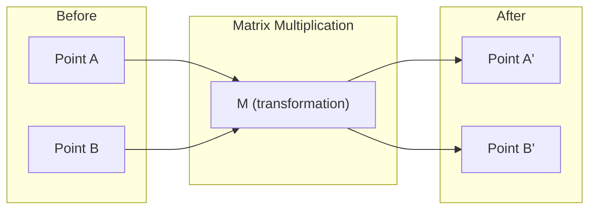
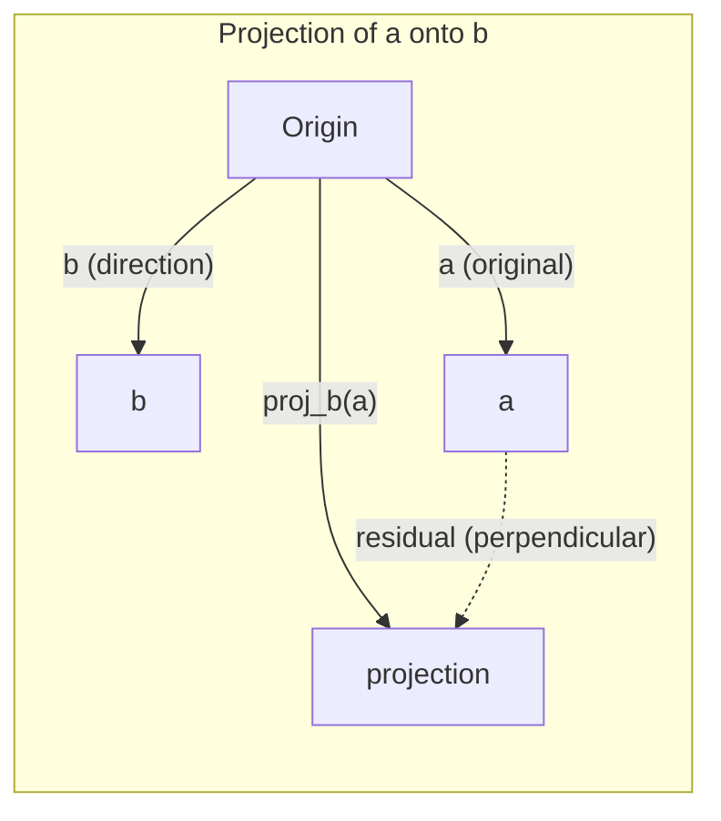

# Linear Algebra Intuition

> Mọi mô hình AI chỉ là toán học ma trận đội một chiếc mũ cầu kỳ.

**Type:** Learn
**Languages:** Python, Julia
**Prerequisites:** Phase 0
**Time:** ~60 minutes

## Learning Objectives

- Triển khai các phép toán vector và ma trận (cộng, tích vô hướng, nhân ma trận) từ đầu bằng Python
- Giải thích về mặt hình học những gì tích vô hướng, phép chiếu và quy trình Gram-Schmidt thực hiện
- Xác định tính độc lập tuyến tính, hạng và cơ sở của một tập vector bằng phép khử hàng
- Kết nối các khái niệm đại số tuyến tính với ứng dụng AI của chúng: embedding, điểm attention và LoRA

## The Problem

Mở bất kỳ bài báo ML nào. Ngay trang đầu tiên, bạn sẽ thấy các vector, ma trận, tích vô hướng và các phép biến đổi. Không có trực giác đại số tuyến tính, chúng chỉ là các ký hiệu. Có nó, bạn có thể thấy mạng nơ-ron thực sự đang làm gì -- di chuyển các điểm trong không gian.

Bạn không cần trở thành nhà toán học. Bạn cần thấy các phép toán này có ý nghĩa gì về mặt hình học, rồi tự viết mã cho chúng.

## The Concept

### Vectors Are Points (and Directions)

Một vector chỉ là một danh sách các số. Nhưng những số đó có ý nghĩa -- chúng là các tọa độ trong không gian.

**Vector 2D [3, 2]:**

| x | y | Điểm |
|---|---|-------|
| 3 | 2 | Vector hướng từ gốc tọa độ (0,0) đến (3, 2) trên mặt phẳng |

Vector có độ lớn sqrt(3^2 + 2^2) = sqrt(13) và hướng lên trên và sang phải.

Trong AI, vector biểu diễn mọi thứ:
- Một từ → một vector gồm 768 số ("ý nghĩa" của nó trong không gian embedding)
- Một hình ảnh → một vector gồm hàng triệu giá trị pixel
- Một người dùng → một vector các sở thích

### Matrices Are Transformations

Một ma trận biến đổi một vector thành một vector khác. Nó có thể quay, co giãn, kéo giãn hoặc chiếu.



Trong AI, ma trận CHÍNH LÀ mô hình:
- Trọng số mạng nơ-ron → các ma trận biến đổi đầu vào thành đầu ra
- Điểm attention → các ma trận quyết định tập trung vào điều gì
- Embedding → các ma trận ánh xạ các từ thành vector

### The Dot Product Measures Similarity

Tích vô hướng của hai vector cho bạn biết chúng tương đồng đến mức nào.

```
a · b = a₁×b₁ + a₂×b₂ + ... + aₙ×bₙ

Same direction:      a · b > 0  (similar)
Perpendicular:       a · b = 0  (unrelated)
Opposite direction:  a · b < 0  (dissimilar)
```

Đây chính xác là cách các công cụ tìm kiếm, hệ thống đề xuất và RAG hoạt động -- tìm các vector có tích vô hướng cao.

### Linear Independence

Các vector độc lập tuyến tính nếu không có vector nào trong tập có thể được viết thành tổ hợp của các vector còn lại. Nếu v1, v2, v3 độc lập, chúng sinh ra một không gian 3D. Nếu một vector là tổ hợp của các vector còn lại, chúng chỉ sinh ra một mặt phẳng.

Tại sao điều này quan trọng đối với AI: ma trận đặc trưng của bạn nên có các cột độc lập tuyến tính. Nếu hai đặc trưng tương quan hoàn hảo (phụ thuộc tuyến tính), mô hình không thể phân biệt tác động của chúng. Điều này gây ra đa cộng tuyến trong hồi quy -- ma trận trọng số trở nên không ổn định, và những thay đổi nhỏ ở đầu vào tạo ra những dao động lớn ở đầu ra.

**Ví dụ cụ thể:**

```
v1 = [1, 0, 0]
v2 = [0, 1, 0]
v3 = [2, 1, 0]   # v3 = 2*v1 + v2
```

v1 và v2 độc lập -- không vector nào là bội vô hướng hoặc tổ hợp của vector kia. Nhưng v3 = 2*v1 + v2, nên {v1, v2, v3} là một tập phụ thuộc. Cả ba vector này đều nằm trong mặt phẳng xy. Dù kết hợp chúng thế nào, bạn cũng không thể đạt đến [0, 0, 1]. Bạn có ba vector nhưng chỉ có hai chiều tự do.

Trong một tập dữ liệu: nếu feature_3 = 2*feature_1 + feature_2, việc thêm feature_3 không cung cấp thông tin mới nào cho mô hình. Tệ hơn, nó làm các phương trình chuẩn trở nên suy biến -- không có nghiệm duy nhất cho các trọng số.

### Basis and Rank

Một cơ sở là một tập tối thiểu các vector độc lập tuyến tính sinh ra toàn bộ không gian. Số vector cơ sở là số chiều của không gian.

Cơ sở chuẩn cho không gian 3D là {[1,0,0], [0,1,0], [0,0,1]}. Nhưng ba vector độc lập bất kỳ trong 3D đều tạo thành một cơ sở hợp lệ. Lựa chọn cơ sở là lựa chọn hệ tọa độ.

Hạng của một ma trận = số cột độc lập tuyến tính = số hàng độc lập tuyến tính. Nếu rank < min(rows, cols), ma trận bị thiếu hạng. Điều này có nghĩa là:
- Hệ có vô số nghiệm (hoặc không có nghiệm)
- Thông tin bị mất trong phép biến đổi
- Ma trận không thể nghịch đảo

| Tình huống | Hạng | Ý nghĩa đối với ML |
|-----------|------|---------------------|
| Đầy hạng (rank = min(m, n)) | Tối đa có thể | Tồn tại nghiệm bình phương tối thiểu duy nhất. Mô hình có điều kiện tốt. |
| Thiếu hạng (rank < min(m, n)) | Dưới mức tối đa | Các đặc trưng dư thừa. Vô số nghiệm trọng số. Cần regularization. |
| Hạng 1 | 1 | Mỗi cột là một bản sao được nhân hệ số của một vector. Tất cả dữ liệu nằm trên một đường thẳng. |
| Gần thiếu hạng (các giá trị kỳ dị nhỏ) | Thấp về mặt số học | Ma trận có điều kiện kém. Nhiễu đầu vào rất nhỏ gây ra những thay đổi lớn ở đầu ra. Sử dụng cắt ngọn SVD hoặc hồi quy ridge. |

### Projection

Chiếu vector **a** lên vector **b** cho thành phần của **a** theo hướng của **b**:

```
proj_b(a) = (a dot b / b dot b) * b
```

Phần dư (a - proj_b(a)) vuông góc với b. Phép phân rã trực giao này là nền tảng của việc khớp bình phương tối thiểu.

Phép chiếu có mặt khắp nơi trong ML:
- Hồi quy tuyến tính tối thiểu hóa khoảng cách từ các quan sát đến không gian cột -- nghiệm CHÍNH LÀ một phép chiếu
- PCA chiếu dữ liệu lên các hướng có phương sai lớn nhất
- Attention trong transformer tính các phép chiếu của query lên key



**Ví dụ:** a = [3, 4], b = [1, 0]

proj_b(a) = (3*1 + 4*0) / (1*1 + 0*0) * [1, 0] = 3 * [1, 0] = [3, 0]

Phép chiếu loại bỏ thành phần y. Đây là giảm chiều ở dạng đơn giản nhất -- bỏ đi các hướng bạn không quan tâm.

### Gram-Schmidt Process

Chuyển đổi một tập vector độc lập bất kỳ thành một cơ sở trực chuẩn. Trực chuẩn có nghĩa là mỗi vector có độ dài 1 và mỗi cặp vuông góc.

Thuật toán:
1. Lấy vector đầu tiên, chuẩn hóa nó
2. Lấy vector thứ hai, trừ đi hình chiếu của nó lên vector đầu tiên, chuẩn hóa
3. Lấy vector thứ ba, trừ đi các hình chiếu của nó lên tất cả các vector trước đó, chuẩn hóa
4. Lặp lại với các vector còn lại

```
Input:  v1, v2, v3, ... (linearly independent)

u1 = v1 / |v1|

w2 = v2 - (v2 dot u1) * u1
u2 = w2 / |w2|

w3 = v3 - (v3 dot u1) * u1 - (v3 dot u2) * u2
u3 = w3 / |w3|

Output: u1, u2, u3, ... (orthonormal basis)
```

Đây là cách phân rã QR hoạt động bên trong. Q là cơ sở trực chuẩn, R lưu các hệ số chiếu. Phân rã QR được sử dụng trong:
- Giải các hệ tuyến tính (ổn định hơn phép khử Gauss)
- Tính các giá trị riêng (thuật toán QR)
- Hồi quy bình phương tối thiểu (phương pháp số tiêu chuẩn)

```figure
eigen-directions
```

## Build It

### Step 1: Vectors from scratch (Python)

```python
class Vector:
    def __init__(self, components):
        self.components = list(components)
        self.dim = len(self.components)

    def __add__(self, other):
        return Vector([a + b for a, b in zip(self.components, other.components)])

    def __sub__(self, other):
        return Vector([a - b for a, b in zip(self.components, other.components)])

    def dot(self, other):
        return sum(a * b for a, b in zip(self.components, other.components))

    def magnitude(self):
        return sum(x**2 for x in self.components) ** 0.5

    def normalize(self):
        mag = self.magnitude()
        return Vector([x / mag for x in self.components])

    def cosine_similarity(self, other):
        return self.dot(other) / (self.magnitude() * other.magnitude())

    def __repr__(self):
        return f"Vector({self.components})"


a = Vector([1, 2, 3])
b = Vector([4, 5, 6])

print(f"a + b = {a + b}")
print(f"a · b = {a.dot(b)}")
print(f"|a| = {a.magnitude():.4f}")
print(f"cosine similarity = {a.cosine_similarity(b):.4f}")
```

### Step 2: Matrices from scratch (Python)

```python
class Matrix:
    def __init__(self, rows):
        self.rows = [list(row) for row in rows]
        self.shape = (len(self.rows), len(self.rows[0]))

    def __matmul__(self, other):
        if isinstance(other, Vector):
            return Vector([
                sum(self.rows[i][j] * other.components[j] for j in range(self.shape[1]))
                for i in range(self.shape[0])
            ])
        rows = []
        for i in range(self.shape[0]):
            row = []
            for j in range(other.shape[1]):
                row.append(sum(
                    self.rows[i][k] * other.rows[k][j]
                    for k in range(self.shape[1])
                ))
            rows.append(row)
        return Matrix(rows)

    def transpose(self):
        return Matrix([
            [self.rows[j][i] for j in range(self.shape[0])]
            for i in range(self.shape[1])
        ])

    def __repr__(self):
        return f"Matrix({self.rows})"


rotation_90 = Matrix([[0, -1], [1, 0]])
point = Vector([3, 1])

rotated = rotation_90 @ point
print(f"Original: {point}")
print(f"Rotated 90°: {rotated}")
```

### Step 3: Why this matters for AI

```python
import random

random.seed(42)
weights = Matrix([[random.gauss(0, 0.1) for _ in range(3)] for _ in range(2)])
input_vector = Vector([1.0, 0.5, -0.3])

output = weights @ input_vector
print(f"Input (3D): {input_vector}")
print(f"Output (2D): {output}")
print("This is what a neural network layer does -- matrix multiplication.")
```

### Step 4: Julia version

```julia
a = [1.0, 2.0, 3.0]
b = [4.0, 5.0, 6.0]

println("a + b = ", a + b)
println("a · b = ", a ⋅ b)       # Julia supports unicode operators
println("|a| = ", √(a ⋅ a))
println("cosine = ", (a ⋅ b) / (√(a ⋅ a) * √(b ⋅ b)))

# Matrix-vector multiplication
W = [0.1 -0.2 0.3; 0.4 0.5 -0.1]
x = [1.0, 0.5, -0.3]
println("Wx = ", W * x)
println("This is a neural network layer.")
```

### Step 5: Linear independence and projection from scratch (Python)

```python
def is_linearly_independent(vectors):
    n = len(vectors)
    dim = len(vectors[0].components)
    mat = Matrix([v.components[:] for v in vectors])
    rows = [row[:] for row in mat.rows]
    rank = 0
    for col in range(dim):
        pivot = None
        for row in range(rank, len(rows)):
            if abs(rows[row][col]) > 1e-10:
                pivot = row
                break
        if pivot is None:
            continue
        rows[rank], rows[pivot] = rows[pivot], rows[rank]
        scale = rows[rank][col]
        rows[rank] = [x / scale for x in rows[rank]]
        for row in range(len(rows)):
            if row != rank and abs(rows[row][col]) > 1e-10:
                factor = rows[row][col]
                rows[row] = [rows[row][j] - factor * rows[rank][j] for j in range(dim)]
        rank += 1
    return rank == n


def project(a, b):
    scalar = a.dot(b) / b.dot(b)
    return Vector([scalar * x for x in b.components])


def gram_schmidt(vectors):
    orthonormal = []
    for v in vectors:
        w = v
        for u in orthonormal:
            proj = project(w, u)
            w = w - proj
        if w.magnitude() < 1e-10:
            continue
        orthonormal.append(w.normalize())
    return orthonormal


v1 = Vector([1, 0, 0])
v2 = Vector([1, 1, 0])
v3 = Vector([1, 1, 1])
basis = gram_schmidt([v1, v2, v3])
for i, u in enumerate(basis):
    print(f"u{i+1} = {u}")
    print(f"  |u{i+1}| = {u.magnitude():.6f}")

print(f"u1 · u2 = {basis[0].dot(basis[1]):.6f}")
print(f"u1 · u3 = {basis[0].dot(basis[2]):.6f}")
print(f"u2 · u3 = {basis[1].dot(basis[2]):.6f}")
```

## Use It

Bây giờ là cùng việc đó với NumPy -- những gì bạn thực sự sẽ sử dụng trong thực tế:

```python
import numpy as np

a = np.array([1, 2, 3], dtype=float)
b = np.array([4, 5, 6], dtype=float)

print(f"a + b = {a + b}")
print(f"a · b = {np.dot(a, b)}")
print(f"|a| = {np.linalg.norm(a):.4f}")
print(f"cosine = {np.dot(a, b) / (np.linalg.norm(a) * np.linalg.norm(b)):.4f}")

W = np.random.randn(2, 3) * 0.1
x = np.array([1.0, 0.5, -0.3])
print(f"Wx = {W @ x}")
```

### Rank, Projection, and QR with NumPy

```python
import numpy as np

A = np.array([[1, 2], [2, 4]])
print(f"Rank: {np.linalg.matrix_rank(A)}")

a = np.array([3, 4])
b = np.array([1, 0])
proj = (np.dot(a, b) / np.dot(b, b)) * b
print(f"Projection of {a} onto {b}: {proj}")

Q, R = np.linalg.qr(np.random.randn(3, 3))
print(f"Q is orthogonal: {np.allclose(Q @ Q.T, np.eye(3))}")
print(f"R is upper triangular: {np.allclose(R, np.triu(R))}")
```

### PyTorch -- Tensors Are Vectors with Autodiff

```python
import torch

x = torch.randn(3, requires_grad=True)
y = torch.tensor([1.0, 0.0, 0.0])

similarity = torch.dot(x, y)
similarity.backward()

print(f"x = {x.data}")
print(f"y = {y.data}")
print(f"dot product = {similarity.item():.4f}")
print(f"d(dot)/dx = {x.grad}")
```

Gradient của tích vô hướng theo x chỉ là y. PyTorch đã tính điều này tự động. Mọi phép toán trong một mạng nơ-ron đều được xây dựng từ các phép toán như thế này -- nhân ma trận, tích vô hướng, phép chiếu -- và autodiff theo dõi gradient qua tất cả chúng.

Bạn vừa xây dựng từ đầu những gì NumPy thực hiện trong một dòng. Giờ bạn biết điều gì đang diễn ra bên trong.

## Ship It

Bài học này tạo ra:
- `outputs/prompt-linear-algebra-tutor.md` -- một prompt dành cho các trợ lý AI để dạy đại số tuyến tính thông qua trực giác hình học

## Connections

Mọi thứ trong bài học này đều kết nối với các phần cụ thể của AI hiện đại:

| Khái niệm | Nơi xuất hiện |
|---------|------------------|
| Tích vô hướng | Điểm attention trong transformer, độ tương đồng cosine trong RAG |
| Nhân ma trận | Mọi lớp mạng nơ-ron, mọi phép biến đổi tuyến tính |
| Độc lập tuyến tính | Lựa chọn đặc trưng, tránh đa cộng tuyến |
| Hạng | Xác định xem một hệ có giải được hay không, LoRA (thích nghi hạng thấp) |
| Phép chiếu | Hồi quy tuyến tính (chiếu lên không gian cột), PCA |
| Gram-Schmidt / QR | Các bộ giải số, tính giá trị riêng |
| Cơ sở trực chuẩn | Tính toán số ổn định, các phép biến đổi làm trắng |

LoRA đáng được đề cập riêng. Nó fine-tune các mô hình ngôn ngữ lớn bằng cách phân rã các cập nhật trọng số thành các ma trận hạng thấp. Thay vì cập nhật một ma trận trọng số 4096x4096 (16M tham số), LoRA cập nhật hai ma trận có kích thước 4096x16 và 16x4096 (131K tham số). Ràng buộc hạng 16 có nghĩa là LoRA giả định cập nhật trọng số nằm trong một không gian con 16 chiều của toàn bộ không gian 4096 chiều. Đó là đại số tuyến tính đang làm công việc thực sự.

## Exercises

1. Triển khai `Vector.angle_between(other)` trả về góc tính bằng độ giữa hai vector
2. Tạo một ma trận co giãn 2D nhân đôi tọa độ x và nhân ba tọa độ y, rồi áp dụng nó vào vector [1, 1]
3. Cho 5 vector ngẫu nhiên giống vector từ (số chiều 50), tìm hai vector tương đồng nhất bằng độ tương đồng cosine
4. Xác minh đầu ra Gram-Schmidt thực sự trực chuẩn: kiểm tra mỗi cặp có tích vô hướng 0 và mỗi vector có độ lớn 1
5. Tạo một ma trận 3x3 có hạng 2. Xác minh bằng phương thức `rank()`. Sau đó giải thích các cột sinh ra đối tượng hình học nào.
6. Chiếu vector [1, 2, 3] lên [1, 1, 1]. Kết quả biểu diễn điều gì về mặt hình học?

## Key Terms

| Thuật ngữ | Cách mọi người nói | Ý nghĩa thực sự |
|------|----------------|----------------------|
| Vector | "Một mũi tên" | Một danh sách các số biểu diễn một điểm hoặc hướng trong không gian n chiều |
| Matrix (Ma trận) | "Một bảng các số" | Một phép biến đổi ánh xạ các vector từ không gian này sang không gian khác |
| Dot product (Tích vô hướng) | "Nhân rồi cộng" | Một thước đo mức độ thẳng hàng của hai vector -- cốt lõi của tìm kiếm tương đồng |
| Embedding | "Một loại phép thuật AI" | Một vector biểu diễn ý nghĩa của thứ gì đó (từ, hình ảnh, người dùng) |
| Linear independence (Độc lập tuyến tính) | "Chúng không chồng lấp" | Không vector nào trong tập có thể được viết thành tổ hợp của các vector còn lại |
| Rank (Hạng) | "Bao nhiêu chiều" | Số cột (hoặc hàng) độc lập tuyến tính trong một ma trận |
| Projection (Phép chiếu) | "Cái bóng" | Thành phần của một vector theo hướng của một vector khác |
| Basis (Cơ sở) | "Các trục tọa độ" | Một tập tối thiểu các vector độc lập sinh ra không gian |
| Orthonormal (Trực chuẩn) | "Các vector đơn vị vuông góc" | Các vector vuông góc với nhau và mỗi vector có độ dài 1 |
