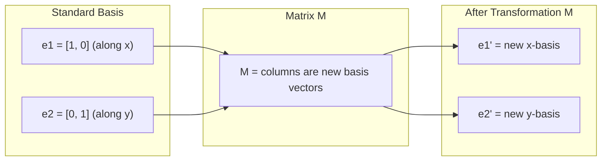
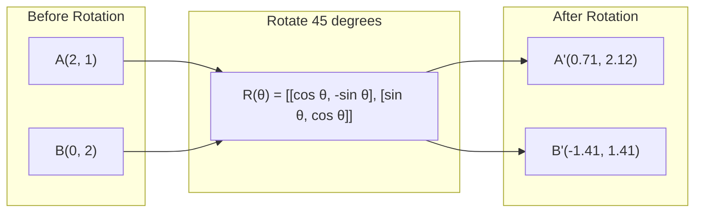
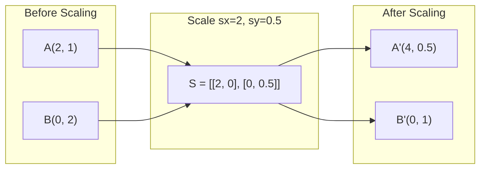
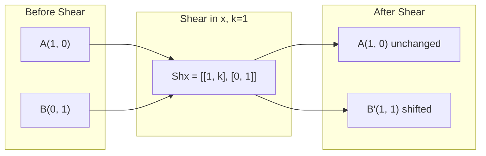
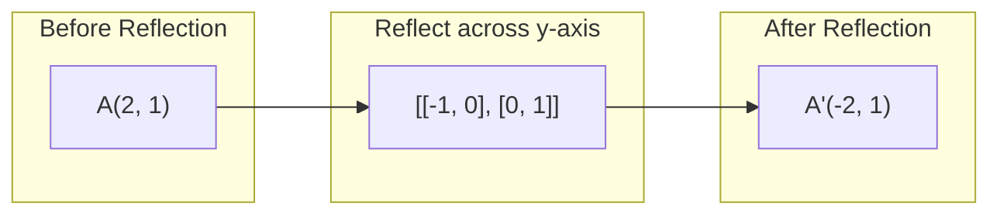
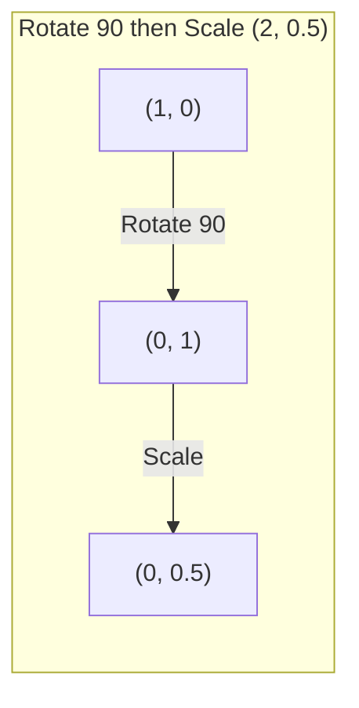
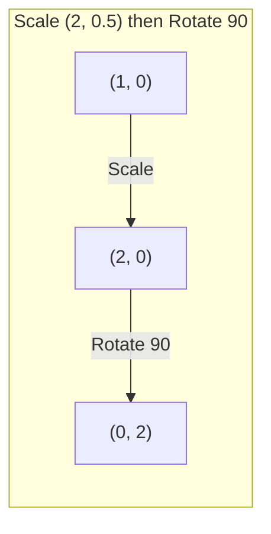

# Matrix Transformations

> Một ma trận là một cỗ máy định hình lại không gian. Hiểu nó làm gì với mọi điểm, và bạn hiểu toàn bộ phép biến đổi.

**Type:** Build
**Languages:** Python, Julia
**Prerequisites:** Phase 1, Lessons 01-02 (Linear Algebra Intuition, Vectors & Matrices Operations)
**Time:** ~75 minutes

## Learning Objectives

- Xây dựng các ma trận quay, co giãn, trượt và phản xạ rồi áp dụng chúng cho các điểm 2D và 3D
- Hợp thành nhiều phép biến đổi bằng phép nhân ma trận và xác minh rằng thứ tự có ý nghĩa
- Tính các giá trị riêng và vector riêng của các ma trận 2x2 từ phương trình đặc trưng
- Giải thích tại sao các giá trị riêng quyết định các hướng PCA, tính ổn định của RNN và hành vi phân cụm phổ

## The Problem

Bạn đọc về PCA và thấy "tìm các vector riêng của ma trận hiệp phương sai." Bạn đọc về tính ổn định của mô hình và thấy "kiểm tra xem mọi giá trị riêng có độ lớn nhỏ hơn 1 hay không." Bạn đọc về tăng cường dữ liệu và thấy "áp dụng một phép quay ngẫu nhiên." Không điều nào trong số này có ý nghĩa cho đến khi bạn hiểu ma trận làm gì với không gian về mặt hình học.

Ma trận không chỉ là các lưới số. Chúng là những cỗ máy không gian. Một ma trận quay xoay các điểm. Một ma trận co giãn kéo giãn chúng. Một ma trận trượt làm nghiêng chúng. Mọi phép biến đổi mà mạng nơ-ron áp dụng cho dữ liệu đều là một trong các phép toán này hoặc một phép hợp thành của chúng. Bài học này làm cho các phép toán đó trở nên cụ thể.

## The Concept

### Transformations as matrices

Mọi phép biến đổi tuyến tính trong 2D đều có thể được viết dưới dạng một ma trận 2x2. Ma trận cho bạn biết chính xác các vector cơ sở [1, 0] và [0, 1] kết thúc ở đâu. Mọi thứ khác suy ra từ đó.



### Rotation

Một phép quay 2D một góc $\theta$ giữ nguyên khoảng cách và góc. Nó di chuyển mọi điểm dọc theo một cung tròn.



Trong 3D, bạn quay quanh một trục. Mỗi trục có ma trận quay riêng:

```math
\begin{aligned}
R_z(\theta) &= \begin{bmatrix} \cos\theta & -\sin\theta & 0 \\ \sin\theta & \cos\theta & 0 \\ 0 & 0 & 1 \end{bmatrix} \quad \text{Rotate around z-axis (x-y plane spins, z stays)} \\[6pt]
R_x(\theta) &= \begin{bmatrix} 1 & 0 & 0 \\ 0 & \cos\theta & -\sin\theta \\ 0 & \sin\theta & \cos\theta \end{bmatrix} \quad \text{Rotate around x-axis (y-z plane spins, x stays)} \\[6pt]
R_y(\theta) &= \begin{bmatrix} \cos\theta & 0 & \sin\theta \\ 0 & 1 & 0 \\ -\sin\theta & 0 & \cos\theta \end{bmatrix} \quad \text{Rotate around y-axis (x-z plane spins, y stays)}
\end{aligned}
```

### Scaling

Phép co giãn kéo giãn hoặc nén dọc theo từng trục một cách độc lập.



### Shearing

Phép trượt làm nghiêng một trục trong khi giữ cố định trục kia. Nó biến hình chữ nhật thành hình bình hành.



Các ma trận trượt:
- `Shx = [[1, k], [0, 1]]` dịch $x$ một lượng $k \cdot y$
- `Shy = [[1, 0], [k, 1]]` dịch $y$ một lượng $k \cdot x$

### Reflection

Phép phản xạ lấy đối xứng các điểm qua một trục hoặc đường thẳng.



Các ma trận phản xạ:
- Phản xạ qua trục y: `[[-1, 0], [0, 1]]`
- Phản xạ qua trục x: `[[1, 0], [0, -1]]`

### Composition: chaining transformations

Áp dụng phép biến đổi A rồi B giống như nhân các ma trận của chúng: `result = B @ A @ point`. Thứ tự có ý nghĩa. Quay rồi co giãn cho kết quả khác với co giãn rồi quay.



Hợp thành: `S @ R = [[0, -2], [0.5, 0]]`



Hợp thành: `R @ S = [[0, -0.5], [2, 0]]`

Kết quả khác nhau. Phép nhân ma trận không có tính giao hoán.

### Eigenvalues and eigenvectors

Hầu hết các vector đổi hướng khi một ma trận tác động vào chúng. Vector riêng đặc biệt: ma trận chỉ co giãn chúng, không bao giờ quay chúng. Hệ số co giãn là giá trị riêng.

```
A @ v = lambda * v

v is the eigenvector (direction that survives)
lambda is the eigenvalue (how much it stretches)

Example: A = | 2  1 |
             | 1  2 |

Eigenvector [1, 1] with eigenvalue 3:
  A @ [1,1] = [3, 3] = 3 * [1, 1]     (same direction, scaled by 3)

Eigenvector [1, -1] with eigenvalue 1:
  A @ [1,-1] = [1, -1] = 1 * [1, -1]  (same direction, unchanged)
```

Ma trận kéo giãn không gian 3 lần theo [1, 1] và giữ nguyên [1, -1]. Mọi hướng khác là sự pha trộn của hai hướng này.

### Eigendecomposition

Nếu một ma trận có $n$ vector riêng độc lập tuyến tính, nó có thể được phân rã:

```
A = V @ D @ V^(-1)

V = matrix whose columns are eigenvectors
D = diagonal matrix of eigenvalues
V^(-1) = inverse of V

This says: rotate into eigenvector coordinates, scale along each axis, rotate back.
```

### Why eigenvalues matter

**PCA.** Các vector riêng của ma trận hiệp phương sai là các thành phần chính. Các giá trị riêng cho bạn biết mỗi thành phần nắm bắt bao nhiêu phương sai. Sắp xếp theo giá trị riêng, giữ lại $k$ thành phần đầu, và bạn có giảm chiều.

**Tính ổn định.** Trong các mạng hồi quy và hệ động lực, các giá trị riêng có độ lớn > 1 khiến đầu ra bùng nổ. Độ lớn < 1 khiến chúng tiêu biến. Đây là vấn đề gradient tiêu biến/bùng nổ được phát biểu trong một câu.

**Các phương pháp phổ.** Mạng nơ-ron đồ thị sử dụng các giá trị riêng của ma trận kề. Phân cụm phổ sử dụng các giá trị riêng của Laplacian. Các vector riêng tiết lộ cấu trúc của đồ thị.

### Determinant as volume scaling factor

Định thức của một ma trận biến đổi cho bạn biết nó co giãn diện tích (2D) hoặc thể tích (3D) bao nhiêu.

```
det = 1:   area preserved (rotation)
det = 2:   area doubled
det = 0:   space crushed to lower dimension (singular)
det = -1:  area preserved but orientation flipped (reflection)

| det(Rotation) | = 1        (always)
| det(Scale sx, sy) | = sx * sy
| det(Shear) | = 1           (area preserved)
| det(Reflection) | = -1     (orientation flipped)
```

```figure
matrix-transform
```

## Build It

### Step 1: Transformation matrices from scratch (Python)

```python
import math

def rotation_2d(theta):
    c, s = math.cos(theta), math.sin(theta)
    return [[c, -s], [s, c]]

def scaling_2d(sx, sy):
    return [[sx, 0], [0, sy]]

def shearing_2d(kx, ky):
    return [[1, kx], [ky, 1]]

def reflection_x():
    return [[1, 0], [0, -1]]

def reflection_y():
    return [[-1, 0], [0, 1]]

def mat_vec_mul(matrix, vector):
    return [
        sum(matrix[i][j] * vector[j] for j in range(len(vector)))
        for i in range(len(matrix))
    ]

def mat_mul(a, b):
    rows_a, cols_b = len(a), len(b[0])
    cols_a = len(a[0])
    return [
        [sum(a[i][k] * b[k][j] for k in range(cols_a)) for j in range(cols_b)]
        for i in range(rows_a)
    ]

point = [1.0, 0.0]
angle = math.pi / 4

rotated = mat_vec_mul(rotation_2d(angle), point)
print(f"Rotate (1,0) by 45 deg: ({rotated[0]:.4f}, {rotated[1]:.4f})")

scaled = mat_vec_mul(scaling_2d(2, 3), [1.0, 1.0])
print(f"Scale (1,1) by (2,3): ({scaled[0]:.1f}, {scaled[1]:.1f})")

sheared = mat_vec_mul(shearing_2d(1, 0), [1.0, 1.0])
print(f"Shear (1,1) kx=1: ({sheared[0]:.1f}, {sheared[1]:.1f})")

reflected = mat_vec_mul(reflection_y(), [2.0, 1.0])
print(f"Reflect (2,1) across y: ({reflected[0]:.1f}, {reflected[1]:.1f})")
```

### Step 2: Composition of transformations

```python
R = rotation_2d(math.pi / 2)
S = scaling_2d(2, 0.5)

rotate_then_scale = mat_mul(S, R)
scale_then_rotate = mat_mul(R, S)

point = [1.0, 0.0]
result1 = mat_vec_mul(rotate_then_scale, point)
result2 = mat_vec_mul(scale_then_rotate, point)

print(f"Rotate 90 then scale: ({result1[0]:.2f}, {result1[1]:.2f})")
print(f"Scale then rotate 90: ({result2[0]:.2f}, {result2[1]:.2f})")
print(f"Same? {result1 == result2}")
```

### Step 3: Eigenvalues from scratch (2x2)

Với một ma trận 2x2 `[[a, b], [c, d]]`, các giá trị riêng giải phương trình đặc trưng: $\lambda^2 - (a+d)\lambda + (ad - bc) = 0$.

```python
def eigenvalues_2x2(matrix):
    a, b = matrix[0]
    c, d = matrix[1]
    trace = a + d
    det = a * d - b * c
    discriminant = trace ** 2 - 4 * det
    if discriminant < 0:
        real = trace / 2
        imag = (-discriminant) ** 0.5 / 2
        return (complex(real, imag), complex(real, -imag))
    sqrt_disc = discriminant ** 0.5
    return ((trace + sqrt_disc) / 2, (trace - sqrt_disc) / 2)

def eigenvector_2x2(matrix, eigenvalue):
    a, b = matrix[0]
    c, d = matrix[1]
    if abs(b) > 1e-10:
        v = [b, eigenvalue - a]
    elif abs(c) > 1e-10:
        v = [eigenvalue - d, c]
    else:
        if abs(a - eigenvalue) < 1e-10:
            v = [1, 0]
        else:
            v = [0, 1]
    mag = (v[0] ** 2 + v[1] ** 2) ** 0.5
    return [v[0] / mag, v[1] / mag]

A = [[2, 1], [1, 2]]
vals = eigenvalues_2x2(A)
print(f"Matrix: {A}")
print(f"Eigenvalues: {vals[0]:.4f}, {vals[1]:.4f}")

for val in vals:
    vec = eigenvector_2x2(A, val)
    result = mat_vec_mul(A, vec)
    scaled = [val * vec[0], val * vec[1]]
    print(f"  lambda={val:.1f}, v={[round(x,4) for x in vec]}")
    print(f"    A@v = {[round(x,4) for x in result]}")
    print(f"    l*v = {[round(x,4) for x in scaled]}")
```

### Step 4: Determinant as volume scaling factor

```python
def det_2x2(matrix):
    return matrix[0][0] * matrix[1][1] - matrix[0][1] * matrix[1][0]

print(f"det(rotation 45) = {det_2x2(rotation_2d(math.pi/4)):.4f}")
print(f"det(scale 2,3)   = {det_2x2(scaling_2d(2, 3)):.1f}")
print(f"det(shear kx=1)  = {det_2x2(shearing_2d(1, 0)):.1f}")
print(f"det(reflect y)   = {det_2x2(reflection_y()):.1f}")

singular = [[1, 2], [2, 4]]
print(f"det(singular)     = {det_2x2(singular):.1f}")
print("Singular: columns are proportional, space collapses to a line.")
```

## Use It

NumPy xử lý tất cả những điều này bằng các thủ tục được tối ưu hóa.

```python
import numpy as np

theta = np.pi / 4
R = np.array([[np.cos(theta), -np.sin(theta)],
              [np.sin(theta),  np.cos(theta)]])

point = np.array([1.0, 0.0])
print(f"Rotate (1,0) by 45 deg: {R @ point}")

S = np.diag([2.0, 3.0])
composed = S @ R
print(f"Scale(2,3) after Rotate(45): {composed @ point}")

A = np.array([[2, 1], [1, 2]], dtype=float)
eigenvalues, eigenvectors = np.linalg.eig(A)
print(f"\nEigenvalues: {eigenvalues}")
print(f"Eigenvectors (columns):\n{eigenvectors}")

for i in range(len(eigenvalues)):
    v = eigenvectors[:, i]
    lam = eigenvalues[i]
    print(f"  A @ v{i} = {A @ v}, lambda * v{i} = {lam * v}")

print(f"\ndet(R) = {np.linalg.det(R):.4f}")
print(f"det(S) = {np.linalg.det(S):.1f}")

B = np.array([[3, 1], [0, 2]], dtype=float)
vals, vecs = np.linalg.eig(B)
D = np.diag(vals)
V = vecs
reconstructed = V @ D @ np.linalg.inv(V)
print(f"\nEigendecomposition A = V @ D @ V^-1:")
print(f"Original:\n{B}")
print(f"Reconstructed:\n{reconstructed}")
```

### 3D rotations with NumPy

```python
def rotation_3d_z(theta):
    c, s = np.cos(theta), np.sin(theta)
    return np.array([[c, -s, 0], [s, c, 0], [0, 0, 1]])

def rotation_3d_x(theta):
    c, s = np.cos(theta), np.sin(theta)
    return np.array([[1, 0, 0], [0, c, -s], [0, s, c]])

point_3d = np.array([1.0, 0.0, 0.0])
rotated_z = rotation_3d_z(np.pi / 2) @ point_3d
rotated_x = rotation_3d_x(np.pi / 2) @ point_3d

print(f"\n3D point: {point_3d}")
print(f"Rotate 90 around z: {np.round(rotated_z, 4)}")
print(f"Rotate 90 around x: {np.round(rotated_x, 4)}")
```

## Ship It

Bài học này xây dựng nền tảng hình học cho PCA (Giai đoạn 2) và phân tích trọng số mạng nơ-ron. Mã giá trị riêng/vector riêng được xây dựng ở đây là cùng thuật toán vận hành việc giảm chiều, phân cụm phổ và phân tích tính ổn định trong các hệ thống ML sản xuất.

## Exercises

1. Áp dụng phép quay, co giãn và trượt lên một hình vuông đơn vị (các đỉnh tại [0,0], [1,0], [1,1], [0,1]). In các đỉnh sau biến đổi cho từng phép. Xác minh rằng phép quay bảo toàn khoảng cách giữa các đỉnh.

2. Tìm các giá trị riêng của ma trận [[4, 2], [1, 3]] bằng tay sử dụng phương trình đặc trưng. Sau đó xác minh bằng hàm xây dựng từ đầu của bạn và bằng NumPy.

3. Tạo một phép hợp thành của ba phép biến đổi (quay 30 độ, co giãn theo [1.5, 0.8], trượt với kx=0.3) và áp dụng nó cho 8 điểm được bố trí trên một đường tròn. In tọa độ trước và sau. Tính định thức của ma trận hợp thành và xác minh nó bằng tích các định thức riêng lẻ.

### Hints

**Bài tập 1.** Áp dụng `rotation_2d`, `scaling_2d` và `shearing_2d` cho mỗi góc bằng `mat_vec_mul`. Đối với phép quay, tính 4 độ dài cạnh và 2 đường chéo trước và sau; mỗi giá trị phải giữ nguyên.

**Bài tập 2.** Viết phương trình đặc trưng $\lambda^2 - (\text{trace})\lambda + \det = 0$ và giải nó. Kiểm tra hai giá trị của bạn cộng lại bằng vết (7) và nhân lại bằng định thức (10), rồi so sánh với `eigenvalues_2x2` và `np.linalg.eigvals`.

**Bài tập 3.** Xây dựng ba ma trận, với `shearing_2d(0.3, 0)` cho phép shear, nhân chúng bằng `mat_mul` theo thứ tự áp dụng và áp dụng kết quả cho 8 điểm $(\cos\theta, \sin\theta)$. Phép quay có định thức 1 và phép shear có định thức 1, vì vậy `det_2x2` của phép hợp phải bằng $1.5 \times 0.8 = 1.2$.

## Key Terms

| Thuật ngữ | Cách mọi người nói | Ý nghĩa thực sự |
|------|----------------|----------------------|
| Rotation matrix (Ma trận quay) | "Xoay các thứ" | Một ma trận trực giao di chuyển các điểm dọc theo các cung tròn trong khi bảo toàn khoảng cách và góc. Định thức luôn là 1. |
| Scaling matrix (Ma trận co giãn) | "Làm các thứ lớn hơn" | Một ma trận đường chéo kéo giãn hoặc nén độc lập dọc theo từng trục. Định thức là tích các hệ số co giãn. |
| Shearing matrix (Ma trận trượt) | "Làm các thứ nghiêng" | Một ma trận dịch một tọa độ theo tỉ lệ với một tọa độ khác, biến hình chữ nhật thành hình bình hành. Định thức là 1. |
| Reflection (Phép phản xạ) | "Lấy đối xứng các thứ" | Một ma trận lật không gian qua một trục hoặc mặt phẳng. Định thức là -1. |
| Composition (Phép hợp thành) | "Làm hai việc" | Nhân các ma trận biến đổi để nối chuỗi các phép toán. Thứ tự có ý nghĩa: B @ A nghĩa là áp dụng A trước, rồi B. |
| Eigenvector (Vector riêng) | "Hướng đặc biệt" | Một hướng mà ma trận chỉ co giãn, không bao giờ quay. Dấu vân tay của phép biến đổi. |
| Eigenvalue (Giá trị riêng) | "Nó kéo giãn bao nhiêu" | Hệ số vô hướng mà ma trận dùng để co giãn vector riêng của nó. Có thể âm (lật) hoặc phức (quay). |
| Eigendecomposition (Phân rã riêng) | "Tách ma trận ra" | Viết một ma trận dưới dạng $V D V^{-1}$, tách nó thành các hướng và độ lớn co giãn cơ bản. |
| Determinant (Định thức) | "Một số duy nhất từ một ma trận" | Hệ số mà phép biến đổi dùng để co giãn diện tích (2D) hoặc thể tích (3D). Bằng không có nghĩa là phép biến đổi không thể đảo ngược. |
| Characteristic equation (Phương trình đặc trưng) | "Nơi các giá trị riêng xuất phát" | $\det(A - \lambda I) = 0$. Đa thức có các nghiệm là các giá trị riêng. |

## Further Reading

- [3Blue1Brown: Linear Transformations](https://www.3blue1brown.com/lessons/linear-transformations) -- trực giác trực quan về cách ma trận định hình lại không gian
- [3Blue1Brown: Eigenvectors and Eigenvalues](https://www.3blue1brown.com/lessons/eigenvalues) -- lời giải thích trực quan hay nhất về ý nghĩa hình học của các vector riêng
- [MIT 18.06 Lecture 21: Eigenvalues and Eigenvectors](https://ocw.mit.edu/courses/18-06-linear-algebra-spring-2010/) -- cách trình bày kinh điển của Gilbert Strang
