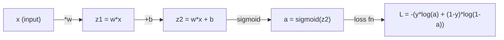
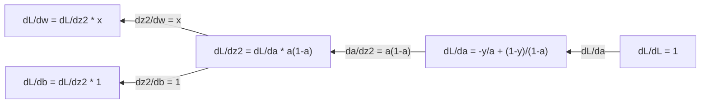
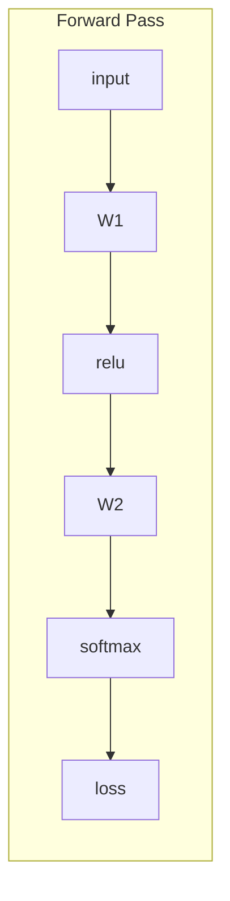
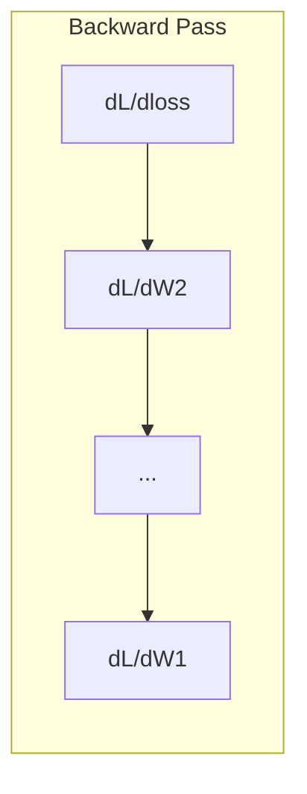

# Calculus for Machine Learning

> Đạo hàm cho bạn biết hướng nào đi xuống. Đó là tất cả những gì một mạng nơ-ron cần để học.

**Type:** Learn
**Language:** Python
**Prerequisites:** Phase 1, Lessons 01-03
**Time:** ~60 minutes

## Learning Objectives

- Tính đạo hàm số và đạo hàm giải tích cho các hàm ML phổ biến (x^2, sigmoid, cross-entropy)
- Triển khai gradient descent từ đầu để tối thiểu hóa một hàm mất mát trong 1D và 2D
- Suy ra gradient của một mô hình hồi quy tuyến tính và huấn luyện nó bằng các cập nhật trọng số thủ công
- Giải thích ma trận Hessian, các xấp xỉ chuỗi Taylor và mối liên hệ của chúng với các phương pháp tối ưu hóa

## The Problem

Bạn có một mạng nơ-ron với hàng triệu trọng số. Mỗi trọng số là một núm vặn. Bạn cần tìm ra hướng xoay từng núm để làm mô hình bớt sai đi một chút. Giải tích cho bạn hướng đó.

Không có giải tích, huấn luyện một mạng nơ-ron có nghĩa là thử các thay đổi ngẫu nhiên và hy vọng điều tốt nhất. Với đạo hàm, bạn biết chính xác mỗi trọng số ảnh hưởng đến sai số như thế nào. Bạn xoay mọi núm đúng hướng, mỗi lần.

## The Concept

### What is a derivative?

Một đạo hàm đo tốc độ thay đổi. Với một hàm y = f(x), đạo hàm f'(x) cho bạn biết: nếu bạn dịch x một lượng rất nhỏ, y thay đổi bao nhiêu?

Về mặt hình học, đạo hàm là độ dốc của đường tiếp tuyến tại một điểm.

**f(x) = x^2:**

| x | f(x) | f'(x) (độ dốc) |
|---|------|---------------|
| 0 | 0    | 0 (phẳng, tại đáy) |
| 1 | 1    | 2 |
| 2 | 4    | 4 (độ dốc đường tiếp tuyến tại điểm này) |
| 3 | 9    | 6 |

Tại x=2, độ dốc là 4. Nếu bạn di chuyển x một chút sang phải, y tăng khoảng 4 lần lượng đó. Tại x=0, độ dốc là 0. Bạn đang ở đáy cái bát.

Định nghĩa hình thức:

```
f'(x) = lim   f(x + h) - f(x)
        h->0  -----------------
                     h
```

Trong mã, bạn bỏ qua giới hạn và chỉ sử dụng một h rất nhỏ. Đó là đạo hàm số.

### Partial derivatives: one variable at a time

Các hàm thực tế có nhiều đầu vào. Mất mát của một mạng nơ-ron phụ thuộc vào hàng nghìn trọng số. Một đạo hàm riêng giữ tất cả các biến không đổi trừ một biến, rồi lấy đạo hàm theo biến đó.

```
f(x, y) = x^2 + 3xy + y^2

df/dx = 2x + 3y     (treat y as a constant)
df/dy = 3x + 2y     (treat x as a constant)
```

Mỗi đạo hàm riêng trả lời: nếu tôi chỉ dịch riêng trọng số này, mất mát thay đổi như thế nào?

### The gradient: vector of all partial derivatives

Gradient gom mọi đạo hàm riêng vào một vector. Với một hàm f(x, y, z), gradient là:

```
grad f = [ df/dx, df/dy, df/dz ]
```

Gradient chỉ theo hướng tăng dốc nhất. Để tối thiểu hóa một hàm, đi theo hướng ngược lại.

**Đồ thị đường đồng mức của f(x,y) = x^2 + y^2:**

Hàm tạo thành hình cái bát với các đường tròn đồng tâm làm đường đồng mức. Điểm cực tiểu nằm tại (0, 0).

| Điểm | grad f | -grad f (hướng đi xuống) |
|-------|--------|----------------------------|
| (1, 1) | [2, 2] (hướng lên dốc, ra xa cực tiểu) | [-2, -2] (hướng xuống dốc, về phía cực tiểu) |
| (0, 0) | [0, 0] (phẳng, tại cực tiểu) | [0, 0] |

Đây là gradient descent trong một hình ảnh. Tính gradient, đổi dấu nó, bước một bước.

### The connection to optimization

Huấn luyện một mạng nơ-ron là tối ưu hóa. Bạn có một hàm mất mát L(w1, w2, ..., wn) đo mức độ sai của mô hình. Bạn muốn tối thiểu hóa nó.

```
Gradient descent update rule:

  w_new = w_old - learning_rate * dL/dw

For every weight:
  1. Compute the partial derivative of loss with respect to that weight
  2. Subtract a small multiple of it from the weight
  3. Repeat
```

Tốc độ học điều khiển kích thước bước. Quá lớn và bạn vượt quá. Quá nhỏ và bạn bò chậm.

**Địa hình mất mát (lát cắt 1D):**

Hàm mất mát L(w) tạo thành một đường cong với các đỉnh và thung lũng khi trọng số w thay đổi.

| Đặc điểm | Mô tả |
|---------|-------------|
| Cực tiểu toàn cục | Điểm thấp nhất trên toàn bộ đường cong -- nghiệm tốt nhất |
| Cực tiểu cục bộ | Một thung lũng thấp hơn các điểm lân cận nhưng không thấp nhất toàn bộ |
| Độ dốc | Gradient descent đi theo độ dốc xuống dưới từ bất kỳ điểm bắt đầu nào |

Gradient descent đi theo độ dốc xuống dưới. Nó có thể bị kẹt ở các cực tiểu cục bộ, nhưng trong các không gian nhiều chiều (hàng triệu trọng số), điều này hiếm khi là một vấn đề thực tế.

### Numerical vs analytical derivatives

Có hai cách để tính một đạo hàm.

Giải tích: áp dụng các quy tắc giải tích bằng tay. Với f(x) = x^2, đạo hàm là f'(x) = 2x. Chính xác. Nhanh.

Số: xấp xỉ bằng định nghĩa. Tính f(x+h) và f(x-h) cho một h rất nhỏ, rồi sử dụng hiệu.

```
Numerical (central difference):

f'(x) ~= f(x + h) - f(x - h)
          -----------------------
                  2h

h = 0.0001 works well in practice
```

Đạo hàm số chậm hơn nhưng dùng được cho bất kỳ hàm nào. Đạo hàm giải tích nhanh nhưng yêu cầu bạn suy ra công thức. Các framework mạng nơ-ron sử dụng cách tiếp cận thứ ba: vi phân tự động, tính các đạo hàm chính xác một cách máy móc. Bạn sẽ thấy điều đó ở Giai đoạn 3.

### Derivatives by hand for simple functions

Đây là những đạo hàm bạn sẽ gặp đi gặp lại trong ML.

```
Function        Derivative       Used in
--------        ----------       -------
f(x) = x^2     f'(x) = 2x      Loss functions (MSE)
f(x) = wx + b  f'(w) = x        Linear layer (gradient w.r.t. weight)
                f'(b) = 1        Linear layer (gradient w.r.t. bias)
                f'(x) = w        Linear layer (gradient w.r.t. input)
f(x) = e^x     f'(x) = e^x     Softmax, attention
f(x) = ln(x)   f'(x) = 1/x     Cross-entropy loss
f(x) = 1/(1+e^-x)  f'(x) = f(x)(1-f(x))   Sigmoid activation
```

Với f(x) = x^2:

```
f(x) = x^2    f'(x) = 2x

  x    f(x)   f'(x)   meaning
  -2    4      -4      slope tilts left (decreasing)
  -1    1      -2      slope tilts left (decreasing)
   0    0       0      flat (minimum!)
   1    1       2      slope tilts right (increasing)
   2    4       4      slope tilts right (increasing)
```

Với f(w) = wx + b với x=3, b=1:

```
f(w) = 3w + 1    f'(w) = 3

The derivative with respect to w is just x.
If x is big, a small change in w causes a big change in output.
```

### The chain rule

Khi các hàm được hợp thành, quy tắc dây chuyền cho bạn biết cách lấy đạo hàm.

```
If y = f(g(x)), then dy/dx = f'(g(x)) * g'(x)

Example: y = (3x + 1)^2
  outer: f(u) = u^2       f'(u) = 2u
  inner: g(x) = 3x + 1    g'(x) = 3
  dy/dx = 2(3x + 1) * 3 = 6(3x + 1)
```

Mạng nơ-ron là các chuỗi hàm: đầu vào -> tuyến tính -> kích hoạt -> tuyến tính -> kích hoạt -> mất mát. Lan truyền ngược là quy tắc dây chuyền được áp dụng lặp lại từ đầu ra đến đầu vào. Đó là toàn bộ thuật toán.

### The Hessian Matrix

Gradient cho bạn biết độ dốc. Hessian cho bạn biết độ cong.

Hessian là ma trận các đạo hàm riêng bậc hai. Với một hàm f(x1, x2, ..., xn), phần tử (i, j) của Hessian là:

```
H[i][j] = d^2f / (dx_i * dx_j)
```

Với một hàm 2 biến f(x, y):

```
H = | d^2f/dx^2    d^2f/dxdy |
    | d^2f/dydx    d^2f/dy^2 |
```

**Hessian cho bạn biết điều gì tại một điểm dừng (nơi gradient = 0):**

| Tính chất Hessian | Ý nghĩa | Bề mặt ví dụ |
|-----------------|---------|-----------------|
| Xác định dương (mọi giá trị riêng > 0) | Cực tiểu cục bộ | Cái bát hướng lên |
| Xác định âm (mọi giá trị riêng < 0) | Cực đại cục bộ | Cái bát hướng xuống |
| Không xác định (các giá trị riêng khác dấu) | Điểm yên ngựa | Hình yên ngựa |

**Ví dụ:** f(x, y) = x^2 - y^2 (một hàm yên ngựa)

```
df/dx = 2x       df/dy = -2y
d^2f/dx^2 = 2    d^2f/dy^2 = -2    d^2f/dxdy = 0

H = | 2   0 |
    | 0  -2 |

Eigenvalues: 2 and -2 (one positive, one negative)
--> Saddle point at (0, 0)
```

So sánh với f(x, y) = x^2 + y^2 (một cái bát):

```
H = | 2  0 |
    | 0  2 |

Eigenvalues: 2 and 2 (both positive)
--> Local minimum at (0, 0)
```

**Tại sao Hessian quan trọng trong ML:**

Phương pháp Newton sử dụng Hessian để thực hiện các bước tối ưu hóa tốt hơn gradient descent. Thay vì chỉ đi theo độ dốc, nó xét đến độ cong:

```
Newton's update:    w_new = w_old - H^(-1) * gradient
Gradient descent:   w_new = w_old - lr * gradient
```

Phương pháp Newton hội tụ nhanh hơn vì Hessian "điều chỉnh tỉ lệ" gradient -- các hướng dốc có bước nhỏ hơn, các hướng phẳng có bước lớn hơn.

Điểm vướng mắc: với một mạng nơ-ron có N tham số, Hessian có kích thước N x N. Một mô hình có 1 triệu tham số sẽ cần một ma trận 1 nghìn tỷ phần tử. Đó là lý do chúng ta sử dụng các xấp xỉ.

| Phương pháp | Những gì nó sử dụng | Chi phí | Hội tụ |
|--------|-------------|------|-------------|
| Gradient descent | Chỉ các đạo hàm bậc nhất | O(N) mỗi bước | Chậm (tuyến tính) |
| Phương pháp Newton | Hessian đầy đủ | O(N^3) mỗi bước | Nhanh (bậc hai) |
| L-BFGS | Hessian xấp xỉ từ lịch sử gradient | O(N) mỗi bước | Trung bình (siêu tuyến tính) |
| Adam | Tốc độ thích nghi theo từng tham số (xấp xỉ Hessian đường chéo) | O(N) mỗi bước | Trung bình |
| Gradient tự nhiên | Ma trận thông tin Fisher (Hessian thống kê) | O(N^2) mỗi bước | Nhanh |

Trong thực tế, Adam là bộ tối ưu hóa mặc định cho học sâu. Nó xấp xỉ thông tin bậc hai với chi phí thấp bằng cách theo dõi trung bình và phương sai cập nhật liên tục của gradient theo từng tham số.

### Taylor Series Approximation

Bất kỳ hàm trơn nào cũng có thể được xấp xỉ cục bộ bằng một đa thức:

```
f(x + h) = f(x) + f'(x)*h + (1/2)*f''(x)*h^2 + (1/6)*f'''(x)*h^3 + ...
```

Càng đưa vào nhiều số hạng, xấp xỉ càng tốt -- nhưng chỉ gần điểm x.

**Tại sao chuỗi Taylor quan trọng đối với ML:**

- **Taylor bậc nhất = gradient descent.** Khi bạn sử dụng f(x + h) ~ f(x) + f'(x)*h, bạn đang thực hiện một xấp xỉ tuyến tính. Gradient descent tối thiểu hóa mô hình tuyến tính này để chọn h = -lr * f'(x).

- **Taylor bậc hai = phương pháp Newton.** Sử dụng f(x + h) ~ f(x) + f'(x)*h + (1/2)*f''(x)*h^2, bạn có một mô hình bậc hai. Tối thiểu hóa nó cho h = -f'(x)/f''(x) -- bước Newton.

- **Thiết kế hàm mất mát.** MSE và cross-entropy là các hàm trơn, có nghĩa là các khai triển Taylor của chúng có tính chất tốt. Đây không phải sự tình cờ. Các hàm mất mát trơn làm cho việc tối ưu hóa có thể dự đoán được.

```
Approximation order    What it captures    Optimization method
-------------------    -----------------   -------------------
0th order (constant)   Just the value      Random search
1st order (linear)     Slope               Gradient descent
2nd order (quadratic)  Curvature           Newton's method
Higher orders          Finer structure     Rarely used in ML
```

Điểm cốt yếu: mọi tối ưu hóa dựa trên gradient thực chất là xấp xỉ hàm mất mát cục bộ và bước đến cực tiểu của xấp xỉ đó.

### Integrals in ML

Đạo hàm cho bạn biết tốc độ thay đổi. Tích phân tính sự tích lũy -- diện tích dưới một đường cong.

Trong ML, bạn hiếm khi tính tích phân bằng tay, nhưng khái niệm này có ở khắp nơi:

**Xác suất.** Với một biến ngẫu nhiên liên tục có mật độ p(x):
```
P(a < X < b) = integral from a to b of p(x) dx
```
Diện tích dưới đường cong mật độ xác suất giữa a và b là xác suất rơi vào khoảng đó.

**Kỳ vọng.** Kết quả trung bình được lấy trọng số theo xác suất:
```
E[f(X)] = integral of f(x) * p(x) dx
```
Mất mát kỳ vọng trên một phân phối dữ liệu là một tích phân. Việc huấn luyện tối thiểu hóa một xấp xỉ thực nghiệm của nó.

**Phân kỳ KL.** Đo mức độ khác nhau giữa hai phân phối:
```
KL(p || q) = integral of p(x) * log(p(x) / q(x)) dx
```
Được sử dụng trong VAE, chưng cất tri thức và suy luận Bayes.

**Các hằng số chuẩn hóa.** Trong suy luận Bayes:
```
p(w | data) = p(data | w) * p(w) / integral of p(data | w) * p(w) dw
```
Mẫu số là một tích phân trên tất cả các giá trị tham số có thể. Nó thường không thể tính toán được, đó là lý do chúng ta dùng các xấp xỉ như MCMC và suy luận biến phân.

| Khái niệm tích phân | Nơi xuất hiện trong ML |
|-----------------|----------------------|
| Diện tích dưới đường cong | Xác suất từ các hàm mật độ |
| Kỳ vọng | Hàm mất mát, tối thiểu hóa rủi ro |
| Phân kỳ KL | VAE, tối ưu hóa chính sách, chưng cất |
| Chuẩn hóa | Phân phối hậu nghiệm Bayes, mẫu số softmax |
| Hợp lý biên | So sánh mô hình, cận dưới bằng chứng (ELBO) |

### Multivariable Chain Rule in a Computation Graph

Quy tắc dây chuyền không chỉ áp dụng cho các hàm vô hướng trên một đường thẳng. Trong một mạng nơ-ron, các biến phân nhánh rồi hợp lại. Đây là cách các đạo hàm truyền qua một lượt truyền xuôi đơn giản:



Lượt truyền ngược tính gradient từ phải sang trái:



Mỗi mũi tên nhân với đạo hàm cục bộ. Gradient cho bất kỳ tham số nào là tích của tất cả các đạo hàm cục bộ dọc theo đường từ mất mát đến tham số đó. Khi các đường phân nhánh và hợp lại, bạn cộng các phần đóng góp (quy tắc dây chuyền đa biến).

Đây là toàn bộ lan truyền ngược: quy tắc dây chuyền được áp dụng có hệ thống qua một đồ thị tính toán, từ đầu ra đến các đầu vào.

### The Jacobian matrix

Khi một hàm ánh xạ một vector thành một vector (như một lớp mạng nơ-ron), đạo hàm của nó là một ma trận. Jacobian chứa mọi đạo hàm riêng của mọi đầu ra theo mọi đầu vào.

Với f: R^n -> R^m, Jacobian J là một ma trận m x n:

| | x1 | x2 | ... | xn |
|---|---|---|---|---|
| f1 | df1/dx1 | df1/dx2 | ... | df1/dxn |
| f2 | df2/dx1 | df2/dx2 | ... | df2/dxn |
| ... | ... | ... | ... | ... |
| fm | dfm/dx1 | dfm/dx2 | ... | dfm/dxn |

Bạn sẽ không tính Jacobian bằng tay cho các mạng nơ-ron. PyTorch xử lý việc đó. Nhưng biết nó tồn tại giúp bạn hiểu hình dạng trong lan truyền ngược: nếu một lớp ánh xạ R^n đến R^m, Jacobian của nó là m x n. Gradient truyền ngược qua chuyển vị của ma trận này.

### Why this matters for neural networks

Mỗi trọng số trong một mạng nơ-ron nhận một gradient. Gradient cho bạn biết cách điều chỉnh trọng số đó để giảm mất mát.





Mỗi cập nhật trọng số:
- `W1 = W1 - lr * dL/dW1`
- `W2 = W2 - lr * dL/dW2`

Lượt truyền xuôi tính dự đoán và mất mát. Lượt truyền ngược tính gradient của mất mát theo mọi trọng số. Sau đó mỗi trọng số bước một bước nhỏ xuống dốc. Lặp lại hàng triệu bước. Đó là học sâu.

```figure
derivative-tangent
```

## Build It

### Step 1: Numerical derivative from scratch

```python
def numerical_derivative(f, x, h=1e-7):
    return (f(x + h) - f(x - h)) / (2 * h)

def f(x):
    return x ** 2

for x in [-2, -1, 0, 1, 2]:
    numerical = numerical_derivative(f, x)
    analytical = 2 * x
    print(f"x={x:2d}  f'(x) numerical={numerical:.6f}  analytical={analytical:.1f}")
```

Đạo hàm số khớp với đạo hàm giải tích đến nhiều chữ số thập phân.

### Step 2: Partial derivatives and gradients

```python
def numerical_gradient(f, point, h=1e-7):
    gradient = []
    for i in range(len(point)):
        point_plus = list(point)
        point_minus = list(point)
        point_plus[i] += h
        point_minus[i] -= h
        partial = (f(point_plus) - f(point_minus)) / (2 * h)
        gradient.append(partial)
    return gradient

def f_multi(point):
    x, y = point
    return x**2 + 3*x*y + y**2

grad = numerical_gradient(f_multi, [1.0, 2.0])
print(f"Numerical gradient at (1,2): {[f'{g:.4f}' for g in grad]}")
print(f"Analytical gradient at (1,2): [2*1+3*2, 3*1+2*2] = [{2*1+3*2}, {3*1+2*2}]")
```

### Step 3: Gradient descent to find the minimum of f(x) = x^2

```python
x = 5.0
lr = 0.1
for step in range(20):
    grad = 2 * x
    x = x - lr * grad
    print(f"step {step:2d}  x={x:8.4f}  f(x)={x**2:10.6f}")
```

Bắt đầu tại x=5, mỗi bước di chuyển gần hơn đến x=0 (cực tiểu).

### Step 4: Gradient descent on a 2D function

```python
def f_2d(point):
    x, y = point
    return x**2 + y**2

point = [4.0, 3.0]
lr = 0.1
for step in range(30):
    grad = numerical_gradient(f_2d, point)
    point = [p - lr * g for p, g in zip(point, grad)]
    loss = f_2d(point)
    if step % 5 == 0 or step == 29:
        print(f"step {step:2d}  point=({point[0]:7.4f}, {point[1]:7.4f})  f={loss:.6f}")
```

### Step 5: Comparing numerical and analytical derivatives

```python
import math

test_functions = [
    ("x^2",      lambda x: x**2,          lambda x: 2*x),
    ("x^3",      lambda x: x**3,          lambda x: 3*x**2),
    ("sin(x)",   lambda x: math.sin(x),   lambda x: math.cos(x)),
    ("e^x",      lambda x: math.exp(x),   lambda x: math.exp(x)),
    ("1/x",      lambda x: 1/x,           lambda x: -1/x**2),
]

x = 2.0
print(f"{'Function':<12} {'Numerical':>12} {'Analytical':>12} {'Error':>12}")
print("-" * 50)
for name, f, df in test_functions:
    num = numerical_derivative(f, x)
    ana = df(x)
    err = abs(num - ana)
    print(f"{name:<12} {num:12.6f} {ana:12.6f} {err:12.2e}")
```

### Step 6: Computing the Hessian numerically

```python
def hessian_2d(f, x, y, h=1e-5):
    fxx = (f(x + h, y) - 2 * f(x, y) + f(x - h, y)) / (h ** 2)
    fyy = (f(x, y + h) - 2 * f(x, y) + f(x, y - h)) / (h ** 2)
    fxy = (f(x + h, y + h) - f(x + h, y - h) - f(x - h, y + h) + f(x - h, y - h)) / (4 * h ** 2)
    return [[fxx, fxy], [fxy, fyy]]

def saddle(x, y):
    return x ** 2 - y ** 2

def bowl(x, y):
    return x ** 2 + y ** 2

H_saddle = hessian_2d(saddle, 0.0, 0.0)
H_bowl = hessian_2d(bowl, 0.0, 0.0)
print(f"Saddle Hessian: {H_saddle}")  # [[2, 0], [0, -2]] -- mixed signs
print(f"Bowl Hessian:   {H_bowl}")    # [[2, 0], [0, 2]]  -- both positive
```

Hessian của hàm yên ngựa có các giá trị riêng 2 và -2 (khác dấu, xác nhận một điểm yên ngựa). Cái bát có các giá trị riêng 2 và 2 (đều dương, xác nhận một cực tiểu).

### Step 7: Taylor approximation in action

```python
import math

def taylor_approx(f, f_prime, f_double_prime, x0, h, order=2):
    result = f(x0)
    if order >= 1:
        result += f_prime(x0) * h
    if order >= 2:
        result += 0.5 * f_double_prime(x0) * h ** 2
    return result

x0 = 0.0
for h in [0.1, 0.5, 1.0, 2.0]:
    true_val = math.sin(h)
    t1 = taylor_approx(math.sin, math.cos, lambda x: -math.sin(x), x0, h, order=1)
    t2 = taylor_approx(math.sin, math.cos, lambda x: -math.sin(x), x0, h, order=2)
    print(f"h={h:.1f}  sin(h)={true_val:.4f}  order1={t1:.4f}  order2={t2:.4f}")
```

Gần x0=0, sin(x) ~ x (Taylor bậc nhất). Xấp xỉ rất tốt với h nhỏ nhưng không còn đúng với h lớn. Đây là lý do gradient descent hoạt động tốt nhất với tốc độ học nhỏ -- mỗi bước giả định xấp xỉ tuyến tính là chính xác.

### Step 8: Why this matters for a neural network

```python
import random

random.seed(42)

w = random.gauss(0, 1)
b = random.gauss(0, 1)
lr = 0.01

xs = [1.0, 2.0, 3.0, 4.0, 5.0]
ys = [3.0, 5.0, 7.0, 9.0, 11.0]

for epoch in range(200):
    total_loss = 0
    dw = 0
    db = 0
    for x, y in zip(xs, ys):
        pred = w * x + b
        error = pred - y
        total_loss += error ** 2
        dw += 2 * error * x
        db += 2 * error
    dw /= len(xs)
    db /= len(xs)
    total_loss /= len(xs)
    w -= lr * dw
    b -= lr * db
    if epoch % 40 == 0 or epoch == 199:
        print(f"epoch {epoch:3d}  w={w:.4f}  b={b:.4f}  loss={total_loss:.6f}")

print(f"\nLearned: y = {w:.2f}x + {b:.2f}")
print(f"Actual:  y = 2x + 1")
```

Mọi vòng lặp huấn luyện dựa trên gradient đều tuân theo mẫu này: dự đoán, tính mất mát, tính gradient, cập nhật trọng số.

## Use It

Với NumPy, các phép toán tương tự nhanh hơn và ngắn gọn hơn:

```python
import numpy as np

x = np.array([1, 2, 3, 4, 5], dtype=float)
y = np.array([3, 5, 7, 9, 11], dtype=float)

w, b = np.random.randn(), np.random.randn()
lr = 0.01

for epoch in range(200):
    pred = w * x + b
    error = pred - y
    loss = np.mean(error ** 2)
    dw = np.mean(2 * error * x)
    db = np.mean(2 * error)
    w -= lr * dw
    b -= lr * db

print(f"Learned: y = {w:.2f}x + {b:.2f}")
```

Bạn vừa xây dựng gradient descent từ đầu. PyTorch tự động hóa việc tính gradient, nhưng vòng lặp cập nhật giống hệt nhau.

## Exercises

1. Triển khai `numerical_second_derivative(f, x)` bằng cách gọi `numerical_derivative` hai lần. Xác minh rằng đạo hàm bậc hai của x^3 tại x=2 là 12.
2. Sử dụng gradient descent để tìm cực tiểu của f(x, y) = (x - 3)^2 + (y + 1)^2. Bắt đầu từ (0, 0). Đáp án sẽ hội tụ về (3, -1).
3. Thêm momentum vào vòng lặp gradient descent: duy trì một vector vận tốc tích lũy các gradient quá khứ. So sánh tốc độ hội tụ khi có và không có momentum trên f(x) = x^4 - 3x^2.

## Key Terms

| Thuật ngữ | Cách mọi người nói | Ý nghĩa thực sự |
|------|----------------|----------------------|
| Derivative (Đạo hàm) | "Độ dốc" | Tốc độ thay đổi của một hàm tại một điểm. Cho bạn biết đầu ra thay đổi bao nhiêu trên mỗi đơn vị thay đổi đầu vào. |
| Partial derivative (Đạo hàm riêng) | "Đạo hàm của một biến" | Đạo hàm theo một biến trong khi tất cả các biến khác được giữ không đổi. |
| Gradient | "Hướng tăng dốc nhất" | Một vector của tất cả các đạo hàm riêng. Chỉ theo hướng làm hàm tăng nhanh nhất. |
| Gradient descent | "Đi xuống dốc" | Trừ gradient (nhân với một tốc độ học) khỏi các tham số để giảm mất mát. Cốt lõi của việc huấn luyện mạng nơ-ron. |
| Learning rate (Tốc độ học) | "Kích thước bước" | Một số vô hướng điều khiển độ lớn mỗi bước gradient descent. Quá lớn: phân kỳ. Quá nhỏ: hội tụ chậm. |
| Chain rule (Quy tắc dây chuyền) | "Nhân các đạo hàm" | Quy tắc lấy đạo hàm của các hàm hợp: df/dx = df/dg * dg/dx. Cơ sở toán học của lan truyền ngược. |
| Jacobian | "Ma trận các đạo hàm" | Khi một hàm ánh xạ các vector thành các vector, Jacobian là ma trận của tất cả các đạo hàm riêng của đầu ra theo đầu vào. |
| Numerical derivative (Đạo hàm số) | "Sai phân hữu hạn" | Xấp xỉ một đạo hàm bằng cách tính giá trị hàm tại hai điểm gần nhau và tính độ dốc giữa chúng. |
| Backpropagation (Lan truyền ngược) | "Autodiff chế độ ngược" | Tính gradient từng lớp từ đầu ra đến đầu vào bằng quy tắc dây chuyền. Cách mạng nơ-ron học. |
| Hessian | "Ma trận các đạo hàm bậc hai" | Ma trận của tất cả các đạo hàm riêng bậc hai. Mô tả độ cong của một hàm. Hessian xác định dương tại một điểm dừng có nghĩa là cực tiểu cục bộ. |
| Taylor series (Chuỗi Taylor) | "Xấp xỉ đa thức" | Xấp xỉ một hàm gần một điểm bằng các đạo hàm của nó: f(x+h) ~ f(x) + f'(x)h + (1/2)f''(x)h^2 + ... Cơ sở để hiểu tại sao gradient descent và phương pháp Newton hoạt động. |
| Integral (Tích phân) | "Diện tích dưới đường cong" | Sự tích lũy của một đại lượng trên một khoảng. Trong ML, tích phân xác định xác suất, kỳ vọng và phân kỳ KL. |

## Further Reading

- [3Blue1Brown: Essence of Calculus](https://www.3blue1brown.com/topics/calculus) - trực giác trực quan về đạo hàm, tích phân và quy tắc dây chuyền
- [Stanford CS231n: Backpropagation](https://cs231n.github.io/optimization-2/) - cách gradient truyền qua các lớp mạng nơ-ron
