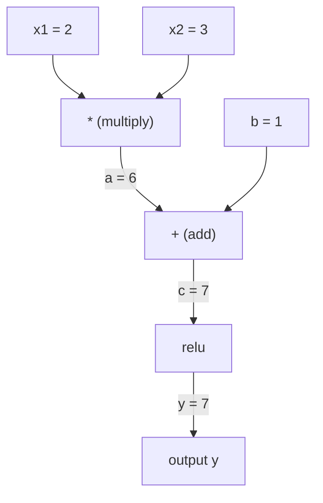
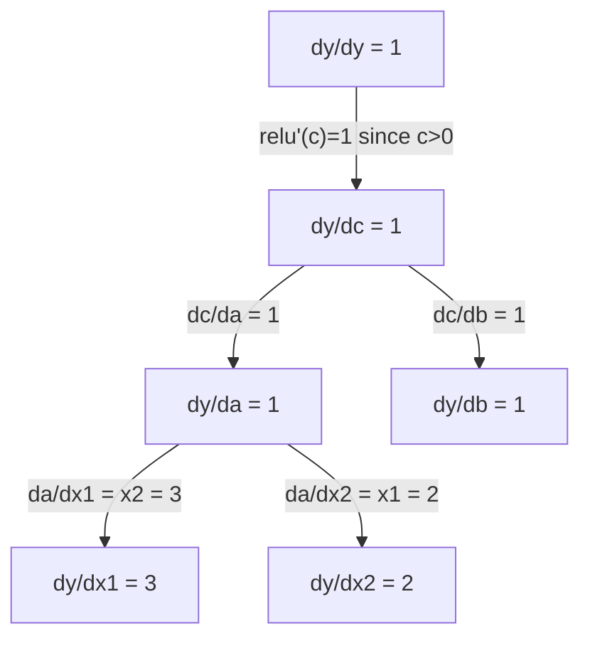

# Chain Rule & Automatic Differentiation

> Quy tắc dây chuyền là động cơ đằng sau mọi mạng nơ-ron có khả năng học.

**Type:** Build
**Language:** Python
**Prerequisites:** Phase 1, Lesson 04 (Derivatives & Gradients)
**Time:** ~90 minutes

## Learning Objectives

- Xây dựng một bộ máy autograd tối thiểu (lớp Value) ghi lại các phép toán và tính gradient bằng autodiff chế độ ngược
- Triển khai các lượt truyền xuôi và truyền ngược qua một đồ thị tính toán bằng sắp xếp tô pô
- Xây dựng và huấn luyện một perceptron nhiều lớp trên XOR chỉ sử dụng bộ máy autograd xây dựng từ đầu
- Xác minh tính đúng đắn của autodiff bằng cách kiểm tra gradient đối chiếu với sai phân hữu hạn số

## The Problem

Bạn có thể tính đạo hàm của các hàm đơn giản. Nhưng một mạng nơ-ron không phải là một hàm đơn giản. Nó là hàng trăm hàm được hợp thành với nhau: nhân ma trận, cộng bias, áp dụng kích hoạt, lại nhân ma trận, softmax, mất mát cross-entropy. Đầu ra là một hàm của một hàm của một hàm.

Để huấn luyện mạng, bạn cần gradient của mất mát theo từng trọng số. Làm điều này bằng tay là bất khả thi với hàng triệu tham số. Làm bằng phương pháp số (sai phân hữu hạn) thì quá chậm.

Quy tắc dây chuyền cho bạn toán học. Vi phân tự động cho bạn thuật toán. Cùng nhau, chúng cho phép bạn tính gradient chính xác qua các phép hợp thành hàm tùy ý trong thời gian tỉ lệ với một lượt truyền xuôi.

Đây là cách PyTorch, TensorFlow và JAX hoạt động. Bạn sẽ xây dựng một phiên bản thu nhỏ từ đầu.

## The Concept

### The Chain Rule

Nếu $y = f(g(x))$, đạo hàm của $y$ theo $x$ là:

```math
\frac{dy}{dx} = \frac{dy}{dg} \cdot \frac{dg}{dx} = f'(g(x)) \cdot g'(x)
```

Nhân các đạo hàm dọc theo chuỗi. Mỗi mắt xích đóng góp đạo hàm cục bộ của nó.

Ví dụ: $y = \sin(x^2)$

```math
\begin{aligned}
g(x) &= x^2 \qquad & g'(x) &= 2x \\
f(g) &= \sin(g) \qquad & f'(g) &= \cos(g) \\[4pt]
\frac{dy}{dx} &= \cos(x^2) \cdot 2x
\end{aligned}
```

Với các phép hợp thành sâu hơn, chuỗi kéo dài:

```math
\begin{aligned}
y &= f(g(h(x))) \\[4pt]
\frac{dy}{dx} &= f'(g(h(x))) \cdot g'(h(x)) \cdot h'(x)
\end{aligned}
```

Mỗi lớp trong một mạng nơ-ron là một mắt xích trong chuỗi này.

### Computational Graphs

Một đồ thị tính toán làm quy tắc dây chuyền trở nên trực quan. Mỗi phép toán trở thành một nút. Dữ liệu truyền xuôi qua đồ thị. Gradient truyền ngược.

**Lượt truyền xuôi (tính các giá trị):**



**Lượt truyền ngược (tính gradient):**



Lượt truyền ngược áp dụng quy tắc dây chuyền tại mỗi nút, lan truyền gradient từ đầu ra đến các đầu vào.

### Forward Mode vs Reverse Mode

Có hai cách áp dụng quy tắc dây chuyền qua một đồ thị.

**Chế độ xuôi** bắt đầu tại các đầu vào và đẩy các đạo hàm về phía trước. Nó tính $dx/dx = 1$ và lan truyền qua từng phép toán. Tốt khi bạn có ít đầu vào và nhiều đầu ra.

```
Forward mode: seed dx/dx = 1, propagate forward

  x = 2       (dx/dx = 1)
  a = x^2     (da/dx = 2x = 4)
  y = sin(a)  (dy/dx = cos(a) * da/dx = cos(4) * 4 = -2.615)
```

**Chế độ ngược** bắt đầu tại đầu ra và kéo gradient ngược lại. Nó tính $dy/dy = 1$ và lan truyền qua từng phép toán theo chiều ngược. Tốt khi bạn có nhiều đầu vào và ít đầu ra.

```
Reverse mode: seed dy/dy = 1, propagate backward

  y = sin(a)  (dy/dy = 1)
  a = x^2     (dy/da = cos(a) = cos(4) = -0.654)
  x = 2       (dy/dx = dy/da * da/dx = -0.654 * 4 = -2.615)
```

Mạng nơ-ron có hàng triệu đầu vào (trọng số) và một đầu ra (mất mát). Chế độ ngược tính tất cả gradient trong một lượt truyền ngược. Đây là lý do lan truyền ngược sử dụng chế độ ngược.

| Chế độ | Giá trị khởi đầu | Hướng | Tốt nhất khi |
|------|------|-----------|-----------|
| Xuôi | $dx_i/dx_i = 1$ | Đầu vào đến đầu ra | Ít đầu vào, nhiều đầu ra |
| Ngược | $dy/dy = 1$ | Đầu ra đến đầu vào | Nhiều đầu vào, ít đầu ra (mạng nơ-ron) |

### Dual Numbers for Forward Mode

Chế độ xuôi có thể được triển khai thanh nhã bằng số đối ngẫu. Một số đối ngẫu có dạng $a + b\epsilon$ trong đó $\epsilon^2 = 0$.

```
Dual number: (value, derivative)

(2, 1) means: value is 2, derivative w.r.t. x is 1

Arithmetic rules:
  (a, a') + (b, b') = (a+b, a'+b')
  (a, a') * (b, b') = (a*b, a'*b + a*b')
  sin(a, a')         = (sin(a), cos(a)*a')
```

Khởi tạo biến đầu vào với đạo hàm 1. Đạo hàm tự động lan truyền qua mọi phép toán.

### Building an Autograd Engine

Một bộ máy autograd cần ba thứ:

1. **Bao bọc giá trị.** Bao bọc mọi số trong một đối tượng lưu giá trị và gradient của nó.
2. **Ghi lại đồ thị.** Mỗi phép toán ghi lại các đầu vào và hàm gradient cục bộ.
3. **Lượt truyền ngược.** Sắp xếp tô pô đồ thị, rồi duyệt nó theo chiều ngược, áp dụng quy tắc dây chuyền tại mỗi nút.

Đây chính xác là những gì `autograd` của PyTorch thực hiện. Lớp `torch.Tensor` bao bọc các giá trị, ghi lại các phép toán khi `requires_grad=True`, và tính gradient khi bạn gọi `.backward()`.

### How PyTorch Autograd Works Under the Hood

Khi bạn viết mã PyTorch:

```python
x = torch.tensor(2.0, requires_grad=True)
y = x ** 2 + 3 * x + 1
y.backward()
print(x.grad)  # 7.0 = 2*x + 3 = 2*2 + 3
```

Bên trong PyTorch:

1. Tạo một nút `Tensor` cho `x` với `requires_grad=True`
2. Mỗi phép toán (`**`, `*`, `+`) tạo một nút mới và ghi lại hàm truyền ngược
3. `y.backward()` kích hoạt autodiff chế độ ngược qua đồ thị đã ghi lại
4. `grad_fn` của mỗi nút tính gradient cục bộ và truyền chúng đến các nút cha
5. Gradient tích lũy trong các thuộc tính `.grad` thông qua phép cộng (không phải thay thế)

Đồ thị là động (định nghĩa bằng cách chạy). Một đồ thị mới được xây dựng trong mỗi lượt truyền xuôi. Đây là lý do PyTorch hỗ trợ luồng điều khiển (if/else, vòng lặp) bên trong mô hình.

```figure
chain-rule
```

## Build It

### Step 1: The Value class

```python
class Value:
    def __init__(self, data, children=(), op=''):
        self.data = data
        self.grad = 0.0
        self._backward = lambda: None
        self._prev = set(children)
        self._op = op

    def __repr__(self):
        return f"Value(data={self.data:.4f}, grad={self.grad:.4f})"
```

Mỗi `Value` lưu dữ liệu số của nó, gradient của nó (ban đầu bằng không), một hàm truyền ngược và các con trỏ đến các nút con đã tạo ra nó.

### Step 2: Arithmetic operations with gradient tracking

```python
    def __add__(self, other):
        other = other if isinstance(other, Value) else Value(other)
        out = Value(self.data + other.data, (self, other), '+')
        def _backward():
            self.grad += out.grad
            other.grad += out.grad
        out._backward = _backward
        return out

    def __mul__(self, other):
        other = other if isinstance(other, Value) else Value(other)
        out = Value(self.data * other.data, (self, other), '*')
        def _backward():
            self.grad += other.data * out.grad
            other.grad += self.data * out.grad
        out._backward = _backward
        return out

    def relu(self):
        out = Value(max(0, self.data), (self,), 'relu')
        def _backward():
            self.grad += (1.0 if out.data > 0 else 0.0) * out.grad
        out._backward = _backward
        return out
```

Mỗi phép toán tạo một closure biết cách tính gradient cục bộ và nhân với gradient phía trước (`out.grad`). `+=` xử lý trường hợp một giá trị được sử dụng trong nhiều phép toán.

### Step 3: The backward pass

```python
    def backward(self):
        topo = []
        visited = set()
        def build_topo(v):
            if v not in visited:
                visited.add(v)
                for child in v._prev:
                    build_topo(child)
                topo.append(v)
        build_topo(self)

        self.grad = 1.0
        for v in reversed(topo):
            v._backward()
```

Sắp xếp tô pô bảo đảm gradient của mỗi nút được tính đầy đủ trước khi nó lan truyền đến các nút con. Gradient khởi đầu là 1.0 ($dy/dy = 1$).

### Step 4: More operations for a complete engine

Lớp Value cơ bản xử lý phép cộng, nhân và relu. Một bộ máy autograd thực sự cần nhiều hơn. Đây là các phép toán bạn cần để xây dựng mạng nơ-ron:

```python
    def __neg__(self):
        return self * -1

    def __sub__(self, other):
        return self + (-other)

    def __radd__(self, other):
        return self + other

    def __rmul__(self, other):
        return self * other

    def __rsub__(self, other):
        return other + (-self)

    def __pow__(self, n):
        out = Value(self.data ** n, (self,), f'**{n}')
        def _backward():
            self.grad += n * (self.data ** (n - 1)) * out.grad
        out._backward = _backward
        return out

    def __truediv__(self, other):
        return self * (other ** -1) if isinstance(other, Value) else self * (Value(other) ** -1)

    def exp(self):
        import math
        e = math.exp(self.data)
        out = Value(e, (self,), 'exp')
        def _backward():
            self.grad += e * out.grad
        out._backward = _backward
        return out

    def log(self):
        import math
        out = Value(math.log(self.data), (self,), 'log')
        def _backward():
            self.grad += (1.0 / self.data) * out.grad
        out._backward = _backward
        return out

    def tanh(self):
        import math
        t = math.tanh(self.data)
        out = Value(t, (self,), 'tanh')
        def _backward():
            self.grad += (1 - t ** 2) * out.grad
        out._backward = _backward
        return out
```

**Tại sao mỗi phép toán quan trọng:**

| Phép toán | Quy tắc truyền ngược | Được sử dụng trong |
|-----------|--------------|---------|
| `__sub__` | Tái sử dụng add + neg | Tính mất mát (pred - target) |
| `__pow__` | $n \cdot x^{n-1}$ | Các kích hoạt đa thức, MSE ($\text{error}^2$) |
| `__truediv__` | Tái sử dụng mul + pow(-1) | Chuẩn hóa, điều chỉnh tỉ lệ tốc độ học |
| `exp` | $\exp(x) \cdot \text{upstream}$ | Softmax, log-hợp lý |
| `log` | $(1/x) \cdot \text{upstream}$ | Mất mát cross-entropy, xác suất log |
| `tanh` | $(1 - \tanh^2) \cdot \text{upstream}$ | Hàm kích hoạt cổ điển |

Phần khéo léo: `__sub__` và `__truediv__` được định nghĩa theo các phép toán hiện có. Chúng có gradient đúng mà không cần thêm công sức vì quy tắc dây chuyền hợp thành qua các phép add/mul/pow bên dưới.

### Step 5: Mini MLP from scratch

Với một lớp Value hoàn chỉnh, bạn có thể xây dựng một mạng nơ-ron. Không PyTorch. Không NumPy. Chỉ có các Value và quy tắc dây chuyền.

```python
import random

class Neuron:
    def __init__(self, n_inputs):
        self.w = [Value(random.uniform(-1, 1)) for _ in range(n_inputs)]
        self.b = Value(0.0)

    def __call__(self, x):
        act = sum((wi * xi for wi, xi in zip(self.w, x)), self.b)
        return act.tanh()

    def parameters(self):
        return self.w + [self.b]

class Layer:
    def __init__(self, n_inputs, n_outputs):
        self.neurons = [Neuron(n_inputs) for _ in range(n_outputs)]

    def __call__(self, x):
        return [n(x) for n in self.neurons]

    def parameters(self):
        return [p for n in self.neurons for p in n.parameters()]

class MLP:
    def __init__(self, sizes):
        self.layers = [Layer(sizes[i], sizes[i+1]) for i in range(len(sizes)-1)]

    def __call__(self, x):
        for layer in self.layers:
            x = layer(x)
        return x[0] if len(x) == 1 else x

    def parameters(self):
        return [p for layer in self.layers for p in layer.parameters()]
```

Một `Neuron` tính `tanh(w1*x1 + w2*x2 + ... + b)`. Một `Layer` là một danh sách các nơ-ron. Một `MLP` xếp chồng các lớp. Mỗi trọng số là một `Value`, nên gọi `loss.backward()` lan truyền gradient đến mọi tham số.

**Huấn luyện trên XOR:**

```python
random.seed(42)
model = MLP([2, 4, 1])  # 2 inputs, 4 hidden neurons, 1 output

xs = [[0, 0], [0, 1], [1, 0], [1, 1]]
ys = [-1, 1, 1, -1]  # XOR pattern (using -1/1 for tanh)

for step in range(100):
    preds = [model(x) for x in xs]
    loss = sum((p - y) ** 2 for p, y in zip(preds, ys))

    for p in model.parameters():
        p.grad = 0.0
    loss.backward()

    lr = 0.05
    for p in model.parameters():
        p.data -= lr * p.grad

    if step % 20 == 0:
        print(f"step {step:3d}  loss = {loss.data:.4f}")

print("\nPredictions after training:")
for x, y in zip(xs, ys):
    print(f"  input={x}  target={y:2d}  pred={model(x).data:6.3f}")
```

Đây là micrograd. Một vòng lặp huấn luyện mạng nơ-ron hoàn chỉnh bằng Python thuần với vi phân tự động. Mọi framework học sâu thương mại đều làm cùng việc đó ở quy mô khổng lồ.

### Step 6: Gradient checking

Làm sao bạn biết autodiff của mình đúng? So sánh nó với các đạo hàm số. Đây là kiểm tra gradient.

```python
def gradient_check(build_expr, x_val, h=1e-7):
    x = Value(x_val)
    y = build_expr(x)
    y.backward()
    autodiff_grad = x.grad

    y_plus = build_expr(Value(x_val + h)).data
    y_minus = build_expr(Value(x_val - h)).data
    numerical_grad = (y_plus - y_minus) / (2 * h)

    diff = abs(autodiff_grad - numerical_grad)
    return autodiff_grad, numerical_grad, diff
```

Kiểm tra nó trên một biểu thức phức tạp:

```python
def expr(x):
    return (x ** 3 + x * 2 + 1).tanh()

ad, num, diff = gradient_check(expr, 0.5)
print(f"Autodiff:  {ad:.8f}")
print(f"Numerical: {num:.8f}")
print(f"Difference: {diff:.2e}")
# Difference should be < 1e-5
```

Kiểm tra gradient là thiết yếu khi triển khai các phép toán mới. Nếu lượt truyền ngược có lỗi, kiểm tra số sẽ phát hiện nó. Mọi triển khai học sâu nghiêm túc đều chạy kiểm tra gradient trong quá trình phát triển.

**Khi nào sử dụng kiểm tra gradient:**

| Tình huống | Có kiểm tra gradient không? |
|-----------|-------------------|
| Thêm một phép toán mới vào autograd của bạn | Có, luôn luôn |
| Gỡ lỗi một vòng lặp huấn luyện không hội tụ | Có, kiểm tra gradient trước |
| Huấn luyện sản xuất | Không, quá chậm (2 lần truyền xuôi cho mỗi tham số) |
| Kiểm thử đơn vị cho mã autograd | Có, tự động hóa nó |

### Step 7: Verify against manual calculation

```python
x1 = Value(2.0)
x2 = Value(3.0)
a = x1 * x2          # a = 6.0
b = a + Value(1.0)    # b = 7.0
y = b.relu()          # y = 7.0

y.backward()

print(f"y = {y.data}")          # 7.0
print(f"dy/dx1 = {x1.grad}")   # 3.0 (= x2)
print(f"dy/dx2 = {x2.grad}")   # 2.0 (= x1)
```

Kiểm tra thủ công: `y = relu(x1*x2 + 1)`. Vì `x1*x2 + 1 = 7 > 0`, relu là phép đồng nhất.
`dy/dx1 = x2 = 3`. `dy/dx2 = x1 = 2`. Bộ máy cho kết quả khớp.

## Use It

### Verify against PyTorch

```python
import torch

x1 = torch.tensor(2.0, requires_grad=True)
x2 = torch.tensor(3.0, requires_grad=True)
a = x1 * x2
b = a + 1.0
y = torch.relu(b)
y.backward()

print(f"PyTorch dy/dx1 = {x1.grad.item()}")  # 3.0
print(f"PyTorch dy/dx2 = {x2.grad.item()}")  # 2.0
```

Cùng gradient. Bộ máy của bạn tính cùng kết quả với PyTorch vì toán học giống nhau: autodiff chế độ ngược thông qua quy tắc dây chuyền.

### A more complex expression

```python
a = Value(2.0)
b = Value(-3.0)
c = Value(10.0)
f = (a * b + c).relu()  # relu(2*(-3) + 10) = relu(4) = 4

f.backward()
print(f"df/da = {a.grad}")  # -3.0 (= b)
print(f"df/db = {b.grad}")  #  2.0 (= a)
print(f"df/dc = {c.grad}")  #  1.0
```

## Ship It

Bài học này tạo ra:
- `outputs/skill-autodiff.md` -- một skill để xây dựng và gỡ lỗi các hệ thống autograd
- `code/autodiff.py` -- một bộ máy autograd tối thiểu mà bạn có thể mở rộng

Lớp Value được xây dựng ở đây là nền tảng cho vòng lặp huấn luyện mạng nơ-ron ở Giai đoạn 3.

## Exercises

1. Thêm `__pow__` vào lớp Value để bạn có thể tính `x ** n`. Xác minh rằng $\frac{d}{dx}(x^3)$ tại $x=2$ bằng `12.0`.

2. Thêm `tanh` làm một hàm kích hoạt. Xác minh rằng $\tanh'(0) = 1$ và $\tanh'(2) = 0.0707$ (xấp xỉ).

3. Xây dựng một đồ thị tính toán cho một nơ-ron đơn: `y = relu(w1*x1 + w2*x2 + b)`. Tính cả năm gradient và xác minh với PyTorch.

4. Triển khai autodiff chế độ xuôi bằng số đối ngẫu. Tạo một lớp `Dual` và xác minh nó cho cùng các đạo hàm với bộ máy chế độ ngược của bạn.

### Hints

**Bài tập 1.** `Value` đã định nghĩa `__pow__`. Đọc `_backward` của nó và xác nhận nó áp dụng $n x^{n-1}$ cho gradient đi vào. Chạy `x = Value(2.0)`, `y = x ** 3`, `y.backward()`; `x.grad` phải là 12.0.

**Bài tập 2.** Sử dụng $\tanh'(x) = 1 - \tanh(x)^2$ trong `_backward`. Đối chiếu với sai phân hữu hạn của chính bạn: $\frac{\tanh(x + h) - \tanh(x - h)}{2h}$ phải khớp tại $x = 0$ và $x = 2$.

**Bài tập 3.** Xây dựng `w1*x1 + w2*x2 + b` từ các đối tượng `Value`, áp dụng `relu` và gọi `backward`. Trước khi so sánh với PyTorch, kiểm tra thủ công: nếu đầu vào của `relu` dương, gradient của `w1` bằng `x1`; nếu âm, cả năm gradient đều bằng 0.

**Bài tập 4.** Lưu một giá trị và một đạo hàm trong mỗi `Dual`, và sử dụng quy tắc tích $(a, a')(b, b') = (ab, a'b + ab')$ cho phép nhân. Khởi tạo đầu vào với đạo hàm 1 và so sánh kết quả với `x.grad` từ bộ máy chế độ ngược cho cùng hàm.

## Key Terms

| Thuật ngữ | Cách mọi người nói | Ý nghĩa thực sự |
|------|----------------|----------------------|
| Chain rule (Quy tắc dây chuyền) | "Nhân các đạo hàm" | Đạo hàm của các hàm hợp bằng tích các đạo hàm cục bộ của từng hàm, được tính tại điểm đúng |
| Computational graph (Đồ thị tính toán) | "Sơ đồ mạng" | Một đồ thị có hướng không chu trình trong đó các nút là các phép toán và các cạnh mang giá trị (xuôi) hoặc gradient (ngược) |
| Forward mode (Chế độ xuôi) | "Đẩy các đạo hàm về phía trước" | Autodiff lan truyền đạo hàm từ đầu vào đến đầu ra. Một lượt cho mỗi biến đầu vào. |
| Reverse mode (Chế độ ngược) | "Lan truyền ngược" | Autodiff lan truyền gradient từ đầu ra đến đầu vào. Một lượt cho mỗi biến đầu ra. |
| Autograd | "Gradient tự động" | Một hệ thống ghi lại các phép toán trên các giá trị, xây dựng một đồ thị và tính gradient chính xác bằng quy tắc dây chuyền |
| Dual numbers (Số đối ngẫu) | "Giá trị cộng đạo hàm" | Các số dạng $a + b\epsilon$ ($\epsilon^2 = 0$) mang thông tin đạo hàm qua các phép tính số học |
| Topological sort (Sắp xếp tô pô) | "Thứ tự phụ thuộc" | Sắp xếp các nút đồ thị để mỗi nút đứng sau tất cả các phần phụ thuộc của nó. Cần thiết để lan truyền gradient đúng. |
| Gradient accumulation (Tích lũy gradient) | "Cộng, không thay thế" | Khi một giá trị đưa vào nhiều phép toán, gradient của nó là tổng tất cả các phần đóng góp gradient đi vào |
| Dynamic graph (Đồ thị động) | "Định nghĩa bằng cách chạy" | Một đồ thị tính toán được xây dựng lại trong mỗi lượt truyền xuôi, cho phép luồng điều khiển Python bên trong mô hình (kiểu PyTorch) |
| Gradient checking (Kiểm tra gradient) | "Xác minh bằng phương pháp số" | So sánh gradient autodiff với gradient sai phân hữu hạn số để xác minh tính đúng đắn. Thiết yếu để gỡ lỗi. |
| MLP | "Perceptron nhiều lớp" | Một mạng nơ-ron có một hoặc nhiều lớp nơ-ron ẩn. Mỗi nơ-ron tính một tổng có trọng số cộng bias, rồi áp dụng một hàm kích hoạt. |
| Neuron (Nơ-ron) | "Tổng có trọng số + kích hoạt" | Đơn vị cơ bản: $\text{output} = \text{activation}(w_1 x_1 + w_2 x_2 + \cdots + b)$. Các trọng số và bias là những tham số có thể học. |

## Further Reading

- [3Blue1Brown: Backpropagation calculus](https://www.youtube.com/watch?v=tIeHLnjs5U8) -- giải thích trực quan về quy tắc dây chuyền trong mạng nơ-ron
- [PyTorch Autograd mechanics](https://pytorch.org/docs/stable/notes/autograd.html) -- cách hệ thống thực sự hoạt động
- [Baydin et al., Automatic Differentiation in Machine Learning: a Survey](https://arxiv.org/abs/1502.05767) -- tài liệu tham khảo toàn diện
