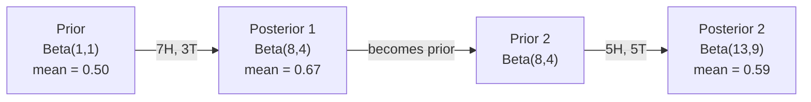

# Bayes' Theorem

> Xác suất nói về những gì bạn kỳ vọng. Định lý Bayes nói về những gì bạn học được.

**Type:** Build
**Language:** Python
**Prerequisites:** Phase 1, Lesson 06 (Probability Fundamentals)
**Time:** ~75 minutes

## Learning Objectives

- Áp dụng định lý Bayes để tính xác suất hậu nghiệm từ tiên nghiệm, hợp lý và bằng chứng
- Xây dựng một bộ phân loại văn bản Naive Bayes từ đầu với làm trơn Laplace và tính toán trong không gian log
- So sánh ước lượng MLE và MAP và giải thích cách MAP tương ứng với L2 regularization
- Triển khai cập nhật Bayes tuần tự bằng các tiên nghiệm liên hợp Beta-Binomial cho kiểm thử A/B

## The Problem

Một xét nghiệm y khoa chính xác 99%. Bạn có kết quả dương tính. Khả năng bạn thực sự mắc bệnh là bao nhiêu?

Hầu hết mọi người nói 99%. Câu trả lời thực tế phụ thuộc vào độ hiếm của bệnh. Nếu 1 trong 10,000 người mắc bệnh, một kết quả dương tính chỉ cho bạn khoảng 1% khả năng bị bệnh. 99% kết quả dương tính còn lại là báo động giả từ những người khỏe mạnh.

Đây không phải là một câu hỏi mẹo. Đó là định lý Bayes. Mọi bộ lọc thư rác, mọi chẩn đoán y khoa, mọi mô hình học máy định lượng sự không chắc chắn đều sử dụng chính cách suy luận này. Bạn bắt đầu với một niềm tin. Bạn thấy bằng chứng. Bạn cập nhật.

Nếu xây dựng các hệ thống ML mà không hiểu điều này, bạn sẽ diễn giải sai đầu ra mô hình, đặt ngưỡng không tốt và đưa ra các dự đoán quá tự tin.

## The Concept

### From joint probability to Bayes

Bạn đã biết từ Bài học 06 rằng xác suất có điều kiện là:

```math
P(A \mid B) = \frac{P(A \text{ and } B)}{P(B)}
```

Và một cách đối xứng:

```math
P(B \mid A) = \frac{P(A \text{ and } B)}{P(A)}
```

Cả hai biểu thức có cùng tử số: $P(A \text{ and } B)$. Đặt chúng bằng nhau và sắp xếp lại:

```math
\begin{aligned}
P(A \text{ and } B) &= P(A \mid B) \cdot P(B) = P(B \mid A) \cdot P(A) \\[4pt]
&\text{Therefore:} \\[4pt]
P(A \mid B) &= \frac{P(B \mid A) \cdot P(A)}{P(B)}
\end{aligned}
```

Đó là định lý Bayes. Bốn đại lượng, một phương trình.

### The four parts

| Thành phần | Tên | Ý nghĩa |
|------|------|---------------|
| $P(A \mid B)$ | Hậu nghiệm | Niềm tin đã cập nhật của bạn về $A$ sau khi thấy bằng chứng $B$ |
| $P(B \mid A)$ | Hợp lý | Mức độ có khả năng của bằng chứng $B$ nếu $A$ đúng |
| $P(A)$ | Tiên nghiệm | Niềm tin của bạn về $A$ trước khi thấy bất kỳ bằng chứng nào |
| $P(B)$ | Bằng chứng | Tổng xác suất thấy $B$ trên mọi khả năng |

Thành phần bằng chứng $P(B)$ đóng vai trò chuẩn hóa. Bạn có thể khai triển nó bằng định luật xác suất toàn phần:

```math
P(B) = P(B \mid A) \cdot P(A) + P(B \mid \text{not } A) \cdot P(\text{not } A)
```

### Medical test example

Một bệnh ảnh hưởng đến 1 trong 10,000 người. Xét nghiệm chính xác 99% (phát hiện 99% người bệnh, cho dương tính giả trong 1% trường hợp).

```math
\begin{aligned}
P(\text{sick}) &= 0.0001 \quad \text{(prior: disease is rare)} \\
P(\text{positive} \mid \text{sick}) &= 0.99 \quad \text{(likelihood: test catches it)} \\
P(\text{positive} \mid \text{healthy}) &= 0.01 \quad \text{(false positive rate)} \\[6pt]
P(\text{positive}) &= P(\text{positive} \mid \text{sick}) \cdot P(\text{sick}) + P(\text{positive} \mid \text{healthy}) \cdot P(\text{healthy}) \\
&= 0.99 \cdot 0.0001 + 0.01 \cdot 0.9999 \\
&= 0.000099 + 0.009999 \\
&= 0.010098 \\[6pt]
P(\text{sick} \mid \text{positive}) &= P(\text{positive} \mid \text{sick}) \cdot P(\text{sick}) / P(\text{positive}) \\
&= 0.99 \cdot 0.0001 / 0.010098 \\
&= 0.0098 \\
&= 0.98\%
\end{aligned}
```

Ít hơn 1%. Tiên nghiệm chi phối. Khi một tình trạng hiếm gặp, ngay cả các xét nghiệm chính xác cũng tạo ra chủ yếu dương tính giả. Đây là lý do bác sĩ yêu cầu xét nghiệm xác nhận.

### Spam filter example

Bạn nhận được một email chứa từ "lottery". Nó có phải thư rác không?

```math
\begin{aligned}
P(\text{spam}) &= 0.3 \quad \text{(30\% of email is spam)} \\
P(\text{"lottery"} \mid \text{spam}) &= 0.05 \quad \text{(5\% of spam emails contain "lottery")} \\
P(\text{"lottery"} \mid \text{not spam}) &= 0.001 \quad \text{(0.1\% of legitimate emails contain "lottery")} \\[6pt]
P(\text{"lottery"}) &= 0.05 \cdot 0.3 + 0.001 \cdot 0.7 \\
&= 0.015 + 0.0007 \\
&= 0.0157 \\[6pt]
P(\text{spam} \mid \text{"lottery"}) &= 0.05 \cdot 0.3 / 0.0157 \\
&= 0.955 \\
&= 95.5\%
\end{aligned}
```

Một từ làm xác suất dịch chuyển từ 30% đến 95.5%. Một bộ lọc thư rác thực sự áp dụng Bayes trên hàng trăm từ đồng thời.

### Naive Bayes: independence assumption

Naive Bayes mở rộng điều này sang nhiều đặc trưng bằng cách giả định mọi đặc trưng độc lập có điều kiện khi biết lớp:

```math
P(\text{class} \mid \text{feature}_1, \text{feature}_2, \ldots, \text{feature}_n) = \frac{P(\text{class}) \cdot P(\text{feature}_1 \mid \text{class}) \cdot P(\text{feature}_2 \mid \text{class}) \cdots P(\text{feature}_n \mid \text{class})}{P(\text{feature}_1, \text{feature}_2, \ldots, \text{feature}_n)}
```

Phần "naive" là giả định độc lập. Trong văn bản, sự xuất hiện của các từ không độc lập ("New" và "York" tương quan). Nhưng giả định này hoạt động tốt đáng ngạc nhiên trong thực tế vì bộ phân loại chỉ cần xếp hạng các lớp, không phải tạo ra các xác suất được hiệu chỉnh.

Vì mẫu số giống nhau cho mọi lớp, bạn có thể bỏ qua nó và chỉ so sánh các tử số:

```math
\text{score}(\text{class}) = P(\text{class}) \cdot \prod_i P(\text{feature}_i \mid \text{class})
```

Chọn lớp có điểm cao nhất.

### Maximum likelihood estimation (MLE)

Làm sao có $P(\text{feature} \mid \text{class})$ từ dữ liệu huấn luyện? Đếm.

```math
P(\text{"free"} \mid \text{spam}) = \frac{\text{number of spam emails containing "free"}}{\text{total spam emails}}
```

Đây là MLE: chọn các giá trị tham số làm cho dữ liệu quan sát có khả năng cao nhất. Bạn đang cực đại hóa hàm hợp lý, với số đếm rời rạc thì quy về tần suất tương đối.

Vấn đề: nếu một từ chưa bao giờ xuất hiện trong thư rác khi huấn luyện, MLE cho nó xác suất bằng không. Một từ chưa từng thấy triệt tiêu toàn bộ tích. Khắc phục bằng làm trơn Laplace:

```math
P(\text{word} \mid \text{class}) = \frac{\text{count}(\text{word}, \text{class}) + 1}{\text{total\_words\_in\_class} + \text{vocabulary\_size}}
```

Cộng 1 vào mọi số đếm bảo đảm không có xác suất nào bằng không.

### Maximum a posteriori (MAP)

MLE hỏi: những tham số nào cực đại hóa $P(\text{data} \mid \text{parameters})$?

MAP hỏi: những tham số nào cực đại hóa $P(\text{parameters} \mid \text{data})$?

Theo định lý Bayes:

```math
P(\text{parameters} \mid \text{data}) \propto P(\text{data} \mid \text{parameters}) \cdot P(\text{parameters})
```

MAP thêm một tiên nghiệm trên chính các tham số. Nếu bạn tin các tham số nên nhỏ, bạn mã hóa điều đó thành một tiên nghiệm phạt các giá trị lớn. Điều này giống hệt L2 regularization trong ML. Hình phạt "ridge" trong hồi quy ridge chính là một tiên nghiệm Gaussian trên các trọng số.

| Ước lượng | Tối ưu hóa | Tương đương trong ML |
|------------|-----------|---------------|
| MLE | $P(\text{data} \mid \text{params})$ | Huấn luyện không regularization |
| MAP | $P(\text{data} \mid \text{params}) \cdot P(\text{params})$ | L2 / L1 regularization |

### Bayesian vs frequentist: the practical difference

Những người theo trường phái tần suất xem tham số là các giá trị cố định chưa biết. Họ hỏi: "Nếu tôi lặp lại thí nghiệm này nhiều lần, điều gì sẽ xảy ra?"

Những người theo trường phái Bayes xem tham số là các phân phối. Họ hỏi: "Với những gì tôi đã quan sát, tôi tin điều gì về các tham số?"

Đối với việc xây dựng các hệ thống ML, sự khác biệt thực tế:

| Khía cạnh | Tần suất | Bayes |
|--------|-------------|----------|
| Đầu ra | Ước lượng điểm | Phân phối trên các giá trị |
| Sự không chắc chắn | Khoảng tin cậy (về quy trình) | Khoảng khả tín (về tham số) |
| Ít dữ liệu | Có thể khớp quá mức | Tiên nghiệm đóng vai trò regularization |
| Tính toán | Thường nhanh hơn | Thường cần lấy mẫu (MCMC) |

Hầu hết ML sản xuất theo trường phái tần suất (SGD, ước lượng điểm). Các phương pháp Bayes tỏa sáng khi bạn cần sự không chắc chắn được hiệu chỉnh (các quyết định y khoa, hệ thống thiết yếu về an toàn) hoặc khi dữ liệu khan hiếm (học ít mẫu, khởi đầu lạnh).

### Why Bayesian thinking matters for ML

Mối liên hệ sâu sắc hơn phép tương tự:

**Tiên nghiệm là regularization.** Một tiên nghiệm Gaussian trên các trọng số là L2 regularization. Một tiên nghiệm Laplace là L1. Mỗi khi bạn thêm một thành phần regularization, bạn đang đưa ra một phát biểu Bayes về các giá trị tham số mà bạn kỳ vọng.

**Hậu nghiệm là sự không chắc chắn.** Một xác suất dự đoán đơn lẻ không cho bạn biết gì về mức độ tự tin của mô hình vào ước lượng đó. Các phương pháp Bayes cho bạn một phân phối: "Tôi nghĩ $P(\text{spam})$ nằm giữa 0.8 và 0.95."

**Cập nhật Bayes là học trực tuyến.** Hậu nghiệm hôm nay trở thành tiên nghiệm ngày mai. Khi mô hình thấy dữ liệu mới, nó cập nhật niềm tin từng bước thay vì huấn luyện lại từ đầu.

**So sánh mô hình mang tính Bayes.** Tiêu chí thông tin Bayes (BIC), hợp lý biên và các hệ số Bayes đều sử dụng suy luận Bayes để lựa chọn giữa các mô hình mà không khớp quá mức.

```figure
bayes-update
```

## Build It

### Step 1: Bayes theorem function

```python
def bayes(prior, likelihood, false_positive_rate):
    evidence = likelihood * prior + false_positive_rate * (1 - prior)
    posterior = likelihood * prior / evidence
    return posterior

result = bayes(prior=0.0001, likelihood=0.99, false_positive_rate=0.01)
print(f"P(sick|positive) = {result:.4f}")
```

### Step 2: Naive Bayes classifier

```python
import math
from collections import defaultdict

class NaiveBayes:
    def __init__(self, smoothing=1.0):
        self.smoothing = smoothing
        self.class_counts = defaultdict(int)
        self.word_counts = defaultdict(lambda: defaultdict(int))
        self.class_word_totals = defaultdict(int)
        self.vocab = set()

    def train(self, documents, labels):
        for doc, label in zip(documents, labels):
            self.class_counts[label] += 1
            words = doc.lower().split()
            for word in words:
                self.word_counts[label][word] += 1
                self.class_word_totals[label] += 1
                self.vocab.add(word)

    def predict(self, document):
        words = document.lower().split()
        total_docs = sum(self.class_counts.values())
        vocab_size = len(self.vocab)
        best_class = None
        best_score = float("-inf")
        for cls in self.class_counts:
            score = math.log(self.class_counts[cls] / total_docs)
            for word in words:
                count = self.word_counts[cls].get(word, 0)
                total = self.class_word_totals[cls]
                score += math.log((count + self.smoothing) / (total + self.smoothing * vocab_size))
            if score > best_score:
                best_score = score
                best_class = cls
        return best_class
```

Xác suất log ngăn hụt dưới. Nhân nhiều xác suất nhỏ tạo ra các số quá nhỏ cho dấu phẩy động. Cộng các xác suất log ổn định về mặt số học và tương đương về mặt toán học.

### Step 3: Train on spam data

```python
train_docs = [
    "win free money now",
    "free lottery ticket winner",
    "claim your prize today free",
    "urgent offer free cash",
    "congratulations you won free",
    "meeting tomorrow at noon",
    "project update attached",
    "can we schedule a call",
    "quarterly report review",
    "lunch on thursday sounds good",
    "team standup notes attached",
    "please review the pull request",
]

train_labels = [
    "spam", "spam", "spam", "spam", "spam",
    "ham", "ham", "ham", "ham", "ham", "ham", "ham",
]

classifier = NaiveBayes()
classifier.train(train_docs, train_labels)

test_messages = [
    "free money waiting for you",
    "meeting rescheduled to friday",
    "you won a free prize",
    "please review the attached report",
]

for msg in test_messages:
    print(f"  '{msg}' -> {classifier.predict(msg)}")
```

### Step 4: Inspect the learned probabilities

```python
def show_top_words(classifier, cls, n=5):
    vocab_size = len(classifier.vocab)
    total = classifier.class_word_totals[cls]
    probs = {}
    for word in classifier.vocab:
        count = classifier.word_counts[cls].get(word, 0)
        probs[word] = (count + classifier.smoothing) / (total + classifier.smoothing * vocab_size)
    sorted_words = sorted(probs.items(), key=lambda x: x[1], reverse=True)
    for word, prob in sorted_words[:n]:
        print(f"    {word}: {prob:.4f}")

print("\nTop spam words:")
show_top_words(classifier, "spam")
print("\nTop ham words:")
show_top_words(classifier, "ham")
```

## Use It

Scikit-learn cung cấp các triển khai naive Bayes sẵn sàng cho sản xuất:

```python
from sklearn.feature_extraction.text import CountVectorizer
from sklearn.naive_bayes import MultinomialNB
from sklearn.metrics import classification_report

vectorizer = CountVectorizer()
X_train = vectorizer.fit_transform(train_docs)
clf = MultinomialNB()
clf.fit(X_train, train_labels)

X_test = vectorizer.transform(test_messages)
predictions = clf.predict(X_test)
for msg, pred in zip(test_messages, predictions):
    print(f"  '{msg}' -> {pred}")
```

Cùng thuật toán. CountVectorizer xử lý tách token và xây dựng từ vựng. MultinomialNB xử lý nội bộ việc làm trơn và các xác suất log. Phiên bản xây dựng từ đầu của bạn làm cùng việc đó trong 40 dòng.

## Ship It

Lớp NaiveBayes được xây dựng ở đây minh họa toàn bộ quy trình: tách token, ước lượng xác suất với làm trơn Laplace, dự đoán trong không gian log. Mã trong `code/bayes.py` chạy từ đầu đến cuối mà không có phần phụ thuộc nào ngoài thư viện chuẩn của Python.

### Conjugate Priors

Khi tiên nghiệm và hậu nghiệm thuộc cùng một họ phân phối, tiên nghiệm được gọi là "liên hợp." Điều này làm cho việc cập nhật Bayes gọn về mặt đại số -- bạn có một hậu nghiệm dạng đóng mà không cần tích phân số.

| Hợp lý | Tiên nghiệm liên hợp | Hậu nghiệm | Ví dụ |
|-----------|----------------|-----------|---------|
| Bernoulli | $\text{Beta}(a, b)$ | $\text{Beta}(a + \text{successes}, b + \text{failures})$ | Ước lượng độ thiên lệch khi tung đồng xu |
| Chuẩn (phương sai đã biết) | $\text{Normal}(\mu_0, \sigma_0)$ | Normal(weighted mean, smaller variance) | Hiệu chuẩn cảm biến |
| Poisson | $\text{Gamma}(a, b)$ | $\text{Gamma}(a + \text{sum of counts}, b + n)$ | Mô hình hóa tần suất đến |
| Multinomial | $\text{Dirichlet}(\alpha)$ | $\text{Dirichlet}(\alpha + \text{counts})$ | Mô hình hóa chủ đề, mô hình ngôn ngữ |

Tại sao điều này quan trọng: không có các tiên nghiệm liên hợp, bạn cần lấy mẫu Monte Carlo hoặc suy luận biến phân để xấp xỉ hậu nghiệm. Với các tiên nghiệm liên hợp, bạn chỉ cập nhật hai số.

Phân phối Beta là tiên nghiệm liên hợp phổ biến nhất trong thực tế. $\text{Beta}(a, b)$ biểu diễn niềm tin của bạn về một tham số xác suất. Trung bình là $a/(a+b)$. $a+b$ càng lớn, phân phối càng tập trung (tự tin).

Các trường hợp đặc biệt của tiên nghiệm Beta:
- $\text{Beta}(1, 1)$ = đều. Bạn không có ý kiến về tham số.
- $\text{Beta}(10, 10)$ = có đỉnh tại 0.5. Bạn tin chắc tham số gần 0.5.
- $\text{Beta}(1, 10)$ = lệch về 0. Bạn tin tham số nhỏ.

Quy tắc cập nhật cực kỳ đơn giản:

```math
\begin{aligned}
\text{Prior:} \quad & \text{Beta}(a, b) \\
\text{Data:} \quad & s \text{ successes}, f \text{ failures} \\
\text{Posterior:} \quad & \text{Beta}(a + s, b + f)
\end{aligned}
```

Không tích phân. Không lấy mẫu. Chỉ phép cộng.

### Sequential Bayesian Updating

Suy luận Bayes có tính tuần tự tự nhiên. Hậu nghiệm hôm nay trở thành tiên nghiệm ngày mai. Đây là cách các hệ thống thực tế học dần mà không xử lý lại toàn bộ dữ liệu lịch sử.

Ví dụ cụ thể: ước lượng xem một đồng xu có cân bằng hay không.

**Ngày 1: Chưa có dữ liệu.**
Bắt đầu với $\text{Beta}(1, 1)$ -- một tiên nghiệm đều. Bạn không có ý kiến.
- Trung bình tiên nghiệm: 0.5
- Tiên nghiệm phẳng trên [0, 1]

**Ngày 2: Quan sát 7 mặt ngửa, 3 mặt sấp.**
$\text{Posterior} = \text{Beta}(1 + 7, 1 + 3) = \text{Beta}(8, 4)$
- Trung bình hậu nghiệm: $8/12 = 0.667$
- Bằng chứng gợi ý đồng xu thiên về mặt ngửa

**Ngày 3: Quan sát thêm 5 mặt ngửa, thêm 5 mặt sấp.**
Sử dụng hậu nghiệm hôm qua làm tiên nghiệm hôm nay.
$\text{Posterior} = \text{Beta}(8 + 5, 4 + 5) = \text{Beta}(13, 9)$
- Trung bình hậu nghiệm: $13/22 = 0.591$
- Dữ liệu mới cân bằng kéo ước lượng trở lại về phía 0.5



Thứ tự các quan sát không quan trọng. $\text{Beta}(1,1)$ được cập nhật với tất cả 12 mặt ngửa và 8 mặt sấp cùng lúc cho $\text{Beta}(13, 9)$ -- cùng kết quả. Cập nhật tuần tự và cập nhật theo batch tương đương về mặt toán học. Nhưng cập nhật tuần tự cho phép bạn ra quyết định tại mỗi bước mà không lưu dữ liệu thô.

Đây là nền tảng của học trực tuyến trong các hệ thống ML sản xuất. Lấy mẫu Thompson cho bandit, các hệ thống đề xuất tăng dần và các bộ phát hiện bất thường theo luồng đều sử dụng mẫu này.

### Connection to A/B Testing

Kiểm thử A/B là suy luận Bayes được ngụy trang.

Thiết lập: bạn đang kiểm tra hai màu nút. Biến thể A (xanh dương) và biến thể B (xanh lá). Bạn muốn biết biến thể nào nhận nhiều lượt nhấp hơn.

Kiểm thử A/B Bayes:

1. **Tiên nghiệm.** Bắt đầu với $\text{Beta}(1, 1)$ cho cả hai biến thể. Không có ưu tiên tiên nghiệm.
2. **Dữ liệu.** Biến thể A: 50 lượt nhấp trong 1000 lượt xem. Biến thể B: 65 lượt nhấp trong 1000 lượt xem.
3. **Hậu nghiệm.**
   - A: $\text{Beta}(1 + 50, 1 + 950) = \text{Beta}(51, 951)$. Trung bình = 0.051
   - B: $\text{Beta}(1 + 65, 1 + 935) = \text{Beta}(66, 936)$. Trung bình = 0.066
4. **Quyết định.** Tính $P(B > A)$ -- xác suất tỉ lệ chuyển đổi thực của B cao hơn của A.

Tính $P(B > A)$ bằng giải tích là khó. Nhưng Monte Carlo làm điều đó trở nên đơn giản:

```
1. Draw 100,000 samples from Beta(51, 951)  -> samples_A
2. Draw 100,000 samples from Beta(66, 936)  -> samples_B
3. P(B > A) = fraction of samples where B > A
```

Nếu $P(B > A) > 0.95$, bạn triển khai biến thể B. Nếu nó nằm giữa 0.05 và 0.95, bạn tiếp tục thu thập dữ liệu. Nếu $P(B > A) < 0.05$, bạn triển khai biến thể A.

Các lợi thế so với kiểm thử A/B tần suất:
- Bạn có một phát biểu xác suất trực tiếp: "có 97% khả năng B tốt hơn"
- Không nhầm lẫn p-value. Không lối nói dè dặt "không bác bỏ được giả thuyết không".
- Bạn có thể kiểm tra kết quả bất kỳ lúc nào mà không làm tăng tỉ lệ dương tính giả (không có "vấn đề nhìn trộm")
- Bạn có thể kết hợp kiến thức tiên nghiệm (ví dụ, các kiểm thử trước gợi ý tỉ lệ chuyển đổi thường là 3-8%)

| Khía cạnh | A/B tần suất | A/B Bayes |
|--------|----------------|--------------|
| Đầu ra | p-value | $P(B > A)$ |
| Diễn giải | "Dữ liệu này đáng ngạc nhiên đến mức nào nếu A=B?" | "Khả năng B tốt hơn A là bao nhiêu?" |
| Dừng sớm | Làm tăng dương tính giả | An toàn tại mọi thời điểm (với một tiên nghiệm được chọn tốt và mô hình được đặc tả đúng) |
| Kiến thức tiên nghiệm | Không sử dụng | Được mã hóa thành tiên nghiệm Beta |
| Quy tắc quyết định | $p < 0.05$ | $P(B > A) > \text{threshold}$ |

## Exercises

1. **Nhiều xét nghiệm.** Một bệnh nhân có kết quả dương tính hai lần trong các xét nghiệm độc lập (cả hai chính xác 99%, tỉ lệ mắc bệnh 1 trong 10,000). $P(\text{sick})$ sau cả hai xét nghiệm là bao nhiêu? Sử dụng hậu nghiệm từ xét nghiệm đầu tiên làm tiên nghiệm cho xét nghiệm thứ hai.

2. **Tác động của làm trơn.** Chạy bộ phân loại thư rác với các giá trị làm trơn 0.01, 0.1, 1.0 và 10.0. Các xác suất từ đứng đầu thay đổi như thế nào? Điều gì xảy ra với smoothing=0 và một từ chỉ xuất hiện trong thư không phải rác?

3. **Thêm đặc trưng.** Mở rộng lớp NaiveBayes để cũng sử dụng độ dài tin nhắn (ngắn/dài) làm một đặc trưng bên cạnh số đếm từ. Ước lượng $P(\text{short} \mid \text{spam})$ và $P(\text{short} \mid \text{ham})$ từ dữ liệu huấn luyện và kết hợp nó vào điểm dự đoán.

4. **MAP bằng tay.** Với dữ liệu quan sát (7 mặt ngửa trong 10 lần tung đồng xu), tính ước lượng MAP của độ thiên lệch bằng một tiên nghiệm $\text{Beta}(2,2)$. So sánh nó với ước lượng MLE ($7/10$).

### Hints

**Bài tập 1.** Gọi `bayes` một lần để có hậu nghiệm sau phép kiểm tra 1, rồi gọi lại nó với hậu nghiệm đó làm tiên nghiệm. `sequential_bayes(prior, likelihood, false_positive_rate, 2)` phải cho cùng giá trị, gần 0.5.

**Bài tập 2.** Tạo một `NaiveBayes(smoothing=s)` cho mỗi giá trị, huấn luyện nó trên cùng dữ liệu và in `top_words` cho mỗi mô hình. Với smoothing 0, một từ không bao giờ xuất hiện trong spam nhận xác suất 0, vì vậy log của nó không được định nghĩa.

**Bài tập 3.** Đếm có bao nhiêu tin nhắn spam và ham là ngắn, chia cho số tin nhắn trong mỗi lớp và cộng log của tỷ lệ đó vào điểm trong `predict`. Kiểm tra hai xác suất cho mỗi lớp cộng lại bằng 1.

**Bài tập 4.** Với một tiên nghiệm $\text{Beta}(\alpha, \beta)$, ước lượng MAP là $\frac{h + \alpha - 1}{n + \alpha + \beta - 2}$. Thay $h = 7$, $n = 10$; kết quả phải nằm giữa MLE (0.7) và mode của tiên nghiệm (0.5).

## Key Terms

| Thuật ngữ | Cách mọi người nói | Ý nghĩa thực sự |
|------|----------------|----------------------|
| Prior (Tiên nghiệm) | "Phỏng đoán ban đầu của tôi" | $P(\text{hypothesis})$ trước khi quan sát bằng chứng. Trong ML: thành phần regularization. |
| Likelihood (Hợp lý) | "Dữ liệu khớp tốt đến mức nào" | $P(\text{evidence} \mid \text{hypothesis})$. Mức độ có khả năng của dữ liệu quan sát dưới một giả thuyết cụ thể. |
| Posterior (Hậu nghiệm) | "Niềm tin đã cập nhật của tôi" | $P(\text{hypothesis} \mid \text{evidence})$. Tiên nghiệm nhân với hợp lý, rồi chuẩn hóa. |
| Evidence (Bằng chứng) | "Hằng số chuẩn hóa" | $P(\text{data})$ trên tất cả các giả thuyết. Bảo đảm hậu nghiệm có tổng bằng 1. |
| Naive Bayes | "Bộ phân loại văn bản đơn giản đó" | Một bộ phân loại giả định các đặc trưng độc lập khi biết lớp. Hoạt động tốt bất chấp giả định sai. |
| Laplace smoothing (Làm trơn Laplace) | "Làm trơn cộng một" | Thêm một số đếm nhỏ vào mọi đặc trưng để ngăn xác suất bằng không từ dữ liệu chưa từng thấy. |
| MLE | "Chỉ sử dụng các tần suất" | Chọn các tham số cực đại hóa $P(\text{data} \mid \text{parameters})$. Không tiên nghiệm. Có thể khớp quá mức với ít dữ liệu. |
| MAP | "MLE có tiên nghiệm" | Chọn các tham số cực đại hóa $P(\text{data} \mid \text{parameters}) \cdot P(\text{parameters})$. Tương đương MLE có regularization. |
| Log-probability (Xác suất log) | "Làm việc trong không gian log" | Sử dụng $\log(P)$ thay vì $P$ để tránh hụt dưới dấu phẩy động khi nhân nhiều số nhỏ. |
| False positive (Dương tính giả) | "Một báo động sai" | Xét nghiệm báo dương tính, nhưng trạng thái thực là âm tính. Dẫn đến ngụy biện tỉ lệ nền. |

## Further Reading

- [3Blue1Brown: Bayes' theorem](https://www.youtube.com/watch?v=HZGCoVF3YvM) - giải thích trực quan với ví dụ xét nghiệm y khoa
- [Stanford CS229: Generative Learning Algorithms](https://cs229.stanford.edu/main_notes.pdf) - naive Bayes và mối liên hệ của nó với các mô hình phân biệt
- [Think Bayes](https://greenteapress.com/wp/think-bayes/) - sách miễn phí, thống kê Bayes với mã Python
- [scikit-learn Naive Bayes](https://scikit-learn.org/stable/modules/naive_bayes.html) - các triển khai sản xuất và khi nào sử dụng từng biến thể
