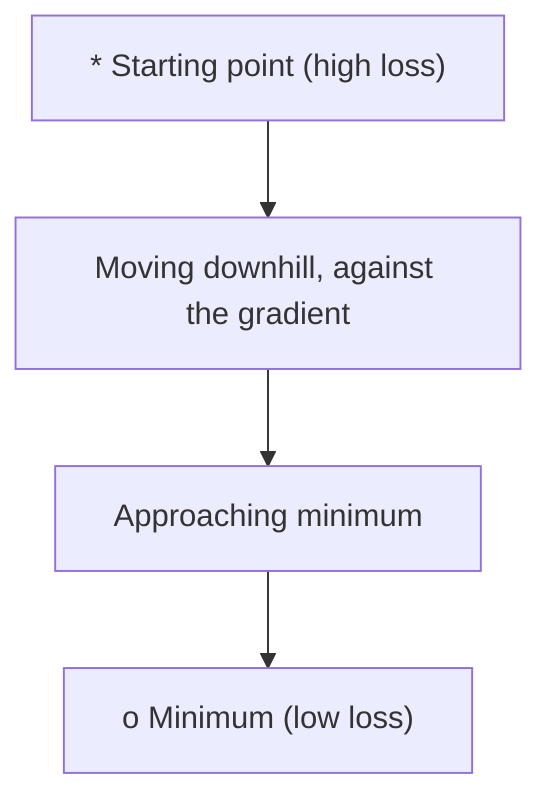
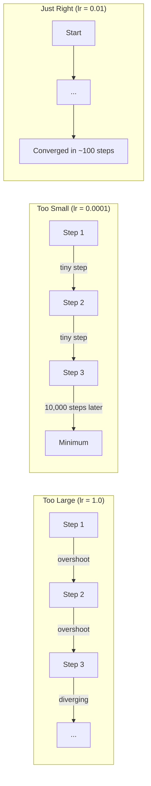
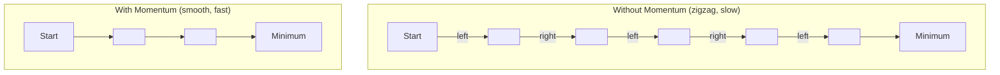
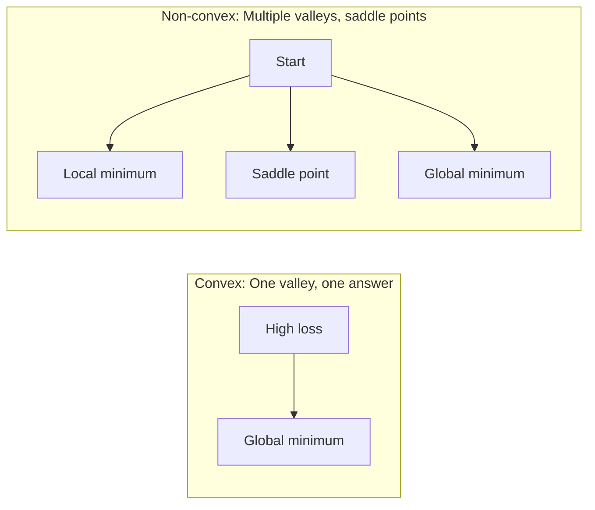
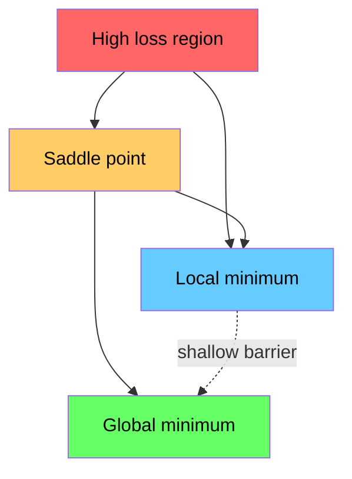

# Optimization

> Huấn luyện một mạng nơ-ron không gì khác hơn là tìm đáy của một thung lũng.

**Type:** Build
**Language:** Python
**Prerequisites:** Phase 1, Lessons 04-05 (Derivatives, Gradients)
**Time:** ~75 minutes

## Learning Objectives

- Triển khai gradient descent cơ bản, SGD có momentum và Adam từ đầu
- So sánh sự hội tụ của các bộ tối ưu hóa trên hàm Rosenbrock và giải thích tại sao Adam điều chỉnh tốc độ học theo từng trọng số
- Phân biệt các địa hình mất mát lồi và không lồi và giải thích vai trò của các điểm yên ngựa trong không gian nhiều chiều
- Cấu hình các lịch tốc độ học (giảm theo bước, ủ cosine, warmup) để ổn định huấn luyện

## The Problem

Bạn có một hàm mất mát. Nó cho bạn biết mô hình sai đến mức nào. Bạn có gradient. Chúng cho bạn biết hướng nào làm mất mát tệ hơn. Giờ bạn cần một chiến lược đi xuống dốc.

Cách tiếp cận ngây thơ rất đơn giản: di chuyển ngược hướng gradient. Nhân tỉ lệ bước với một số gọi là tốc độ học. Lặp lại. Đây là gradient descent, và nó hoạt động. Nhưng "hoạt động" có những điều cần lưu ý. Tốc độ học quá lớn và bạn vượt hẳn qua thung lũng, nảy qua lại giữa các vách. Quá nhỏ và bạn bò về phía câu trả lời qua hàng nghìn bước không cần thiết. Gặp một điểm yên ngựa và bạn ngừng di chuyển dù chưa tìm thấy cực tiểu.

Mỗi bộ tối ưu hóa trong học sâu là một câu trả lời cho cùng một câu hỏi: làm sao đến đáy thung lũng nhanh hơn và đáng tin cậy hơn?

## The Concept

### What optimization means

Tối ưu hóa là tìm các giá trị đầu vào tối thiểu hóa (hoặc cực đại hóa) một hàm. Trong học máy, hàm là mất mát. Đầu vào là các trọng số của mô hình. Huấn luyện là tối ưu hóa.

```
minimize L(w) where:
  L = loss function
  w = model weights (could be millions of parameters)
```

### Gradient descent (vanilla)

Bộ tối ưu hóa đơn giản nhất. Tính gradient của mất mát theo mọi trọng số. Di chuyển mỗi trọng số theo hướng ngược với gradient của nó. Nhân tỉ lệ bước với tốc độ học.

```math
w = w - \text{lr} \cdot \text{gradient}
```

Đó là toàn bộ thuật toán. Một dòng.



### Learning rate: the most important hyperparameter

Tốc độ học điều khiển kích thước bước. Nó quyết định mọi thứ về sự hội tụ.



Không có công thức cho tốc độ học phù hợp. Bạn tìm nó bằng thực nghiệm. Các điểm bắt đầu phổ biến: 0.001 cho Adam, 0.01 cho SGD có momentum.

### SGD vs batch vs mini-batch

Gradient descent cơ bản tính gradient trên toàn bộ tập dữ liệu trước khi bước một bước. Đây được gọi là batch gradient descent. Nó ổn định nhưng chậm.

Gradient descent ngẫu nhiên (SGD) tính gradient trên một mẫu ngẫu nhiên duy nhất và bước ngay lập tức. Nó nhiều nhiễu nhưng nhanh.

Mini-batch gradient descent dung hòa hai cách. Tính gradient trên một batch nhỏ (32, 64, 128, 256 mẫu), rồi bước. Đây là những gì mọi người thực sự sử dụng.

| Biến thể | Kích thước batch | Chất lượng gradient | Tốc độ mỗi bước | Nhiễu |
|---------|-----------|-----------------|---------------|-------|
| Batch GD | Toàn bộ tập dữ liệu | Chính xác | Chậm | Không có |
| SGD | 1 mẫu | Rất nhiều nhiễu | Nhanh | Cao |
| Mini-batch | 32-256 | Ước lượng tốt | Cân bằng | Vừa phải |

Nhiễu trong SGD và mini-batch không phải là lỗi. Nó giúp thoát khỏi các cực tiểu cục bộ nông và các điểm yên ngựa.

### Momentum: the ball rolling downhill

Gradient descent cơ bản chỉ nhìn vào gradient hiện tại. Nếu gradient ngoằn ngoèo (phổ biến trong các thung lũng hẹp), tiến triển chậm. Momentum khắc phục điều này bằng cách tích lũy các gradient quá khứ vào một thành phần vận tốc.

```math
\begin{aligned}
v &= \beta \cdot v + \text{gradient} \\
w &= w - \text{lr} \cdot v
\end{aligned}
```

Phép tương tự: một quả bóng lăn xuống dốc. Nó không dừng và khởi động lại tại mỗi chỗ gồ ghề. Nó tăng tốc theo các hướng nhất quán và làm giảm dao động.



`beta` (thường là 0.9) điều khiển lượng lịch sử cần giữ. Beta cao hơn nghĩa là nhiều momentum hơn, đường đi mượt hơn, nhưng phản ứng chậm hơn với các thay đổi hướng.

### Adam: adaptive learning rates

Các trọng số khác nhau cần các tốc độ học khác nhau. Một trọng số hiếm khi nhận gradient lớn nên bước lớn hơn khi cuối cùng nhận được. Một trọng số liên tục nhận gradient rất lớn nên bước nhỏ hơn.

Adam (Ước lượng Moment Thích nghi) theo dõi hai thứ cho mỗi trọng số:

1. Moment bậc nhất ($m$): trung bình cập nhật liên tục của gradient (giống momentum)
2. Moment bậc hai ($v$): trung bình cập nhật liên tục của gradient bình phương (độ lớn gradient)

```math
\begin{aligned}
m &= \beta_1 \cdot m + (1 - \beta_1) \cdot \text{gradient} \\
v &= \beta_2 \cdot v + (1 - \beta_2) \cdot \text{gradient}^2 \\[4pt]
\hat{m} &= m / (1 - \beta_1^t) \quad \text{bias correction} \\
\hat{v} &= v / (1 - \beta_2^t) \quad \text{bias correction} \\[4pt]
w &= w - \text{lr} \cdot \hat{m} / (\sqrt{\hat{v}} + \epsilon)
\end{aligned}
```

Phép chia cho `sqrt(v_hat)` là điểm cốt yếu. Các trọng số có gradient lớn được chia cho một số lớn (bước hiệu dụng nhỏ). Các trọng số có gradient nhỏ được chia cho một số nhỏ (bước hiệu dụng lớn). Mỗi trọng số có tốc độ học thích nghi riêng.

Các siêu tham số mặc định: `lr=0.001, beta1=0.9, beta2=0.999, epsilon=1e-8`. Những giá trị mặc định này hoạt động tốt cho hầu hết các bài toán.

### Learning rate schedules

Một tốc độ học cố định là một sự thỏa hiệp. Đầu quá trình huấn luyện, bạn muốn các bước lớn để tiến triển nhanh. Cuối quá trình huấn luyện, bạn muốn các bước nhỏ để tinh chỉnh gần cực tiểu.

Các lịch phổ biến:

| Lịch | Công thức | Trường hợp sử dụng |
|----------|---------|----------|
| Giảm theo bước | $\text{lr} = \text{lr} \cdot \text{factor}$ mỗi $N$ epoch | Đơn giản, điều khiển thủ công |
| Giảm theo hàm mũ | $\text{lr} = \text{lr}_0 \cdot \text{decay}^t$ | Giảm mượt |
| Ủ cosine | $\text{lr} = \text{lr} _{\min} + 0.5 \cdot (\text{lr} _{\max} - \text{lr} _{\min}) \cdot (1 + \cos(\pi t / T))$ | Transformer, huấn luyện hiện đại |
| Warmup + giảm | Tăng tuyến tính, rồi giảm | Các mô hình lớn, ngăn bất ổn ban đầu |

### Convex vs non-convex

Một hàm lồi không có cực tiểu cục bộ xấu: mọi cực tiểu cục bộ đều là cực tiểu toàn cục. Đối với một hàm lồi trơn có cực tiểu, gradient descent với tốc độ học đủ nhỏ hội tụ đến cực tiểu đó. Một hàm bậc hai như $f(x) = x^2$ là lồi, và cực tiểu của nó là duy nhất.

Các hàm mất mát mạng nơ-ron không lồi. Chúng có nhiều cực tiểu cục bộ, điểm yên ngựa và vùng phẳng.



Trong thực tế, các cực tiểu cục bộ trong mạng nơ-ron nhiều chiều hiếm khi là vấn đề. Hầu hết các cực tiểu cục bộ có giá trị mất mát gần cực tiểu toàn cục. Các điểm yên ngựa (phẳng theo một số hướng, cong theo các hướng khác) mới là trở ngại thực sự. Momentum và nhiễu từ mini-batch giúp thoát khỏi chúng.

### Loss landscape visualization

Mất mát là một hàm của tất cả trọng số. Với một mô hình có 1 triệu trọng số, địa hình mất mát nằm trong không gian 1,000,001 chiều. Chúng ta trực quan hóa nó bằng cách chọn hai hướng ngẫu nhiên trong không gian trọng số và vẽ mất mát dọc theo các hướng đó, tạo ra một bề mặt 2D.



Các cực tiểu nhọn tổng quát hóa kém. Các cực tiểu phẳng tổng quát hóa tốt. Đây là một lý do SGD có momentum thường vượt Adam về độ chính xác kiểm tra cuối cùng: nhiễu của nó ngăn việc dừng lại ở các cực tiểu nhọn.

```figure
gradient-descent
```

## Build It

### Step 1: Define a test function

Hàm Rosenbrock là một chuẩn đánh giá tối ưu hóa kinh điển. Cực tiểu của nó nằm tại (1, 1) bên trong một thung lũng hẹp cong dễ tìm nhưng khó đi theo.

```math
f(x, y) = (1 - x)^2 + 100 \cdot (y - x^2)^2
```

```python
def rosenbrock(params):
    x, y = params
    return (1 - x) ** 2 + 100 * (y - x ** 2) ** 2

def rosenbrock_gradient(params):
    x, y = params
    df_dx = -2 * (1 - x) + 200 * (y - x ** 2) * (-2 * x)
    df_dy = 200 * (y - x ** 2)
    return [df_dx, df_dy]
```

### Step 2: Vanilla gradient descent

```python
class GradientDescent:
    def __init__(self, lr=0.001):
        self.lr = lr

    def step(self, params, grads):
        return [p - self.lr * g for p, g in zip(params, grads)]
```

### Step 3: SGD with momentum

```python
class SGDMomentum:
    def __init__(self, lr=0.001, momentum=0.9):
        self.lr = lr
        self.momentum = momentum
        self.velocity = None

    def step(self, params, grads):
        if self.velocity is None:
            self.velocity = [0.0] * len(params)
        self.velocity = [
            self.momentum * v + g
            for v, g in zip(self.velocity, grads)
        ]
        return [p - self.lr * v for p, v in zip(params, self.velocity)]
```

### Step 4: Adam

```python
class Adam:
    def __init__(self, lr=0.001, beta1=0.9, beta2=0.999, epsilon=1e-8):
        self.lr = lr
        self.beta1 = beta1
        self.beta2 = beta2
        self.epsilon = epsilon
        self.m = None
        self.v = None
        self.t = 0

    def step(self, params, grads):
        if self.m is None:
            self.m = [0.0] * len(params)
            self.v = [0.0] * len(params)

        self.t += 1

        self.m = [
            self.beta1 * m + (1 - self.beta1) * g
            for m, g in zip(self.m, grads)
        ]
        self.v = [
            self.beta2 * v + (1 - self.beta2) * g ** 2
            for v, g in zip(self.v, grads)
        ]

        m_hat = [m / (1 - self.beta1 ** self.t) for m in self.m]
        v_hat = [v / (1 - self.beta2 ** self.t) for v in self.v]

        return [
            p - self.lr * mh / (vh ** 0.5 + self.epsilon)
            for p, mh, vh in zip(params, m_hat, v_hat)
        ]
```

### Step 5: Run and compare

```python
def optimize(optimizer, func, grad_func, start, steps=5000):
    params = list(start)
    history = [params[:]]
    for _ in range(steps):
        grads = grad_func(params)
        params = optimizer.step(params, grads)
        history.append(params[:])
    return history

start = [-1.0, 1.0]

gd_history = optimize(GradientDescent(lr=0.0005), rosenbrock, rosenbrock_gradient, start)
sgd_history = optimize(SGDMomentum(lr=0.0001, momentum=0.9), rosenbrock, rosenbrock_gradient, start)
adam_history = optimize(Adam(lr=0.01), rosenbrock, rosenbrock_gradient, start)

for name, history in [("GD", gd_history), ("SGD+M", sgd_history), ("Adam", adam_history)]:
    final = history[-1]
    loss = rosenbrock(final)
    print(f"{name:6s} -> x={final[0]:.6f}, y={final[1]:.6f}, loss={loss:.8f}")
```

Đầu ra kỳ vọng: Adam hội tụ nhanh nhất. SGD có momentum đi theo một đường mượt hơn. GD cơ bản tiến triển chậm dọc theo thung lũng hẹp.

## Use It

Trong thực tế, sử dụng các bộ tối ưu hóa PyTorch hoặc JAX. Chúng xử lý các nhóm tham số, suy giảm trọng số, cắt gradient và tăng tốc GPU.

```python
import torch

model = torch.nn.Linear(784, 10)

sgd = torch.optim.SGD(model.parameters(), lr=0.01, momentum=0.9)
adam = torch.optim.Adam(model.parameters(), lr=0.001)
adamw = torch.optim.AdamW(model.parameters(), lr=0.001, weight_decay=0.01)

scheduler = torch.optim.lr_scheduler.CosineAnnealingLR(adam, T_max=100)
```

Các quy tắc kinh nghiệm:

- Bắt đầu với Adam (lr=0.001). Nó hoạt động cho hầu hết các bài toán mà không cần điều chỉnh.
- Chuyển sang SGD có momentum (lr=0.01, momentum=0.9) khi bạn cần độ chính xác cuối cùng tốt nhất và có thể dành thêm công sức điều chỉnh.
- Sử dụng AdamW (Adam với suy giảm trọng số tách biệt) cho transformer.
- Luôn sử dụng một lịch tốc độ học cho các lần huấn luyện dài hơn vài epoch.
- Nếu huấn luyện không ổn định, giảm tốc độ học. Nếu huấn luyện quá chậm, tăng nó.

## Ship It

Bài học này tạo ra một prompt để chọn bộ tối ưu hóa phù hợp. Xem `outputs/prompt-optimizer-guide.md`.

Các lớp bộ tối ưu hóa được xây dựng ở đây xuất hiện lại trong Giai đoạn 3 khi chúng ta huấn luyện một mạng nơ-ron từ đầu.

## Exercises

1. **Quét tốc độ học.** Chạy gradient descent cơ bản trên hàm Rosenbrock với các tốc độ học [0.0001, 0.0005, 0.001, 0.005, 0.01]. Vẽ hoặc in mất mát cuối cùng sau 5000 bước cho mỗi giá trị. Tìm tốc độ học lớn nhất vẫn hội tụ.

2. **So sánh momentum.** Chạy SGD với các giá trị momentum [0.0, 0.5, 0.9, 0.99] trên hàm Rosenbrock. Theo dõi mất mát tại mỗi bước. Giá trị momentum nào hội tụ nhanh nhất? Giá trị nào vượt quá?

3. **Thoát điểm yên ngựa.** Định nghĩa hàm $f(x, y) = x^2 - y^2$ (một điểm yên ngựa tại gốc tọa độ). Bắt đầu tại (0.01, 0.01). So sánh cách GD cơ bản, SGD có momentum và Adam hoạt động. Bộ nào thoát khỏi điểm yên ngựa?

4. **Triển khai giảm tốc độ học.** Thêm một lịch giảm theo hàm mũ vào lớp GradientDescent: `lr = lr_0 * 0.999^step`. So sánh sự hội tụ khi có và không giảm trên hàm Rosenbrock.

### Hints

**Bài tập 1.** Lặp qua các tốc độ học, tạo một `GradientDescent(lr=...)` cho mỗi giá trị và truyền nó cho `optimize` với `rosenbrock` và `rosenbrock_gradient`. Một lần chạy phân kỳ hiển thị loss tăng hoặc trở thành `nan`; cực tiểu nằm tại $(1, 1)$ với loss 0.

**Bài tập 2.** Tạo `SGDMomentum(momentum=m)` cho mỗi giá trị và ghi lại loss sau mỗi bước. Sử dụng `find_convergence_step` để so sánh tốc độ, và tìm các loss tăng rồi giảm để tìm hiện tượng vượt quá.

**Bài tập 3.** Viết gradient $(2x, -2y)$ và chạy ba bộ tối ưu từ (0.01, 0.01). In $y$ sau mỗi 100 bước: bộ tối ưu thoát ra là bộ có $\lvert y \rvert$ tăng lớn.

**Bài tập 4.** Lưu `lr_0` và một bộ đếm bước trong `GradientDescent`, và tính `lr = lr_0 * 0.999 ** step` bên trong `step`. In tốc độ học ở bước 0 và bước 1000; nó phải giảm từ `lr_0` xuống khoảng $0.37 \times \text{lr}_0$.

## Key Terms

| Thuật ngữ | Cách mọi người nói | Ý nghĩa thực sự |
|------|----------------|----------------------|
| Gradient descent | "Đi xuống dốc" | Cập nhật trọng số bằng cách trừ gradient được nhân với tốc độ học. Bộ tối ưu hóa cơ bản nhất. |
| Learning rate (Tốc độ học) | "Kích thước bước" | Một số vô hướng điều khiển mỗi cập nhật di chuyển trọng số bao xa. Quá lớn gây phân kỳ. Quá nhỏ lãng phí tính toán. |
| Momentum | "Tiếp tục lăn" | Tích lũy các gradient quá khứ vào một vector vận tốc. Làm giảm dao động và tăng tốc chuyển động theo các hướng nhất quán. |
| SGD | "Lấy mẫu ngẫu nhiên" | Gradient descent ngẫu nhiên. Tính gradient trên một tập con ngẫu nhiên thay vì toàn bộ tập dữ liệu. Trong thực tế hầu như luôn có nghĩa là mini-batch SGD. |
| Mini-batch | "Một phần dữ liệu" | Một tập con nhỏ của dữ liệu huấn luyện (32-256 mẫu) được sử dụng để ước lượng gradient. Cân bằng tốc độ và độ chính xác gradient. |
| Adam | "Bộ tối ưu hóa mặc định" | Ước lượng Moment Thích nghi. Theo dõi các trung bình cập nhật liên tục của gradient và gradient bình phương theo từng trọng số để cho mỗi trọng số tốc độ học riêng. |
| Bias correction (Hiệu chỉnh độ chệch) | "Khắc phục khởi đầu lạnh" | Các moment bậc nhất và bậc hai của Adam được khởi tạo bằng không. Hiệu chỉnh độ chệch chia cho $(1 - \beta^t)$ để bù trong các bước đầu. |
| Learning rate schedule (Lịch tốc độ học) | "Thay đổi lr theo thời gian" | Một hàm điều chỉnh tốc độ học trong quá trình huấn luyện. Bước lớn lúc đầu, bước nhỏ lúc sau. |
| Convex function (Hàm lồi) | "Một thung lũng" | Một hàm mà bất kỳ cực tiểu cục bộ nào cũng là cực tiểu toàn cục. Gradient descent luôn tìm thấy nó. Mất mát mạng nơ-ron không lồi. |
| Saddle point (Điểm yên ngựa) | "Phẳng nhưng không phải cực tiểu" | Một điểm có gradient bằng không nhưng là cực tiểu theo một số hướng và cực đại theo các hướng khác. Phổ biến trong không gian nhiều chiều. |
| Loss landscape (Địa hình mất mát) | "Địa hình" | Hàm mất mát được vẽ trên không gian trọng số. Được trực quan hóa bằng cách cắt theo hai hướng ngẫu nhiên. |
| Convergence (Hội tụ) | "Đến nơi" | Bộ tối ưu hóa đã đạt đến một điểm mà các bước tiếp theo không làm giảm mất mát đáng kể. |

## Further Reading

- [Sebastian Ruder: An overview of gradient descent optimization algorithms](https://ruder.io/optimizing-gradient-descent/) - khảo sát toàn diện về tất cả các bộ tối ưu hóa chính
- [Why Momentum Really Works (Distill)](https://distill.pub/2017/momentum/) - trực quan hóa tương tác về động lực momentum
- [Adam: A Method for Stochastic Optimization (Kingma & Ba, 2014)](https://arxiv.org/abs/1412.6980) - bài báo Adam gốc, dễ đọc và ngắn
- [Visualizing the Loss Landscape of Neural Nets (Li et al., 2018)](https://arxiv.org/abs/1712.09913) - bài báo cho thấy cực tiểu nhọn so với phẳng
