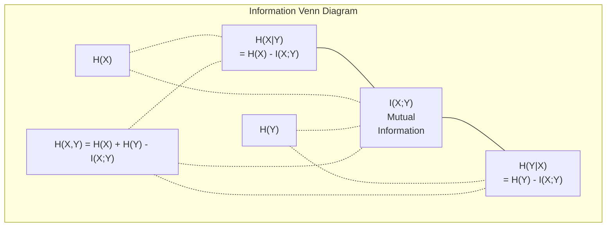

# Information Theory

> Lý thuyết thông tin đo sự bất ngờ. Các hàm mất mát được xây dựng dựa trên nó.

**Type:** Learn
**Language:** Python
**Prerequisites:** Phase 1, Lesson 06 (Probability)
**Time:** ~60 minutes

## Learning Objectives

- Tính entropy, cross-entropy và phân kỳ KL từ đầu và giải thích mối quan hệ của chúng
- Suy ra tại sao tối thiểu hóa mất mát cross-entropy tương đương với cực đại hóa log-hợp lý
- Tính thông tin tương hỗ giữa các đặc trưng và một mục tiêu để xếp hạng độ quan trọng của đặc trưng
- Giải thích perplexity như kích thước từ vựng hiệu dụng mà một mô hình ngôn ngữ lựa chọn từ đó

## The Problem

Bạn gọi `CrossEntropyLoss()` trong mọi mô hình phân loại mà bạn huấn luyện. Bạn thấy "perplexity" trong mọi bài báo mô hình ngôn ngữ. Bạn đọc về phân kỳ KL trong VAE, chưng cất và RLHF. Đây không phải những khái niệm rời rạc. Chúng đều là cùng một ý tưởng đội những chiếc mũ khác nhau.

Lý thuyết thông tin cho bạn ngôn ngữ để suy luận về sự không chắc chắn, nén và dự đoán. Claude Shannon phát minh ra nó vào năm 1948 để giải quyết các vấn đề truyền thông. Hóa ra, huấn luyện một mạng nơ-ron là một vấn đề truyền thông: mô hình đang cố truyền nhãn đúng qua một kênh nhiễu gồm các trọng số đã học.

Bài học này xây dựng mọi công thức từ đầu để bạn thấy chúng đến từ đâu và tại sao chúng hoạt động.

## The Concept

### Information Content (Surprise)

Khi điều gì đó ít có khả năng xảy ra, nó mang nhiều thông tin hơn. Đồng xu ra mặt ngửa? Không bất ngờ. Trúng xổ số? Rất bất ngờ.

Lượng thông tin của một biến cố có xác suất $p$ là:

```math
I(x) = -\log(p(x))
```

Sử dụng log cơ số 2 cho bạn bit. Sử dụng log tự nhiên cho bạn nat. Cùng ý tưởng, khác đơn vị.

```
Event              Probability    Surprise (bits)
Fair coin heads    0.5            1.0
Rolling a 6        0.167          2.58
1-in-1000 event    0.001          9.97
Certain event      1.0            0.0
```

Các biến cố chắc chắn mang lượng thông tin bằng không. Bạn đã biết chúng sẽ xảy ra.

### Entropy (Average Surprise)

Entropy là sự bất ngờ kỳ vọng trên tất cả các kết quả có thể của một phân phối.

```math
H(P) = -\sum_{x} p(x) \log(p(x))
```

Một đồng xu cân bằng có entropy lớn nhất cho một biến nhị phân: 1 bit. Một đồng xu thiên lệch (99% mặt ngửa) có entropy thấp: 0.08 bit. Bạn đã biết điều gì sẽ xảy ra, nên mỗi lần tung hầu như không cho bạn biết gì.

```math
\begin{aligned}
\text{Fair coin:} \quad & H = -(0.5 \log_2(0.5) + 0.5 \log_2(0.5)) = 1.0 \text{ bit} \\
\text{Biased coin:} \quad & H = -(0.99 \log_2(0.99) + 0.01 \log_2(0.01)) = 0.08 \text{ bits}
\end{aligned}
```

Entropy đo sự không chắc chắn không thể giảm trong một phân phối. Bạn không thể nén xuống dưới nó.

### Cross-Entropy (The Loss Function You Use Every Day)

Cross-entropy đo sự bất ngờ trung bình khi bạn sử dụng phân phối $Q$ để mã hóa các biến cố thực sự đến từ phân phối $P$.

```math
H(P, Q) = -\sum_{x} p(x) \log(q(x))
```

$P$ là phân phối thực (các nhãn). $Q$ là các dự đoán của mô hình. Nếu $Q$ khớp hoàn hảo với $P$, cross-entropy bằng entropy. Bất kỳ sự không khớp nào cũng làm nó lớn hơn.

Trong phân loại, $P$ là một vector one-hot (lớp thực có xác suất 1, mọi thứ khác 0). Điều này đơn giản hóa cross-entropy thành:

```math
H(P, Q) = -\log(q(\text{true\_class}))
```

Đó là toàn bộ công thức mất mát cross-entropy cho phân loại. Cực đại hóa xác suất dự đoán của lớp đúng.

### KL Divergence (Distance Between Distributions)

Phân kỳ KL đo lượng bất ngờ thêm mà bạn nhận được khi sử dụng $Q$ thay vì $P$.

```math
\begin{aligned}
D_{KL}(P \,\|\, Q) &= \sum_{x} p(x) \log(p(x) / q(x)) \\
&= H(P, Q) - H(P)
\end{aligned}
```

Cross-entropy là entropy cộng phân kỳ KL. Vì entropy của phân phối thực không đổi trong quá trình huấn luyện, tối thiểu hóa cross-entropy giống như tối thiểu hóa phân kỳ KL. Bạn đang đẩy phân phối của mô hình về phía phân phối thực.

Phân kỳ KL không đối xứng: $D_{KL}(P \Vert Q) \ne D_{KL}(Q \Vert P)$. Nó không phải là một metric khoảng cách thực sự.

### Mutual Information

Thông tin tương hỗ đo mức độ biết một biến cho bạn biết về một biến khác.

```math
\begin{aligned}
I(X; Y) &= H(X) - H(X \mid Y) \\
&= H(X) + H(Y) - H(X, Y)
\end{aligned}
```

Nếu $X$ và $Y$ độc lập, thông tin tương hỗ bằng không. Biết một biến không cho bạn biết gì về biến còn lại. Nếu chúng tương quan hoàn hảo, thông tin tương hỗ bằng entropy của một trong hai biến.

Trong lựa chọn đặc trưng, thông tin tương hỗ cao giữa một đặc trưng và mục tiêu có nghĩa là đặc trưng hữu ích. Thông tin tương hỗ thấp có nghĩa là nó là nhiễu.

### Conditional Entropy

$H(Y \mid X)$ đo lượng không chắc chắn còn lại về $Y$ sau khi bạn quan sát $X$.

```math
H(Y \mid X) = H(X,Y) - H(X)
```

Hai cực:
- Nếu $X$ xác định hoàn toàn $Y$, thì $H(Y \mid X) = 0$. Biết $X$ loại bỏ mọi sự không chắc chắn về $Y$. Ví dụ: $X$ = nhiệt độ Celsius, $Y$ = nhiệt độ Fahrenheit.
- Nếu $X$ không cho bạn biết gì về $Y$, thì $H(Y \mid X) = H(Y)$. Biết $X$ hoàn toàn không giảm sự không chắc chắn của bạn. Ví dụ: $X$ = lần tung đồng xu, $Y$ = thời tiết ngày mai.

Entropy có điều kiện luôn không âm và không bao giờ vượt quá $H(Y)$:

```math
0 \le H(Y \mid X) \le H(Y)
```

Trong học máy, entropy có điều kiện xuất hiện trong cây quyết định. Tại mỗi lần chia, thuật toán chọn đặc trưng $X$ tối thiểu hóa $H(Y \mid X)$ -- đặc trưng loại bỏ nhiều nhất sự không chắc chắn về nhãn $Y$.

### Joint Entropy

$H(X,Y)$ là entropy của phân phối đồng thời của $X$ và $Y$.

```math
H(X,Y) = -\sum_{x} \sum_{y} p(x,y) \log(p(x,y))
```

Tính chất chính:

```math
H(X,Y) \le H(X) + H(Y)
```

Dấu bằng xảy ra khi $X$ và $Y$ độc lập. Nếu chúng chia sẻ thông tin, entropy đồng thời nhỏ hơn tổng các entropy riêng lẻ. Entropy "thiếu" chính là thông tin tương hỗ.



Các mối quan hệ:
- $H(X,Y) = H(X) + H(Y \mid X) = H(Y) + H(X \mid Y)$
- $I(X;Y) = H(X) - H(X \mid Y) = H(Y) - H(Y \mid X)$
- $H(X,Y) = H(X) + H(Y) - I(X;Y)$

### Mutual Information (Deep Dive)

Thông tin tương hỗ $I(X;Y)$ định lượng mức độ biết một biến làm giảm sự không chắc chắn về biến còn lại.

```math
\begin{aligned}
I(X;Y) &= H(X) - H(X \mid Y) \\
&= H(Y) - H(Y \mid X) \\
&= H(X) + H(Y) - H(X,Y) \\
&= \sum_{x} \sum_{y} p(x,y) \log\left(\frac{p(x,y)}{p(x) \, p(y)}\right)
\end{aligned}
```

Các tính chất:
- $I(X;Y) \ge 0$ luôn luôn. Bạn không bao giờ mất thông tin khi quan sát điều gì đó.
- $I(X;Y) = 0$ khi và chỉ khi $X$ và $Y$ độc lập.
- $I(X;Y) = I(Y;X)$. Nó đối xứng, khác với phân kỳ KL.
- $I(X;X) = H(X)$. Một biến chia sẻ toàn bộ thông tin của nó với chính nó.

**Thông tin tương hỗ để lựa chọn đặc trưng.** Trong ML, bạn muốn các đặc trưng cung cấp thông tin về mục tiêu. Thông tin tương hỗ cho bạn một cách có nguyên tắc để xếp hạng các đặc trưng:

1. Với mỗi đặc trưng $X_i$, tính $I(X_i; Y)$ trong đó $Y$ là biến mục tiêu.
2. Xếp hạng các đặc trưng theo điểm MI.
3. Giữ lại $k$ đặc trưng đứng đầu.

Điều này hoạt động với bất kỳ mối quan hệ nào giữa đặc trưng và mục tiêu -- tuyến tính, phi tuyến, đơn điệu hoặc không. Tương quan Pearson chỉ phát hiện các mối quan hệ tuyến tính. MI phát hiện bất kỳ sự phụ thuộc nào, nhưng với dữ liệu hữu hạn, ước lượng của nó cần đủ mẫu và một cách chia khoảng hợp lý.

| Phương pháp | Phát hiện | Chi phí tính toán | Xử lý biến phân loại? |
|--------|---------|-------------------|---------------------|
| Tương quan Pearson | Các quan hệ tuyến tính | $O(n)$ | Không |
| Tương quan Spearman | Các quan hệ đơn điệu | $O(n \log n)$ | Không |
| Thông tin tương hỗ | Bất kỳ sự phụ thuộc thống kê nào | $O(n \log n)$ với chia khoảng | Có |

### Label Smoothing and Cross-Entropy

Phân loại tiêu chuẩn sử dụng các mục tiêu cứng: [0, 0, 1, 0]. Lớp thực nhận xác suất 1, mọi thứ khác nhận 0. Làm trơn nhãn thay thế chúng bằng các mục tiêu mềm:

```math
\text{soft\_target} = (1 - \epsilon) \cdot \text{hard\_target} + \epsilon / \text{num\_classes}
```

Với $\epsilon = 0.1$ và 4 lớp:
- Mục tiêu cứng:  [0, 0, 1, 0]
- Mục tiêu mềm:  [0.025, 0.025, 0.925, 0.025]

Từ góc nhìn lý thuyết thông tin, làm trơn nhãn làm tăng entropy của phân phối mục tiêu. Các mục tiêu one-hot cứng có entropy 0 -- không có sự không chắc chắn. Các mục tiêu mềm có entropy dương.

Tại sao điều này giúp ích:
- Ngăn mô hình đẩy logits đến các giá trị cực đoan (cần logits vô hạn để khớp hoàn hảo với một mục tiêu one-hot dưới cross-entropy)
- Đóng vai trò regularization: mô hình không thể tự tin 100%
- Cải thiện hiệu chỉnh: các xác suất dự đoán phản ánh tốt hơn sự không chắc chắn thực
- Giảm khoảng cách giữa hành vi huấn luyện và suy luận

Mất mát cross-entropy có làm trơn nhãn trở thành:

```math
L = (1 - \epsilon) \cdot \text{CE}(\text{hard\_target}, \text{prediction}) + \epsilon \cdot H_{\text{uniform}}(\text{prediction})
```

Số hạng thứ hai phạt các dự đoán cách xa phân phối đều -- một regularization trực tiếp lên sự tự tin.

### Why Cross-Entropy Is THE Classification Loss

Ba góc nhìn, cùng kết luận.

**Góc nhìn lý thuyết thông tin.** Cross-entropy đo số bit bạn lãng phí khi sử dụng phân phối của mô hình thay vì phân phối thực. Tối thiểu hóa nó khiến mô hình trở thành bộ mã hóa thực tế hiệu quả nhất.

**Góc nhìn hợp lý cực đại.** Với $N$ mẫu huấn luyện có các lớp thực $y_i$:

```math
\begin{aligned}
\text{Likelihood} &= \prod_i q(y_i) \\
\text{Log-likelihood} &= \sum_i \log(q(y_i)) \\
\text{Negative log-likelihood} &= -\sum_i \log(q(y_i))
\end{aligned}
```

Dòng cuối đó là mất mát cross-entropy. Tối thiểu hóa cross-entropy = cực đại hóa hợp lý của dữ liệu huấn luyện dưới mô hình của bạn.

**Góc nhìn gradient.** Gradient của cross-entropy theo logits đơn giản là (predicted - true). Gọn, ổn định và tính nhanh. Đây là lý do nó kết hợp hoàn hảo với softmax.

### Bits vs Nats

Sự khác biệt duy nhất là cơ số log.

```
log base 2   -> bits      (information theory tradition)
log base e   -> nats      (machine learning convention)
log base 10  -> hartleys  (rarely used)
```

1 nat = $1/\ln(2)$ bit = 1.4427 bit. PyTorch và TensorFlow sử dụng log tự nhiên (nat) theo mặc định.

### Perplexity

Perplexity là hàm mũ của cross-entropy. Nó cho bạn biết số lựa chọn có khả năng như nhau hiệu dụng mà mô hình không chắc chắn giữa chúng.

```math
\begin{aligned}
\text{Perplexity} &= 2^{H(P,Q)} \quad \text{(if using bits)} \\
\text{Perplexity} &= e^{H(P,Q)} \quad \text{(if using nats)}
\end{aligned}
```

Một mô hình ngôn ngữ có perplexity 50, tính trung bình, bối rối như thể nó phải chọn đều từ 50 token tiếp theo có thể. Thấp hơn là tốt hơn.

GPT-2 đạt perplexity ~30 trên các chuẩn đánh giá phổ biến. Các mô hình hiện đại ở mức một chữ số cho các miền được biểu diễn tốt.

```figure
entropy-kl
```

## Build It

### Step 1: Information content and entropy

```python
import math

def information_content(p, base=2):
    if p <= 0 or p > 1:
        return float('inf') if p <= 0 else 0.0
    return -math.log(p) / math.log(base)

def entropy(probs, base=2):
    return sum(
        p * information_content(p, base)
        for p in probs if p > 0
    )

fair_coin = [0.5, 0.5]
biased_coin = [0.99, 0.01]
fair_die = [1/6] * 6

print(f"Fair coin entropy:   {entropy(fair_coin):.4f} bits")
print(f"Biased coin entropy: {entropy(biased_coin):.4f} bits")
print(f"Fair die entropy:    {entropy(fair_die):.4f} bits")
```

### Step 2: Cross-entropy and KL divergence

```python
def cross_entropy(p, q, base=2):
    total = 0.0
    for pi, qi in zip(p, q):
        if pi > 0:
            if qi <= 0:
                return float('inf')
            total += pi * (-math.log(qi) / math.log(base))
    return total

def kl_divergence(p, q, base=2):
    return cross_entropy(p, q, base) - entropy(p, base)

true_dist = [0.7, 0.2, 0.1]
good_model = [0.6, 0.25, 0.15]
bad_model = [0.1, 0.1, 0.8]

print(f"Entropy of true dist:     {entropy(true_dist):.4f} bits")
print(f"CE (good model):          {cross_entropy(true_dist, good_model):.4f} bits")
print(f"CE (bad model):           {cross_entropy(true_dist, bad_model):.4f} bits")
print(f"KL divergence (good):     {kl_divergence(true_dist, good_model):.4f} bits")
print(f"KL divergence (bad):      {kl_divergence(true_dist, bad_model):.4f} bits")
```

### Step 3: Cross-entropy as classification loss

```python
def softmax(logits):
    max_logit = max(logits)
    exps = [math.exp(z - max_logit) for z in logits]
    total = sum(exps)
    return [e / total for e in exps]

def cross_entropy_loss(true_class, logits):
    probs = softmax(logits)
    return -math.log(probs[true_class])

logits = [2.0, 1.0, 0.1]
true_class = 0

probs = softmax(logits)
loss = cross_entropy_loss(true_class, logits)

print(f"Logits:      {logits}")
print(f"Softmax:     {[f'{p:.4f}' for p in probs]}")
print(f"True class:  {true_class}")
print(f"Loss:        {loss:.4f} nats")
print(f"Perplexity:  {math.exp(loss):.2f}")
```

### Step 4: Cross-entropy equals negative log-likelihood

```python
import random

random.seed(42)

n_samples = 1000
n_classes = 3
true_labels = [random.randint(0, n_classes - 1) for _ in range(n_samples)]
model_logits = [[random.gauss(0, 1) for _ in range(n_classes)] for _ in range(n_samples)]

ce_loss = sum(
    cross_entropy_loss(label, logits)
    for label, logits in zip(true_labels, model_logits)
) / n_samples

nll = -sum(
    math.log(softmax(logits)[label])
    for label, logits in zip(true_labels, model_logits)
) / n_samples

print(f"Cross-entropy loss:      {ce_loss:.6f}")
print(f"Negative log-likelihood: {nll:.6f}")
print(f"Difference:              {abs(ce_loss - nll):.2e}")
```

### Step 5: Mutual information

```python
def mutual_information(joint_probs, base=2):
    rows = len(joint_probs)
    cols = len(joint_probs[0])

    margin_x = [sum(joint_probs[i][j] for j in range(cols)) for i in range(rows)]
    margin_y = [sum(joint_probs[i][j] for i in range(rows)) for j in range(cols)]

    mi = 0.0
    for i in range(rows):
        for j in range(cols):
            pxy = joint_probs[i][j]
            if pxy > 0:
                mi += pxy * math.log(pxy / (margin_x[i] * margin_y[j])) / math.log(base)
    return mi

independent = [[0.25, 0.25], [0.25, 0.25]]
dependent = [[0.45, 0.05], [0.05, 0.45]]

print(f"MI (independent): {mutual_information(independent):.4f} bits")
print(f"MI (dependent):   {mutual_information(dependent):.4f} bits")
```

## Use It

Các khái niệm tương tự bằng NumPy, theo cách bạn sẽ sử dụng chúng trong thực tế:

```python
import numpy as np

def np_entropy(p):
    p = np.asarray(p, dtype=float)
    mask = p > 0
    result = np.zeros_like(p)
    result[mask] = p[mask] * np.log(p[mask])
    return -result.sum()

def np_cross_entropy(p, q):
    p, q = np.asarray(p, dtype=float), np.asarray(q, dtype=float)
    mask = p > 0
    return -(p[mask] * np.log(q[mask])).sum()

def np_kl_divergence(p, q):
    return np_cross_entropy(p, q) - np_entropy(p)

true = np.array([0.7, 0.2, 0.1])
pred = np.array([0.6, 0.25, 0.15])
print(f"Entropy:    {np_entropy(true):.4f} nats")
print(f"Cross-ent:  {np_cross_entropy(true, pred):.4f} nats")
print(f"KL div:     {np_kl_divergence(true, pred):.4f} nats")
```

Bạn đã xây dựng từ đầu những gì `torch.nn.CrossEntropyLoss()` thực hiện nội bộ. Giờ bạn biết tại sao mất mát giảm trong quá trình huấn luyện: phân phối dự đoán của mô hình đang tiến gần hơn đến phân phối thực, được đo bằng số nat thông tin lãng phí.

## Exercises

1. Tính entropy của bảng chữ cái tiếng Anh với giả định phân phối đều (26 chữ cái). Sau đó ước lượng nó bằng tần suất chữ cái thực tế. Giá trị nào cao hơn và tại sao?

2. Một mô hình xuất ra logits [5.0, 2.0, 0.5] cho một mẫu có lớp thực 1. Tính mất mát cross-entropy bằng tay, rồi xác minh bằng hàm `cross_entropy_loss` của bạn. Logits nào sẽ cho mất mát bằng không?

3. Chỉ ra rằng phân kỳ KL không đối xứng. Chọn hai phân phối $P$ và $Q$ và tính $D_{KL}(P \Vert Q)$ và $D_{KL}(Q \Vert P)$. Giải thích tại sao chúng khác nhau.

4. Xây dựng một hàm tính perplexity cho một chuỗi dự đoán token. Với một danh sách các cặp (true_token_index, predicted_logits), trả về perplexity của chuỗi.

### Hints

**Bài tập 1.** Gọi `entropy` với 26 xác suất bằng nhau; kết quả phải là $\log_2 26 \approx 4.70$ bit. Tần suất chữ cái thực tế không đều, vì vậy entropy với chúng phải thấp hơn.

**Bài tập 2.** Tính `softmax` của các logit, rồi $-\ln$ của xác suất tại chỉ số 1, và so sánh với `cross_entropy_loss(1, logits)`; cả hai phải gần 3.06. Loss chỉ tiến gần 0 khi logit cho lớp 1 lớn hơn nhiều so với hai logit còn lại.

**Bài tập 3.** Sử dụng hai phân phối nhỏ có hình dạng khác nhau, ví dụ $P = [0.9, 0.1]$ và $Q = [0.5, 0.5]$, và gọi `kl_divergence` theo cả hai thứ tự. Hai giá trị phải khác nhau, vì mỗi hướng gán trọng số cho tỷ số log bằng một phân phối khác nhau.

**Bài tập 4.** Với mỗi cặp, tính `cross_entropy_loss(true_token_index, predicted_logits)`, lấy trung bình và truyền nó cho `perplexity`. Kiểm tra bằng các logit đều trên $V$ token: perplexity phải là $V$.

## Key Terms

| Thuật ngữ | Cách mọi người nói | Ý nghĩa thực sự |
|------|----------------|----------------------|
| Information content (Lượng thông tin) | "Sự bất ngờ" | Số bit (hoặc nat) cần để mã hóa một biến cố: $-\log(p)$ |
| Entropy | "Tính ngẫu nhiên" | Sự bất ngờ trung bình trên tất cả các kết quả của một phân phối. Đo sự không chắc chắn không thể giảm. |
| Cross-entropy | "Hàm mất mát" | Sự bất ngờ trung bình khi sử dụng phân phối mô hình $Q$ để mã hóa các biến cố từ phân phối thực $P$. |
| KL divergence (Phân kỳ KL) | "Khoảng cách giữa các phân phối" | Các bit thêm bị lãng phí khi sử dụng $Q$ thay vì $P$. Bằng cross-entropy trừ entropy. Không đối xứng. |
| Mutual information (Thông tin tương hỗ) | "X và Y liên quan đến nhau đến mức nào" | Mức giảm bất định về $X$ nhờ biết $Y$. Số 0 nghĩa là độc lập. |
| Softmax | "Biến logits thành xác suất" | Lấy hàm mũ và chuẩn hóa. Ánh xạ bất kỳ vector có giá trị thực nào thành một phân phối xác suất hợp lệ. |
| Perplexity | "Mô hình bối rối đến mức nào" | Hàm mũ của cross-entropy. Kích thước từ vựng hiệu dụng mà mô hình lựa chọn từ đó tại mỗi bước. |
| Bits (Bit) | "Đơn vị của Shannon" | Thông tin được đo bằng log cơ số 2. Một bit giải quyết một lần tung đồng xu cân bằng. |
| Nats (Nat) | "Đơn vị của ML" | Thông tin được đo bằng log tự nhiên. Được PyTorch và TensorFlow sử dụng theo mặc định. |
| Negative log-likelihood (Âm log-hợp lý) | "Mất mát NLL" | Giống hệt mất mát cross-entropy cho các nhãn one-hot. Tối thiểu hóa nó cực đại hóa xác suất dự đoán đúng. |

## Further Reading

- [Shannon 1948: A Mathematical Theory of Communication](https://people.math.harvard.edu/~ctm/home/text/others/shannon/entropy/entropy.pdf) - bài báo gốc, vẫn dễ đọc
- [Visual Information Theory (Chris Olah)](https://colah.github.io/posts/2015-09-Visual-Information/) - lời giải thích trực quan hay nhất về entropy và phân kỳ KL
- [Tài liệu PyTorch CrossEntropyLoss](https://pytorch.org/docs/stable/generated/torch.nn.CrossEntropyLoss.html) - cách framework triển khai những gì bạn vừa xây dựng
