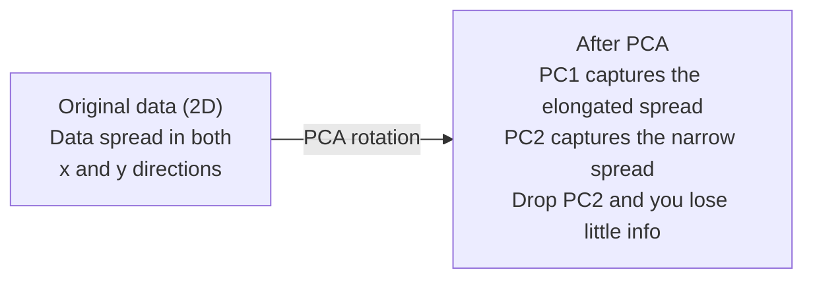

# Dimensionality Reduction

> Dữ liệu nhiều chiều có cấu trúc. Bạn tìm ra nó bằng cách nhìn từ góc phù hợp.

**Type:** Build
**Language:** Python
**Prerequisites:** Phase 1, Lessons 01 (Linear Algebra Intuition), 02 (Vectors, Matrices & Operations), 03 (Eigenvalues & Eigenvectors), 06 (Probability & Distributions)
**Time:** ~90 minutes

## Learning Objectives

- Triển khai PCA từ đầu: đưa dữ liệu về tâm, tính ma trận hiệp phương sai, phân rã riêng và chiếu
- Sử dụng tỉ lệ phương sai được giải thích và phương pháp khuỷu tay để chọn số thành phần chính
- So sánh PCA, t-SNE và UMAP để trực quan hóa các chữ số MNIST trong 2D và giải thích các đánh đổi của chúng
- Áp dụng kernel PCA với một kernel RBF để tách các cấu trúc dữ liệu phi tuyến mà PCA tiêu chuẩn không thể xử lý

## The Problem

Bạn có một tập dữ liệu với 784 đặc trưng trên mỗi mẫu. Có thể đó là các giá trị pixel của các chữ số viết tay. Có thể đó là các mức biểu hiện gen. Có thể đó là các tín hiệu hành vi người dùng. Bạn không thể trực quan hóa 784 chiều. Bạn không thể vẽ chúng. Bạn thậm chí không thể nghĩ về chúng.

Nhưng hầu hết trong số 784 đặc trưng đó là dư thừa. Thông tin thực sự nằm trên một bề mặt nhỏ hơn nhiều. Một chữ "7" viết tay không cần 784 số độc lập để mô tả nó. Nó cần một vài số: góc của nét, độ dài nét ngang, nó nghiêng bao nhiêu. Phần còn lại là nhiễu.

Giảm chiều tìm ra bề mặt nhỏ hơn đó. Nó lấy dữ liệu 784 chiều của bạn và nén xuống 2, 10 hoặc 50 chiều trong khi giữ cấu trúc quan trọng.

## The Concept

### The curse of dimensionality

Các không gian nhiều chiều không trực giác. Ba thứ không còn đúng khi số chiều tăng.

**Khoảng cách trở nên vô nghĩa.** Trong không gian nhiều chiều, khoảng cách giữa hai điểm ngẫu nhiên bất kỳ hội tụ về cùng một giá trị. Nếu mỗi điểm gần như cách mọi điểm khác cùng một khoảng, tìm kiếm láng giềng gần nhất ngừng hoạt động.

```
Dimension    Avg distance ratio (max/min between random points)
2            ~5.0
10           ~1.8
100          ~1.2
1000         ~1.02
```

**Thể tích tập trung ở các góc.** Một siêu lập phương đơn vị trong $d$ chiều có $2^d$ góc. Trong 100 chiều, gần như toàn bộ thể tích nằm ở các góc, xa tâm. Các điểm dữ liệu trải ra rìa và mô hình của bạn thiếu dữ liệu ở bên trong.

**Bạn cần nhiều dữ liệu hơn theo hàm mũ.** Để duy trì cùng mật độ mẫu trong một không gian, đi từ 2D đến 20D có nghĩa là bạn cần lượng dữ liệu gấp $10^{18}$ lần. Bạn không bao giờ có đủ. Giảm chiều đưa mật độ dữ liệu trở lại mức có thể xử lý.

### PCA: find the directions that matter

Phân tích Thành phần Chính (PCA) tìm các trục mà dọc theo đó dữ liệu của bạn biến thiên nhiều nhất. Nó quay hệ tọa độ để trục đầu tiên nắm bắt nhiều phương sai nhất, trục thứ hai nắm bắt nhiều thứ nhì, và cứ thế.

Thuật toán:

```
1. Center the data        (subtract the mean from each feature)
2. Compute covariance     (how features move together)
3. Eigendecomposition     (find the principal directions)
4. Sort by eigenvalue     (biggest variance first)
5. Project               (keep top k eigenvectors, drop the rest)
```

Tại sao phân rã riêng? Ma trận hiệp phương sai đối xứng và nửa xác định dương. Các vector riêng của nó là những hướng trực giao trong không gian đặc trưng. Các giá trị riêng cho bạn biết mỗi hướng nắm bắt bao nhiêu phương sai. Vector riêng có giá trị riêng lớn nhất chỉ theo hướng phương sai lớn nhất.



- **Trước PCA:** Đám mây dữ liệu trải theo đường chéo trên cả hai trục x và y
- **Sau PCA:** Hệ tọa độ được quay để PC1 thẳng hàng với hướng phương sai lớn nhất (độ phân tán kéo dài) và PC2 thẳng hàng với hướng phương sai nhỏ nhất (độ phân tán hẹp)
- **Giảm chiều:** Bỏ PC2 chiếu dữ liệu lên PC1, mất rất ít thông tin

### Explained variance ratio

Mỗi thành phần chính nắm bắt một phần của tổng phương sai. Tỉ lệ phương sai được giải thích cho bạn biết bao nhiêu.

```
Component    Eigenvalue    Explained ratio    Cumulative
PC1          4.73          0.473              0.473
PC2          2.51          0.251              0.724
PC3          1.12          0.112              0.836
PC4          0.89          0.089              0.925
...
```

Khi phương sai được giải thích tích lũy đạt 0.95, bạn biết số thành phần đó nắm bắt 95% thông tin. Mọi thứ sau đó chủ yếu là nhiễu.

### Choosing the number of components

Ba chiến lược:

1. **Ngưỡng.** Giữ đủ thành phần để giải thích 90-95% phương sai.
2. **Phương pháp khuỷu tay.** Vẽ phương sai được giải thích theo từng thành phần. Tìm một chỗ giảm mạnh.
3. **Hiệu năng tác vụ phía sau.** Sử dụng PCA làm tiền xử lý. Quét $k$ và đo độ chính xác mô hình. $k$ tốt nhất là nơi độ chính xác chững lại.

### t-SNE: preserve neighborhoods

t-Distributed Stochastic Neighbor Embedding (t-SNE) được thiết kế để trực quan hóa. Nó ánh xạ dữ liệu nhiều chiều xuống 2D (hoặc 3D) trong khi bảo toàn những điểm nào gần nhau.

Trực giác: trong không gian ban đầu, tính một phân phối xác suất trên các cặp điểm dựa trên khoảng cách của chúng. Các điểm gần có xác suất cao. Các điểm xa có xác suất thấp. Sau đó tìm một cách bố trí 2D nơi cùng phân phối xác suất đó được giữ. Các điểm từng là láng giềng trong 784 chiều vẫn là láng giềng trong 2D.

Các tính chất chính của t-SNE:
- Phi tuyến. Nó có thể mở ra các đa tạp phức tạp mà PCA không thể.
- Ngẫu nhiên. Các lần chạy khác nhau tạo ra các cách bố trí khác nhau.
- Tham số perplexity điều khiển số láng giềng cần xét (phạm vi điển hình: 5-50).
- Khoảng cách giữa các cụm trong đầu ra không có ý nghĩa. Chỉ bản thân các cụm có ý nghĩa.
- Chậm trên các tập dữ liệu lớn. $O(n^2)$ theo mặc định.

### UMAP: faster, better global structure

Uniform Manifold Approximation and Projection (UMAP) hoạt động tương tự t-SNE nhưng có hai lợi thế:
- Nhanh hơn. Nó sử dụng các đồ thị láng giềng gần nhất xấp xỉ thay vì tính tất cả khoảng cách từng cặp.
- Cấu trúc toàn cục tốt hơn. Các vị trí tương đối của các cụm trong đầu ra có xu hướng có ý nghĩa hơn trong t-SNE.

UMAP xây dựng một đồ thị có trọng số trong không gian nhiều chiều ("biểu diễn tô pô mờ") rồi tìm một cách bố trí ít chiều bảo toàn đồ thị này tốt nhất có thể.

Các tham số chính:
- `n_neighbors`: bao nhiêu láng giềng xác định cấu trúc cục bộ (tương tự perplexity). Các giá trị cao hơn bảo toàn nhiều cấu trúc toàn cục hơn.
- `min_dist`: mức độ các điểm được xếp sát nhau trong đầu ra. Các giá trị thấp hơn tạo ra các cụm dày đặc hơn.

### When to use which

| Phương pháp | Trường hợp sử dụng | Bảo toàn | Tốc độ |
|--------|----------|-----------|-------|
| PCA | Tiền xử lý trước huấn luyện | Phương sai toàn cục | Nhanh (chính xác), hoạt động trên hàng triệu mẫu |
| PCA | Trực quan hóa khám phá nhanh | Cấu trúc tuyến tính | Nhanh |
| t-SNE | Đồ thị 2D chất lượng xuất bản | Các vùng lân cận cục bộ | Chậm (< 10k mẫu là lý tưởng) |
| UMAP | Trực quan hóa 2D ở quy mô lớn | Cấu trúc cục bộ + một phần toàn cục | Trung bình (xử lý hàng triệu) |
| PCA | Giảm đặc trưng cho mô hình | Các đặc trưng được xếp hạng theo phương sai | Nhanh |
| t-SNE / UMAP | Hiểu cấu trúc cụm | Sự tách biệt cụm | Trung bình đến chậm |

Quy tắc kinh nghiệm: sử dụng PCA để tiền xử lý và nén dữ liệu. Sử dụng t-SNE hoặc UMAP khi bạn cần trực quan hóa cấu trúc trong 2D.

### Kernel PCA

PCA tiêu chuẩn tìm các không gian con tuyến tính. Nó quay hệ tọa độ và bỏ các trục. Nhưng nếu dữ liệu nằm trên một đa tạp phi tuyến thì sao? Một đường tròn trong 2D không thể được phân tách bằng bất kỳ đường thẳng nào. PCA tiêu chuẩn sẽ không giúp ích.

Kernel PCA áp dụng PCA trong một không gian đặc trưng nhiều chiều được tạo bởi một hàm kernel, mà không tính tường minh tọa độ trong không gian đó. Đây là thủ thuật kernel -- cùng ý tưởng đằng sau SVM.

Thuật toán:
1. Tính ma trận kernel $K$ trong đó $K_{ij} = k(x_i, x_j)$
2. Đưa ma trận kernel về tâm trong không gian đặc trưng
3. Phân rã riêng ma trận kernel đã đưa về tâm
4. Các vector riêng đứng đầu (được nhân với $1/\sqrt{\text{eigenvalue}}$) là các hình chiếu

Các hàm kernel phổ biến:

| Kernel | Công thức | Phù hợp cho |
|--------|---------|----------|
| RBF (Gaussian) | $\exp(-\gamma \lVert x - y \rVert^2)$ | Hầu hết dữ liệu phi tuyến, các đa tạp trơn |
| Đa thức | $(x \cdot y + c)^d$ | Các quan hệ đa thức |
| Sigmoid | $\tanh(\alpha x \cdot y + c)$ | Các ánh xạ giống mạng nơ-ron |

Khi nào sử dụng kernel PCA so với PCA tiêu chuẩn:

| Tiêu chí | PCA tiêu chuẩn | Kernel PCA |
|-----------|-------------|------------|
| Cấu trúc dữ liệu | Không gian con tuyến tính | Đa tạp phi tuyến |
| Tốc độ | $O(\min(n^2 d, d^2 n))$ | $O(n^2 d + n^3)$ |
| Khả năng diễn giải | Các thành phần là tổ hợp tuyến tính của các đặc trưng | Các thành phần thiếu diễn giải trực tiếp theo đặc trưng |
| Khả năng mở rộng | Hoạt động trên hàng triệu mẫu | Ma trận kernel có kích thước $n \times n$, bị giới hạn bởi bộ nhớ |
| Tái tạo | Biến đổi ngược trực tiếp | Đòi hỏi xấp xỉ tiền ảnh |

Ví dụ kinh điển: các đường tròn đồng tâm trong 2D. Hai vòng điểm, một vòng bên trong vòng kia. PCA tiêu chuẩn chiếu cả hai lên cùng một đường thẳng -- vô ích cho phân loại. Kernel PCA với một kernel RBF ánh xạ đường tròn trong và đường tròn ngoài đến các vùng khác nhau, làm chúng phân tách tuyến tính được.

### Reconstruction Error

Phép giảm chiều của bạn tốt đến mức nào? Bạn đã nén 784 chiều xuống 50. Bạn đã mất gì?

Đo sai số tái tạo:
1. Chiếu dữ liệu xuống $k$ chiều: $X_{\text{reduced}} = X W_k$
2. Tái tạo: $\hat{X} = X_{\text{reduced}} W_k^T$
3. Tính MSE: $\text{mean}((X - \hat{X})^2)$

Với PCA, sai số tái tạo có mối quan hệ rõ ràng với phương sai được giải thích:

```math
\begin{aligned}
\text{Reconstruction error} &= \text{sum of eigenvalues NOT included} \\
\text{Total variance} &= \text{sum of ALL eigenvalues} \\
\text{Fraction lost} &= \frac{\text{sum of dropped eigenvalues}}{\text{sum of all eigenvalues}}
\end{aligned}
```

Tỉ lệ phương sai được giải thích cho mỗi thành phần là:

```math
\text{explained\_ratio}_k = \frac{\text{eigenvalue}_k}{\sum \text{all eigenvalues}}
```

Vẽ phương sai được giải thích tích lũy theo số thành phần cho bạn đường cong "khuỷu tay". Số thành phần phù hợp là nơi:
- Đường cong phẳng dần (lợi ích giảm dần)
- Phương sai tích lũy vượt ngưỡng của bạn (thường là 0.90 hoặc 0.95)
- Hiệu năng tác vụ phía sau chững lại

Sai số tái tạo hữu ích ngoài việc chọn $k$. Bạn có thể sử dụng nó để phát hiện bất thường: các mẫu có sai số tái tạo cao là các ngoại lệ không khớp với không gian con đã học. Đây là cơ sở của phát hiện bất thường dựa trên PCA trong các hệ thống sản xuất.

```figure
pca-axes
```

## Build It

### Step 1: PCA from scratch

```python
import numpy as np

class PCA:
    def __init__(self, n_components):
        self.n_components = n_components
        self.components = None
        self.mean = None
        self.eigenvalues = None
        self.explained_variance_ratio_ = None

    def fit(self, X):
        self.mean = np.mean(X, axis=0)
        X_centered = X - self.mean

        cov_matrix = np.cov(X_centered, rowvar=False)

        eigenvalues, eigenvectors = np.linalg.eigh(cov_matrix)

        sorted_idx = np.argsort(eigenvalues)[::-1]
        eigenvalues = eigenvalues[sorted_idx]
        eigenvectors = eigenvectors[:, sorted_idx]

        self.components = eigenvectors[:, :self.n_components].T
        self.eigenvalues = eigenvalues[:self.n_components]
        total_var = np.sum(eigenvalues)
        self.explained_variance_ratio_ = self.eigenvalues / total_var

        return self

    def transform(self, X):
        X_centered = X - self.mean
        return X_centered @ self.components.T

    def fit_transform(self, X):
        self.fit(X)
        return self.transform(X)
```

### Step 2: Test on synthetic data

```python
np.random.seed(42)
n_samples = 500

t = np.random.uniform(0, 2 * np.pi, n_samples)
x1 = 3 * np.cos(t) + np.random.normal(0, 0.2, n_samples)
x2 = 3 * np.sin(t) + np.random.normal(0, 0.2, n_samples)
x3 = 0.5 * x1 + 0.3 * x2 + np.random.normal(0, 0.1, n_samples)

X_synthetic = np.column_stack([x1, x2, x3])

pca = PCA(n_components=2)
X_reduced = pca.fit_transform(X_synthetic)

print(f"Original shape: {X_synthetic.shape}")
print(f"Reduced shape:  {X_reduced.shape}")
print(f"Explained variance ratios: {pca.explained_variance_ratio_}")
print(f"Total variance captured: {sum(pca.explained_variance_ratio_):.4f}")
```

### Step 3: MNIST digits in 2D

```python
from sklearn.datasets import fetch_openml

mnist = fetch_openml("mnist_784", version=1, as_frame=False, parser="auto")
X_mnist = mnist.data[:5000].astype(float)
y_mnist = mnist.target[:5000].astype(int)

pca_mnist = PCA(n_components=50)
X_pca50 = pca_mnist.fit_transform(X_mnist)
print(f"50 components capture {sum(pca_mnist.explained_variance_ratio_):.2%} of variance")

pca_2d = PCA(n_components=2)
X_pca2d = pca_2d.fit_transform(X_mnist)
print(f"2 components capture {sum(pca_2d.explained_variance_ratio_):.2%} of variance")
```

### Step 4: Compare with sklearn

```python
from sklearn.decomposition import PCA as SklearnPCA
from sklearn.manifold import TSNE

sklearn_pca = SklearnPCA(n_components=2)
X_sklearn_pca = sklearn_pca.fit_transform(X_mnist)

print(f"\nOur PCA explained variance:     {pca_2d.explained_variance_ratio_}")
print(f"Sklearn PCA explained variance: {sklearn_pca.explained_variance_ratio_}")

diff = np.abs(np.abs(X_pca2d) - np.abs(X_sklearn_pca))
print(f"Max absolute difference: {diff.max():.10f}")

tsne = TSNE(n_components=2, perplexity=30, random_state=42)
X_tsne = tsne.fit_transform(X_mnist)
print(f"\nt-SNE output shape: {X_tsne.shape}")
```

### Step 5: UMAP comparison

```python
try:
    from umap import UMAP

    reducer = UMAP(n_components=2, n_neighbors=15, min_dist=0.1, random_state=42)
    X_umap = reducer.fit_transform(X_mnist)
    print(f"UMAP output shape: {X_umap.shape}")
except ImportError:
    print("Install umap-learn: pip install umap-learn")
```

## Use It

PCA làm tiền xử lý trước một bộ phân loại:

```python
from sklearn.decomposition import PCA as SklearnPCA
from sklearn.linear_model import LogisticRegression
from sklearn.model_selection import train_test_split
from sklearn.metrics import accuracy_score

X_train, X_test, y_train, y_test = train_test_split(
    X_mnist, y_mnist, test_size=0.2, random_state=42
)

results = {}
for k in [10, 30, 50, 100, 200]:
    pca_k = SklearnPCA(n_components=k)
    X_tr = pca_k.fit_transform(X_train)
    X_te = pca_k.transform(X_test)

    clf = LogisticRegression(max_iter=1000, random_state=42)
    clf.fit(X_tr, y_train)
    acc = accuracy_score(y_test, clf.predict(X_te))
    var_captured = sum(pca_k.explained_variance_ratio_)
    results[k] = (acc, var_captured)
    print(f"k={k:>3d}  accuracy={acc:.4f}  variance={var_captured:.4f}")
```

Hiệu năng chững lại từ rất lâu trước 784 chiều. Mức chững đó là điểm vận hành của bạn.

## Ship It

Bài học này tạo ra:
- `outputs/skill-dimensionality-reduction.md` - một skill để chọn kỹ thuật giảm chiều phù hợp cho một tác vụ nhất định

## Exercises

1. Sửa lớp PCA để hỗ trợ `inverse_transform`. Tái tạo các chữ số MNIST từ 10, 50 và 200 thành phần. In sai số tái tạo (trung bình bình phương chênh lệch so với bản gốc) cho mỗi trường hợp.

2. Chạy t-SNE trên cùng tập con MNIST với các giá trị perplexity 5, 30 và 100. Mô tả đầu ra thay đổi như thế nào. Tại sao perplexity ảnh hưởng đến độ chặt của cụm?

3. Lấy một tập dữ liệu có 50 đặc trưng trong đó chỉ 5 đặc trưng cung cấp thông tin (tạo bằng `sklearn.datasets.make_classification`). Áp dụng PCA và kiểm tra xem đường cong phương sai được giải thích có xác định đúng rằng dữ liệu thực chất có 5 chiều hay không.

### Hints

**Bài tập 1.** Đọc `inverse_transform` trong lớp `PCA` và khớp một mô hình cho mỗi số thành phần. Tính `reconstruction_error` cho 10, 50 và 200 thành phần; sai số phải giảm khi số thành phần tăng.

**Bài tập 2.** Khớp `sklearn.manifold.TSNE` ba lần trên cùng tập con, chỉ thay đổi `perplexity`, và sử dụng cùng `random_state`. Perplexity thấp xem xét ít láng giềng, vì vậy hãy chờ đợi các nhóm nhỏ, chặt; perplexity cao xem xét nhiều láng giềng hơn, vì vậy hãy chờ đợi các nhóm lớn hơn, mượt hơn.

**Bài tập 3.** Gọi `make_classification(n_features=50, n_informative=5, n_redundant=45)`, khớp `PCA` và in phương sai được giải thích tích lũy. Các đặc trưng dư thừa là tổ hợp tuyến tính của các đặc trưng mang thông tin, vì vậy đường cong đạt gần 1.0 ở 5 thành phần. Sau đó thử `n_redundant=0`: 45 đặc trưng còn lại là nhiễu độc lập, và đường cong không phẳng ra.

## Key Terms

| Thuật ngữ | Cách mọi người nói | Ý nghĩa thực sự |
|------|----------------|----------------------|
| Curse of dimensionality (Lời nguyền số chiều) | "Quá nhiều đặc trưng" | Khoảng cách, thể tích và mật độ dữ liệu đều có hành vi trái trực giác khi số chiều tăng. Mô hình cần nhiều dữ liệu hơn theo hàm mũ để bù lại. |
| PCA | "Giảm chiều" | Quay hệ tọa độ để các trục thẳng hàng với các hướng phương sai lớn nhất, rồi bỏ các trục có phương sai thấp. |
| Principal component (Thành phần chính) | "Một hướng quan trọng" | Một vector riêng của ma trận hiệp phương sai. Hướng trong không gian đặc trưng mà dọc theo đó dữ liệu biến thiên nhiều nhất. |
| Explained variance ratio (Tỉ lệ phương sai được giải thích) | "Thành phần này có bao nhiêu thông tin" | Phần tổng phương sai được một thành phần chính nắm bắt. Cộng $k$ tỉ lệ đứng đầu để xem $k$ thành phần bảo toàn bao nhiêu. |
| Covariance matrix (Ma trận hiệp phương sai) | "Cách các đặc trưng tương quan" | Một ma trận đối xứng trong đó phần tử $(i,j)$ đo cách đặc trưng $i$ và đặc trưng $j$ cùng biến động. Các phần tử đường chéo là các phương sai riêng lẻ. |
| t-SNE | "Đồ thị cụm đó" | Một phương pháp phi tuyến ánh xạ dữ liệu nhiều chiều xuống 2D bằng cách bảo toàn các xác suất lân cận từng cặp. Tốt cho trực quan hóa, không cho tiền xử lý. |
| UMAP | "t-SNE nhanh hơn" | Một phương pháp phi tuyến dựa trên phân tích dữ liệu tô pô. Bảo toàn cả cấu trúc cục bộ và một phần toàn cục. Mở rộng tốt hơn t-SNE. |
| Perplexity | "Một núm điều chỉnh t-SNE" | Điều khiển số láng giềng hiệu dụng mà mỗi điểm xét đến. Perplexity thấp tập trung vào cấu trúc rất cục bộ. Perplexity cao nắm bắt các mẫu rộng hơn. |
| Manifold (Đa tạp) | "Bề mặt mà dữ liệu nằm trên" | Một bề mặt ít chiều hơn được nhúng trong một không gian nhiều chiều hơn. Một tờ giấy bị vò trong 3D là một đa tạp 2D. |

## Further Reading

- [A Tutorial on Principal Component Analysis](https://arxiv.org/abs/1404.1100) (Shlens) - cách suy ra PCA rõ ràng từ nền tảng
- [How to Use t-SNE Effectively](https://distill.pub/2016/misread-tsne/) (Wattenberg et al.) - hướng dẫn tương tác về các cạm bẫy t-SNE và lựa chọn tham số
- [Tài liệu UMAP](https://umap-learn.readthedocs.io/) - lý thuyết và hướng dẫn thực hành từ các tác giả UMAP
