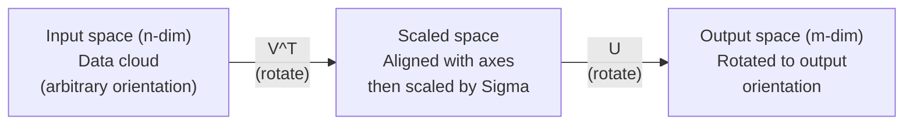
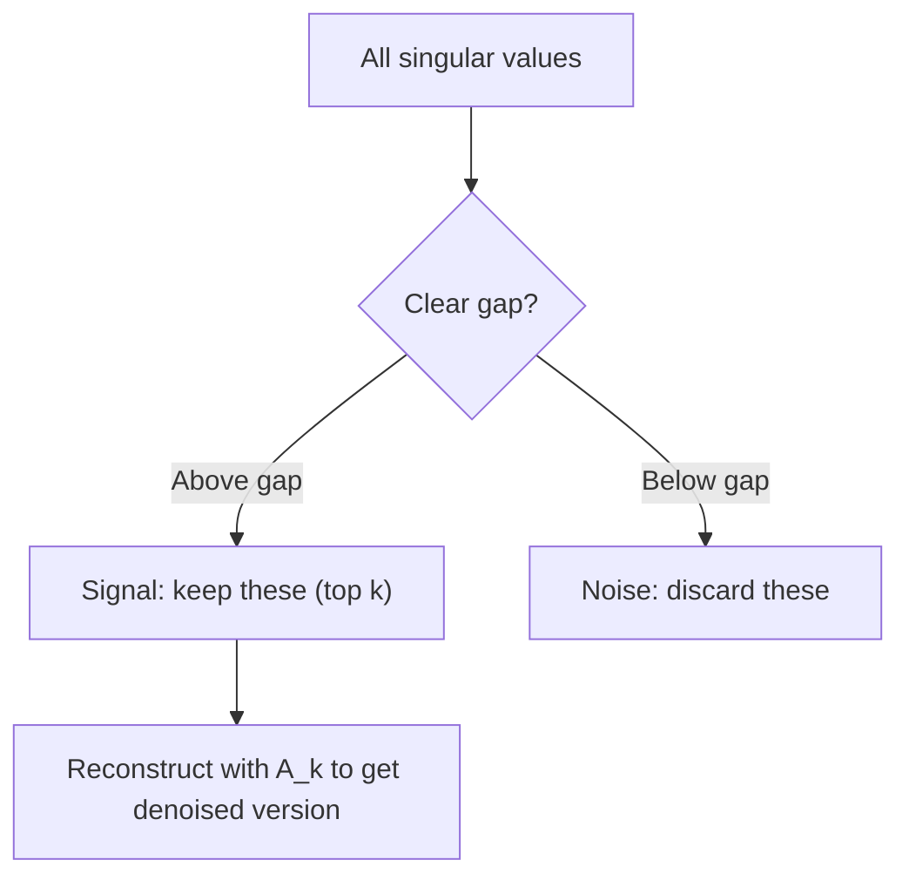

# Singular Value Decomposition

> SVD là con dao đa năng Thụy Sĩ của đại số tuyến tính. Mọi ma trận đều có một phân rã như vậy. Mọi nhà khoa học dữ liệu đều cần một phân rã như vậy.

**Type:** Build
**Languages:** Python, Julia
**Prerequisites:** Phase 1, Lessons 01 (Linear Algebra Intuition), 02 (Vectors & Matrices Operations), 03 (Matrix Transformations)
**Time:** ~120 minutes

## Learning Objectives

- Triển khai SVD bằng phép lặp lũy thừa và giải thích ý nghĩa hình học của $U$, $\Sigma$ và $V^T$
- Áp dụng SVD cắt ngọn để nén hình ảnh và đo tỉ lệ nén so với sai số tái tạo
- Tính giả nghịch đảo Moore-Penrose bằng SVD để giải các hệ bình phương tối thiểu thừa xác định
- Kết nối SVD với PCA, các hệ thống đề xuất (nhân tố ẩn) và Phân tích Ngữ nghĩa Ẩn trong NLP

## The Problem

Bạn có một ma trận 1000x2000. Có thể đó là đánh giá người dùng-phim. Có thể đó là một bảng tần suất tài liệu-thuật ngữ. Có thể đó là các giá trị pixel của một hình ảnh. Bạn cần nén nó, khử nhiễu, tìm cấu trúc ẩn trong nó hoặc giải một hệ bình phương tối thiểu với nó. Phân rã riêng chỉ hoạt động trên ma trận vuông. Ngay cả khi đó, nó yêu cầu ma trận có đầy đủ một tập vector riêng độc lập tuyến tính.

SVD hoạt động trên bất kỳ ma trận nào. Bất kỳ hình dạng nào. Bất kỳ hạng nào. Không điều kiện. Nó phân rã ma trận thành ba nhân tố tiết lộ hình học của những gì ma trận làm với không gian. Đây là phép phân tích thành nhân tử tổng quát nhất và hữu ích nhất trong toàn bộ đại số tuyến tính.

## The Concept

### What SVD does geometrically

Mọi ma trận, bất kể hình dạng, thực hiện ba phép toán theo thứ tự: quay, co giãn, quay. SVD làm phân rã này tường minh.

```math
\underset{\substack{m \times n \\ \text{(any)}}}{A} = \underset{\substack{m \times m \\ \text{(rotate)}}}{U} \cdot \underset{\substack{m \times n \\ \text{(scale)}}}{\Sigma} \cdot \underset{\substack{n \times n \\ \text{(rotate)}}}{V^T}
```

Cho bất kỳ ma trận $A$ nào, SVD phân tích nó thành:
- $V^T$ quay các vector trong không gian đầu vào ($n$ chiều)
- $\Sigma$ co giãn dọc theo từng trục (kéo giãn hoặc nén)
- $U$ quay kết quả vào không gian đầu ra ($m$ chiều)



Hãy nghĩ theo cách này. Bạn đưa cho SVD một ma trận. Nó nói với bạn: "Ma trận này nhận một mặt cầu đầu vào, trước tiên quay nó bằng $V^T$, rồi kéo giãn nó thành một ellipsoid bằng $\Sigma$, rồi quay ellipsoid bằng $U$." Các giá trị kỳ dị là độ dài các trục của ellipsoid.

### The full decomposition

Với một ma trận $A$ có hình dạng $m \times n$:

```math
\begin{aligned}
& A = U \cdot \Sigma \cdot V^T \\[6pt]
& \text{where:} \\
& \quad U \text{ is } m \times m, \text{ orthogonal } (U^T U = I) \\
& \quad \Sigma \text{ is } m \times n, \text{ diagonal (singular values on the diagonal)} \\
& \quad V \text{ is } n \times n, \text{ orthogonal } (V^T V = I) \\[6pt]
& \text{The singular values } \sigma_1 \ge \sigma_2 \ge \cdots \ge \sigma_r > 0 \\
& \text{where } r = \mathop{\mathrm{rank}}(A)
\end{aligned}
```

Các cột của $U$ được gọi là các vector kỳ dị trái. Các cột của $V$ được gọi là các vector kỳ dị phải. Các phần tử đường chéo của $\Sigma$ được gọi là các giá trị kỳ dị. Chúng luôn không âm và theo quy ước được sắp xếp theo thứ tự giảm dần.

### Left singular vectors, singular values, right singular vectors

Mỗi thành phần của SVD có một ý nghĩa hình học riêng.

**Các vector kỳ dị phải (các cột của $V$):** Chúng tạo thành một cơ sở trực chuẩn cho không gian đầu vào ($\mathbb{R}^n$). Chúng là các hướng trong không gian đầu vào mà ma trận ánh xạ thành các hướng trực giao trong không gian đầu ra. Hãy xem chúng là hệ tọa độ tự nhiên cho miền xác định.

**Các giá trị kỳ dị (đường chéo của $\Sigma$):** Đây là các hệ số co giãn. Giá trị kỳ dị thứ i cho bạn biết ma trận kéo giãn các vector dọc theo vector kỳ dị phải thứ i bao nhiêu. Một giá trị kỳ dị bằng không có nghĩa là ma trận ép dẹp hoàn toàn hướng đó.

**Các vector kỳ dị trái (các cột của $U$):** Chúng tạo thành một cơ sở trực chuẩn cho không gian đầu ra ($\mathbb{R}^m$). Vector kỳ dị trái thứ i là hướng trong không gian đầu ra mà vector kỳ dị phải thứ i đến (sau khi co giãn).

Mối quan hệ giữa chúng:

```
A * v_i = sigma_i * u_i

The matrix A takes the i-th right singular vector v_i,
scales it by sigma_i, and maps it to the i-th left singular vector u_i.
```

Điều này cho bạn một bức tranh theo từng tọa độ về những gì một ma trận bất kỳ thực hiện.

### Outer product form

SVD có thể được viết dưới dạng tổng các ma trận hạng 1:

```
A = sigma_1 * u_1 * v_1^T + sigma_2 * u_2 * v_2^T + ... + sigma_r * u_r * v_r^T

Each term sigma_i * u_i * v_i^T is a rank-1 matrix (an outer product).
The full matrix is the sum of r such matrices, where r is the rank.
```

Dạng này là nền tảng của xấp xỉ hạng thấp. Mỗi số hạng thêm một lớp cấu trúc. Số hạng đầu tiên nắm bắt mẫu quan trọng nhất. Số hạng thứ hai nắm bắt mẫu quan trọng tiếp theo. Và cứ thế. Cắt ngọn tổng này cho bạn xấp xỉ tốt nhất có thể tại bất kỳ hạng cho trước nào.

```math
\begin{aligned}
\text{Rank-1 approx:} \quad & A_1 = \sigma_1 u_1 v_1^T \\
& \text{(captures the dominant pattern)} \\[6pt]
\text{Rank-2 approx:} \quad & A_2 = \sigma_1 u_1 v_1^T + \sigma_2 u_2 v_2^T \\
& \text{(captures the two most important patterns)} \\[6pt]
\text{Rank-}k\text{ approx:} \quad & A_k = \text{sum of top } k \text{ terms} \\
& \text{(optimal by the Eckart-Young theorem)}
\end{aligned}
```

### Relationship to eigendecomposition

SVD và phân rã riêng có mối liên hệ sâu sắc. Các giá trị và vector kỳ dị của $A$ đến trực tiếp từ các giá trị riêng và vector riêng của $A^T A$ và $A A^T$.

```
A^T A = V * Sigma^T * U^T * U * Sigma * V^T
      = V * Sigma^T * Sigma * V^T
      = V * D * V^T

where D = Sigma^T * Sigma is a diagonal matrix with sigma_i^2 on the diagonal.

So:
- The right singular vectors (V) are eigenvectors of A^T A
- The singular values squared (sigma_i^2) are eigenvalues of A^T A

Similarly:
A A^T = U * Sigma * V^T * V * Sigma^T * U^T
      = U * Sigma * Sigma^T * U^T

So:
- The left singular vectors (U) are eigenvectors of A A^T
- The eigenvalues of A A^T are also sigma_i^2
```

Mối liên hệ này cho bạn biết ba điều:
1. Các giá trị kỳ dị luôn thực và không âm (chúng là căn bậc hai của các giá trị riêng của một ma trận nửa xác định dương).
2. Bạn có thể tính SVD bằng phân rã riêng của $A^T A$, nhưng điều này bình phương số điều kiện và làm mất độ chính xác số học. Các thuật toán SVD chuyên dụng tránh điều này.
3. Khi $A$ vuông và đối xứng nửa xác định dương, SVD và phân rã riêng là cùng một thứ.

### Truncated SVD: low-rank approximation

Định lý Eckart-Young-Mirsky phát biểu rằng phép xấp xỉ $\text{rank-}k$ tốt nhất cho $A$ (theo cả chuẩn Frobenius và chuẩn phổ) thu được bằng cách chỉ giữ $k$ giá trị kỳ dị lớn nhất và các vector tương ứng của chúng:

```math
\begin{aligned}
& A_k = U_k \cdot \Sigma_k \cdot V_k^T \\[6pt]
& \text{where:} \\
& \quad U_k \text{ is } m \times k \quad \text{(first } k \text{ columns of } U\text{)} \\
& \quad \Sigma_k \text{ is } k \times k \quad \text{(top-left } k \times k \text{ block of } \Sigma\text{)} \\
& \quad V_k \text{ is } n \times k \quad \text{(first } k \text{ columns of } V\text{)} \\[6pt]
& \text{Approximation error} = \sigma_{k+1} \quad \text{(in spectral norm)} \\
& \text{Approximation error} = \sqrt{\sigma_{k+1}^2 + \cdots + \sigma_r^2} \quad \text{(in Frobenius norm)}
\end{aligned}
```

Đây không chỉ là một phép xấp xỉ "tốt". Nó được chứng minh là phép xấp xỉ hạng $k$ tốt nhất có thể. Không có ma trận $\text{rank-}k$ nào khác gần $A$ hơn.

| Thành phần | Độ lớn tương đối | Được giữ trong xấp xỉ hạng 3? |
|-----------|-------------------|------------------------|
| $\sigma_1$ | Lớn nhất | Có |
| $\sigma_2$ | Lớn | Có |
| $\sigma_3$ | Trung bình-lớn | Có |
| $\sigma_4$ | Trung bình | Không (sai số) |
| $\sigma_5$ | Trung bình-nhỏ | Không (sai số) |
| $\sigma_6$ | Nhỏ | Không (sai số) |
| $\sigma_7$ | Rất nhỏ | Không (sai số) |
| $\sigma_8$ | Cực nhỏ | Không (sai số) |

Giữ 3 giá trị đứng đầu: $A_3$ nắm bắt ba giá trị kỳ dị lớn nhất. Sai số = các giá trị còn lại ($\sigma_4$ đến $\sigma_8$).

Nếu các giá trị kỳ dị giảm nhanh, một $k$ nhỏ nắm bắt phần lớn ma trận. Nếu chúng giảm chậm, ma trận không có cấu trúc hạng thấp.

### Image compression with SVD

Một hình ảnh thang xám là một ma trận các cường độ pixel. Một hình ảnh 800x600 có 480,000 giá trị. SVD cho phép bạn xấp xỉ nó với ít giá trị hơn nhiều.

```
Original image: 800 x 600 = 480,000 values

SVD with rank k:
  U_k:      800 x k values
  Sigma_k:  k values
  V_k:      600 x k values
  Total:    k * (800 + 600 + 1) = k * 1401 values

  k=10:   14,010 values   (2.9% of original)
  k=50:   70,050 values  (14.6% of original)
  k=100: 140,100 values  (29.2% of original)

  The compression ratio improves as k gets smaller,
  but visual quality degrades.
```

Điểm cốt yếu: hình ảnh tự nhiên có các giá trị kỳ dị giảm nhanh. Một vài giá trị kỳ dị đầu nắm bắt cấu trúc tổng quát (hình dạng, gradient). Các giá trị sau nắm bắt chi tiết nhỏ và nhiễu. Cắt ngọn ở hạng 50 thường tạo ra một hình ảnh trông gần như giống hệt bản gốc trong khi sử dụng ít hơn 85% dung lượng lưu trữ.

### SVD for recommendation systems

Netflix Prize đã làm điều này nổi tiếng. Bạn có một ma trận đánh giá người dùng-phim trong đó hầu hết các phần tử bị thiếu.

```
             Movie1  Movie2  Movie3  Movie4  Movie5
  User1      [  5      ?       3       ?       1  ]
  User2      [  ?      4       ?       2       ?  ]
  User3      [  3      ?       5       ?       ?  ]
  User4      [  ?      ?       ?       4       3  ]

  ? = unknown rating
```

Ý tưởng: ma trận đánh giá này có hạng thấp. Người dùng không có thị hiếu hoàn toàn độc lập. Có một số ít nhân tố ẩn (hành động so với chính kịch, cũ so với mới, thiên về trí tuệ so với cảm xúc bản năng) giải thích hầu hết các sở thích.

SVD trên ma trận đánh giá (đã điền) phân rã nó thành:
- $U$: hồ sơ người dùng trong không gian nhân tố ẩn
- $\Sigma$: độ quan trọng của mỗi nhân tố ẩn
- $V^T$: hồ sơ phim trong không gian nhân tố ẩn

Đánh giá dự đoán của một người dùng cho một bộ phim là tích vô hướng giữa hồ sơ người dùng và hồ sơ phim (được lấy trọng số theo các giá trị kỳ dị). Xấp xỉ hạng thấp điền các phần tử bị thiếu.

Trong thực tế, bạn sử dụng các biến thể như SVD tăng dần của Simon Funk hoặc ALS (bình phương tối thiểu luân phiên) xử lý dữ liệu thiếu trực tiếp. Nhưng ý tưởng cốt lõi giống nhau: phân rã nhân tố ẩn bằng SVD.

### SVD in NLP: Latent Semantic Analysis

Phân tích Ngữ nghĩa Ẩn (LSA), cũng được gọi là Lập chỉ mục Ngữ nghĩa Ẩn (LSI), áp dụng SVD cho một ma trận thuật ngữ-tài liệu.

```
             Doc1   Doc2   Doc3   Doc4
  "cat"      [  3      0      1      0  ]
  "dog"      [  2      0      0      1  ]
  "fish"     [  0      4      1      0  ]
  "pet"      [  1      1      1      1  ]
  "ocean"    [  0      3      0      0  ]

After SVD with rank k=2:

  Each document becomes a point in 2D "concept space."
  Each term becomes a point in the same 2D space.
  Documents about similar topics cluster together.
  Terms with similar meanings cluster together.

  "cat" and "dog" end up near each other (land pets).
  "fish" and "ocean" end up near each other (water concepts).
  Doc1 and Doc3 cluster if they share similar topics.
```

LSA là một trong những phương pháp thành công đầu tiên để nắm bắt độ tương đồng ngữ nghĩa từ văn bản thô. Nó hoạt động vì các thuật ngữ đồng nghĩa có xu hướng xuất hiện trong các tài liệu tương tự, nên SVD nhóm chúng vào cùng các chiều ẩn. Các embedding từ hiện đại (Word2Vec, GloVe) có thể được xem là hậu duệ của ý tưởng này.

### SVD for noise reduction

Dữ liệu nhiễu có tín hiệu tập trung ở các giá trị kỳ dị đứng đầu và nhiễu trải trên tất cả các giá trị kỳ dị. Cắt ngọn loại bỏ nền nhiễu.

**Các giá trị kỳ dị của tín hiệu sạch:**

| Thành phần | Độ lớn | Loại |
|-----------|-----------|------|
| $\sigma_1$ | Rất lớn | Tín hiệu |
| $\sigma_2$ | Lớn | Tín hiệu |
| $\sigma_3$ | Trung bình | Tín hiệu |
| $\sigma_4$ | Gần không | Không đáng kể |
| $\sigma_5$ | Gần không | Không đáng kể |

**Các giá trị kỳ dị của tín hiệu nhiễu (nhiễu cộng vào tất cả):**

| Thành phần | Độ lớn | Loại |
|-----------|-----------|------|
| $\sigma_1$ | Rất lớn | Tín hiệu |
| $\sigma_2$ | Lớn | Tín hiệu |
| $\sigma_3$ | Trung bình | Tín hiệu |
| $\sigma_4$ | Nhỏ | Nhiễu |
| $\sigma_5$ | Nhỏ | Nhiễu |
| $\sigma_6$ | Nhỏ | Nhiễu |
| $\sigma_7$ | Nhỏ | Nhiễu |



Điều này được sử dụng trong xử lý tín hiệu, đo lường khoa học và làm sạch dữ liệu. Bất cứ khi nào bạn có một ma trận bị làm hỏng bởi nhiễu cộng, SVD cắt ngọn là một cách có nguyên tắc để tách tín hiệu khỏi nhiễu.

### Pseudoinverse via SVD

Giả nghịch đảo Moore-Penrose $A^+$ tổng quát hóa phép nghịch đảo ma trận cho các ma trận không vuông và suy biến. SVD làm việc tính nó trở nên đơn giản.

```
If A = U * Sigma * V^T, then:

A+ = V * Sigma+ * U^T

where Sigma+ is formed by:
  1. Transpose Sigma (swap rows and columns)
  2. Replace each non-zero diagonal entry sigma_i with 1/sigma_i
  3. Leave zeros as zeros

For A (m x n):      A+ is (n x m)
For Sigma (m x n):  Sigma+ is (n x m)
```

Giả nghịch đảo giải các bài toán bình phương tối thiểu. Nếu $Ax = b$ không có nghiệm chính xác (hệ thừa xác định), thì $x = A^+ b$ là nghiệm bình phương tối thiểu (tối thiểu hóa $\lVert Ax - b \rVert$).

```
Overdetermined system (more equations than unknowns):

  [1  1]         [3]
  [2  1] x   =   [5]       No exact solution exists.
  [3  1]         [6]

  x_ls = A+ b = V * Sigma+ * U^T * b

  This gives the x that minimizes the sum of squared residuals.
  Same result as the normal equations (A^T A)^(-1) A^T b,
  but numerically more stable.
```

### Numerical stability advantages

Tính phân rã riêng của $A^T A$ bình phương các giá trị kỳ dị (các giá trị riêng của $A^T A$ là $\sigma_i^2$). Điều này bình phương số điều kiện, khuếch đại các sai số số học.

```
Example:
  A has singular values [1000, 1, 0.001]
  Condition number of A: 1000 / 0.001 = 10^6

  A^T A has eigenvalues [10^6, 1, 10^{-6}]
  Condition number of A^T A: 10^6 / 10^{-6} = 10^{12}

  Computing SVD directly: works with condition number 10^6
  Computing via A^T A:     works with condition number 10^{12}
                           (6 extra digits of precision lost)
```

Các thuật toán SVD hiện đại (đưa về dạng hai đường chéo Golub-Kahan) làm việc trực tiếp trên $A$, không bao giờ tạo $A^T A$. Đây là lý do bạn nên luôn ưu tiên `np.linalg.svd(A)` thay vì `np.linalg.eig(A.T @ A)`.

### Connection to PCA

PCA CHÍNH LÀ SVD trên dữ liệu đã đưa về tâm. Đây không phải phép tương tự. Nó chính xác là cùng một phép tính.

```
Given data matrix X (n_samples x n_features), centered (mean subtracted):

Covariance matrix: C = (1/(n-1)) * X^T X

PCA finds eigenvectors of C. But:

  X = U * Sigma * V^T    (SVD of X)

  X^T X = V * Sigma^2 * V^T

  C = (1/(n-1)) * V * Sigma^2 * V^T

So the principal components are exactly the right singular vectors V.
The explained variance for each component is sigma_i^2 / (n-1).

In sklearn, PCA is implemented using SVD, not eigendecomposition.
It is faster and more numerically stable.
```

Điều này có nghĩa là mọi thứ bạn học về giảm chiều trong Bài học 10 đều là SVD ở bên trong. PCA là ứng dụng phổ biến nhất của SVD trong học máy.

```figure
svd-rank-reconstruction
```

## Build It

### Step 1: SVD from scratch using power iteration

Ý tưởng: để tìm giá trị kỳ dị lớn nhất và các vector của nó, sử dụng phép lặp lũy thừa trên $A^T A$ (hoặc $A A^T$). Sau đó loại phần đóng góp đó khỏi ma trận và lặp lại cho giá trị kỳ dị tiếp theo.

```python
import numpy as np

def power_iteration(M, num_iters=100):
    n = M.shape[1]
    v = np.random.randn(n)
    v = v / np.linalg.norm(v)

    for _ in range(num_iters):
        Mv = M @ v
        v = Mv / np.linalg.norm(Mv)

    eigenvalue = v @ M @ v
    return eigenvalue, v

def svd_from_scratch(A, k=None):
    m, n = A.shape
    if k is None:
        k = min(m, n)

    sigmas = []
    us = []
    vs = []

    A_residual = A.copy().astype(float)

    for _ in range(k):
        AtA = A_residual.T @ A_residual
        eigenvalue, v = power_iteration(AtA, num_iters=200)

        if eigenvalue < 1e-10:
            break

        sigma = np.sqrt(eigenvalue)
        u = A_residual @ v / sigma

        sigmas.append(sigma)
        us.append(u)
        vs.append(v)

        A_residual = A_residual - sigma * np.outer(u, v)

    U = np.column_stack(us) if us else np.empty((m, 0))
    S = np.array(sigmas)
    V = np.column_stack(vs) if vs else np.empty((n, 0))

    return U, S, V
```

### Step 2: Test and compare with NumPy

```python
np.random.seed(42)
A = np.random.randn(5, 4)

U_ours, S_ours, V_ours = svd_from_scratch(A)
U_np, S_np, Vt_np = np.linalg.svd(A, full_matrices=False)

print("Our singular values:", np.round(S_ours, 4))
print("NumPy singular values:", np.round(S_np, 4))

A_reconstructed = U_ours @ np.diag(S_ours) @ V_ours.T
print(f"Reconstruction error: {np.linalg.norm(A - A_reconstructed):.8f}")
```

### Step 3: Image compression demo

```python
def compress_image_svd(image_matrix, k):
    U, S, Vt = np.linalg.svd(image_matrix, full_matrices=False)
    compressed = U[:, :k] @ np.diag(S[:k]) @ Vt[:k, :]
    return compressed

image = np.random.seed(42)
rows, cols = 200, 300
image = np.random.randn(rows, cols)

for k in [1, 5, 10, 20, 50]:
    compressed = compress_image_svd(image, k)
    error = np.linalg.norm(image - compressed) / np.linalg.norm(image)
    original_size = rows * cols
    compressed_size = k * (rows + cols + 1)
    ratio = compressed_size / original_size
    print(f"k={k:>3d}  error={error:.4f}  storage={ratio:.1%}")
```

### Step 4: Noise reduction

```python
np.random.seed(42)
clean = np.outer(np.sin(np.linspace(0, 4*np.pi, 100)),
                 np.cos(np.linspace(0, 2*np.pi, 80)))
noise = 0.3 * np.random.randn(100, 80)
noisy = clean + noise

U, S, Vt = np.linalg.svd(noisy, full_matrices=False)
denoised = U[:, :5] @ np.diag(S[:5]) @ Vt[:5, :]

print(f"Noisy error:    {np.linalg.norm(noisy - clean):.4f}")
print(f"Denoised error: {np.linalg.norm(denoised - clean):.4f}")
print(f"Improvement:    {(1 - np.linalg.norm(denoised - clean) / np.linalg.norm(noisy - clean)):.1%}")
```

### Step 5: Pseudoinverse

```python
A = np.array([[1, 1], [2, 1], [3, 1]], dtype=float)
b = np.array([3, 5, 6], dtype=float)

U, S, Vt = np.linalg.svd(A, full_matrices=False)
S_inv = np.diag(1.0 / S)
A_pinv = Vt.T @ S_inv @ U.T

x_svd = A_pinv @ b
x_lstsq = np.linalg.lstsq(A, b, rcond=None)[0]
x_pinv = np.linalg.pinv(A) @ b

print(f"SVD pseudoinverse solution:  {x_svd}")
print(f"np.linalg.lstsq solution:   {x_lstsq}")
print(f"np.linalg.pinv solution:    {x_pinv}")
```

## Use It

Các bản demo hoạt động đầy đủ nằm trong `code/svd.py`. Chạy nó để thấy SVD được áp dụng cho nén hình ảnh, các hệ thống đề xuất, phân tích ngữ nghĩa ẩn và giảm nhiễu.

```bash
python svd.py
```

Phiên bản Julia trong `code/svd.jl` minh họa cùng các khái niệm bằng hàm `svd()` gốc của Julia và gói `LinearAlgebra`.

```bash
julia svd.jl
```

## Ship It

Bài học này tạo ra:
- `outputs/skill-svd.md` - một skill để biết khi nào và cách áp dụng SVD trong các dự án thực tế

## Exercises

1. Triển khai SVD đầy đủ từ đầu mà không sử dụng phép lặp lũy thừa. Thay vào đó, tính phân rã riêng của $A^T A$ để có $V$ và các giá trị kỳ dị, rồi tính $U = A V \Sigma^{-1}$. So sánh độ chính xác số học với phiên bản lặp lũy thừa của bạn và với NumPy.

2. Tải một hình ảnh thang xám thực tế (hoặc chuyển một hình ảnh sang thang xám). Nén nó ở các hạng 1, 5, 10, 25, 50, 100. Với mỗi hạng, tính tỉ lệ nén và sai số tương đối. Tìm hạng mà tại đó hình ảnh trở nên chấp nhận được về mặt thị giác.

3. Xây dựng một hệ thống đề xuất rất nhỏ. Tạo một ma trận đánh giá người dùng-phim 10x8 với một số phần tử đã biết. Điền các phần tử bị thiếu bằng trung bình hàng. Tính SVD và tái tạo một xấp xỉ hạng 3. Sử dụng ma trận tái tạo để dự đoán các đánh giá bị thiếu. Xác minh rằng các dự đoán hợp lý.

4. Tạo một ma trận tài liệu-thuật ngữ 100x50 với 3 chủ đề tổng hợp. Mỗi chủ đề có 5 thuật ngữ liên quan. Thêm nhiễu. Áp dụng SVD và xác minh rằng 3 giá trị kỳ dị đứng đầu lớn hơn nhiều so với phần còn lại. Chiếu các tài liệu vào không gian ẩn 3D và kiểm tra rằng các tài liệu cùng chủ đề tụ lại với nhau.

5. Tạo một ma trận hạng thấp sạch (hạng 3, kích thước 50x40) và thêm nhiễu Gaussian ở các mức khác nhau ($\sigma$ = 0.1, 0.5, 1.0, 2.0). Với mỗi mức nhiễu, tìm hạng cắt ngọn tối ưu bằng cách quét $k$ từ 1 đến 40 và đo sai số tái tạo so với ma trận sạch. Vẽ cách $k$ tối ưu thay đổi theo mức nhiễu.

### Hints

**Bài tập 1.** Tính $A^T A$, lấy các giá trị riêng và vector riêng của nó bằng `np.linalg.eigh`, rồi sắp xếp chúng theo thứ tự giảm dần. Các giá trị kỳ dị là căn bậc hai của các giá trị riêng; kiểm tra rằng $U \Sigma V^T$ tái dựng $A$ và so sánh sai số với `svd_from_scratch` và `np.linalg.svd`.

**Bài tập 2.** Gọi `truncated_svd` cho mỗi hạng, tái dựng hình ảnh bằng `reconstruct` và sử dụng `compression_ratio(m, n, k)` cho kích thước. Sai số tương đối phải giảm khi hạng tăng, và hạng đầu tiên mà bạn không thấy các khối rõ ràng là đáp án.

**Bài tập 3.** Đánh dấu các ô bị thiếu, điền chúng bằng trung bình hàng, rồi tái dựng một phép xấp xỉ hạng 3 bằng `truncated_svd` và `reconstruct`. Sau đó đo kết quả: đếm các dự đoán nằm ngoài khoảng đánh giá và in thay đổi lớn nhất trong một ô đã biết. Một phép xấp xỉ hạng 3 không bảo đảm tính chất nào trong hai tính chất này, vì vậy hãy cắt các dự đoán về khoảng đó nếu bạn cần các đánh giá hợp lệ.

**Bài tập 4.** Cho mỗi chủ đề một khối 5 thuật ngữ có số đếm cao đối với các tài liệu của nó, rồi thêm nhiễu nhỏ. In các giá trị kỳ dị: 3 giá trị đầu phải lớn hơn nhiều so với giá trị thứ 4. Sau đó tô màu các tọa độ 3D theo chủ đề và kiểm tra mỗi chủ đề tạo thành một nhóm.

**Bài tập 5.** Tạo ma trận sạch thành tích của một ma trận ngẫu nhiên 50x3 và một ma trận ngẫu nhiên 3x40, rồi thêm nhiễu cho mỗi $\sigma$. Với mỗi $k$, so sánh phép tái dựng hạng $k$ với ma trận sạch; hãy chờ đợi $k$ tốt nhất gần 3 khi nhiễu thấp và nhỏ hơn khi nhiễu cao.

## Key Terms

| Thuật ngữ | Cách mọi người nói | Ý nghĩa thực sự |
|------|----------------|----------------------|
| SVD | "Phân tích bất kỳ ma trận nào thành nhân tử" | Phân rã $A$ thành $U \Sigma V^T$ trong đó $U$ và $V$ trực giao và $\Sigma$ là đường chéo với các phần tử không âm. Hoạt động cho bất kỳ ma trận nào có bất kỳ hình dạng nào. |
| Singular value (Giá trị kỳ dị) | "Thành phần này quan trọng đến mức nào" | Phần tử đường chéo thứ $i$ của $\Sigma$. Đo ma trận kéo giãn bao nhiêu dọc theo hướng chính thứ i. Luôn không âm, được sắp xếp theo thứ tự giảm dần. |
| Left singular vector (Vector kỳ dị trái) | "Hướng đầu ra" | Một cột của $U$. Hướng trong không gian đầu ra mà vector kỳ dị phải thứ $i$ ánh xạ đến (sau khi nhân với $\sigma_i$). |
| Right singular vector (Vector kỳ dị phải) | "Hướng đầu vào" | Một cột của $V$. Hướng trong không gian đầu vào mà ma trận ánh xạ thành vector kỳ dị trái thứ $i$ (sau khi nhân với $\sigma_i$). |
| Truncated SVD (SVD cắt ngắn) | "Xấp xỉ hạng thấp" | Chỉ giữ $k$ giá trị kỳ dị lớn nhất và các vector của chúng. Tạo ra phép xấp xỉ $\text{rank-}k$ tốt nhất có thể được chứng minh cho ma trận ban đầu (định lý Eckart-Young). |
| Rank (Hạng) | "Số chiều thực" | Số giá trị kỳ dị khác không. Cho bạn biết ma trận thực sự sử dụng bao nhiêu hướng độc lập. |
| Pseudoinverse (Giả nghịch đảo) | "Nghịch đảo tổng quát" | $V \Sigma^+ U^T$. Nghịch đảo các giá trị kỳ dị khác không, giữ các số không là không. Giải các bài toán bình phương tối thiểu cho các ma trận không vuông hoặc suy biến. |
| Condition number (Số điều kiện) | "Nhạy với sai số đến mức nào" | $\sigma_{\max} / \sigma_{\min}$. Một số điều kiện lớn có nghĩa là thay đổi nhỏ ở đầu vào gây ra thay đổi lớn ở đầu ra. SVD cho thấy trực tiếp điều này. |
| Latent factor (Nhân tố ẩn) | "Biến ẩn" | Một chiều trong không gian hạng thấp được SVD phát hiện. Trong đề xuất, một nhân tố ẩn có thể tương ứng với sở thích thể loại. Trong NLP, nó có thể tương ứng với một chủ đề. |
| Frobenius norm (Chuẩn Frobenius) | "Kích thước tổng thể ma trận" | Căn bậc hai của tổng bình phương các phần tử. Bằng căn bậc hai của tổng bình phương các giá trị kỳ dị. Được sử dụng để đo sai số xấp xỉ. |
| Eckart-Young theorem (Định lý Eckart-Young) | "SVD cho phép nén tốt nhất" | Với bất kỳ hạng mục tiêu $k$ nào, SVD cắt ngắn tối thiểu hóa sai số xấp xỉ trên mọi ma trận $\text{rank-}k$ có thể có. |
| Power iteration (Phép lặp lũy thừa) | "Tìm vector riêng lớn nhất" | Lặp lại việc nhân một vector ngẫu nhiên với ma trận và chuẩn hóa. Hội tụ đến vector riêng có giá trị riêng lớn nhất. Thành phần xây dựng của nhiều thuật toán SVD. |

## Further Reading

- [Gilbert Strang: Linear Algebra and Its Applications, Chapter 7](https://math.mit.edu/~gs/linearalgebra/) - trình bày kỹ lưỡng về SVD cùng các ứng dụng
- [3Blue1Brown: But what is the SVD?](https://www.youtube.com/watch?v=vSczTbgc8Rc) - trực giác hình học cho SVD
- [We Recommend a Singular Value Decomposition](https://www.ams.org/publicoutreach/feature-column/fcarc-svd) - tổng quan dễ tiếp cận từ Hội Toán học Hoa Kỳ
- [Netflix Prize and Matrix Factorization](https://sifter.org/~simon/journal/20061211.html) - bài blog gốc của Simon Funk về SVD cho đề xuất
- [Latent Semantic Analysis](https://en.wikipedia.org/wiki/Latent_semantic_analysis) - ứng dụng NLP ban đầu của SVD
- [Numerical Linear Algebra by Trefethen and Bau](https://people.maths.ox.ac.uk/trefethen/text.html) - tiêu chuẩn vàng để hiểu các thuật toán SVD và các tính chất số học của chúng
