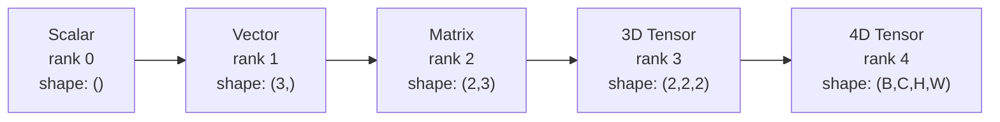
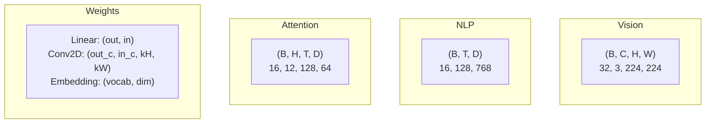
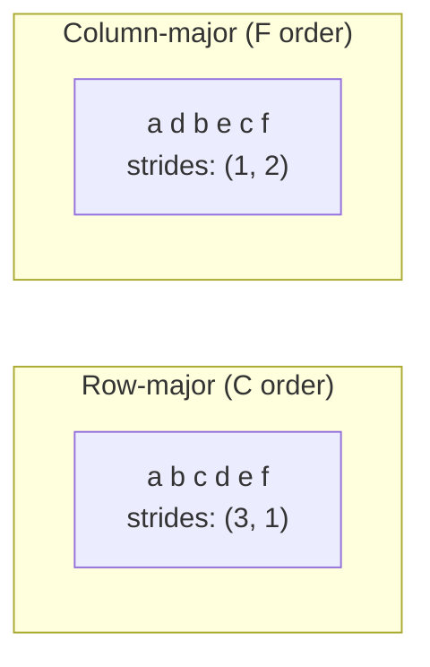
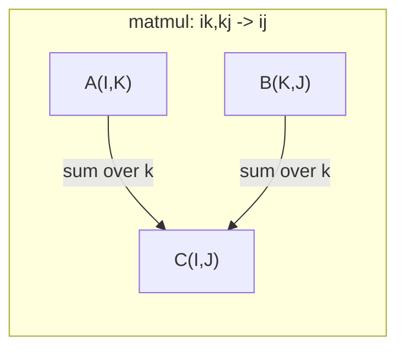

# Tensor Operations

> Tensor là ngôn ngữ chung giữa dữ liệu và học sâu. Mọi hình ảnh, mọi câu, mọi gradient đều truyền qua chúng.

**Type:** Build
**Language:** Python
**Prerequisites:** Phase 1, Lessons 01 (Linear Algebra Intuition), 02 (Vectors, Matrices & Operations)
**Time:** ~90 minutes

## Learning Objectives

- Triển khai một lớp tensor với hình dạng, stride, reshape, transpose và các phép toán theo từng phần tử từ đầu
- Áp dụng các quy tắc broadcasting để thao tác trên các tensor có hình dạng khác nhau mà không sao chép dữ liệu
- Viết các biểu thức einsum cho tích vô hướng, nhân ma trận, tích ngoài và các phép toán theo batch
- Theo dõi các hình dạng tensor chính xác qua mọi bước của multi-head attention

## The Problem

Bạn xây dựng một transformer. Lượt truyền xuôi trông gọn. Bạn chạy nó và nhận được: `RuntimeError: mat1 and mat2 shapes cannot be multiplied (32x768 and 512x768)`. Bạn nhìn chằm chằm vào các hình dạng. Bạn thử một phép chuyển vị. Giờ nó nói `Expected 4D input (got 3D input)`. Bạn thêm một unsqueeze. Thứ khác lại hỏng.

Lỗi hình dạng là lỗi phổ biến nhất trong mã học sâu. Về khái niệm chúng không khó -- mỗi phép toán có một hợp đồng hình dạng -- nhưng chúng gia tăng nhanh chóng. Một transformer có hàng chục phép reshape, transpose và broadcast nối tiếp nhau. Một trục sai và lỗi lan truyền dây chuyền. Tệ hơn, một số lỗi hình dạng hoàn toàn không gây báo lỗi. Chúng âm thầm tạo ra dữ liệu rác bằng cách broadcast theo sai chiều hoặc lấy tổng trên sai trục.

Ma trận xử lý các mối quan hệ từng cặp giữa hai tập đối tượng. Dữ liệu thực không vừa trong hai chiều. Một batch gồm 32 hình ảnh RGB ở 224x224 là một tensor 4D: `(32, 3, 224, 224)`. Self-attention với 12 head cũng là 4D: `(batch, heads, seq_len, head_dim)`. Bạn cần một cấu trúc dữ liệu tổng quát hóa đến bất kỳ số chiều nào, với các phép toán hợp thành gọn gàng trên tất cả chúng. Cấu trúc đó là tensor. Thành thạo các phép toán của nó và lỗi hình dạng trở nên dễ gỡ lỗi.

## The Concept

### What a tensor is

Một tensor là một mảng số nhiều chiều với một kiểu dữ liệu thống nhất. Số chiều là **hạng** (hoặc **bậc**). Mỗi chiều là một **trục**. **Hình dạng** là một tuple liệt kê kích thước dọc theo từng trục.



Tổng số phần tử = tích tất cả các kích thước. Một hình dạng `(2, 3, 4)` chứa `2 * 3 * 4 = 24` phần tử.

### Tensor shapes in deep learning

Các loại dữ liệu khác nhau ánh xạ đến các hình dạng tensor cụ thể theo quy ước.



PyTorch sử dụng NCHW (kênh trước). TensorFlow mặc định dùng NHWC (kênh sau). Các bố trí không khớp gây chậm âm thầm hoặc lỗi.

### How memory layout works

Một mảng 2D trong bộ nhớ là một chuỗi byte 1D. **Stride** cho bạn biết cần bỏ qua bao nhiêu phần tử để di chuyển một bước dọc theo mỗi trục.



Transpose không di chuyển dữ liệu. Nó hoán đổi các stride, làm tensor **không liên tục** -- các phần tử của một hàng không còn liền kề trong bộ nhớ.

### Broadcasting rules

Broadcasting cho phép bạn thao tác trên các tensor có hình dạng khác nhau mà không sao chép dữ liệu. Căn chỉnh các hình dạng từ bên phải. Hai chiều tương thích khi chúng bằng nhau hoặc một chiều là 1. Hình dạng ít chiều hơn được đệm bằng các số 1 ở bên trái.

```
Tensor A:     (8, 1, 6, 1)
Tensor B:        (7, 1, 5)
Padded B:     (1, 7, 1, 5)
Result:       (8, 7, 6, 5)
```

### Einsum: the universal tensor operation

Phép tổng Einstein gắn nhãn mỗi trục bằng một chữ cái. Các trục trong đầu vào nhưng không trong đầu ra được lấy tổng. Các trục ở cả hai được giữ lại.



Các mẫu chính: `i,i->` (tích vô hướng), `i,j->ij` (tích ngoài), `ii->` (vết), `ij->ji` (chuyển vị), `bij,bjk->bik` (nhân ma trận theo batch), `bhtd,bhsd->bhts` (điểm attention).

```figure
tensor-broadcast
```

## Build It

Mã nằm trong `code/tensors.py`. Mỗi bước tham chiếu đến triển khai ở đó.

### Step 1: Tensor storage and strides

Một tensor lưu một danh sách số phẳng cùng siêu dữ liệu hình dạng. Stride cho logic lập chỉ mục biết cách ánh xạ các chỉ số nhiều chiều thành các vị trí phẳng.

```python
class Tensor:
    def __init__(self, data, shape=None):
        if isinstance(data, (list, tuple)):
            self._data, self._shape = self._flatten_nested(data)
        elif isinstance(data, np.ndarray):
            self._data = data.flatten().tolist()
            self._shape = tuple(data.shape)
        else:
            self._data = [data]
            self._shape = ()

        if shape is not None:
            total = reduce(lambda a, b: a * b, shape, 1)
            if total != len(self._data):
                raise ValueError(
                    f"Cannot reshape {len(self._data)} elements into shape {shape}"
                )
            self._shape = tuple(shape)

        self._strides = self._compute_strides(self._shape)

    @staticmethod
    def _compute_strides(shape):
        if len(shape) == 0:
            return ()
        strides = [1] * len(shape)
        for i in range(len(shape) - 2, -1, -1):
            strides[i] = strides[i + 1] * shape[i + 1]
        return tuple(strides)
```

Với hình dạng `(3, 4)`, stride là `(4, 1)` -- bỏ qua 4 phần tử để tiến một hàng, bỏ qua 1 phần tử để tiến một cột.

### Step 2: Reshape, squeeze, unsqueeze

Reshape thay đổi hình dạng mà không thay đổi thứ tự phần tử. Tổng số phần tử phải giữ nguyên. Sử dụng `-1` cho một chiều để suy ra kích thước của nó.

```python
t = Tensor(list(range(12)), shape=(2, 6))
r = t.reshape((3, 4))
r = t.reshape((-1, 3))
```

Squeeze loại bỏ các trục có kích thước 1. Unsqueeze chèn một trục. Unsqueeze rất quan trọng cho broadcasting -- một vector bias `(D,)` được cộng vào một batch `(B, T, D)` cần được unsqueeze thành `(1, 1, D)`.

```python
t = Tensor(list(range(6)), shape=(1, 3, 1, 2))
s = t.squeeze()
v = Tensor([1, 2, 3])
u = v.unsqueeze(0)
```

### Step 3: Transpose and permute

Transpose hoán đổi hai trục. Permute sắp xếp lại tất cả các trục. Đây là cách bạn chuyển đổi giữa NCHW và NHWC.

```python
mat = Tensor(list(range(6)), shape=(2, 3))
tr = mat.transpose(0, 1)

t4d = Tensor(list(range(24)), shape=(1, 2, 3, 4))
perm = t4d.permute((0, 2, 3, 1))
```

Sau transpose hoặc permute, tensor không liên tục trong bộ nhớ. Trong PyTorch, `view` thất bại trên các tensor không liên tục -- sử dụng `reshape` hoặc gọi `.contiguous()` trước.

### Step 4: Element-wise operations and reductions

Các phép toán theo từng phần tử (cộng, nhân, trừ) áp dụng độc lập cho từng phần tử và bảo toàn hình dạng. Các phép rút gọn (sum, mean, max) thu gọn một hoặc nhiều trục.

```python
a = Tensor([[1, 2], [3, 4]])
b = Tensor([[10, 20], [30, 40]])
c = a + b
d = a * 2
s = a.sum(axis=0)
```

Global average pooling trong một CNN: `(B, C, H, W).mean(axis=[2, 3])` tạo ra `(B, C)`. Mean pooling chuỗi trong NLP: `(B, T, D).mean(axis=1)` tạo ra `(B, D)`.

### Step 5: Broadcasting with NumPy

Hàm `demo_broadcasting_numpy()` trong `tensors.py` cho thấy các mẫu cốt lõi.

```python
activations = np.random.randn(4, 3)
bias = np.array([0.1, 0.2, 0.3])
result = activations + bias

images = np.random.randn(2, 3, 4, 4)
scale = np.array([0.5, 1.0, 1.5]).reshape(1, 3, 1, 1)
result = images * scale

a = np.array([1, 2, 3]).reshape(-1, 1)
b = np.array([10, 20, 30, 40]).reshape(1, -1)
outer = a * b
```

Khoảng cách từng cặp bằng broadcasting: reshape `(M, 2)` thành `(M, 1, 2)` và `(N, 2)` thành `(1, N, 2)`, trừ, bình phương, lấy tổng theo trục cuối, lấy căn bậc hai. Kết quả: `(M, N)`.

### Step 6: Einsum operations

Các hàm `demo_einsum()` và `demo_einsum_gallery()` lần lượt trình bày mọi mẫu phổ biến.

```python
a = np.array([1.0, 2.0, 3.0])
b = np.array([4.0, 5.0, 6.0])
dot = np.einsum("i,i->", a, b)

A = np.array([[1, 2], [3, 4], [5, 6]], dtype=float)
B = np.array([[7, 8, 9], [10, 11, 12]], dtype=float)
matmul = np.einsum("ik,kj->ij", A, B)

batch_A = np.random.randn(4, 3, 5)
batch_B = np.random.randn(4, 5, 2)
batch_mm = np.einsum("bij,bjk->bik", batch_A, batch_B)
```

Chi phí tính toán của một phép co là tích tất cả kích thước chỉ số (được giữ và được lấy tổng). Với `bij,bjk->bik` khi B=32, I=128, J=64, K=128: `32 * 128 * 64 * 128 = 33,554,432` phép nhân-cộng.

### Step 7: Attention mechanism via einsum

Hàm `demo_attention_einsum()` triển khai multi-head attention từ đầu đến cuối.

```python
B, H, T, D = 2, 4, 8, 16
E = H * D

X = np.random.randn(B, T, E)
W_q = np.random.randn(E, E) * 0.02

Q = np.einsum("bte,ek->btk", X, W_q)
Q = Q.reshape(B, T, H, D).transpose(0, 2, 1, 3)

scores = np.einsum("bhtd,bhsd->bhts", Q, K) / np.sqrt(D)
weights = softmax(scores, axis=-1)
attn_output = np.einsum("bhts,bhsd->bhtd", weights, V)

concat = attn_output.transpose(0, 2, 1, 3).reshape(B, T, E)
output = np.einsum("bte,ek->btk", concat, W_o)
```

Mỗi bước là một phép toán tensor: phép chiếu (matmul qua einsum), tách head (reshape + transpose), điểm attention (batch matmul qua einsum), tổng có trọng số (batch matmul qua einsum), gộp head (transpose + reshape), phép chiếu đầu ra (matmul qua einsum).

## Use It

### Scratch vs NumPy

| Phép toán | Từ đầu (lớp Tensor) | NumPy |
|---|---|---|
| Tạo | `Tensor([[1,2],[3,4]])` | `np.array([[1,2],[3,4]])` |
| Reshape | `t.reshape((3,4))` | `a.reshape(3,4)` |
| Transpose | `t.transpose(0,1)` | `a.T` hoặc `a.transpose(0,1)` |
| Squeeze | `t.squeeze(0)` | `np.squeeze(a, 0)` |
| Tổng | `t.sum(axis=0)` | `a.sum(axis=0)` |
| Einsum | N/A | `np.einsum("ij,jk->ik", a, b)` |

### Scratch vs PyTorch

```python
import torch

t = torch.tensor([[1, 2, 3], [4, 5, 6]], dtype=torch.float32)
t.shape
t.stride()
t.is_contiguous()

t.reshape(3, 2)
t.unsqueeze(0)
t.transpose(0, 1)
t.transpose(0, 1).contiguous()

torch.einsum("ik,kj->ij", A, B)
```

PyTorch bổ sung autograd, hỗ trợ GPU và các kernel BLAS được tối ưu hóa. Ngữ nghĩa hình dạng giống hệt nhau. Nếu hiểu phiên bản từ đầu, lỗi hình dạng PyTorch trở nên dễ đọc.

### Every neural network layer as a tensor operation

| Phép toán | Dạng Tensor | Einsum |
|---|---|---|
| Lớp tuyến tính | `Y = X @ W.T + b` | `"bd,od->bo"` + bias |
| Attention QKV | `Q = X @ W_q` | `"btd,dh->bth"` |
| Điểm attention | `Q @ K.T / sqrt(d)` | `"bhtd,bhsd->bhts"` |
| Đầu ra attention | `softmax(scores) @ V` | `"bhts,bhsd->bhtd"` |
| Batch norm | `(X - mu) / sigma * gamma` | theo từng phần tử + broadcast |
| Softmax | `exp(x) / sum(exp(x))` | theo từng phần tử + rút gọn |

## Ship It

Bài học này tạo ra hai prompt có thể tái sử dụng:

1. **`outputs/prompt-tensor-shapes.md`** -- Một prompt có hệ thống để gỡ lỗi hình dạng tensor không khớp. Bao gồm các bảng quyết định cho mọi phép toán phổ biến (matmul, broadcast, cat, Linear, Conv2d, BatchNorm, softmax) và một bảng tra cách khắc phục.

2. **`outputs/prompt-tensor-debugger.md`** -- Một prompt gỡ lỗi từng bước mà bạn dán vào bất kỳ trợ lý AI nào khi lỗi hình dạng đang cản trở bạn. Đưa vào thông báo lỗi và các hình dạng tensor của bạn, nhận lại cách khắc phục chính xác.

## Exercises

1. **Dễ -- Reshape khứ hồi.** Lấy một tensor có hình dạng `(2, 3, 4)`. Reshape nó thành `(6, 4)`, rồi thành `(24,)`, rồi trở lại `(2, 3, 4)`. Xác minh thứ tự phần tử được bảo toàn tại mỗi bước bằng cách in dữ liệu phẳng.

2. **Trung bình -- Triển khai broadcasting.** Mở rộng lớp `Tensor` với một phương thức `broadcast_to(shape)` mở rộng các chiều có kích thước 1 để khớp với một hình dạng mục tiêu. Sau đó sửa `_elementwise_op` để tự động broadcast trước khi thao tác. Kiểm tra với các hình dạng `(3, 1)` và `(1, 4)` tạo ra `(3, 4)`.

3. **Khó -- Xây dựng einsum từ đầu.** Triển khai một hàm `einsum(subscripts, *tensors)` cơ bản xử lý ít nhất: tích vô hướng (`i,i->`), nhân ma trận (`ij,jk->ik`), tích ngoài (`i,j->ij`) và chuyển vị (`ij->ji`). Phân tích chuỗi chỉ số, xác định các chỉ số được co và lặp qua tất cả tổ hợp chỉ số. So sánh kết quả với `np.einsum`.

4. **Khó -- Bộ theo dõi hình dạng attention.** Viết một hàm nhận `batch_size`, `seq_len`, `embed_dim` và `num_heads` làm đầu vào và in hình dạng chính xác tại mọi bước của multi-head attention: đầu vào, phép chiếu Q/K/V, tách head, điểm attention, trọng số softmax, tổng có trọng số, gộp head, phép chiếu đầu ra. Xác minh với đầu ra `demo_attention_einsum()`.

## Key Terms

| Thuật ngữ | Cách mọi người nói | Ý nghĩa thực sự |
|---|---|---|
| Tensor | "Một ma trận nhưng nhiều chiều hơn" | Một mảng nhiều chiều với kiểu thống nhất và hình dạng, stride cùng các phép toán được xác định |
| Rank (Hạng) | "Số chiều" | Số trục. Một ma trận có hạng 2, không phải hạng bằng hạng ma trận của nó |
| Shape (Hình dạng) | "Kích thước của tensor" | Một tuple liệt kê kích thước dọc theo từng trục. `(2, 3)` nghĩa là 2 hàng, 3 cột |
| Stride | "Cách bộ nhớ được bố trí" | Số phần tử cần bỏ qua để tiến một vị trí dọc theo từng trục |
| Broadcasting | "Nó cứ hoạt động khi hình dạng khác nhau" | Một tập quy tắc nghiêm ngặt: căn chỉnh từ phải, các chiều phải bằng nhau hoặc một chiều phải là 1 |
| Contiguous (Liên tục) | "Tensor bình thường" | Các phần tử được lưu tuần tự trong bộ nhớ không có khoảng trống hoặc sắp xếp lại so với bố trí logic |
| Einsum | "Một cách cầu kỳ để viết matmul" | Một ký hiệu tổng quát biểu đạt bất kỳ phép co tensor, tích ngoài, vết hoặc chuyển vị nào trong một dòng |
| View | "Giống reshape" | Một tensor dùng chung bộ đệm bộ nhớ nhưng có siêu dữ liệu hình dạng/stride khác. Thất bại trên dữ liệu không liên tục |
| Contraction (Phép co) | "Lấy tổng theo một chỉ số" | Phép toán tổng quát trong đó một chỉ số chung giữa các tensor được nhân và lấy tổng, tạo ra một kết quả có hạng thấp hơn |
| NCHW / NHWC | "Định dạng PyTorch so với TensorFlow" | Các quy ước bố trí bộ nhớ cho tensor hình ảnh. NCHW đặt kênh trước các chiều không gian, NHWC đặt chúng sau |

## Further Reading

- [NumPy Broadcasting](https://numpy.org/doc/stable/user/basics.broadcasting.html) -- Các quy tắc chuẩn cùng ví dụ trực quan
- [PyTorch Tensor Views](https://pytorch.org/docs/stable/tensor_view.html) -- Khi nào view hoạt động và khi nào chúng sao chép
- [einops](https://github.com/arogozhnikov/einops) -- Một thư viện làm việc thay đổi hình dạng tensor dễ đọc và an toàn
- [The Illustrated Transformer](https://jalammar.github.io/illustrated-transformer/) -- Trực quan hóa các hình dạng tensor truyền qua attention
- [Einstein Summation in NumPy](https://numpy.org/doc/stable/reference/generated/numpy.einsum.html) -- Tài liệu einsum đầy đủ cùng ví dụ
