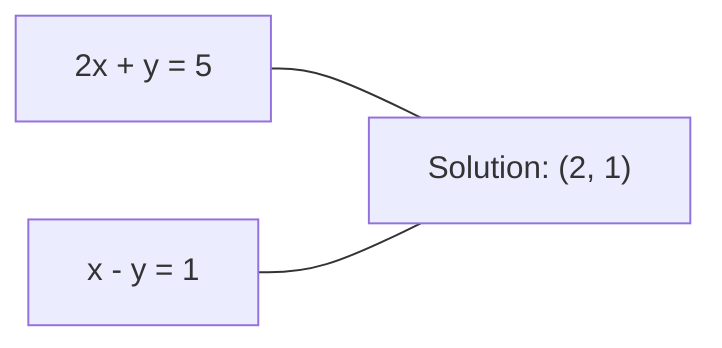
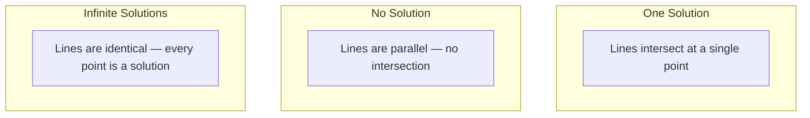

# Linear Systems

> Giải $Ax = b$ là bài toán lâu đời nhất trong toán học vẫn vận hành mạng nơ-ron của bạn.

**Type:** Build
**Language:** Python
**Prerequisites:** Phase 1, Lessons 01 (Linear Algebra Intuition), 02 (Vectors & Matrices), 03 (Matrix Transformations)
**Time:** ~120 minutes

## Learning Objectives

- Giải $Ax = b$ bằng phép khử Gauss với chọn phần tử trụ một phần và thế lùi
- Phân tích ma trận thành nhân tử với các phân rã LU, QR và Cholesky và giải thích khi nào mỗi loại thích hợp
- Suy ra các phương trình chuẩn cho bình phương tối thiểu và kết nối chúng với hồi quy tuyến tính và ridge
- Chẩn đoán các hệ có điều kiện kém bằng số điều kiện và áp dụng regularization để ổn định chúng

## The Problem

Mỗi khi huấn luyện hồi quy tuyến tính, bạn giải một hệ tuyến tính. Mỗi khi tính một phép khớp bình phương tối thiểu, bạn giải một hệ tuyến tính. Mỗi khi một lớp mạng nơ-ron tính `y = Wx + b`, nó đang tính một vế của một hệ tuyến tính. Khi thêm regularization, bạn sửa đổi hệ. Khi sử dụng quá trình Gaussian, bạn phân tích một ma trận thành nhân tử. Khi nghịch đảo ma trận hiệp phương sai cho khoảng cách Mahalanobis, bạn giải một hệ tuyến tính.

Phương trình $Ax = b$ xuất hiện khắp nơi. $A$ là ma trận các hệ số đã biết. $b$ là vector các đầu ra đã biết. $x$ là vector các ẩn bạn muốn tìm. Trong hồi quy tuyến tính, $A$ là ma trận dữ liệu, $b$ là vector mục tiêu và $x$ là vector trọng số. Toàn bộ mô hình quy về: tìm $x$ sao cho $Ax$ gần $b$ nhất có thể.

Bài học này xây dựng mọi phương pháp chính để giải phương trình đó từ đầu. Bạn sẽ hiểu tại sao một số phương pháp nhanh và các phương pháp khác ổn định, tại sao một số chỉ hoạt động cho hệ vuông còn các phương pháp khác xử lý hệ thừa xác định, và tại sao số điều kiện của ma trận quyết định câu trả lời của bạn có ý nghĩa gì hay không.

## The Concept

### What Ax = b means geometrically

Một hệ phương trình tuyến tính có một diễn giải hình học. Mỗi phương trình xác định một siêu phẳng. Nghiệm là điểm (hoặc tập điểm) nơi mọi siêu phẳng giao nhau.

```
2x + y = 5          Two lines in 2D.
x - y  = 1          They intersect at x=2, y=1.
```



Ba điều có thể xảy ra:



Trong dạng ma trận, "một nghiệm" nghĩa là $A$ khả nghịch. "Vô nghiệm" nghĩa là hệ không tương thích. "Vô số nghiệm" nghĩa là $A$ có một không gian không. Hầu hết các bài toán ML thuộc loại "không có nghiệm chính xác" vì bạn có nhiều phương trình (điểm dữ liệu) hơn ẩn (tham số). Đó là nơi bình phương tối thiểu xuất hiện.

### Column picture vs row picture

Có hai cách đọc $Ax = b$.

**Cách nhìn theo hàng.** Mỗi hàng của $A$ xác định một phương trình. Mỗi phương trình là một siêu phẳng. Nghiệm là nơi tất cả chúng giao nhau.

**Cách nhìn theo cột.** Mỗi cột của $A$ là một vector. Câu hỏi trở thành: tổ hợp tuyến tính nào của các cột $A$ tạo ra $b$?

```
A = | 2  1 |    b = | 5 |
    | 1 -1 |        | 1 |

Row picture: solve 2x + y = 5 and x - y = 1 simultaneously.

Column picture: find x1, x2 such that:
  x1 * [2, 1] + x2 * [1, -1] = [5, 1]
  2 * [2, 1] + 1 * [1, -1] = [4+1, 2-1] = [5, 1]   check.
```

Cách nhìn theo cột cơ bản hơn. Nếu $b$ nằm trong không gian cột của $A$, hệ có nghiệm. Nếu $b$ không nằm trong đó, bạn tìm điểm gần nhất trong không gian cột. Điểm gần nhất đó là nghiệm bình phương tối thiểu.

### Gaussian elimination

Phép khử Gauss biến đổi $Ax = b$ thành một hệ tam giác trên $Ux = c$ mà bạn giải bằng thế lùi. Đây là phương pháp trực tiếp nhất.

Thuật toán:

```
1. For each column k (the pivot column):
   a. Find the largest entry in column k at or below row k (partial pivoting).
   b. Swap that row with row k.
   c. For each row i below k:
      - Compute multiplier m = A[i][k] / A[k][k]
      - Subtract m times row k from row i.
2. Back substitute: solve from the last equation upward.
```

Ví dụ:

```
Original:
| 2  1  1 | 8 |       R2 = R2 - (2)R1     | 2  1   1 |  8 |
| 4  3  3 |20 |  -->  R3 = R3 - (1)R1 --> | 0  1   1 |  4 |
| 2  3  1 |12 |                            | 0  2   0 |  4 |

                       R3 = R3 - (2)R2     | 2  1   1 |  8 |
                                       --> | 0  1   1 |  4 |
                                           | 0  0  -2 | -4 |

Back substitute:
  -2 * x3 = -4    -->  x3 = 2
  x2 + 2  = 4     -->  x2 = 2
  2*x1 + 2 + 2 = 8 --> x1 = 2
```

Phép khử Gauss tốn $O(n^3)$ phép toán. Với một hệ $1000 \times 1000$, đó là khoảng một tỷ phép toán dấu phẩy động. Nhanh, nhưng bạn có thể làm tốt hơn nếu cần giải nhiều hệ có cùng $A$.

### Partial pivoting: why it matters

Không có chọn phần tử trụ, phép khử Gauss có thể thất bại hoặc tạo ra kết quả rác. Nếu phần tử trụ bằng không, bạn chia cho không. Nếu nó nhỏ, bạn khuếch đại sai số làm tròn.

```
Bad pivot:                       With partial pivoting:
| 0.001  1 | 1.001 |            Swap rows first:
| 1      1 | 2     |            | 1      1 | 2     |
                                 | 0.001  1 | 1.001 |
m = 1/0.001 = 1000              m = 0.001/1 = 0.001
R2 = R2 - 1000*R1               R2 = R2 - 0.001*R1
| 0.001  1     | 1.001   |      | 1      1     | 2     |
| 0     -999   | -999.0  |      | 0      0.999 | 0.999 |

x2 = 1.000 (correct)            x2 = 1.000 (correct)
x1 = (1.001 - 1)/0.001          x1 = (2 - 1)/1 = 1.000 (correct)
   = 0.001/0.001 = 1.000        Stable because the multiplier is small.
```

Trong số học dấu phẩy động với độ chính xác giới hạn, phiên bản không chọn phần tử trụ có thể mất các chữ số có nghĩa. Chọn phần tử trụ một phần luôn chọn phần tử trụ lớn nhất sẵn có để tối thiểu hóa việc khuếch đại sai số.

### LU decomposition

Phân rã LU phân tích $A$ thành một ma trận tam giác dưới $L$ và một ma trận tam giác trên $U$: $A = LU$. Ma trận $L$ lưu các hệ số nhân từ phép khử Gauss. Ma trận $U$ là kết quả khử.

```
A = L @ U

| 2  1  1 |   | 1  0  0 |   | 2  1   1 |
| 4  3  3 | = | 2  1  0 | @ | 0  1   1 |
| 2  3  1 |   | 1  2  1 |   | 0  0  -2 |
```

Tại sao phân tích thành nhân tử thay vì chỉ khử? Vì một khi có $L$ và $U$, giải $Ax = b$ cho bất kỳ $b$ mới nào chỉ tốn $O(n^2)$:

```math
\begin{aligned}
Ax &= b \\
LUx &= b \\
&\text{Let } y = Ux\text{:} \\
Ly &= b \quad \text{(forward substitution, } O(n^2)\text{)} \\
Ux &= y \quad \text{(back substitution, } O(n^2)\text{)}
\end{aligned}
```

Chi phí $O(n^3)$ được trả một lần trong quá trình phân tích thành nhân tử. Mỗi lần giải tiếp theo là $O(n^2)$. Nếu cần giải 1000 hệ có cùng $A$ nhưng các vector $b$ khác nhau, LU tiết kiệm một hệ số 1000/3 trong tổng lượng công việc.

Với chọn phần tử trụ một phần, bạn có $PA = LU$ trong đó $P$ là ma trận hoán vị ghi lại các lần đổi hàng.

### QR decomposition

Phân rã QR phân tích $A$ thành một ma trận trực giao $Q$ và một ma trận tam giác trên $R$: $A = QR$.

Một ma trận trực giao có tính chất $Q^T Q = I$. Các cột của nó là các vector trực chuẩn. Nhân với $Q$ bảo toàn độ dài và góc.

```
A = Q @ R

Q has orthonormal columns: Q^T Q = I
R is upper triangular

To solve Ax = b:
  QRx = b
  Rx = Q^T b    (just multiply by Q^T, no inversion needed)
  Back substitute to get x.
```

QR ổn định về mặt số học hơn LU để giải các bài toán bình phương tối thiểu. Quy trình Gram-Schmidt xây dựng $Q$ theo từng cột:

```
Given columns a1, a2, ... of A:

q1 = a1 / ||a1||

q2 = a2 - (a2 . q1) * q1        (subtract projection onto q1)
q2 = q2 / ||q2||                (normalize)

q3 = a3 - (a3 . q1) * q1 - (a3 . q2) * q2
q3 = q3 / ||q3||

R[i][j] = qi . aj    for i <= j
```

Mỗi bước loại bỏ thành phần dọc theo tất cả các vector $q$ trước đó, chỉ để lại hướng trực giao mới.

### Cholesky decomposition

Khi $A$ đối xứng ($A = A^T$) và xác định dương (mọi giá trị riêng dương), bạn có thể phân tích nó thành $A = L L^T$ trong đó $L$ là tam giác dưới. Đây là phân rã Cholesky.

```
A = L @ L^T

| 4  2 |   | 2  0 |   | 2  1 |
| 2  5 | = | 1  2 | @ | 0  2 |

L[i][i] = sqrt(A[i][i] - sum(L[i][k]^2 for k < i))
L[i][j] = (A[i][j] - sum(L[i][k]*L[j][k] for k < j)) / L[j][j]    for i > j
```

Cholesky nhanh gấp đôi LU và đòi hỏi một nửa dung lượng lưu trữ. Nó chỉ hoạt động cho các ma trận đối xứng xác định dương, nhưng chúng xuất hiện liên tục:

- Các ma trận hiệp phương sai đối xứng nửa xác định dương (xác định dương khi có regularization).
- Ma trận kernel trong các quá trình Gaussian đối xứng xác định dương.
- Hessian của một hàm lồi tại một cực tiểu đối xứng xác định dương.
- $A^T A$ luôn đối xứng nửa xác định dương.

Trong các quá trình Gaussian, bạn phân tích ma trận kernel $K$ bằng Cholesky, rồi giải $K \alpha = y$ để có trung bình dự đoán. Nhân tử Cholesky cũng cho bạn log-định thức cho hợp lý biên: $\log \det(K) = 2 \sum \log(\mathop{\mathrm{diag}}(L))$.

### Least squares: when Ax = b has no exact solution

Nếu $A$ là $m \times n$ với $m > n$ (nhiều phương trình hơn ẩn), hệ thừa xác định. Không có nghiệm chính xác. Thay vào đó, bạn tối thiểu hóa sai số bình phương:

```
minimize ||Ax - b||^2

This is the sum of squared residuals:
  sum((A[i,:] @ x - b[i])^2 for i in range(m))
```

Điểm cực tiểu thỏa mãn các phương trình chuẩn:

```math
A^T A x = A^T b
```

Suy ra: khai triển $\lVert Ax - b \rVert^2 = (Ax - b)^T (Ax - b) = x^T A^T A x - 2 x^T A^T b + b^T b$. Lấy gradient theo $x$, đặt nó bằng không: $2 A^T A x - 2 A^T b = 0$.

```
Original system (overdetermined, 4 equations, 2 unknowns):
| 1  1 |         | 3 |
| 1  2 | x     = | 5 |       No exact x satisfies all 4 equations.
| 1  3 |         | 6 |
| 1  4 |         | 8 |

Normal equations:
A^T A = | 4  10 |    A^T b = | 22 |
        | 10 30 |            | 63 |

Solve: x = [1.5, 1.7]

This is linear regression. x[0] is the intercept, x[1] is the slope.
```

### Normal equations = linear regression

Mối liên hệ là chính xác. Trong hồi quy tuyến tính, ma trận dữ liệu $X$ có một hàng cho mỗi mẫu và một cột cho mỗi đặc trưng. Vector mục tiêu $y$ có một phần tử cho mỗi mẫu. Vector trọng số $w$ thỏa mãn:

```math
\begin{aligned}
X^T X w &= X^T y \\
w &= (X^T X)^{-1} X^T y
\end{aligned}
```

Đây là nghiệm dạng đóng của hồi quy tuyến tính. Mỗi lời gọi `sklearn.linear_model.LinearRegression.fit()` tính điều này (hoặc một cách tương đương qua QR hay SVD).

Thêm một thành phần regularization $\lambda I$ vào ma trận và bạn có hồi quy ridge:

```math
\begin{aligned}
(X^T X + \lambda I) w &= X^T y \\
w &= (X^T X + \lambda I)^{-1} X^T y
\end{aligned}
```

Regularization làm ma trận có điều kiện tốt hơn (dễ nghịch đảo chính xác hơn) và ngăn khớp quá mức bằng cách thu nhỏ các trọng số về phía không. Ma trận $X^T X + \lambda I$ luôn đối xứng xác định dương khi $\lambda > 0$, nên bạn có thể sử dụng Cholesky để giải nó.

### Pseudoinverse (Moore-Penrose)

Giả nghịch đảo $A^+$ tổng quát hóa phép nghịch đảo ma trận cho các ma trận không vuông và suy biến. Với bất kỳ ma trận $A$ nào:

```math
\begin{aligned}
x &= A^+ b \\[4pt]
\text{where } A^+ &= V \Sigma^+ U^T \quad \text{(computed via SVD)}
\end{aligned}
```

$\Sigma^+$ được tạo bằng cách lấy nghịch đảo của mỗi giá trị kỳ dị khác không và chuyển vị kết quả. Nếu $A = U \Sigma V^T$, thì $A^+ = V \Sigma^+ U^T$.

```
A = U Sigma V^T        (SVD)

Sigma = | 5  0 |       Sigma+ = | 1/5  0  0 |
        | 0  2 |                | 0  1/2  0 |
        | 0  0 |

A+ = V Sigma+ U^T
```

Giả nghịch đảo cho nghiệm bình phương tối thiểu có chuẩn nhỏ nhất. Nếu hệ có:
- Một nghiệm: $A^+ b$ cho nghiệm đó.
- Vô nghiệm: $A^+ b$ cho nghiệm bình phương tối thiểu.
- Vô số nghiệm: $A^+ b$ cho nghiệm có $\lVert x \rVert$ nhỏ nhất.

`np.linalg.lstsq` và `np.linalg.pinv` của NumPy đều sử dụng SVD nội bộ.

### Condition number

Số điều kiện đo mức độ nhạy của nghiệm với những thay đổi nhỏ ở đầu vào. Với một ma trận $A$, số điều kiện là:

```math
\kappa(A) = \lVert A \rVert \cdot \lVert A^{-1} \rVert = \frac{\sigma_{\max}}{\sigma_{\min}}
```

trong đó $\sigma_{\max}$ và $\sigma_{\min}$ là các giá trị kỳ dị lớn nhất và nhỏ nhất.

```
Well-conditioned (kappa ~ 1):        Ill-conditioned (kappa ~ 10^15):
Small change in b -->                Small change in b -->
small change in x                    huge change in x

| 2  0 |   kappa = 2/1 = 2          | 1   1          |   kappa ~ 10^15
| 0  1 |   safe to solve            | 1   1+10^(-15) |   solution is garbage
```

Các quy tắc kinh nghiệm:
- $\kappa < 100$: an toàn, nghiệm chính xác.
- $\kappa \approx 10^k$: bạn mất khoảng $k$ chữ số chính xác từ số học dấu phẩy động.
- $\kappa \approx 10^{16}$ (với float64): nghiệm vô nghĩa. Ma trận thực chất suy biến.

Trong ML, điều kiện kém xảy ra khi các đặc trưng gần cộng tuyến. Regularization (thêm $\lambda I$) cải thiện số điều kiện từ $\sigma_{\max} / \sigma_{\min}$ thành $(\sigma_{\max} + \lambda) / (\sigma_{\min} + \lambda)$.

### Iterative methods: conjugate gradient

Với các hệ thưa rất lớn (hàng triệu ẩn), các phương pháp trực tiếp như LU hoặc Cholesky quá tốn kém. Các phương pháp lặp xấp xỉ nghiệm bằng cách cải thiện một phỏng đoán qua nhiều lần lặp.

Gradient liên hợp (CG) giải $Ax = b$ khi $A$ đối xứng xác định dương. Nó tìm nghiệm chính xác trong nhiều nhất $n$ lần lặp (trong số học chính xác), nhưng thường hội tụ nhanh hơn nhiều nếu các giá trị riêng của $A$ tụ thành nhóm.

```
Algorithm sketch:
  x0 = initial guess (often zero)
  r0 = b - A x0           (residual)
  p0 = r0                 (search direction)

  For k = 0, 1, 2, ...:
    alpha = (rk . rk) / (pk . A pk)
    x_{k+1} = xk + alpha * pk
    r_{k+1} = rk - alpha * A pk
    beta = (r_{k+1} . r_{k+1}) / (rk . rk)
    p_{k+1} = r_{k+1} + beta * pk
    if ||r_{k+1}|| < tolerance: stop
```

CG được sử dụng trong:
- Tối ưu hóa quy mô lớn (phương pháp Newton-CG)
- Giải các phép rời rạc hóa PDE
- Các phương pháp kernel nơi ma trận kernel quá lớn để phân tích thành nhân tử
- Tiền điều kiện cho các bộ giải lặp khác

Tốc độ hội tụ phụ thuộc vào số điều kiện. Các hệ có điều kiện tốt hơn hội tụ nhanh hơn, đó là một lý do nữa regularization giúp ích.

### The full picture: which method when

| Phương pháp | Yêu cầu | Chi phí | Trường hợp sử dụng |
|--------|-------------|------|----------|
| Khử Gauss | $A$ vuông, không suy biến | $O(n^3)$ | Giải một lần một hệ vuông |
| Phân rã LU | $A$ vuông, không suy biến | $O(n^3)$ phân tích + $O(n^2)$ giải | Giải nhiều lần với cùng $A$ |
| Phân rã QR | $A$ bất kỳ ($m \ge n$) | $O(mn^2)$ | Bình phương tối thiểu, ổn định về mặt số học |
| Cholesky | $A$ đối xứng xác định dương | $O(n^3/3)$ | Ma trận hiệp phương sai, quá trình Gaussian, hồi quy ridge |
| Phương trình chuẩn | Thừa xác định ($m > n$) | $O(mn^2 + n^3)$ | Hồi quy tuyến tính ($n$ nhỏ) |
| SVD / giả nghịch đảo | $A$ bất kỳ | $O(mn^2)$ | Hệ thiếu hạng, nghiệm có chuẩn nhỏ nhất |
| Gradient liên hợp | $A$ đối xứng xác định dương, thưa | $O(n \cdot k \cdot \text{nnz})$ | Các hệ thưa lớn, $k$ = số lần lặp |

### Connection to ML

Mọi phương pháp trong bài học này xuất hiện trong ML sản xuất:

**Hồi quy tuyến tính.** Nghiệm dạng đóng giải các phương trình chuẩn $X^T X w = X^T y$. Điều này được thực hiện qua Cholesky (nếu $n$ nhỏ) hoặc QR (nếu độ ổn định số học quan trọng) hoặc SVD (nếu ma trận có thể thiếu hạng).

**Hồi quy ridge.** Thêm $\lambda I$ vào $X^T X$. Hệ có regularization $(X^T X + \lambda I) w = X^T y$ luôn giải được bằng Cholesky vì $X^T X + \lambda I$ đối xứng xác định dương với $\lambda > 0$.

**Quá trình Gaussian.** Trung bình dự đoán đòi hỏi giải $K \alpha = y$ trong đó $K$ là ma trận kernel. Phân tích Cholesky của $K$ là cách tiếp cận tiêu chuẩn. Log hợp lý biên sử dụng $\log \det(K) = 2 \sum \log(\mathop{\mathrm{diag}}(L))$.

**Khởi tạo mạng nơ-ron.** Khởi tạo trực giao sử dụng phân rã QR để tạo các ma trận trọng số có các cột trực chuẩn. Điều này ngăn sụp đổ tín hiệu trong mạng sâu.

**Tiền điều kiện.** Các bộ tối ưu hóa quy mô lớn sử dụng Cholesky không đầy đủ hoặc LU không đầy đủ làm các bộ tiền điều kiện cho các bộ giải gradient liên hợp.

**Kỹ thuật đặc trưng.** Số điều kiện của $X^T X$ cho bạn biết các đặc trưng có cộng tuyến hay không. Nếu $\kappa$ lớn, bỏ các đặc trưng hoặc thêm regularization.

```figure
linear-system-conditioning
```

## Build It

### Step 1: Gaussian elimination with partial pivoting

```python
import numpy as np

def gaussian_elimination(A, b):
    n = len(b)
    Ab = np.hstack([A.astype(float), b.reshape(-1, 1).astype(float)])

    for k in range(n):
        max_row = k + np.argmax(np.abs(Ab[k:, k]))
        Ab[[k, max_row]] = Ab[[max_row, k]]

        if abs(Ab[k, k]) < 1e-12:
            raise ValueError(f"Matrix is singular or nearly singular at pivot {k}")

        for i in range(k + 1, n):
            m = Ab[i, k] / Ab[k, k]
            Ab[i, k:] -= m * Ab[k, k:]

    x = np.zeros(n)
    for i in range(n - 1, -1, -1):
        x[i] = (Ab[i, -1] - Ab[i, i+1:n] @ x[i+1:n]) / Ab[i, i]

    return x
```

### Step 2: LU decomposition

```python
def lu_decompose(A):
    n = A.shape[0]
    L = np.eye(n)
    U = A.astype(float).copy()
    P = np.eye(n)

    for k in range(n):
        max_row = k + np.argmax(np.abs(U[k:, k]))
        if max_row != k:
            U[[k, max_row]] = U[[max_row, k]]
            P[[k, max_row]] = P[[max_row, k]]
            if k > 0:
                L[[k, max_row], :k] = L[[max_row, k], :k]

        for i in range(k + 1, n):
            L[i, k] = U[i, k] / U[k, k]
            U[i, k:] -= L[i, k] * U[k, k:]

    return P, L, U

def lu_solve(P, L, U, b):
    n = len(b)
    Pb = P @ b.astype(float)

    y = np.zeros(n)
    for i in range(n):
        y[i] = Pb[i] - L[i, :i] @ y[:i]

    x = np.zeros(n)
    for i in range(n - 1, -1, -1):
        x[i] = (y[i] - U[i, i+1:] @ x[i+1:]) / U[i, i]

    return x
```

### Step 3: Cholesky decomposition

```python
def cholesky(A):
    n = A.shape[0]
    L = np.zeros_like(A, dtype=float)

    for i in range(n):
        for j in range(i + 1):
            s = A[i, j] - L[i, :j] @ L[j, :j]
            if i == j:
                if s <= 0:
                    raise ValueError("Matrix is not positive definite")
                L[i, j] = np.sqrt(s)
            else:
                L[i, j] = s / L[j, j]

    return L
```

### Step 4: Least squares via normal equations

```python
def least_squares_normal(A, b):
    AtA = A.T @ A
    Atb = A.T @ b
    return gaussian_elimination(AtA, Atb)

def ridge_regression(A, b, lam):
    n = A.shape[1]
    AtA = A.T @ A + lam * np.eye(n)
    Atb = A.T @ b
    L = cholesky(AtA)
    y = np.zeros(n)
    for i in range(n):
        y[i] = (Atb[i] - L[i, :i] @ y[:i]) / L[i, i]
    x = np.zeros(n)
    for i in range(n - 1, -1, -1):
        x[i] = (y[i] - L.T[i, i+1:] @ x[i+1:]) / L.T[i, i]
    return x
```

### Step 5: Condition number

```python
def condition_number(A):
    U, S, Vt = np.linalg.svd(A)
    return S[0] / S[-1]
```

## Use It

Ghép các phần lại cho hồi quy tuyến tính và hồi quy ridge trên dữ liệu thực:

```python
np.random.seed(42)
X_raw = np.random.randn(100, 3)
w_true = np.array([2.0, -1.0, 0.5])
y = X_raw @ w_true + np.random.randn(100) * 0.1

X = np.column_stack([np.ones(100), X_raw])

w_ols = least_squares_normal(X, y)
print(f"OLS weights (ours):    {w_ols}")

w_np = np.linalg.lstsq(X, y, rcond=None)[0]
print(f"OLS weights (numpy):   {w_np}")
print(f"Max difference: {np.max(np.abs(w_ols - w_np)):.2e}")

w_ridge = ridge_regression(X, y, lam=1.0)
print(f"Ridge weights (ours):  {w_ridge}")

from sklearn.linear_model import Ridge
ridge_sk = Ridge(alpha=1.0, fit_intercept=False)
ridge_sk.fit(X, y)
print(f"Ridge weights (sklearn): {ridge_sk.coef_}")
```

## Ship It

Bài học này tạo ra:
- `code/linear_systems.py` chứa các triển khai từ đầu của phép khử Gauss, phân rã LU, phân rã Cholesky, bình phương tối thiểu và hồi quy ridge
- Một minh họa hoạt động cho thấy các phương trình chuẩn và LinearRegression của sklearn tạo ra cùng trọng số

## Exercises

1. Giải hệ `[[1,2,3],[4,5,6],[7,8,10]] x = [6, 15, 27]` bằng phép khử Gauss của bạn, bộ giải LU của bạn và `np.linalg.solve`. Xác minh cả ba cho cùng câu trả lời trong dung sai dấu phẩy động.

2. Tạo một ma trận ngẫu nhiên X 50x5 và mục tiêu y = X @ w_true + noise. Giải w bằng các phương trình chuẩn, QR (qua `np.linalg.qr`), SVD (qua `np.linalg.svd`) và `np.linalg.lstsq`. So sánh cả bốn nghiệm. Đo số điều kiện của $X^T X$ và giải thích nó ảnh hưởng thế nào đến phương pháp bạn tin tưởng.

3. Tạo một ma trận gần suy biến bằng cách làm hai cột gần như giống hệt (ví dụ, cột 2 = cột 1 + 1e-10 * noise). Tính số điều kiện của nó. Giải $Ax = b$ khi có và không có regularization (thêm $0.01 I$). So sánh các nghiệm và phần dư. Giải thích tại sao regularization giúp ích.

4. Triển khai thuật toán gradient liên hợp cho một ma trận ngẫu nhiên đối xứng xác định dương 100x100. Đếm số lần lặp cần để hội tụ đến dung sai 1e-8. So sánh với mức tối đa lý thuyết $n$ lần lặp.

5. Đo thời gian bộ giải Cholesky so với bộ giải LU của bạn so với `np.linalg.solve` trên các ma trận đối xứng xác định dương có kích thước 10, 50, 200, 500. Vẽ các kết quả. Xác minh Cholesky nhanh hơn LU khoảng 2 lần.

### Hints

**Bài tập 1.** Gọi `gaussian_elimination(A, b)`, rồi `lu_decompose(A)` tiếp theo là `lu_solve(P, L, U, b)`, rồi `np.linalg.solve(A, b)`. Kiểm tra mỗi đáp án bằng `np.allclose(A @ x, b)` và so sánh ba đáp án bằng `np.allclose`.

**Bài tập 2.** Sử dụng `least_squares_normal` cho các phương trình chuẩn và ba hàm NumPy cho các phương pháp còn lại. Cả bốn đáp án phải gần `w_true`. So sánh `condition_number(X.T @ X)` với `condition_number(X)`: giá trị đầu là bình phương của giá trị thứ hai, vì vậy các phương trình chuẩn mất nhiều độ chính xác nhất.

**Bài tập 3.** Hãy chờ đợi một số điều kiện trên $10^{9}$. Giải bằng `np.linalg.solve` và bằng `ridge_regression(A, b, 0.01)`, rồi so sánh `np.linalg.norm(x)` và chuẩn phần dư của mỗi trường hợp. Cả hai phần dư đều có thể nhỏ, nhưng nghiệm không có regularization thường có các phần tử rất lớn.

**Bài tập 4.** Tạo một ma trận đối xứng xác định dương bằng `B @ B.T + n * np.eye(n)`, để mọi giá trị riêng đều dương. Thêm một bộ đếm vào vòng lặp trong bản sao `conjugate_gradient` của bạn, rồi kiểm tra chuẩn phần dư cuối dưới 1e-8 và số đếm tối đa là 100.

**Bài tập 5.** Sử dụng cùng các ma trận `B @ B.T + n * np.eye(n)` cho cả ba bộ giải và đo thời gian mỗi lần giải bằng `time.perf_counter`, lấy thời gian tốt nhất trong một số lần chạy. Cholesky cần khoảng một nửa số phép toán số học của LU, vì vậy tỷ lệ rõ nhất ở các kích thước lớn hơn.

## Key Terms

| Thuật ngữ | Cách mọi người nói | Ý nghĩa thực sự |
|------|----------------|----------------------|
| Linear system (Hệ tuyến tính) | "Giải tìm x" | Một tập các phương trình tuyến tính $Ax = b$. Tìm $x$ nghĩa là tìm đầu vào tạo ra đầu ra $b$ dưới phép biến đổi $A$. |
| Gaussian elimination (Phép khử Gauss) | "Khử hàng" | Đặt các phần tử dưới đường chéo về không có hệ thống bằng các phép toán hàng, tạo ra một hệ tam giác trên giải được bằng thế lùi. $O(n^3)$. |
| Partial pivoting (Chọn phần tử trụ một phần) | "Đổi hàng để ổn định" | Trước khi khử ở cột $k$, đổi hàng có giá trị tuyệt đối lớn nhất trong cột đó đến vị trí trụ. Ngăn chia cho các số nhỏ. |
| LU decomposition (Phân rã LU) | "Phân tích thành các tam giác" | Viết $A = LU$ trong đó $L$ là tam giác dưới (lưu các hệ số nhân) và $U$ là tam giác trên (ma trận đã khử). Phân bổ chi phí $O(n^3)$ qua nhiều lần giải. |
| QR decomposition (Phân rã QR) | "Phân tích trực giao thành nhân tử" | Viết $A = QR$ trong đó $Q$ có các cột trực chuẩn và $R$ là tam giác trên. Ổn định hơn LU cho bình phương tối thiểu. |
| Cholesky decomposition (Phân rã Cholesky) | "Căn bậc hai của một ma trận" | Với $A$ đối xứng xác định dương, viết $A = LL^T$. Một nửa chi phí của LU. Được sử dụng cho ma trận hiệp phương sai, ma trận kernel và hồi quy ridge. |
| Least squares (Bình phương tối thiểu) | "Khớp tốt nhất khi chính xác là bất khả thi" | Tối thiểu hóa tổng bình phương phần dư $\lVert Ax - b \rVert^2$ khi hệ thừa xác định (nhiều phương trình hơn ẩn). |
| Normal equations (Phương trình chuẩn) | "Lối tắt giải tích" | $A^T A x = A^T b$. Đặt gradient của $\lVert Ax - b \rVert^2$ bằng không. Đây CHÍNH LÀ nghiệm dạng đóng của hồi quy tuyến tính. |
| Pseudoinverse (Giả nghịch đảo) | "Nghịch đảo cho các ma trận không vuông" | $A^+ = V \Sigma^+ U^T$ qua SVD. Cho nghiệm bình phương tối thiểu có chuẩn nhỏ nhất với mọi ma trận, vuông hay chữ nhật, suy biến hay không. |
| Condition number (Số điều kiện) | "Câu trả lời này đáng tin cậy đến mức nào" | $\kappa = \sigma_{\max} / \sigma_{\min}$. Đo độ nhạy với nhiễu loạn đầu vào. Mất khoảng $\log_{10}(\kappa)$ chữ số chính xác. |
| Ridge regression (Hồi quy ridge) | "Bình phương tối thiểu có regularization" | Giải $(X^T X + \lambda I) w = X^T y$. Thêm $\lambda I$ cải thiện điều kiện và thu nhỏ trọng số về phía không. Ngăn khớp quá mức. |
| Conjugate gradient (Gradient liên hợp) | "Ax=b lặp cho các ma trận lớn" | Một bộ giải lặp cho các hệ đối xứng xác định dương. Hội tụ trong nhiều nhất $n$ bước. Thực tế cho các hệ thưa lớn nơi phân tích thành nhân tử quá tốn kém. |
| Overdetermined system (Hệ thừa xác định) | "Nhiều dữ liệu hơn tham số" | $m > n$ trong một hệ $m\text{-by-}n$. Không tồn tại nghiệm chính xác. Bình phương tối thiểu tìm xấp xỉ tốt nhất. Đây là mọi bài toán hồi quy. |
| Back substitution (Thế lùi) | "Giải từ dưới lên" | Cho một hệ tam giác trên, giải phương trình cuối trước, rồi thế ngược. $O(n^2)$. |
| Forward substitution (Thế tiến) | "Giải từ trên xuống" | Cho một hệ tam giác dưới, giải phương trình đầu trước, rồi thế tiến. $O(n^2)$. Được sử dụng trong bước L của các phép giải LU. |

## Further Reading

- [MIT 18.06: Linear Algebra](https://ocw.mit.edu/courses/18-06-linear-algebra-spring-2010/) (Gilbert Strang) -- khóa học chuẩn mực về hệ tuyến tính và phân tích ma trận thành nhân tử
- [Numerical Linear Algebra](https://people.maths.ox.ac.uk/trefethen/text.html) (Trefethen & Bau) -- tài liệu tham khảo tiêu chuẩn để hiểu độ ổn định số học, điều kiện và tại sao các thuật toán thất bại
- [Matrix Computations](https://www.press.jhu.edu/books/title/10678/matrix-computations) (Golub & Van Loan) -- tài liệu tham khảo bách khoa cho mọi thuật toán ma trận
- [3Blue1Brown: Inverse Matrices](https://www.3blue1brown.com/lessons/inverse-matrices) -- trực giác trực quan về ý nghĩa hình học của giải $Ax = b$
