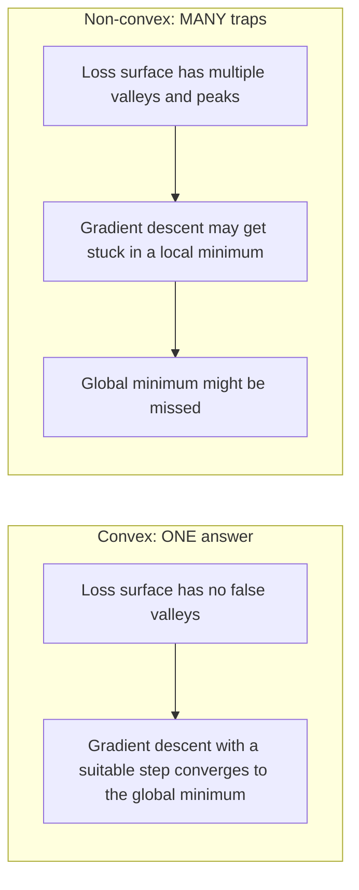
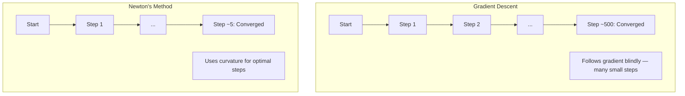
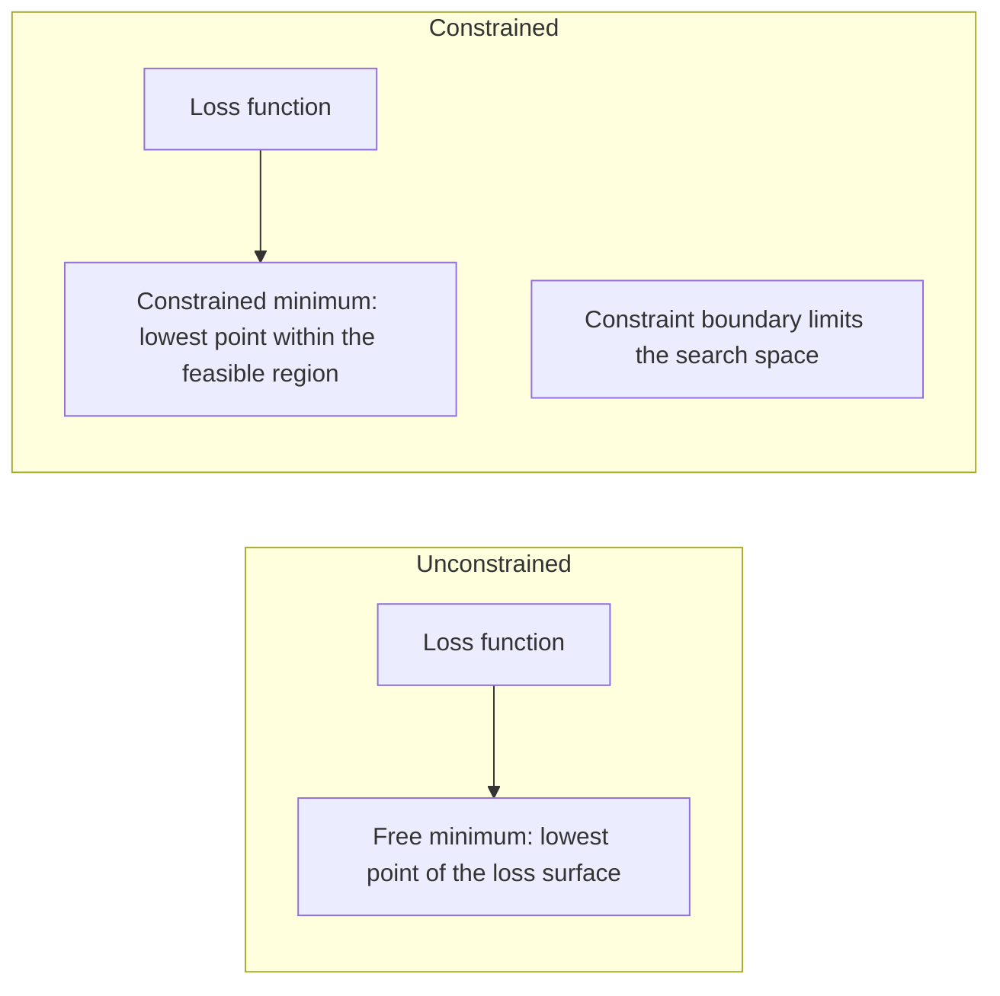
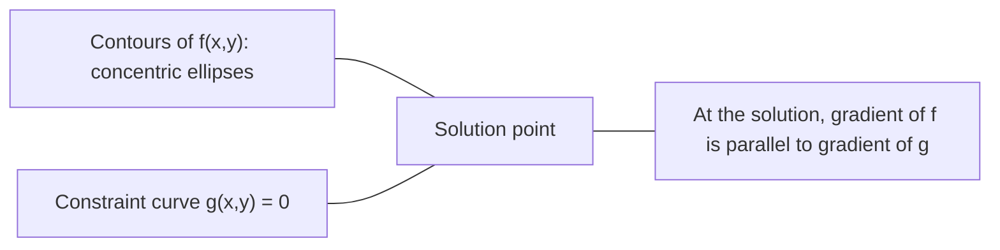

# Convex Optimization

> Các bài toán lồi có một thung lũng. Mạng nơ-ron có hàng triệu. Biết sự khác biệt là điều quan trọng.

**Type:** Build
**Language:** Python
**Prerequisites:** Phase 1, Lessons 04 (Calculus for ML), 08 (Optimization)
**Time:** ~90 minutes

## Learning Objectives

- Kiểm tra một hàm có lồi hay không bằng định nghĩa, đạo hàm bậc hai và các tiêu chí Hessian
- Triển khai phương pháp Newton và so sánh sự hội tụ bậc hai của nó với gradient descent
- Giải các bài toán tối ưu hóa có ràng buộc bằng nhân tử Lagrange và diễn giải các điều kiện KKT
- Giải thích tại sao các địa hình mất mát mạng nơ-ron không lồi nhưng SGD vẫn tìm được nghiệm tốt

## The Problem

Bài học 08 đã dạy bạn gradient descent, momentum và Adam. Các bộ tối ưu hóa đó đi xuống dốc trên bất kỳ bề mặt nào. Nhưng chúng không kèm bảo đảm. Gradient descent trên một địa hình không lồi có thể rơi vào một cực tiểu cục bộ xấu, kẹt ở một điểm yên ngựa hoặc dao động mãi mãi. Bạn vẫn sử dụng nó vì mạng nơ-ron không lồi và không có lựa chọn thay thế.

Nhưng nhiều bài toán trong học máy là lồi. Hồi quy tuyến tính, hồi quy logistic, SVM, LASSO, hồi quy ridge. Đối với các bài toán này, có một điều mạnh hơn: tối ưu hóa với các bảo đảm toán học. Một bài toán lồi không có các thung lũng giả: mọi cực tiểu cục bộ đều là cực tiểu toàn cục. Đối với một hàm lồi trơn có cực tiểu, gradient descent với kích thước bước phù hợp hội tụ đến cực tiểu đó. Không cần khởi động lại. Không có lịch tốc độ học. Không cần cầu nguyện.

Hiểu tính lồi làm ba điều. Thứ nhất, nó cho bạn biết khi nào bài toán dễ (lồi) so với khó (không lồi). Thứ hai, nó cho bạn các công cụ nhanh hơn như phương pháp Newton cho các bài toán lồi. Thứ ba, nó giải thích các khái niệm xuất hiện khắp ML: regularization như một ràng buộc, tính đối ngẫu trong SVM và tại sao học sâu hoạt động dù vi phạm mọi tính chất tốt đẹp mà tính lồi mang lại.

## The Concept

### Convex sets

Một tập $S$ lồi nếu với bất kỳ hai điểm nào trong $S$, đoạn thẳng giữa chúng cũng nằm hoàn toàn trong $S$.

| Các tập lồi | Không lồi |
|---|---|
| **Hình chữ nhật**: hai điểm bất kỳ bên trong có thể được nối bằng một đoạn thẳng nằm bên trong | **Hình sao/lưỡi liềm**: một đường giữa hai điểm bên trong có thể đi ra ngoài tập |
| **Tam giác**: cùng tính chất đúng với mọi điểm bên trong | **Hình bánh vòng/vành khăn**: lỗ có nghĩa là một số đoạn thẳng rời khỏi tập |
| Đoạn thẳng giữa hai điểm bất kỳ nằm trong tập | Đoạn thẳng giữa một số cặp điểm đi ra khỏi tập |

Phép kiểm tra hình thức: với mọi điểm $x, y$ trong $S$ và mọi $t \in [0, 1]$, điểm $tx + (1-t)y$ cũng thuộc $S$.

Ví dụ các tập lồi:
- Một đường thẳng, một mặt phẳng, toàn bộ $\mathbb{R}^n$
- Một hình cầu (hình tròn, hình cầu, siêu cầu)
- Một nửa không gian: $\lbrace x : a^T x \le b \rbrace$
- Giao của bất kỳ số lượng tập lồi nào

Ví dụ các tập không lồi:
- Một hình bánh vòng (vành khăn)
- Hợp của hai hình tròn rời nhau
- Bất kỳ tập nào có một "chỗ lõm" hoặc "lỗ"

### Convex functions

Một hàm $f$ là lồi nếu miền xác định của nó là một tập lồi và với bất kỳ hai điểm $x, y$ trong miền xác định cùng bất kỳ $t \in [0, 1]$ nào:

```math
f(tx + (1-t)y) \le t f(x) + (1-t) f(y)
```

Về hình học: đoạn thẳng giữa hai điểm bất kỳ trên đồ thị nằm phía trên hoặc trên đồ thị.

| Tính chất | Hàm lồi | Hàm không lồi |
|---|---|---|
| **Kiểm tra đoạn thẳng** | Đường giữa hai điểm bất kỳ trên đồ thị nằm **phía trên hoặc trên** đường cong | Đường giữa một số điểm trên đồ thị hạ **xuống dưới** đường cong |
| **Hình dạng** | Một cái bát/thung lũng cong lên | Nhiều đỉnh và thung lũng với độ cong hỗn hợp |
| **Các cực tiểu cục bộ** | Mọi cực tiểu cục bộ đều là cực tiểu toàn cục | Nhiều cực tiểu cục bộ có thể tồn tại ở các độ cao khác nhau |

Các hàm lồi phổ biến:
- $f(x) = x^2$ (parabol)
- $f(x) = \lvert x \rvert$ (giá trị tuyệt đối)
- $f(x) = e^x$ (hàm mũ)
- $f(x) = \max(0, x)$ (ReLU, dù tuyến tính từng khúc)
- $f(x) = -\log(x)$ với $x > 0$ (âm log)
- Bất kỳ hàm tuyến tính nào $f(x) = a^T x + b$ (vừa lồi vừa lõm)

### Testing for convexity

Ba phép kiểm tra thực tế, từ dễ nhất đến chặt chẽ nhất.

**Kiểm tra 1: Kiểm tra đạo hàm bậc hai (1D).** Nếu $f''(x) \ge 0$ với mọi $x$, thì $f$ lồi.

- $f(x) = x^2$: $f''(x) = 2 \ge 0$. Lồi.
- $f(x) = x^3$: $f''(x) = 6x$. Âm với $x < 0$. Không lồi.
- $f(x) = e^x$: $f''(x) = e^x > 0$. Lồi.

**Kiểm tra 2: Kiểm tra Hessian (đa biến).** Nếu ma trận Hessian $H(x)$ nửa xác định dương với mọi $x$, thì $f$ lồi. Hessian là ma trận các đạo hàm riêng bậc hai.

**Kiểm tra 3: Kiểm tra định nghĩa.** Kiểm tra trực tiếp bất đẳng thức $f(tx + (1-t)y) \le t f(x) + (1-t) f(y)$. Hữu ích cho các hàm khó tính đạo hàm.

### Why convexity matters

Định lý trung tâm của tối ưu hóa lồi:

**Với một hàm lồi, mọi cực tiểu cục bộ đều là một cực tiểu toàn cục.**

Điều này có nghĩa là gradient descent không thể mắc kẹt ở một cực tiểu cục bộ xấu. Mọi cực tiểu nó có thể đạt đều có cùng loss. Đối với một hàm lồi trơn có cực tiểu, gradient descent với kích thước bước phù hợp được bảo đảm hội tụ đến giá trị tối ưu.



Các hệ quả:
- Không cần khởi động lại ngẫu nhiên
- Không cần các lịch tốc độ học tinh vi
- Có thể chứng minh hội tụ (tốc độ phụ thuộc các tính chất hàm)
- Nghiệm là duy nhất (ngoại trừ các vùng phẳng)

### Convex vs non-convex in ML

| Bài toán | Lồi? | Lý do |
|---------|---------|-----|
| Hồi quy tuyến tính (MSE) | Có | Mất mát bậc hai theo các trọng số |
| Hồi quy logistic | Có | Mất mát log lồi theo các trọng số |
| SVM (mất mát hinge) | Có | Cực đại của các hàm tuyến tính |
| LASSO (hồi quy L1) | Có | Tổng các hàm lồi là lồi |
| Hồi quy ridge (L2) | Có | Bậc hai + bậc hai = lồi |
| Mạng nơ-ron (bất kỳ mất mát nào) | Không | Các kích hoạt phi tuyến tạo địa hình không lồi |
| Phân cụm k-means | Không | Bước gán rời rạc |
| Phân tích ma trận thành nhân tử | Không | Tích của các ẩn |

Các mô hình tuyến tính có hàm mất mát lồi là lồi. Ngay khi bạn thêm các lớp ẩn với kích hoạt phi tuyến, tính lồi bị phá vỡ.

### The Hessian matrix

Hessian $H$ của một hàm $f: \mathbb{R}^n \to \mathbb{R}$ là ma trận $n \times n$ các đạo hàm riêng bậc hai.

```math
H_{ij} = \frac{\partial^2 f}{\partial x_i \, \partial x_j}
```

Với $f(x, y) = x^2 + 3xy + y^2$:

```math
\begin{gathered}
\begin{aligned}
\frac{\partial f}{\partial x} &= 2x + 3y & \frac{\partial^2 f}{\partial x^2} &= 2 & \frac{\partial^2 f}{\partial x \, \partial y} &= 3 \\
\frac{\partial f}{\partial y} &= 3x + 2y & \frac{\partial^2 f}{\partial y \, \partial x} &= 3 & \frac{\partial^2 f}{\partial y^2} &= 2
\end{aligned} \\[8pt]
H = \begin{bmatrix} 2 & 3 \\ 3 & 2 \end{bmatrix}
\end{gathered}
```

Hessian cho bạn biết về độ cong:
- Các giá trị riêng đều dương: hàm cong lên theo mọi hướng (lồi tại điểm đó)
- Các giá trị riêng đều âm: cong xuống theo mọi hướng (lõm, một cực đại cục bộ)
- Khác dấu: điểm yên ngựa (cong lên theo một số hướng, xuống theo các hướng khác)
- Giá trị riêng bằng không: phẳng theo hướng đó (suy biến)

Để có tính lồi, Hessian phải nửa xác định dương (mọi giá trị riêng $\ge 0$) ở mọi nơi, không chỉ tại một điểm.

### Newton's method

Gradient descent sử dụng thông tin bậc nhất (gradient). Phương pháp Newton sử dụng thông tin bậc hai (Hessian). Nó khớp một xấp xỉ bậc hai tại điểm hiện tại và nhảy trực tiếp đến cực tiểu của hàm bậc hai đó.

```math
\begin{aligned}
\text{Update rule:} \quad & x_{\text{new}} = x - H^{-1} \cdot \text{gradient} \\
\text{Compare to gradient descent:} \quad & x_{\text{new}} = x - \text{lr} \cdot \text{gradient}
\end{aligned}
```

Phương pháp Newton thay tốc độ học vô hướng bằng Hessian nghịch đảo. Điều này tự động điều chỉnh kích thước và hướng bước dựa trên độ cong cục bộ.



Ưu điểm:
- Hội tụ bậc hai gần cực tiểu (sai số được bình phương mỗi bước)
- Không có tốc độ học cần điều chỉnh
- Bất biến theo thang đo (hoạt động bất kể bạn tham số hóa bài toán thế nào)

Nhược điểm:
- Tính Hessian tốn $O(n^2)$ bộ nhớ và $O(n^3)$ để nghịch đảo
- Với một mạng nơ-ron có 1 triệu trọng số, đó là $10^{12}$ phần tử và $10^{18}$ phép toán
- Không thực tế cho học sâu

### Constrained optimization

Tối ưu hóa không ràng buộc: tối thiểu hóa $f(x)$ trên mọi $x$.
Tối ưu hóa có ràng buộc: tối thiểu hóa $f(x)$ với các ràng buộc.

Các bài toán thực có ràng buộc. Bạn muốn tối thiểu hóa chi phí nhưng ngân sách bị giới hạn. Bạn muốn tối thiểu hóa sai số nhưng độ phức tạp mô hình bị chặn.



### Lagrange multipliers

Phương pháp nhân tử Lagrange chuyển một bài toán có ràng buộc thành một bài toán không ràng buộc.

Bài toán: tối thiểu hóa $f(x)$ với $g(x) = 0$.

Nghiệm: đưa vào một biến mới (nhân tử Lagrange $\lambda$) và giải bài toán không ràng buộc:

```math
L(x, \lambda) = f(x) + \lambda g(x)
```

Tại nghiệm, gradient của $L$ bằng không:

```math
\begin{aligned}
\frac{\partial L}{\partial x} &= \frac{\partial f}{\partial x} + \lambda \frac{\partial g}{\partial x} = 0 \\
\frac{\partial L}{\partial \lambda} &= g(x) = 0
\end{aligned}
```

Trực giác hình học: tại cực tiểu có ràng buộc, gradient của $f$ phải song song với gradient của ràng buộc $g$. Nếu chúng không song song, bạn có thể di chuyển dọc theo bề mặt ràng buộc và giảm $f$ hơn nữa.



Ví dụ: tối thiểu hóa $f(x,y) = x^2 + y^2$ với $x + y = 1$.

```math
\begin{aligned}
L &= x^2 + y^2 + \lambda(x + y - 1) \\[4pt]
\frac{\partial L}{\partial x} &= 2x + \lambda = 0 \implies x = -\lambda/2 \\
\frac{\partial L}{\partial y} &= 2y + \lambda = 0 \implies y = -\lambda/2 \\
\frac{\partial L}{\partial \lambda} &= x + y - 1 = 0 \\[4pt]
&\text{From first two: } x = y \\
&\text{Substituting: } 2x = 1, \text{ so } x = y = 0.5, \ \lambda = -1
\end{aligned}
```

Điểm trên đường $x + y = 1$ gần gốc tọa độ nhất là $(0.5, 0.5)$.

### KKT conditions

Các điều kiện Karush-Kuhn-Tucker mở rộng nhân tử Lagrange sang các ràng buộc bất đẳng thức.

Bài toán: tối thiểu hóa $f(x)$ với $g_i(x) \le 0$ cho $i = 1, \ldots, m$.

Các điều kiện KKT (cần để tối ưu):

```math
\begin{aligned}
&\text{1. Stationarity:} && \frac{\partial f}{\partial x} + \sum_i \lambda_i \frac{\partial g_i}{\partial x} = 0 \\
&\text{2. Primal feasibility:} && g_i(x) \le 0 \quad \text{for all } i \\
&\text{3. Dual feasibility:} && \lambda_i \ge 0 \quad \text{for all } i \\
&\text{4. Complementary slackness:} && \lambda_i \, g_i(x) = 0 \quad \text{for all } i
\end{aligned}
```

Điều kiện bù trừ là điểm cốt yếu: hoặc ràng buộc hoạt động ($g_i = 0$, nghiệm nằm trên biên) hoặc nhân tử bằng không (ràng buộc không quan trọng). Một ràng buộc không ảnh hưởng đến nghiệm có $\lambda = 0$.

Các điều kiện KKT là trung tâm của SVM. Các vector hỗ trợ là các điểm dữ liệu nơi ràng buộc hoạt động ($\lambda > 0$). Mọi điểm dữ liệu khác có $\lambda = 0$ và không ảnh hưởng đến biên quyết định.

### Regularization as constrained optimization

L1 và L2 regularization không phải những thủ thuật tùy ý. Chúng là các bài toán tối ưu hóa có ràng buộc được ngụy trang.

**L2 regularization (Ridge):**

```math
\begin{aligned}
&\text{minimize } \text{Loss}(w) \text{ subject to } \lVert w \rVert^2 \le t \\[4pt]
&\text{Equivalent unconstrained form:} \\
&\text{minimize } \text{Loss}(w) + \lambda \lVert w \rVert^2
\end{aligned}
```

Ràng buộc $\lVert w \rVert^2 \le t$ xác định một hình cầu (hình tròn trong 2D, hình cầu trong 3D). Nghiệm là nơi các đường đồng mức mất mát lần đầu chạm hình cầu này.

**L1 regularization (LASSO):**

```math
\begin{aligned}
&\text{minimize } \text{Loss}(w) \text{ subject to } \lVert w \rVert_1 \le t \\[4pt]
&\text{Equivalent unconstrained form:} \\
&\text{minimize } \text{Loss}(w) + \lambda \lVert w \rVert_1
\end{aligned}
```

Ràng buộc $\lVert w \rVert_1 \le t$ xác định một hình thoi (hình vuông được quay trong 2D).

| Tính chất | Ràng buộc L2 (hình tròn) | Ràng buộc L1 (hình thoi) |
|---|---|---|
| **Hình dạng ràng buộc** | Hình tròn (hình cầu trong số chiều cao hơn) | Hình thoi (hình vuông được quay trong 2D) |
| **Nơi đường đồng mức mất mát chạm** | Biên trơn — bất kỳ điểm nào trên đường tròn | Góc — thẳng hàng với một trục |
| **Hành vi nghiệm** | Các trọng số nhỏ nhưng khác không | Một số trọng số đúng bằng không (thưa) |
| **Kết quả** | Thu nhỏ trọng số | Lựa chọn đặc trưng |

Điều này giải thích tại sao L1 tạo các mô hình thưa (lựa chọn đặc trưng) trong khi L2 chỉ thu nhỏ trọng số. Hình thoi có các góc thẳng hàng với các trục. Các đường đồng mức mất mát có khả năng chạm một góc cao hơn, đặt một hoặc nhiều trọng số về đúng không.

### Duality

Mỗi bài toán tối ưu hóa có ràng buộc (bài toán gốc) có một bài toán đi kèm (đối ngẫu). Với các bài toán lồi, bài toán gốc và đối ngẫu có cùng giá trị tối ưu. Đây là đối ngẫu mạnh.

Hàm đối ngẫu Lagrange:

```math
\begin{aligned}
&\text{Primal:} && \text{minimize } f(x) \text{ subject to } g(x) \le 0 \\
&\text{Lagrangian:} && L(x, \lambda) = f(x) + \lambda g(x) \\
&\text{Dual function:} && d(\lambda) = \min_x L(x, \lambda) \\
&\text{Dual problem:} && \text{maximize } d(\lambda) \text{ subject to } \lambda \ge 0
\end{aligned}
```

Tại sao tính đối ngẫu quan trọng:
- Bài toán đối ngẫu đôi khi dễ giải hơn bài toán gốc
- SVM được giải ở dạng đối ngẫu, nơi bài toán phụ thuộc vào các tích vô hướng giữa các điểm dữ liệu (cho phép thủ thuật kernel)
- Đối ngẫu cung cấp một cận dưới cho giá trị tối ưu của bài toán gốc, hữu ích để kiểm tra chất lượng nghiệm

Riêng với SVM:

```
Primal: find w, b that maximize the margin 2/||w|| subject to
        y_i(w^T x_i + b) >= 1 for all i

Dual:   maximize sum(alpha_i) - 0.5 * sum_ij(alpha_i * alpha_j * y_i * y_j * x_i^T x_j)
        subject to alpha_i >= 0 and sum(alpha_i * y_i) = 0

The dual only involves dot products x_i^T x_j.
Replace x_i^T x_j with K(x_i, x_j) to get the kernel trick.
```

### Why deep learning works despite non-convexity

Các hàm mất mát mạng nơ-ron cực kỳ không lồi. Theo mọi thước đo cổ điển, tối ưu hóa chúng đáng lẽ phải thất bại. Tuy nhiên gradient descent ngẫu nhiên tìm các nghiệm tốt một cách đáng tin cậy. Một số yếu tố giải thích điều này.

**Hầu hết các cực tiểu cục bộ đủ tốt.** Trong không gian nhiều chiều, các điểm dừng ngẫu nhiên (nơi gradient bằng không) áp đảo là các điểm yên ngựa, không phải cực tiểu cục bộ. Số ít cực tiểu cục bộ tồn tại có xu hướng có giá trị mất mát gần cực tiểu toàn cục. Mắc kẹt trong một cực tiểu cục bộ tệ là cực kỳ ít khả năng khi không gian tham số có hàng triệu chiều.

**Các điểm yên ngựa, không phải cực tiểu cục bộ, là trở ngại thực sự.** Trong một hàm có $n$ tham số, một điểm yên ngựa có hỗn hợp các hướng độ cong dương và âm. Với một điểm dừng ngẫu nhiên trong không gian nhiều chiều, xác suất tất cả $n$ giá trị riêng dương (cực tiểu cục bộ) xấp xỉ $2^{-n}$. Gần như mọi điểm dừng đều là điểm yên ngựa. Nhiễu của SGD giúp thoát khỏi chúng.

**Thừa tham số làm mượt địa hình.** Các mạng có nhiều tham số hơn ví dụ huấn luyện có bề mặt mất mát mượt hơn, liên thông hơn. Các mạng rộng hơn có ít cực tiểu cục bộ xấu hơn. Điều này trái trực giác nhưng nhất quán về thực nghiệm.

**Cấu trúc địa hình mất mát:**

| Tính chất | Không gian ít chiều | Không gian nhiều chiều |
|---|---|---|
| **Địa hình** | Nhiều đỉnh và thung lũng cô lập | Các thung lũng nối với nhau một cách mượt mà |
| **Các cực tiểu** | Nhiều cực tiểu cục bộ cô lập | Ít cực tiểu cục bộ xấu; hầu hết gần tối ưu |
| **Di chuyển** | Khó tìm cực tiểu toàn cục | Nhiều đường dẫn đến các nghiệm tốt |
| **Các điểm dừng** | Hỗn hợp cực tiểu cục bộ và điểm yên ngựa | Áp đảo là điểm yên ngựa, không phải cực tiểu cục bộ |

**Nhiễu ngẫu nhiên đóng vai trò regularization ngầm.** Mini-batch SGD thêm nhiễu ngăn dừng lại trong các cực tiểu nhọn. Các cực tiểu nhọn khớp quá mức; các cực tiểu phẳng tổng quát hóa. Nhiễu làm tối ưu hóa thiên về các vùng phẳng của địa hình mất mát.

### Second-order methods in practice

Phương pháp Newton thuần không thực tế cho các mô hình lớn. Một số xấp xỉ làm thông tin bậc hai có thể sử dụng được.

**L-BFGS (BFGS bộ nhớ giới hạn):** Xấp xỉ Hessian nghịch đảo bằng $m$ hiệu gradient gần nhất. Đòi hỏi $O(mn)$ bộ nhớ thay vì $O(n^2)$. Hoạt động tốt cho các bài toán có đến ~10,000 tham số. Được sử dụng trong ML cổ điển (hồi quy logistic, CRF) nhưng không trong học sâu.

**Gradient tự nhiên:** Sử dụng ma trận thông tin Fisher (Hessian kỳ vọng của log-hợp lý) thay vì Hessian tiêu chuẩn. Điều này xét đến hình học của các phân phối xác suất. K-FAC (Độ cong Xấp xỉ Phân tích theo Kronecker) xấp xỉ ma trận Fisher thành một tích Kronecker, làm nó thực tế cho các mạng nơ-ron.

**Tối ưu hóa không Hessian:** Sử dụng gradient liên hợp để giải $Hx = g$ mà không bao giờ tạo $H$. Chỉ đòi hỏi các tích Hessian-vector, có thể được tính trong thời gian $O(n)$ bằng vi phân tự động.

**Các xấp xỉ đường chéo:** Moment bậc hai của Adam là một xấp xỉ đường chéo của đường chéo Hessian. AdaHessian mở rộng điều này bằng cách sử dụng các phần tử đường chéo Hessian thực thông qua bộ ước lượng Hutchinson.

| Phương pháp | Bộ nhớ | Chi phí mỗi bước | Khi nào sử dụng |
|--------|--------|--------------|-------------|
| Gradient descent | $O(n)$ | $O(n)$ | Mốc cơ sở, các mô hình lớn |
| Phương pháp Newton | $O(n^2)$ | $O(n^3)$ | Các bài toán lồi nhỏ |
| L-BFGS | $O(mn)$ | $O(mn)$ | Các bài toán lồi trung bình |
| Adam | $O(n)$ | $O(n)$ | Mặc định học sâu |
| K-FAC | $O(n)$ | $O(n)$ mỗi lớp | Nghiên cứu, huấn luyện batch lớn |

```figure
convex-vs-nonconvex
```

## Build It

### Step 1: Convexity checker

Xây dựng một hàm kiểm tra tính lồi bằng thực nghiệm bằng cách lấy mẫu các điểm và kiểm tra định nghĩa.

```python
import random
import math

def check_convexity(f, dim, bounds=(-5, 5), samples=1000):
    violations = 0
    for _ in range(samples):
        x = [random.uniform(*bounds) for _ in range(dim)]
        y = [random.uniform(*bounds) for _ in range(dim)]
        t = random.uniform(0, 1)
        mid = [t * xi + (1 - t) * yi for xi, yi in zip(x, y)]
        lhs = f(mid)
        rhs = t * f(x) + (1 - t) * f(y)
        if lhs > rhs + 1e-10:
            violations += 1
    return violations == 0, violations
```

### Step 2: Newton's method for 2D

Triển khai phương pháp Newton bằng một Hessian tường minh. So sánh tốc độ hội tụ với gradient descent.

```python
def newtons_method(f, grad_f, hessian_f, x0, steps=50, tol=1e-12):
    x = list(x0)
    history = [x[:]]
    for _ in range(steps):
        g = grad_f(x)
        H = hessian_f(x)
        det = H[0][0] * H[1][1] - H[0][1] * H[1][0]
        if abs(det) < 1e-15:
            break
        H_inv = [
            [H[1][1] / det, -H[0][1] / det],
            [-H[1][0] / det, H[0][0] / det],
        ]
        dx = [
            H_inv[0][0] * g[0] + H_inv[0][1] * g[1],
            H_inv[1][0] * g[0] + H_inv[1][1] * g[1],
        ]
        x = [x[0] - dx[0], x[1] - dx[1]]
        history.append(x[:])
        if sum(gi ** 2 for gi in g) < tol:
            break
    return history
```

### Step 3: Lagrange multiplier solver

Giải tối ưu hóa có ràng buộc bằng gradient descent trên hàm Lagrange.

```python
def lagrange_solve(f_grad, g_val, g_grad, x0, lr=0.01,
                   lr_lambda=0.01, steps=5000):
    x = list(x0)
    lam = 0.0
    history = []
    for _ in range(steps):
        fg = f_grad(x)
        gv = g_val(x)
        gg = g_grad(x)
        x = [
            xi - lr * (fgi + lam * ggi)
            for xi, fgi, ggi in zip(x, fg, gg)
        ]
        lam = lam + lr_lambda * gv
        history.append((x[:], lam, gv))
    return history
```

### Step 4: Compare first-order vs second-order

Chạy gradient descent và phương pháp Newton trên cùng một hàm bậc hai. Đếm số bước đến hội tụ.

```python
def quadratic(x):
    return 5 * x[0] ** 2 + x[1] ** 2

def quadratic_grad(x):
    return [10 * x[0], 2 * x[1]]

def quadratic_hessian(x):
    return [[10, 0], [0, 2]]
```

Phương pháp Newton sẽ hội tụ trong 1 bước (nó chính xác cho hàm bậc hai). Gradient descent sẽ mất hàng trăm bước vì các giá trị riêng của Hessian khác nhau một hệ số 5, tạo ra một thung lũng kéo dài.

## Use It

Phân tích tính lồi áp dụng trực tiếp khi chọn các mô hình ML và bộ giải.

Với các bài toán lồi (hồi quy logistic, SVM, LASSO):
- Sử dụng các bộ giải chuyên dụng (liblinear, CVXPY, scipy.optimize.minimize với method='L-BFGS-B')
- Kỳ vọng một nghiệm toàn cục duy nhất
- Các phương pháp bậc hai thực tế và nhanh

Với các bài toán không lồi (mạng nơ-ron):
- Sử dụng các phương pháp bậc nhất (SGD, Adam)
- Chấp nhận rằng nghiệm phụ thuộc vào khởi tạo và tính ngẫu nhiên
- Sử dụng thừa tham số, nhiễu và các lịch tốc độ học làm regularization ngầm
- Không lãng phí thời gian tìm cực tiểu toàn cục. Một cực tiểu cục bộ tốt là đủ.

```python
from scipy.optimize import minimize

result = minimize(
    fun=lambda w: sum((y - X @ w) ** 2) + 0.1 * sum(w ** 2),
    x0=np.zeros(d),
    method='L-BFGS-B',
    jac=lambda w: -2 * X.T @ (y - X @ w) + 0.2 * w,
)
```

Với SVM, dạng đối ngẫu cho phép bạn sử dụng thủ thuật kernel:

```python
from sklearn.svm import SVC

svm = SVC(kernel='rbf', C=1.0)
svm.fit(X_train, y_train)
print(f"Support vectors: {svm.n_support_}")
```

## Exercises

1. **Bộ sưu tập tính lồi.** Kiểm tra tính lồi của các hàm này bằng bộ kiểm tra: $f(x) = x^4$, $f(x) = \sin(x)$, $f(x,y) = x^2 + y^2$, $f(x,y) = xy$, $f(x) = \max(x, 0)$. Giải thích tại sao mỗi kết quả hợp lý.

2. **Cuộc đua Newton với gradient descent.** Chạy cả hai phương pháp trên $f(x,y) = 50x^2 + y^2$ từ điểm bắt đầu $(10, 10)$. Mỗi phương pháp cần bao nhiêu bước để đạt mất mát < 1e-10? Điều gì xảy ra với gradient descent khi số điều kiện (tỉ số giá trị riêng Hessian lớn nhất với nhỏ nhất) tăng?

3. **Hình học nhân tử Lagrange.** Tối thiểu hóa $f(x,y) = (x-3)^2 + (y-3)^2$ với $x + 2y = 4$. Xác minh nghiệm bằng cách kiểm tra gradient của $f$ song song với gradient của $g$ tại nghiệm.

4. **Ràng buộc regularization.** Triển khai tối ưu hóa ràng buộc L1: tối thiểu hóa $(x-3)^2 + (y-2)^2$ với $\lvert x \rvert + \lvert y \rvert \le 1$. Chỉ ra rằng nghiệm có một tọa độ bằng không (tính thưa từ ràng buộc hình thoi).

5. **Phân tích giá trị riêng Hessian.** Tính Hessian của hàm Rosenbrock tại (1,1) và tại (-1,1). Tính các giá trị riêng tại cả hai điểm. Các giá trị riêng cho bạn biết gì về độ cong tại cực tiểu so với xa nó?

### Hints

**Bài tập 1.** Dự đoán mỗi kết quả trước khi chạy `check_convexity`: trong một chiều, xem dấu của $f''(x)$; trong hai chiều, xem các giá trị riêng của Hessian. Đối với $f(x,y) = xy$, Hessian có các giá trị riêng 1 và -1, vì vậy bộ kiểm tra phải báo cáo nó không lồi.

**Bài tập 2.** Gọi `optimize_gd` và `newtons_method` với gradient và Hessian của $f$. Phương pháp Newton giải một hàm bậc hai trong một bước. Đối với gradient descent, tốc độ học phải nhỏ hơn $2/100$ do số hạng $50x^2$, vì vậy hướng $y$ di chuyển chậm. Lặp lại với $100x^2$ và đếm lại số bước.

**Bài tập 3.** Sử dụng `lagrange_solve` với $g(x,y) = x + 2y - 4$. Tại đáp án, kiểm tra rằng $x + 2y = 4$ và $\nabla f = (2(x-3), 2(y-3))$ là một bội của $\nabla g = (1, 2)$.

**Bài tập 4.** Cực tiểu không ràng buộc (3, 2) nằm ngoài hình thoi, vì vậy đáp án nằm trên biên của nó. Sử dụng gradient descent có phép chiếu: đi một bước gradient, rồi chiếu trở lại lên $\lvert x \rvert + \lvert y \rvert \le 1$. Kiểm tra kết quả thỏa mãn ràng buộc với dấu bằng và so sánh nó với `demo_regularization_geometry`.

**Bài tập 5.** Gọi `rosenbrock_hessian` tại mỗi điểm và truyền kết quả cho `hessian_eigenvalues_2d`. Tại (1, 1), cả hai giá trị riêng đều dương và tỷ lệ của chúng rất lớn, vì vậy thung lũng hẹp theo một hướng và phẳng theo hướng còn lại. So sánh tỷ lệ đó với tỷ lệ tại (-1, 1).

## Key Terms

| Thuật ngữ | Ý nghĩa |
|------|---------------|
| Convex set (Tập lồi) | Một tập mà đoạn thẳng giữa hai điểm bất kỳ trong tập nằm bên trong tập |
| Convex function (Hàm lồi) | Một hàm mà đường giữa hai điểm bất kỳ trên đồ thị của nó nằm phía trên hoặc trên đồ thị. Tương đương, Hessian nửa xác định dương ở mọi nơi |
| Local minimum (Cực tiểu cục bộ) | Một điểm thấp hơn tất cả các điểm gần đó. Với các hàm lồi, mọi cực tiểu cục bộ đều là cực tiểu toàn cục |
| Global minimum (Cực tiểu toàn cục) | Điểm thấp nhất của một hàm trên toàn bộ miền xác định |
| Hessian matrix (Ma trận Hessian) | Ma trận của tất cả các đạo hàm riêng bậc hai. Mã hóa thông tin độ cong |
| Positive semidefinite (Nửa xác định dương) | Một ma trận có tất cả các giá trị riêng không âm. Tương tự nhiều chiều của "đạo hàm bậc hai >= 0" |
| Condition number (Số điều kiện) | Tỉ số giá trị riêng lớn nhất với nhỏ nhất của Hessian. Số điều kiện cao nghĩa là các thung lũng kéo dài và gradient descent chậm |
| Newton's method (Phương pháp Newton) | Bộ tối ưu hóa bậc hai sử dụng Hessian nghịch đảo để xác định hướng và kích thước bước. Hội tụ bậc hai gần cực tiểu |
| Lagrange multiplier (Nhân tử Lagrange) | Một biến được đưa vào để chuyển một bài toán tối ưu hóa có ràng buộc thành một bài toán không ràng buộc |
| KKT conditions (Điều kiện KKT) | Các điều kiện cần để tối ưu với các ràng buộc bất đẳng thức. Tổng quát hóa nhân tử Lagrange |
| Complementary slackness (Điều kiện bù trừ) | Tại nghiệm, hoặc một ràng buộc hoạt động hoặc nhân tử của nó bằng không. Không bao giờ cả hai khác không |
| Duality (Tính đối ngẫu) | Mọi bài toán có ràng buộc có một bài toán đối ngẫu đi kèm. Với các bài toán lồi, cả hai có cùng giá trị tối ưu |
| Strong duality (Đối ngẫu mạnh) | Giá trị tối ưu của bài toán gốc và đối ngẫu bằng nhau. Đúng cho các bài toán lồi thỏa mãn điều kiện Slater |
| L-BFGS | Phương pháp bậc hai xấp xỉ lưu $m$ hiệu gradient gần nhất thay vì Hessian đầy đủ |
| Saddle point (Điểm yên ngựa) | Một điểm mà gradient bằng không nhưng nó là cực tiểu theo một số hướng và cực đại theo các hướng khác |
| Overparameterization (Thừa tham số) | Sử dụng nhiều tham số hơn các ví dụ huấn luyện. Làm mượt địa hình mất mát và giảm các cực tiểu cục bộ xấu |

## Further Reading

- [Boyd & Vandenberghe: Convex Optimization](https://web.stanford.edu/~boyd/cvxbook/) - giáo trình tiêu chuẩn, có sẵn miễn phí trực tuyến
- [Bottou, Curtis, Nocedal: Optimization Methods for Large-Scale Machine Learning (2018)](https://arxiv.org/abs/1606.04838) - nối lý thuyết tối ưu hóa lồi với thực hành học sâu
- [Choromanska et al.: The Loss Surfaces of Multilayer Networks (2015)](https://arxiv.org/abs/1412.0233) - tại sao địa hình mạng nơ-ron không lồi không tệ như vẻ ngoài
- [Nocedal & Wright: Numerical Optimization](https://link.springer.com/book/10.1007/978-0-387-40065-5) - tài liệu tham khảo toàn diện cho phương pháp Newton, L-BFGS và tối ưu hóa có ràng buộc
