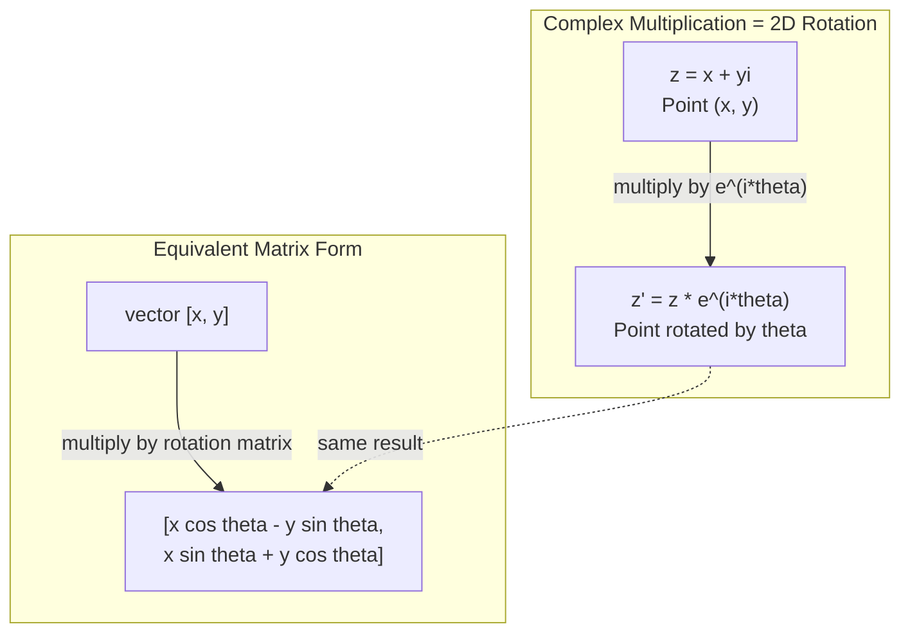
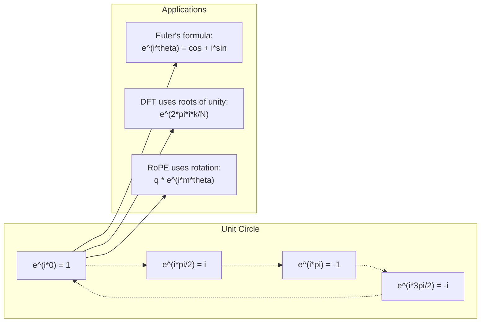

# Complex Numbers for AI

> Căn bậc hai của -1 không phải là tưởng tượng. Nó là chìa khóa của các phép quay, tần số và một nửa lĩnh vực xử lý tín hiệu.

**Type:** Learn
**Language:** Python
**Prerequisites:** Phase 1, Lessons 01-04 (linear algebra, calculus)
**Time:** ~60 minutes

## Learning Objectives

- Thực hiện số học phức (cộng, nhân, chia, liên hợp) ở cả dạng đại số và dạng cực
- Áp dụng công thức Euler để chuyển đổi giữa hàm mũ phức và các hàm lượng giác
- Triển khai Biến đổi Fourier Rời rạc bằng các căn phức của đơn vị
- Giải thích cách các phép quay phức làm nền tảng cho RoPE và các mã hóa vị trí hình sin trong transformer

## The Problem

Bạn mở một bài báo về biến đổi Fourier và thấy `i` ở khắp nơi. Bạn nhìn vào các mã hóa vị trí transformer và thấy `sin` và `cos` tại các tần số khác nhau -- phần thực và phần ảo của các hàm mũ phức. Bạn đọc về tính toán lượng tử và thấy mọi thứ được biểu diễn trong các không gian vector phức.

Số phức có vẻ trừu tượng. Một hệ thống số được xây dựng trên căn bậc hai của -1 có cảm giác như một thủ thuật toán học. Nhưng nó không phải một thủ thuật. Nó là ngôn ngữ tự nhiên của các phép quay và dao động. Bất cứ khi nào thứ gì đó xoay, rung hoặc dao động, số phức là công cụ phù hợp.

Không hiểu số phức, bạn không thể hiểu Biến đổi Fourier Rời rạc. Bạn không thể hiểu FFT. Bạn không thể hiểu cách RoPE (Embedding Vị trí Quay) hoạt động trong các mô hình ngôn ngữ hiện đại. Bạn không thể hiểu tại sao các mã hóa vị trí hình sin trong bài báo Transformer gốc sử dụng các tần số của chúng.

Bài học này xây dựng số học phức từ đầu, kết nối nó với hình học và chỉ cho bạn chính xác số phức xuất hiện ở đâu trong học máy.

## The Concept

### What is a complex number?

Một số phức có hai phần: phần thực và phần ảo.

```
z = a + bi

where:
  a is the real part
  b is the imaginary part
  i is the imaginary unit, defined by i^2 = -1
```

Chỉ vậy thôi. Bạn mở rộng trục số thành một mặt phẳng. Các số thực nằm trên một trục. Các số ảo nằm trên trục kia. Mỗi số phức là một điểm trong mặt phẳng này.

### Complex arithmetic

**Cộng.** Cộng các phần thực với nhau, cộng các phần ảo với nhau.

```
(a + bi) + (c + di) = (a + c) + (b + d)i

Example: (3 + 2i) + (1 + 4i) = 4 + 6i
```

**Nhân.** Sử dụng luật phân phối và nhớ rằng i^2 = -1.

```
(a + bi)(c + di) = ac + adi + bci + bdi^2
                 = ac + adi + bci - bd
                 = (ac - bd) + (ad + bc)i

Example: (3 + 2i)(1 + 4i) = 3 + 12i + 2i + 8i^2
                            = 3 + 14i - 8
                            = -5 + 14i
```

**Liên hợp.** Đổi dấu phần ảo.

```
conjugate of (a + bi) = a - bi
```

Tích của một số phức và số liên hợp của nó luôn thực:

```
(a + bi)(a - bi) = a^2 + b^2
```

**Chia.** Nhân tử số và mẫu số với số liên hợp của mẫu số.

```
(a + bi) / (c + di) = (a + bi)(c - di) / (c^2 + d^2)
```

Điều này loại bỏ phần ảo khỏi mẫu số, cho bạn một số phức gọn.

### The complex plane

Mặt phẳng phức ánh xạ mỗi số phức thành một điểm 2D. Trục ngang là trục thực, trục dọc là trục ảo.

```
z = 3 + 2i  corresponds to the point (3, 2)
z = -1 + 0i corresponds to the point (-1, 0) on the real axis
z = 0 + 4i  corresponds to the point (0, 4) on the imaginary axis
```

Một số phức đồng thời là một điểm và một vector từ gốc tọa độ. Diễn giải kép này là điều làm số phức hữu ích cho hình học.

### Polar form

Bất kỳ điểm nào trong mặt phẳng đều có thể được mô tả bằng khoảng cách từ gốc tọa độ và góc tính từ trục thực dương.

```
z = r * (cos(theta) + i*sin(theta))

where:
  r = |z| = sqrt(a^2 + b^2)     (magnitude, or modulus)
  theta = atan2(b, a)             (phase, or argument)
```

Dạng đại số (a + bi) tốt cho phép cộng. Dạng cực (r, theta) tốt cho phép nhân.

**Phép nhân ở dạng cực.** Nhân các độ lớn, cộng các góc.

```
z1 = r1 * e^(i*theta1)
z2 = r2 * e^(i*theta2)

z1 * z2 = (r1 * r2) * e^(i*(theta1 + theta2))
```

Đây là lý do số phức hoàn hảo cho các phép quay. Nhân với một số phức có độ lớn 1 là một phép quay thuần túy.

### Euler's formula

Cầu nối giữa các hàm mũ phức và lượng giác:

```
e^(i*theta) = cos(theta) + i*sin(theta)
```

Đây là công thức quan trọng nhất trong bài học này. Khi theta = pi:

```
e^(i*pi) = cos(pi) + i*sin(pi) = -1 + 0i = -1

Therefore: e^(i*pi) + 1 = 0
```

Năm hằng số cơ bản (e, i, pi, 1, 0) được liên kết trong một phương trình.

### Why Euler's formula matters for ML

Công thức Euler nói rằng `e^(i*theta)` vạch ra đường tròn đơn vị khi theta thay đổi. Tại theta = 0, bạn ở (1, 0). Tại theta = pi/2, bạn ở (0, 1). Tại theta = pi, bạn ở (-1, 0). Tại theta = 3*pi/2, bạn ở (0, -1). Một vòng quay đầy đủ là theta = 2*pi.

Điều này có nghĩa là hàm mũ phức CHÍNH LÀ phép quay. Và phép quay có ở khắp nơi trong xử lý tín hiệu và ML.

### Connection to 2D rotations

Nhân số phức (x + yi) với e^(i*theta) quay điểm (x, y) một góc theta quanh gốc tọa độ.

```
Rotation via complex multiplication:
  (x + yi) * (cos(theta) + i*sin(theta))
  = (x*cos(theta) - y*sin(theta)) + (x*sin(theta) + y*cos(theta))i

Rotation via matrix multiplication:
  [cos(theta)  -sin(theta)] [x]   [x*cos(theta) - y*sin(theta)]
  [sin(theta)   cos(theta)] [y] = [x*sin(theta) + y*cos(theta)]
```

Chúng tạo ra kết quả giống hệt nhau. Phép nhân phức CHÍNH LÀ phép quay 2D. Ma trận quay chỉ là phép nhân phức được viết dưới ký hiệu ma trận.



### Phasors and rotating signals

Một hàm mũ phức e^(i*omega*t) là một điểm quay quanh đường tròn đơn vị với tần số góc omega. Khi t tăng, điểm vạch ra đường tròn.

Phần thực của điểm quay này là cos(omega*t). Phần ảo là sin(omega*t). Một tín hiệu hình sin là cái bóng của một số phức đang quay.

```
e^(i*omega*t) = cos(omega*t) + i*sin(omega*t)

Real part:      cos(omega*t)    -- a cosine wave
Imaginary part: sin(omega*t)    -- a sine wave
```

Đây là biểu diễn phasor. Thay vì theo dõi một sóng sin uốn lượn, bạn theo dõi một mũi tên quay đều đặn. Dịch pha trở thành độ lệch góc. Thay đổi biên độ trở thành thay đổi độ lớn. Cộng các tín hiệu trở thành cộng vector.

### Roots of unity

Các căn bậc N của đơn vị là N điểm cách đều trên đường tròn đơn vị:

```
w_k = e^(2*pi*i*k/N)    for k = 0, 1, 2, ..., N-1
```

Với N = 4, các căn là: 1, i, -1, -i (bốn hướng la bàn).
Với N = 8, bạn có bốn hướng la bàn cộng thêm bốn hướng chéo.

Các căn của đơn vị là nền tảng của Biến đổi Fourier Rời rạc. DFT phân rã một tín hiệu thành các thành phần tại N tần số cách đều này.

### Connection to the DFT

Biến đổi Fourier Rời rạc của một tín hiệu x[0], x[1], ..., x[N-1] là:

```
X[k] = sum_{n=0}^{N-1} x[n] * e^(-2*pi*i*k*n/N)
```

Mỗi X[k] đo mức độ tín hiệu tương quan với căn thứ k của đơn vị -- một sóng sin phức tại tần số k. DFT tách một tín hiệu thành N phasor quay và cho bạn biết biên độ và pha của mỗi phasor.

### Why i is not imaginary

Từ "ảo" là một sự tình cờ lịch sử. Descartes sử dụng nó với ý coi thường. Nhưng i không ảo hơn các số âm vào thời điểm người ta lần đầu bác bỏ chúng. Các số âm trả lời "lấy 3 trừ 5 thì được gì?" Đơn vị ảo trả lời "bình phương số gì thì được -1?"

Hữu ích hơn: i là một toán tử quay 90 độ. Nhân một số thực với i một lần, bạn quay 90 độ đến trục ảo. Nhân với i lần nữa (i^2), bạn quay thêm 90 độ -- giờ bạn chỉ theo hướng thực âm. Đó là lý do i^2 = -1. Nó không bí ẩn. Nó là nửa vòng quay được tạo từ hai phần tư vòng quay.

Đây là lý do số phức có ở khắp nơi trong kỹ thuật. Bất cứ thứ gì quay -- sóng điện từ, trạng thái lượng tử, dao động tín hiệu, mã hóa vị trí -- đều được mô tả tự nhiên bằng số phức.

### Complex exponentials vs trigonometric functions

Trước công thức Euler, các kỹ sư viết tín hiệu dưới dạng A*cos(omega*t + phi) -- biên độ A, tần số omega, pha phi. Cách này hoạt động nhưng làm số học khó nhọc. Cộng hai cosine có pha khác nhau đòi hỏi các đồng nhất thức lượng giác.

Với hàm mũ phức, cùng tín hiệu đó là A*e^(i*(omega*t + phi)). Cộng hai tín hiệu chỉ là cộng hai số phức. Nhân (điều chế) chỉ là nhân độ lớn và cộng góc. Dịch pha trở thành cộng góc. Dịch tần số trở thành nhân với phasor.

Toàn bộ lĩnh vực xử lý tín hiệu chuyển sang ký hiệu hàm mũ phức vì toán học gọn hơn. "Tín hiệu thực" luôn chỉ là phần thực của biểu diễn phức. Phần ảo được mang theo để ghi sổ, khiến mọi phép đại số diễn ra tự nhiên.

### Connection to transformers

**Các mã hóa vị trí hình sin** (bài báo Transformer gốc):

```
PE(pos, 2i) = sin(pos / 10000^(2i/d))
PE(pos, 2i+1) = cos(pos / 10000^(2i/d))
```

Các cặp sin và cos là phần thực và phần ảo của các hàm mũ phức ở các tần số khác nhau. Mỗi tần số cung cấp một "độ phân giải" khác nhau để mã hóa vị trí. Tần số thấp thay đổi chậm (vị trí thô). Tần số cao thay đổi nhanh (vị trí tinh). Cùng nhau chúng cho mỗi vị trí một dấu vân tay tần số duy nhất.

**RoPE (Embedding Vị trí Quay)** đưa điều này đi xa hơn. Nó nhân tường minh các vector query và key với các ma trận quay phức. Vị trí tương đối giữa hai token trở thành một góc quay. Attention được tính bằng các vector đã quay này, làm mô hình nhạy với vị trí tương đối thông qua phép nhân phức.

| Phép toán | Dạng Đại số | Ý nghĩa Hình học |
|-----------|---------------|-------------------|
| Cộng | (a+c) + (b+d)i | Cộng vector trong mặt phẳng |
| Nhân | (ac-bd) + (ad+bc)i | Quay và co giãn |
| Liên hợp | a - bi | Phản xạ qua trục thực |
| Độ lớn | sqrt(a^2 + b^2) | Khoảng cách từ gốc tọa độ |
| Pha | atan2(b, a) | Góc tính từ trục thực dương |
| Chia | nhân với số liên hợp | Quay ngược và điều chỉnh lại tỉ lệ |
| Lũy thừa | r^n * e^(i*n*theta) | Quay n lần, co giãn theo r^n |



```figure
roots-of-unity
```

## Build It

### Step 1: Complex class

Xây dựng một lớp số Complex hỗ trợ số học, độ lớn, pha và chuyển đổi giữa dạng đại số và dạng cực.

```python
import math

class Complex:
    def __init__(self, real, imag=0.0):
        self.real = real
        self.imag = imag

    def __add__(self, other):
        return Complex(self.real + other.real, self.imag + other.imag)

    def __mul__(self, other):
        r = self.real * other.real - self.imag * other.imag
        i = self.real * other.imag + self.imag * other.real
        return Complex(r, i)

    def __truediv__(self, other):
        denom = other.real ** 2 + other.imag ** 2
        r = (self.real * other.real + self.imag * other.imag) / denom
        i = (self.imag * other.real - self.real * other.imag) / denom
        return Complex(r, i)

    def magnitude(self):
        return math.sqrt(self.real ** 2 + self.imag ** 2)

    def phase(self):
        return math.atan2(self.imag, self.real)

    def conjugate(self):
        return Complex(self.real, -self.imag)
```

### Step 2: Polar conversion and Euler's formula

```python
def to_polar(z):
    return z.magnitude(), z.phase()

def from_polar(r, theta):
    return Complex(r * math.cos(theta), r * math.sin(theta))

def euler(theta):
    return Complex(math.cos(theta), math.sin(theta))
```

Xác minh: `euler(theta).magnitude()` nên luôn là 1.0. `euler(0)` nên cho (1, 0). `euler(pi)` nên cho (-1, 0).

### Step 3: Rotation

Quay một điểm (x, y) một góc theta là một phép nhân phức:

```python
point = Complex(3, 4)
rotated = point * euler(math.pi / 4)
```

Độ lớn giữ nguyên. Chỉ góc thay đổi.

### Step 4: DFT from complex arithmetic

```python
def dft(signal):
    N = len(signal)
    result = []
    for k in range(N):
        total = Complex(0, 0)
        for n in range(N):
            angle = -2 * math.pi * k * n / N
            total = total + Complex(signal[n], 0) * euler(angle)
        result.append(total)
    return result
```

Đây là DFT O(N^2). Mỗi đầu ra X[k] là tổng các mẫu tín hiệu được nhân với các căn của đơn vị.

### Step 5: Inverse DFT

DFT ngược tái tạo tín hiệu gốc từ phổ của nó. Các thay đổi duy nhất so với DFT xuôi: đổi dấu trong số mũ và chia cho N.

```python
def idft(spectrum):
    N = len(spectrum)
    result = []
    for n in range(N):
        total = Complex(0, 0)
        for k in range(N):
            angle = 2 * math.pi * k * n / N
            total = total + spectrum[k] * euler(angle)
        result.append(Complex(total.real / N, total.imag / N))
    return result
```

Điều này cho bạn tái tạo hoàn hảo. Áp dụng DFT, rồi IDFT, và bạn nhận lại tín hiệu gốc đến độ chính xác máy. Không thông tin nào bị mất.

### Step 6: Roots of unity

```python
def roots_of_unity(N):
    return [euler(2 * math.pi * k / N) for k in range(N)]
```

Xác minh hai tính chất:
- Mọi căn đều có độ lớn đúng bằng 1.
- Tổng tất cả N căn bằng không (chúng triệt tiêu nhau do đối xứng).

Các tính chất này là điều làm DFT khả nghịch. Các căn của đơn vị tạo thành một cơ sở trực giao cho miền tần số.

## Use It

Python có hỗ trợ số phức tích hợp sẵn. Ký hiệu `j` biểu diễn đơn vị ảo.

```python
z = 3 + 2j
w = 1 + 4j

print(z + w)
print(z * w)
print(abs(z))

import cmath
print(cmath.phase(z))
print(cmath.exp(1j * cmath.pi))
```

Với các mảng, numpy hỗ trợ trực tiếp số phức:

```python
import numpy as np

z = np.array([1+2j, 3+4j, 5+6j])
print(np.abs(z))
print(np.angle(z))
print(np.conj(z))
print(np.real(z))
print(np.imag(z))

signal = np.sin(2 * np.pi * 5 * np.linspace(0, 1, 128))
spectrum = np.fft.fft(signal)
freqs = np.fft.fftfreq(128, d=1/128)
```

## Ship It

Chạy `code/complex_numbers.py` để tạo `outputs/skill-complex-arithmetic.md`.

## Exercises

1. **Số học phức bằng tay.** Tính (2 + 3i) * (4 - i) và xác minh bằng mã. Sau đó tính (5 + 2i) / (1 - 3i). Vẽ cả hai kết quả trên mặt phẳng phức và kiểm tra phép nhân đã quay và co giãn số đầu tiên.

2. **Chuỗi quay.** Bắt đầu với điểm (1, 0). Nhân với e^(i*pi/6) mười hai lần. Xác minh bạn trở lại (1, 0) sau 12 phép nhân. In tọa độ tại mỗi bước và xác nhận chúng vạch ra một đa giác đều 12 cạnh.

3. **DFT của một tín hiệu đã biết.** Tạo một tín hiệu là tổng của sin(2*pi*3*t) và 0.5*sin(2*pi*7*t) được lấy mẫu tại 32 điểm. Chạy DFT của bạn. Xác minh phổ độ lớn có các đỉnh tại tần số 3 và 7, với đỉnh tại 7 có chiều cao bằng một nửa đỉnh tại 3.

4. **Trực quan hóa các căn của đơn vị.** Tính các căn bậc 8 của đơn vị. Xác minh chúng có tổng bằng không. Xác minh nhân bất kỳ căn nào với căn nguyên thủy e^(2*pi*i/8) cho căn tiếp theo.

5. **Tương đương ma trận quay.** Với 10 góc ngẫu nhiên và 10 điểm ngẫu nhiên, xác minh phép nhân phức cho cùng kết quả với phép nhân ma trận-vector bằng ma trận quay 2x2. In chênh lệch số học lớn nhất.

## Key Terms

| Thuật ngữ | Ý nghĩa |
|------|---------------|
| Complex number (Số phức) | Một số a + bi trong đó a là phần thực, b là phần ảo và i^2 = -1 |
| Imaginary unit (Đơn vị ảo) | Số i, được định nghĩa bởi i^2 = -1. Không ảo theo nghĩa triết học -- nó là một toán tử quay |
| Complex plane (Mặt phẳng phức) | Mặt phẳng 2D nơi trục x là thực và trục y là ảo. Cũng được gọi là mặt phẳng Argand |
| Magnitude (modulus) (Độ lớn, môđun) | Khoảng cách từ gốc tọa độ: sqrt(a^2 + b^2). Được viết là \|z\| |
| Phase (argument) (Pha, argument) | Góc tính từ trục thực dương: atan2(b, a). Được viết là arg(z) |
| Conjugate (Liên hợp) | Ảnh đối xứng qua trục thực: liên hợp của a + bi là a - bi |
| Polar form (Dạng cực) | Biểu diễn z dưới dạng r * e^(i*theta) thay vì a + bi. Làm phép nhân dễ dàng |
| Euler's formula (Công thức Euler) | e^(i*theta) = cos(theta) + i*sin(theta). Kết nối hàm mũ với lượng giác |
| Phasor | Một số phức quay e^(i*omega*t) biểu diễn một tín hiệu hình sin |
| Roots of unity (Các căn của đơn vị) | N số phức e^(2*pi*i*k/N) với k = 0 đến N-1. N điểm cách đều trên đường tròn đơn vị |
| DFT | Biến đổi Fourier Rời rạc. Phân rã một tín hiệu thành các thành phần hình sin phức bằng các căn của đơn vị |
| RoPE | Embedding Vị trí Quay. Sử dụng phép nhân phức để mã hóa vị trí tương đối trong attention của transformer |

## Further Reading

- [Visual Introduction to Euler's Formula](https://betterexplained.com/articles/intuitive-understanding-of-eulers-formula/) - xây dựng trực giác hình học mà không có ký hiệu nặng nề
- [Su et al.: RoFormer (2021)](https://arxiv.org/abs/2104.09864) - bài báo giới thiệu Embedding Vị trí Quay bằng các phép quay phức
- [Vaswani et al.: Attention Is All You Need (2017)](https://arxiv.org/abs/1706.03762) - bài báo Transformer gốc với các mã hóa vị trí hình sin
- [3Blue1Brown: Euler's formula with introductory group theory](https://www.youtube.com/watch?v=mvmuCPvRoWQ) - giải thích trực quan tại sao e^(i*pi) = -1
- [Needham: Visual Complex Analysis](https://global.oup.com/academic/product/visual-complex-analysis-9780198534464) - cách trình bày trực quan hay nhất về số phức, đầy hiểu biết hình học
- [Strang: Introduction to Linear Algebra, Ch. 10](https://math.mit.edu/~gs/linearalgebra/) - số phức trong ngữ cảnh đại số tuyến tính và giá trị riêng
