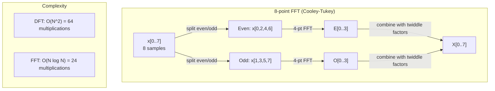
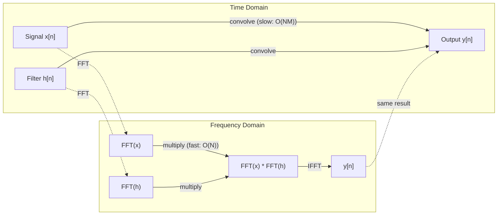

# The Fourier Transform

> Mọi tín hiệu là một tổng các sóng sin. Biến đổi Fourier cho bạn biết đó là những sóng nào.

**Type:** Build
**Language:** Python
**Prerequisites:** Phase 1, Lessons 01-04, 19 (complex numbers)
**Time:** ~90 minutes

## Learning Objectives

- Triển khai DFT từ đầu và xác minh nó với FFT Cooley-Tukey $O(N \log N)$
- Diễn giải các hệ số tần số: trích xuất biên độ, pha và phổ công suất từ một tín hiệu
- Áp dụng định lý tích chập để thực hiện tích chập qua phép nhân FFT
- Kết nối phân rã tần số Fourier với các mã hóa vị trí transformer và các lớp tích chập CNN

## The Problem

Một bản ghi âm là một chuỗi các số đo áp suất theo thời gian. Một giá cổ phiếu là một chuỗi các giá trị theo ngày. Một hình ảnh là một lưới cường độ pixel theo không gian. Tất cả đều là dữ liệu trong miền thời gian (hoặc miền không gian). Bạn thấy các giá trị thay đổi theo một chỉ số nào đó.

Nhưng nhiều mẫu không nhìn thấy được trong miền thời gian. Tín hiệu âm thanh này là một âm thuần hay một hợp âm? Giá cổ phiếu này có chu kỳ hằng tuần không? Hình ảnh này có kết cấu lặp lại không? Những câu hỏi này nói về nội dung tần số, và miền thời gian che giấu nó.

Biến đổi Fourier chuyển dữ liệu từ miền thời gian sang miền tần số. Nó lấy một tín hiệu và phân rã nó thành các sóng sin có tần số khác nhau. Mỗi sóng sin có một biên độ (nó mạnh đến mức nào) và một pha (nó bắt đầu ở đâu). Biến đổi Fourier cho bạn biết cả hai.

Điều này quan trọng đối với ML vì tư duy miền tần số xuất hiện khắp nơi. Các mạng nơ-ron tích chập thực hiện tích chập, là phép nhân trong miền tần số. Các mã hóa vị trí transformer sử dụng phân rã tần số để biểu diễn vị trí. Các mô hình âm thanh (nhận dạng giọng nói, sinh nhạc) hoạt động trên phổ thời gian-tần số -- các biểu diễn tần số của âm thanh. Các mô hình chuỗi thời gian tìm các mẫu tuần hoàn. Hiểu biến đổi Fourier cho bạn từ vựng để làm việc với tất cả những điều này.

## The Concept

### The DFT definition

Cho $N$ mẫu $x[0], x[1], \ldots, x[N-1]$, Biến đổi Fourier Rời rạc tạo ra $N$ hệ số tần số $X[0], X[1], \ldots, X[N-1]$:

```math
X[k] = \sum_{n=0}^{N-1} x[n] \, e^{-2\pi i k n/N} \qquad \text{for } k = 0, 1, \ldots, N-1
```

Mỗi $X[k]$ là một số phức. Độ lớn $\lvert X[k] \rvert$ của nó tỷ lệ với biên độ của tần số $k$. Không có chuẩn hóa, một sóng sin thực có biên độ $A$ rơi chính xác vào bin $k$ cho $\lvert X[k] \rvert = AN/2$, vì vậy hãy chia cho $N/2$ để đọc biên độ. Pha $\angle X[k]$ của nó cho bạn biết độ lệch pha của tần số đó.

Điểm cốt yếu: $e^{-2\pi i k n/N}$ là một phasor quay tại tần số $k$. DFT tính tương quan giữa tín hiệu và từng tần số trong $N$ tần số cách đều. Nếu tín hiệu chứa năng lượng tại tần số $k$, tương quan lớn. Nếu không, nó gần không.

### What each coefficient means

**$X[0]$: thành phần DC.** Đây là tổng tất cả các mẫu -- tỉ lệ với trung bình. Nó biểu diễn độ lệch không đổi (tần số không) của tín hiệu.

```math
X[0] = \sum_{n=0}^{N-1} x[n] \, e^0 = \text{sum of all samples}
```

**$X[k]$ với $1 \le k \le N/2$: các tần số dương.** $X[k]$ biểu diễn tần số $k$ chu kỳ trên $N$ mẫu. $k$ cao hơn nghĩa là tần số cao hơn (dao động nhanh hơn).

**$X[N/2]$: tần số Nyquist.** Tần số cao nhất bạn có thể biểu diễn bằng $N$ mẫu. Trên mức này, bạn có aliasing -- các tần số cao giả dạng các tần số thấp.

**$X[k]$ với $N/2 < k < N$: các tần số âm.** Đối với tín hiệu có giá trị thực, $X[N-k] = \overline{X[k]}$. Các tần số âm là ảnh phản chiếu của các tần số dương. Đây là lý do thông tin hữu ích nằm trong $N/2 + 1$ hệ số đầu tiên.

### Inverse DFT

DFT ngược tái tạo tín hiệu gốc từ các hệ số tần số của nó:

```math
x[n] = \frac{1}{N} \sum_{k=0}^{N-1} X[k] \, e^{2\pi i k n/N} \qquad \text{for } n = 0, 1, \ldots, N-1
```

Các khác biệt duy nhất so với DFT xuôi: dấu trong số mũ là dương (không phải âm), và có một hệ số chuẩn hóa $1/N$.

DFT ngược là tái tạo hoàn hảo. Không thông tin nào bị mất. Bạn có thể đi từ miền thời gian sang miền tần số và trở lại mà không có sai số nào. DFT là một phép đổi cơ sở -- nó biểu diễn lại cùng thông tin trong một hệ tọa độ khác.

### The FFT: making it fast

DFT được định nghĩa ở trên có độ phức tạp $O(N^2)$: với mỗi hệ số trong $N$ hệ số đầu ra, bạn lấy tổng trên $N$ mẫu đầu vào. Với $N$ = 1 triệu, đó là $10^{12}$ phép toán.

Biến đổi Fourier Nhanh (FFT) tính cùng kết quả trong $O(N \log N)$. Với $N$ = 1 triệu, đó là khoảng 20 triệu phép toán thay vì một nghìn tỷ. Đây là điều làm phân tích tần số khả thi trong thực tế.

Thuật toán Cooley-Tukey (FFT phổ biến nhất) hoạt động bằng chia để trị:

1. Chia tín hiệu thành các mẫu có chỉ số chẵn và chỉ số lẻ.
2. Tính DFT của mỗi nửa bằng đệ quy.
3. Kết hợp hai DFT có kích thước một nửa bằng các "hệ số twiddle" $e^{-2\pi i k/N}$.

```math
\begin{aligned}
X[k] &= E[k] + e^{-2\pi i k/N} \, O[k] && \text{for } k = 0, \ldots, N/2 - 1 \\
X[k + N/2] &= E[k] - e^{-2\pi i k/N} \, O[k] && \text{for } k = 0, \ldots, N/2 - 1 \\[6pt]
\text{where } E &= \text{DFT of even-indexed samples} \\
O &= \text{DFT of odd-indexed samples}
\end{aligned}
```

Tính đối xứng có nghĩa là mỗi mức đệ quy làm $O(N)$ công việc, và có $\log_2(N)$ mức. Tổng: $O(N \log N)$.



FFT cơ số 2 được xây dựng ở đây nhanh nhất khi độ dài tín hiệu là một lũy thừa của 2. Bất cứ khi nào một bài toán con có độ dài lẻ, nó quay về `dft` thông thường, vì vậy các tín hiệu thường được đệm số không đến lũy thừa tiếp theo của 2 để tăng tốc. Các FFT thư viện như `numpy.fft` xử lý mọi độ dài bằng các thuật toán cơ số hỗn hợp, nhưng chúng nhanh nhất ở các độ dài có thừa số nguyên tố nhỏ.

### Spectral analysis

**Phổ công suất** là $\lvert X[k] \rvert^2$ -- độ lớn bình phương của mỗi hệ số tần số. Nó cho thấy có bao nhiêu năng lượng tại mỗi tần số.

**Phổ pha** là $\angle X[k]$ -- độ lệch pha của mỗi tần số. Với hầu hết các tác vụ phân tích, bạn quan tâm phổ công suất và bỏ qua pha.

```math
\begin{aligned}
\text{Power at frequency } k: \quad P[k] &= |X[k]|^2 = \mathop{\mathrm{Re}}(X[k])^2 + \mathop{\mathrm{Im}}(X[k])^2 \\
\text{Phase at frequency } k: \quad \phi[k] &= \mathop{\mathrm{atan2}}(\mathop{\mathrm{Im}}(X[k]), \mathop{\mathrm{Re}}(X[k]))
\end{aligned}
```

### Frequency resolution

Độ phân giải tần số của DFT phụ thuộc vào số mẫu $N$ và tốc độ lấy mẫu $f_s$.

```math
\begin{aligned}
\text{Frequency of bin } k: \quad & f_k = k \cdot f_s / N \\
\text{Frequency resolution:} \quad & \Delta f = f_s / N \\
\text{Maximum frequency:} \quad & f_{\max} = f_s / 2 \quad \text{(Nyquist)}
\end{aligned}
```

Để phân biệt hai tần số gần nhau, bạn cần nhiều mẫu hơn. Để nắm bắt các tần số cao, bạn cần tốc độ lấy mẫu cao hơn.

### The convolution theorem

Đây là một trong những kết quả quan trọng nhất trong xử lý tín hiệu và liên quan trực tiếp đến CNN.

**Tích chập trong miền thời gian bằng phép nhân theo từng điểm trong miền tần số.**

```math
\begin{aligned}
& x * h = \text{IFFT}(\text{FFT}(x) \cdot \text{FFT}(h)) \\[4pt]
& \text{where } * \text{ is convolution and } \cdot \text{ is element-wise multiplication}
\end{aligned}
```

Tại sao điều này quan trọng:

- Tích chập trực tiếp của hai tín hiệu có độ dài $N$ và $M$ cần $O(NM)$ phép toán.
- Tích chập dựa trên FFT cần $O(N \log N)$: biến đổi cả hai, nhân, biến đổi ngược.
- Với các kernel lớn, tích chập FFT nhanh hơn đáng kể.
- Đây chính xác là những gì xảy ra trong các lớp tích chập có trường tiếp nhận lớn.

Lưu ý: DFT tính tích chập vòng (tín hiệu quấn vòng). Với tích chập tuyến tính (không quấn vòng), đệm số không cho cả hai tín hiệu đến độ dài $N + M - 1$ trước khi tính.



### Windowing

DFT giả định tín hiệu tuần hoàn -- nó xem $N$ mẫu là một chu kỳ của một tín hiệu lặp lại vô hạn. Nếu tín hiệu không bắt đầu và kết thúc tại cùng giá trị, điều này tạo một gián đoạn tại biên, xuất hiện dưới dạng nội dung tần số cao giả. Điều này được gọi là rò rỉ phổ.

Áp dụng cửa sổ giảm rò rỉ bằng cách làm tín hiệu giảm dần về không ở cả hai đầu trước khi tính DFT.

Các cửa sổ phổ biến:

| Cửa sổ | Hình dạng | Độ rộng thùy chính | Mức thùy phụ | Trường hợp sử dụng |
|--------|-------|----------------|-----------------|----------|
| Chữ nhật | Phẳng (không có cửa sổ) | Hẹp nhất | Cao nhất (-13 dB) | Khi tín hiệu tuần hoàn chính xác trong N mẫu |
| Hann | Cosine nâng | Vừa phải | Thấp (-31 dB) | Phân tích phổ mục đích chung |
| Hamming | Cosine sửa đổi | Vừa phải | Thấp hơn (-42 dB) | Xử lý âm thanh, phân tích giọng nói |
| Blackman | Ba cosine | Rộng | Rất thấp (-58 dB) | Khi việc triệt thùy phụ rất quan trọng |

```math
\begin{aligned}
\text{Hann window:} \quad & w[n] = 0.5 \left(1 - \cos\frac{2\pi n}{N-1}\right) \\
\text{Hamming window:} \quad & w[n] = 0.54 - 0.46 \cos\frac{2\pi n}{N-1}
\end{aligned}
```

Áp dụng cửa sổ bằng cách nhân nó theo từng phần tử với tín hiệu trước DFT: `X = DFT(x * w)`.

### DFT properties

| Tính chất | Miền Thời gian | Miền Tần số |
|----------|-------------|-----------------|
| Tính tuyến tính | $ax + by$ | $aX + bY$ |
| Dịch thời gian | $x[n - k]$ | $X[f] e^{-2\pi i f k/N}$ |
| Dịch tần số | $x[n] e^{2\pi i f_0 n/N}$ | $X[f - f_0]$ |
| Tích chập | $x * h$ | $X \cdot H$ (theo từng điểm) |
| Phép nhân | $x \cdot h$ (theo từng điểm) | $X * H$ (tích chập vòng, nhân tỉ lệ $1/N$) |
| Định lý Parseval | $\sum \lvert x[n] \rvert^2$ | $\frac{1}{N} \sum \lvert X[k] \rvert^2$ |
| Đối xứng liên hợp (đầu vào thực) | $x[n]$ thực | $X[k] = \overline{X[N-k]}$ |

Định lý Parseval nói rằng tổng năng lượng giống nhau trong cả hai miền. Năng lượng được bảo toàn qua phép biến đổi.

### Connection to positional encodings

Transformer gốc sử dụng các mã hóa vị trí hình sin:

```math
\begin{aligned}
PE(pos, 2i) &= \sin\left(pos / 10000^{2i/d_{\text{model}}}\right) \\
PE(pos, 2i+1) &= \cos\left(pos / 10000^{2i/d_{\text{model}}}\right)
\end{aligned}
```

Mỗi cặp chiều $(2i, 2i+1)$ dao động tại một tần số khác nhau. Các tần số cách nhau theo cấp số nhân từ cao (chiều 0,1) đến thấp (các chiều cuối). Điều này cho mỗi vị trí một mẫu duy nhất trên tất cả các dải tần -- tương tự cách các hệ số Fourier nhận diện duy nhất một tín hiệu.

Các tính chất chính mà điều này cung cấp:

- **Tính duy nhất:** Không có hai vị trí có cùng mã hóa.
- **Giá trị bị chặn:** sin và cos luôn nằm trong $[-1, 1]$.
- **Vị trí tương đối:** Mã hóa của vị trí $p+k$ có thể được biểu diễn thành một hàm tuyến tính của mã hóa tại vị trí $p$. Mô hình có thể học cách chú ý đến các vị trí tương đối.

### Connection to CNNs

Một lớp tích chập áp dụng một bộ lọc đã học (kernel) cho đầu vào bằng cách trượt nó qua tín hiệu hoặc hình ảnh. Về toán học, đây là phép tích chập.

Theo định lý tích chập, điều này tương đương với:
1. FFT đầu vào
2. FFT kernel
3. Nhân trong miền tần số
4. IFFT kết quả

Các triển khai CNN tiêu chuẩn sử dụng tích chập trực tiếp (nhanh hơn cho các kernel nhỏ 3x3). Nhưng với các kernel lớn hoặc tích chập toàn cục, các cách tiếp cận dựa trên FFT nhanh hơn đáng kể. Một số kiến trúc (như FNet) thay hoàn toàn attention bằng FFT, đạt độ chính xác cạnh tranh với độ phức tạp $O(N \log N)$ thay vì $O(N^2)$.

### Spectrograms and the Short-Time Fourier Transform

Một FFT duy nhất cho bạn nội dung tần số của toàn bộ tín hiệu, nhưng không cho bạn biết gì về thời điểm các tần số đó xuất hiện. Một chirp (tín hiệu có tần số tăng theo thời gian) và một hợp âm (mọi tần số xuất hiện đồng thời) có thể có cùng phổ độ lớn.

Biến đổi Fourier Thời gian Ngắn (STFT) giải quyết điều này bằng cách tính FFT trên các cửa sổ chồng lấp của tín hiệu. Kết quả là một phổ thời gian-tần số: một biểu diễn 2D với thời gian trên một trục và tần số trên trục kia. Cường độ tại mỗi điểm cho thấy năng lượng tại tần số đó vào thời điểm đó.

```
STFT procedure:
1. Choose a window size (e.g., 1024 samples)
2. Choose a hop size (e.g., 256 samples -- 75% overlap)
3. For each window position:
   a. Extract the windowed segment
   b. Apply a Hann/Hamming window
   c. Compute FFT
   d. Store the magnitude spectrum as one column of the spectrogram
```

Phổ thời gian-tần số là biểu diễn đầu vào tiêu chuẩn cho các mô hình ML âm thanh. Các mô hình nhận dạng giọng nói (Whisper, DeepSpeech) hoạt động trên mel-spectrogram -- các phổ thời gian-tần số có tần số được ánh xạ sang thang mel, khớp tốt hơn với cảm nhận cao độ của con người.

### Aliasing

Nếu một tín hiệu chứa các tần số trên $f_s/2$ (tần số Nyquist), lấy mẫu ở tốc độ $f_s$ sẽ tạo các bản sao bị alias. Một tín hiệu 90 Hz được lấy mẫu ở 100 Hz trông giống hệt một tín hiệu 10 Hz. Không có cách nào phân biệt chúng chỉ từ các mẫu.

```
Example:
  True signal: 90 Hz sine wave
  Sampling rate: 100 Hz
  Apparent frequency: 100 - 90 = 10 Hz

  The samples from the 90 Hz signal at 100 Hz sampling rate
  are identical to the samples from a 10 Hz signal.
  No amount of math can recover the original 90 Hz.
```

Đây là lý do các bộ chuyển đổi tương tự-số có các bộ lọc chống aliasing loại các tần số trên Nyquist trước khi lấy mẫu. Trong ML, aliasing xuất hiện khi giảm mẫu các bản đồ đặc trưng mà không có lọc thông thấp phù hợp -- một số kiến trúc xử lý điều này bằng các lớp pooling chống aliasing.

### Zero-padding does not increase resolution

Một hiểu lầm phổ biến: đệm số không cho một tín hiệu trước FFT cải thiện độ phân giải tần số. Nó không làm vậy. Đệm số không nội suy giữa các ô tần số hiện có, cho bạn một phổ trông mượt hơn. Nhưng nó không thể tiết lộ chi tiết tần số không có trong các mẫu gốc.

Độ phân giải tần số thực chỉ phụ thuộc vào thời gian quan sát $T = N / f_s$. Để phân giải hai tần số cách nhau $\Delta f$, bạn cần ít nhất $T = 1 / \Delta f$ giây dữ liệu. Không lượng đệm số không nào thay đổi giới hạn cơ bản này.

```figure
fourier-synthesis
```

## Build It

### Step 1: DFT from scratch

DFT $O(N^2)$ suy ra trực tiếp từ định nghĩa.

```python
import math

class Complex:
    ...

def dft(x):
    N = len(x)
    result = []
    for k in range(N):
        total = Complex(0, 0)
        for n in range(N):
            angle = -2 * math.pi * k * n / N
            w = Complex(math.cos(angle), math.sin(angle))
            xn = x[n] if isinstance(x[n], Complex) else Complex(x[n])
            total = total + xn * w
        result.append(total)
    return result
```

### Step 2: Inverse DFT

Cùng cấu trúc, số mũ dương, chia cho $N$.

```python
def idft(X):
    N = len(X)
    result = []
    for n in range(N):
        total = Complex(0, 0)
        for k in range(N):
            angle = 2 * math.pi * k * n / N
            w = Complex(math.cos(angle), math.sin(angle))
            total = total + X[k] * w
        result.append(Complex(total.real / N, total.imag / N))
    return result
```

### Step 3: FFT (Cooley-Tukey)

FFT đệ quy đòi hỏi độ dài là lũy thừa của 2. Chia thành chẵn và lẻ, đệ quy, kết hợp bằng các hệ số twiddle.

```python
def fft(x):
    N = len(x)
    if N <= 1:
        return [x[0] if isinstance(x[0], Complex) else Complex(x[0])]
    if N % 2 != 0:
        return dft(x)

    even = fft([x[i] for i in range(0, N, 2)])
    odd = fft([x[i] for i in range(1, N, 2)])

    result = [Complex(0)] * N
    for k in range(N // 2):
        angle = -2 * math.pi * k / N
        twiddle = Complex(math.cos(angle), math.sin(angle))
        t = twiddle * odd[k]
        result[k] = even[k] + t
        result[k + N // 2] = even[k] - t
    return result
```

### Step 4: Spectral analysis helpers

```python
def power_spectrum(X):
    return [xk.real ** 2 + xk.imag ** 2 for xk in X]

def convolve_fft(x, h):
    N = len(x) + len(h) - 1
    padded_N = 1
    while padded_N < N:
        padded_N *= 2

    x_padded = x + [0.0] * (padded_N - len(x))
    h_padded = h + [0.0] * (padded_N - len(h))

    X = fft(x_padded)
    H = fft(h_padded)

    Y = [xk * hk for xk, hk in zip(X, H)]

    y = idft(Y)
    return [y[n].real for n in range(N)]
```

## Use It

Với công việc thực tế, sử dụng FFT của numpy được hỗ trợ bởi các thư viện C được tối ưu hóa cao.

```python
import numpy as np

signal = np.sin(2 * np.pi * 5 * np.arange(256) / 256)
spectrum = np.fft.fft(signal)
freqs = np.fft.fftfreq(256, d=1/256)

power = np.abs(spectrum) ** 2

positive_freqs = freqs[:len(freqs)//2]
positive_power = power[:len(power)//2]
```

Để áp dụng cửa sổ và phân tích phổ nâng cao hơn:

```python
from scipy.signal import windows, stft

window = windows.hann(256)
windowed = signal * window
spectrum = np.fft.fft(windowed)
```

Với tích chập:

```python
from scipy.signal import fftconvolve

result = fftconvolve(signal, kernel, mode='full')
```

Với phổ thời gian-tần số:

```python
from scipy.signal import stft

frequencies, times, Zxx = stft(signal, fs=sample_rate, nperseg=256)
spectrogram = np.abs(Zxx) ** 2
```

Ma trận phổ thời gian-tần số có hình dạng (n_frequencies, n_time_frames). Mỗi cột là phổ công suất tại một cửa sổ thời gian. Đây là thứ các mô hình ML âm thanh dùng làm đầu vào.

## Ship It

Chạy `code/fourier.py` để tạo `outputs/prompt-spectral-analyzer.md`.

## Exercises

1. **Nhận diện âm thuần.** Tạo một tín hiệu với một sóng sin duy nhất tại một tần số chưa biết (giữa 1 và 50 Hz), được lấy mẫu tại 128 Hz trong 1 giây. Sử dụng DFT của bạn để nhận diện tần số. Xác minh câu trả lời khớp. Giờ thêm nhiễu Gaussian với độ lệch chuẩn 0.5 và lặp lại. Nhiễu ảnh hưởng đến phổ như thế nào?

2. **Xác minh FFT so với DFT.** Tạo một tín hiệu ngẫu nhiên có độ dài 64. Tính cả DFT ($O(N^2){}$) và FFT. Xác minh tất cả hệ số khớp trong phạm vi 1e-10. Đo thời gian cả hai hàm trên các tín hiệu có độ dài 256, 512, 1024 và 2048. Vẽ tỉ số thời gian DFT với thời gian FFT.

3. **Chứng minh định lý tích chập bằng ví dụ.** Tạo tín hiệu x = [1, 2, 3, 4, 0, 0, 0, 0] và bộ lọc h = [1, 1, 1, 0, 0, 0, 0, 0]. Tính trực tiếp tích chập vòng của chúng (vòng lặp lồng nhau). Sau đó tính qua FFT (biến đổi, nhân, biến đổi ngược). Xác minh các kết quả khớp. Giờ thực hiện tích chập tuyến tính bằng cách đệm số không thích hợp.

4. **Tác động của cửa sổ.** Tạo một tín hiệu là tổng hai sóng sin tại 10 Hz và 12 Hz (rất gần). Lấy mẫu tại 128 Hz trong 1 giây. Tính phổ công suất khi không có cửa sổ, với cửa sổ Hann và cửa sổ Hamming. Cửa sổ nào làm việc phân biệt hai đỉnh dễ nhất? Tại sao?

5. **Phân tích mã hóa vị trí.** Tạo các mã hóa vị trí hình sin cho d_model = 128 và max_pos = 512. Với mỗi cặp vị trí $(p_1, p_2)$, tính tích vô hướng của các mã hóa. Chỉ ra rằng tích vô hướng chỉ phụ thuộc vào $\lvert p_1 - p_2 \rvert$, không phụ thuộc các vị trí tuyệt đối. Điều gì xảy ra với tích vô hướng khi khoảng cách tăng?

### Hints

**Bài tập 1.** Với 128 mẫu trong 1 giây, bin $k$ là $k$ Hz, vì vậy đối với một tần số nguyên, chỉ số của giá trị lớn nhất trong các bin 1 đến 63 là tần số. Chọn một số hertz nguyên. Một tần số giữa hai bin trải sang các bin lân cận, và đỉnh chỉ cho bin gần nhất. Sử dụng `generate_signal` và `magnitude_spectrum`. Sau khi thêm nhiễu, kiểm tra đỉnh vẫn ở cùng bin trong khi các bin khác tăng lên.

**Bài tập 2.** Sử dụng độ dài là lũy thừa của hai, vì `fft` chia tín hiệu thành các nửa. Kiểm tra `max(abs(a - b))` trên mọi hệ số. Tỷ lệ thời gian phải tăng xấp xỉ theo $N / \log_2 N$.

**Bài tập 3.** Đối với tích chập vòng, tính thủ công $y[n] = \sum_k h[k] x[(n-k) \bmod 8]$ cho $n$ = 0, 1 và 2, rồi so sánh ba giá trị đầu của `convolve_direct` và `convolve_fft`. Tích chập tuyến tính có độ dài 4 + 3 - 1 = 6, vì vậy trước tiên hãy kiểm tra liệu độ dài 8 đã đủ dài chưa.

**Bài tập 4.** Sử dụng `hann_window`, `hamming_window`, `apply_window` và `power_spectrum`, và đếm các đỉnh riêng biệt giữa 9 và 13 Hz. Cả 10 Hz và 12 Hz đều hoàn thành các chu kỳ trọn vẹn trong 1 giây, vì vậy không dùng cửa sổ có thể trông tốt nhất. Lặp lại với 10.5 Hz và 12.5 Hz để thấy hiện tượng rò rỉ mà các cửa sổ làm giảm.

**Bài tập 5.** Tính mỗi mã hóa bằng `positional_encoding(pos, 128)`. So sánh tích vô hướng cho các vị trí (0, 10) với tích vô hướng cho (100, 110): hai giá trị phải khớp đến khoảng 1e-10. Sau đó vẽ tích vô hướng theo $\lvert p_1 - p_2 \rvert$ cho một $p_1$ cố định.

## Key Terms

| Thuật ngữ | Ý nghĩa |
|------|---------------|
| DFT (Discrete Fourier Transform) (Biến đổi Fourier Rời rạc) | Chuyển $N$ mẫu miền thời gian thành $N$ hệ số miền tần số. Mỗi hệ số là tương quan với một sóng sin phức tại tần số đó |
| FFT (Fast Fourier Transform) (Biến đổi Fourier Nhanh) | Một thuật toán $O(N \log N)$ để tính DFT. Thuật toán Cooley-Tukey chia các chỉ số chẵn/lẻ bằng đệ quy |
| Inverse DFT (DFT ngược) | Tái tạo tín hiệu miền thời gian từ các hệ số tần số. Cùng công thức với DFT nhưng đổi dấu số mũ và nhân tỉ lệ $1/N$ |
| Frequency bin (Bin tần số) | Mỗi chỉ số $k$ trong đầu ra DFT biểu thị tần số $k f_s/N$ Hz. "Bin" là ô tần số rời rạc |
| DC component (Thành phần DC) | $X[0]$, hệ số tần số không. Tỉ lệ với trung bình tín hiệu |
| Nyquist frequency (Tần số Nyquist) | $f_s/2$, tần số lớn nhất có thể biểu diễn ở tốc độ lấy mẫu $f_s$. Các tần số trên mức này bị alias |
| Power spectrum (Phổ công suất) | $\lvert X[k] \rvert^2$, độ lớn bình phương của mỗi hệ số tần số. Cho thấy phân bố năng lượng trên các tần số |
| Phase spectrum (Phổ pha) | $\angle X[k]$, độ lệch pha của mỗi thành phần tần số. Thường bị bỏ qua trong phân tích |
| Spectral leakage (Rò rỉ phổ) | Nội dung tần số giả do xem một tín hiệu không tuần hoàn là tuần hoàn. Được giảm bằng áp dụng cửa sổ |
| Window function (Hàm cửa sổ) | Một hàm giảm dần (Hann, Hamming, Blackman) được áp dụng trước DFT để giảm rò rỉ phổ |
| Twiddle factor (Hệ số twiddle) | Hàm mũ phức $e^{-2\pi i k/N}$ được sử dụng để kết hợp các DFT con trong phép tính bướm FFT |
| Convolution theorem (Định lý tích chập) | Tích chập trong miền thời gian bằng phép nhân theo từng điểm trong miền tần số. Nền tảng của xử lý tín hiệu và CNN |
| Circular convolution (Tích chập vòng) | Tích chập nơi tín hiệu quấn vòng. Đây là những gì DFT tự nhiên tính |
| Linear convolution (Tích chập tuyến tính) | Tích chập tiêu chuẩn không quấn vòng. Đạt được bằng cách đệm số không trước DFT |
| Parseval's theorem (Định lý Parseval) | Tổng năng lượng được bảo toàn qua biến đổi Fourier. $\sum \lvert x[n] \rvert^2 = \frac{1}{N} \sum \lvert X[k] \rvert^2$ |
| Aliasing | Khi các tần số trên Nyquist xuất hiện dưới dạng các tần số thấp hơn do tốc độ lấy mẫu không đủ |

## Further Reading

- [Cooley & Tukey: An Algorithm for the Machine Calculation of Complex Fourier Series (1965)](https://www.ams.org/journals/mcom/1965-19-090/S0025-5718-1965-0178586-1/) - bài báo FFT gốc đã thay đổi điện toán
- [3Blue1Brown: But what is the Fourier Transform?](https://www.youtube.com/watch?v=spUNpyF58BY) - phần giới thiệu trực quan hay nhất về biến đổi Fourier
- [Lee-Thorp et al.: FNet: Mixing Tokens with Fourier Transforms (2021)](https://arxiv.org/abs/2105.03824) - thay self-attention bằng FFT trong transformer
- [Smith: The Scientist and Engineer's Guide to Digital Signal Processing](http://www.dspguide.com/) - giáo trình trực tuyến miễn phí trình bày sâu về FFT, cửa sổ và phân tích phổ
- [Vaswani et al.: Attention Is All You Need (2017)](https://arxiv.org/abs/1706.03762) - các mã hóa vị trí hình sin được suy ra từ phân rã tần số Fourier
- [Radford et al.: Whisper (2022)](https://arxiv.org/abs/2212.04356) - nhận dạng giọng nói sử dụng mel-spectrogram làm biểu diễn đầu vào
