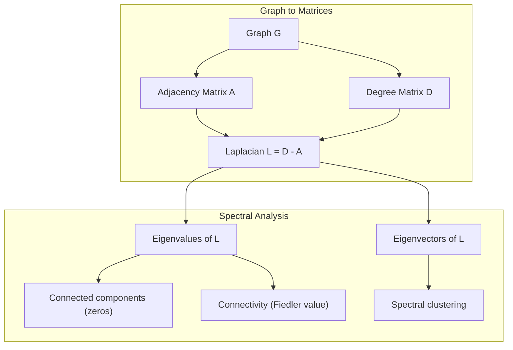
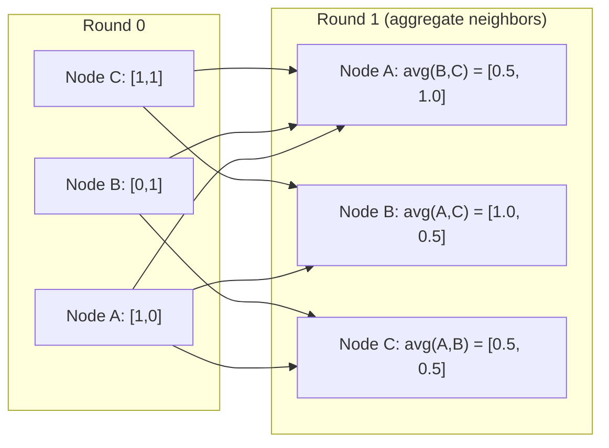

# Graph Theory for Machine Learning

> Đồ thị là cấu trúc dữ liệu của các mối quan hệ. Nếu dữ liệu có các kết nối, bạn cần lý thuyết đồ thị.

**Type:** Build
**Language:** Python
**Prerequisites:** Phase 1, Lessons 01-03 (linear algebra, matrices)
**Time:** ~90 minutes

## Learning Objectives

- Xây dựng một lớp đồ thị với biểu diễn ma trận/danh sách kề và triển khai các phép duyệt BFS và DFS
- Tính Laplacian đồ thị và sử dụng các giá trị riêng của nó để phát hiện các thành phần liên thông và phân cụm nút
- Triển khai một vòng truyền thông điệp kiểu GNN dưới dạng phép nhân ma trận kề đã chuẩn hóa
- Áp dụng phân cụm phổ để phân hoạch một đồ thị bằng vector Fiedler

## The Problem

Mạng xã hội, phân tử, cơ sở tri thức, mạng trích dẫn, bản đồ đường -- tất cả đều là đồ thị. ML truyền thống xem dữ liệu là các bảng phẳng. Mỗi hàng độc lập. Mỗi đặc trưng là một cột. Nhưng khi cấu trúc các kết nối quan trọng, bảng thất bại.

Xét một mạng xã hội. Bạn muốn dự đoán người dùng sẽ mua sản phẩm gì. Lịch sử mua hàng của họ quan trọng. Nhưng lịch sử mua hàng của bạn bè họ quan trọng hơn. Các kết nối mang tín hiệu.

Hoặc xét một phân tử. Bạn muốn dự đoán nó có liên kết với một protein không. Các nguyên tử quan trọng, nhưng điều thực sự quan trọng là cách các nguyên tử liên kết với nhau. Cấu trúc là dữ liệu.

Mạng Nơ-ron Đồ thị (GNN) là lĩnh vực phát triển nhanh nhất trong học sâu. Chúng vận hành khám phá thuốc, đề xuất xã hội, phát hiện gian lận và suy luận đồ thị tri thức. Mọi GNN xây dựng trên cùng nền tảng: lý thuyết đồ thị cơ bản.

Bạn cần bốn thứ:
1. Một cách biểu diễn đồ thị thành ma trận (để bạn có thể nhân chúng)
2. Các thuật toán duyệt để khám phá cấu trúc đồ thị
3. Laplacian -- ma trận quan trọng nhất trong lý thuyết đồ thị phổ
4. Truyền thông điệp -- phép toán làm GNN hoạt động

## The Concept

### Graphs: Nodes and Edges

Một đồ thị G = (V, E) gồm các đỉnh (nút) V và các cạnh E. Mỗi cạnh kết nối hai nút.

**Có hướng so với vô hướng.** Trong một đồ thị vô hướng, cạnh (u, v) nghĩa là u kết nối với v VÀ v kết nối với u. Trong một đồ thị có hướng (digraph), cạnh (u, v) nghĩa là u trỏ đến v, nhưng không nhất thiết theo chiều ngược.

**Có trọng số so với không trọng số.** Trong một đồ thị không trọng số, các cạnh hoặc tồn tại hoặc không. Trong một đồ thị có trọng số, mỗi cạnh có một trọng số số học -- một khoảng cách, một chi phí, một độ mạnh.

| Loại đồ thị | Ví dụ |
|-----------|---------|
| Vô hướng, không trọng số | Mạng bạn bè Facebook |
| Có hướng, không trọng số | Mạng theo dõi Twitter |
| Vô hướng, có trọng số | Bản đồ đường (khoảng cách) |
| Có hướng, có trọng số | Các liên kết trang web (điểm PageRank) |

### The Adjacency Matrix

Ma trận kề A là biểu diễn cốt lõi. Với một đồ thị có n nút:

```
A[i][j] = 1    if there is an edge from node i to node j
A[i][j] = 0    otherwise
```

Với các đồ thị vô hướng, A đối xứng: A[i][j] = A[j][i]. Với các đồ thị có trọng số, A[i][j] = trọng số của cạnh (i, j).

**Ví dụ -- một tam giác:**

```
Nodes: 0, 1, 2
Edges: (0,1), (1,2), (0,2)

A = [[0, 1, 1],
     [1, 0, 1],
     [1, 1, 0]]
```

Ma trận kề là đầu vào cho mọi GNN. Các phép toán ma trận trên A tương ứng với các phép toán trên đồ thị.

### Degree

Bậc của một nút là số cạnh kết nối với nó. Với các đồ thị có hướng, bạn có bậc vào (các cạnh đi vào) và bậc ra (các cạnh đi ra).

Ma trận bậc D là đường chéo:

```
D[i][i] = degree of node i
D[i][j] = 0    for i != j
```

Với ví dụ tam giác: D = diag(2, 2, 2) vì mỗi nút kết nối với hai nút khác.

Bậc cho bạn biết về độ quan trọng của nút. Bậc cao = nút trung tâm. Phân phối bậc của một mạng tiết lộ cấu trúc của nó. Mạng xã hội tuân theo luật lũy thừa (ít nút trung tâm, nhiều nút lá). Các đồ thị ngẫu nhiên có bậc phân phối Poisson.

### BFS and DFS

Hai thuật toán duyệt đồ thị cơ bản. Bạn cần cả hai.

**Tìm kiếm Theo Chiều rộng (BFS):** Khám phá tất cả láng giềng trước, rồi các láng giềng của láng giềng. Sử dụng một hàng đợi (FIFO).

```
BFS from node 0:
  Visit 0
  Queue: [1, 2]        (neighbors of 0)
  Visit 1
  Queue: [2, 3]        (add neighbors of 1)
  Visit 2
  Queue: [3]           (neighbors of 2 already visited)
  Visit 3
  Queue: []            (done)
```

BFS tìm các đường đi ngắn nhất trong đồ thị không trọng số. Khoảng cách từ điểm bắt đầu đến bất kỳ nút nào bằng mức BFS mà tại đó nút được phát hiện lần đầu. Đây là lý do BFS được dùng cho khoảng cách số bước nhảy trong mạng xã hội.

**Tìm kiếm Theo Chiều sâu (DFS):** Đi sâu nhất có thể trước khi quay lui. Sử dụng một ngăn xếp (LIFO) hoặc đệ quy.

```
DFS from node 0:
  Visit 0
  Stack: [1, 2]        (neighbors of 0)
  Visit 2               (pop from stack)
  Stack: [1, 3]         (add neighbors of 2)
  Visit 3               (pop from stack)
  Stack: [1]
  Visit 1               (pop from stack)
  Stack: []             (done)
```

DFS hữu ích cho:
- Tìm các thành phần liên thông (chạy DFS từ các nút chưa thăm)
- Phát hiện chu trình (các cạnh ngược trong cây DFS)
- Sắp xếp tô pô (đảo ngược thứ tự kết thúc DFS)

| Thuật toán | Cấu trúc dữ liệu | Tìm | Trường hợp sử dụng |
|-----------|---------------|-------|----------|
| BFS | Hàng đợi | Các đường đi ngắn nhất | Khoảng cách mạng xã hội, duyệt đồ thị tri thức |
| DFS | Ngăn xếp | Thành phần, chu trình | Tính liên thông, sắp xếp tô pô |

### The Graph Laplacian

L = D - A. Ma trận quan trọng nhất trong lý thuyết đồ thị phổ.

Với tam giác:

```
D = [[2, 0, 0],    A = [[0, 1, 1],    L = [[2, -1, -1],
     [0, 2, 0],         [1, 0, 1],         [-1, 2, -1],
     [0, 0, 2]]         [1, 1, 0]]         [-1, -1,  2]]
```

Laplacian có những tính chất đáng chú ý:

1. **L nửa xác định dương.** Mọi giá trị riêng đều >= 0.

2. **Số giá trị riêng bằng không bằng số thành phần liên thông.** Một đồ thị liên thông có đúng một giá trị riêng bằng không. Một đồ thị có 3 thành phần tách rời có ba giá trị riêng bằng không.

3. **Giá trị riêng khác không nhỏ nhất (giá trị Fiedler) đo tính liên thông.** Một giá trị Fiedler lớn có nghĩa là đồ thị kết nối tốt. Một giá trị Fiedler nhỏ có nghĩa là đồ thị có một điểm yếu -- một điểm nghẽn.

4. **Vector riêng của giá trị Fiedler (vector Fiedler) tiết lộ cách chia tốt nhất.** Các nút có giá trị dương vào một nhóm, các nút có giá trị âm vào nhóm kia. Đây là phân cụm phổ.



### Spectral Properties

Các giá trị riêng của ma trận kề và Laplacian tiết lộ các tính chất cấu trúc mà không cần duyệt.

**Phân cụm phổ** hoạt động như sau:
1. Tính Laplacian L
2. Tìm k vector riêng nhỏ nhất của L (bỏ vector đầu tiên, toàn số một với đồ thị liên thông)
3. Sử dụng các vector riêng đó làm tọa độ mới cho mỗi nút
4. Chạy k-means trên các tọa độ đó

Tại sao điều này hoạt động? Các vector riêng của L mã hóa các hàm "mượt nhất" trên đồ thị. Các nút kết nối tốt nhận các giá trị vector riêng tương tự. Các nút bị phân tách bởi một điểm nghẽn nhận các giá trị khác nhau. Các vector riêng tự nhiên tách các cụm.

**Mối liên hệ với bước đi ngẫu nhiên.** Laplacian chuẩn hóa liên quan đến các bước đi ngẫu nhiên trên đồ thị. Phân phối dừng của một bước đi ngẫu nhiên tỉ lệ với bậc nút. Thời gian trộn (bước đi hội tụ nhanh đến mức nào) phụ thuộc vào khoảng cách phổ.

### Message Passing

Phép toán cốt lõi của Mạng Nơ-ron Đồ thị. Mỗi nút thu thập thông điệp từ các láng giềng, tổng hợp chúng và cập nhật trạng thái của chính nó.

```
h_v^(k+1) = UPDATE(h_v^(k), AGGREGATE({h_u^(k) : u in neighbors(v)}))
```

Ở dạng đơn giản nhất, AGGREGATE = trung bình, và UPDATE = biến đổi tuyến tính + kích hoạt:

```
h_v^(k+1) = sigma(W * mean({h_u^(k) : u in neighbors(v)}))
```

Đây là phép nhân ma trận được ngụy trang. Nếu H là ma trận tất cả các đặc trưng nút và A là ma trận kề:

```
H^(k+1) = sigma(A_norm * H^(k) * W)
```

trong đó A_norm là ma trận kề đã chuẩn hóa (mỗi hàng có tổng bằng 1).

Một vòng truyền thông điệp cho phép mỗi nút "thấy" các láng giềng trực tiếp. Hai vòng cho nó thấy các láng giềng của láng giềng. K vòng cho mỗi nút thông tin từ vùng lân cận K bước nhảy của nó.



### Concepts and ML Applications

| Khái niệm | Ứng dụng ML |
|---------|---------------|
| Ma trận kề | Biểu diễn đầu vào GNN |
| Laplacian đồ thị | Phân cụm phổ, phát hiện cộng đồng |
| BFS/DFS | Duyệt đồ thị tri thức, tìm đường đi |
| Phân phối bậc | Độ quan trọng nút, kỹ thuật đặc trưng |
| Truyền thông điệp | Các lớp GNN (GCN, GAT, GraphSAGE) |
| Các giá trị riêng của L | Phát hiện cộng đồng, phân hoạch đồ thị |
| Phân cụm phổ | Nhóm nút không giám sát |
| PageRank | Độ quan trọng nút, tìm kiếm web |

```figure
graph-degree-distribution
```

## Build It

### Step 1: Graph class from scratch

```python
class Graph:
    def __init__(self, n_nodes, directed=False):
        self.n = n_nodes
        self.directed = directed
        self.adj = {i: {} for i in range(n_nodes)}

    def add_edge(self, u, v, weight=1.0):
        self.adj[u][v] = weight
        if not self.directed:
            self.adj[v][u] = weight

    def neighbors(self, node):
        return list(self.adj[node].keys())

    def degree(self, node):
        return len(self.adj[node])

    def adjacency_matrix(self):
        import numpy as np
        A = np.zeros((self.n, self.n))
        for u in range(self.n):
            for v, w in self.adj[u].items():
                A[u][v] = w
        return A

    def degree_matrix(self):
        import numpy as np
        D = np.zeros((self.n, self.n))
        for i in range(self.n):
            D[i][i] = self.degree(i)
        return D

    def laplacian(self):
        return self.degree_matrix() - self.adjacency_matrix()
```

Danh sách kề (`self.adj`) lưu các láng giềng hiệu quả. Việc chuyển đổi ma trận kề sử dụng numpy vì mọi phép toán phổ đều cần nó.

### Step 2: BFS and DFS

```python
from collections import deque

def bfs(graph, start):
    visited = set()
    order = []
    distances = {}
    queue = deque([(start, 0)])
    visited.add(start)
    while queue:
        node, dist = queue.popleft()
        order.append(node)
        distances[node] = dist
        for neighbor in graph.neighbors(node):
            if neighbor not in visited:
                visited.add(neighbor)
                queue.append((neighbor, dist + 1))
    return order, distances


def dfs(graph, start):
    visited = set()
    order = []
    stack = [start]
    while stack:
        node = stack.pop()
        if node in visited:
            continue
        visited.add(node)
        order.append(node)
        for neighbor in reversed(graph.neighbors(node)):
            if neighbor not in visited:
                stack.append(neighbor)
    return order
```

BFS sử dụng deque (hàng đợi hai đầu) để popleft có độ phức tạp O(1). DFS sử dụng một danh sách làm ngăn xếp. Cả hai thăm mỗi nút đúng một lần -- thời gian O(V + E).

### Step 3: Connected components and Laplacian eigenvalues

```python
def connected_components(graph):
    visited = set()
    components = []
    for node in range(graph.n):
        if node not in visited:
            order, _ = bfs(graph, node)
            visited.update(order)
            components.append(order)
    return components


def laplacian_eigenvalues(graph):
    import numpy as np
    L = graph.laplacian()
    eigenvalues = np.linalg.eigvalsh(L)
    return eigenvalues
```

`eigvalsh` dành cho ma trận đối xứng -- Laplacian luôn đối xứng với đồ thị vô hướng. Nó trả về các giá trị riêng theo thứ tự tăng dần. Đếm các số không để tìm số thành phần liên thông.

### Step 4: Spectral clustering

```python
def spectral_clustering(graph, k=2):
    import numpy as np
    L = graph.laplacian()
    eigenvalues, eigenvectors = np.linalg.eigh(L)
    features = eigenvectors[:, 1:k+1]

    labels = np.zeros(graph.n, dtype=int)
    for i in range(graph.n):
        if features[i, 0] >= 0:
            labels[i] = 0
        else:
            labels[i] = 1
    return labels
```

Với k=2, dấu của vector Fiedler chia đồ thị thành hai cụm. Với k>2, bạn sẽ chạy k-means trên k vector riêng đầu tiên (không bao gồm vector riêng tầm thường toàn số một).

### Step 5: Message passing

```python
def message_passing(graph, features, weight_matrix):
    import numpy as np
    A = graph.adjacency_matrix()
    row_sums = A.sum(axis=1, keepdims=True)
    row_sums[row_sums == 0] = 1
    A_norm = A / row_sums
    aggregated = A_norm @ features
    output = aggregated @ weight_matrix
    return output
```

Đây là một vòng truyền thông điệp GNN. Các đặc trưng mới của mỗi nút là trung bình có trọng số của các đặc trưng láng giềng, được biến đổi bởi ma trận trọng số. Xếp chồng nhiều vòng để lan truyền thông tin xa hơn.

## Use It

Với networkx và numpy, các phép toán tương tự chỉ là các dòng lệnh đơn:

```python
import networkx as nx
import numpy as np

G = nx.karate_club_graph()

A = nx.adjacency_matrix(G).toarray()
L = nx.laplacian_matrix(G).toarray()

eigenvalues = np.linalg.eigvalsh(L.astype(float))
print(f"Smallest eigenvalues: {eigenvalues[:5]}")
print(f"Connected components: {nx.number_connected_components(G)}")

communities = nx.community.greedy_modularity_communities(G)
print(f"Communities found: {len(communities)}")

pr = nx.pagerank(G)
top_nodes = sorted(pr.items(), key=lambda x: x[1], reverse=True)[:5]
print(f"Top 5 PageRank nodes: {top_nodes}")
```

networkx xử lý đồ thị có bất kỳ kích thước nào với các backend C được tối ưu hóa. Sử dụng nó trong sản xuất. Sử dụng triển khai từ đầu của bạn để hiểu nó làm gì.

### numpy spectral analysis

```python
import numpy as np

A = np.array([
    [0, 1, 1, 0, 0],
    [1, 0, 1, 0, 0],
    [1, 1, 0, 1, 0],
    [0, 0, 1, 0, 1],
    [0, 0, 0, 1, 0]
])

D = np.diag(A.sum(axis=1))
L = D - A

eigenvalues, eigenvectors = np.linalg.eigh(L)
print(f"Eigenvalues: {np.round(eigenvalues, 4)}")
print(f"Fiedler value: {eigenvalues[1]:.4f}")
print(f"Fiedler vector: {np.round(eigenvectors[:, 1], 4)}")

fiedler = eigenvectors[:, 1]
group_a = np.where(fiedler >= 0)[0]
group_b = np.where(fiedler < 0)[0]
print(f"Cluster A: {group_a}")
print(f"Cluster B: {group_b}")
```

Vector Fiedler làm phần việc nặng. Các phần tử dương trong một cụm, âm trong cụm kia. Không cần tối ưu hóa lặp -- chỉ một phép phân rã riêng.

## Ship It

Bài học này tạo ra:
- `outputs/skill-graph-analysis.md` -- một tài liệu skill tham khảo để phân tích dữ liệu có cấu trúc đồ thị

## Connections

| Khái niệm | Nơi xuất hiện |
|---------|------------------|
| Ma trận kề | Đầu vào GCN, GAT, GraphSAGE |
| Laplacian | Phân cụm phổ, các bộ lọc ChebNet |
| BFS | Duyệt đồ thị tri thức, truy vấn đường đi ngắn nhất |
| Truyền thông điệp | Mọi lớp GNN, truyền thông điệp nơ-ron |
| Khoảng cách phổ | Tính liên thông đồ thị, thời gian trộn của bước đi ngẫu nhiên |
| Phân phối bậc | Các mạng luật lũy thừa, kỹ thuật đặc trưng nút |
| Các thành phần liên thông | Tiền xử lý, xử lý các đồ thị không liên thông |
| PageRank | Xếp hạng độ quan trọng nút, khởi tạo attention |

GNN đáng được đề cập riêng. Phép tích chập đồ thị trong GCN (Kipf & Welling, 2017) sử dụng ma trận kề có thêm các khuyên, A_hat = A + I:

```text
H^(l+1) = sigma(D_hat^(-1/2) * A_hat * D_hat^(-1/2) * H^(l) * W^(l))
```

trong đó A_hat = A + I (ma trận kề cộng các khuyên) và D_hat là ma trận bậc của A_hat. Các khuyên bảo đảm mỗi nút đưa các đặc trưng của chính nó vào quá trình tổng hợp. Đây chính xác là truyền thông điệp với chuẩn hóa đối xứng. D_hat^(-1/2) * A_hat * D_hat^(-1/2) là ma trận kề đã chuẩn hóa. Laplacian xuất hiện vì chuẩn hóa này liên quan đến L_sym = I - D^(-1/2) * A * D^(-1/2). Hiểu Laplacian nghĩa là hiểu tại sao GCN hoạt động.

## Exercises

1. **Triển khai PageRank từ đầu.** Bắt đầu với điểm số đều. Tại mỗi bước: score(v) = (1-d)/n + d * sum(score(u)/out_degree(u)) cho mọi u trỏ đến v. Sử dụng d=0.85. Chạy đến hội tụ (thay đổi < 1e-6). Kiểm tra trên một đồ thị web nhỏ.

2. **Tìm cộng đồng bằng phân cụm phổ.** Tạo một đồ thị với hai cụm được phân tách rõ (ví dụ, hai clique kết nối bởi một cạnh duy nhất). Chạy phân cụm phổ và xác minh nó tìm ra cách chia đúng. Điều gì xảy ra khi bạn thêm các cạnh nối giữa cụm?

3. **Triển khai thuật toán Dijkstra** cho các đường đi ngắn nhất trong đồ thị có trọng số. So sánh kết quả với BFS trên cùng đồ thị với trọng số đều.

4. **Xây dựng một mạng truyền thông điệp 2 lớp.** Áp dụng truyền thông điệp hai lần với các ma trận trọng số khác nhau. Chỉ ra rằng sau 2 vòng, mỗi nút có thông tin từ vùng lân cận 2 bước nhảy.

5. **Phân tích một đồ thị thực tế.** Sử dụng đồ thị Karate Club (34 nút, 78 cạnh). Tính phân phối bậc, các giá trị riêng Laplacian và phân cụm phổ. So sánh kết quả phân cụm phổ với cách chia thực tế đã biết.

## Key Terms

| Thuật ngữ | Cách mọi người nói | Ý nghĩa thực sự |
|------|----------------|----------------------|
| Graph (Đồ thị) | "Nút và cạnh" | Một cấu trúc toán học G=(V,E) mã hóa các mối quan hệ từng cặp |
| Adjacency matrix (Ma trận kề) | "Bảng kết nối" | Một ma trận n x n trong đó A[i][j] = 1 nếu các nút i và j được kết nối |
| Degree (Bậc) | "Một nút kết nối đến mức nào" | Số cạnh chạm một nút |
| Laplacian | "D trừ A" | L = D - A, ma trận có các giá trị riêng tiết lộ cấu trúc đồ thị |
| Fiedler value (Giá trị Fiedler) | "Tính liên thông đại số" | Giá trị riêng khác không nhỏ nhất của L, đo mức độ đồ thị kết nối tốt |
| BFS | "Tìm kiếm theo từng mức" | Phép duyệt thăm tất cả láng giềng trước khi đi sâu hơn, tìm các đường đi ngắn nhất |
| DFS | "Đi sâu trước" | Phép duyệt đi theo một đường đến cuối trước khi quay lui |
| Message passing (Truyền thông điệp) | "Các nút nói chuyện với láng giềng" | Mỗi nút tổng hợp thông tin từ các láng giềng, cốt lõi của GNN |
| Spectral clustering (Phân cụm phổ) | "Phân cụm bằng vector riêng" | Phân hoạch một đồ thị bằng các vector riêng của Laplacian của nó |
| Connected component (Thành phần liên thông) | "Một phần tách biệt" | Một đồ thị con cực đại nơi mỗi nút có thể đến mọi nút khác |

## Further Reading

- **Kipf & Welling (2017)** -- "Semi-Supervised Classification with Graph Convolutional Networks." Bài báo khởi xướng GNN hiện đại. Chỉ ra rằng tích chập đồ thị phổ đơn giản thành truyền thông điệp.
- **Spielman (2012)** -- Tập bài giảng "Spectral Graph Theory". Phần giới thiệu chuẩn mực về Laplacian, khoảng cách phổ và phân hoạch đồ thị.
- **Hamilton (2020)** -- "Graph Representation Learning." Sách bao quát GNN từ nền tảng đến ứng dụng.
- **Bronstein et al. (2021)** -- "Geometric Deep Learning: Grids, Groups, Graphs, Geodesics, and Gauges." Bài báo về khuôn khổ thống nhất.
- **Veličković et al. (2018)** -- "Graph Attention Networks." Mở rộng truyền thông điệp với các cơ chế attention.
