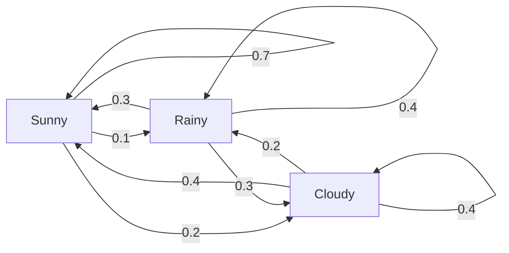
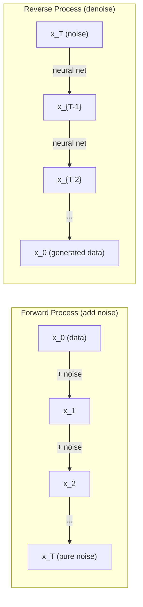

# Stochastic Processes

> Tính ngẫu nhiên có cấu trúc. Toán học đằng sau các bước đi ngẫu nhiên, chuỗi Markov và mô hình khuếch tán.

**Type:** Learn
**Language:** Python
**Prerequisites:** Phase 1, Lessons 06-07 (probability, Bayes)
**Time:** ~75 minutes

## Learning Objectives

- Mô phỏng các bước đi ngẫu nhiên 1D và 2D và xác minh độ dịch chuyển tỉ lệ theo sqrt(n)
- Xây dựng một bộ mô phỏng chuỗi Markov và tính phân phối dừng của nó bằng phân rã riêng
- Triển khai MCMC Metropolis-Hastings và động lực học Langevin để lấy mẫu từ các phân phối mục tiêu
- Kết nối quá trình khuếch tán xuôi với chuyển động Brown và giải thích cách quá trình ngược sinh dữ liệu

## The Problem

Nhiều hệ thống AI liên quan đến tính ngẫu nhiên tiến triển theo thời gian. Không phải tính ngẫu nhiên tĩnh -- tính ngẫu nhiên tuần tự, có cấu trúc nơi mỗi bước phụ thuộc vào những gì đến trước.

Các mô hình ngôn ngữ sinh từng token một. Mỗi token phụ thuộc vào ngữ cảnh trước đó. Mô hình xuất ra một phân phối xác suất, lấy mẫu từ nó và tiếp tục. Đó là một quá trình ngẫu nhiên.

Các mô hình khuếch tán thêm nhiễu vào một hình ảnh từng bước cho đến khi nó trở thành nhiễu thuần. Rồi chúng đảo ngược quá trình, khử nhiễu từng bước cho đến khi một hình ảnh mới xuất hiện. Quá trình xuôi là một chuỗi Markov. Quá trình ngược là một chuỗi Markov đã học chạy ngược.

Các agent học tăng cường thực hiện hành động trong một môi trường. Mỗi hành động dẫn đến một trạng thái mới với một xác suất nào đó. Agent tuân theo một chính sách ngẫu nhiên trong một thế giới ngẫu nhiên. Toàn bộ là một quá trình quyết định Markov.

Lấy mẫu MCMC -- trụ cột của suy luận Bayes -- xây dựng một chuỗi Markov có phân phối dừng là hậu nghiệm bạn muốn lấy mẫu từ đó.

Tất cả những điều này xây dựng trên bốn ý tưởng nền tảng:
1. Bước đi ngẫu nhiên -- quá trình ngẫu nhiên đơn giản nhất
2. Chuỗi Markov -- tính ngẫu nhiên có cấu trúc với một ma trận chuyển
3. Động lực học Langevin -- gradient descent có nhiễu
4. Metropolis-Hastings -- lấy mẫu từ bất kỳ phân phối nào

## The Concept

### Random Walks

Bắt đầu tại vị trí 0. Tại mỗi bước, tung một đồng xu cân bằng. Ngửa: đi sang phải (+1). Sấp: đi sang trái (-1).

Sau n bước, vị trí của bạn là tổng n giá trị ngẫu nhiên +/-1. Vị trí kỳ vọng là 0 (bước đi không chệch). Nhưng khoảng cách kỳ vọng từ gốc tọa độ tăng theo sqrt(n).

Điều này trái trực giác. Bước đi công bằng -- không có độ trôi theo cả hai hướng. Nhưng theo thời gian, nó lang thang ngày càng xa nơi bắt đầu. Độ lệch chuẩn sau n bước là sqrt(n).

```
Step 0:  Position = 0
Step 1:  Position = +1 or -1
Step 2:  Position = +2, 0, or -2
...
Step 100: Expected distance from origin ~ 10 (sqrt(100))
Step 10000: Expected distance from origin ~ 100 (sqrt(10000))
```

**Trong 2D**, bước đi di chuyển lên, xuống, trái hoặc phải với xác suất bằng nhau. Cùng tỉ lệ sqrt(n) áp dụng cho khoảng cách từ gốc tọa độ. Đường đi vạch ra một mẫu giống fractal.

**Tại sao sqrt(n)?** Mỗi bước là +1 hoặc -1 với xác suất bằng nhau. Sau n bước, vị trí S_n = X_1 + X_2 + ... + X_n trong đó mỗi X_i là +/-1. Phương sai mỗi bước là 1, và các bước độc lập, nên Var(S_n) = n. Độ lệch chuẩn = sqrt(n). Theo định lý giới hạn trung tâm, S_n / sqrt(n) hội tụ về một phân phối chuẩn tắc.

Tỉ lệ sqrt(n) này xuất hiện khắp nơi trong ML. Nhiễu SGD tỉ lệ theo 1/sqrt(batch_size). Các chiều embedding tỉ lệ theo sqrt(d). Căn bậc hai là dấu hiệu của các phép cộng ngẫu nhiên độc lập.

**Mối liên hệ với chuyển động Brown.** Xét một bước đi ngẫu nhiên với kích thước bước 1/sqrt(n) và n bước trên mỗi đơn vị thời gian. Khi n tiến đến vô cực, bước đi hội tụ về chuyển động Brown B(t) -- một quá trình thời gian liên tục nơi B(t) có phân phối chuẩn với trung bình 0 và phương sai t.

Chuyển động Brown là nền tảng toán học của khuếch tán. Nó mô hình hóa chuyển động rung ngẫu nhiên của các hạt trong chất lưu, các dao động giá cổ phiếu và -- thiết yếu -- quá trình nhiễu trong các mô hình khuếch tán.

**Sự phá sản của con bạc.** Một người đi ngẫu nhiên bắt đầu tại vị trí k, với các biên hấp thụ tại 0 và N. Xác suất đạt N trước 0 là bao nhiêu? Với một bước đi công bằng: P(reach N) = k/N. Điều này đơn giản và thanh nhã đáng ngạc nhiên. Nó kết nối với lý thuyết martingale -- bước đi ngẫu nhiên công bằng là một martingale (giá trị kỳ vọng tương lai = giá trị hiện tại).

### Markov Chains

Một chuỗi Markov là một hệ thống chuyển giữa các trạng thái theo các xác suất cố định. Tính chất chính: trạng thái tiếp theo chỉ phụ thuộc vào trạng thái hiện tại, không vào lịch sử.

```
P(X_{t+1} = j | X_t = i, X_{t-1} = ...) = P(X_{t+1} = j | X_t = i)
```

Đây là tính chất Markov. Nó có nghĩa là bạn có thể mô tả toàn bộ động lực học bằng một ma trận chuyển P:

```
P[i][j] = probability of going from state i to state j
```

Mỗi hàng của P có tổng bằng 1 (bạn phải đi đâu đó).

**Ví dụ -- Thời tiết:**

```
States: Sunny (0), Rainy (1), Cloudy (2)

P = [[0.7, 0.1, 0.2],    (if sunny: 70% sunny, 10% rainy, 20% cloudy)
     [0.3, 0.4, 0.3],    (if rainy: 30% sunny, 40% rainy, 30% cloudy)
     [0.4, 0.2, 0.4]]    (if cloudy: 40% sunny, 20% rainy, 40% cloudy)
```

Bắt đầu ở bất kỳ trạng thái nào. Sau nhiều lần chuyển, phân phối trạng thái hội tụ về phân phối dừng pi, trong đó pi * P = pi. Đây là vector riêng trái của P với giá trị riêng 1.

Với chuỗi thời tiết, phân phối dừng là [0.55, 0.18, 0.27] -- về lâu dài, trời nắng 55% thời gian bất kể trạng thái bắt đầu.



**Tính phân phối dừng.** Có hai cách tiếp cận:

1. **Phương pháp lũy thừa**: nhân lặp lại bất kỳ phân phối ban đầu nào với P. Sau đủ lần lặp, nó hội tụ.
2. **Phương pháp giá trị riêng**: tìm vector riêng trái của P với giá trị riêng 1. Đây là vector riêng của P^T với giá trị riêng 1.

Cả hai cách tiếp cận đòi hỏi chuỗi thỏa mãn các điều kiện hội tụ.

**Các điều kiện hội tụ.** Một chuỗi Markov hội tụ về một phân phối dừng duy nhất nếu nó:
- **Bất khả quy**: mọi trạng thái đều có thể đến được từ mọi trạng thái khác
- **Phi chu kỳ**: chuỗi không quay vòng với một chu kỳ cố định

Hầu hết các chuỗi bạn gặp trong ML thỏa mãn cả hai điều kiện.

**Các trạng thái hấp thụ.** Một trạng thái là hấp thụ nếu một khi vào đó, bạn không bao giờ rời đi (P[i][i] = 1). Các chuỗi Markov hấp thụ mô hình hóa các quá trình có trạng thái kết thúc -- một trò chơi kết thúc, một khách hàng rời bỏ, một chuỗi token chạm token kết thúc văn bản.

**Thời gian trộn.** Bao nhiêu bước cho đến khi chuỗi "gần" phân phối dừng? Một cách hình thức, số bước cho đến khi khoảng cách biến phân toàn phần so với trạng thái dừng giảm dưới một ngưỡng nào đó. Trộn nhanh = cần ít bước. Khoảng cách phổ của P (1 trừ giá trị riêng lớn thứ hai) điều khiển thời gian trộn. Khoảng cách lớn hơn = trộn nhanh hơn.

### Connection to Language Models

Sinh token trong một mô hình ngôn ngữ xấp xỉ là một quá trình Markov. Với ngữ cảnh hiện tại, mô hình xuất ra một phân phối trên token tiếp theo. Temperature điều khiển độ nhọn:

```
P(token_i) = exp(logit_i / temperature) / sum(exp(logit_j / temperature))
```

- Temperature = 1.0: phân phối tiêu chuẩn
- Temperature < 1.0: nhọn hơn (tất định hơn)
- Temperature > 1.0: phẳng hơn (ngẫu nhiên hơn)
- Temperature -> 0: argmax (tham lam)

Lấy mẫu top-k cắt ngọn về k token có xác suất cao nhất. Lấy mẫu top-p (nucleus) cắt ngọn về tập token nhỏ nhất có xác suất tích lũy vượt p. Cả hai sửa đổi các xác suất chuyển Markov.

### Brownian Motion

Giới hạn thời gian liên tục của bước đi ngẫu nhiên. Vị trí B(t) có ba tính chất:
1. B(0) = 0
2. B(t) - B(s) có phân phối chuẩn với trung bình 0 và phương sai t - s (với t > s)
3. Các số gia trên các khoảng không chồng lấp độc lập

Chuyển động Brown liên tục nhưng không đâu khả vi -- nó rung ở mọi thang đo. Đường đi có số chiều fractal 2 trong mặt phẳng.

Trong mô phỏng rời rạc, bạn xấp xỉ chuyển động Brown bằng:

```
B(t + dt) = B(t) + sqrt(dt) * z,    where z ~ N(0, 1)
```

Tỉ lệ sqrt(dt) quan trọng. Nó đến từ định lý giới hạn trung tâm được áp dụng cho các bước đi ngẫu nhiên.

### Langevin Dynamics

Gradient descent tìm cực tiểu của một hàm. Động lực học Langevin tìm phân phối xác suất tỉ lệ với exp(-U(x)/T), trong đó U là một hàm năng lượng và T là nhiệt độ.

```
x_{t+1} = x_t - dt * gradient(U(x_t)) + sqrt(2 * T * dt) * z_t
```

Hai lực tác động lên hạt:
1. **Lực gradient** (-dt * gradient(U)): đẩy về phía năng lượng thấp (giống gradient descent)
2. **Lực ngẫu nhiên** (sqrt(2*T*dt) * z): đẩy theo các hướng ngẫu nhiên (khám phá)

Tại nhiệt độ T = 0, đây là gradient descent thuần. Ở nhiệt độ cao, nó gần như một bước đi ngẫu nhiên. Ở nhiệt độ phù hợp, hạt khám phá địa hình năng lượng và dành nhiều thời gian hơn ở các vùng năng lượng thấp.

**Mối liên hệ với mô hình khuếch tán.** Quá trình xuôi của một mô hình khuếch tán là:

```
x_t = sqrt(alpha_t) * x_{t-1} + sqrt(1 - alpha_t) * noise
```

Đây là một chuỗi Markov dần trộn dữ liệu với nhiễu. Sau đủ bước, x_T là nhiễu Gaussian thuần.

Quá trình ngược -- đi từ nhiễu trở lại dữ liệu -- cũng là một chuỗi Markov, nhưng các xác suất chuyển của nó được học bởi một mạng nơ-ron. Mạng học cách dự đoán nhiễu đã được thêm ở mỗi bước, rồi trừ nó.



### MCMC: Markov Chain Monte Carlo

Đôi khi bạn cần lấy mẫu từ một phân phối p(x) mà bạn có thể tính giá trị (tới một hằng số) nhưng không thể lấy mẫu trực tiếp. Các hậu nghiệm Bayes là ví dụ kinh điển -- bạn biết hợp lý nhân tiên nghiệm, nhưng hằng số chuẩn hóa không thể tính được.

**Metropolis-Hastings** xây dựng một chuỗi Markov có phân phối dừng là p(x):

1. Bắt đầu tại một vị trí x nào đó
2. Đề xuất một vị trí mới x' từ một phân phối đề xuất Q(x'|x)
3. Tính tỉ số chấp nhận: a = p(x') * Q(x|x') / (p(x) * Q(x'|x))
4. Chấp nhận x' với xác suất min(1, a). Nếu không giữ nguyên tại x.
5. Lặp lại.

Nếu Q đối xứng (ví dụ, Q(x'|x) = Q(x|x') = N(x, sigma^2)), tỉ số đơn giản thành a = p(x') / p(x). Bạn chỉ cần tỉ số xác suất -- hằng số chuẩn hóa triệt tiêu.

Chuỗi được bảo đảm hội tụ về p(x) dưới các điều kiện nhẹ. Nhưng hội tụ có thể chậm nếu đề xuất quá nhỏ (bước đi ngẫu nhiên) hoặc quá lớn (loại bỏ cao). Điều chỉnh đề xuất là nghệ thuật của MCMC.

**Tại sao nó hoạt động.** Tỉ số chấp nhận bảo đảm cân bằng chi tiết: xác suất ở x và chuyển đến x' bằng xác suất ở x' và chuyển đến x. Cân bằng chi tiết hàm ý p(x) là phân phối dừng của chuỗi. Vì vậy sau đủ bước, các mẫu đến từ p(x).

**Các cân nhắc thực tế:**
- **Burn-in**: bỏ N mẫu đầu tiên. Chuỗi cần thời gian để đạt phân phối dừng từ điểm bắt đầu.
- **Làm thưa**: giữ mỗi mẫu thứ k để giảm tự tương quan.
- **Nhiều chuỗi**: chạy một số chuỗi từ các điểm bắt đầu khác nhau. Nếu chúng hội tụ về cùng phân phối, bạn có bằng chứng hội tụ.
- **Tỉ lệ chấp nhận**: với các đề xuất Gaussian trong d chiều, tỉ lệ chấp nhận tối ưu khoảng 23% (Roberts & Rosenthal, 2001). Quá cao nghĩa là chuỗi hầu như không di chuyển. Quá thấp nghĩa là nó loại bỏ mọi thứ.

### Stochastic Processes in AI

| Quá trình | Ứng dụng AI |
|---------|---------------|
| Bước đi ngẫu nhiên | Khám phá trong RL, embedding Node2Vec |
| Chuỗi Markov | Sinh văn bản, lấy mẫu MCMC |
| Chuyển động Brown | Các mô hình khuếch tán (quá trình xuôi) |
| Động lực học Langevin | Các mô hình tạo sinh dựa trên score, SGLD |
| Quá trình quyết định Markov | Học tăng cường |
| Metropolis-Hastings | Suy luận Bayes, lấy mẫu hậu nghiệm |

```figure
random-walk-diffusion
```

## Build It

### Step 1: Random walk simulator

```python
import numpy as np

def random_walk_1d(n_steps, seed=None):
    rng = np.random.RandomState(seed)
    steps = rng.choice([-1, 1], size=n_steps)
    positions = np.concatenate([[0], np.cumsum(steps)])
    return positions


def random_walk_2d(n_steps, seed=None):
    rng = np.random.RandomState(seed)
    directions = rng.choice(4, size=n_steps)
    dx = np.zeros(n_steps)
    dy = np.zeros(n_steps)
    dx[directions == 0] = 1   # right
    dx[directions == 1] = -1  # left
    dy[directions == 2] = 1   # up
    dy[directions == 3] = -1  # down
    x = np.concatenate([[0], np.cumsum(dx)])
    y = np.concatenate([[0], np.cumsum(dy)])
    return x, y
```

Bước đi 1D lưu các tổng tích lũy. Mỗi bước là +1 hoặc -1. Sau n bước, vị trí là tổng. Phương sai tăng tuyến tính theo n, nên độ lệch chuẩn tăng theo sqrt(n).

### Step 2: Markov chain

```python
class MarkovChain:
    def __init__(self, transition_matrix, state_names=None):
        self.P = np.array(transition_matrix, dtype=float)
        self.n_states = len(self.P)
        self.state_names = state_names or [str(i) for i in range(self.n_states)]

    def step(self, current_state, rng=None):
        if rng is None:
            rng = np.random.RandomState()
        probs = self.P[current_state]
        return rng.choice(self.n_states, p=probs)

    def simulate(self, start_state, n_steps, seed=None):
        rng = np.random.RandomState(seed)
        states = [start_state]
        current = start_state
        for _ in range(n_steps):
            current = self.step(current, rng)
            states.append(current)
        return states

    def stationary_distribution(self):
        eigenvalues, eigenvectors = np.linalg.eig(self.P.T)
        idx = np.argmin(np.abs(eigenvalues - 1.0))
        stationary = np.real(eigenvectors[:, idx])
        stationary = stationary / stationary.sum()
        return np.abs(stationary)
```

Phân phối dừng là vector riêng trái của P với giá trị riêng 1. Chúng ta tìm nó bằng cách tính các vector riêng của P^T (chuyển vị biến các vector riêng trái thành vector riêng phải).

### Step 3: Langevin dynamics

```python
def langevin_dynamics(grad_U, x0, dt, temperature, n_steps, seed=None):
    rng = np.random.RandomState(seed)
    x = np.array(x0, dtype=float)
    trajectory = [x.copy()]
    for _ in range(n_steps):
        noise = rng.randn(*x.shape)
        x = x - dt * grad_U(x) + np.sqrt(2 * temperature * dt) * noise
        trajectory.append(x.copy())
    return np.array(trajectory)
```

Gradient đẩy x về phía năng lượng thấp. Nhiễu ngăn nó bị kẹt. Ở cân bằng, phân phối các mẫu tỉ lệ với exp(-U(x)/temperature).

### Step 4: Metropolis-Hastings

```python
def metropolis_hastings(target_log_prob, proposal_std, x0, n_samples, seed=None):
    rng = np.random.RandomState(seed)
    x = np.array(x0, dtype=float)
    samples = [x.copy()]
    accepted = 0
    for _ in range(n_samples - 1):
        x_proposed = x + rng.randn(*x.shape) * proposal_std
        log_ratio = target_log_prob(x_proposed) - target_log_prob(x)
        if np.log(rng.rand()) < log_ratio:
            x = x_proposed
            accepted += 1
        samples.append(x.copy())
    acceptance_rate = accepted / (n_samples - 1)
    return np.array(samples), acceptance_rate
```

Thuật toán đề xuất một điểm mới, kiểm tra xem nó có xác suất cao hơn không (hoặc chấp nhận với xác suất tỉ lệ với tỉ số), và lặp lại. Tỉ lệ chấp nhận nên quanh 23-50% để trộn tốt.

## Use It

Trong thực tế, bạn sử dụng các thư viện đã được thiết lập cho các thuật toán này. Nhưng hiểu cơ chế quan trọng để gỡ lỗi và điều chỉnh.

```python
import numpy as np

rng = np.random.RandomState(42)
walk = np.cumsum(rng.choice([-1, 1], size=10000))
print(f"Final position: {walk[-1]}")
print(f"Expected distance: {np.sqrt(10000):.1f}")
print(f"Actual distance: {abs(walk[-1])}")
```

### numpy for transition matrices

```python
import numpy as np

P = np.array([[0.7, 0.1, 0.2],
              [0.3, 0.4, 0.3],
              [0.4, 0.2, 0.4]])

distribution = np.array([1.0, 0.0, 0.0])
for _ in range(100):
    distribution = distribution @ P

print(f"Stationary distribution: {np.round(distribution, 4)}")
```

Nhân lặp lại phân phối ban đầu với P. Sau đủ lần lặp, nó hội tụ về phân phối dừng bất kể bạn bắt đầu ở đâu. Đây là phương pháp lũy thừa để tìm vector riêng trái trội.

### Connections to real frameworks

- **Khuếch tán PyTorch:** `DDPMScheduler` trong `diffusers` của Hugging Face triển khai các chuỗi Markov xuôi và ngược
- **NumPyro / PyMC:** Sử dụng MCMC (bộ lấy mẫu NUTS, cải tiến so với Metropolis-Hastings) để suy luận Bayes
- **Gymnasium (RL):** Hàm bước môi trường xác định một quá trình quyết định Markov

### Verifying Markov chain convergence

```python
import numpy as np

P = np.array([[0.9, 0.1], [0.3, 0.7]])

eigenvalues = np.linalg.eigvals(P)
spectral_gap = 1 - sorted(np.abs(eigenvalues))[-2]
print(f"Eigenvalues: {eigenvalues}")
print(f"Spectral gap: {spectral_gap:.4f}")
print(f"Approximate mixing time: {1/spectral_gap:.1f} steps")
```

Khoảng cách phổ cho bạn biết chuỗi quên trạng thái ban đầu nhanh đến mức nào. Khoảng cách 0.2 nghĩa là khoảng 5 bước để trộn. Khoảng cách 0.01 nghĩa là khoảng 100 bước. Luôn kiểm tra điều này trước khi chạy các mô phỏng dài -- một chuỗi trộn chậm lãng phí tính toán.

## Ship It

Bài học này tạo ra:
- `outputs/prompt-stochastic-process-advisor.md` -- một prompt giúp xác định khuôn khổ quá trình ngẫu nhiên nào áp dụng cho một bài toán nhất định

## Connections

| Khái niệm | Nơi xuất hiện |
|---------|------------------|
| Bước đi ngẫu nhiên | Embedding đồ thị Node2Vec, khám phá trong RL |
| Chuỗi Markov | Sinh token trong LLM, lấy mẫu MCMC |
| Chuyển động Brown | Quá trình khuếch tán xuôi trong DDPM, các mô hình dựa trên SDE |
| Động lực học Langevin | Các mô hình tạo sinh dựa trên score, động lực học Langevin gradient ngẫu nhiên (SGLD) |
| Phân phối dừng | Mục tiêu hội tụ MCMC, PageRank |
| Metropolis-Hastings | Lấy mẫu hậu nghiệm Bayes, ủ mô phỏng |
| Temperature | Lấy mẫu LLM, khám phá Boltzmann trong RL, ủ mô phỏng |
| Thời gian trộn | Tốc độ hội tụ MCMC, phân tích khoảng cách phổ |
| Trạng thái hấp thụ | Token kết thúc chuỗi, trạng thái kết thúc trong RL |
| Cân bằng chi tiết | Bảo đảm tính đúng đắn cho các bộ lấy mẫu MCMC |

Các mô hình khuếch tán đáng được chú ý đặc biệt. DDPM (Ho et al., 2020) xác định một chuỗi Markov xuôi:

```
q(x_t | x_{t-1}) = N(x_t; sqrt(1-beta_t) * x_{t-1}, beta_t * I)
```

trong đó beta_t là một lịch nhiễu. Sau T bước, x_T xấp xỉ N(0, I). Quá trình ngược được tham số hóa bởi một mạng nơ-ron dự đoán nhiễu:

```
p_theta(x_{t-1} | x_t) = N(x_{t-1}; mu_theta(x_t, t), sigma_t^2 * I)
```

Mỗi bước sinh là một bước trong một chuỗi Markov đã học. Hiểu chuỗi Markov nghĩa là hiểu cách và lý do các mô hình khuếch tán sinh dữ liệu.

SGLD (Động lực học Langevin Gradient Ngẫu nhiên) kết hợp gradient descent mini-batch với nhiễu Langevin. Thay vì tính gradient đầy đủ, bạn sử dụng một ước lượng ngẫu nhiên và thêm nhiễu được hiệu chỉnh. Khi tốc độ học giảm, SGLD chuyển từ tối ưu hóa sang lấy mẫu -- bạn nhận các mẫu hậu nghiệm Bayes xấp xỉ mà không tốn thêm công sức. Đây là một trong những cách đơn giản nhất để có các ước lượng sự không chắc chắn từ một mạng nơ-ron.

Điểm cốt yếu xuyên suốt các kết nối này: các quá trình ngẫu nhiên không chỉ là công cụ lý thuyết. Chúng là các cơ chế tính toán bên trong các hệ thống AI hiện đại. Khi bạn điều chỉnh temperature của một LLM, bạn đang điều chỉnh một chuỗi Markov. Khi bạn huấn luyện một mô hình khuếch tán, bạn đang học cách đảo ngược một quá trình giống chuyển động Brown. Khi bạn chạy suy luận Bayes, bạn đang xây dựng một chuỗi hội tụ về hậu nghiệm.

## Exercises

1. **Mô phỏng 1000 bước đi ngẫu nhiên dài 10000 bước.** Vẽ phân phối các vị trí cuối. Xác minh nó xấp xỉ Gaussian với trung bình 0 và độ lệch chuẩn sqrt(10000) = 100.

2. **Xây dựng một bộ sinh văn bản bằng một chuỗi Markov.** Huấn luyện trên một ngữ liệu nhỏ: với mỗi từ, đếm các lần chuyển sang từ tiếp theo. Xây dựng ma trận chuyển. Sinh các câu mới bằng cách lấy mẫu từ chuỗi.

3. **Triển khai ủ mô phỏng** bằng Metropolis-Hastings. Bắt đầu ở nhiệt độ cao (chấp nhận gần như mọi thứ) và dần làm nguội (chỉ chấp nhận các cải thiện). Sử dụng nó để tìm cực tiểu của một hàm có nhiều cực tiểu cục bộ.

4. **So sánh động lực học Langevin ở các nhiệt độ khác nhau.** Lấy mẫu từ một thế năng hai giếng U(x) = (x^2 - 1)^2. Ở nhiệt độ thấp, các mẫu tụ trong một giếng. Ở nhiệt độ cao, chúng trải trên cả hai. Tìm nhiệt độ tới hạn nơi chuỗi trộn giữa các giếng.

5. **Triển khai quá trình khuếch tán xuôi.** Bắt đầu với một tín hiệu 1D (ví dụ, một sóng sin). Thêm nhiễu dần qua 100 bước với một lịch nhiễu tuyến tính. Cho thấy tín hiệu suy giảm thành nhiễu thuần như thế nào. Sau đó triển khai một bộ khử nhiễu đơn giản đảo ngược quá trình (ngay cả một bộ ngây thơ chỉ trừ nhiễu ước lượng).

## Key Terms

| Thuật ngữ | Cách mọi người nói | Ý nghĩa thực sự |
|------|----------------|----------------------|
| Random walk (Bước đi ngẫu nhiên) | "Di chuyển bằng tung đồng xu" | Một quá trình nơi vị trí thay đổi theo các số gia ngẫu nhiên ở mỗi bước |
| Markov property (Tính chất Markov) | "Không nhớ" | Tương lai chỉ phụ thuộc vào trạng thái hiện tại, không vào lịch sử |
| Transition matrix (Ma trận chuyển) | "Bảng xác suất" | P[i][j] = xác suất chuyển từ trạng thái i sang trạng thái j |
| Stationary distribution (Phân phối dừng) | "Trung bình dài hạn" | Phân phối pi trong đó pi*P = pi -- cân bằng của chuỗi |
| Brownian motion (Chuyển động Brown) | "Rung ngẫu nhiên" | Giới hạn thời gian liên tục của một bước đi ngẫu nhiên, B(t) ~ N(0, t) |
| Langevin dynamics (Động lực học Langevin) | "Gradient descent có nhiễu" | Quy tắc cập nhật kết hợp gradient tất định và nhiễu loạn ngẫu nhiên |
| MCMC | "Đi về phía mục tiêu" | Xây dựng một chuỗi Markov có phân phối dừng là phân phối bạn muốn |
| Metropolis-Hastings | "Đề xuất và chấp nhận/loại bỏ" | Thuật toán MCMC sử dụng các tỉ số chấp nhận để bảo đảm hội tụ |
| Temperature (Nhiệt độ) | "Núm tính ngẫu nhiên" | Tham số điều khiển đánh đổi giữa khám phá và khai thác |
| Diffusion process (Quá trình khuếch tán) | "Nhiễu vào, nhiễu ra" | Xuôi: dần thêm nhiễu. Ngược: dần loại nó. Sinh dữ liệu. |

## Further Reading

- **Ho, Jain, Abbeel (2020)** -- "Denoising Diffusion Probabilistic Models." Bài báo DDPM khởi xướng cuộc cách mạng mô hình khuếch tán. Suy ra rõ ràng các chuỗi Markov xuôi và ngược.
- **Song & Ermon (2019)** -- "Generative Modeling by Estimating Gradients of the Data Distribution." Cách tiếp cận dựa trên score sử dụng động lực học Langevin để lấy mẫu.
- **Roberts & Rosenthal (2004)** -- "General state space Markov chains and MCMC algorithms." Lý thuyết đằng sau khi nào và tại sao MCMC hoạt động.
- **Norris (1997)** -- "Markov Chains." Giáo trình tiêu chuẩn. Bao quát hội tụ, các phân phối dừng và thời gian chạm.
- **Welling & Teh (2011)** -- "Bayesian Learning via Stochastic Gradient Langevin Dynamics." Kết hợp SGD với động lực học Langevin để suy luận Bayes có thể mở rộng.
