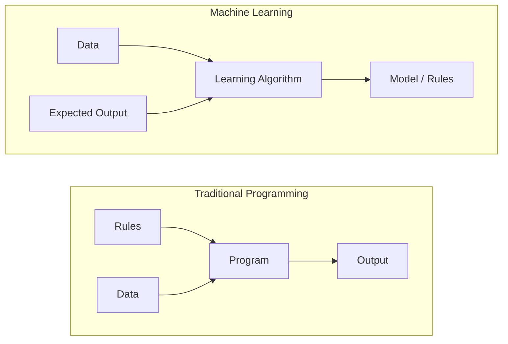
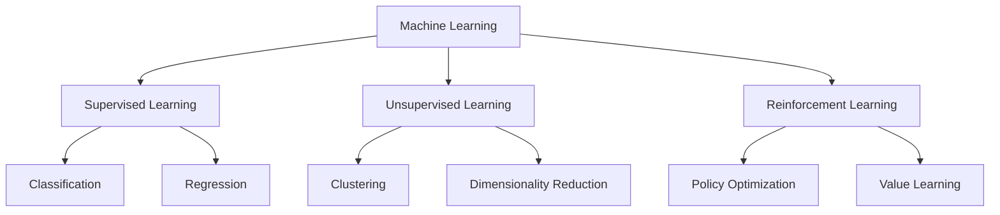
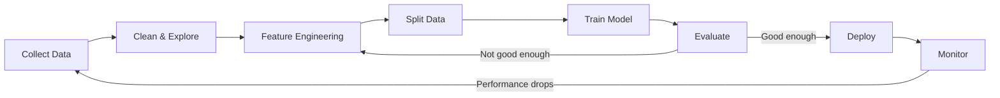
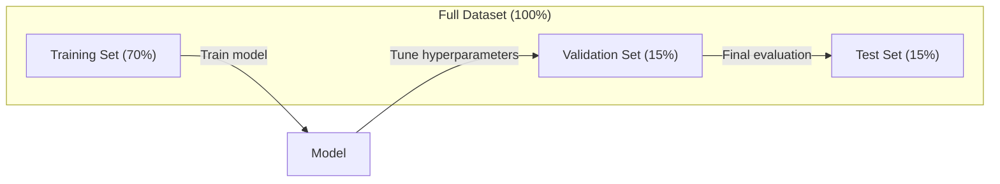
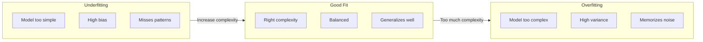
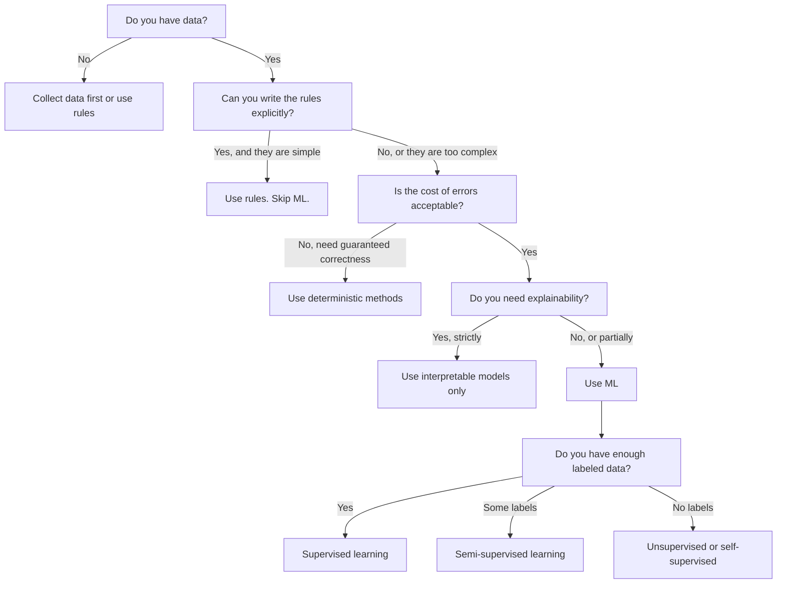

# What Is Machine Learning

> Học máy là dạy máy tính tìm các mẫu trong dữ liệu thay vì viết các quy tắc bằng tay.

**Type:** Learn
**Languages:** Python
**Prerequisites:** Phase 1 (Math Foundations)
**Time:** ~45 minutes

## Learning Objectives

- Giải thích sự khác biệt giữa học có giám sát, không giám sát và tăng cường và xác định loại nào áp dụng cho một bài toán nhất định
- Triển khai một bộ phân loại trọng tâm gần nhất từ đầu và đánh giá nó so với một mốc cơ sở ngẫu nhiên
- Phân biệt các tác vụ phân loại và hồi quy và chọn hàm mất mát thích hợp cho mỗi loại
- Đánh giá liệu một bài toán kinh doanh nhất định phù hợp với ML hay được giải tốt hơn bằng các quy tắc tất định

## The Problem

Bạn muốn xây dựng một bộ lọc thư rác. Cách tiếp cận truyền thống: ngồi xuống và viết hàng trăm quy tắc. "Nếu email chứa 'TIỀN MIỄN PHÍ', đánh dấu là thư rác. Nếu nó có hơn 3 dấu chấm than, đánh dấu là thư rác." Bạn dành nhiều tuần viết quy tắc. Rồi những người gửi thư rác thay đổi cách dùng từ. Các quy tắc của bạn hỏng. Bạn viết thêm quy tắc. Chu kỳ không bao giờ kết thúc.

Học máy đảo ngược điều này. Thay vì viết quy tắc, bạn cho máy tính hàng nghìn email đã gắn nhãn ("thư rác" hoặc "không phải thư rác") và để nó tự tìm ra quy tắc. Máy tính tìm các mẫu mà bạn sẽ không bao giờ nghĩ đến. Khi những người gửi thư rác thay đổi chiến thuật, bạn huấn luyện lại trên dữ liệu mới thay vì viết lại mã.

Sự chuyển đổi từ "lập trình quy tắc" sang "học từ dữ liệu" này là cốt lõi của học máy. Mọi bộ máy đề xuất, trợ lý giọng nói, xe tự lái và mô hình ngôn ngữ đều hoạt động theo cách này.

## The Concept

### Learning From Data, Not Rules

Lập trình truyền thống và học máy giải quyết bài toán theo các hướng đối nhau.



Lập trình truyền thống: bạn viết các quy tắc. Chương trình áp dụng chúng vào dữ liệu để tạo đầu ra.

Học máy: bạn cung cấp dữ liệu và các đầu ra kỳ vọng. Thuật toán khám phá các quy tắc.

"Mô hình" có được từ huấn luyện CHÍNH LÀ các quy tắc, được mã hóa thành các số (trọng số, tham số). Nó tổng quát hóa từ các ví dụ đã thấy để đưa ra dự đoán trên dữ liệu chưa bao giờ thấy.

### The Three Types of Machine Learning



**Học Có Giám sát**: Bạn có các cặp đầu vào-đầu ra. Mô hình học cách ánh xạ đầu vào thành đầu ra.
- "Đây là 10,000 bức ảnh được gắn nhãn mèo hoặc chó. Hãy học phân biệt chúng."
- "Đây là các đặc trưng và giá nhà. Hãy học dự đoán giá."

**Học Không Giám sát**: Bạn chỉ có đầu vào. Không có nhãn. Mô hình tự tìm cấu trúc.
- "Đây là 10,000 lịch sử mua hàng của khách hàng. Hãy tìm các nhóm tự nhiên."
- "Đây là các điểm dữ liệu 1,000 chiều. Hãy giảm xuống 2 chiều trong khi giữ cấu trúc."

**Học Tăng cường**: Một agent thực hiện hành động trong một môi trường và nhận phần thưởng hoặc hình phạt. Nó học một chiến lược (chính sách) để cực đại hóa tổng phần thưởng.
- "Chơi trò chơi này. +1 khi thắng, -1 khi thua. Hãy tìm ra một chiến lược."
- "Điều khiển cánh tay robot này. +1 khi nhặt được vật, -0.01 cho mỗi giây lãng phí."

Hầu hết những gì bạn sẽ xây dựng trong thực tế sử dụng học có giám sát. Học không giám sát phổ biến cho tiền xử lý và khám phá. Học tăng cường vận hành AI trò chơi, robot và RLHF cho các mô hình ngôn ngữ.

### Beyond the Big Three

Ba nhóm ở trên rõ ràng, nhưng ML thực tế thường làm mờ các ranh giới.

**Học bán giám sát** sử dụng một tập nhỏ dữ liệu có nhãn và một tập lớn dữ liệu không nhãn. Bạn có thể có 100 hình ảnh y khoa có nhãn và 100,000 hình ảnh không nhãn. Các kỹ thuật bao gồm:

- **Lan truyền nhãn:** Xây dựng một đồ thị kết nối các điểm dữ liệu tương tự. Nhãn lan từ các nút có nhãn sang các láng giềng không nhãn qua đồ thị.
- **Gắn nhãn giả:** Huấn luyện một mô hình trên dữ liệu có nhãn, sử dụng nó để dự đoán nhãn cho dữ liệu không nhãn, rồi huấn luyện lại trên mọi thứ. Mô hình tự xây dựng dần tập huấn luyện của chính nó.
- **Regularization nhất quán:** Mô hình nên cho cùng dự đoán đối với một đầu vào và một phiên bản bị nhiễu loạn nhẹ của đầu vào đó. Điều này hoạt động ngay cả khi không có nhãn.

**Học tự giám sát** tạo ra sự giám sát từ chính dữ liệu. Hoàn toàn không cần nhãn của con người. Mô hình tạo tác vụ dự đoán của riêng nó từ cấu trúc dữ liệu.

- **Mô hình hóa ngôn ngữ có che (BERT):** Che 15% từ trong một câu, huấn luyện mô hình dự đoán các từ bị thiếu. Các "nhãn" đến từ văn bản gốc.
- **Học tương phản (SimCLR):** Lấy một hình ảnh, tạo hai phiên bản tăng cường. Huấn luyện mô hình nhận ra chúng đến từ cùng hình ảnh trong khi phân biệt chúng với các phiên bản tăng cường của các hình ảnh khác.
- **Dự đoán token tiếp theo (GPT):** Dự đoán từ tiếp theo khi biết mọi từ trước đó. Mỗi tài liệu văn bản trở thành một ví dụ huấn luyện.

Đây không phải các nhóm tách biệt với ba nhóm lớn. Chúng là các chiến lược kết hợp ý tưởng có giám sát và không giám sát. Học tự giám sát về mặt kỹ thuật là có giám sát (mô hình dự đoán điều gì đó), nhưng nhãn được tạo tự động, không phải bởi con người.

### Classification vs Regression

Đây là hai tác vụ học có giám sát chính.

| Khía cạnh | Phân loại | Hồi quy |
|--------|---------------|------------|
| Đầu ra | Các loại rời rạc | Các số liên tục |
| Ví dụ | "Email này có phải thư rác không?" | "Giá nhà sẽ là bao nhiêu?" |
| Không gian đầu ra | {mèo, chó, chim} | Bất kỳ số thực nào |
| Hàm mất mát | Cross-entropy, độ chính xác | Sai số bình phương trung bình, MAE |
| Quyết định | Các ranh giới giữa các lớp | Một đường cong khớp dữ liệu |

Phân loại trả lời "loại nào?" Hồi quy trả lời "bao nhiêu?"

Một số bài toán có thể được định hình theo cả hai cách. Dự đoán một cổ phiếu tăng hay giảm là phân loại. Dự đoán giá chính xác là hồi quy.

### The ML Workflow

Mọi dự án học máy đều tuân theo cùng một quy trình, bất kể thuật toán.



**Thu thập Dữ liệu**: Thu thập dữ liệu thô. Nhiều dữ liệu hơn gần như luôn tốt hơn, nhưng chất lượng quan trọng hơn số lượng.

**Làm sạch & Khám phá**: Xử lý giá trị thiếu, loại bỏ trùng lặp, trực quan hóa phân phối, phát hiện bất thường. Bước này thường chiếm 60-80% tổng thời gian dự án.

**Kỹ thuật Đặc trưng**: Biến đổi dữ liệu thô thành các đặc trưng mô hình có thể sử dụng. Chuyển ngày tháng thành thứ trong tuần. Chuẩn hóa các cột số. Mã hóa các biến phân loại. Đặc trưng tốt quan trọng hơn các thuật toán cầu kỳ.

**Chia Dữ liệu**: Chia thành các tập huấn luyện, xác thực và kiểm tra. Mô hình huấn luyện trên dữ liệu huấn luyện, bạn điều chỉnh siêu tham số trên dữ liệu xác thực và báo cáo hiệu năng cuối cùng trên dữ liệu kiểm tra.

**Huấn luyện Mô hình**: Đưa dữ liệu huấn luyện vào một thuật toán. Thuật toán điều chỉnh các tham số nội bộ để tối thiểu hóa một hàm mất mát.

**Đánh giá**: Đo hiệu năng trên dữ liệu xác thực/kiểm tra. Nếu hiệu năng không chấp nhận được, quay lại và thử các đặc trưng, thuật toán hoặc siêu tham số khác.

**Triển khai**: Đưa mô hình vào sản xuất nơi nó đưa ra dự đoán trên dữ liệu mới.

**Giám sát**: Theo dõi hiệu năng theo thời gian. Các phân phối dữ liệu thay đổi (dịch chuyển dữ liệu), và mô hình suy giảm. Khi hiệu năng giảm, huấn luyện lại.

### Training, Validation, and Test Splits

Đây là khái niệm quan trọng nhất mà người mới hiểu sai. Bạn phải đánh giá mô hình trên dữ liệu nó chưa bao giờ thấy khi huấn luyện. Nếu không bạn đang đo sự ghi nhớ, không phải việc học.



| Phần chia | Mục đích | Khi nào sử dụng | Kích thước điển hình |
|-------|---------|-----------|-------------|
| Huấn luyện | Mô hình học từ dữ liệu này | Trong huấn luyện | 60-80% |
| Xác thực | Điều chỉnh siêu tham số, so sánh mô hình | Sau mỗi lần huấn luyện | 10-20% |
| Kiểm tra | Ước lượng hiệu năng cuối cùng không chệch | Một lần, vào cuối cùng | 10-20% |

Tập kiểm tra là thiêng liêng. Bạn nhìn vào nó đúng một lần. Nếu liên tục điều chỉnh mô hình dựa trên hiệu năng kiểm tra, thực chất bạn đang huấn luyện trên tập kiểm tra và các con số báo cáo trở nên vô nghĩa.

Với các tập dữ liệu nhỏ, sử dụng xác thực chéo k-fold: chia dữ liệu thành k phần, huấn luyện trên k-1 phần, xác thực trên phần còn lại, luân phiên và lấy trung bình kết quả.

### Overfitting vs Underfitting



**Khớp chưa đủ**: Mô hình quá đơn giản để nắm bắt các mẫu trong dữ liệu. Một đường thẳng cố khớp một quan hệ cong. Sai số huấn luyện cao. Sai số kiểm tra cao.

**Khớp quá mức**: Mô hình quá phức tạp và ghi nhớ dữ liệu huấn luyện, bao gồm nhiễu của nó. Một đường cong ngoằn ngoèo đi qua mọi điểm huấn luyện nhưng thất bại trên dữ liệu mới. Sai số huấn luyện thấp. Sai số kiểm tra cao.

**Khớp tốt**: Mô hình nắm bắt các mẫu thực mà không ghi nhớ nhiễu. Sai số huấn luyện và sai số kiểm tra đều thấp một cách hợp lý.

Các dấu hiệu khớp quá mức:
- Độ chính xác huấn luyện cao hơn nhiều so với độ chính xác xác thực
- Mô hình hoạt động tốt trên dữ liệu huấn luyện nhưng kém trên dữ liệu mới
- Thêm dữ liệu huấn luyện cải thiện hiệu năng (mô hình đã ghi nhớ, không phải học)

Các cách sửa khớp quá mức:
- Lấy thêm dữ liệu huấn luyện
- Giảm độ phức tạp mô hình (ít tham số hơn, kiến trúc đơn giản hơn)
- Regularization (thêm một hình phạt cho trọng số lớn)
- Dropout (ngẫu nhiên đặt các nơ-ron về không trong huấn luyện)
- Dừng sớm (dừng huấn luyện khi sai số xác thực bắt đầu tăng)

Các cách sửa khớp chưa đủ:
- Sử dụng một mô hình phức tạp hơn
- Thêm các đặc trưng
- Giảm regularization
- Huấn luyện lâu hơn

### The Bias-Variance Tradeoff

Đây là khuôn khổ toán học đằng sau khớp quá mức và khớp chưa đủ.

**Độ chệch**: Sai số từ các giả định sai trong mô hình. Một mô hình tuyến tính có độ chệch cao khi quan hệ thực là phi tuyến. Độ chệch cao dẫn đến khớp chưa đủ.

**Phương sai**: Sai số do nhạy với các dao động nhỏ trong dữ liệu huấn luyện. Một mô hình có phương sai cao cho các dự đoán rất khác nhau khi được huấn luyện trên các tập con dữ liệu khác nhau. Phương sai cao dẫn đến khớp quá mức.

| Độ phức tạp mô hình | Độ chệch | Phương sai | Kết quả |
|-----------------|------|----------|--------|
| Quá thấp (mô hình tuyến tính cho dữ liệu cong) | Cao | Thấp | Khớp chưa đủ |
| Vừa đúng | Trung bình | Trung bình | Tổng quát hóa tốt |
| Quá cao (đa thức bậc 20 cho 10 điểm) | Thấp | Cao | Khớp quá mức |

Tổng sai số = Độ chệch^2 + Phương sai + Nhiễu không thể giảm

Bạn không thể giảm nhiễu không thể giảm (đó là tính ngẫu nhiên trong chính dữ liệu). Bạn muốn tìm điểm cân bằng nơi độ chệch^2 + phương sai được tối thiểu hóa.

### No Free Lunch Theorem

Không có một thuật toán duy nhất hoạt động tốt nhất cho mọi bài toán. Một thuật toán hoạt động tốt trên một lớp bài toán sẽ hoạt động kém trên một lớp khác. Đây là lý do các nhà khoa học dữ liệu thử nhiều thuật toán và so sánh kết quả.

Trong thực tế, lựa chọn phụ thuộc vào:
- Bạn có bao nhiêu dữ liệu
- Có bao nhiêu đặc trưng
- Quan hệ tuyến tính hay phi tuyến
- Bạn có cần khả năng diễn giải không
- Bạn có thể dành bao nhiêu tài nguyên tính toán

### When NOT to Use Machine Learning

ML mạnh nhưng không phải lúc nào cũng là công cụ phù hợp. Trước khi tìm đến một mô hình, hãy hỏi liệu bạn thực sự cần nó không.

**Không sử dụng ML khi:**

- **Các quy tắc đơn giản và được xác định rõ.** Tính thuế, thuật toán sắp xếp, chuyển đổi đơn vị. Nếu bạn có thể viết logic bằng vài câu lệnh if, một mô hình thêm độ phức tạp mà không có lợi ích.
- **Bạn không có dữ liệu hoặc có rất ít dữ liệu.** ML cần các ví dụ để học. Với 10 điểm dữ liệu, bạn không thể huấn luyện thứ gì có ý nghĩa. Thu thập dữ liệu trước.
- **Cái giá của việc sai là thảm khốc và bạn cần tính đúng đắn được bảo đảm.** Tính liều thuốc, điều khiển lò phản ứng hạt nhân, xác minh mật mã. Các mô hình ML mang tính xác suất. Đôi khi chúng sẽ sai. Nếu "đôi khi sai" không chấp nhận được, sử dụng các phương pháp tất định.
- **Một bảng tra hoặc quy tắc kinh nghiệm giải quyết bài toán.** Nếu một ngưỡng hoặc bảng đơn giản bao phủ 99% trường hợp, thêm ML làm tăng chi phí bảo trì mà không cải thiện có ý nghĩa.
- **Bạn không thể giải thích quyết định và khả năng giải thích là bắt buộc.** Các ngành được quản lý (cho vay, bảo hiểm, tư pháp hình sự) đôi khi yêu cầu mọi quyết định có thể giải thích đầy đủ. Một số mô hình ML có thể diễn giải (hồi quy tuyến tính, cây quyết định nhỏ). Hầu hết thì không.
- **Bài toán thay đổi nhanh hơn khả năng huấn luyện lại của bạn.** Nếu các quy tắc thay đổi hằng ngày và huấn luyện lại mất một tuần, mô hình luôn lỗi thời.

Sử dụng lưu đồ quyết định này:



```figure
f3-learning-boundary
```

## Build It

Mã trong `code/ml_intro.py` triển khai một bộ phân loại trọng tâm gần nhất từ đầu, thuật toán ML đơn giản nhất có thể. Nó minh họa ý tưởng cốt lõi: học từ dữ liệu, rồi dự đoán trên dữ liệu mới.

### Step 1: Nearest Centroid Classifier from Scratch

Bộ phân loại trọng tâm gần nhất tính tâm (trung bình) của mỗi lớp trong dữ liệu huấn luyện. Để dự đoán, nó gán mỗi điểm mới cho lớp có tâm gần nhất.

```python
class NearestCentroid:
    def fit(self, X, y):
        self.classes = np.unique(y)
        self.centroids = np.array([
            X[y == c].mean(axis=0) for c in self.classes
        ])

    def predict(self, X):
        distances = np.array([
            np.sqrt(((X - c) ** 2).sum(axis=1))
            for c in self.centroids
        ])
        return self.classes[distances.argmin(axis=0)]
```

Đó là toàn bộ thuật toán. Fit tính hai trung bình. Predict tính các khoảng cách. Không gradient descent, không lặp, không siêu tham số.

### Step 2: Train on Synthetic Data

Chúng ta tạo một tập dữ liệu phân loại 2D có hai lớp hơi chồng lấp. Bộ phân loại trọng tâm vẽ một biên quyết định tuyến tính giữa các tâm lớp.

```python
rng = np.random.RandomState(42)
X_class0 = rng.randn(100, 2) + np.array([1.0, 1.0])
X_class1 = rng.randn(100, 2) + np.array([-1.0, -1.0])
X = np.vstack([X_class0, X_class1])
y = np.array([0] * 100 + [1] * 100)
```

### Step 3: Compare Against a Baseline

Mọi mô hình ML nên được so sánh với một mốc cơ sở tầm thường. Ở đây, mốc cơ sở dự đoán một lớp ngẫu nhiên. Nếu mô hình ML không vượt đoán ngẫu nhiên, có gì đó sai.

```python
baseline_preds = rng.choice([0, 1], size=len(y_test))
baseline_acc = np.mean(baseline_preds == y_test)
```

Bộ phân loại trọng tâm nên đạt độ chính xác khoảng 90%+ trên tập dữ liệu sạch này. Mốc cơ sở ngẫu nhiên đạt khoảng 50%.

### Why This Matters

Bộ phân loại trọng tâm gần nhất cực kỳ đơn giản. Nó không có siêu tham số, không lặp, không gradient descent. Tuy nhiên nó nắm bắt mẫu ML cơ bản:

1. **Học** một biểu diễn từ dữ liệu huấn luyện (các trọng tâm)
2. **Dự đoán** trên dữ liệu mới bằng biểu diễn đó (khoảng cách gần nhất)
3. **Đánh giá** so với một mốc cơ sở (đoán ngẫu nhiên)

Mọi thuật toán ML, từ hồi quy logistic đến transformer, đều tuân theo cùng mẫu ba bước này. Biểu diễn trở nên phức tạp hơn, nhưng quy trình giữ nguyên.

### Step 4: What the Centroid Classifier Cannot Do

Bộ phân loại trọng tâm gần nhất giả định mỗi lớp tạo thành một khối duy nhất. Nó vẽ các biên quyết định tuyến tính. Nó thất bại khi:

- Các lớp có nhiều cụm (ví dụ, chữ số "1" có thể được viết theo một số cách khác nhau)
- Biên quyết định phi tuyến (ví dụ, một lớp bao quanh lớp khác)
- Các đặc trưng có thang đo rất khác nhau (khoảng cách bị chi phối bởi đặc trưng có thang đo lớn nhất)

Các hạn chế này tạo động lực cho mọi thuật toán khác bạn sẽ học. K láng giềng gần nhất xử lý nhiều cụm. Cây quyết định xử lý các biên phi tuyến. Co giãn đặc trưng khắc phục vấn đề thang đo. Mỗi bài học xây dựng trên các hạn chế của bài trước.

## Use It

sklearn cung cấp `NearestCentroid` và các bộ sinh dữ liệu tổng hợp:

```python
from sklearn.neighbors import NearestCentroid
from sklearn.datasets import make_classification
from sklearn.model_selection import train_test_split

X, y = make_classification(
    n_samples=500, n_features=2, n_redundant=0,
    n_clusters_per_class=1, random_state=42
)
X_train, X_test, y_train, y_test = train_test_split(X, y, test_size=0.3)

clf = NearestCentroid()
clf.fit(X_train, y_train)
print(f"Accuracy: {clf.score(X_test, y_test):.3f}")
```

## Ship It

Bài học này tạo ra `outputs/prompt-ml-problem-framer.md` -- một prompt biến các bài toán kinh doanh mơ hồ thành các tác vụ ML cụ thể. Cho nó một mô tả bài toán ("chúng tôi muốn giảm khách hàng rời bỏ" hoặc "dự đoán nhu cầu cho quý tới") và nó xác định loại học, định nghĩa mục tiêu dự đoán, liệt kê các đặc trưng ứng viên, chọn một chỉ số thành công, thiết lập một mốc cơ sở và nêu các cạm bẫy như rò rỉ dữ liệu hoặc mất cân bằng lớp. Sử dụng nó khi bắt đầu bất kỳ dự án ML nào để tránh xây dựng sai thứ.

## Key Terms

| Thuật ngữ | Cách mọi người nói | Ý nghĩa thực sự |
|------|----------------|----------------------|
| Model (Mô hình) | "AI" | Một hàm toán học có các tham số có thể học ánh xạ đầu vào thành đầu ra |
| Training (Huấn luyện) | "Dạy AI" | Chạy một thuật toán tối ưu hóa để điều chỉnh các tham số mô hình sao cho dự đoán khớp các đầu ra đã biết |
| Feature (Đặc trưng) | "Một cột đầu vào" | Một thuộc tính có thể đo của dữ liệu mà mô hình sử dụng để dự đoán |
| Label (Nhãn) | "Câu trả lời" | Đầu ra đã biết cho một ví dụ huấn luyện, được dùng để tính tín hiệu sai số |
| Hyperparameter (Siêu tham số) | "Một thiết lập bạn điều chỉnh" | Một tham số được đặt trước huấn luyện điều khiển quá trình học (tốc độ học, số lớp) |
| Loss function (Hàm mất mát) | "Mô hình sai đến mức nào" | Một hàm đo khoảng cách giữa đầu ra dự đoán và thực tế, mà huấn luyện cố tối thiểu hóa |
| Overfitting (Khớp quá mức) | "Nó ghi nhớ bài kiểm tra" | Mô hình học nhiễu riêng của huấn luyện thay vì các mẫu tổng quát, nên thất bại trên dữ liệu mới |
| Underfitting (Khớp chưa đủ) | "Nó không học được gì" | Mô hình quá đơn giản để nắm bắt các mẫu thực trong dữ liệu |
| Generalization (Tổng quát hóa) | "Nó hoạt động trên dữ liệu mới" | Khả năng của mô hình đưa ra các dự đoán chính xác trên dữ liệu nó không được huấn luyện |
| Cross-validation (Xác thực chéo) | "Kiểm tra trên các phần khác nhau" | Lặp lại việc chia dữ liệu thành các fold huấn luyện/kiểm tra và lấy trung bình kết quả, cho một ước lượng hiệu năng bền vững hơn |
| Regularization | "Giữ trọng số nhỏ" | Thêm một số hạng phạt vào hàm mất mát để hạn chế các mô hình quá phức tạp |
| Data drift (Dịch chuyển dữ liệu) | "Thế giới đã thay đổi" | Phân phối thống kê của dữ liệu đến dịch chuyển theo thời gian, làm suy giảm hiệu năng mô hình |

## Exercises

1. Lấy bất kỳ tập dữ liệu nào (ví dụ, Iris, Titanic). Chia nó 70/15/15 thành huấn luyện/xác thực/kiểm tra. Giải thích tại sao bạn không nên điều chỉnh siêu tham số trên tập kiểm tra.
2. Liệt kê ba bài toán thực tế. Với mỗi bài toán, xác định nó là phân loại, hồi quy hay phân cụm, và có giám sát hay không giám sát.
3. Một mô hình đạt độ chính xác 99% trên dữ liệu huấn luyện nhưng 60% trên dữ liệu kiểm tra. Chẩn đoán vấn đề và liệt kê ba điều bạn sẽ thử để sửa nó.

## Further Reading

- [An Introduction to Statistical Learning](https://www.statlearning.com/) - giáo trình miễn phí bao quát mọi phương pháp ML cổ điển với các ví dụ thực hành
- [Google's Machine Learning Crash Course](https://developers.google.com/machine-learning/crash-course) - phần giới thiệu trực quan ngắn gọn về các khái niệm ML
- [Scikit-learn User Guide](https://scikit-learn.org/stable/user_guide.html) - tài liệu tham khảo thực hành để triển khai ML bằng Python
