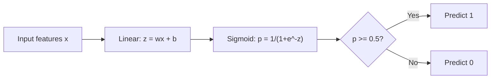
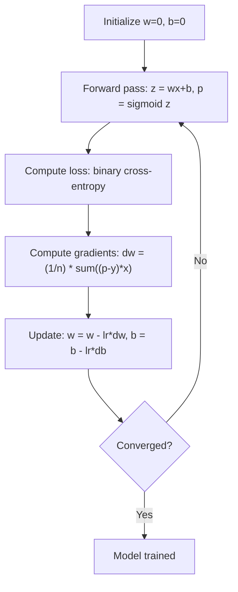

# Logistic Regression

> Hồi quy logistic uốn một đường thẳng thành đường cong chữ S để trả lời các câu hỏi có-hoặc-không bằng xác suất.

**Type:** Build
**Languages:** Python
**Prerequisites:** Phase 2 Lesson 1-2 (What Is ML, Linear Regression)
**Time:** ~90 minutes

## Learning Objectives

- Triển khai hồi quy logistic từ đầu bằng hàm sigmoid và mất mát cross-entropy nhị phân
- Tính và diễn giải precision, recall, điểm F1 và ma trận nhầm lẫn cho phân loại nhị phân
- Giải thích tại sao MSE thất bại với phân loại và tại sao cross-entropy nhị phân tạo ra một bề mặt chi phí lồi
- Xây dựng một mô hình hồi quy softmax cho phân loại đa lớp và đánh giá các đánh đổi khi điều chỉnh ngưỡng

## The Problem

Bạn muốn dự đoán một khối u ác tính hay lành tính khi biết kích thước. Bạn thử hồi quy tuyến tính. Nó xuất ra các số như 0.3 hoặc 1.7 hoặc -0.5. Chúng có nghĩa gì? 1.7 có phải "rất ác tính"? -0.5 có phải "rất lành tính"? Hồi quy tuyến tính xuất ra các số không bị chặn. Phân loại cần các xác suất bị chặn giữa 0 và 1, và một quyết định rõ ràng: có hoặc không.

Hồi quy logistic giải quyết điều này. Nó lấy cùng tổ hợp tuyến tính ($wx + b$) và truyền qua hàm sigmoid, nén bất kỳ số nào vào khoảng (0, 1). Đầu ra là một xác suất. Bạn đặt một ngưỡng (thường là 0.5) và đưa ra quyết định.

Đây là một trong những thuật toán được sử dụng rộng rãi nhất trong thực tế. Bất chấp tên gọi, hồi quy logistic là một thuật toán phân loại, không phải thuật toán hồi quy. Tên đến từ hàm logistic (sigmoid) mà nó sử dụng.

## The Concept

### Why Linear Regression Fails for Classification

Hãy tưởng tượng dự đoán đậu/rớt (1/0) dựa trên số giờ học. Hồi quy tuyến tính khớp một đường qua dữ liệu:

```
hours:  1   2   3   4   5   6   7   8   9   10
actual: 0   0   0   0   1   1   1   1   1   1
```

Một phép khớp tuyến tính có thể tạo ra các dự đoán như -0.2 ở giờ 1 và 1.3 ở giờ 10. Các giá trị này không phải xác suất. Chúng xuống dưới 0 và lên trên 1. Tệ hơn, một ngoại lệ duy nhất (người học 50 giờ) sẽ kéo cả đường, thay đổi dự đoán cho mọi người.

Phân loại cần một hàm:
- Xuất ra các giá trị giữa 0 và 1 (xác suất)
- Tạo ra một chuyển tiếp rõ nét (một biên quyết định)
- Không bị làm méo bởi các ngoại lệ xa biên

### The Sigmoid Function

Hàm sigmoid thực hiện chính xác điều này:

```math
\sigma(z) = \frac{1}{1 + e^{-z}}
```

Các tính chất:
- Khi $z$ lớn và dương, $\sigma(z)$ tiến gần 1
- Khi $z$ lớn và âm, $\sigma(z)$ tiến gần 0
- Khi $z = 0$, $\sigma(z) = 0.5$
- Đầu ra luôn giữa 0 và 1
- Hàm trơn và khả vi ở mọi nơi

Đạo hàm có một dạng thuận tiện: $\sigma'(z) = \sigma(z) (1 - \sigma(z))$. Điều này làm việc tính gradient hiệu quả.

### Logistic Regression = Linear Model + Sigmoid

Mô hình tính $z = wx + b$ (giống hồi quy tuyến tính), rồi áp dụng sigmoid:



Đầu ra $p$ được diễn giải là $P(y=1 \mid x)$, xác suất đầu vào thuộc lớp 1. Biên quyết định là nơi $wx + b = 0$, làm sigmoid xuất ra đúng 0.5.

### Binary Cross-Entropy Loss

Bạn không thể sử dụng MSE cho hồi quy logistic. MSE với một sigmoid tạo ra một bề mặt chi phí không lồi có nhiều cực tiểu cục bộ. Thay vào đó, sử dụng cross-entropy nhị phân (mất mát log):

```math
\text{Loss} = -\frac{1}{n} \sum \left( y \log(p) + (1-y) \log(1-p) \right)
```

Tại sao điều này hoạt động:
- Khi $y=1$ và $p$ gần 1: $\log(1) = 0$, nên mất mát gần 0 (đúng, chi phí thấp)
- Khi $y=1$ và $p$ gần 0: $\log(0)$ tiến đến âm vô cực, nên mất mát rất lớn (sai, chi phí cao)
- Khi $y=0$ và $p$ gần 0: $\log(1) = 0$, nên mất mát gần 0 (đúng, chi phí thấp)
- Khi $y=0$ và $p$ gần 1: $\log(0)$ tiến đến âm vô cực, nên mất mát rất lớn (sai, chi phí cao)

Hàm loss này là lồi đối với hồi quy logistic, vì vậy mọi cực tiểu cục bộ đều là cực tiểu toàn cục và gradient descent không thể mắc kẹt ở một cực tiểu xấu. Trên dữ liệu có thể phân tách hoàn hảo, loss tiếp tục giảm khi các trọng số tăng, vì vậy không tồn tại cực tiểu hữu hạn; L2 regularization khắc phục điều đó và làm cực tiểu trở nên duy nhất.

### Gradient Descent for Logistic Regression

Gradient cho cross-entropy nhị phân với sigmoid có dạng gọn:

```math
\begin{aligned}
\frac{\partial L}{\partial w} &= \frac{1}{n} \sum (p - y) \, x \\
\frac{\partial L}{\partial b} &= \frac{1}{n} \sum (p - y)
\end{aligned}
```

Các biểu thức này trông giống hệt các gradient của hồi quy tuyến tính. Khác biệt là $p = \sigma(wx + b)$ thay vì $p = wx + b$. Sigmoid đưa vào tính phi tuyến, nhưng quy tắc cập nhật gradient giữ nguyên.



### The Decision Boundary

Với một đầu vào 2D (hai đặc trưng), biên quyết định là đường nơi:

```math
w_1 x_1 + w_2 x_2 + b = 0
```

Các điểm ở một phía được phân loại là 1, các điểm phía kia là 0. Hồi quy logistic luôn tạo ra một biên quyết định tuyến tính. Nếu cần một biên cong, bạn hoặc thêm các đặc trưng đa thức hoặc sử dụng một mô hình phi tuyến.

### Multi-Class Classification with Softmax

Hồi quy logistic nhị phân xử lý hai lớp. Với $k$ lớp, sử dụng hàm softmax:

```math
\text{softmax}(z_i) = \frac{e^{z_i}}{\sum_j e^{z_j}}
```

Mỗi lớp có vector trọng số riêng. Mô hình tính một điểm $z_i$ cho mỗi lớp, rồi softmax chuyển các điểm thành xác suất có tổng bằng 1. Lớp dự đoán là lớp có xác suất cao nhất.

Hàm mất mát trở thành cross-entropy categorical:

```math
\text{Loss} = -\frac{1}{n} \sum \sum_k y_k \log(p_k)
```

trong đó $y_k$ là 1 cho lớp thực và 0 cho tất cả các lớp khác (mã hóa one-hot).

### Evaluation Metrics

Chỉ accuracy là không đủ. Với một tập dữ liệu có 95% âm và 5% dương, một mô hình luôn dự đoán âm đạt accuracy 95% nhưng vô ích.

**Ma trận Nhầm lẫn**:

| | Dự đoán Dương | Dự đoán Âm |
|---|---|---|
| Thực tế Dương | Dương tính Thật (TP) | Âm tính Giả (FN) |
| Thực tế Âm | Dương tính Giả (FP) | Âm tính Thật (TN) |

**Precision**: Trong tất cả dự đoán dương, có bao nhiêu thực sự dương?
```math
\text{Precision} = \frac{TP}{TP + FP}
```

**Recall** (Độ nhạy): Trong tất cả trường hợp thực sự dương, chúng ta đã phát hiện bao nhiêu?
```math
\text{Recall} = \frac{TP}{TP + FN}
```

**Điểm F1**: Trung bình điều hòa của precision và recall. Cân bằng cả hai chỉ số.
```math
F_1 = 2 \cdot \frac{\text{Precision} \cdot \text{Recall}}{\text{Precision} + \text{Recall}}
```

Khi nào ưu tiên:
- **Precision**: khi dương tính giả tốn kém (bộ lọc thư rác, bạn không muốn chặn email hợp lệ)
- **Recall**: khi âm tính giả tốn kém (sàng lọc ung thư, bạn không muốn bỏ sót một khối u)
- **F1**: khi bạn cần một chỉ số cân bằng duy nhất

```figure
logistic-sigmoid
```

## Build It

### Step 1: Sigmoid function and data generation

```python
import random
import math

def sigmoid(z):
    z = max(-500, min(500, z))
    return 1.0 / (1.0 + math.exp(-z))


random.seed(42)
N = 200
X = []
y = []

for _ in range(N // 2):
    X.append([random.gauss(2, 1), random.gauss(2, 1)])
    y.append(0)

for _ in range(N // 2):
    X.append([random.gauss(5, 1), random.gauss(5, 1)])
    y.append(1)

combined = list(zip(X, y))
random.shuffle(combined)
X, y = zip(*combined)
X = list(X)
y = list(y)

print(f"Generated {N} samples (2 classes, 2 features)")
print(f"Class 0 center: (2, 2), Class 1 center: (5, 5)")
print(f"First 5 samples:")
for i in range(5):
    print(f"  Features: [{X[i][0]:.2f}, {X[i][1]:.2f}], Label: {y[i]}")
```

### Step 2: Logistic regression from scratch

```python
class LogisticRegression:
    def __init__(self, n_features, learning_rate=0.01):
        self.weights = [0.0] * n_features
        self.bias = 0.0
        self.lr = learning_rate
        self.loss_history = []

    def predict_proba(self, x):
        z = sum(w * xi for w, xi in zip(self.weights, x)) + self.bias
        return sigmoid(z)

    def predict(self, x, threshold=0.5):
        return 1 if self.predict_proba(x) >= threshold else 0

    def compute_loss(self, X, y):
        n = len(y)
        total = 0.0
        for i in range(n):
            p = self.predict_proba(X[i])
            p = max(1e-15, min(1 - 1e-15, p))
            total += y[i] * math.log(p) + (1 - y[i]) * math.log(1 - p)
        return -total / n

    def fit(self, X, y, epochs=1000, print_every=200):
        n = len(y)
        n_features = len(X[0])
        for epoch in range(epochs):
            dw = [0.0] * n_features
            db = 0.0
            for i in range(n):
                p = self.predict_proba(X[i])
                error = p - y[i]
                for j in range(n_features):
                    dw[j] += error * X[i][j]
                db += error
            for j in range(n_features):
                self.weights[j] -= self.lr * (dw[j] / n)
            self.bias -= self.lr * (db / n)
            loss = self.compute_loss(X, y)
            self.loss_history.append(loss)
            if epoch % print_every == 0:
                print(f"  Epoch {epoch:4d} | Loss: {loss:.4f} | w: [{self.weights[0]:.3f}, {self.weights[1]:.3f}] | b: {self.bias:.3f}")
        return self

    def accuracy(self, X, y):
        correct = sum(1 for i in range(len(y)) if self.predict(X[i]) == y[i])
        return correct / len(y)


split = int(0.8 * N)
X_train, X_test = X[:split], X[split:]
y_train, y_test = y[:split], y[split:]

print("\n=== Training Logistic Regression ===")
model = LogisticRegression(n_features=2, learning_rate=0.1)
model.fit(X_train, y_train, epochs=1000, print_every=200)

print(f"\nTrain accuracy: {model.accuracy(X_train, y_train):.4f}")
print(f"Test accuracy:  {model.accuracy(X_test, y_test):.4f}")
print(f"Weights: [{model.weights[0]:.4f}, {model.weights[1]:.4f}]")
print(f"Bias: {model.bias:.4f}")
```

### Step 3: Confusion matrix and metrics from scratch

```python
class ClassificationMetrics:
    def __init__(self, y_true, y_pred):
        self.tp = sum(1 for t, p in zip(y_true, y_pred) if t == 1 and p == 1)
        self.tn = sum(1 for t, p in zip(y_true, y_pred) if t == 0 and p == 0)
        self.fp = sum(1 for t, p in zip(y_true, y_pred) if t == 0 and p == 1)
        self.fn = sum(1 for t, p in zip(y_true, y_pred) if t == 1 and p == 0)

    def accuracy(self):
        total = self.tp + self.tn + self.fp + self.fn
        return (self.tp + self.tn) / total if total > 0 else 0

    def precision(self):
        denom = self.tp + self.fp
        return self.tp / denom if denom > 0 else 0

    def recall(self):
        denom = self.tp + self.fn
        return self.tp / denom if denom > 0 else 0

    def f1(self):
        p = self.precision()
        r = self.recall()
        return 2 * p * r / (p + r) if (p + r) > 0 else 0

    def print_confusion_matrix(self):
        print(f"\n  Confusion Matrix:")
        print(f"                  Predicted")
        print(f"                  Pos   Neg")
        print(f"  Actual Pos     {self.tp:4d}  {self.fn:4d}")
        print(f"  Actual Neg     {self.fp:4d}  {self.tn:4d}")

    def print_report(self):
        self.print_confusion_matrix()
        print(f"\n  Accuracy:  {self.accuracy():.4f}")
        print(f"  Precision: {self.precision():.4f}")
        print(f"  Recall:    {self.recall():.4f}")
        print(f"  F1 Score:  {self.f1():.4f}")


y_pred_test = [model.predict(x) for x in X_test]
print("\n=== Classification Report (Test Set) ===")
metrics = ClassificationMetrics(y_test, y_pred_test)
metrics.print_report()
```

### Step 4: Decision boundary analysis

```python
print("\n=== Decision Boundary ===")
w1, w2 = model.weights
b = model.bias
print(f"Decision boundary: {w1:.4f}*x1 + {w2:.4f}*x2 + {b:.4f} = 0")
if abs(w2) > 1e-10:
    print(f"Solved for x2:     x2 = {-w1/w2:.4f}*x1 + {-b/w2:.4f}")

print("\nSample predictions near the boundary:")
test_points = [
    [3.0, 3.0],
    [3.5, 3.5],
    [4.0, 4.0],
    [2.5, 2.5],
    [5.0, 5.0],
]
for point in test_points:
    prob = model.predict_proba(point)
    pred = model.predict(point)
    print(f"  [{point[0]}, {point[1]}] -> prob={prob:.4f}, class={pred}")
```

### Step 5: Multi-class with softmax

```python
class SoftmaxRegression:
    def __init__(self, n_features, n_classes, learning_rate=0.01):
        self.n_features = n_features
        self.n_classes = n_classes
        self.lr = learning_rate
        self.weights = [[0.0] * n_features for _ in range(n_classes)]
        self.biases = [0.0] * n_classes

    def softmax(self, scores):
        max_score = max(scores)
        exp_scores = [math.exp(s - max_score) for s in scores]
        total = sum(exp_scores)
        return [e / total for e in exp_scores]

    def predict_proba(self, x):
        scores = [
            sum(self.weights[k][j] * x[j] for j in range(self.n_features)) + self.biases[k]
            for k in range(self.n_classes)
        ]
        return self.softmax(scores)

    def predict(self, x):
        probs = self.predict_proba(x)
        return probs.index(max(probs))

    def fit(self, X, y, epochs=1000, print_every=200):
        n = len(y)
        for epoch in range(epochs):
            grad_w = [[0.0] * self.n_features for _ in range(self.n_classes)]
            grad_b = [0.0] * self.n_classes
            total_loss = 0.0
            for i in range(n):
                probs = self.predict_proba(X[i])
                for k in range(self.n_classes):
                    target = 1.0 if y[i] == k else 0.0
                    error = probs[k] - target
                    for j in range(self.n_features):
                        grad_w[k][j] += error * X[i][j]
                    grad_b[k] += error
                true_prob = max(probs[y[i]], 1e-15)
                total_loss -= math.log(true_prob)
            for k in range(self.n_classes):
                for j in range(self.n_features):
                    self.weights[k][j] -= self.lr * (grad_w[k][j] / n)
                self.biases[k] -= self.lr * (grad_b[k] / n)
            if epoch % print_every == 0:
                print(f"  Epoch {epoch:4d} | Loss: {total_loss / n:.4f}")
        return self

    def accuracy(self, X, y):
        correct = sum(1 for i in range(len(y)) if self.predict(X[i]) == y[i])
        return correct / len(y)


random.seed(42)
X_3class = []
y_3class = []

centers = [(1, 1), (5, 1), (3, 5)]
for label, (cx, cy) in enumerate(centers):
    for _ in range(50):
        X_3class.append([random.gauss(cx, 0.8), random.gauss(cy, 0.8)])
        y_3class.append(label)

combined = list(zip(X_3class, y_3class))
random.shuffle(combined)
X_3class, y_3class = zip(*combined)
X_3class = list(X_3class)
y_3class = list(y_3class)

split_3 = int(0.8 * len(X_3class))
X_train_3 = X_3class[:split_3]
y_train_3 = y_3class[:split_3]
X_test_3 = X_3class[split_3:]
y_test_3 = y_3class[split_3:]

print("\n=== Multi-class Softmax Regression (3 classes) ===")
softmax_model = SoftmaxRegression(n_features=2, n_classes=3, learning_rate=0.1)
softmax_model.fit(X_train_3, y_train_3, epochs=1000, print_every=200)
print(f"\nTrain accuracy: {softmax_model.accuracy(X_train_3, y_train_3):.4f}")
print(f"Test accuracy:  {softmax_model.accuracy(X_test_3, y_test_3):.4f}")

print("\nSample predictions:")
for i in range(5):
    probs = softmax_model.predict_proba(X_test_3[i])
    pred = softmax_model.predict(X_test_3[i])
    print(f"  True: {y_test_3[i]}, Predicted: {pred}, Probs: [{', '.join(f'{p:.3f}' for p in probs)}]")
```

### Step 6: Threshold tuning

```python
print("\n=== Threshold Tuning ===")
print("Default threshold: 0.5. Adjusting the threshold trades precision for recall.\n")

thresholds = [0.3, 0.4, 0.5, 0.6, 0.7]
print(f"{'Threshold':>10} {'Accuracy':>10} {'Precision':>10} {'Recall':>10} {'F1':>10}")
print("-" * 52)

for t in thresholds:
    y_pred_t = [1 if model.predict_proba(x) >= t else 0 for x in X_test]
    m = ClassificationMetrics(y_test, y_pred_t)
    print(f"{t:>10.1f} {m.accuracy():>10.4f} {m.precision():>10.4f} {m.recall():>10.4f} {m.f1():>10.4f}")
```

## Use It

Bây giờ là cùng điều đó với scikit-learn.

```python
from sklearn.linear_model import LogisticRegression as SklearnLR
from sklearn.metrics import accuracy_score, precision_score, recall_score, f1_score
from sklearn.metrics import confusion_matrix, classification_report
from sklearn.model_selection import train_test_split
from sklearn.preprocessing import StandardScaler
import numpy as np

np.random.seed(42)
X_0 = np.random.randn(100, 2) + [2, 2]
X_1 = np.random.randn(100, 2) + [5, 5]
X_sk = np.vstack([X_0, X_1])
y_sk = np.array([0] * 100 + [1] * 100)

X_tr, X_te, y_tr, y_te = train_test_split(X_sk, y_sk, test_size=0.2, random_state=42)

scaler = StandardScaler()
X_tr_sc = scaler.fit_transform(X_tr)
X_te_sc = scaler.transform(X_te)

lr = SklearnLR()
lr.fit(X_tr_sc, y_tr)
y_pred = lr.predict(X_te_sc)

print("=== Scikit-learn Logistic Regression ===")
print(f"Accuracy:  {accuracy_score(y_te, y_pred):.4f}")
print(f"Precision: {precision_score(y_te, y_pred):.4f}")
print(f"Recall:    {recall_score(y_te, y_pred):.4f}")
print(f"F1:        {f1_score(y_te, y_pred):.4f}")
print(f"\nConfusion Matrix:\n{confusion_matrix(y_te, y_pred)}")
print(f"\nClassification Report:\n{classification_report(y_te, y_pred)}")
```

Triển khai từ đầu của bạn tạo ra cùng biên quyết định và các chỉ số. Scikit-learn bổ sung các lựa chọn bộ giải (liblinear, lbfgs, saga), regularization tự động, các chiến lược đa lớp (một-đối-phần-còn-lại, multinomial) và các tối ưu hóa độ ổn định số học.

## Ship It

Bài học này tạo ra:
- `code/logistic_regression.py` - hồi quy logistic từ đầu với các chỉ số

## Exercises

1. Tạo một tập dữ liệu KHÔNG phân tách tuyến tính được (ví dụ, hai đường tròn đồng tâm). Huấn luyện hồi quy logistic và quan sát sự thất bại. Sau đó thêm các đặc trưng đa thức ($x_1^2, x_2^2, x_1 x_2$) và huấn luyện lại. Chỉ ra rằng độ chính xác cải thiện.
2. Triển khai một ma trận nhầm lẫn đa lớp cho mô hình softmax 3 lớp. Tính precision và recall theo từng lớp. Lớp nào khó phân loại nhất?
3. Xây dựng một đường cong ROC từ đầu. Với 100 giá trị ngưỡng từ 0 đến 1, tính tỉ lệ dương tính thật và tỉ lệ dương tính giả. Tính AUC (diện tích dưới đường cong) bằng quy tắc hình thang.

## Key Terms

| Thuật ngữ | Cách mọi người nói | Ý nghĩa thực sự |
|------|----------------|----------------------|
| Logistic regression (Hồi quy logistic) | "Hồi quy cho phân loại" | Một mô hình tuyến tính theo sau bởi một hàm sigmoid xuất ra các xác suất lớp |
| Sigmoid function (Hàm sigmoid) | "Đường cong chữ S" | Hàm $1/(1+e^{-z})$ ánh xạ bất kỳ số thực nào vào khoảng (0, 1) |
| Binary cross-entropy (Cross-entropy nhị phân) | "Mất mát log" | Hàm mất mát $-[y \log(p) + (1-y) \log(1-p)]$ phạt nặng các dự đoán sai tự tin |
| Decision boundary (Biên quyết định) | "Đường phân chia" | Bề mặt nơi xác suất đầu ra của mô hình bằng 0.5, phân tách các lớp dự đoán |
| Softmax | "Sigmoid đa lớp" | Một hàm chuyển một vector điểm số thành các xác suất có tổng bằng 1 |
| Precision | "Bao nhiêu mục được chọn là liên quan" | $TP / (TP + FP)$, tỉ lệ dự đoán dương thực sự là dương |
| Recall | "Bao nhiêu mục liên quan được chọn" | $TP / (TP + FN)$, tỉ lệ trường hợp thực sự dương mà mô hình nhận diện đúng |
| F1 score (Điểm F1) | "Độ chính xác cân bằng" | Trung bình điều hòa của precision và recall: $2PR / (P+R)$ |
| Confusion matrix (Ma trận nhầm lẫn) | "Phân tích sai số" | Một bảng thể hiện số đếm TP, TN, FP, FN cho mỗi cặp lớp |
| Threshold (Ngưỡng) | "Điểm cắt" | Giá trị xác suất mà trên đó mô hình dự đoán lớp 1 (mặc định 0.5, có thể điều chỉnh) |
| One-hot encoding (Mã hóa one-hot) | "Các cột nhị phân cho các loại" | Biểu diễn lớp $k$ thành một vector các số không với một số 1 tại vị trí $k$ |
| Categorical cross-entropy (Cross-entropy categorical) | "Mất mát log đa lớp" | Mở rộng của cross-entropy nhị phân sang $k$ lớp bằng các nhãn được mã hóa one-hot |
