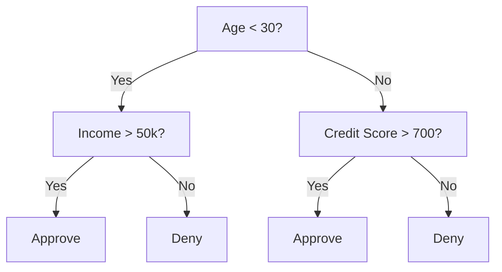
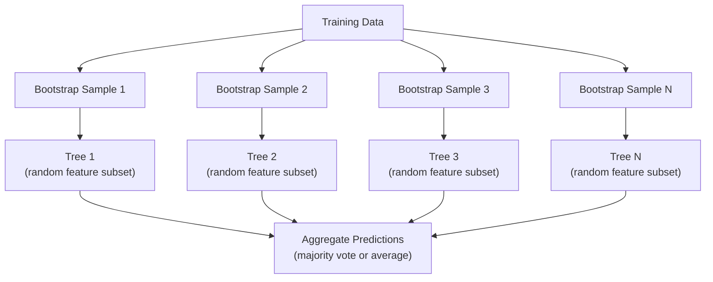

# Decision Trees and Random Forests

> Một cây quyết định chỉ là một lưu đồ. Nhưng một rừng gồm chúng là một trong những công cụ mạnh nhất trong ML.

**Type:** Build
**Language:** Python
**Prerequisites:** Phase 1 (Lessons 09 Information Theory, 06 Probability)
**Time:** ~90 minutes

## Learning Objectives

- Triển khai các phép tính độ hỗn tạp Gini, entropy và độ lợi thông tin để tìm các phép chia cây quyết định tối ưu
- Xây dựng một bộ phân loại cây quyết định từ đầu với các điều khiển cắt tỉa trước (độ sâu tối đa, số mẫu tối thiểu)
- Xây dựng một rừng ngẫu nhiên bằng lấy mẫu bootstrap và ngẫu nhiên hóa đặc trưng, và giải thích tại sao nó giảm phương sai
- So sánh độ quan trọng đặc trưng MDI với độ quan trọng hoán vị và xác định khi nào MDI bị chệch

## The Problem

Bạn có dữ liệu dạng bảng. Hàng là mẫu, cột là đặc trưng và có một cột mục tiêu bạn muốn dự đoán. Bạn có thể đưa nó cho một mạng nơ-ron. Nhưng với dữ liệu dạng bảng, các mô hình dựa trên cây (cây quyết định, rừng ngẫu nhiên, cây gradient boosting) liên tục vượt học sâu. Các cuộc thi Kaggle về dữ liệu có cấu trúc bị chi phối bởi XGBoost và LightGBM, không phải transformer.

Tại sao? Cây xử lý các kiểu đặc trưng hỗn hợp (số và phân loại) mà không cần tiền xử lý. Chúng xử lý các quan hệ phi tuyến mà không cần kỹ thuật đặc trưng. Chúng có thể diễn giải: bạn có thể nhìn cây và thấy chính xác tại sao một dự đoán được đưa ra. Và rừng ngẫu nhiên, lấy trung bình nhiều cây, có khả năng chống khớp quá mức cao trên các tập dữ liệu kích thước vừa.

Bài học này xây dựng cây quyết định từ đầu bằng chia đệ quy, rồi xây dựng một rừng ngẫu nhiên trên đó. Bạn sẽ triển khai toán học đằng sau các tiêu chí chia (độ hỗn tạp Gini, entropy, độ lợi thông tin) và hiểu tại sao một tập hợp các bộ học yếu trở thành một bộ học mạnh.

## The Concept

### What a decision tree does

Một cây quyết định phân hoạch không gian đặc trưng thành các miền chữ nhật bằng cách hỏi một chuỗi câu hỏi có/không.



Mỗi nút trong kiểm tra một đặc trưng so với một ngưỡng. Mỗi nút lá đưa ra một dự đoán. Để phân loại một điểm dữ liệu mới, bạn bắt đầu tại gốc và đi theo các nhánh cho đến khi đến một lá.

Cây được xây dựng từ trên xuống bằng cách chọn, tại mỗi nút, đặc trưng và ngưỡng phân tách dữ liệu tốt nhất. "Tốt nhất" được xác định bởi một tiêu chí chia.

### Split criteria: measuring impurity

Tại mỗi nút, chúng ta có một tập mẫu. Chúng ta muốn chia chúng sao cho các nút con kết quả "thuần" nhất có thể, nghĩa là mỗi nút con chứa phần lớn một lớp.

**Độ hỗn tạp Gini** đo xác suất một mẫu được chọn ngẫu nhiên sẽ bị phân loại sai nếu nó được gắn nhãn theo phân phối lớp tại nút đó.

```math
\text{Gini}(S) = 1 - \sum_k p_k^2 \quad \text{where } p_k \text{ is the proportion of class } k \text{ in set } S.
```

Với một nút thuần (tất cả một lớp), Gini = 0. Với một phép chia nhị phân có các lớp 50/50, Gini = 0.5. Thấp hơn là tốt hơn.

```
Example: 6 cats, 4 dogs

Gini = 1 - (0.6^2 + 0.4^2) = 1 - (0.36 + 0.16) = 0.48
```

**Entropy** đo lượng thông tin (độ hỗn loạn) trong một nút. Đã được đề cập trong Giai đoạn 1 Bài học 09.

```math
\text{Entropy}(S) = -\sum_k p_k \log_2(p_k)
```

Với một nút thuần, entropy = 0. Với một phép chia nhị phân 50/50, entropy = 1.0. Thấp hơn là tốt hơn.

```
Example: 6 cats, 4 dogs

Entropy = -(0.6 * log2(0.6) + 0.4 * log2(0.4))
        = -(0.6 * -0.737 + 0.4 * -1.322)
        = 0.442 + 0.529
        = 0.971 bits
```

**Độ lợi thông tin** là mức giảm độ hỗn tạp (entropy hoặc Gini) sau một phép chia.

```math
\begin{aligned}
& IG(S, \text{feature}, \text{threshold}) = \text{Impurity}(S) - \text{weighted\_avg}(\text{Impurity}(S_{\text{left}}), \text{Impurity}(S_{\text{right}})) \\[4pt]
& \text{where the weights are the proportions of samples in each child.}
\end{aligned}
```

Thuật toán tham lam tại mỗi nút: thử mọi đặc trưng và mọi ngưỡng có thể. Chọn cặp (đặc trưng, ngưỡng) cực đại hóa độ lợi thông tin.

### How splitting works

Với một tập dữ liệu có $n$ đặc trưng và $m$ mẫu tại nút hiện tại:

1. Với mỗi đặc trưng $j$ ($j = 1$ đến $n$):
   - Sắp xếp các mẫu theo đặc trưng $j$
   - Thử mỗi trung điểm giữa các giá trị phân biệt liên tiếp làm ngưỡng
   - Tính độ lợi thông tin cho mỗi ngưỡng
2. Chọn đặc trưng và ngưỡng có độ lợi thông tin cao nhất
3. Chia dữ liệu thành trái (feature <= threshold) và phải (feature > threshold)
4. Đệ quy trên mỗi nút con

Cách tiếp cận tham lam này không bảo đảm cây tối ưu toàn cục. Tìm cây tối ưu là NP-hard. Nhưng chia tham lam hoạt động tốt trong thực tế.

### Stopping conditions

Không có điều kiện dừng, cây phát triển cho đến khi mọi lá đều thuần nhất hoặc không phép chia nào có thể phân tách các mẫu của nó, thường xuống đến một mẫu duy nhất cho mỗi lá. Điều này ghi nhớ hoàn hảo dữ liệu huấn luyện và khái quát hóa rất tệ.

**Cắt tỉa trước** dừng cây trước khi nó phát triển đầy đủ:
- Độ sâu tối đa: dừng chia khi cây đạt độ sâu đã đặt
- Số mẫu tối thiểu mỗi lá: dừng nếu một nút có ít hơn $k$ mẫu
- Độ lợi thông tin tối thiểu: dừng nếu phép chia tốt nhất cải thiện độ hỗn tạp ít hơn một ngưỡng
- Số nút lá tối đa: giới hạn tổng số lá

**Cắt tỉa sau** phát triển cây đầy đủ, rồi cắt bớt:
- Cắt tỉa chi phí-độ phức tạp (được scikit-learn sử dụng): thêm một hình phạt tỉ lệ với số lá. Tăng hình phạt để có các cây nhỏ hơn
- Cắt tỉa giảm sai số: loại một cây con nếu sai số xác thực không tăng

Cắt tỉa trước đơn giản và nhanh hơn. Cắt tỉa sau thường tạo các cây tốt hơn vì nó không dừng quá sớm các phép chia có thể dẫn đến các phép chia tiếp theo hữu ích.

### Decision trees for regression

Với hồi quy, dự đoán tại lá là trung bình các giá trị mục tiêu trong lá đó. Tiêu chí chia cũng thay đổi:

**Giảm phương sai** thay thế độ lợi thông tin:

```math
VR(S, \text{feature}, \text{threshold}) = \text{Var}(S) - \text{weighted\_avg}(\text{Var}(S_{\text{left}}), \text{Var}(S_{\text{right}}))
```

Chọn phép chia giảm phương sai nhiều nhất. Cây phân hoạch không gian đầu vào thành các miền và dự đoán một hằng số (trung bình) trong mỗi miền.

### Random forests: the power of ensembles

Một cây quyết định đơn lẻ có phương sai cao. Những thay đổi nhỏ trong dữ liệu có thể tạo ra các cây hoàn toàn khác nhau. Rừng ngẫu nhiên khắc phục bằng cách lấy trung bình nhiều cây.



Hai nguồn ngẫu nhiên làm các cây đa dạng:

**Bagging (tổng hợp bootstrap):** Mỗi cây được huấn luyện trên một mẫu bootstrap, một mẫu ngẫu nhiên có hoàn lại từ dữ liệu huấn luyện. Khoảng 63% các mẫu gốc xuất hiện trong mỗi bootstrap (phần còn lại là các mẫu ngoài túi có thể được dùng để xác thực).

**Ngẫu nhiên hóa đặc trưng:** Tại mỗi phép chia, chỉ một tập con ngẫu nhiên các đặc trưng được xét. Với phân loại, mặc định là $\sqrt{n_{\text{features}}}$. Với hồi quy, $n_{\text{features}}/3$. Điều này ngăn mọi cây chia trên cùng đặc trưng chi phối.

Điểm cốt yếu: lấy trung bình nhiều cây đã khử tương quan giảm phương sai mà không tăng độ chệch. Mỗi cây riêng lẻ có thể tầm thường. Tập hợp mạnh.

### Feature importance

Rừng ngẫu nhiên cung cấp các điểm độ quan trọng đặc trưng một cách tự nhiên. Phương pháp phổ biến nhất:

**Mức Giảm Độ Hỗn tạp Trung bình (MDI):** Với mỗi đặc trưng, cộng tổng mức giảm độ hỗn tạp trên tất cả các cây và mọi nút nơi đặc trưng đó được sử dụng. Các đặc trưng tạo ra mức giảm độ hỗn tạp lớn hơn ở các phép chia sớm quan trọng hơn.

```math
\text{importance}(\text{feature}_j) = \sum_{\text{nodes where feature}_j \text{ is used}} \frac{n_{\text{samples at node}}}{n_{\text{total samples}}} \cdot \text{impurity\_decrease}
```

Cách này nhanh (được tính trong huấn luyện) nhưng thiên về các đặc trưng có nhiều giá trị phân biệt và các đặc trưng có nhiều điểm chia có thể.

**Độ quan trọng hoán vị** là lựa chọn thay thế: xáo trộn các giá trị của một đặc trưng và đo độ chính xác mô hình giảm bao nhiêu. Đáng tin cậy hơn nhưng chậm hơn.

### When trees beat neural networks

Cây và rừng vượt trội mạng nơ-ron trên dữ liệu dạng bảng. Một số lý do:

| Yếu tố | Cây | Mạng nơ-ron |
|--------|-------|----------------|
| Các kiểu hỗn hợp (số + phân loại) | Hỗ trợ trực tiếp | Cần mã hóa |
| Các tập dữ liệu nhỏ (< 10k hàng) | Hoạt động tốt | Khớp quá mức |
| Các tương tác đặc trưng | Được tìm bằng phép chia | Cần thiết kế kiến trúc |
| Khả năng diễn giải | Minh bạch hoàn toàn | Hộp đen |
| Thời gian huấn luyện | Phút | Giờ |
| Độ nhạy siêu tham số | Thấp | Cao |

Mạng nơ-ron thắng khi dữ liệu có cấu trúc không gian hoặc tuần tự (hình ảnh, văn bản, âm thanh). Với các bảng đặc trưng phẳng, cây là mặc định.

```figure
decision-tree-depth
```

## Build It

### Step 1: Gini impurity and entropy

Xây dựng cả hai tiêu chí chia từ đầu và xác minh chúng đồng ý về các phép chia tốt.

```python
import math

def gini_impurity(labels):
    n = len(labels)
    if n == 0:
        return 0.0
    counts = {}
    for label in labels:
        counts[label] = counts.get(label, 0) + 1
    return 1.0 - sum((c / n) ** 2 for c in counts.values())

def entropy(labels):
    n = len(labels)
    if n == 0:
        return 0.0
    counts = {}
    for label in labels:
        counts[label] = counts.get(label, 0) + 1
    return -sum(
        (c / n) * math.log2(c / n) for c in counts.values() if c > 0
    )
```

### Step 2: Find the best split

Thử mọi đặc trưng và mọi ngưỡng. Trả về cặp có độ lợi thông tin cao nhất.

```python
def information_gain(parent_labels, left_labels, right_labels, criterion="gini"):
    measure = gini_impurity if criterion == "gini" else entropy
    n = len(parent_labels)
    n_left = len(left_labels)
    n_right = len(right_labels)
    if n_left == 0 or n_right == 0:
        return 0.0
    parent_impurity = measure(parent_labels)
    child_impurity = (
        (n_left / n) * measure(left_labels) +
        (n_right / n) * measure(right_labels)
    )
    return parent_impurity - child_impurity
```

### Step 3: Build the DecisionTree class

Chia đệ quy, dự đoán và theo dõi độ quan trọng đặc trưng. `_build` là trung tâm của cây: nó dừng khi một nút thuần hoặc đạt giới hạn cắt tỉa trước, nếu không nó lấy phép chia tốt nhất và đệ quy vào cả hai nút con.

```python
import random

class DecisionTree:
    def __init__(self, max_depth=None, min_samples_split=2,
                 min_samples_leaf=1, criterion="gini",
                 max_features=None):
        self.max_depth = max_depth
        self.min_samples_split = min_samples_split
        self.min_samples_leaf = min_samples_leaf
        self.criterion = criterion
        self.max_features = max_features
        self.tree = None
        self.feature_importances_ = None

    def fit(self, X, y):
        self.n_features = len(X[0])
        self.feature_importances_ = [0.0] * self.n_features
        self.n_samples = len(X)
        self.tree = self._build(X, y, depth=0)
        total = sum(self.feature_importances_)
        if total > 0:
            self.feature_importances_ = [
                fi / total for fi in self.feature_importances_
            ]

    def predict(self, X):
        return [self._predict_one(x, self.tree) for x in X]

    def _build(self, X, y, depth):
        if len(set(y)) == 1:
            return {"leaf": True, "value": y[0]}

        if self.max_depth is not None and depth >= self.max_depth:
            return self._make_leaf(y)

        if len(y) < self.min_samples_split:
            return self._make_leaf(y)

        best_feature, best_threshold, best_gain = self._best_split(X, y)

        if best_feature is None or best_gain <= 0:
            return self._make_leaf(y)

        left_X, left_y, right_X, right_y = self._split_data(
            X, y, best_feature, best_threshold
        )

        if len(left_y) < self.min_samples_leaf or len(right_y) < self.min_samples_leaf:
            return self._make_leaf(y)

        weight = len(y) / self.n_samples
        self.feature_importances_[best_feature] += weight * best_gain

        return {
            "leaf": False,
            "feature": best_feature,
            "threshold": best_threshold,
            "left": self._build(left_X, left_y, depth + 1),
            "right": self._build(right_X, right_y, depth + 1),
        }

    def _make_leaf(self, y):
        counts = {}
        for label in y:
            counts[label] = counts.get(label, 0) + 1
        return {"leaf": True, "value": max(counts, key=counts.get)}

    def _best_split(self, X, y):
        best_feature = None
        best_threshold = None
        best_gain = -1.0

        if self.max_features == "sqrt":
            k = max(1, int(math.sqrt(self.n_features)))
            feature_indices = random.sample(range(self.n_features), k)
        elif isinstance(self.max_features, int):
            if self.max_features < 1:
                raise ValueError("max_features must be at least 1 when given as an integer")
            k = min(self.max_features, self.n_features)
            feature_indices = random.sample(range(self.n_features), k)
        else:
            feature_indices = list(range(self.n_features))

        for feature_idx in feature_indices:
            values = sorted(set(X[i][feature_idx] for i in range(len(X))))
            if len(values) <= 1:
                continue

            for i in range(len(values) - 1):
                threshold = (values[i] + values[i + 1]) / 2.0
                left_y = [y[j] for j in range(len(X)) if X[j][feature_idx] <= threshold]
                right_y = [y[j] for j in range(len(X)) if X[j][feature_idx] > threshold]

                if len(left_y) < self.min_samples_leaf or len(right_y) < self.min_samples_leaf:
                    continue

                gain = information_gain(y, left_y, right_y, self.criterion)
                if gain > best_gain:
                    best_gain = gain
                    best_feature = feature_idx
                    best_threshold = threshold

        return best_feature, best_threshold, best_gain

    def _split_data(self, X, y, feature, threshold):
        left_X, left_y, right_X, right_y = [], [], [], []
        for i in range(len(X)):
            if X[i][feature] <= threshold:
                left_X.append(X[i])
                left_y.append(y[i])
            else:
                right_X.append(X[i])
                right_y.append(y[i])
        return left_X, left_y, right_X, right_y

    def _predict_one(self, x, node):
        if node["leaf"]:
            return node["value"]
        if x[node["feature"]] <= node["threshold"]:
            return self._predict_one(x, node["left"])
        return self._predict_one(x, node["right"])
```

### Step 4: Build the RandomForest class

Lấy mẫu bootstrap, ngẫu nhiên hóa đặc trưng và bỏ phiếu đa số.

```python
class RandomForest:
    def __init__(self, n_trees=100, max_depth=None,
                 min_samples_split=2, max_features="sqrt",
                 criterion="gini"):
        self.n_trees = n_trees
        self.max_depth = max_depth
        self.min_samples_split = min_samples_split
        self.max_features = max_features
        self.criterion = criterion
        self.trees = []

    def fit(self, X, y):
        n = len(X)
        for _ in range(self.n_trees):
            indices = [random.randint(0, n - 1) for _ in range(n)]
            X_boot = [X[i] for i in indices]
            y_boot = [y[i] for i in indices]
            tree = DecisionTree(
                max_depth=self.max_depth,
                min_samples_split=self.min_samples_split,
                max_features=self.max_features,
                criterion=self.criterion,
            )
            tree.fit(X_boot, y_boot)
            self.trees.append(tree)

    def predict(self, X):
        all_preds = [tree.predict(X) for tree in self.trees]
        predictions = []
        for i in range(len(X)):
            votes = {}
            for preds in all_preds:
                v = preds[i]
                votes[v] = votes.get(v, 0) + 1
            predictions.append(max(votes, key=votes.get))
        return predictions
```

Xem `code/trees.py` để có triển khai đầy đủ với tất cả phương thức hỗ trợ.

## Use It

Với scikit-learn, huấn luyện một rừng ngẫu nhiên là ba dòng:

```python
from sklearn.ensemble import RandomForestClassifier
from sklearn.datasets import load_iris
from sklearn.model_selection import train_test_split

X, y = load_iris(return_X_y=True)
X_train, X_test, y_train, y_test = train_test_split(X, y, random_state=42)

rf = RandomForestClassifier(n_estimators=100, random_state=42)
rf.fit(X_train, y_train)
print(f"Accuracy: {rf.score(X_test, y_test):.4f}")
print(f"Feature importances: {rf.feature_importances_}")
```

Trong thực tế, các cây gradient boosting (XGBoost, LightGBM, CatBoost) thường mạnh hơn rừng ngẫu nhiên vì chúng xây dựng các cây tuần tự, với mỗi cây sửa sai số của các cây trước. Nhưng rừng ngẫu nhiên khó bị cấu hình sai hơn và hầu như không cần điều chỉnh siêu tham số.

## Ship It

Bài học này tạo ra `outputs/prompt-tree-interpreter.md` -- một prompt diễn giải các phép chia cây quyết định cho các bên liên quan kinh doanh. Đưa vào cấu trúc của một cây đã huấn luyện (độ sâu, đặc trưng, ngưỡng chia, độ chính xác) và nó chuyển mô hình thành các quy tắc bằng ngôn ngữ đơn giản, xếp hạng độ quan trọng đặc trưng, nêu khớp quá mức hoặc rò rỉ và đề xuất các bước tiếp theo. Sử dụng nó bất cứ khi nào bạn cần giải thích một mô hình dựa trên cây cho người không đọc mã.

## Exercises

1. Huấn luyện một cây quyết định đơn lẻ trên một tập dữ liệu 2D có 3 lớp. Theo dõi thủ công các phép chia và vẽ các biên quyết định chữ nhật. So sánh các biên tại max_depth=2 so với max_depth=10.

2. Triển khai chia giảm phương sai cho cây hồi quy. Tạo $y = \sin(x) + \text{noise}$ cho 200 điểm và khớp cây hồi quy của bạn. Vẽ các dự đoán hằng từng khúc của cây so với đường cong thực.

3. Xây dựng một rừng ngẫu nhiên có 1, 5, 10, 50 và 200 cây. Vẽ độ chính xác huấn luyện và kiểm tra theo số cây. Quan sát độ chính xác kiểm tra chững lại nhưng không giảm (rừng chống khớp quá mức).

4. So sánh độ hỗn tạp Gini và entropy làm tiêu chí chia trên 5 tập dữ liệu khác nhau. Đo độ chính xác và độ sâu cây. Trong hầu hết trường hợp, chúng tạo ra các kết quả gần như giống hệt. Giải thích tại sao.

5. Triển khai độ quan trọng hoán vị. So sánh nó với độ quan trọng MDI trên một tập dữ liệu nơi một đặc trưng là nhiễu ngẫu nhiên nhưng có nhiều giá trị phân biệt. MDI sẽ xếp hạng đặc trưng nhiễu cao. Độ quan trọng hoán vị thì không.

## Key Terms

| Thuật ngữ | Cách mọi người nói | Ý nghĩa thực sự |
|------|----------------|----------------------|
| Decision tree (Cây quyết định) | "Một lưu đồ để dự đoán" | Một mô hình phân hoạch không gian đặc trưng thành các miền chữ nhật bằng cách học một chuỗi phép chia if/else |
| Gini impurity (Độ hỗn tạp Gini) | "Nút pha trộn đến mức nào" | Xác suất phân loại sai một mẫu ngẫu nhiên tại một nút. 0 = thuần, 0.5 = độ hỗn tạp tối đa cho nhị phân |
| Entropy | "Độ hỗn loạn trong một nút" | Lượng thông tin tại một nút. 0 = thuần, 1.0 = sự không chắc chắn tối đa cho nhị phân. Từ lý thuyết thông tin |
| Information gain (Độ lợi thông tin) | "Một phép chia tốt đến mức nào" | Mức giảm độ hỗn tạp sau một phép chia. Tiêu chí tham lam để chọn các phép chia |
| Pre-pruning (Cắt tỉa trước) | "Dừng cây sớm" | Dừng cây phát triển sớm bằng cách đặt độ sâu tối đa, số mẫu tối thiểu hoặc ngưỡng độ lợi tối thiểu |
| Post-pruning (Cắt tỉa sau) | "Cắt cây sau đó" | Phát triển cây đầy đủ, rồi loại các cây con không cải thiện hiệu năng xác thực |
| Bagging | "Huấn luyện trên các tập con ngẫu nhiên" | Tổng hợp bootstrap. Huấn luyện mỗi mô hình trên một mẫu ngẫu nhiên có hoàn lại khác nhau |
| Random forest (Rừng ngẫu nhiên) | "Một nhóm cây" | Tập hợp các cây quyết định, mỗi cây được huấn luyện trên một mẫu bootstrap với các tập con đặc trưng ngẫu nhiên tại mỗi phép chia |
| Feature importance (MDI) (Độ quan trọng đặc trưng) | "Các đặc trưng nào quan trọng" | Tổng mức giảm độ hỗn tạp do mỗi đặc trưng đóng góp, được cộng trên tất cả cây và nút |
| Permutation importance (Độ quan trọng hoán vị) | "Xáo trộn và kiểm tra" | Mức giảm độ chính xác khi các giá trị của một đặc trưng được xáo trộn ngẫu nhiên. Đáng tin cậy hơn MDI cho các đặc trưng nhiễu |
| Variance reduction (Giảm phương sai) | "Phiên bản hồi quy của độ lợi thông tin" | Tương tự độ lợi thông tin cho cây hồi quy. Chọn phép chia giảm phương sai mục tiêu nhiều nhất |
| Bootstrap sample (Mẫu bootstrap) | "Mẫu ngẫu nhiên có lặp" | Một mẫu ngẫu nhiên được rút có hoàn lại từ tập dữ liệu gốc. Cùng kích thước, nhưng có trùng lặp |

## Further Reading

- [Breiman: Random Forests (2001)](https://link.springer.com/article/10.1023/A:1010933404324) - bài báo rừng ngẫu nhiên gốc
- [Grinsztajn et al.: Why do tree-based models still outperform deep learning on tabular data? (2022)](https://arxiv.org/abs/2207.08815) - so sánh chặt chẽ cây với mạng nơ-ron trên các tác vụ dạng bảng
- [Tài liệu scikit-learn Decision Trees](https://scikit-learn.org/stable/modules/tree.html) - hướng dẫn thực hành với các công cụ trực quan hóa
- [XGBoost: A Scalable Tree Boosting System (Chen & Guestrin, 2016)](https://arxiv.org/abs/1603.02754) - bài báo gradient boosting thống trị Kaggle
