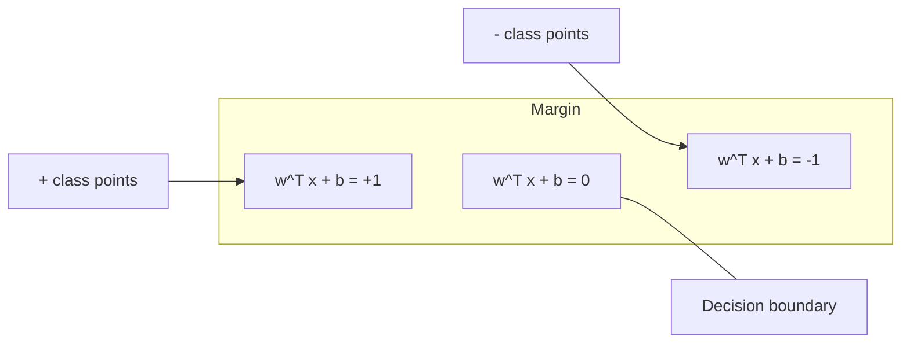
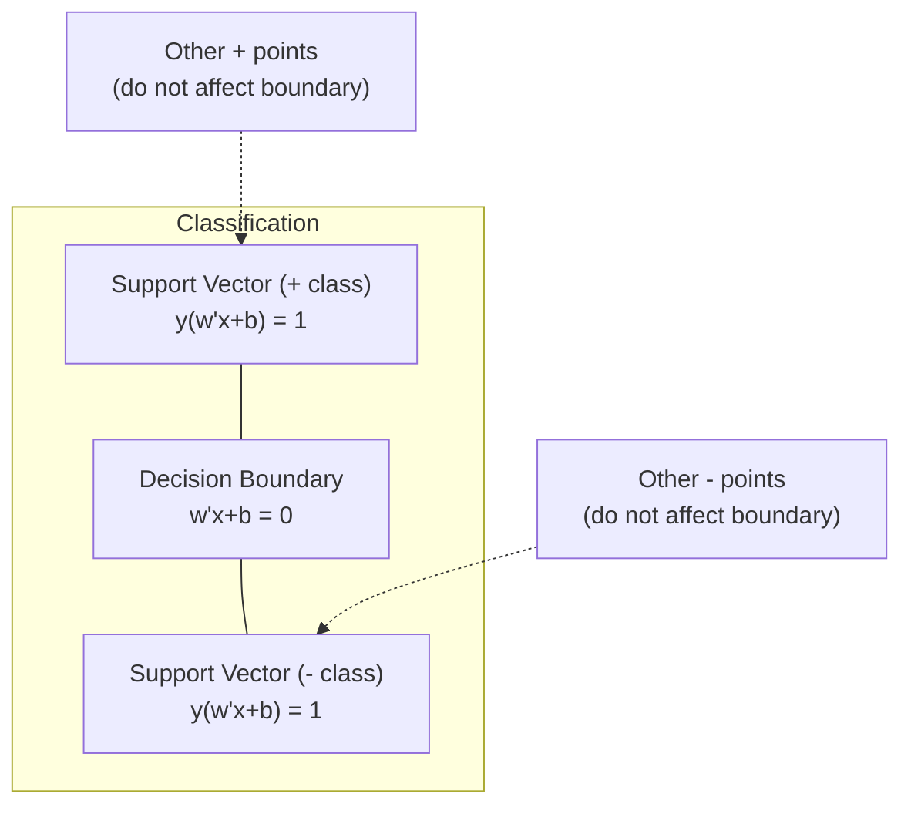
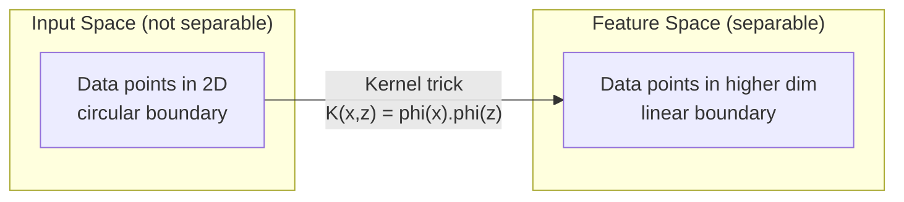

# Support Vector Machines

> Tìm con đường rộng nhất giữa hai lớp. Đó là toàn bộ ý tưởng.

**Type:** Build
**Language:** Python
**Prerequisites:** Phase 1 (Lessons 08 Optimization, 14 Norms and Distances, 18 Convex Optimization)
**Time:** ~90 minutes

## Learning Objectives

- Triển khai một SVM tuyến tính từ đầu bằng mất mát hinge và gradient descent trên dạng bài toán gốc
- Giải thích nguyên lý lề cực đại và xác định các vector hỗ trợ từ một mô hình đã huấn luyện
- So sánh các kernel tuyến tính, đa thức và RBF và giải thích cách thủ thuật kernel tránh ánh xạ tường minh vào không gian nhiều chiều
- Đánh giá sự đánh đổi được tham số C điều khiển giữa độ rộng lề và các lỗi phân loại

## The Problem

Bạn có hai lớp điểm dữ liệu và cần vẽ một đường (hoặc siêu phẳng) phân tách chúng. Vô số đường có thể hoạt động. Bạn nên chọn đường nào?

Đường có lề lớn nhất. Lề là khoảng cách giữa biên quyết định và các điểm dữ liệu gần nhất ở mỗi phía. Lề rộng hơn nghĩa là bộ phân loại tự tin hơn và tổng quát hóa tốt hơn trên dữ liệu chưa từng thấy.

Trực giác này dẫn đến Máy Vector Hỗ trợ, một trong những thuật toán thanh nhã nhất về mặt toán học trong ML. SVM là phương pháp phân loại chiếm ưu thế trước học sâu và vẫn là lựa chọn tốt nhất cho các tập dữ liệu nhỏ, dữ liệu nhiều chiều và các bài toán nơi bạn cần một mô hình có nguyên tắc, được hiểu rõ với các bảo đảm lý thuyết.

SVM kết nối trực tiếp với Giai đoạn 1: tối ưu hóa là lồi (Bài học 18), lề được đo bằng chuẩn (Bài học 14), và thủ thuật kernel khai thác các tích vô hướng để xử lý biên phi tuyến mà không bao giờ tính toán trong không gian nhiều chiều.

## The Concept

### The maximum margin classifier

Với dữ liệu có thể phân tách tuyến tính có các nhãn $y_i \in \lbrace -1, +1 \rbrace$ và các vector đặc trưng $x_i$, chúng ta muốn một siêu phẳng $w^T x + b = 0$ phân tách các lớp.

Khoảng cách từ một điểm $x_i$ đến siêu phẳng là:

```math
\text{distance} = \frac{\lvert w^T x_i + b \rvert}{\lVert w \rVert}
```

Với một điểm được phân loại đúng: $y_i (w^T x_i + b) > 0$. Lề gấp đôi khoảng cách từ siêu phẳng đến điểm gần nhất ở một trong hai phía.



Bài toán tối ưu hóa:

```math
\begin{aligned}
\text{maximize} \quad & \frac{2}{\lVert w \rVert} \quad \text{(the margin width)} \\
\text{subject to} \quad & y_i (w^T x_i + b) \ge 1 \quad \text{for all } i
\end{aligned}
```

Tương đương (tối thiểu hóa $\lVert w \rVert^2$ dễ tối ưu hóa hơn):

```math
\begin{aligned}
\text{minimize} \quad & \frac{1}{2} \lVert w \rVert^2 \\
\text{subject to} \quad & y_i (w^T x_i + b) \ge 1 \quad \text{for all } i
\end{aligned}
```

Đây là một bài toán quy hoạch bậc hai lồi. Nó có một nghiệm toàn cục duy nhất. Các điểm dữ liệu nằm chính xác trên các biên lề (nơi $y_i (w^T x_i + b) = 1$) là các vector hỗ trợ. Chúng là những điểm duy nhất quyết định biên quyết định. Di chuyển hoặc loại bất kỳ điểm không phải vector hỗ trợ nào, và biên không thay đổi.

### Support vectors: the critical few



Hầu hết các điểm huấn luyện không liên quan. Chỉ các vector hỗ trợ quan trọng. Đây là lý do SVM tiết kiệm bộ nhớ tại thời điểm dự đoán: bạn chỉ cần lưu các vector hỗ trợ, không phải toàn bộ tập huấn luyện.

Số vector hỗ trợ cũng cho một cận sai số tổng quát hóa. Ít vector hỗ trợ hơn so với kích thước tập dữ liệu nghĩa là tổng quát hóa tốt hơn.

### Soft margin: handling noise with the C parameter

Dữ liệu thực hiếm khi phân tách hoàn hảo được. Một số điểm có thể ở sai phía biên hoặc bên trong lề. Dạng lề mềm cho phép vi phạm bằng cách đưa vào các biến nới lỏng.

```math
\begin{aligned}
\text{minimize} \quad & \frac{1}{2} \lVert w \rVert^2 + C \sum_i \xi_i \\
\text{subject to} \quad & y_i (w^T x_i + b) \ge 1 - \xi_i \\
& \xi_i \ge 0 \quad \text{for all } i
\end{aligned}
```

Biến nới lỏng $\xi_i$ đo mức độ điểm $i$ vi phạm lề. $C$ điều khiển sự đánh đổi:

| Giá trị $C$ | Hành vi |
|---------|----------|
| $C$ lớn | Phạt nặng các vi phạm. Lề hẹp, ít phân loại sai hơn. Khớp quá mức |
| $C$ nhỏ | Cho phép nhiều vi phạm hơn. Lề rộng, nhiều phân loại sai hơn. Khớp chưa đủ |

$C$ là nghịch đảo cường độ regularization. $C$ lớn = ít regularization hơn. $C$ nhỏ = nhiều regularization hơn.

### Hinge loss: the SVM loss function

SVM lề mềm có thể được viết lại thành một tối ưu hóa không ràng buộc:

```math
\text{minimize} \quad \frac{1}{2} \lVert w \rVert^2 + C \sum_i \max(0, 1 - y_i (w^T x_i + b))
```

Số hạng $\max(0, 1 - y_i f(x_i))$ là mất mát hinge. Nó bằng không khi điểm được phân loại đúng và vượt ra ngoài lề. Nó tuyến tính khi điểm nằm trong lề hoặc bị phân loại sai.

```
Hinge loss for a single point:

loss
  |
  | \
  |  \
  |   \
  |    \
  |     \_______________
  |
  +-----|-----|-------->  y * f(x)
       0     1

Zero loss when y*f(x) >= 1 (correctly classified, outside margin).
Linear penalty when y*f(x) < 1.
```

So sánh với mất mát logistic (hồi quy logistic):

```math
\begin{aligned}
\text{Hinge:} \quad & \max(0, 1 - y f(x)) && \text{Hard cutoff at margin} \\
\text{Logistic:} \quad & \log(1 + \exp(-y f(x))) && \text{Smooth, never exactly zero}
\end{aligned}
```

Mất mát hinge tạo ra các nghiệm thưa (chỉ các vector hỗ trợ có đóng góp khác không). Mất mát logistic sử dụng tất cả điểm dữ liệu. Điều này làm SVM tiết kiệm bộ nhớ hơn tại thời điểm dự đoán.

### Training a linear SVM with gradient descent

Bạn có thể huấn luyện một SVM tuyến tính bằng gradient descent trên mất mát hinge cộng L2 regularization, mà không giải bài toán QP có ràng buộc:

```math
\begin{aligned}
& L(w, b) = \frac{\lambda}{2} \lVert w \rVert^2 + \frac{1}{n} \sum_i \max(0, 1 - y_i (w^T x_i + b)) \\[6pt]
& \text{Gradient with respect to } w\text{:} \\
& \quad \text{If } y_i (w^T x_i + b) \ge 1\text{:} \quad \frac{\partial L}{\partial w} = \lambda w \\
& \quad \text{If } y_i (w^T x_i + b) < 1\text{:} \quad \frac{\partial L}{\partial w} = \lambda w - y_i x_i \\[6pt]
& \text{Gradient with respect to } b\text{:} \\
& \quad \text{If } y_i (w^T x_i + b) \ge 1\text{:} \quad \frac{\partial L}{\partial b} = 0 \\
& \quad \text{If } y_i (w^T x_i + b) < 1\text{:} \quad \frac{\partial L}{\partial b} = -y_i
\end{aligned}
```

Đây được gọi là dạng bài toán gốc. Nó chạy trong $O(n \cdot d)$ mỗi epoch, trong đó $n$ là số mẫu và $d$ là số đặc trưng. Với dữ liệu lớn, thưa, nhiều chiều (phân loại văn bản), cách này nhanh.

### The dual formulation and the kernel trick

Đối ngẫu Lagrange của bài toán SVM (từ Giai đoạn 1 Bài học 18, các điều kiện KKT) là:

```math
\begin{aligned}
\text{maximize} \quad & \sum_i \alpha_i - \frac{1}{2} \sum_{i,j} \alpha_i \alpha_j y_i y_j (x_i \cdot x_j) \\
\text{subject to} \quad & 0 \le \alpha_i \le C \\
& \sum_i \alpha_i y_i = 0
\end{aligned}
```

Đối ngẫu chỉ liên quan đến các tích vô hướng $x_i \cdot x_j$ giữa các điểm dữ liệu. Đây là điểm cốt yếu. Thay mỗi tích vô hướng bằng một hàm kernel $K(x_i, x_j)$ và SVM có thể học các biên phi tuyến mà không bao giờ tính tường minh phép biến đổi.

```math
\begin{aligned}
\text{Linear kernel:} \quad & K(x, z) = x \cdot z \\
\text{Polynomial kernel:} \quad & K(x, z) = (x \cdot z + c)^d \\
\text{RBF (Gaussian):} \quad & K(x, z) = \exp(-\gamma \lVert x - z \rVert^2)
\end{aligned}
```

Kernel RBF ánh xạ dữ liệu vào một không gian vô hạn chiều. Các điểm gần nhau trong không gian đầu vào có giá trị kernel gần 1. Các điểm xa nhau có giá trị kernel gần 0. Nó có thể học bất kỳ biên quyết định trơn nào.



Thủ thuật kernel tính tích vô hướng trong không gian nhiều chiều mà không bao giờ đến đó. Với kernel đa thức bậc $d$ trong $D$ chiều, không gian đặc trưng tường minh có $O(D^d)$ chiều. Nhưng $K(x, z)$ được tính trong thời gian $O(D)$.

### SVM for regression (SVR)

Hồi quy Vector Hỗ trợ khớp một ống có độ rộng $\epsilon$ quanh dữ liệu. Các điểm trong ống có mất mát bằng không. Các điểm ngoài ống bị phạt tuyến tính.

```math
\begin{aligned}
\text{minimize} \quad & \frac{1}{2} \lVert w \rVert^2 + C \sum_i (\xi_i + \xi_i^*) \\
\text{subject to} \quad & y_i - (w^T x_i + b) \le \epsilon + \xi_i \\
& (w^T x_i + b) - y_i \le \epsilon + \xi_i^* \\
& \xi_i, \xi_i^* \ge 0
\end{aligned}
```

Tham số $\epsilon$ điều khiển độ rộng ống. Ống rộng hơn = ít vector hỗ trợ hơn = phép khớp mượt hơn. Ống hẹp hơn = nhiều vector hỗ trợ hơn = phép khớp sát hơn.

### Why SVMs lost to deep learning (and when they still win)

SVM chi phối ML từ cuối thập niên 1990 đến đầu thập niên 2010. Học sâu vượt qua chúng vì một số lý do:

| Yếu tố | SVM | Học sâu |
|--------|------|---------------|
| Kỹ thuật đặc trưng | Đòi hỏi | Học đặc trưng |
| Khả năng mở rộng | $O(n^2)$ đến $O(n^3)$ cho kernel | $O(n)$ mỗi epoch với SGD |
| Hình ảnh/văn bản/âm thanh | Cần các đặc trưng thiết kế thủ công | Học từ dữ liệu thô |
| Các tập dữ liệu lớn (>100k) | Chậm | Mở rộng tốt |
| Tăng tốc GPU | Lợi ích hạn chế | Tăng tốc rất lớn |

SVM vẫn thắng trong các tình huống này:
- Các tập dữ liệu nhỏ (hàng trăm đến vài nghìn mẫu)
- Dữ liệu thưa nhiều chiều (văn bản với các đặc trưng TF-IDF)
- Khi bạn cần các bảo đảm toán học (các cận lề)
- Khi thời gian huấn luyện phải tối thiểu (SVM tuyến tính rất nhanh)
- Phân loại nhị phân với cấu trúc lề rõ ràng
- Phát hiện bất thường (SVM một lớp)

```figure
svm-margin
```

## Build It

### Step 1: Hinge loss and gradient

Nền tảng. Tính mất mát hinge cho một batch và gradient của nó.

```python
def hinge_loss(X, y, w, b):
    n = len(X)
    total_loss = 0.0
    for i in range(n):
        margin = y[i] * (dot(w, X[i]) + b)
        total_loss += max(0.0, 1.0 - margin)
    return total_loss / n
```

### Step 2: Linear SVM via gradient descent

Huấn luyện bằng cách tối thiểu hóa mất mát hinge có regularization. Không cần bộ giải QP.

```python
class LinearSVM:
    def __init__(self, lr=0.001, lambda_param=0.01, n_epochs=1000):
        self.lr = lr
        self.lambda_param = lambda_param
        self.n_epochs = n_epochs
        self.w = None
        self.b = 0.0

    def fit(self, X, y):
        n_features = len(X[0])
        self.w = [0.0] * n_features
        self.b = 0.0

        for epoch in range(self.n_epochs):
            for i in range(len(X)):
                margin = y[i] * (dot(self.w, X[i]) + self.b)
                if margin >= 1:
                    self.w = [wj - self.lr * self.lambda_param * wj
                              for wj in self.w]
                else:
                    self.w = [wj - self.lr * (self.lambda_param * wj - y[i] * X[i][j])
                              for j, wj in enumerate(self.w)]
                    self.b -= self.lr * (-y[i])

    def predict(self, X):
        return [1 if dot(self.w, x) + self.b >= 0 else -1 for x in X]
```

### Step 3: Kernel functions

Triển khai các kernel tuyến tính, đa thức và RBF.

```python
def linear_kernel(x, z):
    return dot(x, z)

def polynomial_kernel(x, z, degree=3, c=1.0):
    return (dot(x, z) + c) ** degree

def rbf_kernel(x, z, gamma=0.5):
    diff = [xi - zi for xi, zi in zip(x, z)]
    return math.exp(-gamma * dot(diff, diff))
```

### Step 4: Margin and support vector identification

Sau huấn luyện, xác định các điểm nào là vector hỗ trợ và tính độ rộng lề.

```python
def find_support_vectors(X, y, w, b, tol=1e-3):
    support_vectors = []
    for i in range(len(X)):
        margin = y[i] * (dot(w, X[i]) + b)
        if abs(margin - 1.0) < tol:
            support_vectors.append(i)
    return support_vectors
```

Xem `code/svm.py` để có triển khai đầy đủ với tất cả demo.

## Use It

Với scikit-learn:

```python
from sklearn.svm import SVC, LinearSVC, SVR
from sklearn.preprocessing import StandardScaler
from sklearn.pipeline import Pipeline

clf = Pipeline([
    ("scaler", StandardScaler()),
    ("svm", SVC(kernel="rbf", C=1.0, gamma="scale")),
])
clf.fit(X_train, y_train)
print(f"Accuracy: {clf.score(X_test, y_test):.4f}")
print(f"Support vectors: {clf['svm'].n_support_}")
```

Quan trọng: luôn co giãn các đặc trưng trước khi huấn luyện một SVM. SVM nhạy với độ lớn đặc trưng vì lề phụ thuộc vào $\lVert w \rVert$, và các đặc trưng chưa co giãn làm méo hình học.

Đối với các tập dữ liệu lớn, sử dụng `LinearSVC` (dạng nguyên thủy, $O(n \cdot d)$ mỗi epoch, tuyến tính theo $n$) thay vì `SVC` (dạng đối ngẫu, $O(n^2)$ đến $O(n^3){}$):

```python
from sklearn.svm import LinearSVC

clf = Pipeline([
    ("scaler", StandardScaler()),
    ("svm", LinearSVC(C=1.0, max_iter=10000)),
])
```

## Exercises

1. Tạo một tập dữ liệu 2D phân tách tuyến tính được. Huấn luyện LinearSVM của bạn và xác định các vector hỗ trợ. Xác minh các vector hỗ trợ là các điểm gần biên quyết định nhất.

2. Thay đổi $C$ từ 0.001 đến 1000 trên một tập dữ liệu nhiễu. Vẽ biên quyết định cho mỗi giá trị $C$. Quan sát sự chuyển tiếp từ lề rộng (khớp chưa đủ) sang lề hẹp (khớp quá mức).

3. Tạo một tập dữ liệu mà các biên lớp là các đường tròn (không tuyến tính). Chỉ ra rằng một SVM tuyến tính thất bại. Tính ma trận kernel RBF và chỉ ra rằng các lớp trở nên phân tách được trong không gian đặc trưng do kernel tạo ra.

4. So sánh mất mát hinge với mất mát logistic trên cùng tập dữ liệu. Huấn luyện một SVM tuyến tính và hồi quy logistic. Đếm số điểm huấn luyện đóng góp vào biên quyết định của mỗi mô hình (vector hỗ trợ so với mọi điểm).

5. Triển khai SVR (mất mát không nhạy epsilon). Khớp nó với $y = \sin(x) + \text{noise}$. Vẽ ống epsilon quanh các dự đoán và làm nổi bật các vector hỗ trợ (các điểm ngoài ống).

## Key Terms

| Thuật ngữ | Ý nghĩa thực sự |
|------|----------------------|
| Support vectors (Vector hỗ trợ) | Các điểm huấn luyện gần biên quyết định nhất. Những điểm duy nhất quyết định siêu phẳng |
| Margin (Lề) | Khoảng cách giữa biên quyết định và các vector hỗ trợ gần nhất. SVM cực đại hóa điều này |
| Hinge loss (Mất mát hinge) | $\max(0, 1 - y f(x))$. Bằng không khi phân loại đúng và ngoài lề. Hình phạt tuyến tính trong trường hợp khác |
| Tham số C | Đánh đổi giữa độ rộng biên và các lỗi phân loại. $C$ lớn = biên hẹp, $C$ nhỏ = biên rộng |
| Soft margin (Lề mềm) | Dạng SVM cho phép vi phạm lề thông qua các biến nới lỏng. Xử lý dữ liệu không phân tách được |
| Kernel trick (Thủ thuật kernel) | Tính tích vô hướng trong một không gian đặc trưng nhiều chiều mà không ánh xạ tường minh vào không gian đó |
| Linear kernel (Kernel tuyến tính) | $K(x, z) = x \cdot z$. Tương đương tích vô hướng tiêu chuẩn. Cho dữ liệu phân tách tuyến tính được |
| RBF kernel (Kernel RBF) | $K(x, z) = \exp(-\gamma \Vert x-z \Vert^2)$. Ánh xạ vào vô hạn chiều. Học bất kỳ biên trơn nào |
| Polynomial kernel (Kernel đa thức) | $K(x, z) = (x \cdot z + c)^d$. Ánh xạ vào một không gian đặc trưng gồm các tổ hợp đa thức |
| Dual formulation (Dạng đối ngẫu) | Viết lại bài toán SVM chỉ phụ thuộc vào các tích vô hướng giữa các điểm dữ liệu. Cho phép sử dụng kernel |
| SVR | Hồi quy Vector Hỗ trợ. Khớp một ống epsilon quanh dữ liệu. Các điểm trong ống có mất mát bằng không |
| Slack variables (Biến nới lỏng) | $\xi_i$: đo mức độ một điểm vi phạm lề. Bằng không với các điểm được phân loại đúng ngoài lề |
| Maximum margin (Lề cực đại) | Nguyên lý chọn siêu phẳng cực đại hóa khoảng cách đến các điểm gần nhất của mỗi lớp |

## Further Reading

- [Vapnik: The Nature of Statistical Learning Theory (1995)](https://link.springer.com/book/10.1007/978-1-4757-3264-1) - tài liệu nền tảng về SVM và học thống kê
- [Cortes & Vapnik: Support-vector networks (1995)](https://link.springer.com/article/10.1007/BF00994018) - bài báo SVM gốc
- [Platt: Sequential Minimal Optimization (1998)](https://www.microsoft.com/en-us/research/publication/sequential-minimal-optimization-a-fast-algorithm-for-training-support-vector-machines/) - thuật toán SMO làm huấn luyện SVM khả thi trong thực tế
- [Tài liệu scikit-learn SVM](https://scikit-learn.org/stable/modules/svm.html) - hướng dẫn thực hành với các chi tiết triển khai
- [LIBSVM: A Library for Support Vector Machines](https://www.csie.ntu.edu.tw/~cjlin/libsvm/) - thư viện C++ đằng sau hầu hết các triển khai SVM
