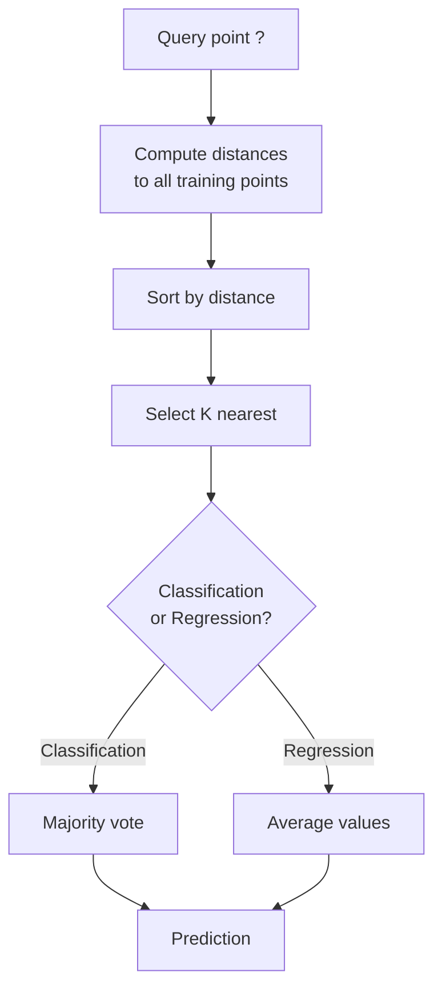
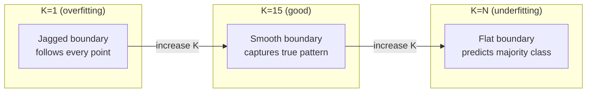
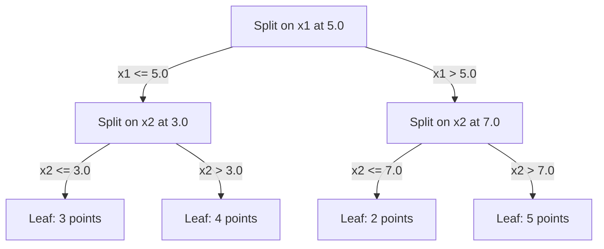

# K-Nearest Neighbors and Distances

> Lưu mọi thứ. Dự đoán bằng cách nhìn các láng giềng. Thuật toán đơn giản nhất thực sự hoạt động.

**Type:** Build
**Language:** Python
**Prerequisites:** Phase 1 (Lesson 14 Norms and Distances)
**Time:** ~90 minutes

## Learning Objectives

- Triển khai phân loại và hồi quy KNN từ đầu với K có thể cấu hình và bỏ phiếu có trọng số theo khoảng cách
- So sánh các metric khoảng cách L1, L2, cosine và Minkowski và chọn loại thích hợp cho một kiểu dữ liệu nhất định
- Giải thích lời nguyền số chiều và minh họa tại sao KNN suy giảm trong các không gian nhiều chiều
- Xây dựng một KD-tree để tìm kiếm láng giềng gần nhất hiệu quả và phân tích khi nào nó vượt tìm kiếm vét cạn

## The Problem

Bạn có một tập dữ liệu. Một điểm dữ liệu mới đến. Bạn cần phân loại nó hoặc dự đoán giá trị của nó. Thay vì học các tham số từ dữ liệu (như hồi quy tuyến tính hoặc SVM), bạn chỉ tìm K điểm huấn luyện gần điểm mới nhất và để chúng bỏ phiếu.

Đây là K láng giềng gần nhất. Không có giai đoạn huấn luyện. Không có tham số cần học. Không có hàm mất mát cần tối thiểu hóa. Bạn lưu toàn bộ tập huấn luyện và tính khoảng cách tại thời điểm dự đoán.

Nghe quá đơn giản để hoạt động. Nhưng KNN cạnh tranh đáng ngạc nhiên cho nhiều bài toán, đặc biệt với các tập dữ liệu nhỏ đến vừa, và hiểu sâu nó tiết lộ các khái niệm cơ bản: lựa chọn metric khoảng cách (kết nối với Giai đoạn 1 Bài học 14), lời nguyền số chiều và sự khác biệt giữa học lười và học háo hức.

KNN cũng xuất hiện khắp nơi trong AI hiện đại, chỉ dưới các tên khác nhau. Các cơ sở dữ liệu vector thực hiện tìm kiếm KNN trên các embedding. Sinh tăng cường truy xuất (RAG) tìm K đoạn tài liệu gần nhất. Các hệ thống đề xuất tìm người dùng hoặc mục tương tự. Thuật toán giống nhau. Quy mô và các cấu trúc dữ liệu khác nhau.

## The Concept

### How KNN works

Cho một tập dữ liệu các điểm có nhãn và một điểm truy vấn mới:

1. Tính khoảng cách từ truy vấn đến mọi điểm trong tập dữ liệu
2. Sắp xếp theo khoảng cách
3. Lấy K điểm gần nhất
4. Với phân loại: bỏ phiếu đa số giữa K láng giềng
5. Với hồi quy: trung bình (hoặc trung bình có trọng số) các giá trị của K láng giềng



Đó là toàn bộ thuật toán. Không khớp. Không gradient descent. Không epoch.

### Choosing K

K là siêu tham số duy nhất. Nó điều khiển sự đánh đổi độ chệch-phương sai:

| K | Hành vi |
|---|----------|
| K = 1 | Biên quyết định đi theo từng điểm. Sai số huấn luyện bằng không. Phương sai cao. Khớp quá mức |
| K nhỏ (3-5) | Nhạy với cấu trúc cục bộ. Có thể nắm bắt các biên phức tạp |
| K lớn | Các biên mượt hơn. Bền vững hơn với nhiễu. Có thể khớp chưa đủ |
| K = N | Dự đoán lớp đa số cho mọi điểm. Độ chệch tối đa |

Một điểm bắt đầu phổ biến là K = sqrt(N) cho một tập dữ liệu N điểm. Sử dụng K lẻ cho phân loại nhị phân để tránh hòa.



### Distance metrics

Hàm khoảng cách xác định "gần" có nghĩa gì. Các metric khác nhau tạo các láng giềng khác nhau, các dự đoán khác nhau.

**L2 (Euclid)** là mặc định. Khoảng cách đường thẳng.

```
d(a, b) = sqrt(sum((a_i - b_i)^2))
```

Nhạy với thang đo đặc trưng. Luôn chuẩn hóa các đặc trưng trước khi sử dụng L2 với KNN.

**L1 (Manhattan)** cộng các chênh lệch tuyệt đối. Bền vững với ngoại lệ hơn L2 vì nó không bình phương các chênh lệch.

```
d(a, b) = sum(|a_i - b_i|)
```

**Khoảng cách cosine** đo góc giữa các vector, bỏ qua độ lớn. Thiết yếu cho dữ liệu văn bản và embedding.

```
d(a, b) = 1 - (a . b) / (||a|| * ||b||)
```

**Minkowski** tổng quát hóa L1 và L2 với tham số p.

```
d(a, b) = (sum(|a_i - b_i|^p))^(1/p)

p=1: Manhattan
p=2: Euclidean
p->inf: Chebyshev (max absolute difference)
```

Metric nào nên dùng phụ thuộc vào dữ liệu:

| Loại dữ liệu | Metric tốt nhất | Lý do |
|-----------|------------|-----|
| Các đặc trưng số, thang đo tương tự | L2 (Euclid) | Mặc định, hoạt động cho dữ liệu không gian |
| Các đặc trưng số, có ngoại lệ | L1 (Manhattan) | Bền vững, không khuếch đại các khác biệt lớn |
| Embedding văn bản | Cosine | Độ lớn là nhiễu, hướng là ý nghĩa |
| Thưa nhiều chiều | Cosine hoặc L1 | L2 chịu lời nguyền số chiều |
| Các kiểu hỗn hợp | Khoảng cách tùy chỉnh | Kết hợp các metric theo từng loại đặc trưng |

### Weighted KNN

KNN tiêu chuẩn cho trọng số bằng nhau với tất cả K láng giềng. Nhưng một láng giềng ở khoảng cách 0.1 nên quan trọng hơn một láng giềng ở khoảng cách 5.0.

**KNN có trọng số theo khoảng cách** gán trọng số nghịch với khoảng cách cho mỗi láng giềng:

```
weight_i = 1 / (distance_i + epsilon)

For classification: weighted vote
For regression:     weighted average = sum(w_i * y_i) / sum(w_i)
```

Epsilon ngăn chia cho không khi một điểm truy vấn khớp chính xác một điểm huấn luyện.

KNN có trọng số ít nhạy với lựa chọn K hơn vì các láng giềng xa đóng góp rất ít bất kể K.

### The curse of dimensionality

Hiệu năng KNN suy giảm trong không gian nhiều chiều. Đây không phải một lo ngại mơ hồ. Nó là một sự thật toán học.

**Vấn đề 1: các khoảng cách hội tụ.** Khi số chiều tăng, tỉ số khoảng cách lớn nhất với nhỏ nhất tiến đến 1. Tất cả các điểm trở nên "xa" truy vấn như nhau.

```
In d dimensions, for random uniform points:

d=2:    max_dist / min_dist = varies widely
d=100:  max_dist / min_dist ~ 1.01
d=1000: max_dist / min_dist ~ 1.001

When all distances are nearly equal, "nearest" is meaningless.
```

**Vấn đề 2: thể tích bùng nổ.** Để nắm bắt K láng giềng trong một phần cố định của dữ liệu, bạn cần mở rộng bán kính tìm kiếm để bao phủ một phần lớn hơn nhiều của không gian đặc trưng. "Vùng lân cận" trong không gian nhiều chiều bao trùm hầu hết không gian.

**Vấn đề 3: các góc chi phối.** Trong một siêu lập phương đơn vị d chiều, phần lớn thể tích tập trung gần các góc, không phải tâm. Một hình cầu nội tiếp khối lập phương chứa một phần thể tích tiến về không khi d tăng.

Hệ quả thực tế: KNN hoạt động tốt đến khoảng 20-50 đặc trưng. Vượt mức đó, bạn cần giảm chiều (PCA, UMAP, t-SNE) trước khi áp dụng KNN, hoặc cần sử dụng các cấu trúc tìm kiếm dựa trên cây khai thác số chiều thấp hơn nội tại của dữ liệu.

### KD-trees: fast nearest neighbor search

KNN vét cạn tính khoảng cách từ truy vấn đến mọi điểm huấn luyện. Đó là O(n * d) mỗi truy vấn. Với các tập dữ liệu lớn, điều này quá chậm.

Một KD-tree phân hoạch đệ quy không gian dọc theo các trục đặc trưng. Tại mỗi mức, nó chia dọc theo một chiều tại giá trị trung vị.



Để tìm láng giềng gần nhất, duyệt cây đến lá chứa truy vấn, rồi quay lui và kiểm tra các phân hoạch lân cận chỉ khi chúng có thể chứa các điểm gần hơn.

Thời gian truy vấn trung bình: O(log n) với số chiều thấp. Nhưng KD-tree suy giảm về O(n) trong không gian nhiều chiều (d > 20) vì quay lui loại bỏ ngày càng ít nhánh.

### Ball trees: better for moderate dimensions

Ball tree phân hoạch dữ liệu thành các siêu cầu lồng nhau thay vì các hộp song song với trục. Mỗi nút xác định một hình cầu (tâm + bán kính) chứa tất cả các điểm trong cây con đó.

Các lợi thế so với KD-tree:
- Hoạt động tốt hơn ở số chiều vừa phải (đến ~50)
- Xử lý cấu trúc không song song với trục
- Các thể tích bao chặt hơn nghĩa là nhiều nhánh được cắt tỉa hơn trong tìm kiếm

Cả KD-tree và ball tree đều là các thuật toán chính xác. Với tìm kiếm thực sự quy mô lớn (hàng triệu điểm, hàng trăm chiều), các phương pháp láng giềng gần nhất xấp xỉ (HNSW, IVF, lượng tử hóa tích) được sử dụng thay thế. Chúng được trình bày trong Giai đoạn 1 Bài học 14.

### Lazy learning vs eager learning

KNN là một bộ học lười: nó không làm việc tại thời điểm huấn luyện và làm mọi việc tại thời điểm dự đoán. Hầu hết các thuật toán khác (hồi quy tuyến tính, SVM, mạng nơ-ron) là các bộ học háo hức: chúng tính toán nặng tại thời điểm huấn luyện để xây dựng một mô hình gọn, rồi dự đoán nhanh.

| Khía cạnh | Lười (KNN) | Háo hức (SVM, mạng nơ-ron) |
|--------|------------|------------------------|
| Thời gian huấn luyện | O(1) chỉ lưu dữ liệu | O(n * epochs) |
| Thời gian dự đoán | O(n * d) mỗi truy vấn | O(d) hoặc O(parameters) |
| Bộ nhớ lúc dự đoán | Lưu toàn bộ tập huấn luyện | Chỉ lưu các tham số mô hình |
| Thích nghi với dữ liệu mới | Thêm điểm ngay lập tức | Huấn luyện lại mô hình |
| Biên quyết định | Ngầm, được tính tức thời | Tường minh, cố định sau huấn luyện |

Học lười lý tưởng khi:
- Tập dữ liệu thay đổi thường xuyên (thêm/xóa điểm mà không huấn luyện lại)
- Bạn cần dự đoán cho rất ít truy vấn
- Bạn muốn thời gian huấn luyện bằng không
- Tập dữ liệu đủ nhỏ để tìm kiếm vét cạn nhanh

### KNN for regression

Thay vì bỏ phiếu đa số, KNN cho hồi quy lấy trung bình các giá trị mục tiêu của K láng giềng.

```
prediction = (1/K) * sum(y_i for i in K nearest neighbors)

Or with distance weighting:
prediction = sum(w_i * y_i) / sum(w_i)
where w_i = 1 / distance_i
```

Hồi quy KNN tạo các dự đoán hằng từng khúc (hoặc mượt từng khúc khi có trọng số). Nó không thể ngoại suy vượt khoảng của dữ liệu huấn luyện. Nếu các mục tiêu huấn luyện đều giữa 0 và 100, KNN sẽ không bao giờ dự đoán 200.

```figure
knn-smoothness
```

## Build It

### Step 1: Distance functions

Triển khai các khoảng cách L1, L2, cosine và Minkowski. Chúng kết nối trực tiếp với Giai đoạn 1 Bài học 14.

```python
import math

def l2_distance(a, b):
    return math.sqrt(sum((ai - bi) ** 2 for ai, bi in zip(a, b)))

def l1_distance(a, b):
    return sum(abs(ai - bi) for ai, bi in zip(a, b))

def cosine_distance(a, b):
    dot_val = sum(ai * bi for ai, bi in zip(a, b))
    norm_a = math.sqrt(sum(ai ** 2 for ai in a))
    norm_b = math.sqrt(sum(bi ** 2 for bi in b))
    if norm_a == 0 or norm_b == 0:
        return 1.0
    return 1.0 - dot_val / (norm_a * norm_b)

def minkowski_distance(a, b, p=2):
    if p == float('inf'):
        return max(abs(ai - bi) for ai, bi in zip(a, b))
    return sum(abs(ai - bi) ** p for ai, bi in zip(a, b)) ** (1 / p)
```

### Step 2: KNN classifier and regressor

Xây dựng KNN đầy đủ với K, metric khoảng cách có thể cấu hình và trọng số khoảng cách tùy chọn.

```python
class KNN:
    def __init__(self, k=5, distance_fn=l2_distance, weighted=False,
                 task="classification"):
        self.k = k
        self.distance_fn = distance_fn
        self.weighted = weighted
        self.task = task
        self.X_train = None
        self.y_train = None

    def fit(self, X, y):
        self.X_train = X
        self.y_train = y

    def predict(self, X):
        return [self._predict_one(x) for x in X]
```

### Step 3: KD-tree for efficient search

Xây dựng một KD-tree từ đầu chia đệ quy tại trung vị của mỗi chiều.

```python
class KDTree:
    def __init__(self, X, indices=None, depth=0):
        # Recursively partition the data
        self.axis = depth % len(X[0])
        # Split on median of the current axis
        ...

    def query(self, point, k=1):
        # Traverse to leaf, then backtrack
        ...
```

Xem `code/knn.py` để có triển khai đầy đủ với tất cả phương thức hỗ trợ và demo.

### Step 4: Feature scaling

KNN đòi hỏi co giãn đặc trưng vì khoảng cách nhạy với độ lớn đặc trưng. Một đặc trưng nằm trong khoảng 0 đến 1000 sẽ chi phối một đặc trưng nằm trong khoảng 0 đến 1.

```python
def standardize(X):
    n = len(X)
    d = len(X[0])
    means = [sum(X[i][j] for i in range(n)) / n for j in range(d)]
    stds = [
        max(1e-10, (sum((X[i][j] - means[j]) ** 2 for i in range(n)) / n) ** 0.5)
        for j in range(d)
    ]
    return [[((X[i][j] - means[j]) / stds[j]) for j in range(d)] for i in range(n)], means, stds
```

## Use It

Với scikit-learn:

```python
from sklearn.neighbors import KNeighborsClassifier
from sklearn.preprocessing import StandardScaler
from sklearn.pipeline import Pipeline

clf = Pipeline([
    ("scaler", StandardScaler()),
    ("knn", KNeighborsClassifier(n_neighbors=5, metric="euclidean")),
])
clf.fit(X_train, y_train)
print(f"Accuracy: {clf.score(X_test, y_test):.4f}")
```

Scikit-learn tự động sử dụng KD-tree hoặc ball tree khi tập dữ liệu đủ lớn và số chiều đủ thấp. Với dữ liệu nhiều chiều, nó quay về vét cạn. Bạn có thể điều khiển điều này bằng tham số `algorithm`.

Với tìm kiếm láng giềng gần nhất quy mô lớn (hàng triệu vector), sử dụng FAISS, Annoy hoặc một cơ sở dữ liệu vector:

```python
import faiss

index = faiss.IndexFlatL2(dimension)
index.add(embeddings)
distances, indices = index.search(query_vectors, k=5)
```

## Exercises

1. Triển khai phân loại KNN trên một tập dữ liệu 2D có 3 lớp. Vẽ biên quyết định cho K=1, K=5, K=15 và K=N. Quan sát chuyển tiếp từ khớp quá mức sang khớp chưa đủ.

2. Tạo 1000 điểm ngẫu nhiên trong 2, 5, 10, 50, 100 và 500 chiều. Với mỗi số chiều, tính tỉ số khoảng cách từng cặp lớn nhất với khoảng cách từng cặp nhỏ nhất. Vẽ tỉ số theo số chiều để trực quan hóa lời nguyền số chiều.

3. So sánh khoảng cách L1, L2 và cosine cho KNN trên một bài toán phân loại văn bản (sử dụng vector TF-IDF). Metric nào cho độ chính xác tốt nhất? Tại sao cosine có xu hướng thắng với văn bản?

4. Triển khai một KD-tree và đo thời gian truy vấn so với vét cạn cho các tập dữ liệu 1k, 10k và 100k điểm trong 2D, 10D và 50D. Ở số chiều nào KD-tree ngừng nhanh hơn vét cạn?

5. Xây dựng một bộ hồi quy KNN có trọng số cho y = sin(x) + noise. So sánh nó với KNN không trọng số cho K=3, 10, 30. Chỉ ra rằng trọng số tạo ra các dự đoán mượt hơn, đặc biệt với K lớn.

## Key Terms

| Thuật ngữ | Ý nghĩa thực sự |
|------|----------------------|
| K-nearest neighbors (K láng giềng gần nhất) | Thuật toán phi tham số dự đoán bằng cách tìm K điểm huấn luyện gần một truy vấn nhất |
| Lazy learning (Học lười) | Không tính toán tại thời điểm huấn luyện. Mọi việc diễn ra tại thời điểm dự đoán. KNN là ví dụ điển hình |
| Eager learning (Học háo hức) | Tính toán nặng tại thời điểm huấn luyện để xây dựng một mô hình gọn. Hầu hết thuật toán ML là háo hức |
| Curse of dimensionality (Lời nguyền số chiều) | Trong không gian nhiều chiều, các khoảng cách hội tụ và vùng lân cận mở rộng để bao phủ hầu hết không gian, làm KNN không hiệu quả |
| KD-tree | Cây nhị phân phân hoạch đệ quy không gian dọc theo các trục đặc trưng. Các truy vấn O(log n) trong không gian ít chiều |
| Ball tree | Cây các siêu cầu lồng nhau. Hoạt động tốt hơn KD-tree ở số chiều vừa phải (đến ~50) |
| Weighted KNN (KNN có trọng số) | Các láng giềng được gán trọng số nghịch với khoảng cách. Các láng giềng gần hơn ảnh hưởng nhiều hơn đến dự đoán |
| Feature scaling (Co giãn đặc trưng) | Chuẩn hóa các đặc trưng về các khoảng có thể so sánh. Cần cho các phương pháp dựa trên khoảng cách như KNN |
| Majority vote (Bỏ phiếu đa số) | Phân loại bằng cách đếm lớp nào phổ biến nhất trong K láng giềng |
| Brute force search (Tìm kiếm vét cạn) | Tính khoảng cách đến mọi điểm huấn luyện. O(n*d) mỗi truy vấn. Chính xác nhưng chậm với n lớn |
| Approximate nearest neighbor (Láng giềng gần nhất xấp xỉ) | Các thuật toán (HNSW, LSH, IVF) tìm các điểm gần nhất xấp xỉ nhanh hơn nhiều so với tìm kiếm chính xác |
| Voronoi diagram (Biểu đồ Voronoi) | Phân hoạch không gian nơi mỗi miền chứa tất cả các điểm gần một điểm huấn luyện hơn bất kỳ điểm nào khác. KNN với K=1 tạo các biên Voronoi |

## Further Reading

- [Cover & Hart: Nearest Neighbor Pattern Classification (1967)](https://ieeexplore.ieee.org/document/1053964) - bài báo KNN nền tảng chứng minh nó có tỉ lệ sai số nhiều nhất gấp đôi mức tối ưu Bayes
- [Friedman, Bentley, Finkel: An Algorithm for Finding Best Matches in Logarithmic Expected Time (1977)](https://dl.acm.org/doi/10.1145/355744.355745) - bài báo KD-tree gốc
- [Beyer et al.: When Is "Nearest Neighbor" Meaningful? (1999)](https://link.springer.com/chapter/10.1007/3-540-49257-7_15) - phân tích hình thức lời nguyền số chiều cho láng giềng gần nhất
- [Tài liệu scikit-learn Nearest Neighbors](https://scikit-learn.org/stable/modules/neighbors.html) - hướng dẫn thực hành với lựa chọn thuật toán
- [FAISS: A Library for Efficient Similarity Search](https://github.com/facebookresearch/faiss) - thư viện của Meta cho tìm kiếm láng giềng gần nhất xấp xỉ ở quy mô hàng tỷ
