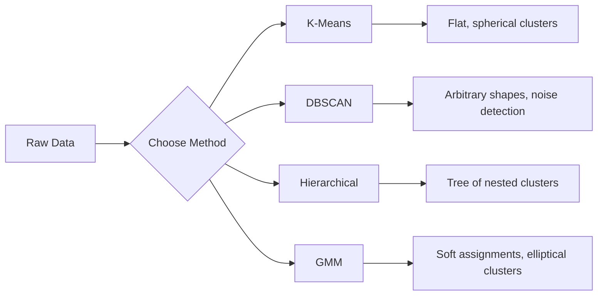

# Unsupervised Learning

> Không nhãn, không thầy. Thuật toán tự tìm cấu trúc.

**Type:** Build
**Languages:** Python
**Prerequisites:** Phase 1 (Norms & Distances, Probability & Distributions), Phase 2 Lessons 1-6
**Time:** ~90 minutes

## Learning Objectives

- Triển khai K-Means, DBSCAN và Mô hình Hỗn hợp Gaussian từ đầu và so sánh hành vi phân cụm của chúng
- Đánh giá chất lượng cụm bằng điểm silhouette và phương pháp khuỷu tay để chọn K tối ưu
- Giải thích khi nào DBSCAN vượt K-Means và xác định thuật toán nào xử lý các cụm không hình cầu và ngoại lệ
- Xây dựng một quy trình phát hiện bất thường bằng các phương pháp phân cụm để đánh dấu các điểm lệch khỏi các mẫu bình thường

## The Problem

Mọi bài học ML đến nay đều giả định dữ liệu có nhãn: "đây là một đầu vào, đây là đầu ra đúng." Trong thế giới thực, nhãn đắt đỏ. Một bệnh viện có hàng triệu hồ sơ bệnh nhân nhưng chưa ai gắn thủ công mỗi hồ sơ với một loại bệnh. Một trang thương mại điện tử có hàng triệu phiên người dùng nhưng chưa ai gắn nhãn thủ công các phân khúc khách hàng. Một đội bảo mật có nhật ký mạng nhưng chưa ai đánh dấu mọi bất thường.

Học không giám sát tìm các mẫu mà không được chỉ bảo phải tìm gì. Nó nhóm các điểm dữ liệu tương tự, khám phá các cấu trúc ẩn và làm lộ các bất thường. Nếu học có giám sát là học từ một giáo trình có đáp án, học không giám sát là nhìn chằm chằm dữ liệu thô cho đến khi các mẫu tự lộ ra.

Điểm vướng mắc: không có nhãn, bạn không thể đo trực tiếp "đúng" hay "sai." Bạn cần các công cụ khác để đánh giá cấu trúc thuật toán tìm được có ý nghĩa hay không.

## The Concept

### Clustering: Grouping Similar Things Together

Phân cụm gán mỗi điểm dữ liệu vào một nhóm (cụm) sao cho các điểm trong cùng nhóm tương tự nhau hơn so với các điểm trong các nhóm khác. Câu hỏi luôn là: "tương tự" nghĩa là gì?



### K-Means: The Workhorse

K-Means phân hoạch dữ liệu thành đúng K cụm. Mỗi cụm có một trọng tâm (tâm khối lượng của nó), và mỗi điểm thuộc về trọng tâm gần nhất.

Thuật toán Lloyd:

1. Chọn K điểm ngẫu nhiên làm các trọng tâm ban đầu
2. Gán mỗi điểm dữ liệu cho trọng tâm gần nhất
3. Tính lại mỗi trọng tâm thành trung bình các điểm được gán
4. Lặp lại các bước 2-3 cho đến khi các phép gán ngừng thay đổi

Hàm mục tiêu (inertia) đo tổng khoảng cách bình phương từ mỗi điểm đến trọng tâm được gán. K-Means tối thiểu hóa nó, nhưng chỉ tìm một cực tiểu cục bộ. Các khởi tạo khác nhau có thể cho kết quả khác nhau.

### Choosing K

Hai phương pháp tiêu chuẩn:

**Phương pháp khuỷu tay:** Chạy K-Means cho K = 1, 2, 3, ..., n. Vẽ inertia theo K. Tìm "khuỷu tay" nơi việc thêm cụm ngừng giảm inertia đáng kể.

**Điểm silhouette:** Với mỗi điểm, đo mức độ tương tự với cụm của nó (a) so với cụm khác gần nhất (b). Hệ số silhouette là (b - a) / max(a, b), nằm trong khoảng từ -1 (sai cụm) đến +1 (phân cụm tốt). Lấy trung bình trên mọi điểm để có điểm toàn cục.

### DBSCAN: Density-Based Clustering

K-Means giả định các cụm hình cầu và yêu cầu bạn chọn K trước. DBSCAN không đưa ra giả định nào trong hai giả định này. Nó tìm các cụm dưới dạng các vùng dày đặc được phân tách bởi các vùng thưa.

Hai tham số:
- **eps**: bán kính của một vùng lân cận
- **min_samples**: số điểm tối thiểu cần để hình thành một vùng dày đặc

Ba loại điểm:
- **Điểm lõi**: có ít nhất min_samples điểm trong khoảng cách eps
- **Điểm biên**: trong khoảng eps của một điểm lõi nhưng bản thân không phải điểm lõi
- **Điểm nhiễu**: không lõi cũng không biên. Đây là các ngoại lệ.

DBSCAN kết nối các điểm lõi trong khoảng eps của nhau vào cùng một cụm. Các điểm biên tham gia cụm của một điểm lõi gần đó. Các điểm nhiễu không thuộc cụm nào.

Điểm mạnh: tìm các cụm có bất kỳ hình dạng nào, tự động xác định số cụm, nhận diện ngoại lệ. Điểm yếu: gặp khó với các cụm có mật độ thay đổi.

### Hierarchical Clustering

Xây dựng một cây (dendrogram) các cụm lồng nhau.

Tích tụ (từ dưới lên):
1. Bắt đầu với mỗi điểm là một cụm riêng
2. Hợp nhất hai cụm gần nhất
3. Lặp lại cho đến khi chỉ còn một cụm
4. Cắt dendrogram tại mức mong muốn để có K cụm

"Độ gần" giữa các cụm có thể được đo bằng:
- **Liên kết đơn**: khoảng cách nhỏ nhất giữa hai điểm bất kỳ trong hai cụm
- **Liên kết đầy đủ**: khoảng cách lớn nhất giữa hai điểm bất kỳ
- **Liên kết trung bình**: khoảng cách trung bình giữa mọi cặp
- **Phương pháp Ward**: phép hợp nhất gây ra mức tăng nhỏ nhất trong tổng phương sai nội cụm

### Gaussian Mixture Models (GMM)

K-Means cho các phép gán cứng: mỗi điểm thuộc đúng một cụm. GMM cho các phép gán mềm: mỗi điểm có một xác suất thuộc về mỗi cụm.

GMM giả định dữ liệu được sinh từ một hỗn hợp K phân phối Gaussian, mỗi phân phối có trung bình và hiệp phương sai riêng. Thuật toán Kỳ vọng-Cực đại hóa (EM) luân phiên giữa:

- **Bước E**: tính xác suất mỗi điểm thuộc về mỗi Gaussian
- **Bước M**: cập nhật trung bình, hiệp phương sai và trọng số hỗn hợp của mỗi Gaussian để cực đại hóa hợp lý của dữ liệu

GMM có thể mô hình hóa các cụm ellipse (không chỉ hình cầu như K-Means) và xử lý tự nhiên các cụm chồng lấp.

### When to Use Which

| Phương pháp | Tốt nhất cho | Tránh khi |
|--------|----------|------------|
| K-Means | Các tập dữ liệu lớn, cụm hình cầu, biết K | Hình dạng không đều, có ngoại lệ |
| DBSCAN | Không biết K, hình dạng tùy ý, phát hiện ngoại lệ | Mật độ thay đổi, số chiều rất cao |
| Phân cấp | Các tập dữ liệu nhỏ, cần dendrogram, không biết K | Các tập dữ liệu lớn (bộ nhớ O(n^2)) |
| GMM | Các cụm chồng lấp, cần phép gán mềm | Các tập dữ liệu rất lớn, quá nhiều chiều |

### Anomaly Detection with Clustering

Phân cụm hỗ trợ tự nhiên việc phát hiện bất thường:
- **K-Means**: các điểm xa mọi trọng tâm là các bất thường
- **DBSCAN**: các điểm nhiễu là các bất thường theo định nghĩa
- **GMM**: các điểm có xác suất thấp dưới mọi Gaussian là các bất thường

```figure
kmeans-step
```

## Build It

### Step 1: K-Means from scratch

```python
import math
import random


def euclidean_distance(a, b):
    return math.sqrt(sum((ai - bi) ** 2 for ai, bi in zip(a, b)))


def kmeans(data, k, max_iterations=100, seed=42):
    random.seed(seed)
    n_features = len(data[0])

    centroids = random.sample(data, k)

    for iteration in range(max_iterations):
        clusters = [[] for _ in range(k)]
        assignments = []

        for point in data:
            distances = [euclidean_distance(point, c) for c in centroids]
            nearest = distances.index(min(distances))
            clusters[nearest].append(point)
            assignments.append(nearest)

        new_centroids = []
        for cluster in clusters:
            if len(cluster) == 0:
                new_centroids.append(random.choice(data))
                continue
            centroid = [
                sum(point[j] for point in cluster) / len(cluster)
                for j in range(n_features)
            ]
            new_centroids.append(centroid)

        if all(
            euclidean_distance(old, new) < 1e-6
            for old, new in zip(centroids, new_centroids)
        ):
            print(f"  Converged at iteration {iteration + 1}")
            break

        centroids = new_centroids

    return assignments, centroids
```

### Step 2: Elbow method and silhouette score

```python
def compute_inertia(data, assignments, centroids):
    total = 0.0
    for point, cluster_id in zip(data, assignments):
        total += euclidean_distance(point, centroids[cluster_id]) ** 2
    return total


def silhouette_score(data, assignments):
    n = len(data)
    if n < 2:
        return 0.0

    clusters = {}
    for i, c in enumerate(assignments):
        clusters.setdefault(c, []).append(i)

    if len(clusters) < 2:
        return 0.0

    scores = []
    for i in range(n):
        own_cluster = assignments[i]
        own_members = [j for j in clusters[own_cluster] if j != i]

        if len(own_members) == 0:
            scores.append(0.0)
            continue

        a = sum(euclidean_distance(data[i], data[j]) for j in own_members) / len(own_members)

        b = float("inf")
        for cluster_id, members in clusters.items():
            if cluster_id == own_cluster:
                continue
            avg_dist = sum(euclidean_distance(data[i], data[j]) for j in members) / len(members)
            b = min(b, avg_dist)

        if max(a, b) == 0:
            scores.append(0.0)
        else:
            scores.append((b - a) / max(a, b))

    return sum(scores) / len(scores)


def find_best_k(data, max_k=10):
    print("Elbow method:")
    inertias = []
    for k in range(1, max_k + 1):
        assignments, centroids = kmeans(data, k)
        inertia = compute_inertia(data, assignments, centroids)
        inertias.append(inertia)
        print(f"  K={k}: inertia={inertia:.2f}")

    print("\nSilhouette scores:")
    for k in range(2, max_k + 1):
        assignments, centroids = kmeans(data, k)
        score = silhouette_score(data, assignments)
        print(f"  K={k}: silhouette={score:.4f}")

    return inertias
```

### Step 3: DBSCAN from scratch

```python
def dbscan(data, eps, min_samples):
    n = len(data)
    labels = [-1] * n
    cluster_id = 0

    def region_query(point_idx):
        neighbors = []
        for i in range(n):
            if euclidean_distance(data[point_idx], data[i]) <= eps:
                neighbors.append(i)
        return neighbors

    visited = [False] * n

    for i in range(n):
        if visited[i]:
            continue
        visited[i] = True

        neighbors = region_query(i)

        if len(neighbors) < min_samples:
            labels[i] = -1
            continue

        labels[i] = cluster_id
        seed_set = list(neighbors)
        seed_set.remove(i)

        j = 0
        while j < len(seed_set):
            q = seed_set[j]

            if not visited[q]:
                visited[q] = True
                q_neighbors = region_query(q)
                if len(q_neighbors) >= min_samples:
                    for nb in q_neighbors:
                        if nb not in seed_set:
                            seed_set.append(nb)

            if labels[q] == -1:
                labels[q] = cluster_id

            j += 1

        cluster_id += 1

    return labels
```

### Step 4: Gaussian Mixture Model (EM algorithm)

```python
def gmm(data, k, max_iterations=100, seed=42):
    random.seed(seed)
    n = len(data)
    d = len(data[0])

    indices = random.sample(range(n), k)
    means = [list(data[i]) for i in indices]
    variances = [1.0] * k
    weights = [1.0 / k] * k

    def gaussian_pdf(x, mean, variance):
        d = len(x)
        coeff = 1.0 / ((2 * math.pi * variance) ** (d / 2))
        exponent = -sum((xi - mi) ** 2 for xi, mi in zip(x, mean)) / (2 * variance)
        return coeff * math.exp(max(exponent, -500))

    for iteration in range(max_iterations):
        responsibilities = []
        for i in range(n):
            probs = []
            for j in range(k):
                probs.append(weights[j] * gaussian_pdf(data[i], means[j], variances[j]))
            total = sum(probs)
            if total == 0:
                total = 1e-300
            responsibilities.append([p / total for p in probs])

        old_means = [list(m) for m in means]

        for j in range(k):
            r_sum = sum(responsibilities[i][j] for i in range(n))
            if r_sum < 1e-10:
                continue

            weights[j] = r_sum / n

            for dim in range(d):
                means[j][dim] = sum(
                    responsibilities[i][j] * data[i][dim] for i in range(n)
                ) / r_sum

            variances[j] = sum(
                responsibilities[i][j]
                * sum((data[i][dim] - means[j][dim]) ** 2 for dim in range(d))
                for i in range(n)
            ) / (r_sum * d)
            variances[j] = max(variances[j], 1e-6)

        shift = sum(
            euclidean_distance(old_means[j], means[j]) for j in range(k)
        )
        if shift < 1e-6:
            print(f"  GMM converged at iteration {iteration + 1}")
            break

    assignments = []
    for i in range(n):
        assignments.append(responsibilities[i].index(max(responsibilities[i])))

    return assignments, means, weights, responsibilities
```

### Step 5: Generate test data and run everything

```python
def make_blobs(centers, n_per_cluster=50, spread=0.5, seed=42):
    random.seed(seed)
    data = []
    true_labels = []
    for label, (cx, cy) in enumerate(centers):
        for _ in range(n_per_cluster):
            x = cx + random.gauss(0, spread)
            y = cy + random.gauss(0, spread)
            data.append([x, y])
            true_labels.append(label)
    return data, true_labels


def make_moons(n_samples=200, noise=0.1, seed=42):
    random.seed(seed)
    data = []
    labels = []
    n_half = n_samples // 2
    for i in range(n_half):
        angle = math.pi * i / n_half
        x = math.cos(angle) + random.gauss(0, noise)
        y = math.sin(angle) + random.gauss(0, noise)
        data.append([x, y])
        labels.append(0)
    for i in range(n_half):
        angle = math.pi * i / n_half
        x = 1 - math.cos(angle) + random.gauss(0, noise)
        y = 1 - math.sin(angle) - 0.5 + random.gauss(0, noise)
        data.append([x, y])
        labels.append(1)
    return data, labels


if __name__ == "__main__":
    centers = [[2, 2], [8, 3], [5, 8]]
    data, true_labels = make_blobs(centers, n_per_cluster=50, spread=0.8)

    print("=== K-Means on 3 blobs ===")
    assignments, centroids = kmeans(data, k=3)
    print(f"  Centroids: {[[round(c, 2) for c in cent] for cent in centroids]}")
    sil = silhouette_score(data, assignments)
    print(f"  Silhouette score: {sil:.4f}")

    print("\n=== Elbow Method ===")
    find_best_k(data, max_k=6)

    print("\n=== DBSCAN on 3 blobs ===")
    db_labels = dbscan(data, eps=1.5, min_samples=5)
    n_clusters = len(set(db_labels) - {-1})
    n_noise = db_labels.count(-1)
    print(f"  Found {n_clusters} clusters, {n_noise} noise points")

    print("\n=== GMM on 3 blobs ===")
    gmm_assignments, gmm_means, gmm_weights, _ = gmm(data, k=3)
    print(f"  Means: {[[round(m, 2) for m in mean] for mean in gmm_means]}")
    print(f"  Weights: {[round(w, 3) for w in gmm_weights]}")
    gmm_sil = silhouette_score(data, gmm_assignments)
    print(f"  Silhouette score: {gmm_sil:.4f}")

    print("\n=== DBSCAN on moons (non-spherical clusters) ===")
    moon_data, moon_labels = make_moons(n_samples=200, noise=0.1)
    moon_db = dbscan(moon_data, eps=0.3, min_samples=5)
    n_moon_clusters = len(set(moon_db) - {-1})
    n_moon_noise = moon_db.count(-1)
    print(f"  Found {n_moon_clusters} clusters, {n_moon_noise} noise points")

    print("\n=== K-Means on moons (will fail to separate) ===")
    moon_km, moon_centroids = kmeans(moon_data, k=2)
    moon_sil = silhouette_score(moon_data, moon_km)
    print(f"  Silhouette score: {moon_sil:.4f}")
    print("  K-Means splits moons poorly because they are not spherical")

    print("\n=== Anomaly detection with DBSCAN ===")
    anomaly_data = list(data)
    anomaly_data.append([20.0, 20.0])
    anomaly_data.append([-5.0, -5.0])
    anomaly_data.append([15.0, 0.0])
    anomaly_labels = dbscan(anomaly_data, eps=1.5, min_samples=5)
    anomalies = [
        anomaly_data[i]
        for i in range(len(anomaly_labels))
        if anomaly_labels[i] == -1
    ]
    print(f"  Detected {len(anomalies)} anomalies")
    for a in anomalies[-3:]:
        print(f"    Point {[round(v, 2) for v in a]}")
```

## Use It

Với scikit-learn, các thuật toán tương tự chỉ là các dòng lệnh đơn:

```python
from sklearn.cluster import KMeans, DBSCAN, AgglomerativeClustering
from sklearn.mixture import GaussianMixture
from sklearn.metrics import silhouette_score as sklearn_silhouette

km = KMeans(n_clusters=3, random_state=42).fit(data)
db = DBSCAN(eps=1.5, min_samples=5).fit(data)
agg = AgglomerativeClustering(n_clusters=3).fit(data)
gmm_model = GaussianMixture(n_components=3, random_state=42).fit(data)
```

Các phiên bản từ đầu cho bạn thấy chính xác các thư viện này tính gì. K-Means lặp giữa gán và tính lại. DBSCAN phát triển các cụm từ các hạt giống dày đặc. GMM luân phiên giữa kỳ vọng và cực đại hóa. Các phiên bản thư viện thêm độ ổn định số học, khởi tạo thông minh hơn (K-Means++) và tăng tốc GPU, nhưng logic cốt lõi giống nhau.

## Ship It

Bài học này tạo ra các triển khai hoạt động của K-Means, DBSCAN và GMM từ đầu. Mã phân cụm có thể được tái sử dụng làm nền tảng cho các phương pháp không giám sát nâng cao hơn.

## Exercises

1. Triển khai khởi tạo K-Means++: thay vì chọn các trọng tâm ngẫu nhiên, chọn trọng tâm đầu tiên ngẫu nhiên và mỗi trọng tâm tiếp theo với xác suất tỉ lệ với khoảng cách bình phương đến trọng tâm hiện có gần nhất. So sánh tốc độ hội tụ với khởi tạo ngẫu nhiên.
2. Thêm phân cụm tích tụ phân cấp vào mã. Triển khai liên kết Ward và tạo một dendrogram (dưới dạng danh sách lồng nhau các phép hợp nhất). Cắt nó ở các mức khác nhau và so sánh với kết quả K-Means.
3. Xây dựng một quy trình phát hiện bất thường đơn giản: chạy DBSCAN và GMM trên cùng dữ liệu, đánh dấu các điểm mà cả hai phương pháp đồng ý là ngoại lệ (nhiễu trong DBSCAN, xác suất thấp trong GMM). Đo sự chồng lấp và thảo luận khi nào các phương pháp bất đồng.

## Key Terms

| Thuật ngữ | Cách mọi người nói | Ý nghĩa thực sự |
|------|----------------|----------------------|
| Clustering (Phân cụm) | "Nhóm các thứ tương tự" | Phân hoạch dữ liệu thành các tập con mà độ tương đồng trong nhóm vượt độ tương đồng giữa nhóm, được đo bằng một metric khoảng cách cụ thể |
| Centroid (Trọng tâm) | "Tâm của một cụm" | Trung bình của tất cả các điểm được gán cho một cụm; được K-Means dùng làm đại diện cụm |
| Inertia | "Các cụm chặt đến mức nào" | Tổng khoảng cách bình phương từ mỗi điểm đến trọng tâm được gán; thấp hơn là chặt hơn |
| Silhouette score (Điểm silhouette) | "Các cụm được phân tách tốt đến mức nào" | Với mỗi điểm, (b - a) / max(a, b) trong đó a là khoảng cách nội cụm trung bình và b là khoảng cách cụm gần nhất trung bình |
| Core point (Điểm lõi) | "Một điểm trong vùng dày đặc" | Một điểm có ít nhất min_samples láng giềng trong khoảng cách eps, trong DBSCAN |
| EM algorithm (Thuật toán EM) | "K-Means mềm" | Kỳ vọng-Cực đại hóa: lặp lại việc tính các xác suất thuộc cụm (bước E) và cập nhật các tham số phân phối (bước M) |
| Dendrogram | "Một cây các cụm" | Một sơ đồ cây thể hiện thứ tự và khoảng cách mà tại đó các cụm được hợp nhất trong phân cụm phân cấp |
| Anomaly (Bất thường) | "Một ngoại lệ" | Một điểm dữ liệu không tuân theo mẫu kỳ vọng, được DBSCAN nhận diện là nhiễu hoặc GMM nhận diện là có xác suất thấp |

## Further Reading

- [Stanford CS229 - Unsupervised Learning](https://cs229.stanford.edu/notes2022fall/main_notes.pdf) - bài giảng của Andrew Ng về phân cụm và EM
- [scikit-learn Clustering Guide](https://scikit-learn.org/stable/modules/clustering.html) - so sánh thực hành mọi thuật toán phân cụm với các ví dụ trực quan
- [Bài báo DBSCAN gốc (Ester et al., 1996)](https://www.aaai.org/Papers/KDD/1996/KDD96-037.pdf) - bài báo giới thiệu phân cụm dựa trên mật độ
