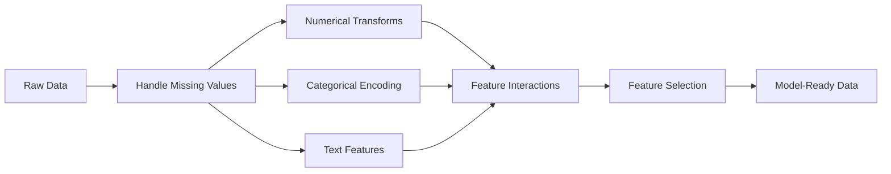

# Feature Engineering & Selection

> Một đặc trưng tốt đáng giá một nghìn điểm dữ liệu.

**Type:** Build
**Languages:** Python
**Prerequisites:** Phase 1 (Statistics for ML, Linear Algebra), Phase 2 Lessons 1-7
**Time:** ~90 minutes

## Learning Objectives

- Triển khai các phép biến đổi số (chuẩn hóa, co giãn min-max, biến đổi log, chia khoảng) và giải thích khi nào mỗi loại thích hợp
- Xây dựng mã hóa one-hot, nhãn và mục tiêu cho các đặc trưng phân loại và xác định nguy cơ rò rỉ dữ liệu trong mã hóa mục tiêu
- Xây dựng một bộ vector hóa TF-IDF từ đầu và giải thích tại sao nó vượt số đếm từ thô cho phân loại văn bản
- Áp dụng lựa chọn đặc trưng dựa trên bộ lọc (ngưỡng phương sai, tương quan, thông tin tương hỗ) để giảm chiều

## The Problem

Bạn có một tập dữ liệu. Bạn chọn một thuật toán. Bạn huấn luyện nó. Kết quả tầm thường. Bạn thử một thuật toán cầu kỳ hơn. Vẫn tầm thường. Bạn dành một tuần điều chỉnh siêu tham số. Cải thiện không đáng kể.

Rồi ai đó biến đổi dữ liệu thô thành các đặc trưng tốt hơn và một hồi quy logistic đơn giản vượt tập hợp gradient boosting đã được điều chỉnh của bạn.

Điều này xảy ra liên tục. Trong ML cổ điển, biểu diễn dữ liệu quan trọng hơn lựa chọn thuật toán. Một mô hình giá nhà với "diện tích theo foot vuông" và "số phòng ngủ" sẽ vượt một mô hình với "địa chỉ dưới dạng chuỗi thô" bất kể bộ học tinh vi đến mức nào. Thuật toán chỉ có thể làm việc với những gì bạn đưa cho nó.

Kỹ thuật đặc trưng là quá trình biến đổi dữ liệu thô thành các biểu diễn làm các mẫu dễ tìm hơn cho mô hình. Lựa chọn đặc trưng là quá trình bỏ đi các đặc trưng thêm nhiễu mà không thêm tín hiệu. Cùng nhau, chúng là hoạt động có tác động lớn nhất trong ML cổ điển.

## The Concept

### The Feature Pipeline



### Numerical Features

Các con số thô hiếm khi sẵn sàng cho mô hình. Các phép biến đổi phổ biến:

**Co giãn:** Đưa các đặc trưng về cùng khoảng để các thuật toán dựa trên khoảng cách (K-Means, KNN, SVM) xem mọi đặc trưng như nhau. Co giãn min-max ánh xạ về [0, 1]. Chuẩn hóa (z-score) ánh xạ về mean=0, std=1.

**Biến đổi log:** Nén các phân phối lệch phải (thu nhập, dân số, số đếm từ). Biến các quan hệ nhân thành các quan hệ cộng.

**Chia khoảng:** Chuyển các giá trị liên tục thành các loại. Hữu ích khi quan hệ giữa đặc trưng và mục tiêu phi tuyến nhưng theo từng bước (ví dụ, nhóm tuổi).

**Các đặc trưng đa thức:** Tạo các số hạng x^2, x^3, x1*x2. Cho phép các mô hình tuyến tính nắm bắt các quan hệ phi tuyến với cái giá là nhiều đặc trưng hơn.

### Categorical Features

Mô hình cần số. Các loại cần mã hóa.

**Mã hóa one-hot:** Tạo một cột nhị phân cho mỗi loại. "color = red/blue/green" trở thành ba cột: is_red, is_blue, is_green. Hoạt động tốt cho các đặc trưng có ít giá trị phân biệt nhưng bùng nổ với nhiều loại.

**Mã hóa nhãn:** Ánh xạ mỗi loại thành một số nguyên: red=0, blue=1, green=2. Đưa vào thứ tự giả (mô hình có thể nghĩ green > blue > red). Chỉ thích hợp cho các mô hình dựa trên cây chia theo các giá trị riêng lẻ.

**Mã hóa mục tiêu:** Thay mỗi loại bằng trung bình của biến mục tiêu cho loại đó. Mạnh nhưng nguy hiểm: nguy cơ rò rỉ dữ liệu cao. Phải chỉ được tính trên dữ liệu huấn luyện và áp dụng cho dữ liệu kiểm tra.

### Text Features

**Bộ vector hóa số đếm:** Đếm số lần mỗi từ xuất hiện trong một tài liệu. "the cat sat on the mat" trở thành {the: 2, cat: 1, sat: 1, on: 1, mat: 1}.

**TF-IDF:** Tần suất Thuật ngữ-Tần suất Tài liệu Nghịch đảo. Gán trọng số cho các từ theo mức độ độc đáo của chúng trên các tài liệu. Các từ phổ biến như "the" nhận trọng số thấp. Các từ hiếm, đặc trưng nhận trọng số cao.

```
TF(word, doc) = count(word in doc) / total words in doc
IDF(word) = log(total docs / docs containing word)
TF-IDF = TF * IDF
```

### Missing Values

Dữ liệu thực có các lỗ hổng. Các chiến lược:

- **Bỏ hàng:** Chỉ khi dữ liệu thiếu hiếm và ngẫu nhiên
- **Điền khuyết trung bình/trung vị:** Đơn giản, bảo toàn hình dạng phân phối (trung vị bền vững hơn với ngoại lệ)
- **Điền khuyết mốt:** Cho các đặc trưng phân loại
- **Cột chỉ báo:** Thêm một cột nhị phân "was_this_missing" trước khi điền khuyết. Việc dữ liệu bị thiếu tự nó có thể cung cấp thông tin
- **Điền tiến/lùi:** Cho dữ liệu chuỗi thời gian

### Feature Interaction

Đôi khi quan hệ nằm trong sự kết hợp. Chỉ riêng "Chiều cao" và "cân nặng" có khả năng dự đoán kém hơn "BMI = weight / height^2". Các tương tác đặc trưng nhân rộng không gian đặc trưng, nên sử dụng kiến thức chuyên môn để chọn những tương tác phù hợp.

### Feature Selection

Nhiều đặc trưng hơn không phải luôn tốt hơn. Các đặc trưng không liên quan thêm nhiễu, tăng thời gian huấn luyện và có thể gây khớp quá mức.

**Các phương pháp bộ lọc (trước mô hình):**
- Tương quan: loại các đặc trưng tương quan cao với nhau (dư thừa)
- Thông tin tương hỗ: đo mức độ biết một đặc trưng giảm sự không chắc chắn về mục tiêu
- Ngưỡng phương sai: loại các đặc trưng hầu như không biến thiên

**Các phương pháp wrapper (dựa trên mô hình):**
- L1 regularization (Lasso): đẩy các trọng số đặc trưng không liên quan về đúng không
- Loại bỏ đặc trưng đệ quy: huấn luyện, loại đặc trưng ít quan trọng nhất, lặp lại

**Tại sao lựa chọn quan trọng:** Một mô hình có 10 đặc trưng tốt thường sẽ vượt một mô hình có 10 đặc trưng tốt và 90 đặc trưng nhiễu. Các đặc trưng nhiễu cho mô hình cơ hội khớp quá mức với các mẫu dữ liệu huấn luyện không tổng quát hóa.

```figure
feature-scaling
```

## Build It

### Step 1: Numerical transforms from scratch

```python
import math


def min_max_scale(values):
    min_val = min(values)
    max_val = max(values)
    if max_val == min_val:
        return [0.0] * len(values)
    return [(v - min_val) / (max_val - min_val) for v in values]


def standardize(values):
    n = len(values)
    mean = sum(values) / n
    variance = sum((v - mean) ** 2 for v in values) / n
    std = math.sqrt(variance) if variance > 0 else 1.0
    return [(v - mean) / std for v in values]


def log_transform(values):
    return [math.log(v + 1) for v in values]


def bin_values(values, n_bins=5):
    min_val = min(values)
    max_val = max(values)
    bin_width = (max_val - min_val) / n_bins
    if bin_width == 0:
        return [0] * len(values)
    result = []
    for v in values:
        bin_idx = int((v - min_val) / bin_width)
        bin_idx = min(bin_idx, n_bins - 1)
        result.append(bin_idx)
    return result


def polynomial_features(row, degree=2):
    n = len(row)
    result = list(row)
    if degree >= 2:
        for i in range(n):
            result.append(row[i] ** 2)
        for i in range(n):
            for j in range(i + 1, n):
                result.append(row[i] * row[j])
    return result
```

### Step 2: Categorical encoding from scratch

```python
def one_hot_encode(values):
    categories = sorted(set(values))
    cat_to_idx = {cat: i for i, cat in enumerate(categories)}
    n_cats = len(categories)

    encoded = []
    for v in values:
        row = [0] * n_cats
        row[cat_to_idx[v]] = 1
        encoded.append(row)

    return encoded, categories


def label_encode(values):
    categories = sorted(set(values))
    cat_to_int = {cat: i for i, cat in enumerate(categories)}
    return [cat_to_int[v] for v in values], cat_to_int


def target_encode(feature_values, target_values, smoothing=10):
    global_mean = sum(target_values) / len(target_values)

    category_stats = {}
    for feat, target in zip(feature_values, target_values):
        if feat not in category_stats:
            category_stats[feat] = {"sum": 0.0, "count": 0}
        category_stats[feat]["sum"] += target
        category_stats[feat]["count"] += 1

    encoding = {}
    for cat, stats in category_stats.items():
        cat_mean = stats["sum"] / stats["count"]
        weight = stats["count"] / (stats["count"] + smoothing)
        encoding[cat] = weight * cat_mean + (1 - weight) * global_mean

    return [encoding[v] for v in feature_values], encoding
```

### Step 3: Text features from scratch

```python
def count_vectorize(documents):
    vocab = {}
    idx = 0
    for doc in documents:
        for word in doc.lower().split():
            if word not in vocab:
                vocab[word] = idx
                idx += 1

    vectors = []
    for doc in documents:
        vec = [0] * len(vocab)
        for word in doc.lower().split():
            vec[vocab[word]] += 1
        vectors.append(vec)

    return vectors, vocab


def tfidf(documents):
    n_docs = len(documents)

    vocab = {}
    idx = 0
    for doc in documents:
        for word in doc.lower().split():
            if word not in vocab:
                vocab[word] = idx
                idx += 1

    doc_freq = {}
    for doc in documents:
        seen = set()
        for word in doc.lower().split():
            if word not in seen:
                doc_freq[word] = doc_freq.get(word, 0) + 1
                seen.add(word)

    vectors = []
    for doc in documents:
        words = doc.lower().split()
        word_count = len(words)
        tf_map = {}
        for word in words:
            tf_map[word] = tf_map.get(word, 0) + 1

        vec = [0.0] * len(vocab)
        for word, count in tf_map.items():
            tf = count / word_count
            idf = math.log(n_docs / doc_freq[word])
            vec[vocab[word]] = tf * idf
        vectors.append(vec)

    return vectors, vocab
```

### Step 4: Missing value imputation from scratch

```python
def impute_mean(values):
    present = [v for v in values if v is not None]
    if not present:
        return [0.0] * len(values), 0.0
    mean = sum(present) / len(present)
    return [v if v is not None else mean for v in values], mean


def impute_median(values):
    present = sorted(v for v in values if v is not None)
    if not present:
        return [0.0] * len(values), 0.0
    n = len(present)
    if n % 2 == 0:
        median = (present[n // 2 - 1] + present[n // 2]) / 2
    else:
        median = present[n // 2]
    return [v if v is not None else median for v in values], median


def impute_mode(values):
    present = [v for v in values if v is not None]
    if not present:
        return values, None
    counts = {}
    for v in present:
        counts[v] = counts.get(v, 0) + 1
    mode = max(counts, key=counts.get)
    return [v if v is not None else mode for v in values], mode


def add_missing_indicator(values):
    return [0 if v is not None else 1 for v in values]
```

### Step 5: Feature selection from scratch

```python
def correlation(x, y):
    n = len(x)
    mean_x = sum(x) / n
    mean_y = sum(y) / n
    cov = sum((xi - mean_x) * (yi - mean_y) for xi, yi in zip(x, y)) / n
    std_x = math.sqrt(sum((xi - mean_x) ** 2 for xi in x) / n)
    std_y = math.sqrt(sum((yi - mean_y) ** 2 for yi in y) / n)
    if std_x == 0 or std_y == 0:
        return 0.0
    return cov / (std_x * std_y)


def mutual_information(feature, target, n_bins=10):
    feat_min = min(feature)
    feat_max = max(feature)
    bin_width = (feat_max - feat_min) / n_bins if feat_max != feat_min else 1.0
    feat_binned = [
        min(int((f - feat_min) / bin_width), n_bins - 1) for f in feature
    ]

    n = len(feature)
    target_classes = sorted(set(target))

    feat_bins = sorted(set(feat_binned))
    p_feat = {}
    for b in feat_bins:
        p_feat[b] = feat_binned.count(b) / n

    p_target = {}
    for t in target_classes:
        p_target[t] = target.count(t) / n

    mi = 0.0
    for b in feat_bins:
        for t in target_classes:
            joint_count = sum(
                1 for fb, tv in zip(feat_binned, target) if fb == b and tv == t
            )
            p_joint = joint_count / n
            if p_joint > 0:
                mi += p_joint * math.log(p_joint / (p_feat[b] * p_target[t]))

    return mi


def variance_threshold(features, threshold=0.01):
    n_features = len(features[0])
    n_samples = len(features)
    selected = []

    for j in range(n_features):
        col = [features[i][j] for i in range(n_samples)]
        mean = sum(col) / n_samples
        var = sum((v - mean) ** 2 for v in col) / n_samples
        if var >= threshold:
            selected.append(j)

    return selected


def remove_correlated(features, threshold=0.9):
    n_features = len(features[0])
    n_samples = len(features)

    to_remove = set()
    for i in range(n_features):
        if i in to_remove:
            continue
        col_i = [features[r][i] for r in range(n_samples)]
        for j in range(i + 1, n_features):
            if j in to_remove:
                continue
            col_j = [features[r][j] for r in range(n_samples)]
            corr = abs(correlation(col_i, col_j))
            if corr >= threshold:
                to_remove.add(j)

    return [i for i in range(n_features) if i not in to_remove]
```

### Step 6: Full pipeline and demo

```python
import random


def make_housing_data(n=200, seed=42):
    random.seed(seed)
    data = []
    for _ in range(n):
        sqft = random.uniform(500, 5000)
        bedrooms = random.choice([1, 2, 3, 4, 5])
        age = random.uniform(0, 50)
        neighborhood = random.choice(["downtown", "suburbs", "rural"])
        has_pool = random.choice([True, False])

        sqft_with_missing = sqft if random.random() > 0.05 else None
        age_with_missing = age if random.random() > 0.08 else None

        price = (
            50 * sqft
            + 20000 * bedrooms
            - 1000 * age
            + (50000 if neighborhood == "downtown" else 10000 if neighborhood == "suburbs" else 0)
            + (15000 if has_pool else 0)
            + random.gauss(0, 20000)
        )

        data.append({
            "sqft": sqft_with_missing,
            "bedrooms": bedrooms,
            "age": age_with_missing,
            "neighborhood": neighborhood,
            "has_pool": has_pool,
            "price": price,
        })
    return data


if __name__ == "__main__":
    data = make_housing_data(200)

    print("=== Raw Data Sample ===")
    for row in data[:3]:
        print(f"  {row}")

    sqft_raw = [d["sqft"] for d in data]
    age_raw = [d["age"] for d in data]
    prices = [d["price"] for d in data]

    print("\n=== Missing Value Handling ===")
    sqft_missing = sum(1 for v in sqft_raw if v is None)
    age_missing = sum(1 for v in age_raw if v is None)
    print(f"  sqft missing: {sqft_missing}/{len(sqft_raw)}")
    print(f"  age missing: {age_missing}/{len(age_raw)}")

    sqft_indicator = add_missing_indicator(sqft_raw)
    age_indicator = add_missing_indicator(age_raw)
    sqft_imputed, sqft_fill = impute_median(sqft_raw)
    age_imputed, age_fill = impute_mean(age_raw)
    print(f"  sqft filled with median: {sqft_fill:.0f}")
    print(f"  age filled with mean: {age_fill:.1f}")

    print("\n=== Numerical Transforms ===")
    sqft_scaled = standardize(sqft_imputed)
    age_scaled = min_max_scale(age_imputed)
    sqft_log = log_transform(sqft_imputed)
    age_binned = bin_values(age_imputed, n_bins=5)
    print(f"  sqft standardized: mean={sum(sqft_scaled)/len(sqft_scaled):.4f}, std={math.sqrt(sum(v**2 for v in sqft_scaled)/len(sqft_scaled)):.4f}")
    print(f"  age min-max: [{min(age_scaled):.2f}, {max(age_scaled):.2f}]")
    print(f"  age bins: {sorted(set(age_binned))}")

    print("\n=== Categorical Encoding ===")
    neighborhoods = [d["neighborhood"] for d in data]

    ohe, ohe_cats = one_hot_encode(neighborhoods)
    print(f"  One-hot categories: {ohe_cats}")
    print(f"  Sample encoding: {neighborhoods[0]} -> {ohe[0]}")

    le, le_map = label_encode(neighborhoods)
    print(f"  Label encoding map: {le_map}")

    te, te_map = target_encode(neighborhoods, prices, smoothing=10)
    print(f"  Target encoding: {({k: round(v) for k, v in te_map.items()})}")

    print("\n=== Text Features ===")
    descriptions = [
        "large modern house with pool",
        "small cozy cottage near downtown",
        "spacious family home with large yard",
        "modern apartment downtown with view",
        "rustic cabin in rural area",
    ]
    cv, cv_vocab = count_vectorize(descriptions)
    print(f"  Vocabulary size: {len(cv_vocab)}")
    print(f"  Doc 0 non-zero features: {sum(1 for v in cv[0] if v > 0)}")

    tf, tf_vocab = tfidf(descriptions)
    print(f"  TF-IDF vocabulary size: {len(tf_vocab)}")
    top_words = sorted(tf_vocab.keys(), key=lambda w: tf[0][tf_vocab[w]], reverse=True)[:3]
    print(f"  Doc 0 top TF-IDF words: {top_words}")

    print("\n=== Polynomial Features ===")
    sample_row = [sqft_scaled[0], age_scaled[0]]
    poly = polynomial_features(sample_row, degree=2)
    print(f"  Input: {[round(v, 4) for v in sample_row]}")
    print(f"  Polynomial: {[round(v, 4) for v in poly]}")
    print(f"  Features: [x1, x2, x1^2, x2^2, x1*x2]")

    print("\n=== Feature Selection ===")
    feature_matrix = [
        [sqft_scaled[i], age_scaled[i], float(sqft_indicator[i]), float(age_indicator[i])]
        + ohe[i]
        for i in range(len(data))
    ]

    print(f"  Total features: {len(feature_matrix[0])}")

    surviving_var = variance_threshold(feature_matrix, threshold=0.01)
    print(f"  After variance threshold (0.01): {len(surviving_var)} features kept")

    surviving_corr = remove_correlated(feature_matrix, threshold=0.9)
    print(f"  After correlation filter (0.9): {len(surviving_corr)} features kept")

    binary_prices = [1 if p > sum(prices) / len(prices) else 0 for p in prices]
    print("\n  Mutual information with target:")
    feature_names = ["sqft", "age", "sqft_missing", "age_missing"] + [f"neigh_{c}" for c in ohe_cats]
    for j in range(len(feature_matrix[0])):
        col = [feature_matrix[i][j] for i in range(len(feature_matrix))]
        mi = mutual_information(col, binary_prices, n_bins=10)
        print(f"    {feature_names[j]}: MI={mi:.4f}")

    print("\n  Correlation with price:")
    for j in range(len(feature_matrix[0])):
        col = [feature_matrix[i][j] for i in range(len(feature_matrix))]
        corr = correlation(col, prices)
        print(f"    {feature_names[j]}: r={corr:.4f}")
```

## Use It

Với scikit-learn, các phép biến đổi này là các pipeline có thể hợp thành:

```python
from sklearn.preprocessing import StandardScaler, OneHotEncoder, PolynomialFeatures
from sklearn.impute import SimpleImputer
from sklearn.feature_extraction.text import TfidfVectorizer
from sklearn.feature_selection import mutual_info_classif, VarianceThreshold
from sklearn.compose import ColumnTransformer
from sklearn.pipeline import Pipeline

numeric_pipe = Pipeline([
    ("imputer", SimpleImputer(strategy="median")),
    ("scaler", StandardScaler()),
])

categorical_pipe = Pipeline([
    ("encoder", OneHotEncoder(sparse_output=False)),
])

preprocessor = ColumnTransformer([
    ("num", numeric_pipe, ["sqft", "age"]),
    ("cat", categorical_pipe, ["neighborhood"]),
])
```

Các phiên bản từ đầu cho thấy chính xác điều gì xảy ra bên trong mỗi phép biến đổi. Các phiên bản thư viện thêm xử lý trường hợp biên, hỗ trợ ma trận thưa và hợp thành pipeline, nhưng toán học giống nhau.

## Ship It

Bài học này tạo ra:
- `outputs/prompt-feature-engineer.md` - một prompt để thực hiện kỹ thuật đặc trưng có hệ thống từ dữ liệu thô

## Exercises

1. Thêm co giãn bền vững (sử dụng trung vị và khoảng tứ phân vị thay vì trung bình và độ lệch chuẩn) vào các phép biến đổi số. So sánh nó với co giãn tiêu chuẩn trên dữ liệu có các ngoại lệ cực đoan.
2. Triển khai mã hóa mục tiêu bỏ-một-ra: với mỗi hàng, tính trung bình mục tiêu loại trừ giá trị mục tiêu của chính hàng đó. Chỉ ra cách này giảm khớp quá mức so với mã hóa mục tiêu ngây thơ.
3. Xây dựng một pipeline lựa chọn đặc trưng tự động kết hợp ngưỡng phương sai, lọc tương quan và xếp hạng thông tin tương hỗ. Áp dụng nó cho tập dữ liệu nhà ở và so sánh hiệu năng mô hình (sử dụng hồi quy tuyến tính đơn giản) với tất cả đặc trưng so với các đặc trưng được chọn.

## Key Terms

| Thuật ngữ | Cách mọi người nói | Ý nghĩa thực sự |
|------|----------------|----------------------|
| Feature engineering (Kỹ thuật đặc trưng) | "Tạo các cột mới" | Biến đổi dữ liệu thô thành các biểu diễn bộc lộ các mẫu cho mô hình |
| Standardization (Chuẩn hóa) | "Làm nó chuẩn" | Trừ trung bình và chia độ lệch chuẩn để đặc trưng có mean=0 và std=1 |
| One-hot encoding (Mã hóa one-hot) | "Tạo các biến giả" | Tạo một cột nhị phân cho mỗi loại, trong đó đúng một cột là 1 với mỗi hàng |
| Target encoding (Mã hóa mục tiêu) | "Sử dụng câu trả lời để mã hóa" | Thay mỗi loại bằng giá trị mục tiêu trung bình cho loại đó, với làm trơn để ngăn khớp quá mức |
| TF-IDF | "Số đếm từ cầu kỳ" | Tần suất Thuật ngữ nhân Tần suất Tài liệu Nghịch đảo: các từ được gán trọng số theo mức độ đặc trưng trên toàn ngữ liệu |
| Imputation (Điền khuyết) | "Điền các chỗ trống" | Thay các giá trị thiếu bằng các giá trị ước lượng (trung bình, trung vị, mốt hoặc dự đoán bởi mô hình) |
| Feature selection (Lựa chọn đặc trưng) | "Bỏ các cột xấu" | Loại các đặc trưng thêm nhiễu hoặc dư thừa, chỉ giữ các đặc trưng có tín hiệu về mục tiêu |
| Mutual information (Thông tin tương hỗ) | "Một thứ cho bạn biết bao nhiêu về thứ khác" | Một thước đo mức giảm sự không chắc chắn về biến Y có được khi quan sát biến X |
| Data leakage (Rò rỉ dữ liệu) | "Vô tình gian lận" | Sử dụng thông tin trong huấn luyện mà sẽ không có tại thời điểm dự đoán, cho các kết quả lạc quan giả |

## Further Reading

- [Feature Engineering and Selection (Max Kuhn & Kjell Johnson)](http://www.feat.engineering/) - sách trực tuyến miễn phí bao quát toàn bộ lĩnh vực kỹ thuật đặc trưng
- [scikit-learn Preprocessing Guide](https://scikit-learn.org/stable/modules/preprocessing.html) - tài liệu tham khảo thực hành cho tất cả các phép biến đổi tiêu chuẩn
- [Target Encoding Done Right (Micci-Barreca, 2001)](https://dl.acm.org/doi/10.1145/507533.507538) - bài báo gốc về mã hóa mục tiêu với làm trơn
