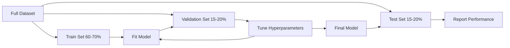

# Model Evaluation

> Một mô hình chỉ tốt bằng cách bạn đo lường nó.

**Type:** Build
**Languages:** Python
**Prerequisites:** Phase 1 (Probability & Distributions, Statistics for ML), Phase 2 Lessons 1-8
**Time:** ~90 minutes

## Learning Objectives

- Triển khai xác thực chéo K-fold và K-fold phân tầng từ đầu và giải thích tại sao phân tầng quan trọng với dữ liệu mất cân bằng
- Tính precision, recall, F1, AUC-ROC và các chỉ số hồi quy (MSE, RMSE, MAE, R-bình phương) từ đầu
- Diễn giải các đường cong học để chẩn đoán một mô hình có độ chệch cao hay phương sai cao
- Xác định các lỗi đánh giá phổ biến bao gồm rò rỉ dữ liệu, lựa chọn sai chỉ số và làm nhiễm tập kiểm tra

## The Problem

Bạn đã huấn luyện một mô hình. Nó đạt độ chính xác 95% trên dữ liệu của bạn. Nó có tốt không?

Có thể. Có thể không. Nếu 95% dữ liệu thuộc một lớp, một mô hình luôn dự đoán lớp đó đạt độ chính xác 95% trong khi hoàn toàn vô ích. Nếu bạn đánh giá trên cùng dữ liệu đã huấn luyện, con số 95% vô nghĩa vì mô hình chỉ ghi nhớ các câu trả lời. Nếu tập dữ liệu có một thành phần thời gian và bạn xáo trộn ngẫu nhiên trước khi chia, mô hình có thể đang sử dụng dữ liệu tương lai để dự đoán quá khứ.

Đánh giá mô hình là nơi hầu hết các dự án ML sai lầm. Chỉ số sai làm một mô hình xấu trông tốt. Phần chia sai để mô hình gian lận. So sánh sai khiến bạn chọn mô hình kém hơn. Đánh giá đúng không phải tùy chọn. Nó là sự khác biệt giữa một mô hình hoạt động trong sản xuất và một mô hình thất bại ngay khi thấy dữ liệu thực.

## The Concept

### Train, Validation, Test



Ba phần chia, ba mục đích:

- **Tập huấn luyện**: mô hình học từ dữ liệu này. Nó thấy các ví dụ này trong huấn luyện.
- **Tập xác thực**: dùng để điều chỉnh siêu tham số và lựa chọn giữa các mô hình. Mô hình không bao giờ huấn luyện trên dữ liệu này, nhưng các quyết định của bạn chịu ảnh hưởng bởi nó.
- **Tập kiểm tra**: được sử dụng đúng một lần, vào cuối cùng, để báo cáo hiệu năng cuối. Nếu bạn nhìn hiệu năng kiểm tra rồi quay lại thay đổi mô hình, nó không còn là tập kiểm tra. Nó đã trở thành một tập xác thực thứ hai.

Tập kiểm tra là bảo đảm giữ riêng của bạn rằng hiệu năng báo cáo phản ánh cách mô hình sẽ hoạt động trên dữ liệu thực sự chưa thấy.

### K-Fold Cross-Validation

Với các tập dữ liệu nhỏ, một lần chia huấn luyện/xác thực duy nhất lãng phí dữ liệu và cho các ước lượng nhiễu. Xác thực chéo K-fold sử dụng tất cả dữ liệu cho cả huấn luyện và xác thực:

```mermaid
flowchart TB
    subgraph Fold1["Fold 1"]
        direction LR
        V1["Val"] --- T1a["Train"] --- T1b["Train"] --- T1c["Train"] --- T1d["Train"]
    end
    subgraph Fold2["Fold 2"]
        direction LR
        T2a["Train"] --- V2["Val"] --- T2b["Train"] --- T2c["Train"] --- T2d["Train"]
    end
    subgraph Fold3["Fold 3"]
        direction LR
        T3a["Train"] --- T3b["Train"] --- V3["Val"] --- T3c["Train"] --- T3d["Train"]
    end
    subgraph Fold4["Fold 4"]
        direction LR
        T4a["Train"] --- T4b["Train"] --- T4c["Train"] --- V4["Val"] --- T4d["Train"]
    end
    subgraph Fold5["Fold 5"]
        direction LR
        T5a["Train"] --- T5b["Train"] --- T5c["Train"] --- T5d["Train"] --- V5["Val"]
    end
    Fold1 --> R["Average scores"]
    Fold2 --> R
    Fold3 --> R
    Fold4 --> R
    Fold5 --> R
```



1. Chia dữ liệu thành K fold có kích thước bằng nhau
2. Với mỗi fold, huấn luyện trên K-1 fold và xác thực trên fold còn lại
3. Lấy trung bình K điểm xác thực

K=5 hoặc K=10 là các lựa chọn tiêu chuẩn. Mỗi điểm dữ liệu được dùng để xác thực đúng một lần. Điểm trung bình là một ước lượng ổn định hơn bất kỳ lần chia đơn lẻ nào.

**K-fold phân tầng**: bảo toàn phân phối lớp trong mỗi fold. Nếu tập dữ liệu có 70% lớp A và 30% lớp B, mỗi fold sẽ có tỉ lệ xấp xỉ như vậy. Điều này quan trọng với các tập dữ liệu mất cân bằng nơi một lần chia ngẫu nhiên có thể đưa tất cả mẫu thiểu số vào một fold.

### Classification Metrics

**Ma trận nhầm lẫn**: nền tảng. Với phân loại nhị phân:

|  | Dự đoán Dương | Dự đoán Âm |
|--|---|---|
| Thực tế Dương | Dương tính Thật (TP) | Âm tính Giả (FN) |
| Thực tế Âm | Dương tính Giả (FP) | Âm tính Thật (TN) |

Từ ma trận này, mọi chỉ số khác suy ra:

- **Accuracy** = (TP + TN) / (TP + TN + FP + FN). Tỉ lệ các dự đoán đúng. Gây hiểu lầm khi các lớp mất cân bằng.
- **Precision** = TP / (TP + FP). Trong tất cả những thứ được dự đoán dương, có bao nhiêu thực sự dương? Sử dụng khi dương tính giả tốn kém (ví dụ, bộ lọc thư rác đánh dấu email thật là thư rác).
- **Recall** (độ nhạy) = TP / (TP + FN). Trong tất cả trường hợp thực sự dương, chúng ta phát hiện bao nhiêu? Sử dụng khi âm tính giả tốn kém (ví dụ, sàng lọc ung thư bỏ sót một khối u).
- **Điểm F1** = 2 * precision * recall / (precision + recall). Trung bình điều hòa của precision và recall. Cân bằng cả hai khi không chỉ số nào rõ ràng chi phối.
- **AUC-ROC**: Diện tích Dưới đường cong Đặc trưng Hoạt động của Bộ thu. Vẽ tỉ lệ dương tính thật theo tỉ lệ dương tính giả tại các ngưỡng phân loại khác nhau. AUC = 0.5 nghĩa là đoán ngẫu nhiên, AUC = 1.0 nghĩa là phân tách hoàn hảo. Độc lập với ngưỡng: nó đo mức độ mô hình xếp hạng các trường hợp dương cao hơn âm, bất kể điểm cắt bạn chọn.

### Regression Metrics

- **MSE** (Sai số Bình phương Trung bình) = mean((y_true - y_pred)^2). Phạt các sai số lớn theo bậc hai. Nhạy với ngoại lệ.
- **RMSE** (Căn Sai số Bình phương Trung bình) = sqrt(MSE). Cùng đơn vị với biến mục tiêu. Dễ diễn giải hơn MSE.
- **MAE** (Sai số Tuyệt đối Trung bình) = mean(|y_true - y_pred|). Xử lý mọi sai số tuyến tính. Bền vững với ngoại lệ hơn MSE.
- **R-bình phương** = 1 - SS_res / SS_tot, trong đó SS_res = sum((y_true - y_pred)^2) và SS_tot = sum((y_true - y_mean)^2). Phần phương sai được mô hình giải thích. R^2 = 1.0 là hoàn hảo. R^2 = 0.0 nghĩa là mô hình không tốt hơn việc luôn dự đoán trung bình. R^2 có thể âm nếu mô hình tệ hơn trung bình.

### Learning Curves

Vẽ các điểm huấn luyện và xác thực như một hàm của kích thước tập huấn luyện:

- **Độ chệch cao (khớp chưa đủ)**: cả hai đường cong hội tụ về một điểm thấp. Thêm dữ liệu sẽ không giúp. Bạn cần một mô hình phức tạp hơn.
- **Phương sai cao (khớp quá mức)**: điểm huấn luyện cao nhưng điểm xác thực thấp hơn nhiều. Khoảng cách giữa chúng lớn. Thêm dữ liệu sẽ giúp.

### Validation Curves

Vẽ các điểm huấn luyện và xác thực như một hàm của một siêu tham số:

- Ở độ phức tạp thấp: cả hai điểm đều thấp (khớp chưa đủ)
- Ở độ phức tạp phù hợp: cả hai điểm đều cao và gần nhau
- Ở độ phức tạp cao: điểm huấn luyện giữ cao nhưng điểm xác thực giảm (khớp quá mức)

Giá trị siêu tham số tối ưu là nơi điểm xác thực đạt đỉnh.

### Common Evaluation Mistakes

**Rò rỉ dữ liệu**: thông tin từ tập kiểm tra rò rỉ vào huấn luyện. Ví dụ: khớp một bộ co giãn trên toàn bộ tập dữ liệu trước khi chia, đưa dữ liệu tương lai vào dự đoán chuỗi thời gian, sử dụng một đặc trưng được suy ra từ mục tiêu. Luôn chia trước, rồi tiền xử lý.

**Mất cân bằng lớp**: 99% giao dịch hợp lệ, 1% gian lận. Một mô hình luôn dự đoán "hợp lệ" đạt accuracy 99%. Thay vào đó sử dụng precision, recall, F1 hoặc AUC-ROC.

**Sai chỉ số**: tối ưu hóa accuracy khi nên tối ưu hóa recall (chẩn đoán y khoa), hoặc tối ưu hóa RMSE khi dữ liệu có các ngoại lệ nặng (thay bằng MAE).

**Không sử dụng các phần chia phân tầng**: với dữ liệu mất cân bằng, một lần chia ngẫu nhiên có thể đặt rất ít mẫu thiểu số vào fold xác thực, cho các ước lượng không ổn định.

**Kiểm tra quá thường xuyên**: mỗi khi nhìn hiệu năng kiểm tra và điều chỉnh, bạn khớp quá mức với tập kiểm tra. Tập kiểm tra chỉ dùng một lần.

```figure
precision-recall-threshold
```

## Build It

### Step 1: Train/validation/test split

```python
import random
import math


def train_val_test_split(X, y, train_ratio=0.6, val_ratio=0.2, seed=42):
    random.seed(seed)
    n = len(X)
    indices = list(range(n))
    random.shuffle(indices)

    train_end = int(n * train_ratio)
    val_end = int(n * (train_ratio + val_ratio))

    train_idx = indices[:train_end]
    val_idx = indices[train_end:val_end]
    test_idx = indices[val_end:]

    X_train = [X[i] for i in train_idx]
    y_train = [y[i] for i in train_idx]
    X_val = [X[i] for i in val_idx]
    y_val = [y[i] for i in val_idx]
    X_test = [X[i] for i in test_idx]
    y_test = [y[i] for i in test_idx]

    return X_train, y_train, X_val, y_val, X_test, y_test
```

### Step 2: K-fold and stratified K-fold cross-validation

```python
def kfold_split(n, k=5, seed=42):
    random.seed(seed)
    indices = list(range(n))
    random.shuffle(indices)

    fold_size = n // k
    folds = []

    for i in range(k):
        start = i * fold_size
        end = start + fold_size if i < k - 1 else n
        val_idx = indices[start:end]
        train_idx = indices[:start] + indices[end:]
        folds.append((train_idx, val_idx))

    return folds


def stratified_kfold_split(y, k=5, seed=42):
    random.seed(seed)

    class_indices = {}
    for i, label in enumerate(y):
        class_indices.setdefault(label, []).append(i)

    for label in class_indices:
        random.shuffle(class_indices[label])

    folds = [{"train": [], "val": []} for _ in range(k)]

    for label, indices in class_indices.items():
        fold_size = len(indices) // k
        for i in range(k):
            start = i * fold_size
            end = start + fold_size if i < k - 1 else len(indices)
            val_part = indices[start:end]
            train_part = indices[:start] + indices[end:]
            folds[i]["val"].extend(val_part)
            folds[i]["train"].extend(train_part)

    return [(f["train"], f["val"]) for f in folds]


def cross_validate(X, y, model_fn, k=5, metric_fn=None, stratified=False):
    n = len(X)

    if stratified:
        folds = stratified_kfold_split(y, k)
    else:
        folds = kfold_split(n, k)

    scores = []
    for train_idx, val_idx in folds:
        X_train = [X[i] for i in train_idx]
        y_train = [y[i] for i in train_idx]
        X_val = [X[i] for i in val_idx]
        y_val = [y[i] for i in val_idx]

        model = model_fn()
        model.fit(X_train, y_train)
        predictions = [model.predict(x) for x in X_val]

        if metric_fn:
            score = metric_fn(y_val, predictions)
        else:
            score = sum(1 for yt, yp in zip(y_val, predictions) if yt == yp) / len(y_val)
        scores.append(score)

    return scores
```

### Step 3: Confusion matrix and classification metrics

```python
def confusion_matrix(y_true, y_pred):
    tp = sum(1 for yt, yp in zip(y_true, y_pred) if yt == 1 and yp == 1)
    tn = sum(1 for yt, yp in zip(y_true, y_pred) if yt == 0 and yp == 0)
    fp = sum(1 for yt, yp in zip(y_true, y_pred) if yt == 0 and yp == 1)
    fn = sum(1 for yt, yp in zip(y_true, y_pred) if yt == 1 and yp == 0)
    return tp, tn, fp, fn


def accuracy(y_true, y_pred):
    tp, tn, fp, fn = confusion_matrix(y_true, y_pred)
    total = tp + tn + fp + fn
    return (tp + tn) / total if total > 0 else 0.0


def precision(y_true, y_pred):
    tp, tn, fp, fn = confusion_matrix(y_true, y_pred)
    return tp / (tp + fp) if (tp + fp) > 0 else 0.0


def recall(y_true, y_pred):
    tp, tn, fp, fn = confusion_matrix(y_true, y_pred)
    return tp / (tp + fn) if (tp + fn) > 0 else 0.0


def f1_score(y_true, y_pred):
    p = precision(y_true, y_pred)
    r = recall(y_true, y_pred)
    return 2 * p * r / (p + r) if (p + r) > 0 else 0.0


def roc_curve(y_true, y_scores):
    thresholds = sorted(set(y_scores), reverse=True)
    tpr_list = []
    fpr_list = []

    total_positives = sum(y_true)
    total_negatives = len(y_true) - total_positives

    for threshold in thresholds:
        y_pred = [1 if s >= threshold else 0 for s in y_scores]
        tp = sum(1 for yt, yp in zip(y_true, y_pred) if yt == 1 and yp == 1)
        fp = sum(1 for yt, yp in zip(y_true, y_pred) if yt == 0 and yp == 1)

        tpr = tp / total_positives if total_positives > 0 else 0.0
        fpr = fp / total_negatives if total_negatives > 0 else 0.0

        tpr_list.append(tpr)
        fpr_list.append(fpr)

    return fpr_list, tpr_list, thresholds


def auc_roc(y_true, y_scores):
    fpr_list, tpr_list, _ = roc_curve(y_true, y_scores)

    pairs = sorted(zip(fpr_list, tpr_list))
    fpr_sorted = [p[0] for p in pairs]
    tpr_sorted = [p[1] for p in pairs]

    area = 0.0
    for i in range(1, len(fpr_sorted)):
        width = fpr_sorted[i] - fpr_sorted[i - 1]
        height = (tpr_sorted[i] + tpr_sorted[i - 1]) / 2
        area += width * height

    return area
```

### Step 4: Regression metrics

```python
def mse(y_true, y_pred):
    n = len(y_true)
    return sum((yt - yp) ** 2 for yt, yp in zip(y_true, y_pred)) / n


def rmse(y_true, y_pred):
    return math.sqrt(mse(y_true, y_pred))


def mae(y_true, y_pred):
    n = len(y_true)
    return sum(abs(yt - yp) for yt, yp in zip(y_true, y_pred)) / n


def r_squared(y_true, y_pred):
    mean_y = sum(y_true) / len(y_true)
    ss_res = sum((yt - yp) ** 2 for yt, yp in zip(y_true, y_pred))
    ss_tot = sum((yt - mean_y) ** 2 for yt in y_true)
    if ss_tot == 0:
        return 0.0
    return 1.0 - ss_res / ss_tot
```

### Step 5: Learning curves

```python
def learning_curve(X, y, model_fn, metric_fn, train_sizes=None, val_ratio=0.2, seed=42):
    random.seed(seed)
    n = len(X)
    indices = list(range(n))
    random.shuffle(indices)

    val_size = int(n * val_ratio)
    val_idx = indices[:val_size]
    pool_idx = indices[val_size:]

    X_val = [X[i] for i in val_idx]
    y_val = [y[i] for i in val_idx]

    if train_sizes is None:
        train_sizes = [int(len(pool_idx) * r) for r in [0.1, 0.2, 0.4, 0.6, 0.8, 1.0]]

    train_scores = []
    val_scores = []

    for size in train_sizes:
        subset = pool_idx[:size]
        X_train = [X[i] for i in subset]
        y_train = [y[i] for i in subset]

        model = model_fn()
        model.fit(X_train, y_train)

        train_pred = [model.predict(x) for x in X_train]
        val_pred = [model.predict(x) for x in X_val]

        train_scores.append(metric_fn(y_train, train_pred))
        val_scores.append(metric_fn(y_val, val_pred))

    return train_sizes, train_scores, val_scores
```

### Step 6: A simple classifier for testing, plus the full demo

```python
class SimpleLogistic:
    def __init__(self, lr=0.1, epochs=100):
        self.lr = lr
        self.epochs = epochs
        self.weights = None
        self.bias = 0.0

    def sigmoid(self, z):
        z = max(-500, min(500, z))
        return 1.0 / (1.0 + math.exp(-z))

    def fit(self, X, y):
        n_features = len(X[0])
        self.weights = [0.0] * n_features
        self.bias = 0.0

        for _ in range(self.epochs):
            for xi, yi in zip(X, y):
                z = sum(w * x for w, x in zip(self.weights, xi)) + self.bias
                pred = self.sigmoid(z)
                error = yi - pred
                for j in range(n_features):
                    self.weights[j] += self.lr * error * xi[j]
                self.bias += self.lr * error

    def predict_proba(self, x):
        z = sum(w * xi for w, xi in zip(self.weights, x)) + self.bias
        return self.sigmoid(z)

    def predict(self, x):
        return 1 if self.predict_proba(x) >= 0.5 else 0


class SimpleLinearRegression:
    def __init__(self, lr=0.001, epochs=200):
        self.lr = lr
        self.epochs = epochs
        self.weights = None
        self.bias = 0.0

    def fit(self, X, y):
        n_features = len(X[0])
        self.weights = [0.0] * n_features
        self.bias = 0.0
        n = len(X)

        for _ in range(self.epochs):
            for xi, yi in zip(X, y):
                pred = sum(w * x for w, x in zip(self.weights, xi)) + self.bias
                error = yi - pred
                for j in range(n_features):
                    self.weights[j] += self.lr * error * xi[j] / n
                self.bias += self.lr * error / n

    def predict(self, x):
        return sum(w * xi for w, xi in zip(self.weights, x)) + self.bias


def standardize(values):
    n = len(values)
    mean = sum(values) / n
    var = sum((v - mean) ** 2 for v in values) / n
    std = math.sqrt(var) if var > 0 else 1.0
    return [(v - mean) / std for v in values], mean, std


def make_classification_data(n=300, seed=42):
    random.seed(seed)
    X = []
    y = []
    for _ in range(n):
        x1 = random.gauss(0, 1)
        x2 = random.gauss(0, 1)
        label = 1 if (x1 + x2 + random.gauss(0, 0.5)) > 0 else 0
        X.append([x1, x2])
        y.append(label)
    return X, y


def make_regression_data(n=200, seed=42):
    random.seed(seed)
    X = []
    y = []
    for _ in range(n):
        x1 = random.uniform(0, 10)
        x2 = random.uniform(0, 5)
        target = 3 * x1 + 2 * x2 + random.gauss(0, 2)
        X.append([x1, x2])
        y.append(target)
    return X, y


def make_imbalanced_data(n=300, minority_ratio=0.05, seed=42):
    random.seed(seed)
    X = []
    y = []
    for _ in range(n):
        if random.random() < minority_ratio:
            x1 = random.gauss(3, 0.5)
            x2 = random.gauss(3, 0.5)
            label = 1
        else:
            x1 = random.gauss(0, 1)
            x2 = random.gauss(0, 1)
            label = 0
        X.append([x1, x2])
        y.append(label)
    return X, y


if __name__ == "__main__":
    X_clf, y_clf = make_classification_data(300)

    print("=== Train/Validation/Test Split ===")
    X_train, y_train, X_val, y_val, X_test, y_test = train_val_test_split(X_clf, y_clf)
    print(f"  Train: {len(X_train)}, Val: {len(X_val)}, Test: {len(X_test)}")
    print(f"  Train class distribution: {sum(y_train)}/{len(y_train)} positive")
    print(f"  Val class distribution: {sum(y_val)}/{len(y_val)} positive")

    model = SimpleLogistic(lr=0.1, epochs=200)
    model.fit(X_train, y_train)

    print("\n=== Classification Metrics ===")
    y_pred = [model.predict(x) for x in X_test]
    tp, tn, fp, fn = confusion_matrix(y_test, y_pred)
    print(f"  Confusion matrix: TP={tp}, TN={tn}, FP={fp}, FN={fn}")
    print(f"  Accuracy:  {accuracy(y_test, y_pred):.4f}")
    print(f"  Precision: {precision(y_test, y_pred):.4f}")
    print(f"  Recall:    {recall(y_test, y_pred):.4f}")
    print(f"  F1 Score:  {f1_score(y_test, y_pred):.4f}")

    y_scores = [model.predict_proba(x) for x in X_test]
    auc = auc_roc(y_test, y_scores)
    print(f"  AUC-ROC:   {auc:.4f}")

    print("\n=== K-Fold Cross-Validation (K=5) ===")
    cv_scores = cross_validate(
        X_clf, y_clf,
        model_fn=lambda: SimpleLogistic(lr=0.1, epochs=200),
        k=5,
        metric_fn=accuracy,
    )
    mean_cv = sum(cv_scores) / len(cv_scores)
    std_cv = math.sqrt(sum((s - mean_cv) ** 2 for s in cv_scores) / len(cv_scores))
    print(f"  Fold scores: {[round(s, 4) for s in cv_scores]}")
    print(f"  Mean: {mean_cv:.4f} (+/- {std_cv:.4f})")

    print("\n=== Stratified K-Fold Cross-Validation (K=5) ===")
    strat_scores = cross_validate(
        X_clf, y_clf,
        model_fn=lambda: SimpleLogistic(lr=0.1, epochs=200),
        k=5,
        metric_fn=accuracy,
        stratified=True,
    )
    strat_mean = sum(strat_scores) / len(strat_scores)
    strat_std = math.sqrt(sum((s - strat_mean) ** 2 for s in strat_scores) / len(strat_scores))
    print(f"  Fold scores: {[round(s, 4) for s in strat_scores]}")
    print(f"  Mean: {strat_mean:.4f} (+/- {strat_std:.4f})")

    print("\n=== Imbalanced Data: Why Accuracy Lies ===")
    X_imb, y_imb = make_imbalanced_data(300, minority_ratio=0.05)
    positives = sum(y_imb)
    print(f"  Class distribution: {positives} positive, {len(y_imb) - positives} negative ({positives/len(y_imb)*100:.1f}% positive)")

    always_negative = [0] * len(y_imb)
    print(f"  Always-negative baseline:")
    print(f"    Accuracy:  {accuracy(y_imb, always_negative):.4f}")
    print(f"    Precision: {precision(y_imb, always_negative):.4f}")
    print(f"    Recall:    {recall(y_imb, always_negative):.4f}")
    print(f"    F1 Score:  {f1_score(y_imb, always_negative):.4f}")

    X_tr_i, y_tr_i, X_v_i, y_v_i, X_te_i, y_te_i = train_val_test_split(X_imb, y_imb)
    model_imb = SimpleLogistic(lr=0.5, epochs=500)
    model_imb.fit(X_tr_i, y_tr_i)
    y_pred_imb = [model_imb.predict(x) for x in X_te_i]
    print(f"\n  Trained model on imbalanced data:")
    print(f"    Accuracy:  {accuracy(y_te_i, y_pred_imb):.4f}")
    print(f"    Precision: {precision(y_te_i, y_pred_imb):.4f}")
    print(f"    Recall:    {recall(y_te_i, y_pred_imb):.4f}")
    print(f"    F1 Score:  {f1_score(y_te_i, y_pred_imb):.4f}")

    print("\n=== Regression Metrics ===")
    X_reg, y_reg = make_regression_data(200)

    col0 = [x[0] for x in X_reg]
    col1 = [x[1] for x in X_reg]
    col0_s, m0, s0 = standardize(col0)
    col1_s, m1, s1 = standardize(col1)
    X_reg_scaled = [[col0_s[i], col1_s[i]] for i in range(len(X_reg))]

    X_tr_r, y_tr_r, X_v_r, y_v_r, X_te_r, y_te_r = train_val_test_split(X_reg_scaled, y_reg)
    reg_model = SimpleLinearRegression(lr=0.01, epochs=500)
    reg_model.fit(X_tr_r, y_tr_r)
    y_pred_r = [reg_model.predict(x) for x in X_te_r]

    print(f"  MSE:       {mse(y_te_r, y_pred_r):.4f}")
    print(f"  RMSE:      {rmse(y_te_r, y_pred_r):.4f}")
    print(f"  MAE:       {mae(y_te_r, y_pred_r):.4f}")
    print(f"  R-squared: {r_squared(y_te_r, y_pred_r):.4f}")

    mean_baseline = [sum(y_tr_r) / len(y_tr_r)] * len(y_te_r)
    print(f"\n  Mean baseline:")
    print(f"    MSE:       {mse(y_te_r, mean_baseline):.4f}")
    print(f"    R-squared: {r_squared(y_te_r, mean_baseline):.4f}")

    print("\n=== Learning Curve ===")
    sizes, train_sc, val_sc = learning_curve(
        X_clf, y_clf,
        model_fn=lambda: SimpleLogistic(lr=0.1, epochs=200),
        metric_fn=accuracy,
    )
    print(f"  {'Size':>6} {'Train':>8} {'Val':>8}")
    for s, tr, va in zip(sizes, train_sc, val_sc):
        print(f"  {s:>6} {tr:>8.4f} {va:>8.4f}")

    print("\n=== Statistical Model Comparison ===")
    model_a_scores = cross_validate(
        X_clf, y_clf,
        model_fn=lambda: SimpleLogistic(lr=0.1, epochs=100),
        k=5, metric_fn=accuracy,
    )
    model_b_scores = cross_validate(
        X_clf, y_clf,
        model_fn=lambda: SimpleLogistic(lr=0.1, epochs=500),
        k=5, metric_fn=accuracy,
    )
    diffs = [a - b for a, b in zip(model_a_scores, model_b_scores)]
    mean_diff = sum(diffs) / len(diffs)
    std_diff = math.sqrt(sum((d - mean_diff) ** 2 for d in diffs) / len(diffs))
    t_stat = mean_diff / (std_diff / math.sqrt(len(diffs))) if std_diff > 0 else 0.0
    print(f"  Model A (100 epochs) mean: {sum(model_a_scores)/len(model_a_scores):.4f}")
    print(f"  Model B (500 epochs) mean: {sum(model_b_scores)/len(model_b_scores):.4f}")
    print(f"  Mean difference: {mean_diff:.4f}")
    print(f"  Paired t-statistic: {t_stat:.4f}")
    print(f"  (|t| > 2.78 for significance at p<0.05 with df=4)")
```

## Use It

Với scikit-learn, đánh giá được tích hợp vào quy trình:

```python
from sklearn.model_selection import cross_val_score, StratifiedKFold, learning_curve
from sklearn.metrics import (
    accuracy_score, precision_score, recall_score, f1_score,
    roc_auc_score, confusion_matrix, mean_squared_error, r2_score,
)
from sklearn.linear_model import LogisticRegression

model = LogisticRegression()
scores = cross_val_score(model, X, y, cv=StratifiedKFold(5), scoring="f1")
```

Các phiên bản từ đầu cho thấy chính xác xác thực chéo làm gì (không phép thuật, chỉ các vòng lặp for và theo dõi chỉ số), cách mỗi chỉ số được tính (chỉ đếm TP/FP/TN/FN) và tại sao phân tầng quan trọng (bảo toàn tỉ lệ lớp trong mỗi fold). Các phiên bản thư viện thêm tính song song, nhiều lựa chọn chấm điểm hơn và tích hợp với pipeline.

## Ship It

Bài học này tạo ra:
- `outputs/skill-evaluation.md` - một skill bao quát chiến lược đánh giá cho các mô hình phân loại và hồi quy

## Exercises

1. Triển khai các đường cong precision-recall: vẽ precision theo recall tại các ngưỡng khác nhau. Tính average precision (diện tích dưới đường cong PR). So sánh đường cong PR với đường cong ROC trên một tập dữ liệu mất cân bằng và giải thích khi nào mỗi loại cung cấp nhiều thông tin hơn.
2. Xây dựng một vòng lặp xác thực chéo lồng nhau: vòng ngoài đánh giá hiệu năng mô hình, vòng trong điều chỉnh siêu tham số. Sử dụng nó để so sánh hai mô hình công bằng mà không rò rỉ dữ liệu xác thực vào đánh giá.
3. Triển khai một kiểm định hoán vị để so sánh mô hình: xáo trộn nhãn, huấn luyện lại và đo hiệu năng. Lặp lại 100 lần để xây dựng một phân phối không. Tính p-value của hiệu năng mô hình quan sát so với phân phối này.

## Key Terms

| Thuật ngữ | Cách mọi người nói | Ý nghĩa thực sự |
|------|----------------|----------------------|
| Overfitting (Khớp quá mức) | "Ghi nhớ dữ liệu huấn luyện" | Mô hình nắm bắt nhiễu trong dữ liệu huấn luyện, hoạt động tốt trên huấn luyện nhưng kém trên dữ liệu chưa thấy |
| Cross-validation (Xác thực chéo) | "Kiểm tra trên các tập con khác nhau" | Luân phiên có hệ thống phần dữ liệu được dùng để xác thực, lấy trung bình kết quả trên tất cả lần luân phiên |
| Precision | "Bao nhiêu dự đoán dương là đúng" | TP / (TP + FP): tỉ lệ các dự đoán dương thực sự là dương |
| Recall | "Bao nhiêu trường hợp thực sự dương chúng ta tìm được" | TP / (TP + FN): tỉ lệ các trường hợp thực sự dương được nhận diện đúng |
| AUC-ROC | "Mô hình phân tách các lớp tốt đến mức nào" | Diện tích dưới đường cong tỉ lệ dương tính thật theo tỉ lệ dương tính giả trên tất cả ngưỡng, từ 0.5 (ngẫu nhiên) đến 1.0 (hoàn hảo) |
| R-squared (R-bình phương) | "Bao nhiêu phương sai được giải thích" | 1 - (tổng bình phương phần dư / tổng bình phương toàn phần): phần phương sai mục tiêu được mô hình nắm bắt |
| Data leakage (Rò rỉ dữ liệu) | "Mô hình gian lận" | Sử dụng thông tin trong huấn luyện mà không có ở thời điểm dự đoán, dẫn đến đánh giá lạc quan |
| Learning curve (Đường cong học) | "Hiệu năng thay đổi thế nào khi có thêm dữ liệu" | Một đồ thị điểm huấn luyện và xác thực theo kích thước tập huấn luyện, bộc lộ khớp chưa đủ hoặc khớp quá mức |
| Stratified split (Chia phân tầng) | "Giữ tỉ lệ lớp cân bằng" | Chia dữ liệu để mỗi tập con có cùng tỉ lệ mỗi lớp như toàn bộ tập dữ liệu |

## Further Reading

- [scikit-learn Model Selection Guide](https://scikit-learn.org/stable/model_selection.html) - tài liệu tham khảo toàn diện về xác thực chéo, các chỉ số và điều chỉnh siêu tham số
- [Beyond Accuracy: Precision and Recall (Google ML Crash Course)](https://developers.google.com/machine-learning/crash-course/classification/precision-and-recall) - giải thích rõ ràng với các ví dụ tương tác
- [A Survey of Cross-Validation Procedures (Arlot & Celisse, 2010)](https://projecteuclid.org/journals/statistics-surveys/volume-4/issue-none/A-survey-of-cross-validation-procedures-for-model-selection/10.1214/09-SS054.full) - trình bày chặt chẽ khi nào và tại sao các chiến lược CV khác nhau hoạt động
