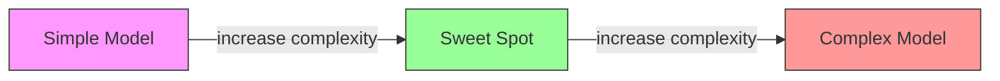
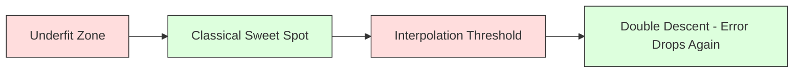
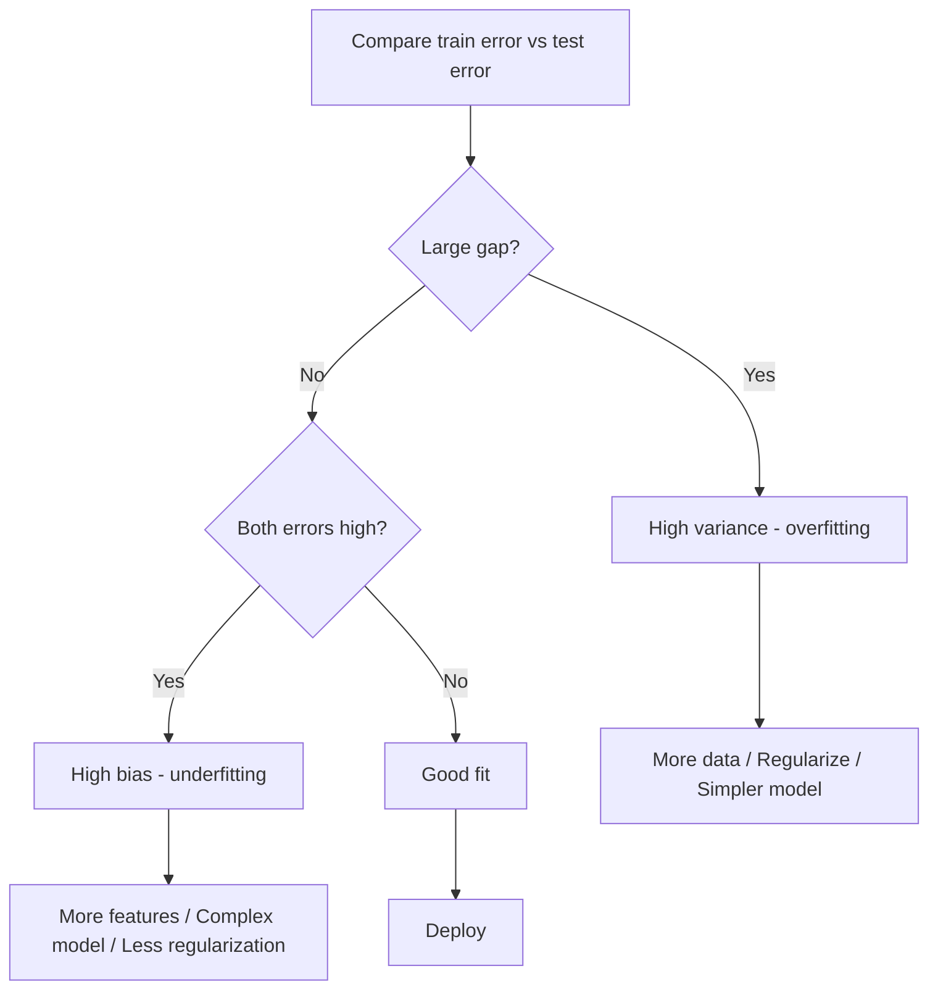
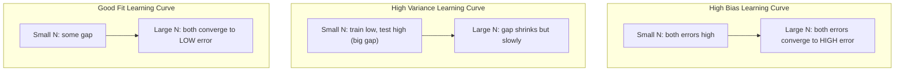
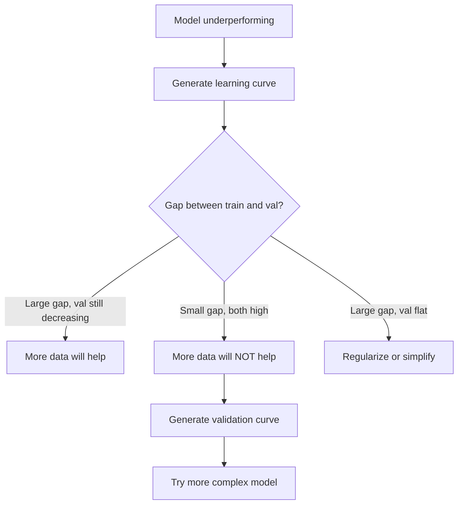

# Bias-Variance Tradeoff

> Mọi sai số mô hình đến từ một trong ba nguồn: độ chệch, phương sai hoặc nhiễu. Bạn chỉ có thể điều khiển hai nguồn đầu.

**Type:** Learn
**Language:** Python
**Prerequisites:** Phase 2, Lessons 01-09 (ML basics, regression, classification, evaluation)
**Time:** ~75 minutes

## Learning Objectives

- Suy ra phân rã độ chệch-phương sai của sai số dự đoán kỳ vọng và giải thích vai trò của nhiễu không thể giảm
- Chẩn đoán một mô hình có độ chệch cao hay phương sai cao bằng các mẫu sai số huấn luyện và kiểm tra
- Giải thích cách các kỹ thuật regularization (L1, L2, dropout, dừng sớm) đánh đổi độ chệch lấy phương sai
- Triển khai các thí nghiệm trực quan hóa sự đánh đổi độ chệch-phương sai trên các mô hình có độ phức tạp tăng dần

## The Problem

Bạn đã huấn luyện một mô hình. Nó có một mức sai số trên dữ liệu kiểm tra. Sai số đó đến từ đâu?

Nếu mô hình quá đơn giản (hồi quy tuyến tính trên một tập dữ liệu cong), nó sẽ liên tục bỏ lỡ mẫu thực. Đó là độ chệch. Nếu mô hình quá phức tạp (đa thức bậc 20 trên 15 điểm dữ liệu), nó sẽ khớp hoàn hảo dữ liệu huấn luyện nhưng cho các dự đoán rất khác nhau trên dữ liệu mới. Đó là phương sai.

Bạn không thể tối thiểu hóa cả hai cùng lúc với một năng lực mô hình cố định. Đẩy độ chệch xuống và phương sai tăng. Đẩy phương sai xuống và độ chệch tăng. Hiểu sự đánh đổi này là kỹ năng chẩn đoán hữu ích nhất trong học máy. Nó cho bạn biết nên làm mô hình phức tạp hơn hay đơn giản hơn, nên lấy thêm dữ liệu hay tạo các đặc trưng tốt hơn, nên regularization nhiều hơn hay ít hơn.

## The Concept

### Bias: Systematic Error

Độ chệch đo dự đoán trung bình của mô hình lệch bao xa so với giá trị thực. Nếu bạn huấn luyện cùng mô hình trên nhiều tập huấn luyện khác nhau được rút từ cùng phân phối và lấy trung bình dự đoán, độ chệch là khoảng cách giữa trung bình đó và sự thật.

Độ chệch cao nghĩa là mô hình quá cứng nhắc để nắm bắt mẫu thực. Một đường thẳng khớp với một parabol sẽ luôn bỏ lỡ đường cong, bất kể bạn cho nó bao nhiêu dữ liệu. Đây là khớp chưa đủ.

```
High bias (underfitting):
  Model always predicts roughly the same wrong thing.
  Training error: HIGH
  Test error: HIGH
  Gap between them: SMALL
```

### Variance: Sensitivity to Training Data

Phương sai đo mức thay đổi dự đoán khi bạn huấn luyện trên các tập con dữ liệu khác nhau. Nếu các thay đổi nhỏ trong tập huấn luyện gây thay đổi lớn trong mô hình, phương sai cao.

Phương sai cao nghĩa là mô hình đang khớp nhiễu trong dữ liệu huấn luyện, không phải tín hiệu nền tảng. Một đa thức bậc 20 sẽ luồn qua mọi điểm huấn luyện nhưng dao động dữ dội giữa chúng. Đây là khớp quá mức.

```
High variance (overfitting):
  Model fits training data perfectly but fails on new data.
  Training error: LOW
  Test error: HIGH
  Gap between them: LARGE
```

### The Decomposition

Với bất kỳ điểm $x$ nào, sai số dự đoán kỳ vọng dưới mất mát bình phương phân rã chính xác:

```math
\begin{aligned}
& \text{Expected Error} = \text{Bias}^2 + \text{Variance} + \text{Irreducible Noise} \\[6pt]
& \text{where:} \\
& \quad \text{Bias}^2 = (\mathbb{E}[\hat{f}(x)] - f(x))^2 \\
& \quad \text{Variance} = \mathbb{E}[(\hat{f}(x) - \mathbb{E}[\hat{f}(x)])^2] \\
& \quad \text{Noise} = \mathbb{E}[(y - f(x))^2] \quad (\sigma^2)
\end{aligned}
```

- $f(x)$ là hàm thực
- $\hat{f}(x)$ là dự đoán của mô hình
- $\mathbb{E}[\ldots]$ là kỳ vọng trên các tập huấn luyện khác nhau
- $y$ là nhãn quan sát (hàm thực cộng nhiễu)

Số hạng nhiễu là không thể khử. Không mô hình nào có thể làm tốt hơn $\sigma^2$ trên dữ liệu có nhiễu. Công việc của bạn là tìm sự cân bằng phù hợp giữa $\text{bias}^2$ và phương sai.

### Model Complexity vs Error



Đường cong chữ U cổ điển:

| Độ phức tạp | Độ chệch | Phương sai | Tổng Sai số |
|-----------|------|----------|-------------|
| Quá thấp | CAO | THẤP | CAO (khớp chưa đủ) |
| Vừa đúng | VỪA PHẢI | VỪA PHẢI | THẤP NHẤT |
| Quá cao | THẤP | CAO | CAO (khớp quá mức) |

### Regularization as Bias-Variance Control

Regularization cố ý tăng độ chệch để giảm phương sai. Nó ràng buộc mô hình để không thể đuổi theo nhiễu.

- **L2 (Ridge):** Thu nhỏ mọi trọng số về phía không. Giữ mọi đặc trưng nhưng giảm ảnh hưởng của chúng.
- **L1 (Lasso):** Đẩy một số trọng số về đúng không. Thực hiện lựa chọn đặc trưng.
- **Dropout:** Vô hiệu hóa ngẫu nhiên các nơ-ron trong huấn luyện. Buộc các biểu diễn dư thừa.
- **Dừng sớm:** Dừng huấn luyện trước khi mô hình khớp đầy đủ dữ liệu huấn luyện.

Cường độ regularization (lambda, tỉ lệ dropout, số epoch) trực tiếp điều khiển vị trí của bạn trên đường cong độ chệch-phương sai. Nhiều regularization hơn nghĩa là độ chệch nhiều hơn, phương sai ít hơn.

### Double Descent: The Modern Perspective

Lý thuyết cổ điển nói: sau điểm cân bằng, nhiều độ phức tạp hơn luôn gây hại. Nhưng nghiên cứu từ năm 2019 cho thấy điều bất ngờ. Nếu bạn tiếp tục tăng năng lực mô hình vượt xa ngưỡng nội suy (nơi mô hình có đủ tham số để khớp hoàn hảo dữ liệu huấn luyện), sai số kiểm tra có thể giảm lần nữa.



Hiện tượng "giảm kép" này giải thích tại sao các mạng nơ-ron thừa tham số rất lớn (có nhiều tham số hơn nhiều so với ví dụ huấn luyện) vẫn tổng quát hóa tốt. Sự đánh đổi độ chệch-phương sai cổ điển không sai, nhưng không đầy đủ cho chế độ hiện đại.

Các quan sát chính về giảm kép:
- Nó xảy ra trong các mô hình tuyến tính, cây quyết định và mạng nơ-ron
- Nhiều dữ liệu hơn thực sự có thể gây hại trong vùng nội suy (giảm kép theo mẫu)
- Nhiều epoch huấn luyện hơn cũng có thể gây ra nó (giảm kép theo epoch)
- Regularization làm mượt đỉnh nhưng không loại bỏ nó

Tại sao điều này xảy ra? Tại ngưỡng nội suy, mô hình có vừa đủ năng lực để khớp mọi điểm huấn luyện. Nó bị buộc vào một nghiệm rất cụ thể luồn qua từng điểm, và các nhiễu loạn nhỏ trong dữ liệu gây ra các thay đổi lớn trong phép khớp. Đây là nơi phương sai đạt đỉnh. Vượt ngưỡng, mô hình có nhiều nghiệm có thể khớp dữ liệu hoàn hảo. Thuật toán học (ví dụ, gradient descent với regularization ngầm) có xu hướng chọn nghiệm đơn giản nhất trong số đó. Sự thiên lệch ngầm về các nghiệm đơn giản này là lý do các mô hình thừa tham số tổng quát hóa.

| Chế độ | Tham số so với Mẫu | Hành vi |
|--------|----------------------|----------|
| Thiếu tham số | $p \ll n$ | Đánh đổi cổ điển áp dụng |
| Ngưỡng nội suy | $p \sim n$ | Phương sai đạt đỉnh, sai số kiểm tra tăng vọt |
| Thừa tham số | $p \gg n$ | Regularization ngầm bắt đầu tác động, sai số kiểm tra giảm |

Cho mục đích thực tế: nếu bạn đang sử dụng mạng nơ-ron hoặc các tập hợp cây lớn, không dừng ở ngưỡng nội suy. Hoặc ở thấp hơn hẳn (với regularization tường minh) hoặc đi vượt xa nó. Vị trí tệ nhất là ngay tại ngưỡng.

### Diagnosing Your Model



| Triệu chứng | Chẩn đoán | Cách sửa |
|---------|-----------|-----|
| Sai số huấn luyện cao, sai số kiểm tra cao | Độ chệch | Thêm đặc trưng, mô hình phức tạp, ít regularization hơn |
| Sai số huấn luyện thấp, sai số kiểm tra cao | Phương sai | Thêm dữ liệu, regularization, mô hình đơn giản hơn, dropout |
| Sai số huấn luyện thấp, sai số kiểm tra thấp | Khớp tốt | Đưa vào sử dụng |
| Sai số huấn luyện giảm, sai số kiểm tra tăng | Đang khớp quá mức | Dừng sớm |

### Practical Strategies

**Khi độ chệch là vấn đề:**
- Thêm các đặc trưng đa thức hoặc tương tác
- Sử dụng một mô hình linh hoạt hơn (tập hợp cây thay vì tuyến tính)
- Giảm cường độ regularization
- Huấn luyện lâu hơn (nếu chưa hội tụ)

**Khi phương sai là vấn đề:**
- Lấy thêm dữ liệu huấn luyện
- Sử dụng bagging (rừng ngẫu nhiên)
- Tăng regularization (lambda cao hơn, nhiều dropout hơn)
- Lựa chọn đặc trưng (loại các đặc trưng nhiễu)
- Sử dụng xác thực chéo để phát hiện sớm

### Ensemble Methods and Variance Reduction

Các phương pháp tập hợp là công cụ thực tế nhất để chống phương sai.

**Bagging (Tổng hợp Bootstrap)** huấn luyện nhiều mô hình trên các mẫu bootstrap khác nhau của dữ liệu huấn luyện, rồi lấy trung bình các dự đoán. Mỗi mô hình riêng lẻ có phương sai cao, nhưng trung bình có phương sai thấp hơn nhiều. Rừng ngẫu nhiên là bagging được áp dụng cho các cây quyết định.

Tại sao nó hoạt động về mặt toán học: nếu bạn lấy trung bình $N$ dự đoán độc lập, mỗi dự đoán có phương sai $\sigma^2$, phương sai của trung bình là $\sigma^2 / N$. Các mô hình không thực sự độc lập (chúng đều thấy dữ liệu tương tự), nên mức giảm ít hơn $1/N$, nhưng vẫn đáng kể.

**Boosting** giảm độ chệch bằng cách xây dựng các mô hình tuần tự, nơi mỗi mô hình mới tập trung vào sai số của tập hợp cho đến lúc đó. Gradient boosting và AdaBoost là các ví dụ chính. Boosting có thể khớp quá mức nếu bạn thêm quá nhiều mô hình, nên cần dừng sớm hoặc regularization.

| Phương pháp | Tác động Chính | Thay đổi Độ chệch | Thay đổi Phương sai |
|--------|---------------|-------------|-----------------|
| Bagging | Giảm phương sai | Không thay đổi | Giảm |
| Boosting | Giảm độ chệch | Giảm | Có thể tăng |
| Stacking | Giảm cả hai | Phụ thuộc bộ học meta | Phụ thuộc các mô hình cơ sở |
| Dropout | Bagging ngầm | Tăng nhẹ | Giảm |

**Quy tắc thực tế:** nếu mô hình cơ sở có phương sai cao (cây sâu, đa thức bậc cao), sử dụng bagging. Nếu mô hình cơ sở có độ chệch cao (các decision stump nông, các mô hình tuyến tính đơn giản), sử dụng boosting.

### Learning Curves

Các đường cong học vẽ sai số huấn luyện và xác thực như một hàm của kích thước tập huấn luyện. Chúng là công cụ chẩn đoán thực tế nhất bạn có. Khác một so sánh huấn luyện/kiểm tra đơn lẻ, các đường cong học cho thấy quỹ đạo mô hình và cho bạn biết thêm dữ liệu có giúp hay không.



Cách đọc chúng:

| Tình huống | Sai số Huấn luyện | Sai số Xác thực | Khoảng cách | Ý nghĩa | Cần Làm gì |
|----------|---------------|-----------------|-----|---------------|------------|
| Độ chệch cao | Cao | Cao | Nhỏ | Mô hình không thể nắm bắt mẫu | Thêm đặc trưng, mô hình phức tạp, ít regularization hơn |
| Phương sai cao | Thấp | Cao | Lớn | Mô hình ghi nhớ dữ liệu huấn luyện | Thêm dữ liệu, regularization, mô hình đơn giản hơn |
| Khớp tốt | Vừa phải | Vừa phải | Nhỏ | Mô hình tổng quát hóa tốt | Đưa vào sử dụng |
| Phương sai cao, đang cải thiện | Thấp | Giảm khi thêm dữ liệu | Thu hẹp | Vấn đề phương sai mà dữ liệu có thể sửa | Thu thập thêm dữ liệu |
| Độ chệch cao, phẳng | Cao | Cao và phẳng | Nhỏ và phẳng | Thêm dữ liệu sẽ KHÔNG giúp | Thay đổi kiến trúc mô hình |

Điểm cốt yếu: nếu cả hai đường cong đã chững lại và khoảng cách nhỏ nhưng cả hai sai số cao, thêm dữ liệu vô ích. Bạn cần một mô hình tốt hơn. Nếu khoảng cách lớn và vẫn thu hẹp, thêm dữ liệu sẽ giúp.

### How to Generate Learning Curves

Có hai cách tiếp cận:

**Cách tiếp cận 1: Thay đổi kích thước tập huấn luyện, cố định mô hình.** Giữ mô hình và các siêu tham số không đổi. Huấn luyện trên các tập con ngày càng lớn của dữ liệu huấn luyện. Đo sai số huấn luyện và xác thực ở mỗi kích thước. Đây là đường cong học tiêu chuẩn.

**Cách tiếp cận 2: Thay đổi độ phức tạp mô hình, cố định dữ liệu.** Giữ dữ liệu không đổi. Quét một tham số độ phức tạp (bậc đa thức, độ sâu cây, số lớp). Đo sai số huấn luyện và xác thực ở mỗi độ phức tạp. Đây là đường cong xác thực và cho thấy trực tiếp sự đánh đổi độ chệch-phương sai.

Hai cách tiếp cận bổ sung cho nhau. Cách thứ nhất cho biết thêm dữ liệu có giúp không. Cách thứ hai cho biết một mô hình khác có giúp không. Chạy cả hai trước khi quyết định bước tiếp theo.



```figure
bias-variance
```

## Build It

Mã trong `code/bias_variance.py` chạy thí nghiệm phân rã độ chệch-phương sai đầy đủ. Đây là cách tiếp cận từng bước.

### Step 1: Generate Synthetic Data from a Known Function

Chúng ta sử dụng `f(x) = sin(1.5x) + 0.5x` với nhiễu Gaussian. Biết hàm thực cho phép tính độ chệch và phương sai chính xác.

```python
def true_function(x):
    return np.sin(1.5 * x) + 0.5 * x

def generate_data(n_samples=30, noise_std=0.5, x_range=(-3, 3), seed=None):
    rng = np.random.RandomState(seed)
    x = rng.uniform(x_range[0], x_range[1], n_samples)
    y = true_function(x) + rng.normal(0, noise_std, n_samples)
    return x, y
```

### Step 2: Bootstrap Sampling and Polynomial Fitting

Với mỗi bậc đa thức, chúng ta rút nhiều tập huấn luyện bootstrap, khớp đa thức và ghi lại dự đoán trên một lưới kiểm tra cố định. Điều này cho một phân phối dự đoán tại mỗi điểm kiểm tra.

```python
def fit_polynomial(x_train, y_train, degree, lam=0.0):
    X = np.column_stack([x_train ** d for d in range(degree + 1)])
    if lam > 0:
        penalty = lam * np.eye(X.shape[1])
        penalty[0, 0] = 0
        w = np.linalg.solve(X.T @ X + penalty, X.T @ y_train)
    else:
        w = np.linalg.lstsq(X, y_train, rcond=None)[0]
    return w
```

Chúng ta khớp trên 200 mẫu bootstrap khác nhau. Mỗi mẫu bootstrap được rút từ cùng phân phối nền tảng nhưng chứa các điểm khác nhau.

### Step 3: Computing Bias^2, Variance Decomposition

Với 200 tập dự đoán tại mỗi điểm kiểm tra, chúng ta có thể tính phân rã trực tiếp từ định nghĩa:

```python
mean_pred = predictions.mean(axis=0)
bias_sq = np.mean((mean_pred - y_true) ** 2)
variance = np.mean(predictions.var(axis=0))
total_error = np.mean(np.mean((predictions - y_true) ** 2, axis=1))
```

- `mean_pred` là $\mathbb{E}[\hat{f}(x)]$ được ước lượng từ các mẫu bootstrap
- `bias_sq` là bình phương khoảng cách giữa dự đoán trung bình và sự thật
- `variance` là độ phân tán trung bình của các dự đoán trên các mẫu bootstrap
- `total_error` nên xấp xỉ bằng $\text{bias}^2 + \text{variance} + \text{noise}$

### Step 4: Learning Curves

Các đường cong học quét kích thước tập huấn luyện trong khi giữ độ phức tạp mô hình cố định. Chúng cho thấy mô hình bị giới hạn bởi dữ liệu hay năng lực.

```python
def demo_learning_curves():
    sizes = [10, 15, 20, 30, 50, 75, 100, 150, 200, 300]
    degree = 5

    for n in sizes:
        train_errors = []
        test_errors = []
        for seed in range(50):
            x_train, y_train = generate_data(n_samples=n, seed=seed * 100)
            w = fit_polynomial(x_train, y_train, degree)
            train_pred = predict_polynomial(x_train, w)
            train_mse = np.mean((train_pred - y_train) ** 2)
            test_pred = predict_polynomial(x_test, w)
            test_mse = np.mean((test_pred - y_test) ** 2)
            train_errors.append(train_mse)
            test_errors.append(test_mse)
        # Average over runs gives the learning curve point
```

Với một mô hình phương sai cao (bậc 5 với dữ liệu nhỏ), bạn thấy:
- Sai số huấn luyện bắt đầu thấp và tăng khi thêm dữ liệu làm ghi nhớ khó hơn
- Sai số kiểm tra bắt đầu cao và giảm khi mô hình nhận thêm tín hiệu
- Khoảng cách thu hẹp khi thêm dữ liệu

Với một mô hình độ chệch cao (bậc 1), cả hai sai số hội tụ nhanh đến cùng một giá trị cao và thêm dữ liệu không giúp.

### Step 5: Regularization Sweep

Mã cũng bao gồm `demo_regularization_sweep()`, cố định một đa thức bậc cao (bậc 15) và quét cường độ regularization Ridge từ 0.001 đến 100. Điều này cho thấy sự đánh đổi độ chệch-phương sai từ một góc khác: thay vì thay đổi độ phức tạp mô hình, chúng ta thay đổi cường độ ràng buộc.

```python
def demo_regularization_sweep():
    alphas = [0.001, 0.005, 0.01, 0.05, 0.1, 0.5, 1.0, 5.0, 10.0, 50.0, 100.0]
    for alpha in alphas:
        results = bias_variance_decomposition([15], lam=alpha)
        r = results[15]
        print(f"alpha={alpha:.3f}  bias={r['bias_sq']:.4f}  var={r['variance']:.4f}")
```

Ở alpha thấp, đa thức bậc 15 gần như không bị ràng buộc. Phương sai chi phối vì mô hình đuổi theo nhiễu trong mỗi mẫu bootstrap. Ở alpha cao, hình phạt mạnh đến mức mô hình thực chất trở thành một hàm gần hằng. Độ chệch chi phối. Alpha tối ưu nằm giữa các cực này.

Đây là cùng đường cong chữ U từ thay đổi bậc đa thức, nhưng được điều khiển bằng một núm liên tục thay vì rời rạc. Trong thực tế, regularization là cách ưu tiên để điều khiển sự đánh đổi vì nó cho phép điều khiển chi tiết mà không thay đổi tập đặc trưng.

## Use It

sklearn cung cấp `learning_curve` và `validation_curve` để tự động hóa các chẩn đoán này mà không viết các vòng lặp bootstrap.

### Validation Curve: Sweep Model Complexity

```python
from sklearn.model_selection import validation_curve
from sklearn.pipeline import make_pipeline
from sklearn.preprocessing import PolynomialFeatures
from sklearn.linear_model import Ridge

degrees = list(range(1, 16))
train_scores_all = []
val_scores_all = []

for d in degrees:
    pipe = make_pipeline(PolynomialFeatures(d), Ridge(alpha=0.01))
    train_scores, val_scores = validation_curve(
        pipe, X, y, param_name="polynomialfeatures__degree",
        param_range=[d], cv=5, scoring="neg_mean_squared_error"
    )
    train_scores_all.append(-train_scores.mean())
    val_scores_all.append(-val_scores.mean())
```

Điều này cho trực tiếp đường cong đánh đổi độ chệch-phương sai. Nơi điểm xác thực tệ nhất so với điểm huấn luyện, phương sai chi phối. Nơi cả hai tệ, độ chệch chi phối.

### Learning Curve: Sweep Training Set Size

```python
from sklearn.model_selection import learning_curve

pipe = make_pipeline(PolynomialFeatures(5), Ridge(alpha=0.01))
train_sizes, train_scores, val_scores = learning_curve(
    pipe, X, y, train_sizes=np.linspace(0.1, 1.0, 10),
    cv=5, scoring="neg_mean_squared_error"
)
train_mse = -train_scores.mean(axis=1)
val_mse = -val_scores.mean(axis=1)
```

Vẽ `train_mse` và `val_mse` theo `train_sizes`. Hình dạng cho bạn biết mọi thứ về mô hình.

### Cross-Validation with Regularization Sweep

```python
from sklearn.model_selection import cross_val_score

alphas = [0.001, 0.01, 0.1, 1.0, 10.0, 100.0]
for alpha in alphas:
    pipe = make_pipeline(PolynomialFeatures(10), Ridge(alpha=alpha))
    scores = cross_val_score(pipe, X, y, cv=5, scoring="neg_mean_squared_error")
    print(f"alpha={alpha:>7.3f}  MSE={-scores.mean():.4f} +/- {scores.std():.4f}")
```

Điều này quét cường độ regularization cho một độ phức tạp mô hình cố định. Bạn sẽ thấy cùng sự đánh đổi độ chệch-phương sai: alpha thấp nghĩa là phương sai cao, alpha cao nghĩa là độ chệch cao.

### Putting It All Together: A Complete Diagnostic Workflow

Trong thực tế, bạn chạy các chẩn đoán này theo trình tự:

1. Huấn luyện mô hình. Tính sai số huấn luyện và kiểm tra.
2. Nếu cả hai cao: bạn có vấn đề độ chệch. Chuyển đến bước 4.
3. Nếu huấn luyện thấp nhưng kiểm tra cao: bạn có vấn đề phương sai. Tạo một đường cong học để xem thêm dữ liệu có giúp không. Nếu không, áp dụng regularization.
4. Tạo một đường cong xác thực quét tham số độ phức tạp chính. Tìm điểm cân bằng.
5. Tại điểm cân bằng, tạo một đường cong học. Nếu khoảng cách vẫn lớn, bạn cần thêm dữ liệu hoặc regularization.
6. Thử Ridge/Lasso với các giá trị alpha khác nhau bằng `cross_val_score`. Chọn alpha có sai số xác thực chéo thấp nhất.

Việc này mất 10-15 phút tính toán cho hầu hết các tập dữ liệu dạng bảng và tiết kiệm hàng giờ đoán mò.

## Ship It

Bài học này tạo ra: `outputs/prompt-model-diagnostics.md`

## Exercises

1. Chạy phân rã với `noise_std=0` (không nhiễu). Điều gì xảy ra với số hạng sai số không thể giảm? Độ phức tạp tối ưu có thay đổi không?

2. Tăng kích thước tập huấn luyện từ 30 lên 300. Điều này ảnh hưởng đến thành phần phương sai thế nào? Bậc đa thức tối ưu có dịch chuyển không?

3. Thêm L2 regularization (hồi quy Ridge) vào thí nghiệm. Với một đa thức bậc cao cố định (bậc 15), quét lambda từ 0 đến 100. Vẽ $\text{bias}^2$ và phương sai như các hàm của lambda.

4. Thay hàm thực từ một đa thức thành `sin(x)`. Phân rã độ chệch-phương sai thay đổi như thế nào? Vẫn có một bậc tối ưu rõ ràng không?

5. Triển khai một wrapper tổng hợp bootstrap (bagging) đơn giản: huấn luyện 10 mô hình trên các mẫu bootstrap và lấy trung bình dự đoán. Chỉ ra rằng điều này giảm phương sai mà không tăng độ chệch nhiều.

## Key Terms

| Thuật ngữ | Cách mọi người nói | Ý nghĩa thực sự |
|------|----------------|----------------------|
| Bias (Độ chệch) | "Mô hình quá đơn giản" | Sai số hệ thống từ các giả định sai. Khoảng cách giữa dự đoán trung bình của mô hình và sự thật. |
| Variance (Phương sai) | "Mô hình đang khớp quá mức" | Sai số do nhạy với dữ liệu huấn luyện. Mức thay đổi dự đoán trên các tập huấn luyện khác nhau. |
| Irreducible error (Sai số không thể giảm) | "Nhiễu trong dữ liệu" | Sai số từ tính ngẫu nhiên trong quá trình sinh dữ liệu thực. Không mô hình nào có thể loại bỏ. |
| Underfitting (Khớp chưa đủ) | "Chưa học đủ" | Mô hình có độ chệch cao. Nó bỏ lỡ mẫu thực ngay cả trên dữ liệu huấn luyện. |
| Overfitting (Khớp quá mức) | "Ghi nhớ dữ liệu" | Mô hình có phương sai cao. Nó khớp nhiễu trong dữ liệu huấn luyện không tổng quát hóa. |
| Regularization | "Ràng buộc mô hình" | Thêm một hình phạt để giảm độ phức tạp mô hình, đánh đổi độ chệch lấy phương sai thấp hơn. |
| Double descent (Giảm kép) | "Nhiều tham số hơn có thể giúp" | Sai số kiểm tra giảm lần nữa khi năng lực mô hình vượt xa ngưỡng nội suy. |
| Model complexity (Độ phức tạp mô hình) | "Mô hình linh hoạt đến mức nào" | Năng lực của một mô hình để khớp các mẫu tùy ý. Được điều khiển bởi kiến trúc, đặc trưng hoặc regularization. |

## Further Reading

- [Hastie, Tibshirani, Friedman: Elements of Statistical Learning, Ch. 7](https://hastie.su.domains/ElemStatLearn/) -- trình bày chuẩn mực về phân rã độ chệch-phương sai
- [Belkin et al., Reconciling modern machine learning practice and the bias-variance trade-off (2019)](https://arxiv.org/abs/1812.11118) -- bài báo giảm kép
- [Nakkiran et al., Deep Double Descent (2019)](https://arxiv.org/abs/1912.02292) -- giảm kép theo epoch và theo mẫu
- [Scott Fortmann-Roe: Understanding the Bias-Variance Tradeoff](http://scott.fortmann-roe.com/docs/BiasVariance.html) -- giải thích trực quan rõ ràng
