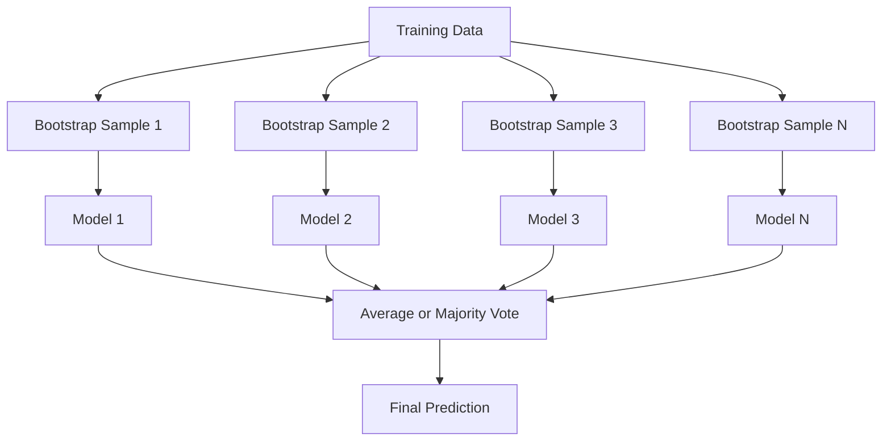
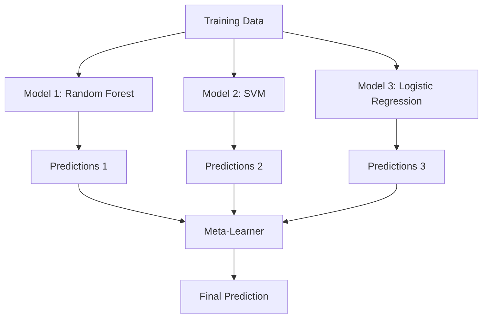

# Ensemble Methods

> Một nhóm các bộ học yếu, được kết hợp đúng, trở thành một bộ học mạnh. Đây không phải phép ẩn dụ. Nó là một định lý.

**Type:** Build
**Language:** Python
**Prerequisites:** Phase 2, Lesson 10 (Bias-Variance Tradeoff)
**Time:** ~120 minutes

## Learning Objectives

- Triển khai AdaBoost và gradient boosting từ đầu và giải thích cách boosting giảm độ chệch tuần tự
- Xây dựng một tập hợp bagging và minh họa cách lấy trung bình các mô hình đã khử tương quan giảm phương sai mà không tăng độ chệch
- So sánh bagging, boosting và stacking về thành phần sai số mà mỗi phương pháp nhắm tới
- Đánh giá độ đa dạng tập hợp và giải thích tại sao độ chính xác bỏ phiếu đa số cải thiện khi có thêm các bộ học yếu độc lập

## The Problem

Một cây quyết định đơn lẻ huấn luyện nhanh và dễ diễn giải, nhưng khớp quá mức. Một mô hình tuyến tính đơn lẻ khớp chưa đủ trên các biên phức tạp. Bạn có thể dành nhiều ngày thiết kế kiến trúc mô hình hoàn hảo. Hoặc bạn có thể kết hợp một nhóm mô hình không hoàn hảo và có thứ tốt hơn bất kỳ mô hình riêng lẻ nào.

Các phương pháp tập hợp thực hiện chính xác điều này. Chúng là kỹ thuật đáng tin cậy nhất để thắng các cuộc thi Kaggle trên dữ liệu dạng bảng, vận hành hầu hết các hệ thống ML sản xuất và minh họa sự đánh đổi độ chệch-phương sai trong thực tế. Bagging giảm phương sai. Boosting giảm độ chệch. Stacking học mô hình nào đáng tin trên các đầu vào nào.

## The Concept

### Why Ensembles Work

Giả sử bạn có $N$ bộ phân loại độc lập, mỗi bộ có độ chính xác $p > 0.5$. Bỏ phiếu đa số có độ chính xác:

```math
P(\text{majority correct}) = \sum_{k > N/2} \binom{N}{k} p^k (1-p)^{N-k}
```

Với 21 bộ phân loại mỗi bộ có độ chính xác 60%, độ chính xác bỏ phiếu đa số khoảng 74%. Với 101 bộ phân loại, nó tăng đến 84%. Các sai số triệt tiêu khi các mô hình mắc các lỗi khác nhau.

Yêu cầu chính là **độ đa dạng**. Nếu mọi mô hình mắc cùng sai số, kết hợp chúng không giúp gì. Các tập hợp hoạt động vì chúng tạo ra các mô hình đa dạng thông qua:

- Các tập con huấn luyện khác nhau (bagging)
- Các tập con đặc trưng khác nhau (rừng ngẫu nhiên)
- Sửa sai số tuần tự (boosting)
- Các họ mô hình khác nhau (stacking)

### Bagging (Bootstrap Aggregating)

Bagging tạo độ đa dạng bằng cách huấn luyện mỗi mô hình trên một mẫu bootstrap khác nhau của dữ liệu huấn luyện.



Một mẫu bootstrap được rút có hoàn lại từ dữ liệu gốc, cùng kích thước với bản gốc. Khoảng 63.2% các mẫu duy nhất xuất hiện trong mỗi bootstrap. 36.8% còn lại (các mẫu ngoài túi) cung cấp một tập xác thực miễn phí.

Bagging giảm phương sai mà không tăng độ chệch nhiều. Mỗi cây riêng lẻ khớp quá mức với mẫu bootstrap của nó, nhưng sự khớp quá mức khác nhau ở mỗi cây, nên lấy trung bình triệt tiêu nhiễu.

**Rừng Ngẫu nhiên** là bagging với một biến tấu bổ sung: tại mỗi phép chia, chỉ một tập con ngẫu nhiên các đặc trưng được xét. Điều này buộc các cây đa dạng hơn nữa. Số đặc trưng ứng viên điển hình là `sqrt(n_features)` cho phân loại và `n_features / 3` cho hồi quy.

### Boosting (Sequential Error Correction)

Boosting huấn luyện các mô hình tuần tự. Mỗi mô hình mới tập trung vào các ví dụ mà các mô hình trước làm sai.


Boosting giảm độ chệch. Mỗi mô hình mới sửa các sai số hệ thống của tập hợp đến lúc đó. Dự đoán cuối cùng là một tổng có trọng số của tất cả mô hình, nơi các mô hình tốt hơn nhận trọng số cao hơn.

Đánh đổi: boosting có thể khớp quá mức nếu chạy quá nhiều vòng, vì nó tiếp tục khớp các ví dụ khó hơn, một số có thể là nhiễu.

### AdaBoost

AdaBoost (Boosting Thích nghi) là thuật toán boosting thực tế đầu tiên. Nó hoạt động với bất kỳ bộ học cơ sở nào, thường là các decision stump (cây sâu 1).

Thuật toán:

```
1. Initialize sample weights: w_i = 1/N for all i

2. For t = 1 to T:
   a. Train weak learner h_t on weighted data
   b. Compute weighted error:
      err_t = sum(w_i * I(h_t(x_i) != y_i)) / sum(w_i)
   c. Compute model weight:
      alpha_t = 0.5 * ln((1 - err_t) / err_t)
   d. Update sample weights:
      w_i = w_i * exp(-alpha_t * y_i * h_t(x_i))
   e. Normalize weights to sum to 1

3. Final prediction: H(x) = sign(sum(alpha_t * h_t(x)))
```

Các mô hình có sai số thấp hơn nhận alpha cao hơn. Các mẫu bị phân loại sai nhận trọng số cao hơn để mô hình tiếp theo tập trung vào chúng.

### Gradient Boosting

Gradient boosting tổng quát hóa boosting sang các hàm mất mát tùy ý. Thay vì điều chỉnh lại trọng số mẫu, nó khớp mỗi mô hình mới với các phần dư (gradient âm của mất mát) của tập hợp hiện tại.

```
1. Initialize: F_0(x) = argmin_c sum(L(y_i, c))

2. For t = 1 to T:
   a. Compute pseudo-residuals:
      r_i = -dL(y_i, F_{t-1}(x_i)) / dF_{t-1}(x_i)
   b. Fit a tree h_t to the residuals r_i
   c. Find optimal step size:
      gamma_t = argmin_gamma sum(L(y_i, F_{t-1}(x_i) + gamma * h_t(x_i)))
   d. Update:
      F_t(x) = F_{t-1}(x) + learning_rate * gamma_t * h_t(x)

3. Final prediction: F_T(x)
```

Với mất mát sai số bình phương, các phần dư giả chỉ là các phần dư thực: $r_i = y_i - F_{t-1}(x_i)$. Mỗi cây thực sự khớp các sai số của tập hợp trước.

Tốc độ học (thu nhỏ) điều khiển mức đóng góp của mỗi cây. Tốc độ học nhỏ hơn cần nhiều cây hơn nhưng tổng quát hóa tốt hơn. Các giá trị điển hình: 0.01 đến 0.3.

### XGBoost: Why It Dominates Tabular Data

XGBoost (eXtreme Gradient Boosting) là gradient boosting với các tối ưu hóa kỹ thuật làm nó nhanh, chính xác và chống khớp quá mức:

- **Mục tiêu có regularization:** Các hình phạt L1 và L2 trên trọng số lá ngăn các cây riêng lẻ quá tự tin
- **Xấp xỉ bậc hai:** Sử dụng cả đạo hàm bậc nhất và bậc hai của mất mát, cho các quyết định chia tốt hơn
- **Các phép chia có xét tính thưa:** Hỗ trợ trực tiếp các giá trị thiếu bằng cách học hướng tốt nhất cho dữ liệu thiếu tại mỗi phép chia
- **Lấy mẫu con cột:** Giống rừng ngẫu nhiên, lấy mẫu các đặc trưng tại mỗi phép chia để có độ đa dạng
- **Phác họa phân vị có trọng số:** Tìm hiệu quả các điểm chia cho các đặc trưng liên tục trên dữ liệu phân tán
- **Cấu trúc khối có xét bộ nhớ đệm:** Bố trí bộ nhớ được tối ưu hóa cho các dòng bộ nhớ đệm CPU

Với dữ liệu dạng bảng, XGBoost (và người kế nhiệm LightGBM) liên tục vượt mạng nơ-ron. Điều này sẽ không sớm thay đổi. Nếu dữ liệu của bạn vừa trong một bảng có hàng và cột, bắt đầu với gradient boosting.

### Stacking (Meta-Learning)

Stacking sử dụng các dự đoán của nhiều mô hình cơ sở làm các đặc trưng cho một bộ học meta.



Bộ học meta học mô hình cơ sở nào đáng tin với đầu vào nào. Nếu rừng ngẫu nhiên tốt hơn ở một số vùng và SVM ở các vùng khác, bộ học meta sẽ học cách định tuyến tương ứng.

Để tránh rò rỉ dữ liệu, các dự đoán mô hình cơ sở phải được tạo qua xác thực chéo trên tập huấn luyện. Bạn không bao giờ huấn luyện mô hình cơ sở và tạo đặc trưng meta trên cùng dữ liệu.

### Voting

Tập hợp đơn giản nhất. Chỉ kết hợp trực tiếp các dự đoán.

- **Bỏ phiếu cứng:** Bỏ phiếu đa số trên các nhãn lớp.
- **Bỏ phiếu mềm:** Lấy trung bình các xác suất dự đoán, chọn lớp có xác suất trung bình cao nhất. Thường tốt hơn vì nó sử dụng thông tin độ tự tin.

```figure
f3-ensemble-average
```

## Build It

### Step 1: Decision Stump (Base Learner)

Mã trong `code/ensembles.py` triển khai mọi thứ từ đầu. Chúng ta bắt đầu với một decision stump: một cây có một phép chia duy nhất.

```python
class DecisionStump:
    def __init__(self):
        self.feature_idx = None
        self.threshold = None
        self.polarity = 1
        self.alpha = None

    def fit(self, X, y, weights):
        n_samples, n_features = X.shape
        best_error = float("inf")

        for f in range(n_features):
            thresholds = np.unique(X[:, f])
            for thresh in thresholds:
                for polarity in [1, -1]:
                    pred = np.ones(n_samples)
                    pred[polarity * X[:, f] < polarity * thresh] = -1
                    error = np.sum(weights[pred != y])
                    if error < best_error:
                        best_error = error
                        self.feature_idx = f
                        self.threshold = thresh
                        self.polarity = polarity

    def predict(self, X):
        n = X.shape[0]
        pred = np.ones(n)
        idx = self.polarity * X[:, self.feature_idx] < self.polarity * self.threshold
        pred[idx] = -1
        return pred
```

### Step 2: AdaBoost from Scratch

```python
class AdaBoostScratch:
    def __init__(self, n_estimators=50):
        self.n_estimators = n_estimators
        self.stumps = []
        self.alphas = []

    def fit(self, X, y):
        n = X.shape[0]
        weights = np.full(n, 1 / n)

        for _ in range(self.n_estimators):
            stump = DecisionStump()
            stump.fit(X, y, weights)
            pred = stump.predict(X)

            err = np.sum(weights[pred != y])
            err = np.clip(err, 1e-10, 1 - 1e-10)

            alpha = 0.5 * np.log((1 - err) / err)
            weights *= np.exp(-alpha * y * pred)
            weights /= weights.sum()

            stump.alpha = alpha
            self.stumps.append(stump)
            self.alphas.append(alpha)

    def predict(self, X):
        total = sum(a * s.predict(X) for a, s in zip(self.alphas, self.stumps))
        return np.sign(total)
```

### Step 3: Gradient Boosting from Scratch

```python
class GradientBoostingScratch:
    def __init__(self, n_estimators=100, learning_rate=0.1, max_depth=3):
        self.n_estimators = n_estimators
        self.lr = learning_rate
        self.max_depth = max_depth
        self.trees = []
        self.initial_pred = None

    def fit(self, X, y):
        self.initial_pred = np.mean(y)
        current_pred = np.full(len(y), self.initial_pred)

        for _ in range(self.n_estimators):
            residuals = y - current_pred
            tree = SimpleRegressionTree(max_depth=self.max_depth)
            tree.fit(X, residuals)
            update = tree.predict(X)
            current_pred += self.lr * update
            self.trees.append(tree)

    def predict(self, X):
        pred = np.full(X.shape[0], self.initial_pred)
        for tree in self.trees:
            pred += self.lr * tree.predict(X)
        return pred
```

### Step 4: Compare against sklearn

Mã xác minh các triển khai từ đầu tạo độ chính xác tương tự `AdaBoostClassifier` và `GradientBoostingClassifier` của sklearn, và so sánh mọi phương pháp cạnh nhau.

## Use It

### When to Use Each Method

| Phương pháp | Giảm | Tốt nhất cho | Cần chú ý |
|--------|---------|----------|---------------|
| Bagging / Rừng Ngẫu nhiên | Phương sai | Dữ liệu nhiễu, nhiều đặc trưng | Không giúp với độ chệch |
| AdaBoost | Độ chệch | Dữ liệu sạch, bộ học cơ sở đơn giản | Nhạy với ngoại lệ và nhiễu |
| Gradient Boosting | Độ chệch | Dữ liệu dạng bảng, các cuộc thi | Huấn luyện chậm, dễ khớp quá mức nếu không điều chỉnh |
| XGBoost / LightGBM | Cả hai | ML dạng bảng trong sản xuất | Nhiều siêu tham số |
| Stacking | Cả hai | Đạt 1-2% độ chính xác cuối | Phức tạp, nguy cơ bộ học meta khớp quá mức |
| Bỏ phiếu | Phương sai | Kết hợp nhanh các mô hình đa dạng | Chỉ giúp nếu các mô hình đa dạng |

### The Production Stack for Tabular Data

Với hầu hết các bài toán dự đoán dạng bảng, đây là thứ tự thử:

1. **LightGBM hoặc XGBoost** với các tham số mặc định
2. Điều chỉnh n_estimators, learning_rate, max_depth, min_child_weight
3. Nếu cần 0.5% cuối cùng, xây dựng một tập hợp stacking với 3-5 mô hình đa dạng
4. Sử dụng xác thực chéo xuyên suốt

Mạng nơ-ron trên dữ liệu dạng bảng hầu như luôn kém gradient boosting, bất chấp các nỗ lực nghiên cứu tiếp tục. TabNet, NODE và các kiến trúc tương tự đôi khi ngang bằng nhưng hiếm khi vượt một XGBoost được điều chỉnh tốt.

## Ship It

Bài học này tạo ra `outputs/prompt-ensemble-selector.md` -- một prompt giúp bạn chọn phương pháp tập hợp phù hợp cho một tập dữ liệu nhất định. Mô tả dữ liệu (kích thước, các loại đặc trưng, mức nhiễu, cân bằng lớp) và bài toán đang giải. Prompt đi qua một danh sách kiểm tra quyết định, đề xuất một phương pháp, gợi ý các siêu tham số bắt đầu và cảnh báo các lỗi phổ biến với phương pháp đó. Cũng tạo ra `outputs/skill-ensemble-builder.md` với hướng dẫn lựa chọn đầy đủ.

## Exercises

1. Sửa triển khai AdaBoost để theo dõi độ chính xác huấn luyện sau mỗi vòng. Vẽ độ chính xác theo số bộ ước lượng. Khi nào nó hội tụ?

2. Triển khai một rừng ngẫu nhiên từ đầu bằng cách thêm lấy mẫu con đặc trưng ngẫu nhiên vào cây hồi quy. Huấn luyện 100 cây với `max_features=sqrt(n_features)` và lấy trung bình dự đoán. So sánh mức giảm phương sai với một cây đơn lẻ.

3. Trong triển khai gradient boosting, thêm dừng sớm: theo dõi mất mát xác thực sau mỗi vòng và dừng khi nó không cải thiện trong 10 vòng liên tiếp. Thực sự cần bao nhiêu cây?

4. Xây dựng một tập hợp stacking với ba mô hình cơ sở (hồi quy logistic, cây quyết định, k láng giềng gần nhất) và một bộ học meta hồi quy logistic. Sử dụng xác thực chéo 5-fold để tạo các đặc trưng meta. So sánh với từng mô hình cơ sở riêng lẻ.

5. Chạy XGBoost trên cùng tập dữ liệu với các tham số mặc định. So sánh độ chính xác với gradient boosting từ đầu của bạn. Đo thời gian cả hai. Khác biệt tốc độ lớn đến mức nào?

## Key Terms

| Thuật ngữ | Cách mọi người nói | Ý nghĩa thực sự |
|------|----------------|----------------------|
| Bagging | "Huấn luyện trên các tập con ngẫu nhiên" | Tổng hợp bootstrap: huấn luyện mô hình trên các mẫu bootstrap, lấy trung bình dự đoán để giảm phương sai |
| Boosting | "Tập trung vào các ví dụ khó" | Huấn luyện các mô hình tuần tự, mỗi mô hình sửa sai số của tập hợp đến lúc đó, để giảm độ chệch |
| AdaBoost | "Điều chỉnh lại trọng số dữ liệu" | Boosting qua các cập nhật trọng số mẫu; các điểm bị phân loại sai nhận trọng số cao hơn cho bộ học tiếp theo |
| Gradient boosting | "Khớp các phần dư" | Boosting bằng cách khớp mỗi mô hình mới với gradient âm của hàm mất mát |
| XGBoost | "Vũ khí Kaggle" | Gradient boosting với regularization, tối ưu hóa bậc hai và các thủ thuật tốc độ ở cấp hệ thống |
| Stacking | "Mô hình trên các mô hình" | Sử dụng các dự đoán của mô hình cơ sở làm các đặc trưng đầu vào cho một bộ học meta |
| Random forest (Rừng ngẫu nhiên) | "Nhiều cây được ngẫu nhiên hóa" | Bagging với các cây quyết định, thêm lấy mẫu con đặc trưng ngẫu nhiên tại mỗi phép chia để có độ đa dạng |
| Ensemble diversity (Độ đa dạng tập hợp) | "Mắc các lỗi khác nhau" | Các mô hình phải không tương quan trong sai số để tập hợp cải thiện so với từng mô hình riêng lẻ |
| Out-of-bag error (Sai số ngoài túi) | "Xác thực miễn phí" | Các mẫu không nằm trong một lần rút bootstrap (~36.8%) làm tập xác thực mà không cần một tập giữ riêng |

## Further Reading

- [Schapire & Freund: Boosting: Foundations and Algorithms](https://mitpress.mit.edu/9780262526036/) -- cuốn sách của những người tạo ra AdaBoost
- [Friedman: Greedy Function Approximation: A Gradient Boosting Machine (2001)](https://doi.org/10.1214/aos/1013203451) -- bài báo gradient boosting gốc
- [Chen & Guestrin: XGBoost (2016)](https://arxiv.org/abs/1603.02754) -- bài báo XGBoost
- [Wolpert: Stacked Generalization (1992)](https://www.sciencedirect.com/science/article/abs/pii/S0893608005800231) -- bài báo stacking gốc
- [scikit-learn Ensemble Methods](https://scikit-learn.org/stable/modules/ensemble.html) -- tài liệu tham khảo thực hành
