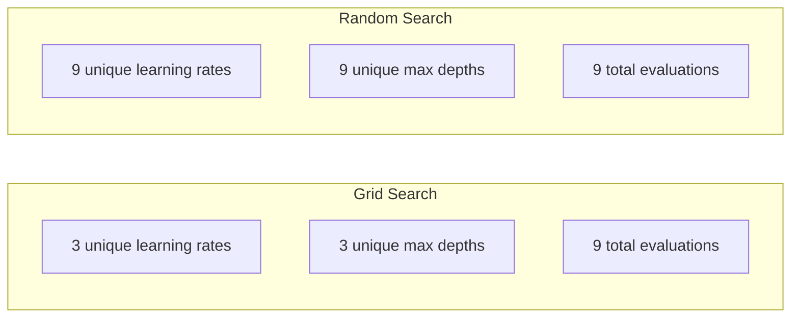
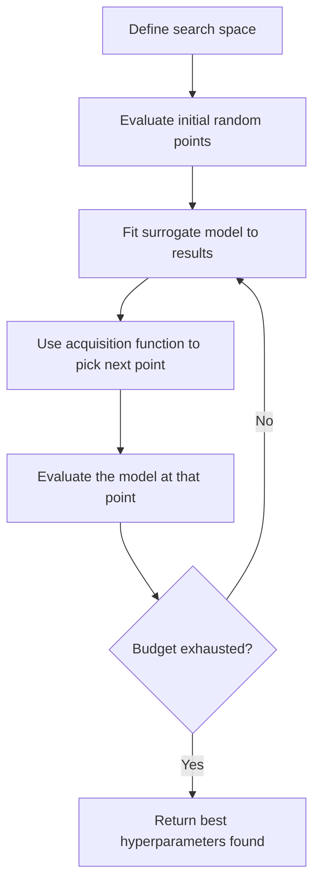
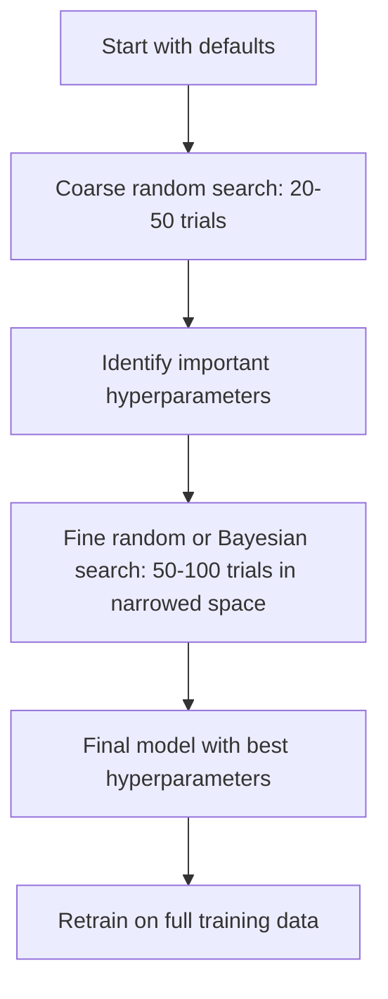
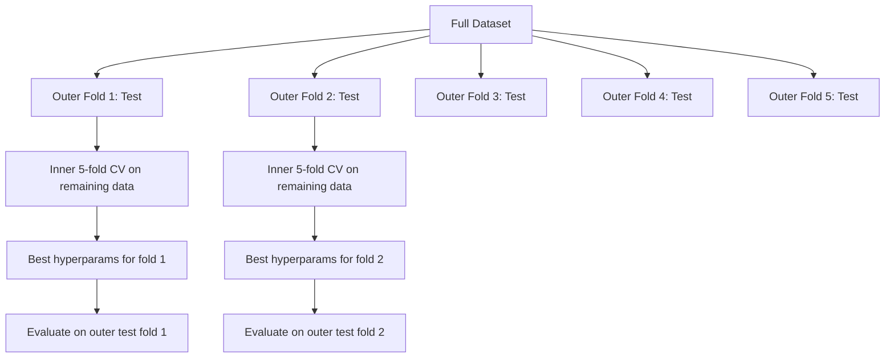

# Hyperparameter Tuning

> Siêu tham số là các núm bạn xoay trước khi huấn luyện bắt đầu. Xoay chúng tốt là sự khác biệt giữa một mô hình tầm thường và một mô hình tuyệt vời.

**Type:** Build
**Language:** Python
**Prerequisites:** Phase 2, Lesson 11 (Ensemble Methods)
**Time:** ~90 minutes

## Learning Objectives

- Triển khai tìm kiếm lưới, tìm kiếm ngẫu nhiên và tối ưu hóa Bayes từ đầu và so sánh hiệu quả sử dụng mẫu của chúng
- Giải thích tại sao tìm kiếm ngẫu nhiên vượt tìm kiếm lưới khi hầu hết siêu tham số có số chiều hiệu dụng thấp
- Xây dựng một vòng lặp tối ưu hóa Bayes bằng một mô hình thay thế và hàm thu nhận để hướng dẫn tìm kiếm
- Thiết kế một chiến lược điều chỉnh siêu tham số tránh khớp quá mức tập xác thực thông qua xác thực chéo đúng cách

## The Problem

Mô hình gradient boosting có tốc độ học, số cây, độ sâu tối đa, số mẫu tối thiểu mỗi lá, tỉ lệ lấy mẫu con và tỉ lệ lấy mẫu cột. Đó là sáu siêu tham số. Nếu mỗi tham số có 5 giá trị hợp lý, lưới có 5^6 = 15,625 tổ hợp. Huấn luyện mỗi tổ hợp mất 10 giây. Đó là 43 giờ tính toán để thử tất cả.

Tìm kiếm lưới là cách tiếp cận rõ ràng và là cách tệ nhất ở quy mô lớn. Tìm kiếm ngẫu nhiên làm tốt hơn với ít tính toán hơn. Tối ưu hóa Bayes làm còn tốt hơn bằng cách học từ các đánh giá trước. Biết nên dùng chiến lược nào và các siêu tham số nào thực sự quan trọng tiết kiệm nhiều ngày lãng phí thời gian GPU.

## The Concept

### Parameters vs Hyperparameters

Các tham số được học trong huấn luyện (trọng số, bias, ngưỡng chia). Siêu tham số được đặt trước khi huấn luyện bắt đầu và điều khiển cách học diễn ra.

| Siêu tham số | Nó điều khiển gì | Khoảng điển hình |
|---------------|-----------------|---------------|
| Tốc độ học | Kích thước bước mỗi cập nhật | 0.001 đến 1.0 |
| Số cây/epoch | Huấn luyện bao lâu | 10 đến 10,000 |
| Độ sâu tối đa | Độ phức tạp mô hình | 1 đến 30 |
| Regularization (lambda) | Ngăn khớp quá mức | 0.0001 đến 100 |
| Kích thước batch | Nhiễu ước lượng gradient | 16 đến 512 |
| Tỉ lệ dropout | Tỉ lệ nơ-ron bị loại | 0.0 đến 0.5 |

### Grid Search

Tìm kiếm lưới đánh giá mọi tổ hợp các giá trị được chỉ định. Nó toàn diện và dễ hiểu, nhưng tăng theo hàm mũ với số siêu tham số.

```
Grid for 2 hyperparameters:

  learning_rate: [0.01, 0.1, 1.0]
  max_depth:     [3, 5, 7]

  Evaluations: 3 x 3 = 9 combinations

  (0.01, 3)  (0.01, 5)  (0.01, 7)
  (0.1,  3)  (0.1,  5)  (0.1,  7)
  (1.0,  3)  (1.0,  5)  (1.0,  7)
```

Tìm kiếm lưới có một khuyết điểm cơ bản: nếu một siêu tham số quan trọng còn tham số kia không, hầu hết các đánh giá bị lãng phí. Bạn chỉ có 3 giá trị duy nhất của tham số quan trọng từ 9 đánh giá.

### Random Search

Tìm kiếm ngẫu nhiên lấy mẫu siêu tham số từ các phân phối thay vì một lưới. Với cùng ngân sách 9 đánh giá, bạn có 9 giá trị duy nhất của mỗi siêu tham số.



Tại sao ngẫu nhiên thắng lưới (Bergstra & Bengio, 2012):

- Hầu hết siêu tham số có số chiều hiệu dụng thấp. Chỉ 1-2 trong 6 siêu tham số thường quan trọng cho một bài toán nhất định.
- Tìm kiếm lưới lãng phí đánh giá trên các chiều không quan trọng.
- Tìm kiếm ngẫu nhiên bao phủ các chiều quan trọng dày hơn với cùng ngân sách.
- Với 60 lần thử ngẫu nhiên, bạn có 95% khả năng tìm một điểm trong phạm vi 5% của tối ưu (nếu điểm đó tồn tại trong không gian tìm kiếm).

### Bayesian Optimization

Tìm kiếm ngẫu nhiên bỏ qua kết quả. Nó không học rằng tốc độ học cao gây phân kỳ hoặc độ sâu 3 liên tục vượt độ sâu 10. Tối ưu hóa Bayes sử dụng các đánh giá trước để quyết định tìm ở đâu tiếp theo.



Hai thành phần chính:

**Mô hình thay thế:** Một mô hình có chi phí tính giá trị thấp (thường là quá trình Gaussian) xấp xỉ hàm mục tiêu đắt đỏ. Nó cho cả một dự đoán và một ước lượng sự không chắc chắn tại bất kỳ điểm nào trong không gian tìm kiếm.

**Hàm thu nhận:** Quyết định đánh giá ở đâu tiếp theo bằng cách cân bằng khai thác (tìm gần các điểm tốt đã biết) và khám phá (tìm nơi sự không chắc chắn cao). Các lựa chọn phổ biến:

- **Cải thiện Kỳ vọng (EI):** Chúng ta kỳ vọng cải thiện bao nhiêu so với mức tốt nhất hiện tại ở điểm này?
- **Cận Tin cậy Trên (UCB):** Dự đoán cộng một bội của sự không chắc chắn. UCB cao hơn nghĩa là hoặc hứa hẹn hoặc chưa khám phá.
- **Xác suất Cải thiện (PI):** Xác suất điểm này vượt mức tốt nhất hiện tại là bao nhiêu?

Tối ưu hóa Bayes thường tìm các siêu tham số tốt hơn tìm kiếm ngẫu nhiên với số đánh giá ít hơn 2-5 lần. Chi phí phụ khớp mô hình thay thế không đáng kể so với huấn luyện mô hình thực.

### Early Stopping

Không phải mọi lần huấn luyện đều cần kết thúc. Nếu một cấu hình rõ ràng tệ sau 10 epoch, dừng nó và tiếp tục. Đây là dừng sớm trong ngữ cảnh tìm kiếm siêu tham số.

Các chiến lược:
- **Dựa trên patience:** Dừng nếu mất mát xác thực không cải thiện trong N epoch liên tiếp
- **Cắt tỉa trung vị:** Dừng nếu kết quả trung gian của lần thử tệ hơn trung vị các lần thử đã hoàn tất tại cùng bước
- **Hyperband:** Phân bổ ngân sách nhỏ cho nhiều cấu hình, rồi tăng dần ngân sách cho các cấu hình tốt nhất

Hyperband đặc biệt hiệu quả. Nó bắt đầu 81 cấu hình với 1 epoch mỗi cấu hình, giữ một phần ba đứng đầu, cho chúng 3 epoch, giữ một phần ba đứng đầu, và cứ thế. Điều này tìm các cấu hình tốt nhanh hơn 10-50 lần so với đánh giá mọi cấu hình bằng toàn bộ ngân sách.

### Learning Rate Schedulers

Tốc độ học hầu như luôn là siêu tham số quan trọng nhất. Thay vì giữ cố định, các bộ lập lịch điều chỉnh nó trong huấn luyện.

| Bộ lập lịch | Công thức | Khi nào sử dụng |
|-----------|---------|-------------|
| Giảm theo bước | Nhân với 0.1 mỗi N epoch | Huấn luyện CNN cổ điển |
| Ủ cosine | lr * 0.5 * (1 + cos(pi * t / T)) | Mặc định hiện đại |
| Warmup + giảm | Tăng tuyến tính rồi giảm cosine | Transformer |
| Một chu kỳ | Tăng rồi giảm trong một chu kỳ | Hội tụ nhanh |
| Giảm khi chững lại | Giảm theo hệ số khi chỉ số đình trệ | Mặc định an toàn |

### Hyperparameter Importance

Không phải mọi siêu tham số đều quan trọng như nhau. Nghiên cứu về rừng ngẫu nhiên (Probst et al., 2019) và gradient boosting cho thấy các mẫu nhất quán:

**Độ quan trọng cao:**
- Tốc độ học (luôn điều chỉnh trước)
- Số bộ ước lượng / epoch (sử dụng dừng sớm thay vì điều chỉnh)
- Cường độ regularization

**Độ quan trọng trung bình:**
- Độ sâu tối đa / số lớp
- Số mẫu tối thiểu mỗi lá / suy giảm trọng số
- Tỉ lệ lấy mẫu con

**Độ quan trọng thấp:**
- Số đặc trưng tối đa (với rừng ngẫu nhiên)
- Lựa chọn hàm kích hoạt cụ thể
- Kích thước batch (trong khoảng hợp lý)

Điều chỉnh các tham số quan trọng trước, giữ phần còn lại ở mặc định.

### Practical Strategy



Quy trình cụ thể:

1. **Bắt đầu với các mặc định thư viện.** Chúng được chọn bởi những người thực hành có kinh nghiệm và thường đã đi được 80% chặng đường.
2. **Tìm kiếm ngẫu nhiên thô.** Các khoảng rộng, 20-50 lần thử. Sử dụng dừng sớm để kết thúc nhanh các lần chạy tệ.
3. **Phân tích kết quả.** Các siêu tham số nào tương quan với hiệu năng? Thu hẹp không gian tìm kiếm.
4. **Tìm kiếm tinh.** Tối ưu hóa Bayes hoặc tìm kiếm ngẫu nhiên tập trung trong không gian đã thu hẹp. 50-100 lần thử.
5. **Huấn luyện lại trên tất cả dữ liệu huấn luyện** với các siêu tham số tốt nhất tìm được.

### Cross-Validation Integration

Điều chỉnh siêu tham số trên một phần chia xác thực duy nhất có rủi ro. Các siêu tham số tốt nhất có thể khớp quá mức với fold xác thực cụ thể. Xác thực chéo lồng nhau giải quyết bằng cách sử dụng hai vòng lặp:

- **Vòng ngoài** (đánh giá): chia dữ liệu thành train+val và test. Báo cáo hiệu năng không chệch.
- **Vòng trong** (điều chỉnh): chia train+val thành train và val. Tìm các siêu tham số tốt nhất.



Mỗi fold ngoài tìm các siêu tham số tốt nhất riêng một cách độc lập. Các điểm ngoài là một ước lượng không chệch của hiệu năng tổng quát hóa.

Với sklearn:

```python
from sklearn.model_selection import cross_val_score, GridSearchCV
from sklearn.ensemble import GradientBoostingRegressor

inner_cv = GridSearchCV(
    GradientBoostingRegressor(),
    param_grid={
        "learning_rate": [0.01, 0.05, 0.1],
        "max_depth": [2, 3, 5],
        "n_estimators": [50, 100, 200],
    },
    cv=5,
    scoring="neg_mean_squared_error",
)

outer_scores = cross_val_score(
    inner_cv, X, y, cv=5, scoring="neg_mean_squared_error"
)

print(f"Nested CV MSE: {-outer_scores.mean():.4f} +/- {outer_scores.std():.4f}")
```

Việc này đắt đỏ (5 fold ngoài x 5 fold trong x 27 điểm lưới = 675 lần khớp mô hình), nhưng cho bạn một ước lượng hiệu năng đáng tin cậy. Sử dụng khi báo cáo kết quả cuối trong các bài báo hoặc khi quyết định có hệ quả lớn.

### Practical Tips

**Bắt đầu với tốc độ học.** Nó luôn là siêu tham số quan trọng nhất cho các phương pháp dựa trên gradient. Một tốc độ học tệ làm mọi thứ khác không còn liên quan. Cố định các siêu tham số khác ở mặc định và quét tốc độ học trước.

**Sử dụng các phân phối log-đều cho tốc độ học và regularization.** Khác biệt giữa 0.001 và 0.01 quan trọng bằng khác biệt giữa 0.1 và 1.0. Tìm kiếm tuyến tính lãng phí ngân sách ở đầu lớn.

**Sử dụng dừng sớm thay vì điều chỉnh n_estimators.** Với boosting và mạng nơ-ron, đặt n_estimators hoặc epoch cao và để dừng sớm quyết định khi nào dừng. Điều này loại một siêu tham số khỏi tìm kiếm.

**Phân bổ ngân sách.** Dành 60% ngân sách điều chỉnh cho 2 siêu tham số quan trọng nhất. Dành 40% còn lại cho mọi thứ khác. 2 tham số đầu giải thích phần lớn biến thiên hiệu năng.

**Thang đo quan trọng.** Không bao giờ tìm kiếm kích thước batch trên thang log (16, 32, 64 là ổn). Luôn tìm kiếm tốc độ học trên thang log. Khớp phân phối tìm kiếm với cách siêu tham số ảnh hưởng mô hình.

| Loại Mô hình | Các Siêu tham số Hàng đầu | Tìm kiếm Được đề xuất | Ngân sách |
|-----------|--------------------|--------------------|--------|
| Rừng Ngẫu nhiên | n_estimators, max_depth, min_samples_leaf | Tìm kiếm ngẫu nhiên, 50 lần thử | Thấp (huấn luyện nhanh) |
| Gradient Boosting | learning_rate, n_estimators, max_depth | Bayes, 100 lần thử + dừng sớm | Trung bình |
| Mạng Nơ-ron | learning_rate, weight_decay, batch_size | Bayes hoặc ngẫu nhiên, 100+ lần thử | Cao (huấn luyện chậm) |
| SVM | C, gamma (kernel RBF) | Lưới trên thang log, 25-50 lần thử | Thấp (2 tham số) |
| Lasso/Ridge | alpha | Tìm kiếm 1D trên thang log, 20 lần thử | Rất thấp |
| XGBoost | learning_rate, max_depth, subsample, colsample | Bayes, 100-200 lần thử + dừng sớm | Trung bình |

**Khi không chắc:** tìm kiếm ngẫu nhiên với số lần thử gấp 2 lần số siêu tham số (ví dụ, 6 siêu tham số = tối thiểu 12+ lần thử). Bạn sẽ ngạc nhiên về mức độ thường xuyên tìm kiếm ngẫu nhiên 50 lần thử vượt tìm kiếm lưới được thiết kế cẩn thận.

```figure
k-fold-cv
```

## Build It

### Step 1: Grid Search from Scratch

Mã trong `code/tuning.py` triển khai tìm kiếm lưới, tìm kiếm ngẫu nhiên và một bộ tối ưu hóa Bayes đơn giản từ đầu.

```python
def grid_search(model_fn, param_grid, X_train, y_train, X_val, y_val):
    keys = list(param_grid.keys())
    values = list(param_grid.values())
    best_score = -float("inf")
    best_params = None
    n_evals = 0

    for combo in itertools.product(*values):
        params = dict(zip(keys, combo))
        model = model_fn(**params)
        model.fit(X_train, y_train)
        score = evaluate(model, X_val, y_val)
        n_evals += 1

        if score > best_score:
            best_score = score
            best_params = params

    return best_params, best_score, n_evals
```

### Step 2: Random Search from Scratch

```python
def random_search(model_fn, param_distributions, X_train, y_train,
                  X_val, y_val, n_iter=50, seed=42):
    rng = np.random.RandomState(seed)
    best_score = -float("inf")
    best_params = None

    for _ in range(n_iter):
        params = {k: sample(v, rng) for k, v in param_distributions.items()}
        model = model_fn(**params)
        model.fit(X_train, y_train)
        score = evaluate(model, X_val, y_val)

        if score > best_score:
            best_score = score
            best_params = params

    return best_params, best_score, n_iter
```

### Step 3: Bayesian Optimization (Simplified)

Ý tưởng cốt lõi: khớp một quá trình Gaussian với các cặp (siêu tham số, điểm) đã quan sát, rồi sử dụng một hàm thu nhận để quyết định nhìn ở đâu tiếp theo.

```python
class SimpleBayesianOptimizer:
    def __init__(self, search_space, n_initial=5):
        self.search_space = search_space
        self.n_initial = n_initial
        self.X_observed = []
        self.y_observed = []

    def _kernel(self, x1, x2, length_scale=1.0):
        dists = np.sum((x1[:, None, :] - x2[None, :, :]) ** 2, axis=2)
        return np.exp(-0.5 * dists / length_scale ** 2)

    def _fit_gp(self, X_new):
        X_obs = np.array(self.X_observed)
        y_obs = np.array(self.y_observed)
        y_mean = y_obs.mean()
        y_centered = y_obs - y_mean

        K = self._kernel(X_obs, X_obs) + 1e-4 * np.eye(len(X_obs))
        K_star = self._kernel(X_new, X_obs)

        L = np.linalg.cholesky(K)
        alpha = np.linalg.solve(L.T, np.linalg.solve(L, y_centered))
        mu = K_star @ alpha + y_mean

        v = np.linalg.solve(L, K_star.T)
        var = 1.0 - np.sum(v ** 2, axis=0)
        var = np.maximum(var, 1e-6)

        return mu, var

    def _expected_improvement(self, mu, var, best_y):
        sigma = np.sqrt(var)
        z = (mu - best_y) / (sigma + 1e-10)
        ei = sigma * (z * norm_cdf(z) + norm_pdf(z))
        return ei

    def suggest(self):
        if len(self.X_observed) < self.n_initial:
            return sample_random(self.search_space)

        candidates = [sample_random(self.search_space) for _ in range(500)]
        X_cand = np.array([to_vector(c) for c in candidates])
        mu, var = self._fit_gp(X_cand)
        ei = self._expected_improvement(mu, var, max(self.y_observed))
        return candidates[np.argmax(ei)]

    def observe(self, params, score):
        self.X_observed.append(to_vector(params))
        self.y_observed.append(score)
```

Mô hình thay thế GP cho hai thứ tại mỗi điểm ứng viên: một điểm dự đoán (mu) và một mức không chắc chắn (var). Cải thiện Kỳ vọng cân bằng chúng: nó ưu tiên các điểm mà mô hình dự đoán điểm cao HOẶC nơi sự không chắc chắn cao. Ban đầu, hầu hết điểm có sự không chắc chắn cao nên bộ tối ưu hóa khám phá. Về sau, nó tập trung vào vùng hứa hẹn nhất.

### Step 4: Compare All Methods

Chạy cả ba phương pháp trên cùng mục tiêu tổng hợp và so sánh. So sánh này sử dụng một wrapper đơn giản hóa gọi mỗi bộ tối ưu hóa với một hàm mục tiêu trực tiếp (không huấn luyện mô hình), nên API khác các triển khai dựa trên mô hình ở trên:

```python
def synthetic_objective(params):
    lr = params["learning_rate"]
    depth = params["max_depth"]
    return -(np.log10(lr) + 2) ** 2 - (depth - 4) ** 2 + 10

param_grid = {
    "learning_rate": [0.001, 0.01, 0.1, 1.0],
    "max_depth": [2, 3, 4, 5, 6, 7, 8],
}

grid_best = None
grid_score = -float("inf")
grid_history = []
for combo in itertools.product(*param_grid.values()):
    params = dict(zip(param_grid.keys(), combo))
    score = synthetic_objective(params)
    grid_history.append((params, score))
    if score > grid_score:
        grid_score = score
        grid_best = params

param_dist = {
    "learning_rate": ("log_float", 0.001, 1.0),
    "max_depth": ("int", 2, 8),
}

rand_best = None
rand_score = -float("inf")
rand_history = []
rng = np.random.RandomState(42)
for _ in range(28):
    params = {k: sample(v, rng) for k, v in param_dist.items()}
    score = synthetic_objective(params)
    rand_history.append((params, score))
    if score > rand_score:
        rand_score = score
        rand_best = params

optimizer = SimpleBayesianOptimizer(param_dist, n_initial=5)
bayes_history = []
for _ in range(28):
    params = optimizer.suggest()
    score = synthetic_objective(params)
    optimizer.observe(params, score)
    bayes_history.append((params, score))
bayes_score = max(s for _, s in bayes_history)

print(f"{'Method':<20} {'Best Score':>12} {'Evaluations':>12}")
print("-" * 50)
print(f"{'Grid Search':<20} {grid_score:>12.4f} {len(grid_history):>12}")
print(f"{'Random Search':<20} {rand_score:>12.4f} {len(rand_history):>12}")
print(f"{'Bayesian Opt':<20} {bayes_score:>12.4f} {len(bayes_history):>12}")
```

Với cùng ngân sách, tối ưu hóa Bayes thường tìm điểm tốt nhất nhanh nhất vì không lãng phí đánh giá ở các vùng rõ ràng tệ. Tìm kiếm ngẫu nhiên bao phủ nhiều hơn tìm kiếm lưới. Tìm kiếm lưới chỉ thắng khi có rất ít siêu tham số và đủ nguồn lực để vét hết.

## Use It

### Optuna in Practice

Optuna là thư viện được đề xuất cho điều chỉnh siêu tham số nghiêm túc. Nó hỗ trợ sẵn cắt tỉa, tìm kiếm phân tán và trực quan hóa.

```python
import optuna

def objective(trial):
    lr = trial.suggest_float("learning_rate", 1e-4, 1e-1, log=True)
    n_est = trial.suggest_int("n_estimators", 50, 500)
    max_depth = trial.suggest_int("max_depth", 2, 10)

    model = GradientBoostingRegressor(
        learning_rate=lr,
        n_estimators=n_est,
        max_depth=max_depth,
    )
    model.fit(X_train, y_train)
    return mean_squared_error(y_val, model.predict(X_val))

study = optuna.create_study(direction="minimize")
study.optimize(objective, n_trials=100)

print(f"Best params: {study.best_params}")
print(f"Best MSE: {study.best_value:.4f}")
```

Các tính năng Optuna chính:
- `suggest_float(..., log=True)` cho các tham số nên tìm kiếm trên thang log (tốc độ học, regularization)
- `suggest_int` cho các tham số số nguyên
- `suggest_categorical` cho các lựa chọn rời rạc
- MedianPruner tích hợp sẵn để dừng sớm các lần thử tệ
- `study.trials_dataframe()` để phân tích

### Optuna with Pruning

Cắt tỉa dừng sớm các lần thử không hứa hẹn, tiết kiệm lượng tính toán rất lớn. Đây là mẫu:

```python
import optuna
from sklearn.model_selection import cross_val_score

def objective(trial):
    params = {
        "learning_rate": trial.suggest_float("lr", 1e-4, 0.5, log=True),
        "max_depth": trial.suggest_int("max_depth", 2, 10),
        "n_estimators": trial.suggest_int("n_estimators", 50, 500),
        "subsample": trial.suggest_float("subsample", 0.5, 1.0),
    }

    model = GradientBoostingRegressor(**params)
    scores = cross_val_score(model, X_train, y_train, cv=3,
                             scoring="neg_mean_squared_error")
    mean_score = -scores.mean()

    trial.report(mean_score, step=0)
    if trial.should_prune():
        raise optuna.TrialPruned()

    return mean_score

pruner = optuna.pruners.MedianPruner(n_startup_trials=10, n_warmup_steps=5)
study = optuna.create_study(direction="minimize", pruner=pruner)
study.optimize(objective, n_trials=200)
```

`MedianPruner` dừng một lần thử nếu giá trị trung gian tệ hơn trung vị của tất cả các lần thử đã hoàn tất tại cùng bước. Cắt tỉa đòi hỏi gọi `trial.report()` để báo cáo các chỉ số trung gian và `trial.should_prune()` để kiểm tra có nên dừng lần thử không. `n_startup_trials=10` bảo đảm ít nhất 10 lần thử hoàn tất đầy đủ trước khi cắt tỉa bắt đầu. Điều này thường tiết kiệm 40-60% tổng tính toán.

### sklearn's Built-in Tuners

Cho các thí nghiệm nhanh, sklearn cung cấp `GridSearchCV`, `RandomizedSearchCV` và `HalvingRandomSearchCV`:

```python
from sklearn.model_selection import RandomizedSearchCV
from scipy.stats import loguniform, randint

param_dist = {
    "learning_rate": loguniform(1e-4, 0.5),
    "max_depth": randint(2, 10),
    "n_estimators": randint(50, 500),
}

search = RandomizedSearchCV(
    GradientBoostingRegressor(),
    param_dist,
    n_iter=100,
    cv=5,
    scoring="neg_mean_squared_error",
    random_state=42,
    n_jobs=-1,
)
search.fit(X_train, y_train)
print(f"Best params: {search.best_params_}")
print(f"Best CV MSE: {-search.best_score_:.4f}")
```

Sử dụng `loguniform` từ scipy cho tốc độ học và regularization. Sử dụng `randint` cho các siêu tham số số nguyên. Cờ `n_jobs=-1` song song hóa trên tất cả lõi CPU.

### Common Mistakes in Hyperparameter Tuning

**Rò rỉ dữ liệu qua tiền xử lý.** Nếu khớp một bộ co giãn trên toàn bộ tập dữ liệu trước xác thực chéo, thông tin từ fold xác thực rò rỉ vào huấn luyện. Luôn đặt tiền xử lý bên trong một `Pipeline` để nó chỉ được khớp trên fold huấn luyện.

**Khớp quá mức tập xác thực.** Chạy hàng nghìn lần thử thực chất huấn luyện trên tập xác thực. Sử dụng xác thực chéo lồng nhau cho các ước lượng hiệu năng cuối, hoặc giữ riêng một tập kiểm tra không bao giờ sử dụng trong điều chỉnh.

**Tìm kiếm trong khoảng quá hẹp.** Nếu giá trị tốt nhất nằm ở biên không gian tìm kiếm, bạn chưa tìm đủ rộng. Giá trị tối ưu có thể nằm ngoài khoảng. Luôn kiểm tra các tham số tốt nhất có ở các rìa không.

**Bỏ qua các tác động tương tác.** Tốc độ học và số bộ ước lượng tương tác mạnh trong boosting. Một tốc độ học thấp cần nhiều bộ ước lượng hơn. Điều chỉnh chúng độc lập cho kết quả kém hơn điều chỉnh cùng nhau.

**Không sử dụng dừng sớm cho các mô hình lặp.** Với gradient boosting và mạng nơ-ron, đặt n_estimators hoặc epoch ở giá trị cao và sử dụng dừng sớm. Điều này tốt hơn hẳn việc điều chỉnh số lần lặp như một siêu tham số.

## Exercises

1. Chạy tìm kiếm lưới và tìm kiếm ngẫu nhiên với cùng tổng ngân sách (ví dụ, 50 đánh giá). So sánh các điểm tốt nhất tìm được. Chạy thí nghiệm 10 lần với các seed khác nhau. Tìm kiếm ngẫu nhiên thắng thường xuyên đến mức nào?

2. Triển khai Hyperband từ đầu. Bắt đầu với 81 cấu hình, mỗi cấu hình huấn luyện 1 epoch. Giữ 1/3 đứng đầu tại mỗi vòng và tăng gấp ba ngân sách. So sánh tổng tính toán (tổng tất cả epoch trên mọi cấu hình) với việc chạy 81 cấu hình bằng toàn bộ ngân sách.

3. Thêm một bộ lập lịch tốc độ học (ủ cosine) vào triển khai gradient boosting từ Bài học 11. Nó có giúp so với một tốc độ học cố định không?

4. Sử dụng Optuna để điều chỉnh một RandomForestClassifier trên một tập dữ liệu thực (ví dụ, tập dữ liệu ung thư vú của sklearn). Sử dụng `optuna.visualization.plot_param_importances(study)` để xem các siêu tham số nào quan trọng nhất. Nó có khớp xếp hạng độ quan trọng trong bài học này không?

5. Triển khai một hàm thu nhận đơn giản (Cải thiện Kỳ vọng) và minh họa khám phá so với khai thác. Vẽ trung bình và sự không chắc chắn của mô hình thay thế, và cho thấy EI chọn đánh giá tiếp ở đâu.

## Key Terms

| Thuật ngữ | Cách mọi người nói | Ý nghĩa thực sự |
|------|----------------|----------------------|
| Hyperparameter (Siêu tham số) | "Một thiết lập bạn chọn" | Một giá trị được đặt trước huấn luyện điều khiển quá trình học, không được học từ dữ liệu |
| Grid search (Tìm kiếm lưới) | "Thử mọi tổ hợp" | Tìm kiếm toàn diện trên một lưới tham số được chỉ định. Chi phí theo hàm mũ. |
| Random search (Tìm kiếm ngẫu nhiên) | "Chỉ lấy mẫu ngẫu nhiên" | Lấy mẫu các siêu tham số từ các phân phối. Bao phủ các chiều quan trọng tốt hơn tìm kiếm lưới. |
| Bayesian optimization (Tối ưu hóa Bayes) | "Tìm kiếm thông minh" | Sử dụng một mô hình thay thế của mục tiêu để quyết định đánh giá tiếp ở đâu, cân bằng khám phá và khai thác |
| Surrogate model (Mô hình thay thế) | "Một xấp xỉ rẻ" | Một mô hình (thường là quá trình Gaussian) xấp xỉ hàm mục tiêu đắt đỏ từ các đánh giá đã quan sát |
| Acquisition function (Hàm thu nhận) | "Nhìn ở đâu tiếp theo" | Chấm điểm các ứng viên bằng cách cân bằng cải thiện kỳ vọng với sự không chắc chắn. EI và UCB là các lựa chọn phổ biến. |
| Early stopping (Dừng sớm) | "Dừng lãng phí thời gian" | Kết thúc huấn luyện sớm khi hiệu năng xác thực ngừng cải thiện |
| Hyperband | "Bảng đấu cho các cấu hình" | Phân bổ tài nguyên thích nghi: bắt đầu nhiều cấu hình với ngân sách nhỏ, giữ các cấu hình tốt nhất và tăng ngân sách |
| Learning rate scheduler (Bộ lập lịch tốc độ học) | "Thay đổi lr trong huấn luyện" | Một hàm điều chỉnh tốc độ học trong suốt huấn luyện để hội tụ tốt hơn |

## Further Reading

- [Bergstra & Bengio: Random Search for Hyper-Parameter Optimization (2012)](https://jmlr.org/papers/v13/bergstra12a.html) -- bài báo cho thấy ngẫu nhiên thắng lưới
- [Snoek et al., Practical Bayesian Optimization of Machine Learning Algorithms (2012)](https://arxiv.org/abs/1206.2944) -- tối ưu hóa Bayes cho ML
- [Li et al., Hyperband: A Novel Bandit-Based Approach (2018)](https://jmlr.org/papers/v18/16-558.html) -- bài báo Hyperband
- [Optuna: A Next-generation Hyperparameter Optimization Framework](https://arxiv.org/abs/1907.10902) -- bài báo Optuna
- [Probst et al., Tunability: Importance of Hyperparameters (2019)](https://jmlr.org/papers/v20/18-444.html) -- các siêu tham số nào quan trọng
