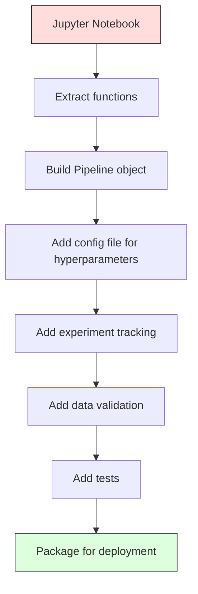

# ML Pipelines

> Một mô hình không phải là một sản phẩm. Một pipeline thì có. Pipeline là mọi thứ từ dữ liệu thô đến dự đoán đã triển khai, và mọi bước phải có thể tái lập.

**Type:** Build
**Language:** Python
**Prerequisites:** Phase 2, Lesson 12 (Hyperparameter Tuning)
**Time:** ~120 minutes

## Learning Objectives

- Xây dựng một pipeline ML từ đầu nối điền khuyết, co giãn, mã hóa và huấn luyện mô hình thành một đối tượng duy nhất có thể tái lập
- Xác định các tình huống rò rỉ dữ liệu và giải thích cách pipeline ngăn chúng bằng cách chỉ khớp các bộ biến đổi trên dữ liệu huấn luyện
- Xây dựng một ColumnTransformer áp dụng các tiền xử lý khác nhau cho các đặc trưng số và phân loại
- Triển khai tuần tự hóa pipeline và minh họa cùng pipeline đã khớp tạo các kết quả giống hệt trong huấn luyện và sản xuất

## The Problem

Bạn có một notebook tải dữ liệu, điền các giá trị thiếu bằng trung vị, co giãn đặc trưng, huấn luyện một mô hình và in độ chính xác. Nó hoạt động. Bạn đưa vào sử dụng.

Một tháng sau, ai đó huấn luyện lại mô hình và nhận các kết quả khác. Trung vị được tính trên toàn bộ tập dữ liệu bao gồm dữ liệu kiểm tra (rò rỉ dữ liệu). Các tham số co giãn không được lưu, nên suy luận sử dụng các thống kê khác. Mã kỹ thuật đặc trưng được sao chép-dán giữa huấn luyện và phục vụ, và các bản sao lệch nhau. Một cột phân loại có thêm một giá trị mới trong sản xuất mà bộ mã hóa chưa bao giờ thấy.

Đây không phải giả định. Chúng là các lý do phổ biến nhất khiến hệ thống ML thất bại trong sản xuất. Pipeline giải quyết tất cả bằng cách đóng gói mọi bước biến đổi vào một đối tượng duy nhất, có thứ tự, có thể tái lập.

## The Concept

### What a Pipeline Is

Một pipeline là một chuỗi có thứ tự các phép biến đổi dữ liệu theo sau bởi một mô hình. Mỗi bước nhận đầu ra bước trước làm đầu vào. Toàn bộ pipeline được khớp một lần trên dữ liệu huấn luyện. Tại thời điểm suy luận, cùng pipeline đã khớp biến đổi dữ liệu mới và tạo các dự đoán.


Pipeline bảo đảm:
- Các phép biến đổi chỉ được khớp trên dữ liệu huấn luyện (không rò rỉ)
- Cùng các phép biến đổi được áp dụng tại thời điểm suy luận
- Toàn bộ đối tượng có thể được tuần tự hóa và triển khai thành một sản phẩm duy nhất
- Xác thực chéo áp dụng pipeline theo từng fold, ngăn rò rỉ tinh vi

### Data Leakage: The Silent Killer

Rò rỉ dữ liệu xảy ra khi thông tin từ tập kiểm tra hoặc dữ liệu tương lai làm nhiễm huấn luyện. Pipeline ngăn các dạng phổ biến nhất.

**Rò rỉ (sai):**
```python
X = df.drop("target", axis=1)
y = df["target"]

scaler = StandardScaler()
X_scaled = scaler.fit_transform(X)

X_train, X_test = X_scaled[:800], X_scaled[800:]
y_train, y_test = y[:800], y[800:]
```

Bộ co giãn đã thấy dữ liệu kiểm tra. Trung bình và độ lệch chuẩn bao gồm các mẫu kiểm tra. Điều này làm tăng các ước lượng độ chính xác.

**Đúng:**
```python
X_train, X_test = X[:800], X[800:]

scaler = StandardScaler()
X_train_scaled = scaler.fit_transform(X_train)
X_test_scaled = scaler.transform(X_test)
```

Với một pipeline, bạn không cần nghĩ về điều này. Pipeline tự động xử lý nó.

### sklearn Pipeline

`Pipeline` của sklearn nối các bộ biến đổi và một bộ ước lượng. Nó cung cấp `.fit()`, `.predict()` và `.score()` áp dụng tất cả các bước theo thứ tự.

```python
from sklearn.pipeline import Pipeline
from sklearn.preprocessing import StandardScaler
from sklearn.linear_model import LogisticRegression

pipe = Pipeline([
    ("scaler", StandardScaler()),
    ("model", LogisticRegression()),
])

pipe.fit(X_train, y_train)
predictions = pipe.predict(X_test)
```

Khi bạn gọi `pipe.fit(X_train, y_train)`:
1. Bộ co giãn gọi `fit_transform` trên X_train
2. Mô hình gọi `fit` trên X_train đã co giãn

Khi bạn gọi `pipe.predict(X_test)`:
1. Bộ co giãn gọi `transform` (không phải fit_transform) trên X_test
2. Mô hình gọi `predict` trên X_test đã co giãn

Bộ co giãn không bao giờ thấy dữ liệu kiểm tra khi khớp. Đó là toàn bộ mục đích.

### ColumnTransformer: Different Pipelines for Different Columns

Các tập dữ liệu thực có các cột số và phân loại cần tiền xử lý khác nhau. `ColumnTransformer` xử lý điều này.

```python
from sklearn.compose import ColumnTransformer
from sklearn.preprocessing import StandardScaler, OneHotEncoder
from sklearn.impute import SimpleImputer

numeric_pipe = Pipeline([
    ("impute", SimpleImputer(strategy="median")),
    ("scale", StandardScaler()),
])

categorical_pipe = Pipeline([
    ("impute", SimpleImputer(strategy="most_frequent")),
    ("encode", OneHotEncoder(handle_unknown="ignore")),
])

preprocessor = ColumnTransformer([
    ("num", numeric_pipe, ["age", "income", "score"]),
    ("cat", categorical_pipe, ["city", "gender", "plan"]),
])

full_pipeline = Pipeline([
    ("preprocess", preprocessor),
    ("model", GradientBoostingClassifier()),
])
```

`handle_unknown="ignore"` trong OneHotEncoder rất quan trọng cho sản xuất. Khi một loại mới xuất hiện (một thành phố mô hình chưa bao giờ thấy), nó tạo một vector không thay vì gây sập.

### Experiment Tracking

Một pipeline làm huấn luyện có thể tái lập, nhưng bạn cũng cần theo dõi những gì xảy ra qua các thí nghiệm: các siêu tham số nào được dùng, phiên bản tập dữ liệu nào, các chỉ số là gì, mã nào đang chạy.

**MLflow** là giải pháp nguồn mở phổ biến nhất:

```python
import mlflow

with mlflow.start_run():
    mlflow.log_param("max_depth", 5)
    mlflow.log_param("n_estimators", 100)
    mlflow.log_param("learning_rate", 0.1)

    pipe.fit(X_train, y_train)
    accuracy = pipe.score(X_test, y_test)

    mlflow.log_metric("accuracy", accuracy)
    mlflow.sklearn.log_model(pipe, "model")
```

Mỗi lần chạy được ghi lại với các tham số, chỉ số, sản phẩm và toàn bộ mô hình. Bạn có thể so sánh các lần chạy, tái lập bất kỳ thí nghiệm nào và triển khai bất kỳ phiên bản mô hình nào.

**Weights & Biases (wandb)** cung cấp cùng chức năng với một bảng điều khiển được lưu trữ:

```python
import wandb

wandb.init(project="my-pipeline")
wandb.config.update({"max_depth": 5, "n_estimators": 100})

pipe.fit(X_train, y_train)
accuracy = pipe.score(X_test, y_test)

wandb.log({"accuracy": accuracy})
```

### Model Versioning

Sau theo dõi thí nghiệm, bạn cần quản lý các phiên bản mô hình. Mô hình nào đang trong sản xuất? Mô hình nào đang thử nghiệm? Mô hình nào là của tuần trước?

Model Registry của MLflow cung cấp:
- **Theo dõi phiên bản:** Mỗi mô hình được lưu nhận một số phiên bản
- **Chuyển giai đoạn:** "Staging", "Production", "Archived"
- **Quy trình phê duyệt:** Các mô hình phải được đưa rõ ràng lên sản xuất
- **Hoàn tác:** Chuyển lại một phiên bản trước ngay lập tức

### Data Versioning with DVC

Mã được quản lý phiên bản bằng git. Dữ liệu cũng nên được quản lý phiên bản, nhưng git không thể xử lý các tệp lớn. DVC (Quản lý Phiên bản Dữ liệu) giải quyết điều này.

```
dvc init
dvc add data/training.csv
git add data/training.csv.dvc data/.gitignore
git commit -m "Track training data"
dvc push
```

DVC lưu dữ liệu thực trong lưu trữ từ xa (S3, GCS, Azure) và giữ một tệp `.dvc` nhỏ trong git ghi lại mã băm. Khi bạn checkout một commit git, `dvc checkout` khôi phục chính xác dữ liệu đã được sử dụng.

Điều này có nghĩa là mỗi commit git ghim cả mã lẫn dữ liệu. Khả năng tái lập đầy đủ.

### Reproducible Experiments

Một thí nghiệm có thể tái lập cần bốn thứ:

1. **Các seed ngẫu nhiên cố định:** Đặt seed cho numpy, random và framework (torch, sklearn)
2. **Các phần phụ thuộc được ghim:** requirements.txt hoặc poetry.lock với các phiên bản chính xác
3. **Dữ liệu có quản lý phiên bản:** DVC hoặc tương tự
4. **Các tệp cấu hình:** Tất cả siêu tham số trong một cấu hình, không mã hóa cứng

```python
import numpy as np
import random

def set_seed(seed=42):
    random.seed(seed)
    np.random.seed(seed)
    try:
        import torch
        torch.manual_seed(seed)
        torch.cuda.manual_seed_all(seed)
        torch.backends.cudnn.deterministic = True
    except ImportError:
        pass
```

### From Notebook to Production Pipeline



Tiến trình điển hình:

1. **Khám phá bằng notebook:** Các thí nghiệm nhanh, trực quan hóa, ý tưởng đặc trưng
2. **Trích xuất hàm:** Chuyển tiền xử lý, kỹ thuật đặc trưng, đánh giá vào các mô-đun
3. **Xây dựng Pipeline:** Nối các phép biến đổi thành một Pipeline sklearn hoặc lớp tùy chỉnh
4. **Quản lý cấu hình:** Chuyển mọi siêu tham số vào một cấu hình YAML/JSON
5. **Theo dõi thí nghiệm:** Thêm ghi nhật ký MLflow hoặc wandb
6. **Xác thực dữ liệu:** Kiểm tra schema, các phân phối và các mẫu giá trị thiếu trước huấn luyện
7. **Kiểm thử:** Kiểm thử đơn vị cho các bộ biến đổi, kiểm thử tích hợp cho toàn pipeline
8. **Triển khai:** Tuần tự hóa pipeline, bọc trong một API (FastAPI, Flask), đóng gói container

### Common Pipeline Mistakes

| Sai lầm | Tại sao nó tệ | Cách sửa |
|---------|-------------|-----|
| Khớp trên toàn bộ dữ liệu trước khi chia | Rò rỉ dữ liệu | Sử dụng Pipeline với cross_val_score |
| Kỹ thuật đặc trưng ngoài pipeline | Các phép biến đổi khác nhau giữa huấn luyện và phục vụ | Đặt mọi phép biến đổi trong Pipeline |
| Không xử lý các loại chưa biết | Sập trong sản xuất khi có giá trị mới | OneHotEncoder(handle_unknown="ignore") |
| Tên cột mã hóa cứng | Hỏng khi schema thay đổi | Sử dụng các danh sách tên cột từ cấu hình |
| Không xác thực dữ liệu | Các dự đoán âm thầm sai trên dữ liệu xấu | Thêm các kiểm tra schema trước dự đoán |
| Lệch huấn luyện/phục vụ | Mô hình thấy các đặc trưng khác trong sản xuất | Một đối tượng Pipeline cho cả hai |

```figure
f3-pipeline-flow
```

## Build It

Mã trong `code/pipeline.py` xây dựng một pipeline ML hoàn chỉnh từ đầu:

### Step 1: Custom Transformer

```python
class CustomTransformer:
    def __init__(self):
        self.means = None
        self.stds = None

    def fit(self, X):
        self.means = np.mean(X, axis=0)
        self.stds = np.std(X, axis=0)
        self.stds[self.stds == 0] = 1.0
        return self

    def transform(self, X):
        return (X - self.means) / self.stds

    def fit_transform(self, X):
        return self.fit(X).transform(X)
```

### Step 2: Pipeline from Scratch

```python
class PipelineFromScratch:
    def __init__(self, steps):
        self.steps = steps

    def fit(self, X, y=None):
        X_current = X.copy()
        for name, step in self.steps[:-1]:
            X_current = step.fit_transform(X_current)
        name, model = self.steps[-1]
        model.fit(X_current, y)
        return self

    def predict(self, X):
        X_current = X.copy()
        for name, step in self.steps[:-1]:
            X_current = step.transform(X_current)
        name, model = self.steps[-1]
        return model.predict(X_current)
```

### Step 3: Cross-Validation with Pipeline

Mã minh họa cách xác thực chéo với một pipeline ngăn rò rỉ dữ liệu: bộ co giãn được khớp riêng trên dữ liệu huấn luyện của mỗi fold.

### Step 4: Full Production Pipeline with sklearn

Một pipeline hoàn chỉnh với `ColumnTransformer`, nhiều nhánh tiền xử lý và một mô hình, được huấn luyện với xác thực chéo đúng cách và ghi nhật ký thí nghiệm.

## Ship It

Bài học này tạo ra:
- `outputs/prompt-ml-pipeline.md` -- một skill để xây dựng và gỡ lỗi các pipeline ML
- `code/pipeline.py` -- một pipeline hoàn chỉnh từ đầu đến sklearn

## Exercises

1. Xây dựng một pipeline xử lý một tập dữ liệu có 3 cột số và 2 cột phân loại. Sử dụng `ColumnTransformer` để áp dụng điền khuyết trung vị + co giãn cho các biến số và điền khuyết giá trị phổ biến nhất + mã hóa one-hot cho các biến phân loại. Huấn luyện với xác thực chéo 5-fold.

2. Cố ý đưa vào rò rỉ dữ liệu: khớp bộ co giãn trên toàn bộ tập dữ liệu trước khi chia. So sánh điểm xác thực chéo (rò rỉ) với điểm xác thực chéo pipeline (sạch). Khác biệt lớn đến mức nào?

3. Tuần tự hóa pipeline bằng `joblib.dump`. Tải nó trong một tập lệnh riêng và chạy dự đoán. Xác minh các dự đoán giống hệt nhau.

4. Thêm một bộ biến đổi tùy chỉnh vào pipeline tạo các đặc trưng đa thức (bậc 2) cho hai cột số quan trọng nhất. Nó nên nằm ở đâu trong pipeline?

5. Thiết lập theo dõi MLflow cho pipeline. Chạy 5 thí nghiệm với các siêu tham số khác nhau. Sử dụng giao diện MLflow (`mlflow ui`) để so sánh các lần chạy và chọn mô hình tốt nhất.

## Key Terms

| Thuật ngữ | Cách mọi người nói | Ý nghĩa thực sự |
|------|----------------|----------------------|
| Pipeline | "Chuỗi phép biến đổi + mô hình" | Một chuỗi có thứ tự các bộ biến đổi đã khớp và một mô hình, được áp dụng như một đơn vị để ngăn rò rỉ |
| Data leakage (Rò rỉ dữ liệu) | "Thông tin kiểm tra rò vào huấn luyện" | Sử dụng thông tin từ bên ngoài tập huấn luyện để xây dựng mô hình, làm tăng các ước lượng hiệu năng |
| ColumnTransformer | "Tiền xử lý khác nhau cho từng cột" | Áp dụng các pipeline khác nhau cho các tập con cột khác nhau, kết hợp kết quả |
| Experiment tracking (Theo dõi thí nghiệm) | "Ghi nhật ký các lần chạy" | Ghi lại các tham số, chỉ số, sản phẩm và phiên bản mã cho mỗi lần huấn luyện |
| MLflow | "Theo dõi và triển khai mô hình" | Nền tảng nguồn mở cho theo dõi thí nghiệm, đăng ký mô hình và triển khai |
| DVC | "Git cho dữ liệu" | Hệ thống quản lý phiên bản cho các tệp dữ liệu lớn, lưu mã băm trong git và dữ liệu trong lưu trữ từ xa |
| Model registry (Sổ đăng ký mô hình) | "Danh mục phiên bản mô hình" | Một hệ thống theo dõi các phiên bản mô hình với các nhãn giai đoạn (thử nghiệm, sản xuất, lưu trữ) |
| Training/serving skew (Lệch huấn luyện/phục vụ) | "Nó hoạt động trong notebook" | Các khác biệt giữa cách dữ liệu được xử lý trong huấn luyện và suy luận, gây sai số âm thầm |
| Reproducibility (Khả năng tái lập) | "Cùng mã, cùng kết quả" | Khả năng có kết quả giống hệt từ cùng mã, dữ liệu và cấu hình |

## Further Reading

- [Tài liệu scikit-learn Pipeline](https://scikit-learn.org/stable/modules/compose.html) -- tài liệu tham khảo pipeline chính thức
- [Tài liệu MLflow](https://mlflow.org/docs/latest/index.html) -- theo dõi thí nghiệm và sổ đăng ký mô hình
- [Tài liệu DVC](https://dvc.org/doc) -- quản lý phiên bản dữ liệu
- [Sculley et al., Hidden Technical Debt in Machine Learning Systems (2015)](https://papers.nips.cc/paper/2015/hash/86df7dcfd896fcaf2674f757a2463eba-Abstract.html) -- bài báo nền tảng về độ phức tạp hệ thống ML
- [Google ML Best Practices: Rules of ML](https://developers.google.com/machine-learning/guides/rules-of-ml) -- lời khuyên ML sản xuất thực tế
