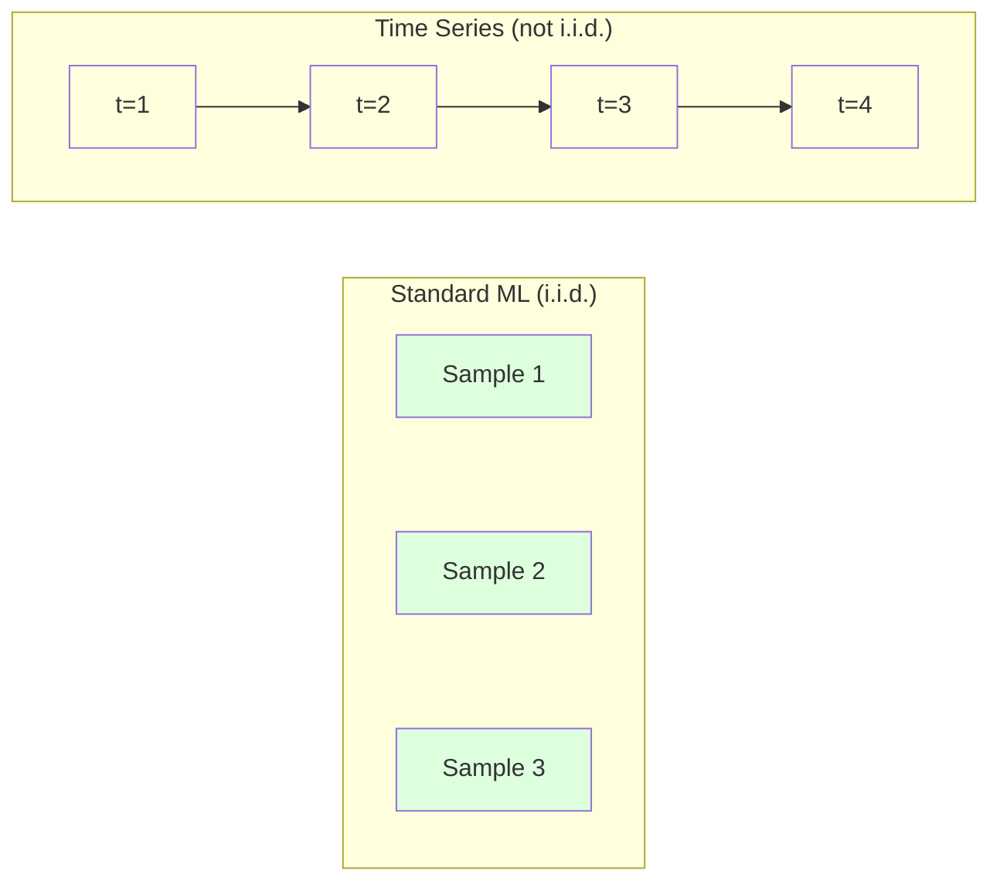
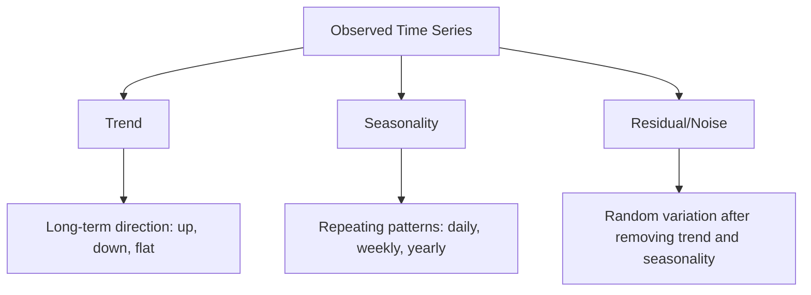
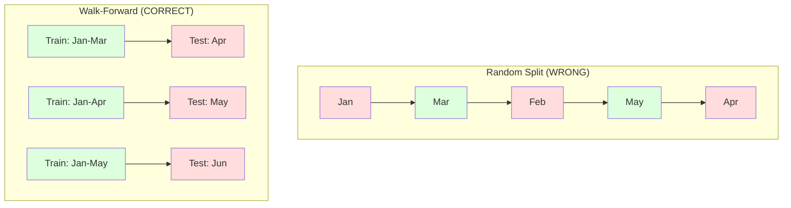

# Time Series Fundamentals

> Hiệu năng quá khứ có dự đoán kết quả tương lai -- nếu bạn kiểm tra tính dừng trước.

**Type:** Build
**Language:** Python
**Prerequisites:** Phase 2, Lessons 01-09
**Time:** ~90 minutes

## Learning Objectives

- Phân rã một chuỗi thời gian thành các thành phần xu hướng, mùa vụ và phần dư và kiểm tra tính dừng
- Triển khai các đặc trưng trễ và thống kê trượt để chuyển một chuỗi thời gian thành một bài toán học có giám sát
- Xây dựng một khuôn khổ xác thực tiến dần ngăn dữ liệu tương lai rò rỉ vào huấn luyện
- Giải thích tại sao các phần chia huấn luyện/kiểm tra ngẫu nhiên không hợp lệ với chuỗi thời gian và minh họa khoảng cách hiệu năng so với các phần chia thời gian đúng

## The Problem

Bạn có dữ liệu được sắp xếp theo thời gian. Doanh số hằng ngày, nhiệt độ hằng giờ, mức sử dụng CPU mỗi phút, giá cổ phiếu hằng tuần. Bạn muốn dự đoán giá trị tiếp theo, tuần tiếp theo, quý tiếp theo.

Bạn tìm đến bộ công cụ ML tiêu chuẩn: chia huấn luyện/kiểm tra ngẫu nhiên, xác thực chéo, ma trận đặc trưng vào, dự đoán ra. Mọi bước đều sai.

Chuỗi thời gian phá vỡ các giả định mà ML tiêu chuẩn dựa vào. Các mẫu không độc lập -- nhiệt độ hôm nay phụ thuộc hôm qua. Các phần chia ngẫu nhiên làm rò rỉ thông tin tương lai vào quá khứ. Các đặc trưng trông tuyệt trong kiểm tra hồi cứu thất bại trong sản xuất vì chúng dựa vào các mẫu dịch chuyển theo thời gian.

Một mô hình đạt độ chính xác 95% với xác thực chéo ngẫu nhiên có thể đạt 55% với đánh giá theo thời gian đúng. Khác biệt không phải chuyện tiểu tiết kỹ thuật. Nó là khác biệt giữa một mô hình hoạt động trên giấy và một mô hình hoạt động trong sản xuất.

Bài học này trình bày các nền tảng: điều gì làm dữ liệu thời gian khác biệt, cách đánh giá mô hình trung thực và cách biến một chuỗi thời gian thành các đặc trưng mà các mô hình ML tiêu chuẩn có thể sử dụng.

## The Concept

### What Makes Time Series Different

ML tiêu chuẩn giả định i.i.d. -- độc lập và cùng phân phối. Mỗi mẫu được rút từ cùng phân phối, độc lập với các mẫu khác. Chuỗi thời gian vi phạm cả hai:

- **Không độc lập.** Giá cổ phiếu hôm nay phụ thuộc hôm qua. Doanh số tuần này tương quan với tuần trước.
- **Không cùng phân phối.** Phân phối dịch chuyển theo thời gian. Doanh số tháng Mười Hai trông khác doanh số tháng Ba.

Các vi phạm này không nhỏ. Chúng thay đổi cách bạn xây dựng đặc trưng, đánh giá mô hình và các thuật toán nào hoạt động.



Trong ML tiêu chuẩn, các mẫu có thể hoán đổi. Xáo trộn chúng không thay đổi gì. Trong chuỗi thời gian, thứ tự là mọi thứ. Xáo trộn phá hủy tín hiệu.

### Components of a Time Series

Mọi chuỗi thời gian là một kết hợp của:



- **Xu hướng**: Hướng dài hạn. Doanh thu tăng 10% mỗi năm. Nhiệt độ toàn cầu tăng.
- **Tính mùa vụ**: Các mẫu lặp lại tại các khoảng cố định. Doanh số bán lẻ tăng vọt tháng Mười Hai. Sử dụng điều hòa đạt đỉnh tháng Bảy.
- **Phần dư**: Bất cứ thứ gì còn lại sau khi loại xu hướng và tính mùa vụ. Nếu phần dư trông như nhiễu trắng, phân rã đã nắm bắt tín hiệu.

### Stationarity

Một chuỗi thời gian dừng nếu các tính chất thống kê (trung bình, phương sai, tự tương quan) không thay đổi theo thời gian. Hầu hết các phương pháp dự báo giả định tính dừng.

**Tại sao quan trọng:** Một chuỗi không dừng có trung bình trôi. Một mô hình huấn luyện trên dữ liệu tháng Một đã học trung bình khác với những gì tháng Hai sẽ cho thấy. Nó sẽ sai có hệ thống.

**Cách kiểm tra:** Tính trung bình trượt và độ lệch chuẩn trượt trên các cửa sổ. Nếu chúng trôi, chuỗi không dừng.

**Cách sửa:** Lấy sai phân. Thay vì mô hình hóa các giá trị thô, mô hình hóa thay đổi giữa các giá trị liên tiếp:

```
diff[t] = value[t] - value[t-1]
```

Nếu một lượt lấy sai phân không làm chuỗi dừng, áp dụng lần nữa (sai phân bậc hai). Hầu hết các chuỗi thực tế cần nhiều nhất hai lượt.

**Ví dụ:**

Chuỗi gốc: [100, 102, 106, 112, 120]
Sai phân bậc nhất:  [2, 4, 6, 8] (vẫn có xu hướng tăng)
Sai phân bậc hai:  [2, 2, 2] (không đổi -- dừng)

Chuỗi gốc có một xu hướng bậc hai. Lấy sai phân bậc nhất biến nó thành xu hướng tuyến tính. Lấy sai phân bậc hai làm nó phẳng. Trong thực tế, hiếm khi cần hơn hai lượt.

**Kiểm định hình thức:** Kiểm định Dickey-Fuller Mở rộng (ADF) là kiểm định thống kê tiêu chuẩn cho tính dừng. Giả thuyết không là "chuỗi không dừng." Một p-value dưới 0.05 nghĩa là bạn có thể bác bỏ giả thuyết không và kết luận tính dừng. Chúng ta không triển khai ADF từ đầu (nó đòi hỏi các bảng phân phối tiệm cận), nhưng cách tiếp cận thống kê trượt trong mã cho một kiểm tra trực quan thực tế.

### Autocorrelation

Tự tương quan đo mức một giá trị ở thời điểm t tương quan với giá trị tại t-k (k bước trong quá khứ). Hàm tự tương quan (ACF) vẽ tương quan này cho mỗi độ trễ k.

**ACF cho bạn biết:**
- Chuỗi nhớ xa đến đâu. Nếu ACF giảm về không sau độ trễ 5, các giá trị hơn 5 bước trước không liên quan.
- Tính mùa vụ có tồn tại không. Nếu ACF tăng vọt tại độ trễ 12 (dữ liệu hằng tháng), có tính mùa vụ hằng năm.
- Cần tạo bao nhiêu đặc trưng trễ. Sử dụng các độ trễ đến nơi ACF trở nên không đáng kể.

**PACF (Hàm Tự tương quan Riêng phần)** loại các tương quan gián tiếp. Nếu hôm nay tương quan với 3 ngày trước chỉ vì cả hai tương quan với hôm qua, PACF tại độ trễ 3 sẽ bằng không trong khi ACF tại độ trễ 3 không bằng không.

### Lag Features: Turning Time Series into Supervised Learning

Các mô hình ML tiêu chuẩn cần một ma trận đặc trưng X và mục tiêu y. Chuỗi thời gian cho bạn một cột giá trị duy nhất. Cầu nối là các đặc trưng trễ.

Lấy chuỗi [10, 12, 14, 13, 15] và tạo các đặc trưng trễ 1 và trễ 2:

| lag_2 | lag_1 | target |
|-------|-------|--------|
| 10    | 12    | 14     |
| 12    | 14    | 13     |
| 14    | 13    | 15     |

Giờ bạn có một bài toán hồi quy tiêu chuẩn. Bất kỳ mô hình ML nào (hồi quy tuyến tính, rừng ngẫu nhiên, gradient boosting) đều có thể dự đoán mục tiêu từ các độ trễ.

Các đặc trưng bổ sung bạn có thể tạo:
- **Thống kê trượt:** trung bình, độ lệch chuẩn, nhỏ nhất, lớn nhất trên k giá trị gần nhất
- **Đặc trưng lịch:** thứ trong tuần, tháng, is_holiday, is_weekend
- **Các giá trị sai phân:** thay đổi từ bước trước
- **Thống kê mở rộng:** trung bình tích lũy, tổng tích lũy
- **Các đặc trưng tỉ số:** giá trị hiện tại / trung bình trượt (xa trung bình gần đây bao nhiêu)
- **Các đặc trưng tương tác:** lag_1 * day_of_week (các tác động ngày trong tuần lên momentum)

**Bao nhiêu độ trễ?** Sử dụng hàm tự tương quan. Nếu ACF đáng kể đến độ trễ 10, sử dụng ít nhất 10 độ trễ. Nếu có tính mùa vụ hằng tuần, đưa vào độ trễ 7 (và có thể 14). Nhiều độ trễ hơn cho mô hình nhiều lịch sử hơn nhưng cũng nhiều đặc trưng cần khớp hơn, tăng nguy cơ khớp quá mức.

**Bẫy căn chỉnh mục tiêu.** Khi tạo các đặc trưng trễ, mục tiêu phải là giá trị tại thời điểm t, và mọi đặc trưng phải sử dụng giá trị tại thời điểm t-1 hoặc trước đó. Nếu vô tình đưa giá trị tại thời điểm t làm một đặc trưng, bạn có một bộ dự đoán hoàn hảo -- và một mô hình hoàn toàn vô ích. Đây là lỗi phổ biến nhất trong kỹ thuật đặc trưng chuỗi thời gian.

### Walk-Forward Validation

Đây là khái niệm quan trọng nhất trong bài học này. Xác thực chéo k-fold tiêu chuẩn gán ngẫu nhiên các mẫu cho huấn luyện và kiểm tra. Với chuỗi thời gian, điều này làm rò rỉ thông tin tương lai.



Xác thực tiến dần:
1. Huấn luyện trên dữ liệu đến thời điểm t
2. Dự đoán tại thời điểm t+1 (hoặc t+1 đến t+k cho nhiều bước)
3. Trượt cửa sổ về phía trước
4. Lặp lại

Mỗi fold kiểm tra chỉ chứa dữ liệu đến sau tất cả dữ liệu huấn luyện. Không rò rỉ tương lai. Điều này cho một ước lượng trung thực về cách mô hình sẽ hoạt động khi triển khai.

**Cửa sổ mở rộng** sử dụng toàn bộ dữ liệu lịch sử để huấn luyện (cửa sổ lớn dần). **Cửa sổ trượt** sử dụng một cửa sổ huấn luyện kích thước cố định (cửa sổ trượt). Sử dụng mở rộng khi tin dữ liệu cũ vẫn liên quan. Sử dụng trượt khi thế giới thay đổi và dữ liệu cũ gây hại.

### ARIMA Intuition

ARIMA là mô hình chuỗi thời gian cổ điển. Nó có ba thành phần:

- **AR (Tự hồi quy):** Dự đoán từ các giá trị quá khứ. AR(p) sử dụng p giá trị gần nhất.
- **I (Tích hợp):** Lấy sai phân để đạt tính dừng. I(d) áp dụng d lượt sai phân.
- **MA (Trung bình Trượt):** Dự đoán từ các sai số dự báo quá khứ. MA(q) sử dụng q sai số gần nhất.

ARIMA(p, d, q) kết hợp cả ba. Bạn chọn p, d, q dựa trên phân tích ACF/PACF hoặc tìm kiếm tự động (auto-ARIMA).

Chúng ta sẽ không triển khai ARIMA từ đầu -- nó đòi hỏi tối ưu hóa số vượt phạm vi bài học. Điểm cốt yếu là hiểu mỗi thành phần làm gì để có thể diễn giải các kết quả ARIMA và biết khi nào dùng nó.

### When to Use What

| Cách tiếp cận | Tốt nhất Cho | Xử lý Tính mùa vụ | Xử lý Đặc trưng Bên ngoài |
|----------|---------|-------------------|------------------------|
| Các đặc trưng trễ + ML | Dạng bảng với nhiều đặc trưng bên ngoài | Với các đặc trưng lịch | Có |
| ARIMA | Một chuỗi đơn biến duy nhất, ngắn hạn | Biến thể SARIMA | Không (ARIMAX cho mức hạn chế) |
| Làm trơn hàm mũ | Xu hướng đơn giản + tính mùa vụ | Có (Holt-Winters) | Không |
| Prophet | Dự báo kinh doanh, ngày lễ | Có (các số hạng Fourier) | Hạn chế |
| Mạng nơ-ron (LSTM, Transformer) | Các chuỗi dài, nhiều chuỗi | Được học | Có |

Với hầu hết các bài toán thực tế, các đặc trưng trễ + gradient boosting là điểm bắt đầu mạnh nhất. Nó xử lý các đặc trưng bên ngoài tự nhiên, không yêu cầu tính dừng và dễ gỡ lỗi.

### Forecasting Horizons and Strategies

Dự báo một bước dự đoán trước một bước thời gian. Dự báo nhiều bước dự đoán nhiều bước. Có ba chiến lược:

**Đệ quy (lặp):** Dự đoán trước một bước, dùng dự đoán làm đầu vào cho bước tiếp theo. Đơn giản nhưng sai số tích lũy -- mỗi dự đoán sử dụng dự đoán trước, nên các lỗi dồn lại.

**Trực tiếp:** Huấn luyện một mô hình riêng cho mỗi chân trời. Model-1 dự đoán t+1, Model-5 dự đoán t+5. Không tích lũy sai số, nhưng mỗi mô hình có ít mẫu huấn luyện hơn và chúng không chia sẻ thông tin.

**Đa đầu ra:** Huấn luyện một mô hình xuất ra đồng thời tất cả chân trời. Chia sẻ thông tin giữa các chân trời nhưng đòi hỏi một mô hình hỗ trợ nhiều đầu ra (hoặc một hàm mất mát tùy chỉnh).

Với hầu hết bài toán thực tế, bắt đầu với đệ quy cho các chân trời ngắn (1-5 bước) và trực tiếp cho các chân trời dài hơn.

### Common Mistakes in Time Series

| Sai lầm | Tại sao xảy ra | Cách sửa |
|---------|---------------|-----------|
| Chia huấn luyện/kiểm tra ngẫu nhiên | Thói quen từ ML tiêu chuẩn | Sử dụng tiến dần hoặc chia theo thời gian |
| Sử dụng các đặc trưng tương lai | Vô tình đưa đặc trưng tại thời điểm t vào | Rà soát mọi đặc trưng về căn chỉnh thời gian |
| Khớp quá mức tính mùa vụ | Mô hình ghi nhớ các mẫu lịch | Giữ riêng một chu kỳ mùa vụ đầy đủ trong tập kiểm tra |
| Bỏ qua thay đổi thang đo | Doanh thu tăng gấp đôi nhưng các mẫu giữ nguyên | Mô hình hóa thay đổi phần trăm thay vì tuyệt đối |
| Quá nhiều đặc trưng trễ | "Nhiều lịch sử hơn tốt hơn" | Sử dụng ACF để xác định các độ trễ liên quan |
| Không lấy sai phân | "Mô hình sẽ tự tìm ra" | Các mô hình cây xử lý xu hướng; các mô hình tuyến tính cần tính dừng |

```figure
f3-series-decompose
```

## Build It

Mã trong `code/time_series.py` triển khai các khối xây dựng cốt lõi từ đầu.

### Lag Feature Creator

```python
def make_lag_features(series, n_lags):
    n = len(series)
    X = np.full((n, n_lags), np.nan)
    for lag in range(1, n_lags + 1):
        X[lag:, lag - 1] = series[:-lag]
    valid = ~np.isnan(X).any(axis=1)
    return X[valid], series[valid]
```

Điều này chuyển một chuỗi 1D thành một ma trận đặc trưng nơi mỗi hàng có `n_lags` giá trị gần nhất làm đặc trưng và giá trị hiện tại làm mục tiêu.

### Walk-Forward Cross-Validation

```python
def walk_forward_split(n_samples, n_splits=5, min_train=50):
    assert min_train < n_samples, "min_train must be less than n_samples"
    step = max(1, (n_samples - min_train) // n_splits)
    for i in range(n_splits):
        train_end = min_train + i * step
        test_end = min(train_end + step, n_samples)
        if train_end >= n_samples:
            break
        yield slice(0, train_end), slice(train_end, test_end)
```

Mỗi lần chia bảo đảm dữ liệu huấn luyện nằm hoàn toàn trước dữ liệu kiểm tra. Cửa sổ huấn luyện mở rộng với mỗi fold.

### Simple Autoregressive Model

Một mô hình AR thuần chỉ là hồi quy tuyến tính trên các đặc trưng trễ:

```python
class SimpleAR:
    def __init__(self, n_lags=5):
        self.n_lags = n_lags
        self.weights = None
        self.bias = None

    def fit(self, series):
        X, y = make_lag_features(series, self.n_lags)
        # Solve via normal equations
        X_b = np.column_stack([np.ones(len(X)), X])
        theta = np.linalg.lstsq(X_b, y, rcond=None)[0]
        self.bias = theta[0]
        self.weights = theta[1:]
        return self
```

Điều này giống hồi quy tuyến tính từ Bài học 02 về khái niệm, nhưng được áp dụng cho các phiên bản trễ thời gian của cùng biến.

### Stationarity Check

Mã tính các thống kê trượt để đánh giá tính dừng một cách trực quan và bằng số:

```python
def check_stationarity(series, window=50):
    rolling_mean = np.array([
        series[max(0, i - window):i].mean()
        for i in range(1, len(series) + 1)
    ])
    rolling_std = np.array([
        series[max(0, i - window):i].std()
        for i in range(1, len(series) + 1)
    ])
    return rolling_mean, rolling_std
```

Nếu trung bình trượt trôi hoặc độ lệch chuẩn trượt thay đổi, chuỗi không dừng. Áp dụng sai phân và kiểm tra lại.

Mã cũng kiểm tra tính dừng bằng cách so sánh nửa đầu và nửa sau chuỗi. Nếu các trung bình khác nhau hơn nửa độ lệch chuẩn hoặc tỉ số phương sai vượt 2 lần, chuỗi được đánh dấu không dừng.

### Autocorrelation

```python
def autocorrelation(series, max_lag=20):
    n = len(series)
    mean = series.mean()
    var = series.var()
    acf = np.zeros(max_lag + 1)
    for k in range(max_lag + 1):
        cov = np.mean((series[:n-k] - mean) * (series[k:] - mean))
        acf[k] = cov / var if var > 0 else 0
    return acf
```

## Use It

Với sklearn, bạn sử dụng các đặc trưng trễ trực tiếp với bất kỳ bộ hồi quy nào:

```python
from sklearn.linear_model import Ridge
from sklearn.ensemble import GradientBoostingRegressor

X, y = make_lag_features(series, n_lags=10)

for train_idx, test_idx in walk_forward_split(len(X)):
    model = Ridge(alpha=1.0)
    model.fit(X[train_idx], y[train_idx])
    predictions = model.predict(X[test_idx])
```

Với ARIMA, sử dụng statsmodels:

```python
from statsmodels.tsa.arima.model import ARIMA

model = ARIMA(train_series, order=(5, 1, 2))
fitted = model.fit()
forecast = fitted.forecast(steps=30)
```

Mã trong `time_series.py` minh họa cả hai cách tiếp cận và so sánh bằng xác thực tiến dần.

### sklearn TimeSeriesSplit

sklearn cung cấp `TimeSeriesSplit` triển khai xác thực tiến dần:

```python
from sklearn.model_selection import TimeSeriesSplit

tscv = TimeSeriesSplit(n_splits=5)
for train_index, test_index in tscv.split(X):
    X_train, X_test = X[train_index], X[test_index]
    y_train, y_test = y[train_index], y[test_index]
    model.fit(X_train, y_train)
    score = model.score(X_test, y_test)
```

Điều này tương đương `walk_forward_split` từ đầu của chúng ta nhưng được tích hợp vào khuôn khổ xác thực chéo của sklearn. Bạn có thể sử dụng với `cross_val_score`:

```python
from sklearn.model_selection import cross_val_score

scores = cross_val_score(model, X, y, cv=TimeSeriesSplit(n_splits=5))
print(f"Mean score: {scores.mean():.4f} +/- {scores.std():.4f}")
```

### Evaluation Metrics

Dự báo chuỗi thời gian sử dụng các chỉ số hồi quy, nhưng với ngữ cảnh có xét thời gian:

- **MAE (Sai số Tuyệt đối Trung bình):** Trung bình của |y_true - y_pred|. Dễ diễn giải theo đơn vị gốc. "Trung bình, các dự đoán lệch 3.2 độ."
- **RMSE (Căn Sai số Bình phương Trung bình):** Căn bậc hai của sai số bình phương trung bình. Phạt các sai số lớn hơn MAE. Sử dụng khi các sai số lớn tệ hơn nhiều sai số nhỏ.
- **MAPE (Sai số Phần trăm Tuyệt đối Trung bình):** Trung bình của |error / true_value| * 100. Độc lập với thang đo, hữu ích để so sánh các chuỗi khác nhau. Nhưng không xác định khi các giá trị thực bằng không.
- **So sánh mốc cơ sở ngây thơ:** Luôn so sánh với các mốc cơ sở đơn giản. Mốc cơ sở ngây thơ mùa vụ dự đoán giá trị từ một chu kỳ trước (hôm qua, tuần trước). Nếu mô hình không thể vượt ngây thơ, có gì đó sai.

### Rolling Features

Mã minh họa việc thêm các thống kê trượt (trung bình, độ lệch chuẩn, nhỏ nhất, lớn nhất trên các cửa sổ 7 và 14 ngày) vào các đặc trưng trễ. Chúng cho mô hình thông tin về các xu hướng gần đây và độ biến động mà chỉ các đặc trưng trễ không nắm bắt.

Ví dụ, nếu trung bình trượt tăng, nó gợi ý xu hướng đi lên. Nếu độ lệch chuẩn trượt tăng, nó gợi ý độ biến động tăng. Đây là các loại mẫu mà các mô hình dựa trên cây có thể học nhưng các mô hình tuyến tính không thể.

## Ship It

Bài học này tạo ra:
- `outputs/prompt-time-series-advisor.md` -- một prompt để định hình các bài toán chuỗi thời gian
- `code/time_series.py` -- các đặc trưng trễ, xác thực tiến dần, mô hình AR, kiểm tra tính dừng

### Baselines You Must Beat

Trước khi xây dựng bất kỳ mô hình nào, thiết lập các mốc cơ sở:

1. **Giá trị gần nhất (duy trì).** Dự đoán ngày mai sẽ giống hôm nay. Với nhiều chuỗi, điều này khó vượt đáng ngạc nhiên.
2. **Ngây thơ mùa vụ.** Dự đoán hôm nay sẽ giống cùng ngày tuần trước (hoặc năm trước). Nếu mô hình không thể vượt cách này, nó chưa học mẫu hữu ích nào ngoài tính mùa vụ.
3. **Trung bình trượt.** Dự đoán trung bình k giá trị gần nhất. Làm mượt nhiễu nhưng không thể nắm bắt các thay đổi đột ngột.

Nếu mô hình ML cầu kỳ thua mốc cơ sở ngây thơ mùa vụ, bạn có lỗi. Phổ biến nhất: rò rỉ tương lai trong các đặc trưng, phương pháp đánh giá sai hoặc chuỗi thực sự ngẫu nhiên và không thể dự đoán.

### Practical Tips

1. **Bắt đầu bằng vẽ đồ thị.** Trước mọi mô hình hóa, vẽ chuỗi thô. Tìm xu hướng, tính mùa vụ, ngoại lệ, điểm gãy cấu trúc (các thay đổi hành vi đột ngột). Một kiểm tra trực quan 30 giây thường cho biết nhiều hơn một giờ phân tích tự động.

2. **Lấy sai phân trước, mô hình hóa sau.** Nếu chuỗi có một xu hướng rõ, lấy sai phân trước khi tạo các đặc trưng trễ. Các mô hình dựa trên cây có thể xử lý xu hướng, nhưng các mô hình tuyến tính không thể, và lấy sai phân không bao giờ gây hại.

3. **Giữ riêng ít nhất một chu kỳ mùa vụ đầy đủ.** Nếu có tính mùa vụ hằng tuần, tập kiểm tra cần ít nhất một tuần đầy đủ. Nếu hằng tháng, ít nhất một tháng đầy đủ. Nếu không bạn không thể đánh giá mô hình có nắm bắt mẫu mùa vụ không.

4. **Giám sát trong sản xuất.** Các mô hình chuỗi thời gian suy giảm theo thời gian khi thế giới thay đổi. Theo dõi sai số dự đoán trên cơ sở trượt. Khi sai số bắt đầu tăng, huấn luyện lại mô hình trên dữ liệu gần đây.

5. **Cẩn thận với các thay đổi chế độ.** Một mô hình huấn luyện trên dữ liệu trước đại dịch sẽ không dự đoán hành vi sau đại dịch. Đưa các chỉ báo thay đổi chế độ đã biết làm đặc trưng, hoặc sử dụng một cửa sổ trượt quên dữ liệu cũ.

6. **Biến đổi log các chuỗi lệch.** Doanh thu, giá cả và số đếm thường lệch phải. Lấy log ổn định phương sai và biến các mẫu nhân thành cộng, mà các mô hình tuyến tính có thể xử lý. Dự báo trong không gian log, rồi lấy hàm mũ để trở về đơn vị gốc.

## Exercises

1. **Thí nghiệm tính dừng.** Tạo một chuỗi có xu hướng tuyến tính. Kiểm tra tính dừng bằng thống kê trượt. Áp dụng sai phân bậc nhất. Kiểm tra lại. Cần bao nhiêu lượt sai phân cho một xu hướng bậc hai?

2. **Lựa chọn độ trễ.** Tính ACF trên một chuỗi mùa vụ (period=7). Các độ trễ nào có tự tương quan cao nhất? Tạo các đặc trưng trễ chỉ với các độ trễ đó (không phải các độ trễ liên tiếp). Độ chính xác có cải thiện so với sử dụng các độ trễ từ 1 đến 7 không?

3. **Tiến dần so với chia ngẫu nhiên.** Huấn luyện hồi quy Ridge trên các đặc trưng trễ. Đánh giá với chia ngẫu nhiên 80/20 và với xác thực tiến dần. Phần chia ngẫu nhiên đánh giá quá cao hiệu năng bao nhiêu?

4. **Kỹ thuật đặc trưng.** Thêm trung bình trượt (window=7), độ lệch chuẩn trượt (window=7) và các đặc trưng thứ trong tuần vào các đặc trưng trễ. So sánh độ chính xác khi có và không có các phần bổ sung bằng xác thực tiến dần.

5. **Dự báo nhiều bước.** Sửa mô hình AR để dự đoán trước 5 bước thay vì 1. So sánh hai chiến lược: (a) dự đoán một bước, dùng dự đoán làm đầu vào cho bước tiếp theo (đệ quy), và (b) huấn luyện các mô hình riêng cho mỗi chân trời (trực tiếp). Cách nào chính xác hơn?

## Key Terms

| Thuật ngữ | Cách mọi người nói | Ý nghĩa thực sự |
|------|----------------|----------------------|
| Stationarity (Tính dừng) | "Các thống kê không thay đổi theo thời gian" | Một chuỗi có trung bình, phương sai và cấu trúc tự tương quan không đổi theo thời gian |
| Differencing (Lấy sai phân) | "Trừ các giá trị liên tiếp" | Tính y[t] - y[t-1] để loại xu hướng và đạt tính dừng |
| Autocorrelation (ACF) (Tự tương quan) | "Một chuỗi tương quan với chính nó thế nào" | Tương quan giữa một chuỗi thời gian và một bản sao trễ của nó, như một hàm của độ trễ |
| Partial autocorrelation (PACF) (Tự tương quan riêng phần) | "Chỉ tương quan trực tiếp" | Tự tương quan tại độ trễ k sau khi loại tác động của mọi độ trễ ngắn hơn |
| Lag features (Đặc trưng trễ) | "Các giá trị quá khứ làm đầu vào" | Sử dụng y[t-1], y[t-2], ..., y[t-k] làm các đặc trưng để dự đoán y[t] |
| Walk-forward validation (Xác thực tiến dần) | "Xác thực chéo tôn trọng thời gian" | Đánh giá mà dữ liệu huấn luyện luôn đứng trước dữ liệu kiểm tra theo thời gian |
| ARIMA | "Mô hình chuỗi thời gian cổ điển" | Tự hồi quy Tích hợp Trung bình Trượt: kết hợp các giá trị quá khứ (AR), sai phân (I) và sai số quá khứ (MA) |
| Seasonality (Tính mùa vụ) | "Các mẫu lịch lặp lại" | Các chu kỳ đều đặn, có thể dự đoán trong một chuỗi thời gian gắn với các kỳ lịch (hằng ngày, hằng tuần, hằng năm) |
| Trend (Xu hướng) | "Hướng dài hạn" | Mức tăng hoặc giảm bền bỉ của mức chuỗi theo thời gian |
| Expanding window (Cửa sổ mở rộng) | "Sử dụng toàn bộ lịch sử" | Xác thực tiến dần nơi tập huấn luyện lớn dần với mỗi fold |
| Sliding window (Cửa sổ trượt) | "Lịch sử kích thước cố định" | Xác thực tiến dần nơi tập huấn luyện là một cửa sổ độ dài cố định trượt về phía trước |

## Further Reading

- [Hyndman and Athanasopoulos, Forecasting: Principles and Practice (3rd ed.)](https://otexts.com/fpp3/) -- giáo trình miễn phí hay nhất về dự báo chuỗi thời gian
- [scikit-learn Time Series Split](https://scikit-learn.org/stable/modules/generated/sklearn.model_selection.TimeSeriesSplit.html) -- bộ chia tiến dần của sklearn
- [Tài liệu statsmodels ARIMA](https://www.statsmodels.org/stable/generated/statsmodels.tsa.arima.model.ARIMA.html) -- triển khai ARIMA với các chẩn đoán
- [Makridakis et al., The M5 Competition (2022)](https://www.sciencedirect.com/science/article/pii/S0169207021001874) -- cuộc thi dự báo quy mô lớn cho thấy các phương pháp ML so với các phương pháp thống kê
