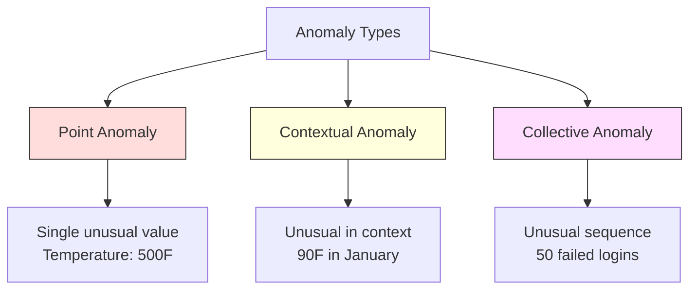
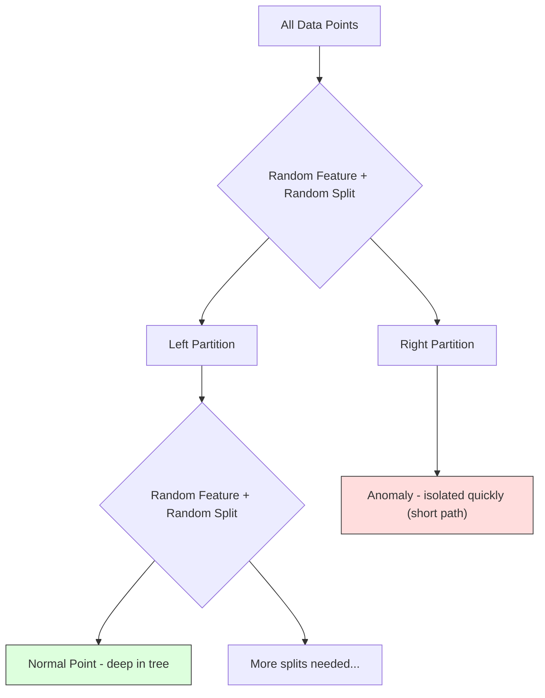
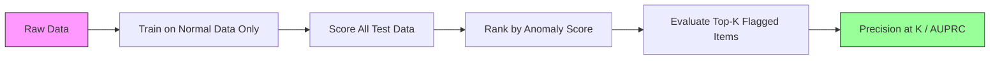

# Anomaly Detection

> Bình thường thì dễ định nghĩa. Bất thường là bất cứ điều gì không phù hợp.

**Type:** Build
**Language:** Python
**Prerequisites:** Phase 2, Lessons 01-09
**Time:** ~75 minutes

## Learning Objectives

- Triển khai các phương pháp phát hiện bất thường Z-score, IQR và Isolation Forest từ đầu
- Phân biệt các bất thường điểm, theo ngữ cảnh và tập thể, và chọn phương pháp phát hiện thích hợp cho từng loại
- Giải thích tại sao phát hiện bất thường được đặt thành bài toán mô hình hóa dữ liệu bình thường thay vì phân loại các bất thường
- So sánh phát hiện bất thường không giám sát với phân loại có giám sát và đánh giá sự đánh đổi giữa khả năng bao phủ các bất thường mới và precision

## The Problem

Một thẻ tín dụng được sử dụng tại New York lúc 2 giờ chiều, sau đó tại Tokyo lúc 2:05 chiều. Một cảm biến nhà máy ghi nhận 150 độ khi phạm vi bình thường là 80-120. Một máy chủ gửi 50,000 yêu cầu mỗi giây khi mức trung bình hằng ngày là 200.

Đây là các bất thường. Việc tìm ra chúng có ý nghĩa quan trọng. Gian lận gây thiệt hại hàng tỷ. Hỏng hóc thiết bị gây tổn thất thời gian ngừng hoạt động. Xâm nhập mạng gây tổn thất dữ liệu.

Thách thức: bạn hiếm khi có các ví dụ bất thường được gán nhãn. Gian lận chiếm 0.1% giao dịch. Hỏng hóc thiết bị xảy ra vài lần mỗi năm. Bạn không thể huấn luyện một bộ phân loại tiêu chuẩn vì gần như không có gì trong lớp "bất thường" để học. Ngay cả khi bạn có một số nhãn, những bất thường bạn đã thấy cũng không phải là những loại duy nhất bạn sẽ gặp. Mưu đồ gian lận ngày mai trông khác với hôm nay.

Phát hiện bất thường đảo ngược bài toán. Thay vì học điều gì là bất thường, hãy học điều gì là bình thường. Bất cứ điều gì lệch khỏi bình thường đều đáng ngờ. Cách này hoạt động mà không cần nhãn, thích ứng với các loại bất thường mới và mở rộng tới những tập dữ liệu khổng lồ.

## The Concept

### Types of Anomalies

Không phải mọi bất thường đều giống nhau:

- **Bất thường điểm.** Một điểm dữ liệu đơn lẻ khác thường bất kể ngữ cảnh. Một số đo nhiệt độ 500 độ. Một giao dịch $50,000 từ một tài khoản thường chi tiêu $50.
- **Bất thường theo ngữ cảnh.** Một điểm dữ liệu khác thường xét trong ngữ cảnh của nó. Nhiệt độ 90 độ là bình thường vào mùa hè, bất thường vào mùa đông. Cùng giá trị, khác ngữ cảnh.
- **Bất thường tập thể.** Một chuỗi điểm dữ liệu khác thường khi xét cả nhóm, dù từng điểm riêng lẻ có thể bình thường. Năm lần đăng nhập thất bại là bình thường. Năm mươi lần liên tiếp là một cuộc tấn công brute-force.

Hầu hết các phương pháp phát hiện bất thường điểm. Bất thường theo ngữ cảnh cần các đặc trưng thời gian hoặc vị trí. Bất thường tập thể cần các phương pháp có xét đến chuỗi.



### The Unsupervised Framing

Trong phân loại tiêu chuẩn, bạn có nhãn cho cả hai lớp. Trong phát hiện bất thường, bạn thường gặp một trong ba tình huống:

1. **Hoàn toàn không giám sát.** Không có nhãn nào. Bạn khớp bộ phát hiện trên toàn bộ dữ liệu và hy vọng các bất thường đủ hiếm để không làm sai lệch mô hình "bình thường".
2. **Bán giám sát.** Bạn có một tập dữ liệu sạch chỉ gồm dữ liệu bình thường. Bạn khớp trên tập sạch này và chấm điểm mọi thứ khác. Đây là cách thiết lập mạnh nhất khi có thể thực hiện.
3. **Giám sát yếu.** Bạn có một vài bất thường được gán nhãn. Sử dụng chúng để đánh giá, không phải huấn luyện. Huấn luyện không giám sát, rồi đo precision/recall trên tập con được gán nhãn.

Nhận định then chốt: phát hiện bất thường khác về cơ bản so với phân loại. Bạn đang mô hình hóa phân phối của dữ liệu bình thường, không phải ranh giới quyết định giữa hai lớp.

### Supervised vs Unsupervised: The Tradeoff

Nếu bạn có các bất thường được gán nhãn, bạn nên sử dụng chúng để huấn luyện (phân loại có giám sát) hay chỉ để đánh giá (phát hiện không giám sát)?

**Có giám sát (coi là phân loại):**
- Phát hiện đúng những loại bất thường bạn đã thấy trước đây
- Precision cao hơn đối với các loại bất thường đã biết
- Hoàn toàn bỏ sót các loại bất thường mới
- Cần huấn luyện lại khi xuất hiện các loại bất thường mới
- Cần đủ ví dụ bất thường (thường có quá ít)

**Không giám sát (mô hình hóa bình thường, đánh dấu các sai lệch):**
- Phát hiện mọi sai lệch khỏi bình thường, bao gồm các loại mới
- Không cần các bất thường được gán nhãn
- Tỷ lệ dương tính giả cao hơn (không phải mọi điều khác thường đều xấu)
- Vững hơn trước sự dịch chuyển phân phối

Trong thực tế, các hệ thống tốt nhất kết hợp cả hai: phát hiện không giám sát để bao phủ rộng, các mô hình có giám sát cho những loại bất thường đã biết có mức ưu tiên cao và con người xem xét các trường hợp mơ hồ.

### Z-Score Method

Cách tiếp cận đơn giản nhất. Tính trung bình và độ lệch chuẩn của từng đặc trưng. Đánh dấu bất kỳ điểm nào cách trung bình hơn k độ lệch chuẩn.

```text
z_score = (x - mean) / std
anomaly if |z_score| > threshold
```

Ngưỡng mặc định là 3.0 (99.7% dữ liệu bình thường nằm trong phạm vi 3 độ lệch chuẩn đối với phân phối Gaussian).

**Điểm mạnh:** Đơn giản. Nhanh. Có thể diễn giải ("giá trị này cách mức bình thường 4.5 độ lệch chuẩn").

**Điểm yếu:** Giả định dữ liệu có phân phối chuẩn. Nhạy với các ngoại lệ trong dữ liệu huấn luyện (các ngoại lệ làm dịch chuyển trung bình và tăng độ lệch chuẩn, khiến chúng khó bị phát hiện hơn). Thất bại trên các phân phối đa đỉnh.

**Khi hoạt động tốt:** Giám sát một đặc trưng khi dữ liệu có dạng gần hình chuông. Thời gian phản hồi của máy chủ, dung sai sản xuất, số đo cảm biến có đường cơ sở ổn định.

**Khi thất bại:** Dữ liệu nhiều cụm (hai địa điểm văn phòng có nhiệt độ cơ sở khác nhau), dữ liệu lệch (giá trị giao dịch mà $1000 là hiếm nhưng không bất thường), dữ liệu có ngoại lệ trong tập huấn luyện.

### IQR Method

Vững hơn Z-score. Sử dụng khoảng tứ phân vị thay cho trung bình và độ lệch chuẩn.

```
Q1 = 25th percentile
Q3 = 75th percentile
IQR = Q3 - Q1
lower_bound = Q1 - factor * IQR
upper_bound = Q3 + factor * IQR
anomaly if x < lower_bound or x > upper_bound
```

Hệ số mặc định là 1.5.

**Điểm mạnh:** Vững trước các ngoại lệ (các phân vị không bị ảnh hưởng bởi giá trị cực đoan). Hoạt động trên các phân phối lệch. Không có giả định về tính chuẩn.

**Điểm yếu:** Chỉ đơn biến (áp dụng độc lập cho từng đặc trưng). Không thể phát hiện các bất thường chỉ khác thường khi xét các đặc trưng cùng nhau (một điểm có thể bình thường ở từng đặc trưng riêng lẻ nhưng bất thường trong không gian kết hợp).

**Lưu ý thực tế:** Hệ số 1.5 trong IQR tương ứng với các râu trong biểu đồ hộp. Các điểm ngoài râu là những ngoại lệ tiềm năng. Sử dụng 3.0 thay vì 1.5 khiến bộ phát hiện thận trọng hơn (ít điểm được đánh dấu hơn, ít dương tính giả hơn). Hệ số phù hợp phụ thuộc vào mức chấp nhận báo động giả của bạn.

### Isolation Forest

Nhận định then chốt: các bất thường ít và khác biệt. Trong một phép phân hoạch ngẫu nhiên dữ liệu, các bất thường dễ cô lập hơn -- chúng cần ít phép chia ngẫu nhiên hơn để tách khỏi phần còn lại.



**Cách hoạt động:**
1. Xây dựng nhiều cây ngẫu nhiên (một rừng cô lập)
2. Tại mỗi nút, chọn một đặc trưng ngẫu nhiên và một giá trị chia ngẫu nhiên giữa giá trị nhỏ nhất và lớn nhất của đặc trưng
3. Tiếp tục chia cho tới khi mọi điểm được cô lập (trong lá riêng của nó)
4. Các bất thường có độ dài đường đi trung bình ngắn hơn trên tất cả các cây

**Tại sao hoạt động:** Các điểm bình thường nằm trong những vùng dày đặc. Cần nhiều phép chia ngẫu nhiên để cô lập một điểm khỏi các láng giềng. Các bất thường nằm trong những vùng thưa. Một hoặc hai phép chia ngẫu nhiên là đủ để cô lập chúng.

Điểm bất thường dựa trên độ dài đường đi trung bình trên tất cả các cây, được chuẩn hóa bằng độ dài đường đi kỳ vọng của một cây tìm kiếm nhị phân ngẫu nhiên:

```
score(x) = 2^(-average_path_length(x) / c(n))
```

Trong đó `c(n)` là độ dài đường đi kỳ vọng cho n mẫu. Điểm gần 1 nghĩa là bất thường. Điểm gần 0.5 nghĩa là bình thường. Điểm gần 0 nghĩa là rất bình thường (nằm sâu trong các cụm dày đặc).

**Điểm mạnh:** Không có giả định về phân phối. Hoạt động trong không gian nhiều chiều. Mở rộng tốt (dưới tuyến tính theo kích thước mẫu vì mỗi cây sử dụng một mẫu con). Xử lý các loại đặc trưng hỗn hợp.

**Điểm yếu:** Gặp khó khăn với các bất thường trong vùng dày đặc (hiệu ứng che khuất). Chia ngẫu nhiên kém hiệu quả hơn khi nhiều đặc trưng không liên quan.

**Các siêu tham số chính:**
- `n_estimators`: Số cây. 100 thường là đủ. Nhiều cây hơn cho điểm ổn định hơn nhưng tính toán chậm hơn.
- `max_samples`: Số mẫu trên mỗi cây. 256 là mặc định trong bài báo gốc. Các giá trị nhỏ hơn khiến từng cây kém chính xác hơn nhưng tăng tính đa dạng. Lấy mẫu con là điều khiến Isolation Forest nhanh -- mỗi cây chỉ thấy một phần nhỏ dữ liệu.
- `contamination`: Tỷ lệ bất thường kỳ vọng. Chỉ được sử dụng để đặt ngưỡng. Không ảnh hưởng đến bản thân các điểm số.

### Local Outlier Factor (LOF)

LOF so sánh mật độ cục bộ quanh một điểm với mật độ quanh các láng giềng của nó. Một điểm trong vùng thưa được bao quanh bởi các vùng dày đặc là bất thường.

**Cách hoạt động:**
1. Với mỗi điểm, tìm k láng giềng gần nhất của nó
2. Tính mật độ khả đạt cục bộ (vùng lân cận dày đặc đến mức nào)
3. So sánh mật độ của từng điểm với mật độ của các láng giềng
4. Nếu một điểm có mật độ thấp hơn nhiều so với các láng giềng, nó là một ngoại lệ

**Điểm LOF:**
- LOF gần 1.0 nghĩa là mật độ tương tự các láng giềng (bình thường)
- LOF lớn hơn 1.0 nghĩa là mật độ thấp hơn các láng giềng (có khả năng bất thường)
- LOF lớn hơn 1.0 nhiều (ví dụ: 2.0+) nghĩa là mật độ thấp hơn đáng kể (có khả năng cao là bất thường)

Phần "cục bộ" rất quan trọng. Xét một tập dữ liệu có hai cụm: một cụm dày đặc gồm 1000 điểm và một cụm thưa gồm 50 điểm. Một điểm ở rìa cụm thưa không khác thường trên toàn cục -- nó có 50 láng giềng. Nhưng nó khác thường cục bộ nếu các láng giềng ngay cạnh nó dày đặc hơn nó. LOF nắm bắt được sắc thái này mà các phương pháp toàn cục bỏ sót.

**Điểm mạnh:** Phát hiện các bất thường cục bộ (những điểm khác thường trong vùng lân cận, ngay cả khi chúng không khác thường trên toàn cục). Hoạt động trên các cụm có mật độ khác nhau.

**Điểm yếu:** Chậm trên các tập dữ liệu lớn (O(n^2) với cách triển khai đơn giản). Nhạy với lựa chọn k. Không hoạt động tốt trong không gian rất nhiều chiều (lời nguyền số chiều ảnh hưởng đến các phép tính khoảng cách).

### Comparison

| Phương pháp | Giả định | Tốc độ | Xử lý số chiều cao | Phát hiện bất thường cục bộ |
|--------|------------|-------|-------------------|------------------------|
| Z-score | Phân phối chuẩn | Rất nhanh | Có (theo từng đặc trưng) | Không |
| IQR | Không có (theo từng đặc trưng) | Rất nhanh | Có (theo từng đặc trưng) | Không |
| Isolation Forest | Không có | Nhanh | Có | Một phần |
| LOF | Khoảng cách có ý nghĩa | Chậm | Kém | Có |

### Evaluation Challenges

Đánh giá các bộ phát hiện bất thường khó hơn đánh giá các bộ phân loại:

- **Mất cân bằng lớp cực độ.** Với 0.1% bất thường, dự đoán "bình thường" cho mọi thứ cho accuracy 99.9%. Accuracy vô dụng.
- **AUROC gây hiểu lầm.** Với mức mất cân bằng lớn, AUROC có thể trông tốt ngay cả khi mô hình bỏ sót hầu hết các bất thường ở các ngưỡng thực tế.
- **Các thước đo tốt hơn:** Precision@k (trong k mục được đánh dấu cao nhất, bao nhiêu mục là bất thường thật), AUPRC (diện tích dưới đường cong precision-recall) và recall tại một tỷ lệ dương tính giả cố định.



### Anomaly Detection Pipeline

Trong thực tế, phát hiện bất thường tuân theo quy trình này:

1. **Thu thập dữ liệu cơ sở.** Lý tưởng là một khoảng thời gian mà bạn biết không có (hoặc có rất ít) bất thường.
2. **Kỹ thuật đặc trưng.** Các đặc trưng thô cộng với các đặc trưng dẫn xuất (thống kê trượt, đặc trưng thời gian, tỷ số).
3. **Huấn luyện bộ phát hiện.** Khớp trên dữ liệu cơ sở. Mô hình học "bình thường" trông như thế nào.
4. **Chấm điểm dữ liệu mới.** Mỗi quan sát mới nhận một điểm bất thường.
5. **Lựa chọn ngưỡng.** Chọn mức cắt điểm số. Đây là quyết định kinh doanh: ngưỡng cao hơn nghĩa là ít báo động giả hơn nhưng bỏ sót nhiều bất thường hơn.
6. **Cảnh báo và điều tra.** Các điểm được đánh dấu được chuyển cho con người xem xét hoặc phản hồi tự động.
7. **Thu thập phản hồi.** Ghi lại các mục được đánh dấu là bất thường thật hay báo động giả. Sử dụng dữ liệu này để đánh giá bộ phát hiện và điều chỉnh ngưỡng theo thời gian.

Pipeline không bao giờ "xong". Các phân phối dữ liệu dịch chuyển, các loại bất thường mới xuất hiện và các ngưỡng cần điều chỉnh. Hãy coi phát hiện bất thường là một hệ thống sống, không phải một mô hình làm một lần.

```figure
f3-anomaly-fence
```

## Build It

Mã trong `code/anomaly_detection.py` triển khai Z-score, IQR và Isolation Forest từ đầu.

### Z-Score Detector

```python
def zscore_detect(X, threshold=3.0):
    mean = X.mean(axis=0)
    std = X.std(axis=0)
    std[std == 0] = 1.0
    z = np.abs((X - mean) / std)
    return z.max(axis=1) > threshold
```

Đơn giản và được vector hóa. Đánh dấu một điểm nếu bất kỳ đặc trưng nào vượt ngưỡng.

### IQR Detector

```python
def iqr_detect(X, factor=1.5):
    q1 = np.percentile(X, 25, axis=0)
    q3 = np.percentile(X, 75, axis=0)
    iqr = q3 - q1
    iqr[iqr == 0] = 1.0
    lower = q1 - factor * iqr
    upper = q3 + factor * iqr
    outside = (X < lower) | (X > upper)
    return outside.any(axis=1)
```

### Isolation Forest from Scratch

Bản triển khai từ đầu xây dựng các cây cô lập phân hoạch ngẫu nhiên không gian đặc trưng:

```python
class IsolationTree:
    def __init__(self, max_depth):
        self.max_depth = max_depth

    def fit(self, X, depth=0):
        n, p = X.shape
        if depth >= self.max_depth or n <= 1:
            self.is_leaf = True
            self.size = n
            return self
        self.is_leaf = False
        self.feature = np.random.randint(p)
        x_min = X[:, self.feature].min()
        x_max = X[:, self.feature].max()
        if x_min == x_max:
            self.is_leaf = True
            self.size = n
            return self
        self.threshold = np.random.uniform(x_min, x_max)
        left_mask = X[:, self.feature] < self.threshold
        self.left = IsolationTree(self.max_depth).fit(X[left_mask], depth + 1)
        self.right = IsolationTree(self.max_depth).fit(X[~left_mask], depth + 1)
        return self
```

Độ dài đường đi để cô lập một điểm quyết định điểm bất thường của nó. Đường đi ngắn hơn nghĩa là bất thường hơn.

Lớp `IsolationForest` bao bọc nhiều cây:

```python
class IsolationForest:
    def __init__(self, n_estimators=100, max_samples=256, seed=42):
        self.n_estimators = n_estimators
        self.max_samples = max_samples

    def fit(self, X):
        sample_size = min(self.max_samples, X.shape[0])
        max_depth = int(np.ceil(np.log2(sample_size)))
        for _ in range(self.n_estimators):
            idx = rng.choice(X.shape[0], size=sample_size, replace=False)
            tree = IsolationTree(max_depth=max_depth)
            tree.fit(X[idx])
            self.trees.append(tree)

    def anomaly_score(self, X):
        avg_path = average path length across all trees
        scores = 2.0 ** (-avg_path / c(max_samples))
        return scores
```

Hệ số chuẩn hóa `c(n)` là độ dài đường đi kỳ vọng của một phép tìm kiếm không thành công trong một cây tìm kiếm nhị phân có n phần tử. Nó bằng `2 * H(n-1) - 2*(n-1)/n` trong đó `H` là số điều hòa. Phép chuẩn hóa này bảo đảm các điểm số có thể so sánh được giữa những tập dữ liệu có kích thước khác nhau.

### Demo Scenarios

Mã tạo ra nhiều kịch bản kiểm thử:

1. **Một cụm với các ngoại lệ.** Một cụm Gaussian 2D với các bất thường được chèn xa tâm. Tất cả các phương pháp đều nên hoạt động ở đây.
2. **Dữ liệu đa đỉnh.** Ba cụm có kích thước và mật độ khác nhau. Các điểm giữa các cụm là bất thường. Z-score gặp khó khăn vì phạm vi của từng đặc trưng rộng.
3. **Dữ liệu nhiều chiều.** 50 đặc trưng, nhưng các bất thường chỉ khác ở 5 trong số đó. Kiểm tra xem các phương pháp có thể tìm được bất thường trong một tập con đặc trưng hay không.

Mỗi bản minh họa so sánh tất cả các phương pháp bằng precision, recall, F1 và Precision@k.

## Use It

Với sklearn (sử dụng các bản triển khai thư viện, không phải từ đầu):

```python
from sklearn.ensemble import IsolationForest
from sklearn.neighbors import LocalOutlierFactor

iso = IsolationForest(n_estimators=100, contamination=0.05, random_state=42)
iso.fit(X_train)
predictions = iso.predict(X_test)

lof = LocalOutlierFactor(n_neighbors=20, contamination=0.05, novelty=True)
lof.fit(X_train)
predictions = lof.predict(X_test)
```

Lưu ý `contamination` đặt tỷ lệ bất thường kỳ vọng. Đặt đúng giá trị này rất quan trọng -- quá thấp sẽ bỏ sót bất thường, quá cao sẽ tạo báo động giả.

Mã trong `anomaly_detection.py` so sánh các bản triển khai từ đầu với sklearn trên cùng dữ liệu.

### sklearn Contamination Parameter

Tham số `contamination` trong sklearn quyết định ngưỡng để chuyển các điểm bất thường liên tục thành dự đoán nhị phân. Nó không thay đổi các điểm số bên dưới.

```python
iso_5 = IsolationForest(contamination=0.05)
iso_10 = IsolationForest(contamination=0.10)
```

Cả hai tạo ra cùng các điểm bất thường. Nhưng `iso_5` đánh dấu 5% cao nhất trong khi `iso_10` đánh dấu 10% cao nhất. Nếu bạn không biết tỷ lệ bất thường thật (thường là không biết), hãy đặt contamination thành "auto" và làm việc trực tiếp với các điểm thô. Đặt ngưỡng riêng dựa trên sự đánh đổi chi phí giữa dương tính giả và âm tính giả.

### One-Class SVM

Một bộ phát hiện bất thường không giám sát khác đáng biết. One-Class SVM khớp một ranh giới quanh dữ liệu bình thường trong không gian đặc trưng nhiều chiều (sử dụng kernel trick).

```python
from sklearn.svm import OneClassSVM

oc_svm = OneClassSVM(kernel="rbf", gamma="auto", nu=0.05)
oc_svm.fit(X_train)
predictions = oc_svm.predict(X_test)
```

Tham số `nu` xấp xỉ tỷ lệ bất thường. One-Class SVM hoạt động tốt trên các tập dữ liệu nhỏ đến vừa nhưng không mở rộng tới dữ liệu rất lớn (ma trận kernel tăng theo bậc hai).

### Autoencoder Approach (Preview)

Autoencoder là các mạng nơ-ron học cách nén và tái tạo dữ liệu. Huấn luyện trên dữ liệu bình thường. Khi kiểm thử, các bất thường có sai số tái tạo cao vì mạng chỉ học cách tái tạo các mẫu bình thường.

Nội dung này được đề cập trong Giai đoạn 3 (Học sâu), nhưng nguyên tắc vẫn giống nhau: mô hình hóa điều bình thường, đánh dấu điều lệch khỏi nó.

### Ensemble Anomaly Detection

Cũng như các phương pháp ensemble cải thiện phân loại (Bài 11), kết hợp nhiều bộ phát hiện bất thường cải thiện khả năng phát hiện. Cách tiếp cận đơn giản nhất:

1. Chạy nhiều bộ phát hiện (Z-score, IQR, Isolation Forest, LOF)
2. Chuẩn hóa điểm của mỗi bộ phát hiện về [0, 1]
3. Lấy trung bình các điểm đã chuẩn hóa
4. Đánh dấu các điểm vượt ngưỡng theo điểm trung bình

Điều này giảm dương tính giả vì các phương pháp khác nhau có những kiểu thất bại khác nhau. Một điểm được cả bốn phương pháp đánh dấu gần như chắc chắn là bất thường. Một điểm chỉ được một phương pháp đánh dấu có thể là một đặc tính riêng của phương pháp đó.

Các ensemble tinh vi hơn gán trọng số cho mỗi bộ phát hiện theo độ tin cậy ước tính của nó (đo trên một tập validation có các bất thường đã biết, nếu có).

### Production Considerations

1. **Độ trôi ngưỡng.** Khi phân phối dữ liệu dịch chuyển, một ngưỡng cố định trở nên lỗi thời. Giám sát phân phối điểm bất thường và điều chỉnh định kỳ.
2. **Mệt mỏi vì cảnh báo.** Quá nhiều báo động giả và người vận hành ngừng chú ý. Bắt đầu với ngưỡng cao (ít cảnh báo hơn, đáng tin cậy hơn) và hạ xuống khi niềm tin được xây dựng.
3. **Cách tiếp cận ensemble.** Trong production, kết hợp nhiều bộ phát hiện. Chỉ đánh dấu một điểm nếu nhiều phương pháp đồng ý rằng nó bất thường. Điều này giảm đáng kể dương tính giả.
4. **Kỹ thuật đặc trưng.** Các đặc trưng thô hiếm khi đủ. Thêm thống kê trượt, tỷ số, thời gian kể từ sự kiện gần nhất và các đặc trưng theo lĩnh vực. Một tập đặc trưng tốt quan trọng hơn lựa chọn bộ phát hiện.
5. **Vòng phản hồi.** Khi người vận hành điều tra các mục được đánh dấu và xác nhận hoặc bác bỏ chúng, đưa phản hồi này vào hệ thống. Tích lũy dữ liệu được gán nhãn theo thời gian để đánh giá và cải thiện bộ phát hiện.

## Ship It

Bài học này tạo ra:
- `outputs/skill-anomaly-detector.md` -- một skill quyết định để chọn bộ phát hiện phù hợp
- `code/anomaly_detection.py` -- Z-score, IQR và Isolation Forest từ đầu, có so sánh với sklearn

### Choosing a Threshold

Điểm bất thường là liên tục. Bạn cần một ngưỡng để đưa ra quyết định nhị phân. Đây là quyết định kinh doanh, không phải quyết định kỹ thuật.

Xét hai kịch bản:
- **Phát hiện gian lận.** Bỏ sót gian lận rất tốn kém (bồi hoàn, niềm tin khách hàng). Báo động giả khiến một chuyên viên phân tích mất 5 phút điều tra. Đặt ngưỡng thấp để phát hiện nhiều gian lận hơn, chấp nhận nhiều báo động giả hơn.
- **Bảo trì thiết bị.** Một báo động giả đồng nghĩa với việc ngừng hoạt động không cần thiết gây tốn $50,000. Một hỏng hóc bị bỏ sót đồng nghĩa với khoản sửa chữa $500,000. Đặt ngưỡng để cân bằng các chi phí này.

Trong cả hai trường hợp, ngưỡng tối ưu phụ thuộc vào tỷ lệ chi phí giữa dương tính giả và âm tính giả. Vẽ precision và recall ở các ngưỡng khác nhau, chồng hàm chi phí lên và chọn điểm có chi phí thấp nhất.

### Scaling to Production

Đối với phát hiện bất thường thời gian thực trong production:

1. **Huấn luyện theo lô, chấm điểm trực tuyến.** Huấn luyện mô hình định kỳ (hằng ngày, hằng tuần) trên dữ liệu bình thường gần đây. Chấm điểm từng quan sát mới khi nó đến.
2. **Phép tính đặc trưng phải khớp.** Nếu bạn huấn luyện với thống kê trượt trong 30 ngày, bạn cần 30 ngày lịch sử để tính các đặc trưng cho một quan sát mới. Lưu đệm lịch sử cần thiết.
3. **Giám sát phân phối điểm.** Theo dõi phân phối các điểm bất thường theo thời gian. Nếu điểm trung vị trôi lên trên, hoặc dữ liệu đang thay đổi hoặc mô hình đã lỗi thời.
4. **Khả năng giải thích.** Khi bạn đánh dấu một bất thường, hãy nói lý do. Z-score: "Đặc trưng X cao hơn mức bình thường 4.2 độ lệch chuẩn." Isolation Forest: "Điểm này được cô lập sau trung bình 3.1 phép chia (các điểm bình thường cần 8.5)."

## Exercises

1. **Điều chỉnh ngưỡng.** Chạy bộ phát hiện Z-score với các ngưỡng từ 1.0 đến 5.0 theo bước 0.5. Vẽ precision và recall ở mỗi ngưỡng. Điểm phù hợp nhất cho dữ liệu của bạn nằm ở đâu?

2. **Bất thường đa biến.** Tạo dữ liệu 2D mà từng đặc trưng riêng lẻ trông bình thường, nhưng tổ hợp lại bất thường (ví dụ: các điểm xa đường chéo của cụm chính). Cho thấy Z-score theo từng đặc trưng bỏ sót chúng nhưng Isolation Forest phát hiện được chúng.

3. **LOF từ đầu.** Triển khai Local Outlier Factor sử dụng k láng giềng gần nhất. So sánh với LocalOutlierFactor của sklearn trên cùng dữ liệu. Sử dụng k=10 và k=50 -- lựa chọn k ảnh hưởng đến kết quả như thế nào?

4. **Phát hiện bất thường trên luồng.** Sửa bộ phát hiện Z-score để hoạt động trong bối cảnh dữ liệu luồng: cập nhật trung bình và phương sai tích lũy khi các điểm mới đến (thuật toán trực tuyến của Welford). So sánh với Z-score theo lô trên cùng dữ liệu.

5. **Đánh giá thực tế.** Lấy một tập dữ liệu có các bất thường đã biết (ví dụ: gian lận thẻ tín dụng từ Kaggle). Đánh giá cả bốn phương pháp bằng precision@100, precision@500 và AUPRC. Phương pháp nào hoạt động tốt nhất? Tại sao?

## Key Terms

| Thuật ngữ | Cách mọi người nói | Ý nghĩa thực sự |
|------|----------------|----------------------|
| Anomaly (Bất thường) | "Ngoại lệ, điểm khác thường" | Một điểm dữ liệu lệch đáng kể khỏi mẫu kỳ vọng của dữ liệu bình thường |
| Point anomaly (Bất thường điểm) | "Một giá trị kỳ lạ đơn lẻ" | Một quan sát riêng lẻ khác thường bất kể ngữ cảnh |
| Contextual anomaly (Bất thường theo ngữ cảnh) | "Giá trị bình thường, ngữ cảnh sai" | Một quan sát khác thường xét trong ngữ cảnh của nó (thời gian, vị trí, v.v.) nhưng có thể bình thường trong ngữ cảnh khác |
| Isolation Forest | "Chia ngẫu nhiên để tìm ngoại lệ" | Một ensemble các cây ngẫu nhiên cô lập bất thường bằng ít phép chia hơn các điểm bình thường |
| Local Outlier Factor | "So sánh mật độ với các láng giềng" | Một phương pháp đánh dấu các điểm có mật độ cục bộ thấp hơn nhiều so với mật độ của các láng giềng |
| Z-score | "Số độ lệch chuẩn so với trung bình" | (x - mean) / std, đo khoảng cách của một điểm tới tâm theo đơn vị độ lệch chuẩn |
| IQR | "Khoảng tứ phân vị" | Q3 - Q1, đo độ phân tán của 50% dữ liệu ở giữa, được sử dụng để phát hiện ngoại lệ một cách vững chắc |
| Contamination (Mức nhiễm) | "Tỷ lệ bất thường kỳ vọng" | Một siêu tham số cho bộ phát hiện biết tỷ lệ dữ liệu mà nó nên đánh dấu là bất thường |
| Precision@k | "Trong k điểm được đánh dấu cao nhất, bao nhiêu là thật" | Precision chỉ được tính trên k điểm đáng ngờ nhất, hữu ích cho phát hiện bất thường mất cân bằng |
| AUPRC | "Diện tích dưới đường cong precision-recall" | Một thước đo tóm tắt hiệu suất precision-recall trên tất cả các ngưỡng, tốt hơn AUROC đối với dữ liệu mất cân bằng |

## Further Reading

- [Liu et al., Isolation Forest (2008)](https://cs.nju.edu.cn/zhouzh/zhouzh.files/publication/icdm08b.pdf) -- bài báo Isolation Forest gốc
- [Breunig et al., LOF: Identifying Density-Based Local Outliers (2000)](https://dl.acm.org/doi/10.1145/342009.335388) -- bài báo LOF gốc
- [scikit-learn Outlier Detection docs](https://scikit-learn.org/stable/modules/outlier_detection.html) -- tổng quan về tất cả các bộ phát hiện bất thường của sklearn
- [Chandola et al., Anomaly Detection: A Survey (2009)](https://dl.acm.org/doi/10.1145/1541880.1541882) -- khảo sát toàn diện về các phương pháp phát hiện bất thường
- [Goldstein and Uchida, A Comparative Evaluation of Unsupervised Anomaly Detection Algorithms (2016)](https://journals.plos.org/plosone/article?id=10.1371/journal.pone.0152173) -- so sánh thực nghiệm 10 phương pháp trên các tập dữ liệu thực
