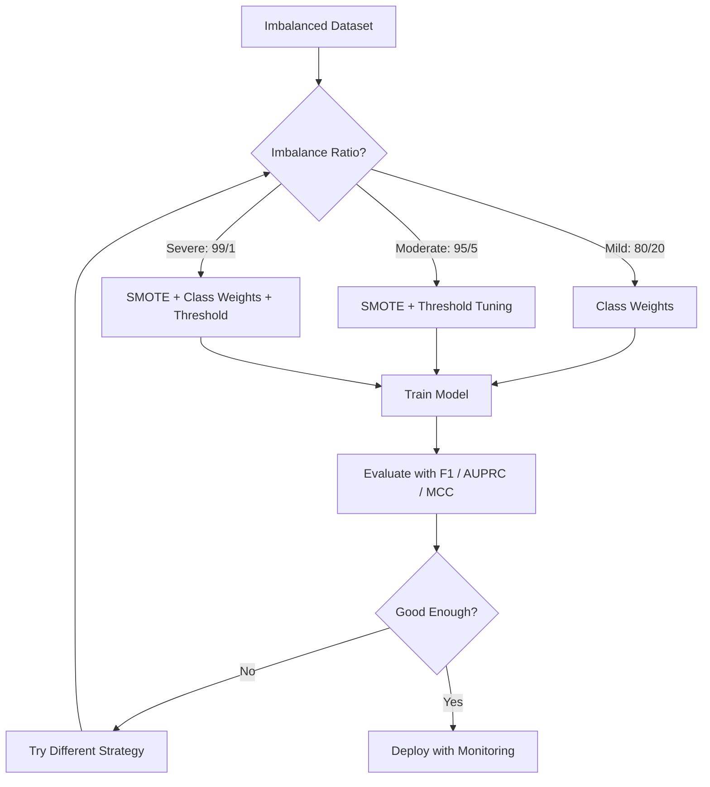
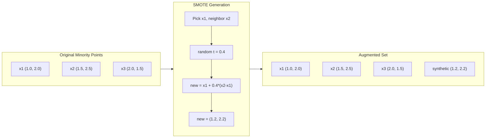
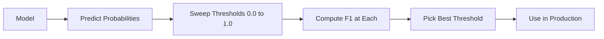
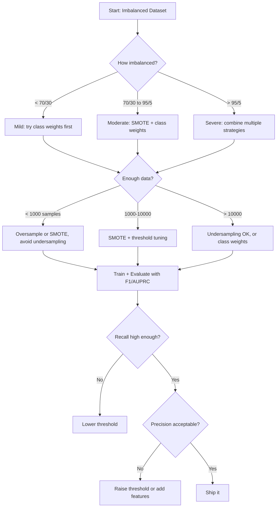

# Handling Imbalanced Data

> Khi 99% dữ liệu của bạn là "bình thường", accuracy là một lời nói dối.

**Type:** Build
**Language:** Python
**Prerequisites:** Phase 2, Lessons 01-09 (especially evaluation metrics)
**Time:** ~90 minutes

## Learning Objectives

- Triển khai SMOTE từ đầu và giải thích lấy mẫu tăng cường tổng hợp khác với sao chép ngẫu nhiên như thế nào
- Đánh giá các bộ phân loại mất cân bằng bằng F1, AUPRC và Matthews Correlation Coefficient thay vì accuracy
- So sánh các chiến lược gán trọng số lớp, điều chỉnh ngưỡng và lấy mẫu lại, và chọn cách tiếp cận phù hợp cho một tỷ lệ mất cân bằng nhất định
- Xây dựng một pipeline dữ liệu mất cân bằng hoàn chỉnh kết hợp SMOTE, trọng số lớp và tối ưu hóa ngưỡng

## The Problem

Bạn xây dựng một mô hình phát hiện gian lận. Nó đạt accuracy 99.9%. Bạn ăn mừng. Rồi bạn nhận ra nó dự đoán "không gian lận" cho từng giao dịch một.

Đây không phải là lỗi. Đó là điều hợp lý cần làm khi chỉ 0.1% giao dịch là gian lận. Mô hình học rằng luôn đoán lớp đa số sẽ tối thiểu hóa sai số tổng thể. Về mặt kỹ thuật, nó đúng và hoàn toàn vô dụng.

Điều này xảy ra ở mọi nơi mà phân loại thực sự quan trọng. Chẩn đoán bệnh: tỷ lệ dương tính 1%. Xâm nhập mạng: 0.01% cuộc tấn công. Lỗi sản xuất: 0.5% bị lỗi. Lọc thư rác: 20% thư rác. Dự đoán rời bỏ: 5% người rời bỏ. Lớp thiểu số càng có hệ quả lớn, nó càng có xu hướng hiếm.

Accuracy thất bại vì nó coi mọi dự đoán đúng như nhau. Gán nhãn đúng một giao dịch hợp lệ và phát hiện đúng gian lận đều được tính là một điểm accuracy. Nhưng phát hiện gian lận là toàn bộ lý do mô hình tồn tại. Chúng ta cần các thước đo, kỹ thuật và chiến lược huấn luyện buộc mô hình chú ý tới lớp hiếm nhưng quan trọng.

## The Concept

### Why Accuracy Fails

Xét một tập dữ liệu có 1000 mẫu: 990 âm tính, 10 dương tính. Một mô hình luôn dự đoán âm tính:

|  | Dự đoán dương tính | Dự đoán âm tính |
|--|---|---|
| Thực tế dương tính | 0 (TP) | 10 (FN) |
| Thực tế âm tính | 0 (FP) | 990 (TN) |

```math
\text{Accuracy} = (0 + 990) / 1000 = 99.0\%
```

Mô hình không phát hiện được gian lận nào. Không bệnh nào. Không lỗi nào. Nhưng accuracy nói 99%. Đây là lý do accuracy nguy hiểm đối với các bài toán mất cân bằng.

### Better Metrics

**Precision** = $\text{TP} / (\text{TP} + \text{FP})$. Trong mọi thứ được đánh dấu là dương tính, bao nhiêu thực sự là dương tính? Precision cao nghĩa là ít báo động giả.

**Recall** = $\text{TP} / (\text{TP} + \text{FN})$. Trong mọi thứ thực sự dương tính, chúng ta phát hiện được bao nhiêu? Recall cao nghĩa là ít dương tính bị bỏ sót.

**Điểm F1** = $2 \cdot \text{precision} \cdot \text{recall} / (\text{precision} + \text{recall})$. Trung bình điều hòa. Phạt sự mất cân bằng cực độ giữa precision và recall nhiều hơn trung bình cộng.

**Điểm F-beta** = $(1 + \beta^2) \cdot \text{precision} \cdot \text{recall} / (\beta^2 \cdot \text{precision} + \text{recall})$. Khi $\beta > 1$, recall quan trọng hơn. Khi $\beta < 1$, precision quan trọng hơn. F2 phổ biến trong phát hiện gian lận (bỏ sót gian lận tệ hơn báo động giả).

**AUPRC** (Diện tích dưới đường cong Precision-Recall). Giống AUC-ROC nhưng cung cấp nhiều thông tin hơn đối với dữ liệu mất cân bằng. Một bộ phân loại ngẫu nhiên có AUPRC bằng tỷ lệ lớp dương tính (không phải 0.5 như ROC). Điều này khiến các cải thiện dễ thấy hơn.

**Matthews Correlation Coefficient** = $(\text{TP} \cdot \text{TN} - \text{FP} \cdot \text{FN}) / \sqrt{(\text{TP}+\text{FP})(\text{TP}+\text{FN})(\text{TN}+\text{FP})(\text{TN}+\text{FN})}$. Nằm trong khoảng -1 đến +1. Chỉ cho điểm cao khi mô hình làm tốt trên cả hai lớp. Cân bằng ngay cả khi các lớp có kích thước rất khác nhau.

Với mô hình "luôn dự đoán âm tính" ở trên: $\text{precision} = 0/0$ (không xác định, thường được đặt thành 0), $\text{recall} = 0/10 = 0$, $\text{F1} = 0$, $\text{MCC} = 0$. Các thước đo này xác định đúng rằng mô hình vô giá trị.

### The Imbalanced Data Pipeline



### SMOTE: Synthetic Minority Oversampling Technique

Lấy mẫu tăng cường ngẫu nhiên sao chép các mẫu thiểu số hiện có. Cách này hoạt động nhưng có nguy cơ quá khớp vì mô hình thấy lặp đi lặp lại các điểm giống hệt nhau.

SMOTE tạo các mẫu thiểu số tổng hợp mới hợp lý nhưng không phải bản sao. Thuật toán:

1. Với mỗi mẫu thiểu số $x$, tìm $k$ láng giềng gần nhất của nó trong các mẫu thiểu số khác
2. Chọn ngẫu nhiên một láng giềng
3. Tạo một mẫu mới trên đoạn thẳng giữa $x$ và láng giềng đó

Công thức: `new_sample = x + random(0, 1) * (neighbor - x)`

Cách này nội suy giữa các điểm thiểu số thật, tạo ra các mẫu trong cùng vùng không gian đặc trưng mà không chỉ sao chép dữ liệu hiện có.



### Sampling Strategies Compared

**Lấy mẫu tăng cường ngẫu nhiên**: sao chép các mẫu thiểu số để khớp số lượng đa số.
- Ưu điểm: đơn giản, không mất thông tin
- Nhược điểm: các bản sao giống hệt gây quá khớp, tăng thời gian huấn luyện

**Lấy mẫu giảm ngẫu nhiên**: loại bỏ các mẫu đa số để khớp số lượng thiểu số.
- Ưu điểm: huấn luyện nhanh, đơn giản
- Nhược điểm: loại bỏ dữ liệu đa số có thể hữu ích, phương sai cao hơn

**SMOTE**: tạo các mẫu thiểu số tổng hợp thông qua nội suy.
- Ưu điểm: tạo ra các điểm dữ liệu mới, giảm quá khớp so với lấy mẫu tăng cường ngẫu nhiên
- Nhược điểm: có thể tạo ra các mẫu nhiễu gần ranh giới quyết định, không tính đến phân phối lớp đa số

| Chiến lược | Dữ liệu được thay đổi | Rủi ro | Khi nào sử dụng |
|----------|-------------|------|-------------|
| Lấy mẫu tăng cường | Thiểu số được sao chép | Quá khớp | Tập dữ liệu nhỏ, mất cân bằng vừa phải |
| Lấy mẫu giảm | Đa số bị loại bỏ | Mất thông tin | Tập dữ liệu lớn, muốn huấn luyện nhanh |
| SMOTE | Thêm thiểu số tổng hợp | Nhiễu ở ranh giới | Mất cân bằng vừa phải, đủ mẫu thiểu số cho k-NN |

### Class Weights

Thay vì thay đổi dữ liệu, hãy thay đổi cách mô hình xử lý lỗi. Gán trọng số cao hơn cho việc phân loại sai lớp thiểu số.

Với một bài toán nhị phân có 950 mẫu âm tính và 50 mẫu dương tính:
- Trọng số cho lớp âm tính = $n_{\text{samples}} / (2 \cdot n_{\text{negative}}) = 1000 / (2 \cdot 950) = 0.526$
- Trọng số cho lớp dương tính = $n_{\text{samples}} / (2 \cdot n_{\text{positive}}) = 1000 / (2 \cdot 50) = 10.0$

Lớp dương tính nhận trọng số gấp 19 lần. Phân loại sai một mẫu dương tính tốn chi phí bằng phân loại sai 19 mẫu âm tính. Mô hình bị buộc phải chú ý tới lớp thiểu số.

Trong hồi quy logistic, điều này sửa đổi hàm mất mát:

```math
\text{weighted\_loss} = -\sum \bigl( w_i \cdot [y_i \log(p_i) + (1-y_i) \log(1-p_i)] \bigr)
```

trong đó $w_i$ phụ thuộc vào lớp của mẫu $i$.

Về mặt toán học, trọng số lớp tương đương với lấy mẫu tăng cường theo kỳ vọng, nhưng không tạo ra các điểm dữ liệu mới. Điều này khiến chúng nhanh hơn và tránh nguy cơ quá khớp của các mẫu bị sao chép.

### Threshold Tuning

Hầu hết các bộ phân loại xuất ra một xác suất. Ngưỡng mặc định là 0.5: nếu $P(\text{positive}) \ge 0.5$, dự đoán dương tính. Nhưng 0.5 là tùy ý. Khi các lớp mất cân bằng, ngưỡng tối ưu thường thấp hơn nhiều.

Quy trình:
1. Huấn luyện một mô hình
2. Lấy các xác suất dự đoán trên tập validation
3. Quét các ngưỡng từ 0.0 đến 1.0
4. Tính F1 (hoặc thước đo bạn chọn) tại mỗi ngưỡng
5. Chọn ngưỡng tối đa hóa thước đo của bạn



Một mô hình có thể xuất ra $P(\text{fraud}) = 0.15$ cho một giao dịch gian lận. Ở ngưỡng 0.5, giao dịch này được phân loại là không gian lận. Ở ngưỡng 0.10, nó được phát hiện đúng. Hiệu chỉnh xác suất ít quan trọng hơn thứ hạng -- miễn là gian lận nhận xác suất cao hơn không gian lận, sẽ tồn tại một ngưỡng tách chúng.

### Cost-Sensitive Learning

Sự tổng quát hóa của trọng số lớp. Thay vì các chi phí đồng nhất, gán các chi phí phân loại sai cụ thể:

| | Dự đoán dương tính | Dự đoán âm tính |
|--|---|---|
| Thực tế dương tính | 0 (đúng) | $C_{\text{FN}} = 100$ |
| Thực tế âm tính | $C_{\text{FP}} = 1$ | 0 (đúng) |

Bỏ sót một giao dịch gian lận (FN) tốn chi phí gấp 100 lần báo động giả (FP). Mô hình tối ưu hóa tổng chi phí, không phải tổng số lỗi.

Đây là cách tiếp cận có cơ sở nguyên tắc nhất khi bạn có thể ước tính các chi phí thực tế. Một chẩn đoán ung thư bị bỏ sót có chi phí rất khác với một báo động giả dẫn tới một lần sinh thiết bổ sung. Làm rõ các chi phí này buộc phải đưa ra những đánh đổi đúng.

### Decision Flowchart



```figure
class-imbalance
```

## Build It

### Step 1: Generate an imbalanced dataset

```python
import numpy as np


def make_imbalanced_data(n_majority=950, n_minority=50, seed=42):
    rng = np.random.RandomState(seed)

    X_maj = rng.randn(n_majority, 2) * 1.0 + np.array([0.0, 0.0])
    X_min = rng.randn(n_minority, 2) * 0.8 + np.array([2.5, 2.5])

    X = np.vstack([X_maj, X_min])
    y = np.concatenate([np.zeros(n_majority), np.ones(n_minority)])

    shuffle_idx = rng.permutation(len(y))
    return X[shuffle_idx], y[shuffle_idx]
```

### Step 2: SMOTE from scratch

```python
def euclidean_distance(a, b):
    return np.sqrt(np.sum((a - b) ** 2))


def find_k_neighbors(X, idx, k):
    distances = []
    for i in range(len(X)):
        if i == idx:
            continue
        d = euclidean_distance(X[idx], X[i])
        distances.append((i, d))
    distances.sort(key=lambda x: x[1])
    return [d[0] for d in distances[:k]]


def smote(X_minority, k=5, n_synthetic=100, seed=42):
    rng = np.random.RandomState(seed)
    n_samples = len(X_minority)
    k = min(k, n_samples - 1)
    synthetic = []

    for _ in range(n_synthetic):
        idx = rng.randint(0, n_samples)
        neighbors = find_k_neighbors(X_minority, idx, k)
        neighbor_idx = neighbors[rng.randint(0, len(neighbors))]
        t = rng.random()
        new_point = X_minority[idx] + t * (X_minority[neighbor_idx] - X_minority[idx])
        synthetic.append(new_point)

    return np.array(synthetic)
```

### Step 3: Random oversampling and undersampling

```python
def random_oversample(X, y, seed=42):
    rng = np.random.RandomState(seed)
    classes, counts = np.unique(y, return_counts=True)
    max_count = counts.max()

    X_resampled = list(X)
    y_resampled = list(y)

    for cls, count in zip(classes, counts):
        if count < max_count:
            cls_indices = np.where(y == cls)[0]
            n_needed = max_count - count
            chosen = rng.choice(cls_indices, size=n_needed, replace=True)
            X_resampled.extend(X[chosen])
            y_resampled.extend(y[chosen])

    X_out = np.array(X_resampled)
    y_out = np.array(y_resampled)
    shuffle = rng.permutation(len(y_out))
    return X_out[shuffle], y_out[shuffle]


def random_undersample(X, y, seed=42):
    rng = np.random.RandomState(seed)
    classes, counts = np.unique(y, return_counts=True)
    min_count = counts.min()

    X_resampled = []
    y_resampled = []

    for cls in classes:
        cls_indices = np.where(y == cls)[0]
        chosen = rng.choice(cls_indices, size=min_count, replace=False)
        X_resampled.extend(X[chosen])
        y_resampled.extend(y[chosen])

    X_out = np.array(X_resampled)
    y_out = np.array(y_resampled)
    shuffle = rng.permutation(len(y_out))
    return X_out[shuffle], y_out[shuffle]
```

### Step 4: Logistic regression with class weights

```python
def sigmoid(z):
    return 1.0 / (1.0 + np.exp(-np.clip(z, -500, 500)))


def logistic_regression_weighted(X, y, weights, lr=0.01, epochs=200):
    n_samples, n_features = X.shape
    w = np.zeros(n_features)
    b = 0.0

    for _ in range(epochs):
        z = X @ w + b
        pred = sigmoid(z)
        error = pred - y
        weighted_error = error * weights

        gradient_w = (X.T @ weighted_error) / n_samples
        gradient_b = np.mean(weighted_error)

        w -= lr * gradient_w
        b -= lr * gradient_b

    return w, b


def compute_class_weights(y):
    classes, counts = np.unique(y, return_counts=True)
    n_samples = len(y)
    n_classes = len(classes)
    weight_map = {}
    for cls, count in zip(classes, counts):
        weight_map[cls] = n_samples / (n_classes * count)
    return np.array([weight_map[yi] for yi in y])
```

### Step 5: Threshold tuning

```python
def find_optimal_threshold(y_true, y_probs, metric="f1"):
    best_threshold = 0.5
    best_score = -1.0

    for threshold in np.arange(0.05, 0.96, 0.01):
        y_pred = (y_probs >= threshold).astype(int)
        tp = np.sum((y_pred == 1) & (y_true == 1))
        fp = np.sum((y_pred == 1) & (y_true == 0))
        fn = np.sum((y_pred == 0) & (y_true == 1))

        if metric == "f1":
            precision = tp / (tp + fp) if (tp + fp) > 0 else 0.0
            recall = tp / (tp + fn) if (tp + fn) > 0 else 0.0
            score = 2 * precision * recall / (precision + recall) if (precision + recall) > 0 else 0.0
        elif metric == "recall":
            score = tp / (tp + fn) if (tp + fn) > 0 else 0.0
        elif metric == "precision":
            score = tp / (tp + fp) if (tp + fp) > 0 else 0.0

        if score > best_score:
            best_score = score
            best_threshold = threshold

    return best_threshold, best_score
```

### Step 6: Evaluation functions

```python
def confusion_matrix_values(y_true, y_pred):
    tp = np.sum((y_pred == 1) & (y_true == 1))
    tn = np.sum((y_pred == 0) & (y_true == 0))
    fp = np.sum((y_pred == 1) & (y_true == 0))
    fn = np.sum((y_pred == 0) & (y_true == 1))
    return tp, tn, fp, fn


def compute_metrics(y_true, y_pred):
    tp, tn, fp, fn = confusion_matrix_values(y_true, y_pred)
    accuracy = (tp + tn) / (tp + tn + fp + fn)
    precision = tp / (tp + fp) if (tp + fp) > 0 else 0.0
    recall = tp / (tp + fn) if (tp + fn) > 0 else 0.0
    f1 = 2 * precision * recall / (precision + recall) if (precision + recall) > 0 else 0.0

    denom = np.sqrt(float((tp + fp) * (tp + fn) * (tn + fp) * (tn + fn)))
    mcc = (tp * tn - fp * fn) / denom if denom > 0 else 0.0

    return {
        "accuracy": accuracy,
        "precision": precision,
        "recall": recall,
        "f1": f1,
        "mcc": mcc,
    }
```

### Step 7: Compare all approaches

```python
X, y = make_imbalanced_data(950, 50, seed=42)
split = int(0.8 * len(y))
X_train, X_test = X[:split], X[split:]
y_train, y_test = y[:split], y[split:]

# Baseline: no treatment
w_base, b_base = logistic_regression_weighted(
    X_train, y_train, np.ones(len(y_train)), lr=0.1, epochs=300
)
probs_base = sigmoid(X_test @ w_base + b_base)
preds_base = (probs_base >= 0.5).astype(int)

# Oversampled
X_over, y_over = random_oversample(X_train, y_train)
w_over, b_over = logistic_regression_weighted(
    X_over, y_over, np.ones(len(y_over)), lr=0.1, epochs=300
)
preds_over = (sigmoid(X_test @ w_over + b_over) >= 0.5).astype(int)

# SMOTE
minority_mask = y_train == 1
X_minority = X_train[minority_mask]
synthetic = smote(X_minority, k=5, n_synthetic=len(y_train) - 2 * int(minority_mask.sum()))
X_smote = np.vstack([X_train, synthetic])
y_smote = np.concatenate([y_train, np.ones(len(synthetic))])
w_sm, b_sm = logistic_regression_weighted(
    X_smote, y_smote, np.ones(len(y_smote)), lr=0.1, epochs=300
)
preds_smote = (sigmoid(X_test @ w_sm + b_sm) >= 0.5).astype(int)

# Class weights
sample_weights = compute_class_weights(y_train)
w_cw, b_cw = logistic_regression_weighted(
    X_train, y_train, sample_weights, lr=0.1, epochs=300
)
probs_cw = sigmoid(X_test @ w_cw + b_cw)
preds_cw = (probs_cw >= 0.5).astype(int)

# Threshold tuning (tune on a validation slice of the training set, not the test set)
val_split = int(0.75 * len(y_train))
X_tr, X_val = X_train[:val_split], X_train[val_split:]
y_tr, y_val = y_train[:val_split], y_train[val_split:]
w_val, b_val = logistic_regression_weighted(
    X_tr, y_tr, compute_class_weights(y_tr), lr=0.1, epochs=300
)
probs_val = sigmoid(X_val @ w_val + b_val)
best_thresh, best_f1 = find_optimal_threshold(y_val, probs_val, metric="f1")
preds_thresh = (probs_cw >= best_thresh).astype(int)
```

File mã chạy tất cả nội dung này trong một script duy nhất và in kết quả.

## Use It

Với scikit-learn và imbalanced-learn, các kỹ thuật này chỉ cần một dòng:

```python
from sklearn.linear_model import LogisticRegression
from sklearn.metrics import classification_report, f1_score
from sklearn.model_selection import train_test_split
from imblearn.over_sampling import SMOTE
from imblearn.under_sampling import RandomUnderSampler
from imblearn.pipeline import Pipeline

X_train, X_test, y_train, y_test = train_test_split(X, y, stratify=y)

model_weighted = LogisticRegression(class_weight="balanced")
model_weighted.fit(X_train, y_train)
print(classification_report(y_test, model_weighted.predict(X_test)))

smote = SMOTE(random_state=42)
X_resampled, y_resampled = smote.fit_resample(X_train, y_train)
model_smote = LogisticRegression()
model_smote.fit(X_resampled, y_resampled)
print(classification_report(y_test, model_smote.predict(X_test)))

pipeline = Pipeline([
    ("smote", SMOTE()),
    ("model", LogisticRegression(class_weight="balanced")),
])
pipeline.fit(X_train, y_train)
print(classification_report(y_test, pipeline.predict(X_test)))
```

Các bản triển khai từ đầu cho thấy chính xác mỗi kỹ thuật làm gì. SMOTE chỉ là nội suy k-NN trên lớp thiểu số. Trọng số lớp nhân hàm mất mát. Điều chỉnh ngưỡng là một vòng lặp for qua các mức cắt. Không có phép thuật.

## Ship It

Bài học này tạo ra:
- `outputs/skill-imbalanced-data.md` -- một danh sách kiểm tra quyết định để xử lý các bài toán phân loại mất cân bằng

## Exercises

1. **Borderline-SMOTE**: sửa bản triển khai SMOTE để chỉ tạo các mẫu tổng hợp cho những điểm thiểu số gần ranh giới quyết định (những điểm có k láng giềng gần nhất bao gồm các mẫu lớp đa số). So sánh kết quả với SMOTE tiêu chuẩn trên một tập dữ liệu mà các lớp chồng lấn.

2. **Tối ưu hóa ma trận chi phí**: triển khai học nhạy chi phí trong đó ma trận chi phí là một tham số. Tạo một hàm nhận ma trận chi phí và trả về các dự đoán tối ưu tối thiểu hóa chi phí kỳ vọng. Kiểm thử với các tỷ lệ chi phí khác nhau (1:10, 1:100, 1:1000) và vẽ cách sự đánh đổi precision-recall thay đổi.

3. **Hiệu chỉnh ngưỡng**: triển khai Platt scaling (khớp một mô hình hồi quy logistic trên các đầu ra thô của mô hình để tạo ra các xác suất đã hiệu chỉnh). So sánh đường cong precision-recall trước và sau hiệu chỉnh. Cho thấy hiệu chỉnh không thay đổi thứ hạng (AUC giữ nguyên) nhưng khiến các xác suất có ý nghĩa hơn.

4. **Ensemble với bagging cân bằng**: huấn luyện nhiều mô hình, mỗi mô hình trên một mẫu bootstrap cân bằng (toàn bộ thiểu số + tập con ngẫu nhiên của đa số). Lấy trung bình các dự đoán của chúng. So sánh cách tiếp cận này với một mô hình đơn lẻ có SMOTE. Đo cả hiệu suất và phương sai qua các lần chạy.

5. **Thí nghiệm tỷ lệ mất cân bằng**: lấy một tập dữ liệu cân bằng và tăng dần tỷ lệ mất cân bằng (50/50, 70/30, 90/10, 95/5, 99/1). Với mỗi tỷ lệ, huấn luyện có và không có SMOTE. Vẽ F1 theo tỷ lệ mất cân bằng cho cả hai cách tiếp cận. Ở tỷ lệ nào SMOTE bắt đầu tạo ra khác biệt có ý nghĩa?

## Key Terms

| Thuật ngữ | Cách mọi người nói | Ý nghĩa thực sự |
|------|----------------|----------------------|
| Class imbalance (Mất cân bằng lớp) | "Một lớp có nhiều mẫu hơn hẳn" | Phân phối các lớp trong tập dữ liệu bị lệch đáng kể, khiến các mô hình thiên về lớp đa số |
| SMOTE | "Lấy mẫu tăng cường tổng hợp" | Tạo các mẫu thiểu số mới bằng cách nội suy giữa các mẫu thiểu số hiện có và k láng giềng thiểu số gần nhất của chúng |
| Class weights (Trọng số lớp) | "Khiến lỗi trên các lớp hiếm tốn kém hơn" | Nhân hàm mất mát với các trọng số riêng cho từng lớp để mô hình phạt nặng hơn việc phân loại sai thiểu số |
| Threshold tuning (Điều chỉnh ngưỡng) | "Di chuyển ranh giới quyết định" | Thay đổi mức cắt xác suất để phân loại từ mặc định 0.5 sang một giá trị tối ưu hóa thước đo mong muốn |
| Precision-recall tradeoff (Sự đánh đổi precision-recall) | "Bạn không thể có cả hai" | Hạ ngưỡng phát hiện nhiều dương tính hơn (recall cao hơn) nhưng cũng đánh dấu nhiều dương tính giả hơn (precision thấp hơn), và ngược lại |
| AUPRC | "Diện tích dưới đường cong PR" | Tóm tắt đường cong precision-recall thành một con số duy nhất; cung cấp nhiều thông tin hơn AUC-ROC khi các lớp mất cân bằng nặng |
| Matthews Correlation Coefficient | "Thước đo cân bằng" | Một hệ số tương quan giữa các nhãn dự đoán và thực tế chỉ cho điểm cao khi mô hình hoạt động tốt trên cả hai lớp |
| Cost-sensitive learning (Học nhạy chi phí) | "Những lỗi khác nhau tốn chi phí khác nhau" | Đưa các chi phí phân loại sai thực tế vào mục tiêu huấn luyện để mô hình tối ưu hóa tổng chi phí, không phải số lỗi |
| Random oversampling (Lấy mẫu tăng cường ngẫu nhiên) | "Sao chép thiểu số" | Lặp lại các mẫu lớp thiểu số để cân bằng số lượng lớp; đơn giản nhưng có nguy cơ quá khớp các điểm bị sao chép |

## Further Reading

- [SMOTE: Synthetic Minority Over-sampling Technique (Chawla et al., 2002)](https://arxiv.org/abs/1106.1813) -- bài báo SMOTE gốc, vẫn là công trình được trích dẫn nhiều nhất về học trên dữ liệu mất cân bằng
- [Learning from Imbalanced Data (He & Garcia, 2009)](https://ieeexplore.ieee.org/document/5128907) -- khảo sát toàn diện bao quát các cách tiếp cận lấy mẫu, nhạy chi phí và thuật toán
- [imbalanced-learn documentation](https://imbalanced-learn.org/stable/) -- thư viện Python với các biến thể SMOTE, chiến lược lấy mẫu giảm và tích hợp pipeline
- [The Precision-Recall Plot Is More Informative than the ROC Plot (Saito & Rehmsmeier, 2015)](https://journals.plos.org/plosone/article?id=10.1371/journal.pone.0118432) -- khi nào và tại sao nên ưu tiên các đường cong PR hơn các đường cong ROC đối với bài toán mất cân bằng
