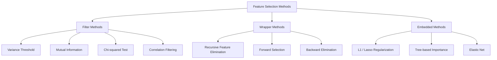
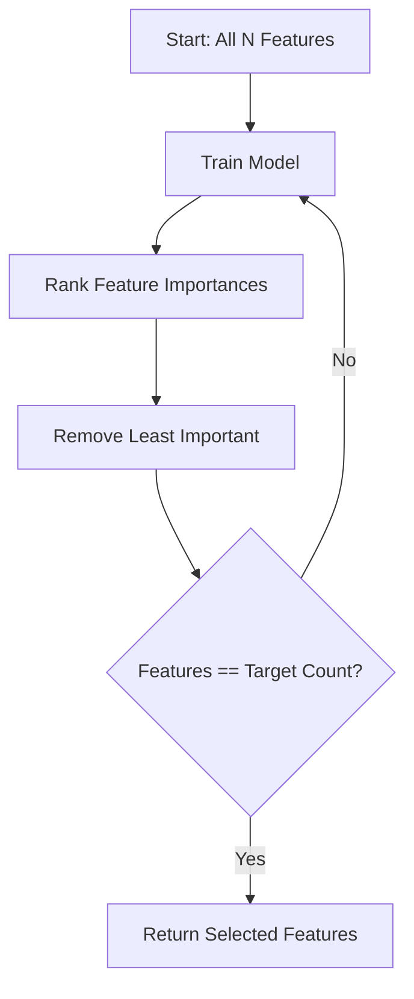
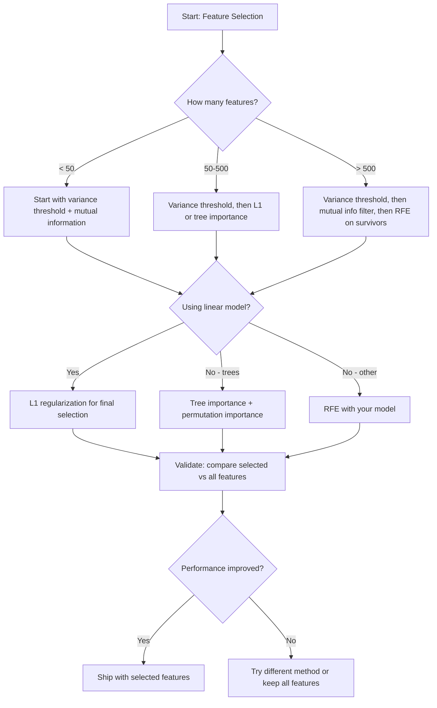

# Feature Selection

> Nhiều đặc trưng hơn không tốt hơn. Đúng đặc trưng thì tốt hơn.

**Type:** Build
**Language:** Python
**Prerequisites:** Phase 2, Lessons 01-09, 08 (feature engineering)
**Time:** ~75 minutes

## Learning Objectives

- Triển khai các phương pháp lọc (ngưỡng phương sai, thông tin tương hỗ, chi bình phương) và các phương pháp bao bọc (RFE, lựa chọn tiến) từ đầu
- Giải thích tại sao thông tin tương hỗ nắm bắt các quan hệ phi tuyến giữa đặc trưng và mục tiêu mà tương quan bỏ sót
- So sánh chính quy hóa L1 (lựa chọn nhúng) với RFE (lựa chọn bao bọc) và đánh giá các đánh đổi về tính toán của chúng
- Xây dựng một pipeline lựa chọn đặc trưng kết hợp nhiều phương pháp và chứng minh khả năng khái quát hóa được cải thiện trên dữ liệu được giữ lại

## The Problem

Bạn có 500 đặc trưng. Mô hình của bạn huấn luyện chậm, liên tục quá khớp và không ai có thể giải thích nó đã học gì. Bạn thêm nhiều đặc trưng hơn với hy vọng cải thiện hiệu suất. Nó trở nên tệ hơn.

Đây là lời nguyền số chiều đang phát huy tác động. Khi số đặc trưng tăng, thể tích không gian đặc trưng bùng nổ. Các điểm dữ liệu trở nên thưa thớt. Khoảng cách giữa các điểm hội tụ. Mô hình cần nhiều dữ liệu hơn theo cấp số nhân để tìm ra các mẫu thật. Các đặc trưng nhiễu lấn át các đặc trưng tín hiệu. Quá khớp trở thành mặc định.

Lựa chọn đặc trưng là thuốc giải. Gạt bỏ nhiễu. Loại bỏ sự dư thừa. Giữ các đặc trưng mang thông tin thực sự về mục tiêu. Kết quả: huấn luyện nhanh hơn, khái quát hóa tốt hơn và các mô hình bạn thực sự có thể giải thích.

Mục tiêu không phải sử dụng mọi thông tin sẵn có. Mà là sử dụng đúng thông tin.

## The Concept

### Three Categories of Feature Selection

Mỗi phương pháp lựa chọn đặc trưng thuộc một trong ba loại:



**Các phương pháp lọc** chấm điểm độc lập từng đặc trưng bằng một thước đo thống kê. Chúng không sử dụng mô hình. Nhanh, nhưng bỏ sót các tương tác đặc trưng.

**Các phương pháp bao bọc** huấn luyện một mô hình để đánh giá các tập con đặc trưng. Chúng sử dụng hiệu suất mô hình làm điểm số. Kết quả tốt hơn, nhưng tốn kém vì huấn luyện lại mô hình nhiều lần.

**Các phương pháp nhúng** lựa chọn đặc trưng như một phần của quá trình huấn luyện mô hình. Chính quy hóa L1 đẩy các trọng số về không. Cây quyết định chia theo các đặc trưng hữu ích nhất. Việc lựa chọn xảy ra trong quá trình khớp, không phải như một bước riêng biệt.

### Variance Threshold

Bộ lọc đơn giản nhất. Nếu một đặc trưng hầu như không biến thiên giữa các mẫu, nó gần như không mang thông tin.

Xét một đặc trưng bằng 0.0 ở 999 trong số 1000 mẫu. Phương sai của nó gần bằng không. Không mô hình nào có thể sử dụng nó để phân biệt các lớp. Loại bỏ nó.

```
variance(x) = mean((x - mean(x))^2)
```

Đặt một ngưỡng (ví dụ: 0.01). Loại bỏ mọi đặc trưng có phương sai thấp hơn ngưỡng đó. Cách này loại bỏ các đặc trưng hằng hoặc gần hằng mà hoàn toàn không nhìn vào biến mục tiêu.

Khi nào sử dụng: như một bước tiền xử lý trước các phương pháp khác. Nó phát hiện các đặc trưng rõ ràng vô dụng với chi phí gần bằng không.

Hạn chế: một đặc trưng có thể có phương sai cao mà vẫn hoàn toàn là nhiễu. Ngưỡng phương sai là cần nhưng chưa đủ.

### Mutual Information

Thông tin tương hỗ đo mức độ mà việc biết giá trị đặc trưng X làm giảm sự bất định về mục tiêu Y.

```
I(X; Y) = sum_x sum_y p(x, y) * log(p(x, y) / (p(x) * p(y)))
```

Nếu X và Y độc lập, p(x, y) = p(x) * p(y), nên số hạng log bằng không và I(X; Y) = 0. X cho bạn biết càng nhiều về Y, thông tin tương hỗ càng cao.

Ưu điểm chính so với tương quan: thông tin tương hỗ nắm bắt các quan hệ phi tuyến. Một đặc trưng có thể có tương quan bằng không với mục tiêu nhưng thông tin tương hỗ cao vì quan hệ là bậc hai hoặc tuần hoàn.

Đối với các đặc trưng liên tục, trước tiên rời rạc hóa thành các bin (ước lượng dựa trên histogram). Số bin ảnh hưởng đến ước lượng -- quá ít bin làm mất thông tin, quá nhiều bin thêm nhiễu. Một lựa chọn phổ biến: sqrt(n) bin hoặc quy tắc Sturges (1 + log2(n)).


### Recursive Feature Elimination (RFE)

RFE là một phương pháp bao bọc. Nó sử dụng độ quan trọng đặc trưng của chính mô hình để cắt tỉa lặp lại:

1. Huấn luyện mô hình với tất cả các đặc trưng
2. Xếp hạng các đặc trưng theo độ quan trọng (hệ số đối với mô hình tuyến tính, mức giảm độ hỗn tạp đối với cây)
3. Loại bỏ (các) đặc trưng ít quan trọng nhất
4. Lặp lại cho tới khi còn số đặc trưng mong muốn



RFE xét các tương tác đặc trưng vì mô hình nhìn thấy tất cả các đặc trưng còn lại cùng nhau. Loại bỏ một đặc trưng làm thay đổi độ quan trọng của các đặc trưng khác. Điều này khiến nó kỹ lưỡng hơn các phương pháp lọc.

Chi phí: bạn huấn luyện mô hình N - target lần. Với 500 đặc trưng và mục tiêu là 10, đó là 490 lần huấn luyện. Đối với các mô hình tốn kém, cách này chậm. Bạn có thể tăng tốc bằng cách loại bỏ nhiều đặc trưng mỗi bước (ví dụ: loại bỏ 10% thấp nhất mỗi vòng).

### L1 (Lasso) Regularization

Chính quy hóa L1 thêm giá trị tuyệt đối của các trọng số vào hàm mất mát:

```
loss = prediction_error + alpha * sum(|w_i|)
```

Tham số alpha kiểm soát mức độ quyết liệt khi cắt tỉa đặc trưng. Alpha cao hơn nghĩa là nhiều trọng số về đúng bằng không hơn.

Tại sao đúng bằng không? Hình phạt L1 tạo ra một miền ràng buộc hình thoi trong không gian trọng số. Nghiệm tối ưu có xu hướng rơi vào một góc của hình thoi này, nơi một hoặc nhiều trọng số bằng không. Chính quy hóa L2 (ridge) tạo ra một ràng buộc hình tròn, nơi các trọng số co lại nhưng hiếm khi chạm không.

Đây là lựa chọn đặc trưng nhúng: mô hình học trong quá trình huấn luyện những đặc trưng nào cần bỏ qua. Các đặc trưng có trọng số bằng không về thực chất được loại bỏ.

Ưu điểm: một lần huấn luyện, xử lý các đặc trưng tương quan (chọn một và đưa các đặc trưng khác về không), được tích hợp trong hầu hết các bản triển khai mô hình tuyến tính.

Hạn chế: chỉ hoạt động cho mô hình tuyến tính. Không thể nắm bắt độ quan trọng đặc trưng phi tuyến.

### Tree-Based Feature Importance

Cây quyết định và các ensemble của chúng (rừng ngẫu nhiên, gradient boosting) tự nhiên xếp hạng các đặc trưng. Mỗi phép chia giảm độ hỗn tạp (Gini hoặc entropy cho phân loại, phương sai cho hồi quy). Các đặc trưng tạo ra mức giảm độ hỗn tạp lớn hơn thì quan trọng hơn.

Đối với một rừng ngẫu nhiên có T cây:

```
importance(feature_j) = (1/T) * sum over all trees of
    sum over all nodes splitting on feature_j of
        (n_samples * impurity_decrease)
```

Cách này cho một điểm quan trọng được chuẩn hóa cho từng đặc trưng. Nó tự động xử lý các quan hệ phi tuyến và tương tác đặc trưng.

Thận trọng: độ quan trọng dựa trên cây thiên về các đặc trưng có nhiều giá trị duy nhất (cardinality cao). Một cột ID ngẫu nhiên sẽ trông quan trọng vì nó chia hoàn hảo mọi mẫu. Sử dụng độ quan trọng hoán vị để kiểm tra tính hợp lý.

### Permutation Importance

Một phương pháp độc lập với mô hình:

1. Huấn luyện mô hình và ghi lại hiệu suất cơ sở trên dữ liệu validation
2. Với mỗi đặc trưng: xáo trộn ngẫu nhiên các giá trị của nó, đo mức giảm hiệu suất
3. Mức giảm càng lớn, đặc trưng càng quan trọng

Nếu xáo trộn một đặc trưng không làm giảm hiệu suất, mô hình không phụ thuộc vào nó. Nếu hiệu suất sụp đổ, đặc trưng đó rất quan trọng.

Độ quan trọng hoán vị tránh được sự thiên lệch cardinality của độ quan trọng dựa trên cây. Nhưng nó chậm: một lần đánh giá đầy đủ cho mỗi đặc trưng, lặp lại nhiều lần để ổn định.

### Comparison Table

| Phương pháp | Loại | Tốc độ | Phi tuyến | Tương tác đặc trưng |
|--------|------|-------|-----------|---------------------|
| Ngưỡng phương sai | Lọc | Rất nhanh | Không | Không |
| Thông tin tương hỗ | Lọc | Nhanh | Có | Không |
| Bộ lọc tương quan | Lọc | Nhanh | Không | Không |
| RFE | Bao bọc | Chậm | Phụ thuộc vào mô hình | Có |
| L1 / Lasso | Nhúng | Nhanh | Không (tuyến tính) | Không |
| Độ quan trọng cây | Nhúng | Trung bình | Có | Có |
| Độ quan trọng hoán vị | Độc lập với mô hình | Chậm | Có | Có |

### Decision Flowchart



```figure
f3-feature-prune
```

## Build It

### Step 1: Generate synthetic data with known feature structure

```python
import numpy as np


def make_feature_selection_data(n_samples=500, seed=42):
    rng = np.random.RandomState(seed)

    x1 = rng.randn(n_samples)
    x2 = rng.randn(n_samples)
    x3 = rng.randn(n_samples)
    x4 = x1 + 0.1 * rng.randn(n_samples)
    x5 = x2 + 0.1 * rng.randn(n_samples)

    informative = np.column_stack([x1, x2, x3, x4, x5])

    correlated = np.column_stack([
        x1 * 0.9 + 0.1 * rng.randn(n_samples),
        x2 * 0.8 + 0.2 * rng.randn(n_samples),
        x3 * 0.7 + 0.3 * rng.randn(n_samples),
        x1 * 0.5 + x2 * 0.5 + 0.1 * rng.randn(n_samples),
        x2 * 0.6 + x3 * 0.4 + 0.1 * rng.randn(n_samples),
    ])

    noise = rng.randn(n_samples, 10) * 0.5

    X = np.hstack([informative, correlated, noise])
    y = (2 * x1 - 1.5 * x2 + x3 + 0.5 * rng.randn(n_samples) > 0).astype(int)

    feature_names = (
        [f"info_{i}" for i in range(5)]
        + [f"corr_{i}" for i in range(5)]
        + [f"noise_{i}" for i in range(10)]
    )

    return X, y, feature_names
```

Chúng ta biết sự thật nền: các đặc trưng 0-4 mang thông tin (cộng thêm 3 và 4 là các bản sao tương quan của 0 và 1), các đặc trưng 5-9 tương quan với các đặc trưng mang thông tin, các đặc trưng 10-19 hoàn toàn là nhiễu. Một phương pháp lựa chọn tốt nên xếp 0-4 cao nhất và 10-19 thấp nhất.

### Step 2: Variance threshold

```python
def variance_threshold(X, threshold=0.01):
    variances = np.var(X, axis=0)
    mask = variances > threshold
    return mask, variances
```

### Step 3: Mutual information (discrete)

```python
def discretize(x, n_bins=10):
    min_val, max_val = x.min(), x.max()
    if max_val == min_val:
        return np.zeros_like(x, dtype=int)
    bin_edges = np.linspace(min_val, max_val, n_bins + 1)
    binned = np.digitize(x, bin_edges[1:-1])
    return binned


def mutual_information(X, y, n_bins=10):
    n_samples, n_features = X.shape
    mi_scores = np.zeros(n_features)

    y_vals, y_counts = np.unique(y, return_counts=True)
    p_y = y_counts / n_samples

    for f in range(n_features):
        x_binned = discretize(X[:, f], n_bins)
        x_vals, x_counts = np.unique(x_binned, return_counts=True)
        p_x = dict(zip(x_vals, x_counts / n_samples))

        mi = 0.0
        for xv in x_vals:
            for yi, yv in enumerate(y_vals):
                joint_mask = (x_binned == xv) & (y == yv)
                p_xy = np.sum(joint_mask) / n_samples
                if p_xy > 0:
                    mi += p_xy * np.log(p_xy / (p_x[xv] * p_y[yi]))
        mi_scores[f] = mi

    return mi_scores
```

### Step 4: Recursive Feature Elimination

```python
def simple_logistic_importance(X, y, lr=0.1, epochs=100):
    n_samples, n_features = X.shape
    w = np.zeros(n_features)
    b = 0.0

    for _ in range(epochs):
        z = X @ w + b
        pred = 1.0 / (1.0 + np.exp(-np.clip(z, -500, 500)))
        error = pred - y
        w -= lr * (X.T @ error) / n_samples
        b -= lr * np.mean(error)

    return w, b


def rfe(X, y, n_features_to_select=5, lr=0.1, epochs=100):
    n_total = X.shape[1]
    remaining = list(range(n_total))
    rankings = np.ones(n_total, dtype=int)
    rank = n_total

    while len(remaining) > n_features_to_select:
        X_subset = X[:, remaining]
        w, _ = simple_logistic_importance(X_subset, y, lr, epochs)
        importances = np.abs(w)

        least_idx = np.argmin(importances)
        original_idx = remaining[least_idx]
        rankings[original_idx] = rank
        rank -= 1
        remaining.pop(least_idx)

    for idx in remaining:
        rankings[idx] = 1

    selected_mask = rankings == 1
    return selected_mask, rankings
```

### Step 5: L1 feature selection

```python
def soft_threshold(w, alpha):
    return np.sign(w) * np.maximum(np.abs(w) - alpha, 0)


def l1_feature_selection(X, y, alpha=0.1, lr=0.01, epochs=500):
    n_samples, n_features = X.shape
    w = np.zeros(n_features)
    b = 0.0

    for _ in range(epochs):
        z = X @ w + b
        pred = 1.0 / (1.0 + np.exp(-np.clip(z, -500, 500)))
        error = pred - y

        gradient_w = (X.T @ error) / n_samples
        gradient_b = np.mean(error)

        w -= lr * gradient_w
        w = soft_threshold(w, lr * alpha)
        b -= lr * gradient_b

    selected_mask = np.abs(w) > 1e-6
    return selected_mask, w
```

### Step 6: Tree-based importance (simple decision tree)

```python
def gini_impurity(y):
    if len(y) == 0:
        return 0.0
    classes, counts = np.unique(y, return_counts=True)
    probs = counts / len(y)
    return 1.0 - np.sum(probs ** 2)


def best_split(X, y, feature_idx):
    values = np.unique(X[:, feature_idx])
    if len(values) <= 1:
        return None, -1.0

    best_threshold = None
    best_gain = -1.0
    parent_gini = gini_impurity(y)
    n = len(y)

    for i in range(len(values) - 1):
        threshold = (values[i] + values[i + 1]) / 2.0
        left_mask = X[:, feature_idx] <= threshold
        right_mask = ~left_mask

        n_left = np.sum(left_mask)
        n_right = np.sum(right_mask)

        if n_left == 0 or n_right == 0:
            continue

        gain = parent_gini - (n_left / n) * gini_impurity(y[left_mask]) - (n_right / n) * gini_impurity(y[right_mask])

        if gain > best_gain:
            best_gain = gain
            best_threshold = threshold

    return best_threshold, best_gain


def tree_importance(X, y, n_trees=50, max_depth=5, seed=42):
    rng = np.random.RandomState(seed)
    n_samples, n_features = X.shape
    importances = np.zeros(n_features)

    for _ in range(n_trees):
        sample_idx = rng.choice(n_samples, size=n_samples, replace=True)
        feature_subset = rng.choice(n_features, size=max(1, int(np.sqrt(n_features))), replace=False)

        X_boot = X[sample_idx]
        y_boot = y[sample_idx]

        tree_imp = _build_tree_importance(X_boot, y_boot, feature_subset, max_depth)
        importances += tree_imp

    total = importances.sum()
    if total > 0:
        importances /= total

    return importances


def _build_tree_importance(X, y, feature_subset, max_depth, depth=0):
    n_features = X.shape[1]
    importances = np.zeros(n_features)

    if depth >= max_depth or len(np.unique(y)) <= 1 or len(y) < 4:
        return importances

    best_feature = None
    best_threshold = None
    best_gain = -1.0

    for f in feature_subset:
        threshold, gain = best_split(X, y, f)
        if gain > best_gain:
            best_gain = gain
            best_feature = f
            best_threshold = threshold

    if best_feature is None or best_gain <= 0:
        return importances

    importances[best_feature] += best_gain * len(y)

    left_mask = X[:, best_feature] <= best_threshold
    right_mask = ~left_mask

    importances += _build_tree_importance(X[left_mask], y[left_mask], feature_subset, max_depth, depth + 1)
    importances += _build_tree_importance(X[right_mask], y[right_mask], feature_subset, max_depth, depth + 1)

    return importances
```

### Step 7: Run all methods and compare

File mã chạy cả năm phương pháp trên cùng tập dữ liệu tổng hợp và in một bảng so sánh cho thấy mỗi phương pháp lựa chọn những đặc trưng nào.

## Use It

Với scikit-learn, lựa chọn đặc trưng được tích hợp vào pipeline:

```python
from sklearn.feature_selection import (
    VarianceThreshold,
    mutual_info_classif,
    RFE,
    SelectFromModel,
)
from sklearn.linear_model import Lasso, LogisticRegression
from sklearn.ensemble import RandomForestClassifier

vt = VarianceThreshold(threshold=0.01)
X_filtered = vt.fit_transform(X)

mi_scores = mutual_info_classif(X, y)
top_k = np.argsort(mi_scores)[-10:]

rfe_selector = RFE(LogisticRegression(), n_features_to_select=10)
rfe_selector.fit(X, y)
X_rfe = rfe_selector.transform(X)

lasso_selector = SelectFromModel(Lasso(alpha=0.01))
lasso_selector.fit(X, y)
X_lasso = lasso_selector.transform(X)

rf = RandomForestClassifier(n_estimators=100)
rf.fit(X, y)
importances = rf.feature_importances_
```

Các bản triển khai từ đầu cho thấy chính xác điều gì xảy ra bên trong mỗi phương pháp. Ngưỡng phương sai chỉ là tính `var(X, axis=0)` và áp dụng một mặt nạ. Thông tin tương hỗ là đếm các tần số đồng thời và biên trong một bảng chéo. RFE là một vòng lặp huấn luyện, xếp hạng và cắt tỉa. L1 là hạ gradient với một bước ngưỡng hóa mềm. Độ quan trọng cây tích lũy các mức giảm độ hỗn tạp qua các phép chia. Không có phép thuật -- chỉ là thống kê và vòng lặp.

Các phiên bản sklearn bổ sung độ vững (ví dụ: mutual_info_classif sử dụng ước lượng mật độ k-NN thay vì chia bin), tốc độ (các bản triển khai C) và tích hợp pipeline.

## Ship It

Bài học này tạo ra:
- `outputs/skill-feature-selector.md` -- một cây quyết định tham khảo nhanh để chọn phương pháp lựa chọn đặc trưng phù hợp

## Exercises

1. **Lựa chọn tiến**: triển khai cách ngược với RFE. Bắt đầu với không đặc trưng nào. Ở mỗi bước, thêm đặc trưng cải thiện hiệu suất mô hình nhiều nhất. Dừng khi thêm đặc trưng không còn giúp ích. So sánh các đặc trưng đã chọn với kết quả RFE. Cách nào nhanh hơn? Cách nào cho kết quả tốt hơn?

2. **Lựa chọn ổn định**: chạy lựa chọn đặc trưng L1 50 lần, mỗi lần trên một mẫu con ngẫu nhiên gồm 80% dữ liệu, với các giá trị alpha hơi khác nhau. Đếm tần suất mỗi đặc trưng được chọn. Các đặc trưng được chọn trong > 80% số lần chạy là "ổn định". So sánh các đặc trưng ổn định với lựa chọn L1 chạy một lần. Cách nào đáng tin cậy hơn?

3. **Phát hiện đa cộng tuyến**: tính ma trận tương quan cho tất cả các đặc trưng. Triển khai một hàm, với một ngưỡng tương quan cho trước (ví dụ: 0.9), loại bỏ một đặc trưng trong mỗi cặp tương quan cao (giữ lại đặc trưng có thông tin tương hỗ cao hơn với mục tiêu). Kiểm thử trên tập dữ liệu tổng hợp và xác minh nó loại bỏ các đặc trưng tương quan dư thừa.

4. **Pipeline lựa chọn đặc trưng**: nối ngưỡng phương sai, bộ lọc thông tin tương hỗ và RFE thành một pipeline duy nhất. Trước tiên loại bỏ các đặc trưng có phương sai gần bằng không, sau đó giữ 50% cao nhất theo thông tin tương hỗ, rồi chạy RFE trên những đặc trưng còn lại. So sánh pipeline này với việc chỉ chạy RFE trên tất cả các đặc trưng. Pipeline có nhanh hơn không? Nó có chính xác tương đương không?

5. **Độ quan trọng hoán vị từ đầu**: triển khai độ quan trọng hoán vị. Với mỗi đặc trưng, xáo trộn các giá trị của nó 10 lần, đo mức giảm trung bình của điểm F1. So sánh thứ hạng với độ quan trọng dựa trên cây. Tìm các trường hợp chúng không đồng ý và giải thích tại sao (gợi ý: các đặc trưng tương quan).

## Key Terms

| Thuật ngữ | Cách mọi người nói | Ý nghĩa thực sự |
|------|----------------|----------------------|
| Filter method (Phương pháp lọc) | "Chấm điểm độc lập các đặc trưng" | Một cách tiếp cận lựa chọn đặc trưng xếp hạng các đặc trưng bằng một thước đo thống kê mà không huấn luyện mô hình, đánh giá riêng từng đặc trưng |
| Wrapper method (Phương pháp bao bọc) | "Sử dụng mô hình để chọn đặc trưng" | Một cách tiếp cận lựa chọn đặc trưng đánh giá các tập con đặc trưng bằng cách huấn luyện mô hình và sử dụng hiệu suất của nó làm tiêu chí lựa chọn |
| Embedded method (Phương pháp nhúng) | "Mô hình lựa chọn đặc trưng trong quá trình huấn luyện" | Lựa chọn đặc trưng diễn ra như một phần của quá trình khớp mô hình, chẳng hạn như chính quy hóa L1 đẩy các trọng số về không |
| Mutual information (Thông tin tương hỗ) | "Một biến cho bạn biết bao nhiêu về biến khác" | Một thước đo mức giảm sự bất định về Y khi biết X, nắm bắt cả các phụ thuộc tuyến tính và phi tuyến |
| Recursive Feature Elimination (Loại bỏ đặc trưng đệ quy) | "Huấn luyện, xếp hạng, cắt tỉa, lặp lại" | Một phương pháp bao bọc lặp lại, huấn luyện mô hình, loại bỏ (các) đặc trưng ít quan trọng nhất và lặp lại cho tới khi đạt số lượng mục tiêu |
| L1 / Lasso regularization (Chính quy hóa L1 / Lasso) | "Hình phạt tiêu diệt các đặc trưng" | Thêm tổng các giá trị tuyệt đối của trọng số vào hàm mất mát, đẩy trọng số của các đặc trưng không quan trọng về đúng bằng không |
| Variance threshold (Ngưỡng phương sai) | "Loại bỏ các đặc trưng hằng" | Loại bỏ các đặc trưng có phương sai giữa các mẫu thấp hơn một ngưỡng được chỉ định, lọc bỏ các đặc trưng không mang thông tin |
| Feature importance (Độ quan trọng đặc trưng) | "Những đặc trưng nào quan trọng nhất" | Một điểm số cho biết mỗi đặc trưng đóng góp bao nhiêu vào các dự đoán của mô hình, được tính từ mức tăng của phép chia (cây) hoặc độ lớn hệ số (tuyến tính) |
| Permutation importance (Độ quan trọng hoán vị) | "Xáo trộn và đo thiệt hại" | Đánh giá độ quan trọng đặc trưng bằng cách xáo trộn ngẫu nhiên các giá trị của từng đặc trưng và đo mức giảm hiệu suất mô hình do đó gây ra |
| Curse of dimensionality (Lời nguyền số chiều) | "Quá nhiều đặc trưng, không đủ dữ liệu" | Hiện tượng thêm đặc trưng làm tăng thể tích không gian đặc trưng theo cấp số nhân, khiến dữ liệu thưa thớt và khoảng cách vô nghĩa |

## Further Reading

- [An Introduction to Variable and Feature Selection (Guyon & Elisseeff, 2003)](https://jmlr.org/papers/v3/guyon03a.html) -- khảo sát nền tảng về các phương pháp lựa chọn đặc trưng, vẫn được tham khảo rộng rãi
- [scikit-learn Feature Selection Guide](https://scikit-learn.org/stable/modules/feature_selection.html) -- tài liệu tham khảo thực tế cho các phương pháp lọc, bao bọc và nhúng với các ví dụ mã
- [Stability Selection (Meinshausen & Buhlmann, 2010)](https://arxiv.org/abs/0809.2932) -- kết hợp lấy mẫu con với lựa chọn đặc trưng để có kết quả vững và có thể tái lập
- [Beware Default Random Forest Importances (Strobl et al., 2007)](https://bmcbioinformatics.biomedcentral.com/articles/10.1186/1471-2105-8-25) -- chứng minh sự thiên lệch cardinality trong độ quan trọng dựa trên cây và đề xuất độ quan trọng có điều kiện làm phương án thay thế
