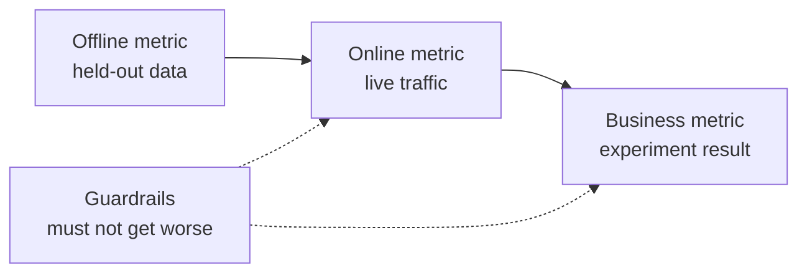

# ML System Design — From Problem to Deployed Model

> Một mô hình là một phần của một hệ thống. Thiết kế quyết định mô hình dự đoán gì, ai hành động theo nó, chi phí của nó và điều gì xảy ra khi nó thất bại.

**Type:** Build
**Languages:** Python
**Prerequisites:** Phase 2, Lessons 09 (Model Evaluation) and 13 (ML Pipelines)
**Time:** ~110 minutes

## Learning Objectives

- Định hình một vấn đề kinh doanh thành một tác vụ ML với một dự đoán, một quyết định sử dụng nó và một lý do vì sao quy tắc là chưa đủ
- Tách các chỉ số ngoại tuyến, trực tuyến, kinh doanh và rào chắn, và so sánh mọi mô hình với các baseline tầm thường và heuristic
- Ước tính chi phí hàng ngày, độ trễ và độ cũ của suy luận batch và trực tuyến từ các số lưu lượng
- Chọn một mẫu rollout (shadow, canary, kiểm tra A/B) và một mặc định an toàn cho mỗi chế độ lỗi
- Xác định các vòng lặp phản hồi trong đó mô hình thay đổi dữ liệu huấn luyện phiên bản tiếp theo của nó
- Viết một tài liệu thiết kế ML và chấm điểm nó theo một checklist cố định

## The Problem

Một công ty thuê bao yêu cầu "một mô hình churn". Một nhà khoa học dữ liệu huấn luyện một bộ phân loại gradient-boosted và báo cáo AUC 0.91. Ba tháng sau, không ai sử dụng nó.

Các lý do không liên quan gì đến thuật toán. Không ai quyết định một điểm số khởi động hành động nào. Các điểm số đến mỗi tuần một lần, nhưng nhóm giữ chân gọi khách hàng mỗi ngày. Nhãn đến từ một bảng hủy cũng lưu lý do hủy, nên một đặc trưng chứa câu trả lời. Không ai so sánh mô hình với quy tắc mà nhóm hỗ trợ đã sử dụng: gọi bất cứ ai không hoạt động trong hai tuần.

Mỗi thất bại này xảy ra trước khi việc huấn luyện bắt đầu. Chúng là các thất bại thiết kế, và một tài liệu thiết kế một trang hỏi về từng điều đó. Bài học này dạy các quyết định trong tài liệu đó. Bạn xây dựng một bộ công cụ định giá phục vụ batch và trực tuyến, so sánh một mô hình với các baseline của nó và chấm điểm một tài liệu thiết kế theo một checklist.

## The Concept

### From a business goal to an ML task

Một mục tiêu kinh doanh không phải một tác vụ ML. Bạn biến nó thành một tác vụ bằng bốn câu hỏi:

1. Chính xác mô hình dự đoán gì, và cho thực thể nào (người dùng, thanh toán, cửa hàng, mặt hàng)?
2. Quyết định nào sử dụng dự đoán, và ai hoặc cái gì đưa ra quyết định đó?
3. Khi nào cần dự đoán, và dữ liệu nào tồn tại ở thời điểm đó?
4. Làm sao bạn biết quyết định đã tốt hơn?

| Mục tiêu kinh doanh | Dự đoán | Quyết định sử dụng nó | Tác vụ ML |
|---|---|---|---|
| Giảm churn | Xác suất một người dùng hủy trong 30 ngày tới | Gửi một ưu đãi giữ chân đến 5 phần trăm cao nhất mỗi đêm | Phân loại nhị phân |
| Cắt giảm tổn thất gian lận | Xác suất một khoản thanh toán là gian lận | Phê duyệt, xem xét hoặc chặn trong 100 ms | Phân loại nhị phân |
| Giữ hàng trên kệ đầy đủ | Số đơn vị bán theo cửa hàng theo ngày trong tuần tới | Số lượng đặt hàng cho mỗi cửa hàng | Dự báo |
| Hiển thị các mặt hàng liên quan | Điểm liên quan cho một cặp (người dùng, mặt hàng) | Thứ tự các mặt hàng trong feed | Xếp hạng |

Cột thứ hai cần cẩn trọng nhất. "Dự đoán churn" để chân trời, thực thể và hành động mở. "Dự đoán liệu người dùng này có hủy trong 30 ngày tới hay không, để tác vụ tối nay có thể chọn ai nhận một ưu đãi" cố định cả ba.

### When not to use ML

Quy tắc #1 trong Rules of Machine Learning của Google nói đừng sợ ra mắt một sản phẩm không có machine learning. Machine learning cần dữ liệu, và một heuristic đơn giản thường đưa bạn đi được một phần đường. Không sử dụng ML trong những trường hợp này:

- Một quy tắc ngắn đạt mục tiêu và vẫn đúng. Một quy tắc rẻ hơn để chạy, kiểm tra và giải thích.
- Bạn không có nhãn và không có cách thực tế để thu thập chúng.
- Không ai hành động theo dự đoán, nên một dự đoán tốt hơn không thay đổi gì.
- Dữ liệu tồn tại lúc dự đoán không chứa tín hiệu.
- Một lỗi là không thể chấp nhận và không ai có thể kiểm tra đầu ra.
- Xây dựng và vận hành hệ thống tốn hơn giá trị của các quyết định tốt hơn.

Khi một quy tắc trở nên dài và mong manh, ML bắt đầu mang lại lợi ích. Quy tắc #3 của cùng hướng dẫn ưu tiên ML hơn một heuristic phức tạp, vì một mô hình được học dễ cập nhật và bảo trì hơn.

### Three layers of metrics

Bạn đo một hệ thống ML ở ba tầng, cộng một tập các giới hạn:

| Tầng | Khi nào bạn có thể đo | Ví dụ churn |
|---|---|---|
| Chỉ số ngoại tuyến | Trước ra mắt, trên dữ liệu quá khứ được giữ lại | F1 tại ngưỡng ưu đãi, precision trong 5 phần trăm cao nhất |
| Chỉ số trực tuyến | Trong khi ra mắt, trên lưu lượng thực | Tỷ lệ chấp nhận ưu đãi, tỷ lệ người dùng được chấm điểm, phân phối điểm |
| Chỉ số kinh doanh | Nhiều tuần sau ra mắt, với một thí nghiệm | Tỷ lệ churn 30 ngày trong nhóm được tác động so với nhóm giữ lại |
| Chỉ số rào chắn | Mọi lúc | Chi phí ưu đãi trên mỗi người dùng giữ được, tỷ lệ hủy đăng ký, độ trễ p99 |



Các tầng thường bất đồng. Một chỉ số ngoại tuyến chấm điểm dữ liệu quá khứ, và quá khứ không chứa mô hình của bạn. Một chỉ số trực tuyến phụ thuộc cách mọi người phản ứng với quyết định. Một chỉ số kinh doanh chuyển động chậm và mang nhiễu từ mọi thứ khác trong công ty.

Chọn chỉ số ngoại tuyến khớp với quyết định. Nếu tác vụ liên hệ 5 phần trăm người dùng cao nhất, đo precision trong 5 phần trăm cao nhất. AUC lấy trung bình trên mọi ngưỡng, bao gồm những ngưỡng bạn không bao giờ sử dụng. Quy tắc #2 của cùng hướng dẫn nói thiết kế và triển khai chỉ số trước, trước khi bạn quyết định hệ thống ML sẽ làm gì.

### Baselines

Một giá trị chỉ số không có ý nghĩa khi đứng một mình. F1 0.56 là tốt nếu phương án thay thế tốt nhất đạt 0.30 và kém nếu một quy tắc đạt 0.60. So sánh mọi mô hình với ba loại baseline:

- **Baseline tầm thường.** Luôn dự đoán lớp đa số, hoặc luôn dự đoán trung bình huấn luyện. Chúng ta đã sử dụng kiểm tra này trong bài đánh giá mô hình.
- **Baseline heuristic.** Một quy tắc từ kiến thức lĩnh vực, hoặc một ngưỡng một đặc trưng mà bạn khớp trên dữ liệu huấn luyện.
- **Hệ thống hiện tại.** Bất cứ thứ gì đưa ra quyết định hôm nay, ngay cả khi đó là một người với một bảng tính.

Mức tăng là điểm mô hình trừ điểm của baseline mạnh nhất. Đặt một mức tăng tối thiểu trước khi bạn xem kết quả, và làm nó đủ lớn để bù cho hệ thống bổ sung. Baseline tầm thường thường yếu. Baseline heuristic là cái khó đánh bại.

### Data and label requirements

Trả lời những câu hỏi này trước khi bạn huấn luyện:

- **Nguồn nhãn.** Bảng hoặc sự kiện nào xác định nhãn, và ai sở hữu nó?
- **Độ trễ nhãn.** Bao lâu sau dự đoán thì kết quả thật đến? Các khoản chargeback gian lận có thể đến nhiều tuần sau thanh toán. Nhãn churn đến ở cuối chân trời 30 ngày.
- **Chất lượng nhãn.** Ai gán nhãn, và nó sai thường xuyên đến mức nào?
- **Tính sẵn có lúc dự đoán.** Mọi đặc trưng có tồn tại ở thời điểm dự đoán không? Một đặc trưng mà hệ thống ghi sau kết quả làm rò rỉ nhãn vào huấn luyện.
- **Khối lượng theo lớp.** Có bao nhiêu ví dụ dương tính? Hai trăm dương tính giới hạn bạn ở các mô hình đơn giản.
- **Chia theo thời gian.** Giữ lại giai đoạn gần nhất. Chúng ta đã chia dữ liệu theo thời gian trong bài chuỗi thời gian vì cùng lý do.

### Latency, throughput, and cost budgets

Ba con số giới hạn mọi thiết kế phục vụ:

- **Ngân sách độ trễ.** Độ trễ p99 là thời gian mà 99 trong 100 yêu cầu nằm dưới. Một kiểm tra thanh toán có thể cần 50 ms. Một báo cáo hàng đêm có thể mất hàng giờ.
- **Throughput đỉnh.** Định kích thước hệ thống cho phút bận nhất, không phải trung bình hàng ngày. QPS đỉnh thường gấp nhiều lần trung bình.
- **Ngân sách chi phí.** Biểu diễn nó bằng đô la mỗi ngày hoặc đô la trên 1000 dự đoán, để bạn có thể so sánh các thiết kế.

Định luật Little kết nối hai điều đầu. Số yêu cầu đang xử lý bằng throughput nhân độ trễ. Ở 400 yêu cầu mỗi giây và mỗi yêu cầu 50 ms, có 20 yêu cầu đang xử lý tại mọi thời điểm.

### Batch inference versus online inference

Có hai cách cơ bản để phục vụ dự đoán:

- **Suy luận batch.** Một tác vụ được lên lịch chấm điểm mọi thực thể và ghi điểm vào một bảng hoặc một kho key-value. Ứng dụng đọc điểm đã lưu lúc có yêu cầu.
- **Suy luận trực tuyến.** Ứng dụng gửi các đặc trưng đến một dịch vụ mô hình lúc có yêu cầu và chờ điểm.

| Thuộc tính | Batch | Trực tuyến |
|---|---|---|
| Độ mới | Cũ bằng thời gian từ lần chạy gần nhất, cộng thời gian chạy | Sử dụng dữ liệu của yêu cầu |
| Độ trễ yêu cầu | Một lần đọc key-value, vài ms | Tìm nạp đặc trưng cộng thời gian mô hình |
| Yếu tố chi phối chi phí | Số thực thể nhân số lần chạy mỗi ngày | Các bản sao được định kích thước cho QPS đỉnh |
| Thực thể mới | Không có điểm cho đến lần chạy tiếp theo | Được chấm điểm ở yêu cầu đầu tiên |
| Khi nó hỏng | Điểm cũ vẫn đọc được | Yêu cầu thất bại hoặc hết thời gian |

Bộ công cụ trong bài học này định giá cả hai. Chi phí batch tăng theo số thực thể và số lần chạy mỗi ngày. Một giới hạn độ cũ ngắn hơn nghĩa là nhiều lần chạy hơn. Chi phí trực tuyến tăng theo lưu lượng đỉnh, vì bạn trả cho các bản sao nhàn rỗi giữa các đỉnh. Một tác vụ batch mất một giờ không thể đáp ứng giới hạn độ cũ dưới một giờ ở bất kỳ mức giá nào.

Một thiết kế lai là phổ biến. Một tác vụ batch hàng đêm chấm điểm người dùng đã biết, và một đường trực tuyến chấm điểm người dùng mới cùng các yêu cầu cần dữ liệu mới.

### Deployment patterns

Một mô hình mới đến người dùng theo các giai đoạn:

1. **Shadow.** Mô hình mới nhận một bản sao lưu lượng thực. Hệ thống ghi nhật ký các dự đoán của nó và không bao giờ sử dụng chúng. Bạn so sánh độ trễ, tỷ lệ lỗi và phân phối dự đoán với mô hình hiện tại.
2. **Canary.** Mô hình mới đưa ra các quyết định thực cho một tỷ lệ lưu lượng nhỏ, thường 1 đến 5 phần trăm. Bạn mở rộng tỷ lệ theo các bước và rollback khi một rào chắn bị phá vỡ.
3. **Kiểm tra A/B.** Một phép chia người dùng ngẫu nhiên thấy mỗi mô hình. Bạn đo chỉ số kinh doanh bằng một kiểm định thống kê, và bạn cần đủ lưu lượng cùng đủ thời gian để thấy khác biệt.

Mọi giai đoạn cần một rollback mất vài phút. Giữ phiên bản mô hình cũ được triển khai và chuyển lưu lượng bằng cấu hình. Giai đoạn phục vụ LLM bao quát cùng ba mẫu cho mô hình ngôn ngữ trong [bài shadow và canary](../../../17-infrastructure-and-production/20-shadow-canary-progressive/docs/en.md) và [bài kiểm tra A/B](../../../17-infrastructure-and-production/21-ab-testing-llm-features/docs/en.md).

### Feedback loops

Một vòng lặp phản hồi tồn tại khi các quyết định của mô hình thay đổi dữ liệu huấn luyện phiên bản tiếp theo của nó. Sculley và cộng sự liệt kê các vòng lặp phản hồi trực tiếp và ẩn trong số các nguồn nợ kỹ thuật chính trong các hệ thống ML. Ba trường hợp phổ biến:

- **Các can thiệp che giấu nhãn.** Một mô hình churn gửi ưu đãi, và các ưu đãi giữ lại một số người dùng. Tháng sau, những người dùng rủi ro cao trông trung thành, và mô hình được huấn luyện lại học rằng các đặc trưng của họ không dự đoán churn.
- **Các hành động bị chặn không có kết quả.** Một mô hình gian lận chặn một khoản thanh toán, nên khoản thanh toán đó không bao giờ có nhãn chargeback. Các mô hình được huấn luyện lại thấy ít ví dụ gian lận hơn từ vùng bị chặn.
- **Việc hiển thị giới hạn phản hồi.** Một mô hình xếp hạng hiển thị các mặt hàng hàng đầu của nó, nên chỉ những mặt hàng đó thu thập lượt nhấp.

Các cách sửa chia sẻ một ý tưởng: giữ một số dữ liệu mà mô hình không ảnh hưởng. Giữ lại một nhóm ngẫu nhiên nhỏ không bao giờ nhận can thiệp. Cho một tỷ lệ lưu lượng nhỏ một quyết định ngẫu nhiên. Ghi nhật ký điểm và quyết định với mỗi ví dụ, để huấn luyện sau này có thể phân biệt dữ liệu bị ảnh hưởng với dữ liệu sạch.

### Failure modes and safe defaults

Mọi phần của hệ thống sớm muộn cũng thất bại. Quyết định hành động mặc định cho mỗi lỗi trong thiết kế, không phải trong sự cố:

| Lỗi | Kết quả khi không có kế hoạch | Mặc định an toàn |
|---|---|---|
| Dịch vụ mô hình hết thời gian | Yêu cầu thất bại | Sử dụng baseline heuristic |
| Tác vụ batch hàng đêm thất bại | Điểm bị thiếu hoặc trở nên cũ | Phục vụ các điểm tốt gần nhất trong một thời gian cố định, rồi quy tắc |
| Đặc trưng thiếu hoặc ngoài phạm vi | Mô hình chấm điểm đầu vào xấu | Sử dụng giá trị mặc định được ghi tài liệu và ghi nhật ký sự kiện |
| Thực thể mới không có lịch sử | Không có điểm | Sử dụng quy tắc hoặc trung bình tổng thể |
| Phân phối điểm thay đổi đột ngột | Các quyết định sai ở quy mô lớn | Tạm dừng các hành động tự động và cảnh báo một người |

Baseline heuristic từ phần chỉ số của bạn cũng là mặc định cho hầu hết các lỗi, nên xây dựng nó trước.

### The design document

Tài liệu thiết kế ghi lại mọi quyết định ở trên vào một nơi, trước khi việc huấn luyện bắt đầu. Bộ kiểm tra trong bài học này chấm điểm một phiên bản JSON của nó. Sáu mục chặn một lần xem xét, vì mỗi mục làm hệ thống không an toàn hoặc vô dụng:

| Phần | Câu hỏi nó trả lời | Chặn |
|---|---|---|
| Vấn đề | Dự đoán gì, quyết định nào sử dụng nó và vì sao quy tắc chưa đủ? | Quyết định |
| Chỉ số | Các chỉ số ngoại tuyến, trực tuyến, kinh doanh và rào chắn nào áp dụng? | Chỉ số kinh doanh |
| Baseline | Các baseline tầm thường, heuristic và hệ thống hiện tại nào áp dụng? | Một baseline heuristic hoặc hiện tại |
| Dữ liệu | Nhãn đến từ đâu, muộn bao lâu và mỗi đặc trưng có tồn tại lúc dự đoán không? | Không rò rỉ |
| Ngân sách và phục vụ | Các giới hạn độ trễ, QPS đỉnh, chi phí và độ cũ nào áp dụng, và chế độ phục vụ nào khớp với chúng? | Không |
| Rollout | Các giai đoạn shadow, canary và A/B nào áp dụng, và bạn rollback thế nào? | Shadow hoặc canary, cộng rollback |
| Vòng lặp phản hồi | Mô hình có thể thay đổi dữ liệu tương lai của chính nó thế nào, và điều gì giữ dữ liệu sạch? | Không |
| Chế độ lỗi | Hành động mặc định cho mỗi lỗi là gì? | Một mặc định cho mọi lỗi |
| Giám sát | Bạn theo dõi gì sau khi ra mắt? | Không |

```figure
mlprod-serving-cost
```

## Build It

Mã trong `code/main.py` chỉ sử dụng thư viện chuẩn. Nó có ba công cụ: một mô hình chi phí phục vụ, một bộ so sánh baseline và một bộ kiểm tra tài liệu thiết kế.

### Step 1: Describe the workload and the prices

Một workload chứa các số lưu lượng và ngân sách. Một mô hình chi phí chứa giá. Các mức giá là số tròn cho bài tập, không phải báo giá nhà cung cấp.

```python
@dataclass(frozen=True)
class Workload:
    name: str
    entities: int
    requests_per_day: int
    peak_qps: float
    max_staleness_hours: float
    latency_budget_ms: float


@dataclass(frozen=True)
class CostModel:
    batch_dollars_per_million: float = 0.40
    batch_job_hours: float = 1.0
    lookup_dollars_per_million: float = 0.25
    lookup_latency_ms: float = 4.0
    replica_dollars_per_hour: float = 0.50
    replica_qps: float = 200.0
    min_replicas: int = 2
    online_latency_ms: float = 35.0
```

### Step 2: Price batch and online serving

Một tác vụ batch phải hoàn thành trong giới hạn độ cũ. Thời gian giữa các lần chạy là giới hạn trừ thời gian tác vụ. Mỗi lần chạy chấm điểm mọi thực thể, dù có ai yêu cầu điểm đó hay không.

```python
def batch_plan(workload: Workload, costs: CostModel) -> ServingPlan:
    refresh_hours = workload.max_staleness_hours - costs.batch_job_hours
    if refresh_hours <= 0:
        return ServingPlan(
            "batch", False, math.inf, costs.lookup_latency_ms, math.inf, 0.0,
            "staleness limit is shorter than one batch job",
        )
    runs_per_day = 24.0 / refresh_hours
    predictions = workload.entities * runs_per_day
    dollars = (
        predictions / 1e6 * costs.batch_dollars_per_million
        + workload.requests_per_day / 1e6 * costs.lookup_dollars_per_million
    )
    ...
```

Phục vụ trực tuyến trả cho đủ bản sao để xử lý đỉnh, với tối thiểu hai để có tính sẵn sàng:

```python
def online_plan(workload: Workload, costs: CostModel) -> ServingPlan:
    replicas = max(costs.min_replicas, math.ceil(workload.peak_qps / costs.replica_qps))
    dollars = replicas * costs.replica_dollars_per_hour * 24.0
    feasible = costs.online_latency_ms <= workload.latency_budget_ms
    ...
```

`choose_serving` giữ các kế hoạch đáp ứng giới hạn độ trễ và độ cũ và trả về kế hoạch rẻ nhất. Nó trả về `None` khi không kế hoạch nào phù hợp, cho bạn biết cần thay đổi ngân sách.

### Step 3: Compare a model with its baselines

Bộ so sánh chấm điểm mô hình và mọi baseline bằng cùng chỉ số. Nó đo mức tăng so với baseline mạnh nhất, không phải yếu nhất.

```python
def compare_to_baselines(
    y_true: list,
    model_pred: list,
    baselines: dict[str, list],
    metric,
    metric_name: str,
    higher_is_better: bool = True,
    min_lift: float = 0.02,
) -> BaselineReport:
    if not baselines:
        raise ValueError("a model needs at least one baseline")
    scores = {name: metric(y_true, pred) for name, pred in baselines.items()}
    pick = max if higher_is_better else min
    best_name = pick(scores, key=scores.get)
    model_score = metric(y_true, model_pred)
    lift = model_score - scores[best_name] if higher_is_better else scores[best_name] - model_score
    return BaselineReport(metric_name, {"model": model_score, **scores}, best_name, lift, min_lift)
```

Baseline heuristic là một quy tắc một đặc trưng. `fit_rule` thử mỗi giá trị của đặc trưng làm một ngưỡng trên dữ liệu huấn luyện và giữ ngưỡng có F1 tốt nhất. Demo huấn luyện một logistic regression nhỏ trên dữ liệu churn tổng hợp và so sánh nó với ba baseline.

### Step 4: Score a design document

Mỗi mục checklist có một khóa, một trọng số, một cờ chặn, một thông báo và một hàm kiểm tra. Một mục chặn có trọng số 2.

```python
CheckItem("decision", 2, True, "name the action that uses each prediction", lambda d: _text(d, "problem.decision")),
CheckItem("baselines", 2, True, "add a heuristic or current-system baseline", check_baselines),
CheckItem("no_leakage", 2, True, "confirm every feature exists at prediction time",
          lambda d: get_path(d, "data.features_available_at_prediction_time") is True),
CheckItem("serving_fit", 1, False, "pick a serving mode that meets the staleness, latency, and cost budgets",
          check_serving_fit),
```

`check_serving_fit` tái sử dụng mô hình chi phí. Nó đọc các số workload từ tài liệu và định giá chế độ được chọn. Kiểm tra thất bại khi chế độ đó không đạt giới hạn độ cũ, ngân sách độ trễ hoặc ngân sách chi phí hàng ngày. Một tài liệu nói "batch" với giới hạn độ cũ ba phút thất bại kiểm tra này. Mô hình chi phí không có kế hoạch lai, nên một tài liệu nói "hybrid" thất bại kiểm tra này cho đến khi bạn thêm kế hoạch đó trong Bài tập 1.

`review_design_doc` cộng trọng số các mục qua và chia cho tổng. Phán quyết chỉ là "sẵn sàng để xem xét" khi điểm đạt 0.85 và không có mục chặn nào thất bại.

### Step 5: Run it

```bash
python3 code/main.py
```

```console
nightly churn scores
  ok batch        $0.91/day      4 ms  1.0 runs per day over 2,000,000 entities
  ok online      $24.00/day     35 ms  2 replicas sized for 40 peak QPS
  choose: batch

feed ranking, 2-hour freshness
  ok batch       $48.50/day      4 ms  24.0 runs per day over 5,000,000 entities
  ok online      $24.00/day     35 ms  2 replicas sized for 120 peak QPS
  choose: online

=== Model versus baselines (churn, metric F1) ===
  model                    0.564
  days_idle > 12.8688      0.500
  random at base rate      0.232
  majority class           0.000
  model beats the strongest baseline (days_idle > 12.8688) by +0.064
```

Baseline đa số đạt 0 trên F1, vì nó không bao giờ dự đoán churn. Quy tắc được khớp là đối thủ thực sự. Mô hình đánh bại nó 0.064, nên mô hình xứng đáng có vị trí. Với các đặc trưng yếu hơn, quy tắc có thể thắng, và khi đó quy tắc là hệ thống đúng để triển khai.

Xem xét tài liệu thiết kế in tài liệu yếu với sáu mục chặn và tài liệu đầy đủ với điểm 1.00. Truyền một đường dẫn để xem xét tài liệu của riêng bạn:

```bash
python3 code/main.py my_design_doc.json
```

## Use It

Mỗi phần của bộ công cụ ánh xạ đến các công cụ mà các nhóm sử dụng trong production.

**Baseline.** scikit-learn cung cấp các baseline tầm thường dưới dạng estimator, nên chúng khớp vào cùng pipeline với mô hình:

```python
from sklearn.dummy import DummyClassifier, DummyRegressor
from sklearn.metrics import f1_score

majority = DummyClassifier(strategy="most_frequent").fit(X_train, y_train)
base_rate = DummyClassifier(strategy="stratified", random_state=0).fit(X_train, y_train)
mean_value = DummyRegressor(strategy="mean").fit(X_train, y_reg_train)

print(f1_score(y_test, majority.predict(X_test)))
```

`most_frequent` khớp với `majority_baseline`, và `stratified` khớp với `base_rate_baseline`. scikit-learn không có baseline heuristic, vì heuristic đến từ lĩnh vực của bạn.

**Phục vụ batch.** Một workflow scheduler như Apache Airflow hoặc Dagster chạy tác vụ chấm điểm. Tác vụ ghi điểm vào một bảng kho dữ liệu hoặc một kho key-value như Redis hoặc DynamoDB.

**Phục vụ trực tuyến.** Các model server như KServe, BentoML, NVIDIA Triton và TorchServe bọc một mô hình đằng sau một endpoint HTTP hoặc gRPC. Một dịch vụ web thông thường với một mô hình đã tải cũng hoạt động cho các mô hình nhỏ.

**Rollout.** Các công cụ Kubernetes như Argo Rollouts chia lưu lượng cho các bản phát hành canary. Các nền tảng thí nghiệm như GrowthBook và Statsig gán người dùng vào các nhóm A/B và tính các thống kê.

**Xem xét thiết kế.** Breck và cộng sự công bố ML Test Score, một thang tiêu chí gồm 28 bài kiểm tra và nhu cầu giám sát cho các hệ thống ML production. Bộ kiểm tra của chúng ta nhỏ hơn. Nó hỏi các câu hỏi thiết kế đến trước những bài kiểm tra đó.

## Ship It

Bài học này tạo ra `outputs/skill-ml-design-review.md`. Skill xem xét một tài liệu thiết kế ML từng phần và nêu tên các khoảng trống chặn trước. Nó cũng kiểm tra lựa chọn phục vụ bằng phép tính chi phí batch và trực tuyến từ bài học này.

## Exercises

1. Thêm một kế hoạch lai vào `choose_serving`. Chấm điểm người dùng đã biết trong batch và người dùng mới trực tuyến. So sánh chi phí hàng ngày của nó.
2. Thay đổi dữ liệu churn cho đến khi mô hình không còn đánh bại quy tắc. Báo cáo thay đổi hệ số nhỏ nhất loại bỏ mức tăng.
3. Thêm một mục `budgets.max_dollars_per_1k_predictions` vào checklist. Viết một bài kiểm tra thất bại khi thiếu nó.
4. Viết một tài liệu thiết kế JSON cho một kiểm tra gian lận thanh toán. Chạy bộ kiểm tra và sửa mọi mục chặn.
5. Mô phỏng vòng lặp phản hồi churn. Loại các nhãn của người dùng đã nhận ưu đãi, huấn luyện lại và đo thay đổi F1.

## Key Terms

| Thuật ngữ | Cách mọi người nói | Ý nghĩa |
|------|----------------|----------------------|
| ML task — Tác vụ ML | "Xây dựng một mô hình churn" | Một mục tiêu dự đoán, một thực thể, một chân trời và quyết định sử dụng dự đoán |
| Offline metric — Chỉ số ngoại tuyến | "Điểm mô hình" | Một chỉ số được tính trên dữ liệu quá khứ giữ lại trước khi ra mắt |
| Online metric — Chỉ số trực tuyến | "Các số liệu thực" | Một chỉ số được đo trên lưu lượng thực trong khi mô hình chạy |
| Business metric — Chỉ số kinh doanh | "Mục tiêu" | Kết quả công ty mà quyết định phải thay đổi, được đo bằng một thí nghiệm |
| Guardrail metric — Chỉ số rào chắn | "Không gây hại" | Một chỉ số không được xấu đi khi mô hình mới ra mắt |
| Baseline — Đường cơ sở | "Mô hình ngốc" | Một bộ dự đoán tầm thường, heuristic hoặc hệ thống hiện tại mà mô hình phải đánh bại với một biên đặt trước |
| Batch inference — Suy luận batch | "Điểm được tính trước" | Một tác vụ được lên lịch chấm điểm mọi thực thể và lưu kết quả để tra cứu |
| Online inference — Suy luận trực tuyến | "Mô hình thời gian thực" | Mô hình chấm điểm mỗi yêu cầu khi nó đến |
| Shadow deployment — Triển khai shadow | "Ra mắt tối" | Mô hình mới chấm điểm lưu lượng thực, và không ai sử dụng đầu ra của nó |
| Canary release — Phát hành canary | "Rollout chậm" | Mô hình mới quyết định cho một tỷ lệ lưu lượng nhỏ, tăng dần, với rollback sẵn sàng |
| Feedback loop — Vòng lặp phản hồi | "Mô hình tự huấn luyện" | Các quyết định của mô hình thay đổi dữ liệu huấn luyện phiên bản tiếp theo của nó |

## Further Reading

- [Sculley et al., Hidden Technical Debt in Machine Learning Systems (NeurIPS 2015)](https://papers.nips.cc/paper/2015/hash/86df7dcfd896fcaf2674f757a2463eba-Abstract.html): vòng lặp phản hồi, sự đan xen và các chi phí hệ thống xung quanh một mô hình
- [Google, Rules of Machine Learning](https://developers.google.com/machine-learning/guides/rules-of-ml): các quy tắc thực tế cho mô hình đầu tiên, chỉ số và tính nhất quán huấn luyện-phục vụ
- [Breck et al., The ML Test Score (IEEE Big Data 2017)](https://research.google/pubs/the-ml-test-score-a-rubric-for-ml-production-readiness-and-technical-debt-reduction/): 28 bài kiểm tra đo sự sẵn sàng production
- [Kohavi, Tang, and Xu, Trustworthy Online Controlled Experiments (Cambridge University Press, 2020)](https://experimentguide.com/): cách chạy các kiểm tra A/B cho câu trả lời đúng
- [Sato, Wider, and Windheuser, Continuous Delivery for Machine Learning (2019)](https://martinfowler.com/articles/cd4ml.html): dữ liệu, mô hình và pipeline triển khai được quản lý phiên bản
- [Google Cloud, MLOps: Continuous delivery and automation pipelines in machine learning](https://cloud.google.com/architecture/mlops-continuous-delivery-and-automation-pipelines-in-machine-learning): ba mức trưởng thành cho tự động hóa huấn luyện và phục vụ
