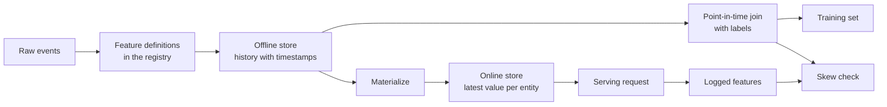

# Feature Stores and Training-Serving Skew

> Một đặc trưng có một định nghĩa và hai bên đọc. Huấn luyện đọc lịch sử của nó tại mỗi thời điểm nhãn, và phục vụ đọc giá trị mới nhất của nó. Khi hai bên đọc bất đồng, mô hình thấy các đầu vào mà nó chưa từng huấn luyện trên đó.

**Type:** Build
**Languages:** Python
**Prerequisites:** Phase 2, Lessons 08 (Feature Engineering), 13 (ML Pipelines), 15 (Time Series), and 19 (ML System Design)
**Time:** ~100 minutes

## Learning Objectives

- Mô tả offline store, online store, thực thể, dấu thời gian sự kiện và TTL, cùng công việc của mỗi thứ
- Triển khai một phép join đúng theo thời điểm và cho thấy cách một phép join ngây thơ sao chép các giá trị tương lai vào dữ liệu huấn luyện
- Nêu tên bốn nguyên nhân training-serving skew: hai đường mã, đặc trưng cũ, các mặc định khác nhau và du hành thời gian
- Xây dựng một feature registry trong đó một định nghĩa cung cấp cho cả đường huấn luyện và đường phục vụ
- Backfill một đặc trưng mới trên các ngày quá khứ mà không đọc dữ liệu từ sau mỗi ngày
- Phát hiện skew bằng cách so sánh các đặc trưng phục vụ được ghi nhật ký với đường huấn luyện cho cùng thực thể và thời điểm

## The Problem

Một nhóm xây dựng một mô hình churn. Mỗi nhãn cho biết liệu một người dùng có không mua hàng trong 30 ngày sau một ngày nhãn hay không. Nhóm join các nhãn với bảng đặc trưng người dùng theo `user_id` và huấn luyện một quy tắc trên `days_since_last_purchase`. Độ chính xác ngoại tuyến là 0.948.

Trên lưu lượng thực, mô hình hoạt động kém hơn một phiên bản cũ hơn và đơn giản hơn. Bảng đặc trưng chứa giá trị mới nhất cho mỗi người dùng, từ nhiều tuần sau các ngày nhãn. Một người dùng có lần mua cuối vào ngày 115 hiển thị 60 ngày không hoạt động trong snapshot ngày 175, nên đặc trưng chứa câu trả lời. Trong khi đó, một nhóm khác viết lại các đặc trưng phục vụ trong một dịch vụ khác. Cửa sổ 30 ngày của họ bao gồm thêm một ngày, và mặc định của họ cho một người dùng mới là -1 thay vì 365.

Cả hai khuyết tật có cùng nguyên nhân. Huấn luyện và phục vụ tính "cùng một đặc trưng" theo hai cách khác nhau. Bài học này xây dựng các mảnh của một feature store từ đầu. Bạn viết một registry, một backfill, một phép join theo thời điểm, một online store với TTL và một kiểm tra skew. Demo tái tạo cả hai khuyết tật bằng các con số.

## The Concept

### Two readers of the same feature

Huấn luyện và phục vụ yêu cầu các đặc trưng theo các dạng khác nhau:

| Thuộc tính | Huấn luyện (ngoại tuyến) | Phục vụ (trực tuyến) |
|---|---|---|
| Câu hỏi | "Giá trị cho mỗi trong 10 triệu cặp (thực thể, thời gian) là gì?" | "Giá trị cho một thực thể này bây giờ là gì?" |
| Thời gian | Nhiều thời điểm trong quá khứ | Hiện tại |
| Khối lượng | Hàng triệu hàng mỗi tác vụ | Một hàng mỗi yêu cầu |
| Độ trễ | Vài phút là ổn | Vài mili giây |
| Lưu trữ | Offline store: lịch sử đầy đủ với dấu thời gian, trong tệp dạng cột hoặc một kho dữ liệu | Online store: giá trị mới nhất mỗi thực thể, trong một cơ sở dữ liệu key-value |

Một feature store giữ cả hai kho được điền từ một tập định nghĩa đặc trưng. Materialization là tác vụ sao chép các giá trị mới nhất từ offline store sang online store.



### Entities, timestamps, and TTL

Bốn thuật ngữ mô tả mọi hàng đặc trưng:

- **Thực thể.** Khóa mà một đặc trưng mô tả, chẳng hạn `user_id` hoặc `card_id`.
- **Dấu thời gian sự kiện.** Thời điểm mà giá trị trở thành đúng. Một số đếm mua hàng "tính đến ngày 14" có dấu thời gian sự kiện ngày 14.
- **Dấu thời gian tạo.** Thời điểm mà hệ thống ghi hàng. Một backfill chạy hôm nay ghi các hàng với dấu thời gian sự kiện cũ và dấu thời gian tạo mới.
- **TTL (thời gian tồn tại).** Tuổi tối đa của một giá trị. Một giá trị cũ hơn TTL được tính là thiếu, nên bên đọc sử dụng mặc định.

Một nhóm đặc trưng với cùng thực thể, nguồn và TTL thường được gọi là một feature view.

### Point-in-time correct joins

Một hàng huấn luyện ghép một nhãn với các giá trị đặc trưng tồn tại tại thời điểm nhãn. Phép join theo thời điểm làm điều này cho mỗi nhãn:

1. Tìm các hàng đặc trưng của cùng thực thể.
2. Giữ các hàng có dấu thời gian sự kiện ở hoặc trước dấu thời gian nhãn.
3. Lấy hàng mới nhất trong số đó.
4. Bỏ nó nếu dấu thời gian nhãn trừ dấu thời gian sự kiện của nó lớn hơn TTL.

Đây là một người dùng, một nhãn ở ngày 16 và các hàng đặc trưng hàng tuần:

| Ngày hàng đặc trưng | `purchases_30d` | Join theo thời điểm | Join ngây thơ theo `user_id` |
|---|---|---|---|
| 7 | 4 | | |
| 14 | 3 | Được chọn | |
| 21 | 1 | Tương lai | |
| 28 | 0 | Tương lai | Được chọn |

Nhãn hỏi liệu người dùng có mua gì trong ngày 17 đến 46 hay không. Hàng ngày 28 đã đếm các ngày yên ắng sau ngày nhãn. Nó hiển thị 0 lần mua vì người dùng đã ngừng mua, chính là sự kiện mà nhãn đo. Phép join ngây thơ sao chép câu trả lời vào đầu vào.

Chúng ta đã chia dữ liệu theo thời gian trong bài chuỗi thời gian vì cùng lý do. Một phép join theo thời điểm áp dụng quy tắc đó cho mọi hàng thay vì cho một điểm chia.

### Causes of training-serving skew

Rules of Machine Learning của Google định nghĩa training-serving skew là một khác biệt giữa hiệu năng trong huấn luyện và hiệu năng trong phục vụ. Họ nêu tên ba nguyên nhân: xử lý dữ liệu khác nhau trong hai pipeline, một thay đổi dữ liệu giữa huấn luyện và phục vụ và một vòng lặp phản hồi. Trong các pipeline đặc trưng, bốn nguyên nhân cụ thể xuất hiện lặp đi lặp lại:

| Nguyên nhân | Điều xảy ra | Ví dụ từ demo |
|---|---|---|
| Hai đường mã | Huấn luyện và phục vụ tính đặc trưng bằng mã khác nhau | Cửa sổ phục vụ bao gồm ngày `now - 30`, còn cửa sổ huấn luyện thì không |
| Đặc trưng cũ | Giá trị phục vụ đọc có tuổi khác giá trị mà huấn luyện sử dụng | Huấn luyện đọc các snapshot hàng tuần, và một dịch vụ mới tính các giá trị mới |
| Mặc định khác nhau | Hai đường điền một giá trị thiếu khác nhau | Huấn luyện sử dụng 365 cho "chưa mua hàng", và phục vụ sử dụng -1 |
| Du hành thời gian | Huấn luyện đọc một giá trị từ sau thời điểm nhãn | Phép join ngây thơ đọc snapshot mới nhất cho mọi nhãn |

Quy tắc #32 của cùng hướng dẫn nói tái sử dụng mã giữa pipeline huấn luyện và pipeline phục vụ bất cứ khi nào có thể. Một feature store theo quy tắc đó với một định nghĩa mà cả hai đường gọi.

### A feature registry

Registry là danh mục các định nghĩa đặc trưng. Mỗi mục chứa một tên, một thực thể, một nguồn, một phép biến đổi, một cửa sổ, một giá trị mặc định, một TTL, một người sở hữu, một phiên bản và một mô tả.

Hai quy tắc giữ nó an toàn:

- Cả hai đường đọc định nghĩa từ registry. Không dịch vụ nào giữ một bản sao riêng của phép biến đổi.
- Một thay đổi định nghĩa tạo một phiên bản mới. Phiên bản cũ ở lại, để các mô hình cũ giữ đặc trưng mà chúng đã huấn luyện trên đó.

### Backfills

Một đặc trưng mới không có lịch sử, nhưng huấn luyện cần giá trị của nó tại mọi thời điểm nhãn cũ. Một backfill chạy định nghĩa tại mỗi ngày quá khứ và ghi một hàng mỗi thực thể và ngày. Mỗi lần chạy chỉ đọc các sự kiện có dấu thời gian ở hoặc trước ngày của nó.

Backfill tốn tính toán tăng theo số thực thể nhân số ngày. Chúng cũng mang đến một rò rỉ tinh vi. Một backfill chạy hôm nay ghi các hàng với dấu thời gian sự kiện cũ, nhưng nó có thể đọc dữ liệu đến muộn hoặc được sửa sau đó. Một phép join theo thời điểm nghiêm ngặt cũng kiểm tra rằng dấu thời gian tạo ở hoặc trước thời điểm nhãn.

### Detecting skew

Quy tắc #29 của cùng hướng dẫn nói ghi nhật ký các đặc trưng lúc phục vụ và sử dụng chúng trong huấn luyện. Ngay cả một mẫu ghi nhật ký nhỏ cũng cho phép bạn kiểm tra tính nhất quán. So sánh mỗi giá trị ghi nhật ký với giá trị mà đường huấn luyện tạo ra cho cùng thực thể và thời điểm. Với mỗi đặc trưng, báo cáo tỷ lệ không khớp và sai khác tuyệt đối trung bình.

Để tìm nguyên nhân, so sánh ba cặp:

1. Lần đọc online store so với join huấn luyện. Điều này kiểm tra toàn hệ thống và nên cho thấy skew bằng không.
2. Tính toán mới so với join huấn luyện. Điều này cô lập độ cũ.
3. Đường mã thứ hai so với tính toán mới. Điều này cô lập các khác biệt mã, chẳng hạn cửa sổ và mặc định.

```figure
mlprod-pit-join
```

## Build It

Mã trong `code/main.py` chỉ sử dụng thư viện chuẩn. Thời gian là một số nguyên ngày. Một tác vụ batch hàng tuần ghi các snapshot đặc trưng vào ngày 7, 14 và tiếp tục đến 175.

### Step 1: Feature definitions and the registry

Một `FeatureDefinition` chứa phép biến đổi dưới dạng dữ liệu: một phép tổng hợp, một cửa sổ và một mặc định. Phương thức `compute` của nó không bao giờ đọc các sự kiện sau `as_of`.

```python
@dataclass(frozen=True)
class FeatureDefinition:
    name: str
    entity: str
    aggregate: str
    window_days: int | None
    default: float
    version: int = 1
    owner: str = "growth-team"
    description: str = ""

    def compute(self, events: list[Event], as_of: int) -> float:
        visible = [e for e in events if e.day <= as_of]
        if self.window_days is not None:
            visible = [e for e in visible if e.day > as_of - self.window_days]
        if self.aggregate == "count":
            return float(len(visible))
        if self.aggregate == "sum":
            return round(sum(e.amount for e in visible), 2)
        if self.aggregate == "days_since_last":
            return float(as_of - max(e.day for e in visible)) if visible else self.default
        raise ValueError(f"unknown aggregate {self.aggregate!r}")
```

`FeatureRegistry.register` chấp nhận cùng định nghĩa hai lần, nhưng nó từ chối một định nghĩa khác với cùng tên và phiên bản. `fill_defaults` cho cả hai đường cùng mặc định cho một giá trị thiếu.

Một mô hình ghim một định nghĩa bằng một tham chiếu như `spend_30d@1`. `compute` và `fill_defaults` phân giải tham chiếu, và một tên không có `@` đọc phiên bản mới nhất. Một tham chiếu có `@` và không có số phiên bản phát sinh `ValueError`, nên một lỗi gõ không thể đọc phiên bản mới nhất mà không có lời cảnh báo. Tham chiếu cũng là khóa trong mỗi hàng được lưu, nên backfill, online store và lần đọc phục vụ đều sử dụng định nghĩa đã ghim.

### Step 2: Backfill the offline store

```python
def backfill(registry: FeatureRegistry, names: list[str], events: list[Event], days: list[int]) -> list[FeatureRow]:
    rows = []
    for entity, entity_events in sorted(group_events(events).items()):
        for day in days:
            rows.append(FeatureRow(entity, day, registry.compute(names, entity_events, day)))
    return rows
```

Demo backfill ba đặc trưng cho 299 người dùng trên 25 ngày snapshot, cho 7475 hàng.

### Step 3: The point-in-time join

Sắp xếp các hàng của mỗi thực thể theo ngày một lần. Với mỗi nhãn, `bisect_right` tìm hàng cuối ở hoặc trước ngày nhãn. Kiểm tra TTL bỏ một hàng quá cũ.

```python
def point_in_time_join(labels: list[LabelRow], rows: list[FeatureRow], ttl_days: int | None = None) -> list[JoinedRow]:
    by_entity: dict[str, list[FeatureRow]] = defaultdict(list)
    for row in rows:
        by_entity[row.entity].append(row)
    days_index = {}
    for entity, entity_rows in by_entity.items():
        entity_rows.sort(key=lambda r: r.day)
        days_index[entity] = [r.day for r in entity_rows]
    joined = []
    for label in labels:
        days = days_index.get(label.entity, [])
        pos = bisect.bisect_right(days, label.day) - 1
        match = by_entity[label.entity][pos] if pos >= 0 else None
        if match is not None and ttl_days is not None and label.day - match.day > ttl_days:
            match = None
        joined.append(JoinedRow(
            label.entity, label.day, label.label,
            match.day if match else None, match.values if match else None,
        ))
    return joined
```

### Step 4: Measure the leak from a naive join

`naive_latest_join` chỉ join theo thực thể, nên nó trả về hàng mới nhất cho mọi nhãn. Demo xây dựng nhãn vào ngày 100, 120 và 140 và khớp một quy tắc một đặc trưng trên mỗi tập huấn luyện. Rồi nó kiểm tra cả hai quy tắc trên các nhãn từ ngày 145, với các đặc trưng theo thời điểm:

```console
  naive join used a snapshot from after the label day for 100% of rows
  offline accuracy, naive join: 0.948 (rule: idle > 53 days)
  offline accuracy, PIT join:   0.893 (rule: idle > 19 days)
  accuracy on day 145, trained with naive join: 0.763
  accuracy on day 145, trained with PIT join:   0.876
```

Phép join ngây thơ trông tốt hơn ngoại tuyến, 0.948 so với 0.893. Trên dữ liệu mới nó tệ hơn, 0.763 so với 0.876. Đặc trưng bị rò rỉ chuyển ngưỡng được khớp từ 19 sang 53 ngày không hoạt động.

### Step 5: The online store and materialization

Online store giữ một hàng mỗi thực thể và từ chối các hàng cũ hơn TTL. `materialize` chỉ ghi các hàng có ngày ở hoặc trước thời điểm tác vụ.

```python
class OnlineStore:
    def __init__(self, ttl_days: int):
        self.ttl_days = ttl_days
        self._latest: dict[str, FeatureRow] = {}

    def write(self, row: FeatureRow) -> None:
        current = self._latest.get(row.entity)
        if current is None or row.day >= current.day:
            self._latest[row.entity] = row

    def read(self, entity: str, now: int) -> dict[str, float] | None:
        row = self._latest.get(entity)
        if row is None or row.day > now or now - row.day > self.ttl_days:
            return None
        return dict(row.values)
```

Với TTL 10 ngày, một lần đọc vào ngày 145 trả về hàng ngày 140. Một lần đọc vào ngày 160, không có materialization mới, trả về các mặc định, vì hàng đã 20 ngày tuổi.

### Step 6: The skew check

`detect_skew` so sánh hai view có khóa `(entity, day)`. Nó báo cáo tỷ lệ không khớp và sai khác tuyệt đối trung bình theo đặc trưng và gắn cờ một đặc trưng khi hơn 1 phần trăm giá trị khác nhau. Nó phát sinh `ValueError` khi hai view có các khóa khác nhau hoặc không có khóa. Một yêu cầu bị thiếu có thể che giấu skew, và một kiểm tra không có yêu cầu không cho thấy gì.

```python
def detect_skew(
    training: dict[tuple[str, int], dict[str, float]],
    serving: dict[tuple[str, int], dict[str, float]],
    features: list[str],
    tolerance: float = 1e-6,
    max_mismatch_rate: float = 0.01,
) -> list[SkewReport]:
    if set(training) != set(serving):
        raise ValueError(f"{len(set(training) ^ set(serving))} keys are in only one view: log and compare the same requests")
    if not training:
        raise ValueError("no requests to compare")
    keys = sorted(training)
    reports = []
    for feature in features:
        diffs = [abs(training[k][feature] - serving[k][feature]) for k in keys]
        mismatches = sum(1 for d in diffs if d > tolerance)
        rate = mismatches / len(keys)
        mean_diff = sum(diffs) / len(keys)
        reports.append(SkewReport(feature, len(keys), rate, mean_diff, rate > max_mismatch_rate))
    return reports
```

Demo ghi nhật ký các yêu cầu vào ngày 141 đến 150 và chạy ba phép so sánh từ phần khái niệm. Nhóm yêu cầu bao gồm 20 người dùng mới không có lịch sử.

```bash
python3 code/main.py
```

```console
=== Skew checks on 383 logged requests, days 141 to 150 ===
  online store read  vs  training join (one definition, same snapshots)
    ok   days_since_last_purchase   mismatch   0.0%  mean |diff|    0.00
    ok   purchases_30d              mismatch   0.0%  mean |diff|    0.00
    ok   spend_30d                  mismatch   0.0%  mean |diff|    0.00
  fresh compute      vs  training join (staleness only)
    SKEW days_since_last_purchase   mismatch  83.0%  mean |diff|    2.77
    SKEW purchases_30d              mismatch  30.5%  mean |diff|    0.38
    SKEW spend_30d                  mismatch  37.1%  mean |diff|   16.77
  second code path   vs  fresh compute (code differences only)
    SKEW days_since_last_purchase   mismatch   5.5%  mean |diff|   20.07
    SKEW purchases_30d              mismatch  12.5%  mean |diff|    0.13
    SKEW spend_30d                  mismatch  12.5%  mean |diff|    5.09
```

Đọc ba khối theo thứ tự:

- **Một định nghĩa, cùng các snapshot.** Online store và join huấn luyện đọc cùng các hàng đã materialize, nên skew bằng không.
- **Độ cũ.** Một giá trị mới khác snapshot hàng tuần trên hầu hết các yêu cầu. Dữ liệu mới hơn không tự động tốt hơn ở đây, vì mô hình học từ các giá trị cũ tới sáu ngày.
- **Các khác biệt mã.** Đường mã thứ hai khác trên 12.5 phần trăm các số đếm cửa sổ, vì cửa sổ của nó bao gồm thêm một ngày. Nó chỉ khác trên `days_since_last_purchase` với người dùng mới, nhưng với một lượng lớn: -1 so với 365.

## Use It

Feast là một feature store mã nguồn mở. Mỗi mảnh của mã viết từ đầu có một phần tương ứng trong Feast:

| Từ đầu | Feast |
|---|---|
| `FeatureDefinition`, `FeatureRegistry` | `Entity`, `FeatureView` và `Field` trong một kho đặc trưng, được đăng ký bằng `feast apply` |
| Lịch sử `FeatureRow` | Một offline store, ví dụ một `FileSource` trên các tệp Parquet hoặc một bảng kho dữ liệu |
| `point_in_time_join` với một TTL | `store.get_historical_features(entity_df=..., features=[...])` |
| `materialize` | `feast materialize-incremental <end time>` |
| `OnlineStore.read` | `store.get_online_features(features=[...], entity_rows=[...])` |
| Kiểm tra dấu thời gian tạo | `created_timestamp_column` trên nguồn và `filter_by_created_timestamp=True` |

Các định nghĩa trông như thế này. Mã theo quickstart Feast và không cần thiết để chạy bài học này.

```python
from datetime import timedelta

from feast import Entity, FeatureView, Field, FileSource
from feast.types import Float32, Int64

user = Entity(name="user", join_keys=["user_id"])

user_activity_source = FileSource(
    name="user_activity_source",
    path="data/user_activity.parquet",
    timestamp_field="event_timestamp",
    created_timestamp_column="created",
)

user_activity = FeatureView(
    name="user_activity",
    entities=[user],
    ttl=timedelta(days=10),
    schema=[
        Field(name="purchases_30d", dtype=Int64),
        Field(name="spend_30d", dtype=Float32),
        Field(name="days_since_last_purchase", dtype=Int64),
    ],
    source=user_activity_source,
)
```

Huấn luyện và phục vụ sau đó đọc cùng feature view:

```python
from feast import FeatureStore

store = FeatureStore(repo_path=".")

training_df = store.get_historical_features(
    entity_df=labels_df,
    features=["user_activity:purchases_30d", "user_activity:days_since_last_purchase"],
    filter_by_created_timestamp=True,
).to_df()

online = store.get_online_features(
    features=["user_activity:purchases_30d", "user_activity:days_since_last_purchase"],
    entity_rows=[{"user_id": 42}],
).to_dict()
```

`labels_df` chứa một hàng mỗi nhãn với `user_id`, `event_timestamp` và nhãn. Tài liệu Feast nêu rằng TTL tương đối với mỗi dấu thời gian trong dataframe thực thể, không phải với thời điểm truy vấn. Điều đó khớp kiểm tra TTL trong `point_in_time_join`. Cùng trang mô tả `filter_by_created_timestamp=True`, giữ các giá trị backfill không rò rỉ vào dữ liệu huấn luyện. Không phải mọi offline store đều hỗ trợ tùy chọn này. Một kho không hỗ trợ phát sinh lỗi thay vì bỏ qua tùy chọn.

Tecton, Hopsworks và các feature store trong các nền tảng ML đám mây lớn sử dụng cùng sự phân chia giữa offline store và online store. Với kiểm tra skew, TensorFlow Data Validation có thể so sánh dữ liệu huấn luyện với dữ liệu phục vụ để phát hiện skew. Breck và cộng sự mô tả hệ thống xác thực dữ liệu trong TFX, nền tảng ML đầu cuối của Google, bao gồm training-serving skew.

## Ship It

Bài học này tạo ra `outputs/skill-feature-skew-audit.md`. Skill kiểm toán một pipeline đặc trưng về du hành thời gian và training-serving skew. Nó đi qua phép join, các định nghĩa, các mặc định, độ mới của mỗi đường và việc ghi nhật ký mà một kiểm tra skew cần.

## Exercises

1. Thay khoảng snapshot từ 7 ngày thành 1 ngày. Chạy lại phép so sánh độ cũ và giải thích kết quả.
2. Đặt TTL thành 3 ngày. Đếm các hàng huấn luyện mất các đặc trưng của chúng và nhận mặc định.
3. Thêm một ngày tạo vào `FeatureRow`. Làm phép join bỏ qua các hàng được ghi sau ngày nhãn.
4. Đăng ký `spend_7d` là phiên bản 2 của `spend_30d`. Backfill nó và in cả hai phiên bản từ registry.
5. Sửa `legacy_serving_features` cho đến khi kiểm tra skew thứ ba qua. Liệt kê mỗi thay đổi.

## Key Terms

| Thuật ngữ | Cách mọi người nói | Ý nghĩa |
|------|----------------|----------------------|
| Feature store — Kho đặc trưng | "Một cơ sở dữ liệu cho đặc trưng" | Một hệ thống tính các đặc trưng từ một tập định nghĩa và phục vụ chúng cho huấn luyện và cho phục vụ |
| Offline store — Kho ngoại tuyến | "Dữ liệu huấn luyện" | Lịch sử đặc trưng đầy đủ với dấu thời gian sự kiện, được đọc bởi các tác vụ huấn luyện và backfill |
| Online store — Kho trực tuyến | "Cache đặc trưng" | Giá trị mới nhất mỗi thực thể, được đường phục vụ đọc trong mili giây |
| Entity — Thực thể | "ID" | Khóa mà một đặc trưng mô tả, chẳng hạn một người dùng hoặc một thẻ |
| Event timestamp — Dấu thời gian sự kiện | "Khi nó xảy ra" | Thời điểm mà một giá trị đặc trưng trở thành đúng |
| Point-in-time join — Join theo thời điểm | "Một as-of join" | Một phép join ghép mỗi nhãn với hàng đặc trưng mới nhất ở hoặc trước thời điểm nhãn |
| TTL | "Hết hạn" | Tuổi tối đa của một giá trị đặc trưng trước khi một bên đọc coi nó là thiếu |
| Materialization | "Đồng bộ sang trực tuyến" | Tác vụ sao chép các giá trị đặc trưng mới nhất từ offline store sang online store |
| Backfill | "Tính lịch sử" | Chạy một định nghĩa đặc trưng tại các ngày quá khứ để tạo lịch sử của nó |
| Training-serving skew | "Nó hoạt động ngoại tuyến" | Một khác biệt giữa các đặc trưng hoặc hành vi trong huấn luyện và trong phục vụ |

## Further Reading

- [Feast, Point-in-time joins](https://docs.feast.dev/getting-started/concepts/point-in-time-joins): ngữ nghĩa TTL và bộ lọc dấu thời gian tạo
- [Tài liệu Feast](https://docs.feast.dev/): feature view, offline store, online store và materialization
- [Google, Rules of Machine Learning](https://developers.google.com/machine-learning/guides/rules-of-ml): các quy tắc training-serving skew, từ Quy tắc #29 đến Quy tắc #37
- [Breck et al., Data Validation for Machine Learning (SysML 2019)](https://research.google/pubs/data-validation-for-machine-learning/): xác thực dữ liệu tại Google, bao gồm training-serving skew
- [Hướng dẫn TensorFlow Data Validation](https://www.tensorflow.org/tfx/guide/tfdv): kiểm tra schema, phát hiện skew và phát hiện drift
- [Sculley et al., Hidden Technical Debt in Machine Learning Systems (NeurIPS 2015)](https://papers.nips.cc/paper/2015/hash/86df7dcfd896fcaf2674f757a2463eba-Abstract.html): các phụ thuộc dữ liệu và nợ pipeline xung quanh một mô hình
