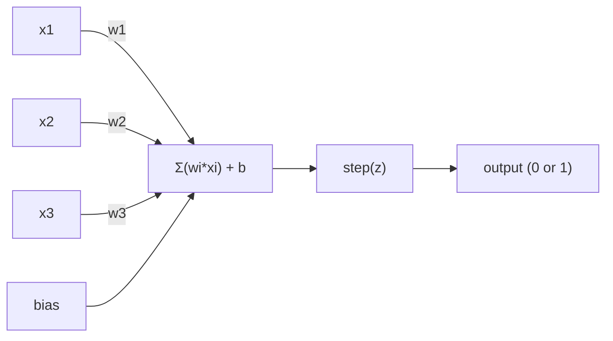
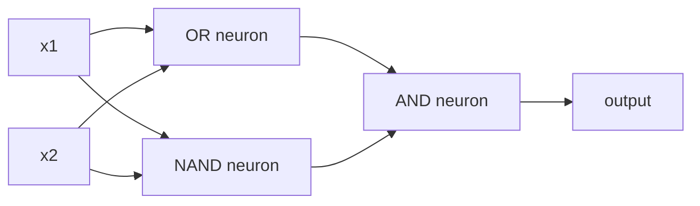

# The Perceptron

> Perceptron là nguyên tử của mạng nơ-ron. Tách nó ra và bạn tìm thấy các trọng số, một bias và một quyết định.

**Type:** Build
**Languages:** Python
**Prerequisites:** Phase 1 (Linear Algebra Intuition)
**Time:** ~60 minutes

## Learning Objectives

- Triển khai một perceptron từ đầu bằng Python, bao gồm quy tắc cập nhật trọng số và hàm kích hoạt bước
- Giải thích tại sao một perceptron đơn lẻ chỉ có thể giải các bài toán phân tách tuyến tính được và minh họa trường hợp thất bại XOR
- Xây dựng một perceptron nhiều lớp bằng cách kết hợp các cổng OR, NAND và AND để giải XOR
- Huấn luyện một mạng hai lớp với kích hoạt sigmoid và lan truyền ngược để tự động học XOR

## The Problem

Bạn biết vector và tích vô hướng. Bạn biết rằng một ma trận biến đổi các đầu vào thành đầu ra. Nhưng một máy *học* phép biến đổi nào cần sử dụng như thế nào?

Perceptron trả lời điều này. Đó là cỗ máy học đơn giản nhất có thể: lấy một số đầu vào, nhân với các trọng số, cộng một bias và đưa ra một quyết định nhị phân. Rồi điều chỉnh. Chỉ vậy thôi. Mọi mạng nơ-ron từng được xây dựng đều là các lớp của ý tưởng này xếp chồng lên nhau.

Hiểu perceptron nghĩa là hiểu "học" thực sự có nghĩa gì trong mã: điều chỉnh các con số cho tới khi đầu ra khớp thực tế.

## The Concept

### One Neuron, One Decision

Một perceptron nhận $n$ đầu vào, nhân mỗi đầu vào với một trọng số, cộng chúng lại, cộng một bias và đưa kết quả qua một hàm kích hoạt.



Hàm bước rất thẳng tay: nếu tổng có trọng số cộng bias $\ge 0$, xuất ra 1. Nếu không, xuất ra 0.

```math
\text{step}(z) = \begin{cases} 1 & \text{if } z \ge 0 \\ 0 & \text{if } z < 0 \end{cases}
```

Đây là một bộ phân loại tuyến tính. Các trọng số và bias xác định một đường thẳng (hoặc siêu phẳng trong không gian nhiều chiều hơn) chia không gian đầu vào thành hai vùng.

### The Decision Boundary

Với hai đầu vào, perceptron vẽ một đường thẳng qua không gian 2D:

```
  x2
  ┤
  │  Class 1        /
  │    (0)          /
  │                /
  │               / w1·x1 + w2·x2 + b = 0
  │              /
  │             /     Class 2
  │            /        (1)
  ┼───────────/──────────── x1
```

Mọi thứ ở một phía của đường thẳng xuất ra 0. Mọi thứ ở phía còn lại xuất ra 1. Huấn luyện di chuyển đường thẳng này cho tới khi nó phân tách đúng các lớp.

### The Learning Rule

Quy tắc học perceptron rất đơn giản:

```
For each training example (x, y_true):
    y_pred = predict(x)
    error = y_true - y_pred

    For each weight:
        w_i = w_i + learning_rate * error * x_i
    bias = bias + learning_rate * error
```

Nếu dự đoán đúng, $\text{error} = 0$, không có gì thay đổi. Nếu nó dự đoán 0 nhưng lẽ ra phải là 1, các trọng số tăng. Nếu nó dự đoán 1 nhưng lẽ ra phải là 0, các trọng số giảm. Tốc độ học kiểm soát độ lớn mỗi lần điều chỉnh.

### The XOR Problem

Đây là nơi nó thất bại. Nhìn vào các cổng logic này:

```
AND gate:           OR gate:            XOR gate:
x1  x2  out         x1  x2  out         x1  x2  out
0   0   0           0   0   0           0   0   0
0   1   0           0   1   1           0   1   1
1   0   0           1   0   1           1   0   1
1   1   1           1   1   1           1   1   0
```

AND và OR phân tách tuyến tính được: bạn có thể vẽ một đường thẳng duy nhất để tách các số 0 khỏi các số 1. XOR thì không. Không một đường thẳng duy nhất nào có thể tách [0,1] và [1,0] khỏi [0,0] và [1,1].

```
AND (separable):        XOR (not separable):

  x2                      x2
  1 ┤  0     1            1 ┤  1     0
    │     /                 │
  0 ┤  0 / 0              0 ┤  0     1
    ┼──/──────── x1         ┼──────────── x1
       line works!          no single line works!
```

Đây là một giới hạn cơ bản. Một perceptron đơn lẻ chỉ có thể giải các bài toán phân tách tuyến tính được. Minsky và Papert đã chứng minh điều này vào năm 1969 và nó gần như giết chết nghiên cứu mạng nơ-ron trong một thập kỷ.

Cách khắc phục: xếp chồng các perceptron thành các lớp. Một perceptron nhiều lớp có thể giải XOR bằng cách kết hợp hai quyết định tuyến tính thành một quyết định phi tuyến.

```figure
perceptron-boundary
```

## Build It

### Step 1: The Perceptron class

```python
class Perceptron:
    def __init__(self, n_inputs, learning_rate=0.1):
        self.weights = [0.0] * n_inputs
        self.bias = 0.0
        self.lr = learning_rate

    def predict(self, inputs):
        total = sum(w * x for w, x in zip(self.weights, inputs))
        total += self.bias
        return 1 if total >= 0 else 0

    def train(self, training_data, epochs=100):
        for epoch in range(epochs):
            errors = 0
            for inputs, target in training_data:
                prediction = self.predict(inputs)
                error = target - prediction
                if error != 0:
                    errors += 1
                    for i in range(len(self.weights)):
                        self.weights[i] += self.lr * error * inputs[i]
                    self.bias += self.lr * error
            if errors == 0:
                print(f"Converged at epoch {epoch + 1}")
                return
        print(f"Did not converge after {epochs} epochs")
```

### Step 2: Train on logic gates

```python
and_data = [
    ([0, 0], 0),
    ([0, 1], 0),
    ([1, 0], 0),
    ([1, 1], 1),
]

or_data = [
    ([0, 0], 0),
    ([0, 1], 1),
    ([1, 0], 1),
    ([1, 1], 1),
]

not_data = [
    ([0], 1),
    ([1], 0),
]

print("=== AND Gate ===")
p_and = Perceptron(2)
p_and.train(and_data)
for inputs, _ in and_data:
    print(f"  {inputs} -> {p_and.predict(inputs)}")

print("\n=== OR Gate ===")
p_or = Perceptron(2)
p_or.train(or_data)
for inputs, _ in or_data:
    print(f"  {inputs} -> {p_or.predict(inputs)}")

print("\n=== NOT Gate ===")
p_not = Perceptron(1)
p_not.train(not_data)
for inputs, _ in not_data:
    print(f"  {inputs} -> {p_not.predict(inputs)}")
```

### Step 3: Watch XOR fail

```python
xor_data = [
    ([0, 0], 0),
    ([0, 1], 1),
    ([1, 0], 1),
    ([1, 1], 0),
]

print("\n=== XOR Gate (single perceptron) ===")
p_xor = Perceptron(2)
p_xor.train(xor_data, epochs=1000)
for inputs, expected in xor_data:
    result = p_xor.predict(inputs)
    status = "OK" if result == expected else "WRONG"
    print(f"  {inputs} -> {result} (expected {expected}) {status}")
```

Nó sẽ không bao giờ hội tụ. Đây là bằng chứng chắc chắn rằng một perceptron đơn lẻ không thể học XOR.

### Step 4: Solve XOR with two layers

Thủ thuật: $\text{XOR} = (x_1 \text{ OR } x_2) \text{ AND NOT } (x_1 \text{ AND } x_2)$. Kết hợp ba perceptron:



```python
def xor_network(x1, x2):
    or_neuron = Perceptron(2)
    or_neuron.weights = [1.0, 1.0]
    or_neuron.bias = -0.5

    nand_neuron = Perceptron(2)
    nand_neuron.weights = [-1.0, -1.0]
    nand_neuron.bias = 1.5

    and_neuron = Perceptron(2)
    and_neuron.weights = [1.0, 1.0]
    and_neuron.bias = -1.5

    hidden1 = or_neuron.predict([x1, x2])
    hidden2 = nand_neuron.predict([x1, x2])
    output = and_neuron.predict([hidden1, hidden2])
    return output


print("\n=== XOR Gate (multi-layer network) ===")
for inputs, expected in xor_data:
    result = xor_network(inputs[0], inputs[1])
    print(f"  {inputs} -> {result} (expected {expected})")
```

Cả bốn trường hợp đều đúng. Xếp chồng các perceptron thành các lớp tạo ra các ranh giới quyết định mà không perceptron đơn lẻ nào có thể tạo ra.

### Step 5: Train a Two-Layer Network

Bước 4 thiết lập thủ công các trọng số. Điều đó hoạt động cho XOR, nhưng không cho các bài toán thực tế mà bạn không biết trước các trọng số đúng. Cách khắc phục: thay hàm bước bằng sigmoid và học các trọng số tự động thông qua lan truyền ngược.

```python
class TwoLayerNetwork:
    def __init__(self, learning_rate=0.5):
        import random
        random.seed(0)
        self.w_hidden = [[random.uniform(-1, 1), random.uniform(-1, 1)] for _ in range(2)]
        self.b_hidden = [random.uniform(-1, 1), random.uniform(-1, 1)]
        self.w_output = [random.uniform(-1, 1), random.uniform(-1, 1)]
        self.b_output = random.uniform(-1, 1)
        self.lr = learning_rate

    def sigmoid(self, x):
        import math
        x = max(-500, min(500, x))
        return 1.0 / (1.0 + math.exp(-x))

    def forward(self, inputs):
        self.inputs = inputs
        self.hidden_outputs = []
        for i in range(2):
            z = sum(w * x for w, x in zip(self.w_hidden[i], inputs)) + self.b_hidden[i]
            self.hidden_outputs.append(self.sigmoid(z))
        z_out = sum(w * h for w, h in zip(self.w_output, self.hidden_outputs)) + self.b_output
        self.output = self.sigmoid(z_out)
        return self.output

    def train(self, training_data, epochs=10000):
        for epoch in range(epochs):
            total_error = 0
            for inputs, target in training_data:
                output = self.forward(inputs)
                error = target - output
                total_error += error ** 2

                d_output = error * output * (1 - output)

                saved_w_output = self.w_output[:]
                hidden_deltas = []
                for i in range(2):
                    h = self.hidden_outputs[i]
                    hd = d_output * saved_w_output[i] * h * (1 - h)
                    hidden_deltas.append(hd)

                for i in range(2):
                    self.w_output[i] += self.lr * d_output * self.hidden_outputs[i]
                self.b_output += self.lr * d_output

                for i in range(2):
                    for j in range(len(inputs)):
                        self.w_hidden[i][j] += self.lr * hidden_deltas[i] * inputs[j]
                    self.b_hidden[i] += self.lr * hidden_deltas[i]
```

```python
net = TwoLayerNetwork(learning_rate=2.0)
net.train(xor_data, epochs=10000)
for inputs, expected in xor_data:
    result = net.forward(inputs)
    predicted = 1 if result >= 0.5 else 0
    print(f"  {inputs} -> {result:.4f} (rounded: {predicted}, expected {expected})")
```

Hai khác biệt chính so với Bước 4. Thứ nhất, sigmoid thay thế hàm bước -- nó trơn, nên các gradient tồn tại. Thứ hai, phương thức `train` lan truyền sai số ngược từ đầu ra tới lớp ẩn, điều chỉnh mỗi trọng số theo tỷ lệ đóng góp của nó vào sai số. Đó là lan truyền ngược trong 20 dòng.

Đây là cầu nối tới Bài 03. Toán học đằng sau `d_output` và `hidden_deltas` là quy tắc chuỗi được áp dụng cho đồ thị mạng. Chúng ta sẽ suy ra nó đầy đủ ở đó.

## Use It

Mọi thứ bạn vừa xây dựng từ đầu đều tồn tại trong một lệnh import:

```python
from sklearn.linear_model import Perceptron as SkPerceptron
import numpy as np

X = np.array([[0,0],[0,1],[1,0],[1,1]])
y = np.array([0, 0, 0, 1])

clf = SkPerceptron(max_iter=100, tol=1e-3)
clf.fit(X, y)
print([clf.predict([x])[0] for x in X])
```

Năm dòng. Lớp `Perceptron` 30 dòng của bạn làm cùng một việc. Phiên bản sklearn bổ sung kiểm tra hội tụ, nhiều hàm mất mát và hỗ trợ đầu vào thưa -- nhưng vòng lặp cốt lõi giống hệt: tổng có trọng số, hàm bước, cập nhật trọng số khi có sai số.

Khoảng cách thực sự xuất hiện ở quy mô lớn. Những gì thay đổi trong các mạng production:

- Hàm bước trở thành sigmoid, ReLU hoặc các kích hoạt trơn khác
- Các trọng số được học tự động thông qua lan truyền ngược (Bài 03)
- Các lớp sâu hơn: 3, 10, 100+ lớp
- Cùng nguyên lý vẫn đúng: mỗi lớp tạo ra các đặc trưng mới từ đầu ra của lớp trước

Một perceptron đơn lẻ chỉ có thể vẽ các đường thẳng. Xếp chồng chúng và bạn có thể vẽ bất kỳ hình dạng nào.

## Ship It

Bài học này tạo ra:
- `outputs/skill-perceptron.md` - một skill đề cập khi nào cần kiến trúc một lớp so với nhiều lớp

## Exercises

1. Huấn luyện một perceptron trên một cổng NAND (cổng phổ dụng - bất kỳ mạch logic nào cũng có thể được xây dựng từ NAND). Xác minh các trọng số và bias của nó tạo thành một ranh giới quyết định hợp lệ.
2. Sửa lớp Perceptron để theo dõi ranh giới quyết định ($w_1 x_1 + w_2 x_2 + b = 0$) ở mỗi epoch. In cách đường thẳng dịch chuyển trong quá trình huấn luyện trên cổng AND.
3. Xây dựng một perceptron 3 đầu vào chỉ xuất ra 1 khi ít nhất 2 trong 3 đầu vào là 1 (một hàm bỏ phiếu đa số). Bài toán này có phân tách tuyến tính được không? Tại sao?

## Key Terms

| Thuật ngữ | Cách mọi người nói | Ý nghĩa thực sự |
|------|----------------|----------------------|
| Perceptron | "Một nơ-ron giả" | Một bộ phân loại tuyến tính: tích vô hướng của các đầu vào và trọng số, cộng bias, qua một hàm bước |
| Weight (Trọng số) | "Một đầu vào quan trọng đến mức nào" | Một hệ số nhân co giãn đóng góp của mỗi đầu vào vào quyết định |
| Bias | "Ngưỡng" | Một hằng số dịch chuyển ranh giới quyết định, cho phép perceptron kích hoạt ngay cả khi các đầu vào bằng không |
| Activation function (Hàm kích hoạt) | "Thứ ép các giá trị lại" | Một hàm được áp dụng sau tổng có trọng số - hàm bước cho perceptron, sigmoid/ReLU cho các mạng hiện đại |
| Linearly separable (Phân tách tuyến tính được) | "Bạn có thể vẽ một đường thẳng giữa chúng" | Một tập dữ liệu mà một siêu phẳng duy nhất có thể phân tách hoàn hảo các lớp |
| XOR problem (Bài toán XOR) | "Điều perceptron không thể làm" | Bằng chứng rằng các mạng một lớp không thể học các hàm không phân tách tuyến tính được |
| Decision boundary (Ranh giới quyết định) | "Nơi bộ phân loại chuyển đổi" | Siêu phẳng $w \cdot x + b = 0$ chia không gian đầu vào thành hai lớp |
| Multi-layer perceptron (Perceptron nhiều lớp) | "Một mạng nơ-ron thực sự" | Các perceptron được xếp chồng thành các lớp, trong đó đầu ra mỗi lớp đưa vào đầu vào của lớp tiếp theo |

## Further Reading

- Frank Rosenblatt, "The Perceptron: A Probabilistic Model for Information Storage and Organization in the Brain" (1958) -- bài báo gốc khởi đầu tất cả
- Minsky & Papert, "Perceptrons" (1969) -- cuốn sách chứng minh XOR không thể giải được bằng các mạng một lớp và giết chết nghiên cứu perceptron trong một thập kỷ
- Michael Nielsen, "Neural Networks and Deep Learning", Chapter 1 (http://neuralnetworksanddeeplearning.com/) -- miễn phí trực tuyến, lời giải thích trực quan tốt nhất về cách các perceptron kết hợp thành mạng
