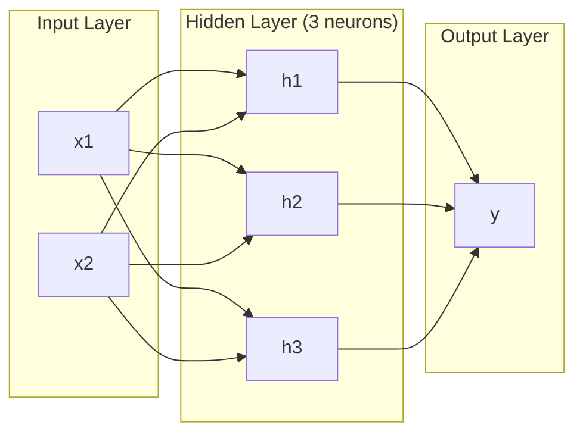
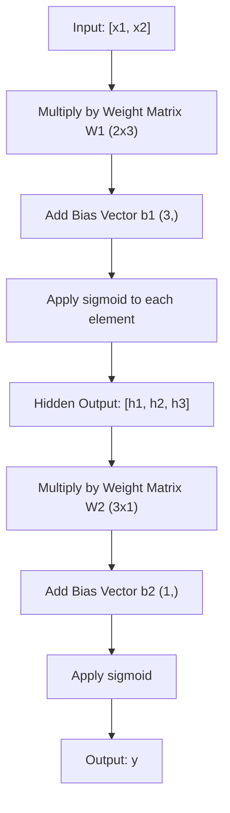
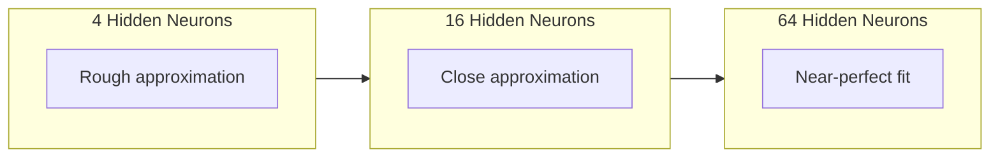

# Multi-Layer Networks and Forward Pass

> Một nơ-ron vẽ một đường thẳng. Xếp chồng chúng và bạn có thể vẽ bất cứ thứ gì.

**Type:** Build
**Languages:** Python
**Prerequisites:** Phase 01 (Math Foundations), Lesson 03.01 (The Perceptron)
**Time:** ~90 minutes

## Learning Objectives

- Xây dựng một mạng nhiều lớp từ đầu với các lớp Layer và Network thực hiện một lượt truyền xuôi hoàn chỉnh
- Theo dõi các kích thước ma trận qua mỗi lớp của một mạng và xác định các trường hợp không khớp hình dạng
- Giải thích cách xếp chồng các kích hoạt phi tuyến cho phép một mạng học các ranh giới quyết định cong
- Giải bài toán XOR bằng kiến trúc 2-2-1 với các trọng số sigmoid được điều chỉnh thủ công

## The Problem

Một nơ-ron đơn lẻ là một công cụ vẽ đường thẳng. Chỉ vậy thôi. Một đường thẳng qua dữ liệu của bạn. Mọi bài toán thực sự trong AI -- nhận dạng hình ảnh, hiểu ngôn ngữ, chơi cờ vây -- đều cần các đường cong. Xếp chồng các nơ-ron thành các lớp là cách bạn có được các đường cong.

Năm 1969, Minsky và Papert chứng minh giới hạn này có tính chí mạng: một mạng một lớp không thể học XOR. Không phải "khó học" -- mà về mặt toán học là không thể. Bảng chân trị XOR đặt [0,1] và [1,0] ở một phía, [0,0] và [1,1] ở phía kia. Không một đường thẳng duy nhất nào phân tách chúng.

Điều này giết chết nguồn tài trợ mạng nơ-ron trong hơn một thập kỷ. Nhìn lại, cách khắc phục rất rõ ràng: ngừng sử dụng một lớp. Xếp chồng các nơ-ron thành các lớp. Để lớp đầu tiên chia cắt không gian đầu vào thành các đặc trưng mới, và để lớp thứ hai kết hợp những đặc trưng đó thành các quyết định mà không đường thẳng đơn lẻ nào có thể đưa ra.

Chồng lớp đó là mạng nhiều lớp. Nó là nền tảng của mọi mô hình học sâu trong production ngày nay. Lượt truyền xuôi -- dữ liệu chảy từ đầu vào qua các lớp ẩn tới đầu ra -- là thứ đầu tiên bạn cần xây dựng trước khi bất kỳ thứ gì khác hoạt động.

## The Concept

### Layers: Input, Hidden, Output

Một mạng nhiều lớp có ba loại lớp:

**Lớp đầu vào** -- không thực sự là một lớp. Nó chứa dữ liệu thô của bạn. Hai đặc trưng nghĩa là hai nút đầu vào. Không có tính toán nào xảy ra ở đây.

**Các lớp ẩn** -- nơi công việc diễn ra. Mỗi nơ-ron nhận mọi đầu ra từ lớp trước, áp dụng các trọng số và một bias, rồi đưa kết quả qua một hàm kích hoạt. "Ẩn" vì bạn không bao giờ thấy trực tiếp các giá trị này trong dữ liệu huấn luyện.

**Lớp đầu ra** -- câu trả lời cuối cùng. Với phân loại nhị phân, một nơ-ron với sigmoid. Với đa lớp, một nơ-ron cho mỗi lớp phân loại.



Đây là một mạng 2-3-1. Hai đầu vào, ba nơ-ron ẩn, một đầu ra. Mỗi kết nối mang một trọng số. Mỗi nơ-ron (trừ đầu vào) mang một bias.

Mỗi lớp tạo ra một vector số được gọi là trạng thái ẩn. Với văn bản, các trạng thái ẩn tăng số chiều -- mã hóa một từ thành 768 số để nắm bắt ý nghĩa ngữ nghĩa. Với hình ảnh, chúng giảm số chiều -- nén hàng triệu pixel thành một biểu diễn có thể quản lý. Trạng thái ẩn là nơi việc học tồn tại.

### Neurons and Activations

Mỗi nơ-ron làm ba việc:

1. Nhân mỗi đầu vào với trọng số tương ứng của nó
2. Cộng tất cả các tích và thêm một bias
3. Đưa tổng qua một hàm kích hoạt

Hiện tại, kích hoạt là sigmoid:

```
sigmoid(z) = 1 / (1 + e^(-z))
```

Sigmoid ép bất kỳ số nào vào khoảng (0, 1). Các đầu vào dương lớn đẩy về phía 1. Các đầu vào âm lớn đẩy về phía 0. Số không ánh xạ thành 0.5. Đường cong trơn này là điều khiến việc học trở nên khả thi -- khác với bước cứng của perceptron, sigmoid có gradient ở mọi nơi.

### Forward Pass: How Data Flows

Lượt truyền xuôi đẩy dữ liệu đầu vào qua mạng, từng lớp một, cho tới khi đến đầu ra. Không có việc học nào diễn ra trong lượt truyền xuôi. Đó là tính toán thuần túy: nhân, cộng, kích hoạt, lặp lại.



Tại mỗi lớp, ba phép toán xảy ra theo thứ tự:

```
z = W * input + b       (linear transformation)
a = sigmoid(z)           (activation)
```

Đầu ra của một lớp trở thành đầu vào của lớp tiếp theo. Đó là toàn bộ lượt truyền xuôi.

### Matrix Dimensions

Theo dõi kích thước là kỹ năng gỡ lỗi quan trọng nhất trong học sâu. Đây là mạng 2-3-1:

| Bước | Phép toán | Kích thước | Hình dạng kết quả |
|------|-----------|------------|-------------|
| Đầu vào | x | -- | (2,) |
| Tuyến tính lớp ẩn | W1 * x + b1 | W1: (3, 2), b1: (3,) | (3,) |
| Kích hoạt lớp ẩn | sigmoid(z1) | -- | (3,) |
| Tuyến tính đầu ra | W2 * h + b2 | W2: (1, 3), b2: (1,) | (1,) |
| Kích hoạt đầu ra | sigmoid(z2) | -- | (1,) |

Quy tắc: ma trận trọng số W tại lớp k có hình dạng (neurons_in_layer_k, neurons_in_layer_k_minus_1). Các hàng khớp lớp hiện tại. Các cột khớp lớp trước. Nếu các hình dạng không khớp nhau, bạn có lỗi.

### Universal Approximation Theorem

Năm 1989, George Cybenko chứng minh một điều đáng chú ý: một mạng nơ-ron với một lớp ẩn duy nhất và đủ nơ-ron có thể xấp xỉ bất kỳ hàm liên tục nào tới bất kỳ độ chính xác mong muốn nào.

Điều này không có nghĩa một lớp ẩn luôn tốt nhất. Nó có nghĩa kiến trúc có khả năng về mặt lý thuyết. Trong thực tế, các mạng sâu hơn (nhiều lớp hơn, ít nơ-ron hơn mỗi lớp) học cùng những hàm đó với tổng số tham số ít hơn nhiều so với các mạng nông và rộng. Đó là lý do học sâu hoạt động.

Trực giác: mỗi nơ-ron trong lớp ẩn học một "chỗ nhô" hoặc đặc trưng. Đủ chỗ nhô được đặt đúng vị trí có thể xấp xỉ bất kỳ đường cong trơn nào. Nhiều nơ-ron hơn, nhiều chỗ nhô hơn, xấp xỉ tốt hơn.



### Composability

Mạng nơ-ron có thể kết hợp được. Bạn có thể xếp chồng chúng, nối chuỗi chúng, chạy chúng song song. Một mô hình Whisper sử dụng một mạng encoder để xử lý âm thanh và một mạng decoder riêng biệt để sinh văn bản. Các LLM hiện đại chỉ có decoder. BERT chỉ có encoder. T5 có encoder-decoder. Lựa chọn kiến trúc xác định mô hình có thể làm gì.

```figure
mlp-forward
```

## Build It

Python thuần. Không numpy. Mọi phép toán ma trận đều được viết từ đầu.

### Step 1: Sigmoid Activation

```python
import math

def sigmoid(x):
    x = max(-500.0, min(500.0, x))
    return 1.0 / (1.0 + math.exp(-x))
```

Việc chặn về [-500, 500] ngăn tràn số. `math.exp(500)` lớn nhưng hữu hạn. `math.exp(1000)` là vô cực.

### Step 2: Layer Class

Phép toán quan trọng nhất trong toàn bộ học sâu là nhân ma trận. Mọi lớp, mọi đầu attention, mọi lượt truyền xuôi -- tất cả đều là các phép nhân ma trận từ trên xuống dưới. Một lớp tuyến tính nhận một vector đầu vào, nhân nó với một ma trận trọng số và cộng một vector bias: y = Wx + b. Một phương trình đó chiếm 90% tính toán trong một mạng nơ-ron.

Một lớp chứa một ma trận trọng số và một vector bias. Phương thức forward của nó nhận một vector đầu vào và trả về đầu ra đã kích hoạt.

```python
class Layer:
    def __init__(self, n_inputs, n_neurons, weights=None, biases=None):
        if weights is not None:
            self.weights = weights
        else:
            import random
            self.weights = [
                [random.uniform(-1, 1) for _ in range(n_inputs)]
                for _ in range(n_neurons)
            ]
        if biases is not None:
            self.biases = biases
        else:
            self.biases = [0.0] * n_neurons

    def forward(self, inputs):
        self.last_input = inputs
        self.last_output = []
        for neuron_idx in range(len(self.weights)):
            z = sum(
                w * x for w, x in zip(self.weights[neuron_idx], inputs)
            )
            z += self.biases[neuron_idx]
            self.last_output.append(sigmoid(z))
        return self.last_output
```

Ma trận trọng số có hình dạng (n_neurons, n_inputs). Mỗi hàng là các trọng số của một nơ-ron trên tất cả các đầu vào. Phương thức forward lặp qua các nơ-ron, tính tổng có trọng số cộng bias, áp dụng sigmoid và thu thập các kết quả.

### Step 3: Network Class

Một mạng là một danh sách các lớp. Lượt truyền xuôi nối chúng thành chuỗi: đầu ra của lớp k đưa vào lớp k+1.

```python
class Network:
    def __init__(self, layers):
        self.layers = layers

    def forward(self, inputs):
        current = inputs
        for layer in self.layers:
            current = layer.forward(current)
        return current
```

Đó là toàn bộ lượt truyền xuôi. Bốn dòng logic. Dữ liệu đi vào, chảy qua mọi lớp, đi ra ở phía bên kia.

### Step 4: XOR with Hand-Tuned Weights

Trong Bài 01, chúng ta giải XOR bằng cách kết hợp các perceptron OR, NAND và AND. Giờ làm cùng việc đó với các lớp Layer và Network của chúng ta. Kiến trúc 2-2-1: hai đầu vào, hai nơ-ron ẩn, một đầu ra.

```python
hidden = Layer(
    n_inputs=2,
    n_neurons=2,
    weights=[[20.0, 20.0], [-20.0, -20.0]],
    biases=[-10.0, 30.0],
)

output = Layer(
    n_inputs=2,
    n_neurons=1,
    weights=[[20.0, 20.0]],
    biases=[-30.0],
)

xor_net = Network([hidden, output])

xor_data = [
    ([0, 0], 0),
    ([0, 1], 1),
    ([1, 0], 1),
    ([1, 1], 0),
]

for inputs, expected in xor_data:
    result = xor_net.forward(inputs)
    predicted = 1 if result[0] >= 0.5 else 0
    print(f"  {inputs} -> {result[0]:.6f} (rounded: {predicted}, expected: {expected})")
```

Các trọng số lớn (20, -20) khiến sigmoid hoạt động như một hàm bước. Nơ-ron ẩn đầu tiên xấp xỉ OR. Nơ-ron thứ hai xấp xỉ NAND. Nơ-ron đầu ra kết hợp chúng thành AND, chính là XOR.

### Step 5: Circle Classification

Một bài toán khó hơn: phân loại các điểm 2D là nằm trong hay ngoài một đường tròn bán kính 0.5 có tâm tại gốc tọa độ. Điều này cần một ranh giới quyết định cong -- không thể đối với một perceptron đơn lẻ.

```python
import random
import math

random.seed(42)

data = []
for _ in range(200):
    x = random.uniform(-1, 1)
    y = random.uniform(-1, 1)
    label = 1 if (x * x + y * y) < 0.25 else 0
    data.append(([x, y], label))

circle_net = Network([
    Layer(n_inputs=2, n_neurons=8),
    Layer(n_inputs=8, n_neurons=1),
])
```

Với các trọng số ngẫu nhiên, mạng sẽ không phân loại tốt. Nhưng lượt truyền xuôi vẫn chạy. Đây chính là điểm cần hiểu -- lượt truyền xuôi chỉ là tính toán. Học các trọng số đúng là lan truyền ngược, sẽ có trong Bài 03.

```python
correct = 0
for inputs, expected in data:
    result = circle_net.forward(inputs)
    predicted = 1 if result[0] >= 0.5 else 0
    if predicted == expected:
        correct += 1

print(f"Accuracy with random weights: {correct}/{len(data)} ({100*correct/len(data):.1f}%)")
```

Các trọng số ngẫu nhiên cho accuracy kém -- thường tệ hơn đoán lớp đa số. Sau huấn luyện (Bài 03), cùng kiến trúc này với 8 nơ-ron ẩn sẽ vẽ một ranh giới cong phân tách bên trong với bên ngoài.

## Use It

PyTorch làm mọi thứ ở trên trong bốn dòng:

```python
import torch
import torch.nn as nn

model = nn.Sequential(
    nn.Linear(2, 8),
    nn.Sigmoid(),
    nn.Linear(8, 1),
    nn.Sigmoid(),
)

x = torch.tensor([[0.0, 0.0], [0.0, 1.0], [1.0, 0.0], [1.0, 1.0]])
output = model(x)
print(output)
```

`nn.Linear(2, 8)` là lớp Layer của bạn: ma trận trọng số có hình dạng (8, 2), vector bias có hình dạng (8,). `nn.Sigmoid()` là hàm sigmoid của bạn được áp dụng theo từng phần tử. `nn.Sequential` là lớp Network của bạn: nối các lớp theo thứ tự.

Khác biệt là tốc độ và quy mô. PyTorch chạy trên GPU, xử lý các batch hàng triệu mẫu và tự động tính gradient cho lan truyền ngược. Nhưng logic lượt truyền xuôi giống hệt thứ bạn vừa xây dựng từ đầu.

## Ship It

Bài học này tạo ra một prompt tái sử dụng để thiết kế các kiến trúc mạng:

- `outputs/prompt-network-architect.md`

Sử dụng nó khi bạn cần quyết định bao nhiêu lớp, bao nhiêu nơ-ron mỗi lớp và những hàm kích hoạt nào cần sử dụng cho một bài toán nhất định.

## Exercises

1. Xây dựng một mạng 2-4-2-1 (hai lớp ẩn) và chạy lượt truyền xuôi trên dữ liệu XOR với các trọng số ngẫu nhiên. In các đầu ra lớp ẩn trung gian để xem biểu diễn biến đổi như thế nào tại mỗi lớp.

2. Thay đổi kích thước lớp ẩn trong bộ phân loại đường tròn từ 8 thành 2, rồi thành 32. Chạy lượt truyền xuôi với các trọng số ngẫu nhiên mỗi lần. Số nơ-ron ẩn có thay đổi phạm vi hoặc phân phối đầu ra không? Tại sao?

3. Triển khai một phương thức `count_parameters` trên lớp Network trả về tổng số trọng số và bias có thể huấn luyện. Kiểm thử nó trên một mạng 784-256-128-10 (kiến trúc MNIST kinh điển). Nó có bao nhiêu tham số?

4. Xây dựng một lượt truyền xuôi cho một mạng 3-4-4-2. Đưa vào các giá trị màu RGB (được chuẩn hóa về 0-1) và quan sát hai đầu ra. Đây là kiến trúc cho một bộ phân loại màu đơn giản có hai lớp phân loại.

5. Thay sigmoid bằng một hàm "bước rò rỉ": trả về 0.01 * z nếu z < 0, nếu không trả về 1.0. Chạy lượt truyền xuôi trên XOR với cùng các trọng số được điều chỉnh thủ công từ Bước 4. Nó còn hoạt động không? Tại sao sigmoid trơn được ưu tiên hơn các mức cắt cứng?

## Key Terms

| Thuật ngữ | Cách mọi người nói | Ý nghĩa thực sự |
|------|----------------|----------------------|
| Forward pass (Lượt truyền xuôi) | "Chạy mô hình" | Đẩy đầu vào qua mọi lớp -- nhân với trọng số, cộng bias, kích hoạt -- để tạo ra một đầu ra |
| Hidden layer (Lớp ẩn) | "Phần giữa" | Bất kỳ lớp nào giữa đầu vào và đầu ra có các giá trị không được quan sát trực tiếp trong dữ liệu |
| Multi-layer network (Mạng nhiều lớp) | "Một mạng nơ-ron sâu" | Các lớp nơ-ron xếp chồng tuần tự, trong đó đầu ra mỗi lớp đưa vào đầu vào lớp tiếp theo |
| Activation function (Hàm kích hoạt) | "Tính phi tuyến" | Một hàm được áp dụng sau phép biến đổi tuyến tính đưa các đường cong vào ranh giới quyết định |
| Sigmoid | "Đường cong chữ S" | sigma(z) = 1/(1+e^(-z)), ép bất kỳ số thực nào về (0,1), trơn và khả vi ở mọi nơi |
| Weight matrix (Ma trận trọng số) | "Các tham số" | Một ma trận W có hình dạng (current_layer_neurons, previous_layer_neurons) chứa các độ mạnh kết nối có thể học |
| Bias vector (Vector bias) | "Độ dịch" | Một vector được cộng sau phép nhân ma trận cho phép các nơ-ron kích hoạt ngay cả khi tất cả các đầu vào bằng không |
| Universal approximation (Xấp xỉ phổ dụng) | "Mạng nơ-ron có thể học bất cứ thứ gì" | Một lớp ẩn duy nhất có đủ nơ-ron có thể xấp xỉ bất kỳ hàm liên tục nào -- nhưng "đủ" có thể nghĩa là hàng tỷ |
| Linear transformation (Phép biến đổi tuyến tính) | "Bước nhân ma trận" | z = W * x + b, phép tính trước kích hoạt, ánh xạ các đầu vào sang một không gian mới |
| Decision boundary (Ranh giới quyết định) | "Nơi bộ phân loại chuyển đổi" | Bề mặt trong không gian đầu vào nơi đầu ra mạng vượt qua ngưỡng phân loại |

## Further Reading

- Michael Nielsen, "Neural Networks and Deep Learning", Chapter 1-2 (http://neuralnetworksanddeeplearning.com/) -- lời giải thích miễn phí rõ ràng nhất về lượt truyền xuôi và cấu trúc mạng, với các hình trực quan tương tác
- Cybenko, "Approximation by Superpositions of a Sigmoidal Function" (1989) -- bài báo định lý xấp xỉ phổ dụng gốc, dễ đọc một cách đáng ngạc nhiên
- 3Blue1Brown, "But what is a neural network?" (https://www.youtube.com/watch?v=aircAruvnKk) -- phần trình bày trực quan 20 phút về các lớp, trọng số và lượt truyền xuôi xây dựng mô hình tư duy đúng
- Goodfellow, Bengio, Courville, "Deep Learning", Chapter 6 (https://www.deeplearningbook.org/) -- tài liệu tham khảo tiêu chuẩn về các mạng nhiều lớp, miễn phí trực tuyến
