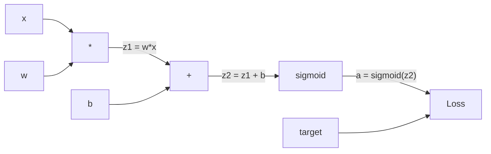
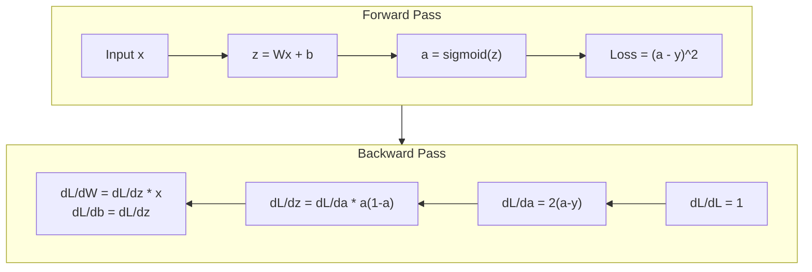
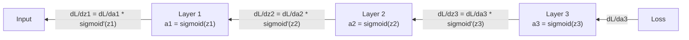

# Backpropagation from Scratch

> Lan truyền ngược là thuật toán khiến việc học trở nên khả thi. Không có nó, mạng nơ-ron chỉ là những bộ sinh số ngẫu nhiên đắt đỏ.

**Type:** Build
**Languages:** Python
**Prerequisites:** Lesson 03.02 (Multi-Layer Networks)
**Time:** ~120 minutes

## Learning Objectives

- Triển khai một bộ máy autograd dựa trên Value xây dựng đồ thị tính toán và tính các gradient thông qua sắp xếp tô pô
- Suy ra lượt truyền ngược cho phép cộng, phép nhân và sigmoid bằng quy tắc chuỗi
- Huấn luyện một mạng nhiều lớp trên XOR và phân loại đường tròn chỉ bằng bộ máy lan truyền ngược bạn xây dựng từ đầu
- Nhận diện vấn đề tiêu biến gradient trong các mạng sigmoid sâu và giải thích tại sao các gradient co lại theo cấp số nhân

## The Problem

Mạng của bạn có một lớp ẩn duy nhất với 768 đầu vào và 3072 đầu ra. Đó là 2,359,296 trọng số. Nó đưa ra một dự đoán sai. Những trọng số nào gây ra sai số? Kiểm tra riêng từng trọng số nghĩa là 2.3 triệu lượt truyền xuôi. Lan truyền ngược tính tất cả 2.3 triệu gradient trong một lượt truyền ngược duy nhất. Đó không phải là một sự tối ưu hóa. Đó là khác biệt giữa có thể huấn luyện và bất khả thi.

Cách tiếp cận đơn giản: lấy một trọng số, dịch nó một lượng rất nhỏ, chạy lại lượt truyền xuôi, đo xem mất mát tăng hay giảm. Điều đó cho bạn gradient của trọng số đó. Giờ làm việc đó cho mọi trọng số trong mạng. Nhân với hàng nghìn bước huấn luyện và hàng triệu điểm dữ liệu. Bạn sẽ cần thời gian địa chất để huấn luyện bất cứ thứ gì hữu ích.

Lan truyền ngược giải quyết điều này. Một lượt truyền xuôi, một lượt truyền ngược, tất cả các gradient được tính. Thủ thuật là quy tắc chuỗi từ giải tích, được áp dụng có hệ thống cho một đồ thị tính toán. Đây là thuật toán khiến học sâu trở nên thực tiễn. Không có nó, chúng ta vẫn sẽ mắc kẹt ở các bài toán đồ chơi.

## The Concept

### The Chain Rule, Applied to Networks

Bạn đã thấy quy tắc chuỗi trong Giai đoạn 01, Bài 05. Nhắc lại nhanh: nếu $y = f(g(x))$, thì $\frac{dy}{dx} = f'(g(x)) \cdot g'(x)$. Bạn nhân các đạo hàm dọc theo chuỗi.

Trong một mạng nơ-ron, "chuỗi" là dãy phép toán từ đầu vào tới mất mát. Mỗi lớp áp dụng các trọng số, cộng các bias, đưa qua một kích hoạt. Hàm mất mát so sánh đầu ra cuối cùng với mục tiêu. Lan truyền ngược lần theo chuỗi này ngược lại, tính xem mỗi phép toán đóng góp vào sai số như thế nào.

### Computational Graphs

Mỗi lượt truyền xuôi xây dựng một đồ thị. Mỗi nút là một phép toán (nhân, cộng, sigmoid). Mỗi cạnh mang một giá trị về phía trước và một gradient về phía sau.



Lượt truyền xuôi: các giá trị chảy từ trái sang phải. $x$ và $w$ tạo ra $z_1 = w x$. Cộng $b$ để có $z_2$. Sigmoid cho kích hoạt $a$. So sánh $a$ với mục tiêu $y$ bằng hàm mất mát.

Lượt truyền ngược: gradient chảy từ phải sang trái. Bắt đầu với $\partial L/\partial a$ (loss thay đổi thế nào theo activation). Nhân với $\partial a/\partial z_2$ (đạo hàm sigmoid). Điều đó cho $\partial L/\partial z_2$. Tách thành $\partial L/\partial b$ (bằng $\partial L/\partial z_2$, vì $z_2 = z_1 + b$) và $\partial L/\partial z_1$. Sau đó $\partial L/\partial w = \partial L/\partial z_1 \cdot x$ và $\partial L/\partial x = \partial L/\partial z_1 \cdot w$.

Mỗi nút trong đồ thị có một việc trong lượt truyền ngược: nhận gradient đến từ phía trên, nhân với đạo hàm cục bộ của nó và truyền xuống.

### Forward vs Backward



Lượt truyền xuôi lưu mọi giá trị trung gian: z, a, các đầu vào của mỗi lớp. Lượt truyền ngược cần những giá trị được lưu này để tính gradient. Đây là sự đánh đổi bộ nhớ-tính toán ở trung tâm của backprop. Bạn đánh đổi bộ nhớ (lưu các kích hoạt) lấy tốc độ (một lượt thay vì hàng triệu).

### Gradient Flow Through a Network

Với một mạng 3 lớp, các gradient nối chuỗi qua mọi lớp:



Tại mỗi lớp, gradient được nhân với đạo hàm sigmoid. Đạo hàm sigmoid là $a(1 - a)$, đạt tối đa 0.25 (khi $a = 0.5$). Sâu ba lớp, gradient đã được nhân với nhiều nhất $0.25^3 = 0.0156$. Sâu mười lớp: $0.25^{10} = 0.000001$.

### Vanishing Gradients

Đây là vấn đề tiêu biến gradient. Sigmoid ép đầu ra của nó vào giữa 0 và 1. Đạo hàm của nó luôn nhỏ hơn 0.25. Xếp chồng đủ lớp sigmoid và các gradient co lại thành không còn gì. Các lớp đầu hầu như không học vì chúng nhận các gradient gần bằng không.

```
sigmoid(z):     Output range [0, 1]
sigmoid'(z):    Max value 0.25 (at z = 0)

After 5 layers:   gradient * 0.25^5 = 0.001x original
After 10 layers:  gradient * 0.25^10 = 0.000001x original
```

Đây là lý do các mạng sigmoid sâu gần như không thể huấn luyện. Cách khắc phục -- ReLU và các biến thể của nó -- là chủ đề của Bài 04. Hiện tại, hãy hiểu rằng backprop hoạt động hoàn hảo. Vấn đề là những gì nó đang đi qua.

### Deriving Gradients for a 2-Layer Network

Toán học cụ thể cho một mạng có đầu vào $x$, lớp ẩn với sigmoid, lớp đầu ra với sigmoid và mất mát MSE.

Lượt truyền xuôi:

```math
\begin{aligned}
z_1 &= W_1 x + b_1 \\
a_1 &= \text{sigmoid}(z_1) \\
z_2 &= W_2 a_1 + b_2 \\
a_2 &= \text{sigmoid}(z_2) \\
L &= (a_2 - y)^2
\end{aligned}
```

Lượt truyền ngược (áp dụng quy tắc chuỗi từng bước):

```math
\begin{aligned}
\frac{\partial L}{\partial a_2} &= 2(a_2 - y) \\
\frac{\partial a_2}{\partial z_2} &= a_2 (1 - a_2) \\
\frac{\partial L}{\partial z_2} &= \frac{\partial L}{\partial a_2} \cdot \frac{\partial a_2}{\partial z_2} = 2(a_2 - y) \cdot a_2 (1 - a_2) \\[6pt]
\frac{\partial L}{\partial W_2} &= \frac{\partial L}{\partial z_2} \cdot a_1 \\
\frac{\partial L}{\partial b_2} &= \frac{\partial L}{\partial z_2} \\[6pt]
\frac{\partial L}{\partial a_1} &= \frac{\partial L}{\partial z_2} \cdot W_2 \\
\frac{\partial a_1}{\partial z_1} &= a_1 (1 - a_1) \\
\frac{\partial L}{\partial z_1} &= \frac{\partial L}{\partial a_1} \cdot \frac{\partial a_1}{\partial z_1} \\[6pt]
\frac{\partial L}{\partial W_1} &= \frac{\partial L}{\partial z_1} \cdot x \\
\frac{\partial L}{\partial b_1} &= \frac{\partial L}{\partial z_1}
\end{aligned}
```

Mỗi gradient là một tích các đạo hàm cục bộ được lần ngược từ mất mát. Lan truyền ngược chỉ có vậy.

```figure
backprop-vanishing
```

## Build It

### Step 1: The Value Node

Mỗi số trong phép tính của chúng ta trở thành một Value. Nó lưu dữ liệu, gradient của nó và cách nó được tạo ra (để biết cách tính gradient ngược).

```python
class Value:
    def __init__(self, data, children=(), op=''):
        self.data = data
        self.grad = 0.0
        self._backward = lambda: None
        self._children = set(children)
        self._op = op

    def __repr__(self):
        return f"Value(data={self.data:.4f}, grad={self.grad:.4f})"
```

Chưa có gradient (0.0). Chưa có hàm truyền ngược (no-op). `_children` theo dõi những Value nào tạo ra Value này, để chúng ta có thể sắp xếp tô pô đồ thị sau đó.

### Step 2: Operations with Backward Functions

Mỗi phép toán tạo ra một Value mới và xác định cách các gradient chảy ngược qua nó.

```python
def __add__(self, other):
    other = other if isinstance(other, Value) else Value(other)
    out = Value(self.data + other.data, (self, other), '+')

    def _backward():
        self.grad += out.grad
        other.grad += out.grad

    out._backward = _backward
    return out

def __mul__(self, other):
    other = other if isinstance(other, Value) else Value(other)
    out = Value(self.data * other.data, (self, other), '*')

    def _backward():
        self.grad += other.data * out.grad
        other.grad += self.data * out.grad

    out._backward = _backward
    return out
```

Đối với phép cộng: $\partial(a+b)/\partial a = 1$, $\partial(a+b)/\partial b = 1$. Vì vậy cả hai đầu vào nhận trực tiếp gradient của đầu ra.

Đối với phép nhân: $\partial(ab)/\partial a = b$, $\partial(ab)/\partial b = a$. Mỗi đầu vào nhận giá trị của đầu vào còn lại nhân gradient đầu ra.

`+=` rất quan trọng. Một Value có thể được sử dụng trong nhiều phép toán. Gradient của nó là tổng các gradient từ tất cả các đường đi.

### Step 3: Sigmoid and Loss

```python
import math

def sigmoid(self):
    x = self.data
    x = max(-500, min(500, x))
    s = 1.0 / (1.0 + math.exp(-x))
    out = Value(s, (self,), 'sigmoid')

    def _backward():
        self.grad += (s * (1 - s)) * out.grad

    out._backward = _backward
    return out
```

Đạo hàm sigmoid: $\text{sigmoid}(x) \cdot (1 - \text{sigmoid}(x))$. Chúng ta đã tính $\text{sigmoid}(x) = s$ trong lượt truyền xuôi. Sử dụng lại nó. Không cần thêm công việc.

```python
def mse_loss(predicted, target):
    diff = predicted + Value(-target)
    return diff * diff
```

MSE cho một đầu ra đơn lẻ: $(\text{predicted} - \text{target})^2$. Chúng ta biểu diễn phép trừ như phép cộng với một Value đổi dấu.

### Step 4: Backward Pass

Sắp xếp tô pô bảo đảm chúng ta xử lý các nút đúng thứ tự -- gradient của một nút được tích lũy đầy đủ trước khi chúng ta lan truyền qua nó.

```python
def backward(self):
    topo = []
    visited = set()

    def build_topo(v):
        if v not in visited:
            visited.add(v)
            for child in v._children:
                build_topo(child)
            topo.append(v)

    build_topo(self)
    self.grad = 1.0
    for v in reversed(topo):
        v._backward()
```

Bắt đầu tại mất mát (gradient = 1.0, vì $dL/dL = 1$). Đi ngược qua đồ thị đã sắp xếp. `_backward` của mỗi nút đẩy các gradient tới các nút con của nó.

### Step 5: Layer and Network

```python
import random

class Neuron:
    def __init__(self, n_inputs):
        scale = (2.0 / n_inputs) ** 0.5
        self.weights = [Value(random.uniform(-scale, scale)) for _ in range(n_inputs)]
        self.bias = Value(0.0)

    def __call__(self, x):
        act = sum((wi * xi for wi, xi in zip(self.weights, x)), self.bias)
        return act.sigmoid()

    def parameters(self):
        return self.weights + [self.bias]


class Layer:
    def __init__(self, n_inputs, n_outputs):
        self.neurons = [Neuron(n_inputs) for _ in range(n_outputs)]

    def __call__(self, x):
        out = [n(x) for n in self.neurons]
        return out[0] if len(out) == 1 else out

    def parameters(self):
        params = []
        for n in self.neurons:
            params.extend(n.parameters())
        return params


class Network:
    def __init__(self, sizes):
        self.layers = []
        for i in range(len(sizes) - 1):
            self.layers.append(Layer(sizes[i], sizes[i + 1]))

    def __call__(self, x):
        for layer in self.layers:
            x = layer(x)
            if not isinstance(x, list):
                x = [x]
        return x[0] if len(x) == 1 else x

    def parameters(self):
        params = []
        for layer in self.layers:
            params.extend(layer.parameters())
        return params

    def zero_grad(self):
        for p in self.parameters():
            p.grad = 0.0
```

Một Neuron nhận các đầu vào, tính tổng có trọng số + bias và áp dụng sigmoid. Khởi tạo trọng số co giãn theo $\sqrt{2/n_{\text{inputs}}}$ để ngăn bão hòa sigmoid trong các mạng sâu hơn. Một Layer là một danh sách Neuron. Một Network là một danh sách Layer. Phương thức `parameters()` thu thập tất cả các Value có thể học để chúng ta có thể cập nhật chúng.

### Step 6: Train on XOR

```python
random.seed(42)
net = Network([2, 4, 1])

xor_data = [
    ([0.0, 0.0], 0.0),
    ([0.0, 1.0], 1.0),
    ([1.0, 0.0], 1.0),
    ([1.0, 1.0], 0.0),
]

learning_rate = 1.0

for epoch in range(1000):
    total_loss = Value(0.0)
    for inputs, target in xor_data:
        x = [Value(i) for i in inputs]
        pred = net(x)
        loss = mse_loss(pred, target)
        total_loss = total_loss + loss

    net.zero_grad()
    total_loss.backward()

    for p in net.parameters():
        p.data -= learning_rate * p.grad

    if epoch % 100 == 0:
        print(f"Epoch {epoch:4d} | Loss: {total_loss.data:.6f}")

print("\nXOR Results:")
for inputs, target in xor_data:
    x = [Value(i) for i in inputs]
    pred = net(x)
    print(f"  {inputs} -> {pred.data:.4f} (expected {target})")
```

Quan sát mất mát giảm. Từ các dự đoán ngẫu nhiên tới đầu ra XOR đúng, được dẫn dắt hoàn toàn bởi lan truyền ngược tính gradient và dịch chuyển các trọng số đúng hướng.

### Step 7: Circle Classification

Trong Bài 02, bạn điều chỉnh thủ công các trọng số cho phân loại đường tròn. Giờ để mạng học chúng.

```python
random.seed(7)

def generate_circle_data(n=100):
    data = []
    for _ in range(n):
        x1 = random.uniform(-1.5, 1.5)
        x2 = random.uniform(-1.5, 1.5)
        label = 1.0 if x1 * x1 + x2 * x2 < 1.0 else 0.0
        data.append(([x1, x2], label))
    return data

circle_data = generate_circle_data(80)

circle_net = Network([2, 8, 1])
learning_rate = 0.5

for epoch in range(2000):
    random.shuffle(circle_data)
    total_loss_val = 0.0
    for inputs, target in circle_data:
        x = [Value(i) for i in inputs]
        pred = circle_net(x)
        loss = mse_loss(pred, target)
        circle_net.zero_grad()
        loss.backward()
        for p in circle_net.parameters():
            p.data -= learning_rate * p.grad
        total_loss_val += loss.data

    if epoch % 200 == 0:
        correct = 0
        for inputs, target in circle_data:
            x = [Value(i) for i in inputs]
            pred = circle_net(x)
            predicted_class = 1.0 if pred.data > 0.5 else 0.0
            if predicted_class == target:
                correct += 1
        accuracy = correct / len(circle_data) * 100
        print(f"Epoch {epoch:4d} | Loss: {total_loss_val:.4f} | Accuracy: {accuracy:.1f}%")
```

Chúng ta sử dụng SGD trực tuyến ở đây -- cập nhật các trọng số sau mỗi mẫu thay vì tích lũy toàn bộ batch. Điều này phá vỡ tính đối xứng nhanh hơn và tránh bão hòa sigmoid trên toàn bộ bề mặt mất mát. Xáo trộn dữ liệu mỗi epoch ngăn mạng ghi nhớ thứ tự.

Không điều chỉnh thủ công. Mạng tự khám phá ranh giới quyết định hình tròn. Đó là sức mạnh của lan truyền ngược: bạn xác định kiến trúc, hàm mất mát và dữ liệu. Thuật toán tìm ra các trọng số.

## Use It

PyTorch làm mọi thứ ở trên trong vài dòng. Ý tưởng cốt lõi giống hệt -- autograd xây dựng một đồ thị tính toán trong lượt truyền xuôi và lần ngược nó để tính gradient.

```python
import torch
import torch.nn as nn

model = nn.Sequential(
    nn.Linear(2, 4),
    nn.Sigmoid(),
    nn.Linear(4, 1),
    nn.Sigmoid(),
)
optimizer = torch.optim.SGD(model.parameters(), lr=1.0)
criterion = nn.MSELoss()

X = torch.tensor([[0,0],[0,1],[1,0],[1,1]], dtype=torch.float32)
y = torch.tensor([[0],[1],[1],[0]], dtype=torch.float32)

for epoch in range(1000):
    pred = model(X)
    loss = criterion(pred, y)
    optimizer.zero_grad()
    loss.backward()
    optimizer.step()

print("PyTorch XOR Results:")
with torch.no_grad():
    for i in range(4):
        pred = model(X[i])
        print(f"  {X[i].tolist()} -> {pred.item():.4f} (expected {y[i].item()})")
```

`loss.backward()` là `total_loss.backward()` của bạn. `optimizer.step()` là `p.data -= lr * p.grad` thủ công của bạn. `optimizer.zero_grad()` là `net.zero_grad()` của bạn. Cùng thuật toán, bản triển khai đủ mạnh cho công nghiệp. PyTorch xử lý tăng tốc GPU, độ chính xác hỗn hợp, gradient checkpointing và hàng trăm loại lớp. Nhưng lượt truyền ngược vẫn là cùng quy tắc chuỗi được áp dụng cho cùng đồ thị tính toán.

Huấn luyện chạy lượt truyền xuôi, rồi lượt truyền ngược, rồi cập nhật trọng số. Suy luận chỉ chạy lượt truyền xuôi. Không gradient, không cập nhật. Phân biệt này quan trọng vì suy luận là điều xảy ra trong production. Khi bạn gọi một API như Claude hoặc GPT, bạn đang chạy suy luận -- prompt của bạn chảy xuôi qua mạng và các token đi ra ở đầu kia. Không trọng số nào thay đổi. Hiểu backprop quan trọng vì nó đã định hình mọi trọng số trong mạng đó.

## Ship It

Bài học này tạo ra:
- `outputs/prompt-gradient-debugger.md` -- một prompt tái sử dụng để chẩn đoán các vấn đề gradient (tiêu biến, bùng nổ, NaN) trong bất kỳ mạng nơ-ron nào

## Exercises

1. Thêm một phương thức `__sub__` vào lớp Value $(a - b = a + (-1 \cdot b))$. Sau đó triển khai một phương thức `__neg__`. Xác minh các gradient đúng bằng cách so sánh với tính toán thủ công cho một biểu thức đơn giản như $(a - b)^2$.

2. Thêm một phương thức `relu` vào Value (xuất ra $\max(0, x)$, đạo hàm là 1 nếu $x \gt 0$, nếu không là 0). Thay sigmoid bằng relu trong các lớp ẩn và huấn luyện lại trên XOR. So sánh tốc độ hội tụ. Bạn sẽ thấy huấn luyện nhanh hơn -- điều này xem trước Bài 04.

3. Triển khai một phương thức `__pow__` trên Value cho các lũy thừa nguyên. Sử dụng nó để thay `mse_loss` bằng một biểu thức `(predicted - target) ** 2` đúng nghĩa. Xác minh các gradient khớp bản triển khai gốc.

4. Thêm cắt gradient vào vòng lặp huấn luyện: sau khi gọi `backward()`, cắt tất cả các gradient về [-1, 1]. Huấn luyện một mạng sâu hơn (4+ lớp với sigmoid) và so sánh các đường cong mất mát khi có và không có cắt. Đây là biện pháp phòng vệ đầu tiên của bạn trước gradient bùng nổ.

5. Xây dựng một hình trực quan: sau khi huấn luyện trên XOR, in gradient của mọi tham số trong mạng. Xác định lớp nào có các gradient nhỏ nhất. Điều này minh họa vấn đề tiêu biến gradient bạn đã đọc trong phần Concept.

## Key Terms

| Thuật ngữ | Cách mọi người nói | Ý nghĩa thực sự |
|------|----------------|----------------------|
| Backpropagation | "Mạng học" | Một thuật toán tính $\partial L/\partial w$ cho mọi trọng số bằng cách áp dụng quy tắc dây chuyền ngược qua đồ thị tính toán |
| Computational graph (Đồ thị tính toán) | "Cấu trúc mạng" | Một đồ thị có hướng không chu trình trong đó các nút là phép toán và các cạnh mang giá trị (xuôi) và gradient (ngược) |
| Chain rule (Quy tắc chuỗi) | "Nhân các đạo hàm" | Nếu $y = f(g(x))$, thì $\frac{dy}{dx} = f'(g(x)) \cdot g'(x)$ -- nền tảng toán học của lan truyền ngược |
| Gradient | "Hướng tăng dốc nhất" | Đạo hàm riêng của mất mát theo một tham số -- cho bạn biết cách thay đổi tham số đó để giảm mất mát |
| Vanishing gradient (Tiêu biến gradient) | "Các mạng sâu không học" | Các gradient co lại theo cấp số nhân khi chúng lan truyền qua các lớp có kích hoạt bão hòa như sigmoid |
| Forward pass (Lượt truyền xuôi) | "Chạy mạng" | Tính đầu ra từ các đầu vào bằng cách áp dụng tuần tự các phép toán của mỗi lớp và lưu các giá trị trung gian |
| Backward pass (Lượt truyền ngược) | "Tính các gradient" | Duyệt đồ thị tính toán theo chiều ngược lại, tích lũy gradient tại mỗi nút bằng quy tắc chuỗi |
| Learning rate (Tốc độ học) | "Nó học nhanh đến mức nào" | Một số vô hướng kiểm soát kích thước bước khi cập nhật trọng số: $w_{\text{new}} = w_{\text{old}} - \text{lr} \cdot \text{gradient}$ |
| Topological sort (Sắp xếp tô pô) | "Thứ tự đúng" | Một thứ tự các nút đồ thị mà mỗi nút xuất hiện sau tất cả các nút nó phụ thuộc -- bảo đảm các gradient được tích lũy đầy đủ trước khi lan truyền |
| Autograd | "Vi phân tự động" | Một hệ thống xây dựng các đồ thị tính toán trong tính toán xuôi và tự động tính gradient -- điều bộ máy của PyTorch làm |

## Further Reading

- Rumelhart, Hinton & Williams, "Learning representations by back-propagating errors" (1986) -- bài báo khiến lan truyền ngược trở nên phổ biến và mở đường cho huấn luyện mạng nhiều lớp
- 3Blue1Brown, "Neural Networks" series (https://www.youtube.com/playlist?list=PLZHQObOWTQDNU6R1_67000Dx_ZCJB-3pi) -- lời giải thích trực quan tốt nhất về lan truyền ngược và luồng gradient qua các mạng
