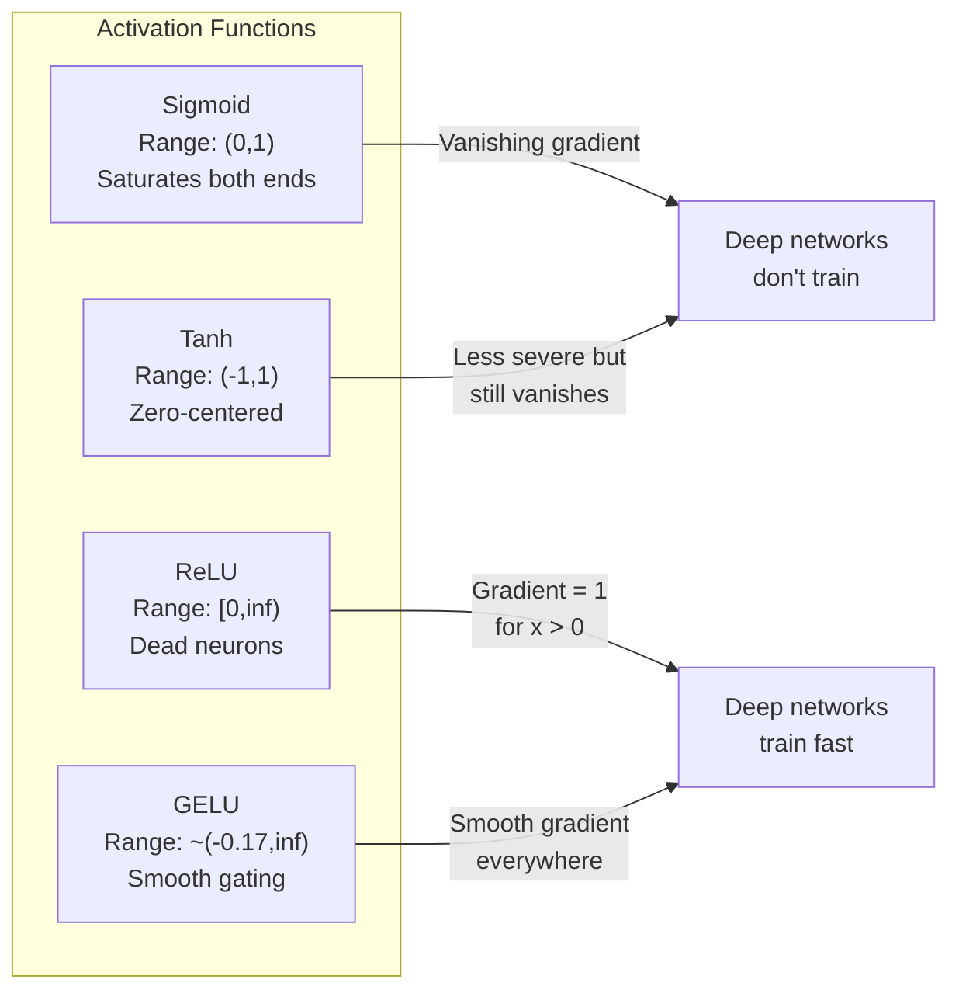
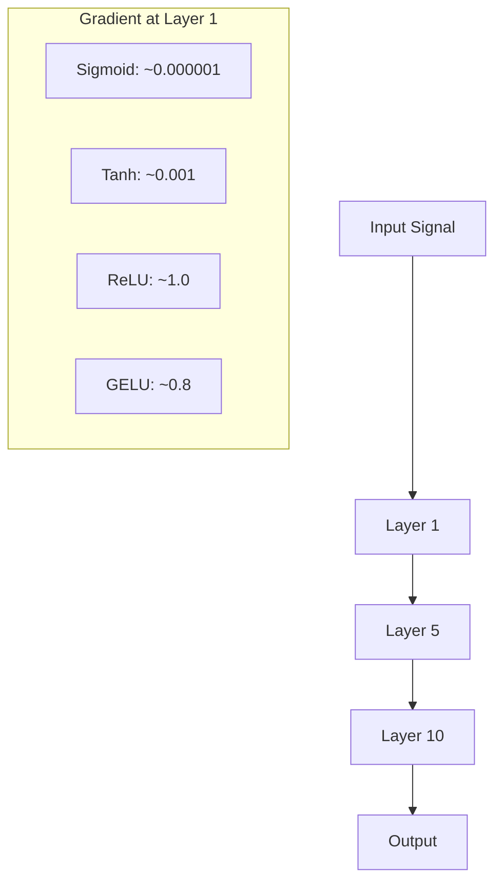
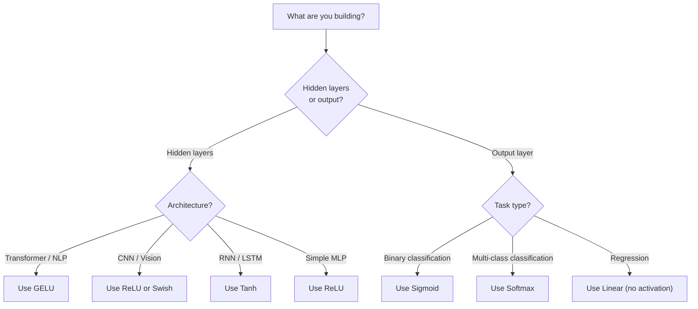

# Activation Functions

> Không có tính phi tuyến, mạng 100 lớp của bạn là một phép nhân ma trận cầu kỳ. Các kích hoạt là những cánh cổng cho phép mạng nơ-ron suy nghĩ bằng các đường cong.

**Type:** Build
**Languages:** Python
**Prerequisites:** Lesson 03.03 (Backpropagation)
**Time:** ~75 minutes

## Learning Objectives

- Triển khai sigmoid, tanh, ReLU, Leaky ReLU, GELU, Swish và softmax cùng các đạo hàm của chúng từ đầu
- Chẩn đoán vấn đề tiêu biến gradient bằng cách đo độ lớn kích hoạt qua 10+ lớp với các kích hoạt khác nhau
- Phát hiện các nơ-ron chết trong một mạng ReLU và giải thích tại sao GELU tránh được kiểu thất bại này
- Chọn hàm kích hoạt đúng cho một kiến trúc nhất định (transformer, CNN, RNN, lớp đầu ra)

## The Problem

Xếp chồng hai phép biến đổi tuyến tính: $y = W_2(W_1 x + b_1) + b_2$. Khai triển: $y = W_2 W_1 x + W_2 b_1 + b_2$. Đó chỉ là $y = Ax + c$ -- một phép biến đổi tuyến tính duy nhất. Bất kể bạn xếp chồng bao nhiêu lớp tuyến tính, kết quả thu gọn thành một phép nhân ma trận. Mạng 100 lớp của bạn có cùng năng lực biểu diễn như một lớp đơn lẻ.

Đây không phải là một điều thú vị thuần lý thuyết. Nó có nghĩa một mạng tuyến tính sâu thực sự không thể học XOR, không thể phân loại một tập dữ liệu xoắn ốc, không thể nhận dạng một khuôn mặt. Không có các hàm kích hoạt, độ sâu là một ảo ảnh.

Các hàm kích hoạt phá vỡ tính tuyến tính. Chúng uốn đầu ra mỗi lớp qua một hàm phi tuyến, cho mạng khả năng bẻ cong các ranh giới quyết định, xấp xỉ các hàm tùy ý và thực sự học. Nhưng chọn sai kích hoạt và các gradient của bạn tiêu biến về không (sigmoid trong các mạng sâu), bùng nổ tới vô cực (các kích hoạt không bị chặn mà không có khởi tạo cẩn thận), hoặc các nơ-ron của bạn chết vĩnh viễn (ReLU với các bias âm lớn). Lựa chọn hàm kích hoạt trực tiếp quyết định liệu mạng của bạn có học được chút nào hay không.

## The Concept

### Why Nonlinearity Is Necessary

Phép nhân ma trận có thể kết hợp được. Nhân một vector với ma trận $A$ rồi ma trận $B$ giống hệt nhân với $AB$. Điều này nghĩa là xếp chồng mười lớp tuyến tính tương đương về mặt toán học với một lớp tuyến tính có một ma trận lớn. Tất cả những tham số đó, tất cả độ sâu đó -- lãng phí. Bạn cần thứ gì đó phá vỡ chuỗi. Đó là điều các hàm kích hoạt làm.

Đây là chứng minh. Một lớp tuyến tính tính $f(x) = Wx + b$. Xếp chồng hai lớp:

```math
\begin{aligned}
\text{Layer 1:} \quad h &= W_1 x + b_1 \\
\text{Layer 2:} \quad y &= W_2 h + b_2
\end{aligned}
```

Thế vào:

```math
\begin{aligned}
y &= W_2 (W_1 x + b_1) + b_2 \\
y &= (W_2 W_1) x + (W_2 b_1 + b_2) \\
y &= A x + c
\end{aligned}
```

Một lớp. Chèn một kích hoạt phi tuyến $g()$ giữa các lớp:

```math
\begin{aligned}
h &= g(W_1 x + b_1) \\
y &= W_2 h + b_2
\end{aligned}
```

Giờ phép thế bị phá vỡ. $W_2 g(W_1 x + b_1) + b_2$ không thể được rút gọn thành một phép biến đổi tuyến tính duy nhất. Mạng có thể biểu diễn các hàm phi tuyến. Mỗi lớp bổ sung có kích hoạt thêm năng lực biểu diễn.

### Sigmoid

Hàm kích hoạt ban đầu cho mạng nơ-ron.

```math
\text{sigmoid}(x) = \frac{1}{1 + e^{-x}}
```

Phạm vi đầu ra: (0, 1). Trơn, khả vi, ánh xạ bất kỳ số thực nào thành một giá trị giống xác suất.

Đạo hàm:

```math
\text{sigmoid}'(x) = \text{sigmoid}(x) \cdot (1 - \text{sigmoid}(x))
```

Giá trị tối đa của đạo hàm này là 0.25, xảy ra tại $x = 0$. Trong lan truyền ngược, các gradient nhân qua các lớp. Mười lớp sigmoid nghĩa là gradient được nhân với nhiều nhất 0.25 mười lần:

```math
0.25^{10} = 0.000000953674
```

Ít hơn một phần triệu tín hiệu ban đầu. Đây là vấn đề tiêu biến gradient. Các gradient trong các lớp đầu trở nên nhỏ tới mức các trọng số hầu như không cập nhật. Mạng dường như học -- mất mát giảm trong các lớp sau -- nhưng các lớp đầu bị đóng băng. Các mạng sigmoid sâu đơn giản là không huấn luyện được.

Vấn đề bổ sung: các đầu ra sigmoid luôn dương (0 đến 1), nghĩa là các gradient của trọng số luôn cùng dấu. Điều này gây đi zíc zắc trong quá trình hạ gradient.

### Tanh

Phiên bản được đặt tâm của sigmoid.

```math
\tanh(x) = \frac{e^x - e^{-x}}{e^x + e^{-x}}
```

Phạm vi đầu ra: (-1, 1). Có tâm tại không, loại bỏ vấn đề zíc zắc.

Đạo hàm:

```math
\tanh'(x) = 1 - \tanh(x)^2
```

Đạo hàm tối đa là 1.0 tại $x = 0$ -- tốt hơn sigmoid bốn lần. Nhưng vấn đề tiêu biến gradient vẫn tồn tại. Với các đầu vào dương hoặc âm lớn, đạo hàm tiến về không. Mười lớp vẫn nghiền nát gradient, chỉ ít quyết liệt hơn.

### ReLU: The Breakthrough

Rectified Linear Unit. Được Nair và Hinton phổ biến cho học sâu vào năm 2010 (bản thân hàm có từ công trình năm 1969 của Fukushima), nó đã thay đổi mọi thứ.

```math
\text{relu}(x) = \max(0, x)
```

Khoảng đầu ra: $[0, \infty)$. Đạo hàm vô cùng đơn giản:

```math
\text{relu}'(x) = \begin{cases} 1 & \text{if } x > 0 \\ 0 & \text{if } x \le 0 \end{cases}
```

Không có tiêu biến gradient đối với các đầu vào dương. Gradient đúng bằng 1, được truyền thẳng qua. Đây là lý do các mạng sâu trở nên có thể huấn luyện -- ReLU bảo toàn độ lớn gradient qua các lớp.

Nhưng có một kiểu thất bại: vấn đề nơ-ron chết. Nếu đầu vào có trọng số của một nơ-ron luôn âm (do một bias âm lớn hoặc khởi tạo trọng số không may), đầu ra của nó luôn bằng không, gradient luôn bằng không và nó không bao giờ cập nhật. Nó chết vĩnh viễn. Trong thực tế, 10-40% nơ-ron trong một mạng ReLU có thể chết trong quá trình huấn luyện.

### Leaky ReLU

Cách khắc phục đơn giản nhất cho các nơ-ron chết.

```math
\text{leaky\_relu}(x) = \begin{cases} x & \text{if } x > 0 \\ \alpha x & \text{if } x \le 0 \end{cases}
```

Trong đó $\alpha$ là một hằng số nhỏ, thường là 0.01. Phía âm có độ dốc nhỏ thay vì không, nên các nơ-ron chết vẫn nhận được một tín hiệu gradient và có thể phục hồi.

### GELU: The Modern Default

Gaussian Error Linear Unit. Được Hendrycks và Gimpel giới thiệu năm 2016. Kích hoạt mặc định trong BERT, GPT và hầu hết các transformer hiện đại.

```math
\text{gelu}(x) = x \cdot \Phi(x)
```

Trong đó $\Phi(x)$ là hàm phân phối tích lũy của phân phối chuẩn tắc. Xấp xỉ được sử dụng trong thực tế:

```math
\text{gelu}(x) \approx 0.5 \cdot x \cdot \left(1 + \tanh\left(\sqrt{2/\pi} \cdot (x + 0.044715 \cdot x^3)\right)\right)
```

GELU trơn ở mọi nơi, cho phép các giá trị âm nhỏ (khác ReLU cắt cứng về không), và có một cách diễn giải xác suất: nó gán trọng số cho mỗi đầu vào theo khả năng đầu vào đó dương dưới một phân phối Gaussian. Cơ chế cổng trơn này vượt ReLU trong các kiến trúc transformer vì nó cung cấp luồng gradient tốt hơn và hoàn toàn tránh vấn đề nơ-ron chết.

### Swish / SiLU

Kích hoạt tự đặt cổng được Ramachandran và cộng sự khám phá năm 2017 thông qua tìm kiếm tự động.

```math
\text{swish}(x) = x \cdot \text{sigmoid}(x)
```

Swish về mặt hình thức là $x \cdot \text{sigmoid}(x)$. Google khám phá nó thông qua tìm kiếm tự động trên không gian hàm kích hoạt -- một mạng nơ-ron thiết kế các phần của mạng nơ-ron.

Giống GELU, nó trơn, không đơn điệu và cho phép các giá trị âm nhỏ. Khác biệt rất tinh tế: Swish sử dụng sigmoid cho cơ chế cổng trong khi GELU sử dụng CDF Gaussian. Trong thực tế, hiệu suất gần như giống hệt. Swish được sử dụng trong EfficientNet và một số mô hình thị giác. GELU thống trị trong các mô hình ngôn ngữ.

### Softmax: The Output Activation

Không được sử dụng trong các lớp ẩn. Softmax chuyển một vector điểm thô (logit) thành một phân phối xác suất.

```math
\text{softmax}(x_i) = \frac{e^{x_i}}{\sum_j e^{x_j}}
```

Mỗi đầu ra nằm giữa 0 và 1. Tất cả đầu ra cộng lại bằng 1. Điều này khiến nó là kích hoạt cuối tiêu chuẩn cho phân loại đa lớp. Logit lớn nhất nhận xác suất cao nhất, nhưng khác argmax, softmax khả vi và bảo toàn thông tin về độ tin cậy tương đối.

### Comparison of Shapes



### Gradient Flow Comparison



### Which Activation When



```figure
softmax-temperature
```

## Build It

### Step 1: Implement All Activation Functions with Derivatives

Mỗi hàm nhận một float đơn lẻ và trả về một float. Mỗi hàm đạo hàm nhận cùng đầu vào và trả về gradient.

```python
import math

def sigmoid(x):
    x = max(-500, min(500, x))
    return 1.0 / (1.0 + math.exp(-x))

def sigmoid_derivative(x):
    s = sigmoid(x)
    return s * (1 - s)

def tanh_act(x):
    return math.tanh(x)

def tanh_derivative(x):
    t = math.tanh(x)
    return 1 - t * t

def relu(x):
    return max(0.0, x)

def relu_derivative(x):
    return 1.0 if x > 0 else 0.0

def leaky_relu(x, alpha=0.01):
    return x if x > 0 else alpha * x

def leaky_relu_derivative(x, alpha=0.01):
    return 1.0 if x > 0 else alpha

def gelu(x):
    return 0.5 * x * (1 + math.tanh(math.sqrt(2 / math.pi) * (x + 0.044715 * x ** 3)))

def gelu_derivative(x):
    phi = 0.5 * (1 + math.erf(x / math.sqrt(2)))
    pdf = math.exp(-0.5 * x * x) / math.sqrt(2 * math.pi)
    return phi + x * pdf

def swish(x):
    return x * sigmoid(x)

def swish_derivative(x):
    s = sigmoid(x)
    return s + x * s * (1 - s)

def softmax(xs):
    max_x = max(xs)
    exps = [math.exp(x - max_x) for x in xs]
    total = sum(exps)
    return [e / total for e in exps]
```

### Step 2: Visualize Where Gradients Die

Tính gradient tại 100 điểm cách đều từ -5 đến 5. In một histogram văn bản thể hiện nơi gradient của mỗi kích hoạt gần bằng không.

```python
def gradient_scan(name, derivative_fn, start=-5, end=5, n=100):
    step = (end - start) / n
    near_zero = 0
    healthy = 0
    for i in range(n):
        x = start + i * step
        g = derivative_fn(x)
        if abs(g) < 0.01:
            near_zero += 1
        else:
            healthy += 1
    pct_dead = near_zero / n * 100
    print(f"{name:15s}: {healthy:3d} healthy, {near_zero:3d} near-zero ({pct_dead:.0f}% dead zone)")

gradient_scan("Sigmoid", sigmoid_derivative)
gradient_scan("Tanh", tanh_derivative)
gradient_scan("ReLU", relu_derivative)
gradient_scan("Leaky ReLU", leaky_relu_derivative)
gradient_scan("GELU", gelu_derivative)
gradient_scan("Swish", swish_derivative)
```

### Step 3: Vanishing Gradient Experiment

Truyền xuôi một tín hiệu qua N lớp bằng sigmoid so với ReLU. Đo cách độ lớn kích hoạt thay đổi.

```python
import random

def vanishing_gradient_experiment(activation_fn, name, n_layers=10, n_inputs=5):
    random.seed(42)
    values = [random.gauss(0, 1) for _ in range(n_inputs)]

    print(f"\n{name} through {n_layers} layers:")
    for layer in range(n_layers):
        weights = [random.gauss(0, 1) for _ in range(n_inputs)]
        z = sum(w * v for w, v in zip(weights, values))
        activated = activation_fn(z)
        magnitude = abs(activated)
        bar = "#" * int(magnitude * 20)
        print(f"  Layer {layer+1:2d}: magnitude = {magnitude:.6f} {bar}")
        values = [activated] * n_inputs

vanishing_gradient_experiment(sigmoid, "Sigmoid")
vanishing_gradient_experiment(relu, "ReLU")
vanishing_gradient_experiment(gelu, "GELU")
```

### Step 4: Dead Neuron Detector

Tạo một mạng ReLU, truyền các đầu vào ngẫu nhiên qua nó, đếm bao nhiêu nơ-ron không bao giờ kích hoạt.

```python
def dead_neuron_detector(n_inputs=5, hidden_size=20, n_samples=1000):
    random.seed(0)
    weights = [[random.gauss(0, 1) for _ in range(n_inputs)] for _ in range(hidden_size)]
    biases = [random.gauss(0, 1) for _ in range(hidden_size)]

    fire_counts = [0] * hidden_size

    for _ in range(n_samples):
        inputs = [random.gauss(0, 1) for _ in range(n_inputs)]
        for neuron_idx in range(hidden_size):
            z = sum(w * x for w, x in zip(weights[neuron_idx], inputs)) + biases[neuron_idx]
            if relu(z) > 0:
                fire_counts[neuron_idx] += 1

    dead = sum(1 for c in fire_counts if c == 0)
    rarely_fire = sum(1 for c in fire_counts if 0 < c < n_samples * 0.05)
    healthy = hidden_size - dead - rarely_fire

    print(f"\nDead Neuron Report ({hidden_size} neurons, {n_samples} samples):")
    print(f"  Dead (never fired):     {dead}")
    print(f"  Barely alive (<5%):     {rarely_fire}")
    print(f"  Healthy:                {healthy}")
    print(f"  Dead neuron rate:       {dead/hidden_size*100:.1f}%")

    for i, c in enumerate(fire_counts):
        status = "DEAD" if c == 0 else "WEAK" if c < n_samples * 0.05 else "OK"
        bar = "#" * (c * 40 // n_samples)
        print(f"  Neuron {i:2d}: {c:4d}/{n_samples} fires [{status:4s}] {bar}")

dead_neuron_detector()
```

### Step 5: Training Comparison -- Sigmoid vs ReLU vs GELU

Huấn luyện cùng mạng hai lớp trên tập dữ liệu đường tròn (các điểm trong đường tròn = lớp 1, bên ngoài = lớp 0) với ba kích hoạt khác nhau. So sánh tốc độ hội tụ.

```python
def make_circle_data(n=200, seed=42):
    random.seed(seed)
    data = []
    for _ in range(n):
        x = random.uniform(-2, 2)
        y = random.uniform(-2, 2)
        label = 1.0 if x * x + y * y < 1.5 else 0.0
        data.append(([x, y], label))
    return data


class ActivationNetwork:
    def __init__(self, activation_fn, activation_deriv, hidden_size=8, lr=0.1):
        random.seed(0)
        self.act = activation_fn
        self.act_d = activation_deriv
        self.lr = lr
        self.hidden_size = hidden_size

        self.w1 = [[random.gauss(0, 0.5) for _ in range(2)] for _ in range(hidden_size)]
        self.b1 = [0.0] * hidden_size
        self.w2 = [random.gauss(0, 0.5) for _ in range(hidden_size)]
        self.b2 = 0.0

    def forward(self, x):
        self.x = x
        self.z1 = []
        self.h = []
        for i in range(self.hidden_size):
            z = self.w1[i][0] * x[0] + self.w1[i][1] * x[1] + self.b1[i]
            self.z1.append(z)
            self.h.append(self.act(z))

        self.z2 = sum(self.w2[i] * self.h[i] for i in range(self.hidden_size)) + self.b2
        self.out = sigmoid(self.z2)
        return self.out

    def backward(self, target):
        error = self.out - target
        d_out = error * self.out * (1 - self.out)

        for i in range(self.hidden_size):
            d_h = d_out * self.w2[i] * self.act_d(self.z1[i])
            self.w2[i] -= self.lr * d_out * self.h[i]
            for j in range(2):
                self.w1[i][j] -= self.lr * d_h * self.x[j]
            self.b1[i] -= self.lr * d_h
        self.b2 -= self.lr * d_out

    def train(self, data, epochs=200):
        losses = []
        for epoch in range(epochs):
            total_loss = 0
            correct = 0
            for x, y in data:
                pred = self.forward(x)
                self.backward(y)
                total_loss += (pred - y) ** 2
                if (pred >= 0.5) == (y >= 0.5):
                    correct += 1
            avg_loss = total_loss / len(data)
            accuracy = correct / len(data) * 100
            losses.append(avg_loss)
            if epoch % 50 == 0 or epoch == epochs - 1:
                print(f"    Epoch {epoch:3d}: loss={avg_loss:.4f}, accuracy={accuracy:.1f}%")
        return losses


data = make_circle_data()

configs = [
    ("Sigmoid", sigmoid, sigmoid_derivative),
    ("ReLU", relu, relu_derivative),
    ("GELU", gelu, gelu_derivative),
]

results = {}
for name, act_fn, act_d_fn in configs:
    print(f"\n=== Training with {name} ===")
    net = ActivationNetwork(act_fn, act_d_fn, hidden_size=8, lr=0.1)
    losses = net.train(data, epochs=200)
    results[name] = losses

print("\n=== Final Loss Comparison ===")
for name, losses in results.items():
    print(f"  {name:10s}: start={losses[0]:.4f} -> end={losses[-1]:.4f} (improvement: {(1 - losses[-1]/losses[0])*100:.1f}%)")
```

## Use It

PyTorch cung cấp tất cả các hàm này ở cả dạng hàm và module:

```python
import torch
import torch.nn as nn
import torch.nn.functional as F

x = torch.randn(4, 10)

relu_out = F.relu(x)
gelu_out = F.gelu(x)
sigmoid_out = torch.sigmoid(x)
swish_out = F.silu(x)

logits = torch.randn(4, 5)
probs = F.softmax(logits, dim=1)

model = nn.Sequential(
    nn.Linear(10, 64),
    nn.GELU(),
    nn.Linear(64, 32),
    nn.GELU(),
    nn.Linear(32, 5),
)
```

Các lớp ẩn trong một transformer: GELU. Các lớp ẩn trong một CNN: ReLU. Lớp đầu ra cho phân loại: softmax. Lớp đầu ra cho hồi quy: không có (tuyến tính). Lớp đầu ra cho xác suất: sigmoid. Chỉ vậy thôi. Bắt đầu với những mặc định này. Chỉ thay đổi khi bạn có bằng chứng.

RNN và LSTM sử dụng tanh cho trạng thái ẩn và sigmoid cho các cổng, nhưng nếu bạn xây dựng từ đầu ngày nay, có lẽ bạn không sử dụng RNN. Nếu các nơ-ron đang chết trong mạng ReLU của bạn, chuyển sang GELU. Đừng chọn Leaky ReLU trừ khi có lý do cụ thể -- GELU giải quyết vấn đề nơ-ron chết và cho luồng gradient tốt hơn.

## Ship It

Bài học này tạo ra:
- `outputs/prompt-activation-selector.md` -- một prompt tái sử dụng giúp bạn chọn hàm kích hoạt phù hợp cho bất kỳ kiến trúc nào

## Exercises

1. Triển khai Parametric ReLU (PReLU) trong đó độ dốc âm $\alpha$ là một tham số có thể học. Huấn luyện nó trên tập dữ liệu đường tròn và so sánh với Leaky ReLU cố định.

2. Chạy thí nghiệm tiêu biến gradient với 50 lớp thay vì 10. Vẽ độ lớn tại mỗi lớp cho sigmoid, tanh, ReLU và GELU. Tại lớp nào tín hiệu của mỗi kích hoạt về thực chất đạt không?

3. Triển khai ELU (Exponential Linear Unit): $\text{elu}(x) = x$ nếu $x \gt 0$, $\alpha (e^x - 1)$ nếu $x \le 0$. So sánh tỷ lệ nơ-ron chết của nó với ReLU trên cùng mạng.

4. Xây dựng một "bộ giám sát sức khỏe gradient" chạy trong quá trình huấn luyện: tại mỗi epoch, tính độ lớn gradient trung bình ở mỗi lớp. In cảnh báo khi gradient của bất kỳ lớp nào giảm dưới 0.001 hoặc vượt 100.

5. Sửa phần so sánh huấn luyện để sử dụng tập dữ liệu XOR từ Bài 01 thay vì các đường tròn. Kích hoạt nào hội tụ nhanh nhất trên XOR? Tại sao điều này khác kết quả đường tròn?

## Key Terms

| Thuật ngữ | Cách mọi người nói | Ý nghĩa thực sự |
|------|----------------|----------------------|
| Activation function (Hàm kích hoạt) | "Phần phi tuyến" | Một hàm áp dụng cho đầu ra mỗi nơ-ron phá vỡ tính tuyến tính, cho phép mạng học các ánh xạ phi tuyến |
| Vanishing gradient (Tiêu biến gradient) | "Các gradient biến mất trong các mạng sâu" | Các gradient co lại theo cấp số nhân qua các lớp khi đạo hàm của kích hoạt nhỏ hơn 1, khiến các lớp đầu không thể huấn luyện |
| Exploding gradient (Bùng nổ gradient) | "Các gradient nổ tung" | Các gradient tăng theo cấp số nhân qua các lớp khi hệ số nhân hiệu dụng vượt 1, gây huấn luyện không ổn định |
| Dead neuron (Nơ-ron chết) | "Một nơ-ron đã ngừng học" | Một nơ-ron ReLU có đầu vào âm vĩnh viễn, tạo ra đầu ra bằng không và gradient bằng không |
| Sigmoid | "Ép các giá trị về 0-1" | Hàm logistic $1/(1+e^{-x})$, quan trọng về lịch sử nhưng gây tiêu biến gradient trong các mạng sâu |
| ReLU | "Cắt các giá trị âm về không" | $\max(0, x)$ -- kích hoạt khiến học sâu trở nên thực tiễn bằng cách bảo toàn độ lớn gradient |
| GELU | "Kích hoạt transformer" | Gaussian Error Linear Unit, một kích hoạt trơn gán trọng số cho các đầu vào theo xác suất chúng dương |
| Swish/SiLU | "ReLU tự đặt cổng" | $x \cdot \text{sigmoid}(x)$, được khám phá thông qua tìm kiếm tự động, được sử dụng trong EfficientNet |
| Softmax | "Biến điểm số thành xác suất" | Chuẩn hóa một vector logit thành một phân phối xác suất trong đó mọi giá trị thuộc (0,1) và có tổng bằng 1 |
| Leaky ReLU | "ReLU không chết" | $\max(\alpha x, x)$ trong đó $\alpha$ nhỏ (0.01), ngăn các nơ-ron chết bằng cách cho phép các gradient âm nhỏ |
| Saturation (Bão hòa) | "Phần phẳng của sigmoid" | Các vùng mà đạo hàm của một kích hoạt tiến về không, chặn luồng gradient |
| Logit | "Điểm thô trước softmax" | Đầu ra chưa chuẩn hóa của lớp cuối trước khi áp dụng softmax hoặc sigmoid |

## Further Reading

- Nair & Hinton, "Rectified Linear Units Improve Restricted Boltzmann Machines" (2010) -- bài báo giới thiệu ReLU và cho phép huấn luyện các mạng sâu
- Hendrycks & Gimpel, "Gaussian Error Linear Units (GELUs)" (2016) -- giới thiệu hàm kích hoạt trở thành mặc định cho transformer
- Ramachandran et al., "Searching for Activation Functions" (2017) -- sử dụng tìm kiếm tự động để khám phá Swish, cho thấy thiết kế kích hoạt có thể được tự động hóa
- Glorot & Bengio, "Understanding the difficulty of training deep feedforward neural networks" (2010) -- bài báo chẩn đoán gradient tiêu biến/bùng nổ và đề xuất khởi tạo Xavier
- Goodfellow, Bengio, Courville, "Deep Learning" Chapter 6.3 (https://www.deeplearningbook.org/) -- trình bày chặt chẽ về các đơn vị ẩn và hàm kích hoạt
