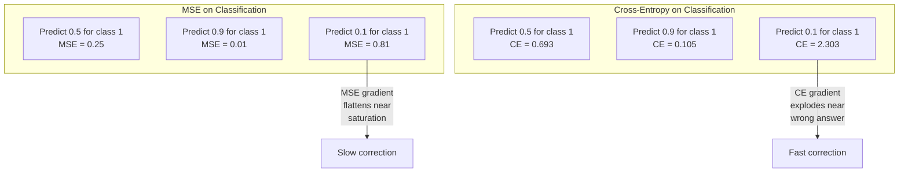
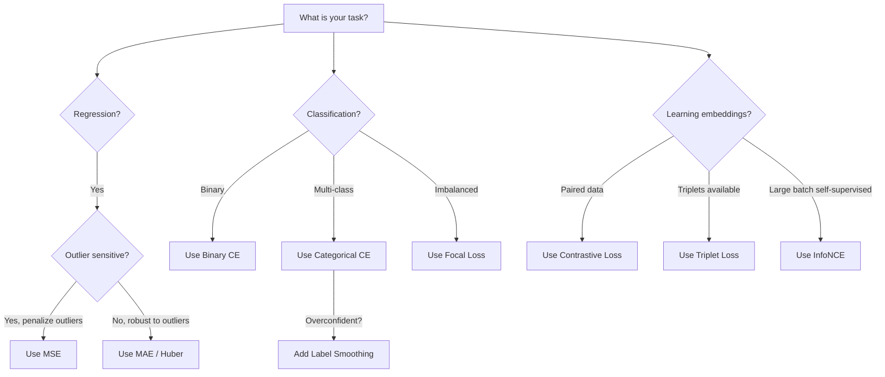
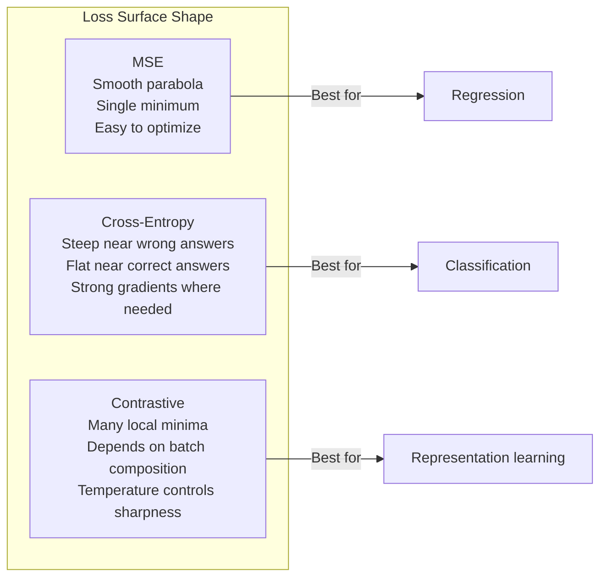

# Loss Functions

> Mạng của bạn đưa ra một dự đoán. Sự thật nền lại nói khác. Nó sai đến mức nào? Con số đó là mất mát. Chọn sai hàm mất mát và mô hình của bạn tối ưu hóa hoàn toàn sai thứ.

**Type:** Build
**Languages:** Python
**Prerequisites:** Lesson 03.04 (Activation Functions)
**Time:** ~75 minutes

## Learning Objectives

- Triển khai MSE, cross-entropy nhị phân, cross-entropy đa lớp và mất mát tương phản (InfoNCE) từ đầu cùng các gradient của chúng
- Giải thích tại sao MSE thất bại cho phân loại bằng cách minh họa kiểu thất bại "dự đoán 0.5 cho mọi thứ"
- Áp dụng làm trơn nhãn cho cross-entropy và mô tả cách nó ngăn các dự đoán quá tự tin
- Chọn hàm mất mát đúng cho các tác vụ hồi quy, phân loại nhị phân, phân loại đa lớp và học embedding

## The Problem

Một mô hình tối thiểu hóa MSE trên một bài toán phân loại sẽ tự tin dự đoán 0.5 cho mọi thứ. Nó đang tối thiểu hóa mất mát. Nó cũng vô dụng.

Hàm mất mát là thứ duy nhất mô hình của bạn thực sự tối ưu hóa. Không phải accuracy. Không phải điểm F1. Không phải bất kỳ thước đo nào bạn báo cáo cho quản lý. Bộ tối ưu hóa lấy gradient của hàm mất mát và điều chỉnh các trọng số để làm con số đó nhỏ hơn. Nếu hàm mất mát không nắm bắt điều bạn quan tâm, mô hình sẽ tìm cách rẻ nhất về mặt toán học để thỏa mãn nó, và cách đó gần như không bao giờ là điều bạn muốn.

Đây là một ví dụ cụ thể. Bạn có một tác vụ phân loại nhị phân. Hai lớp, chia 50/50. Bạn sử dụng MSE làm mất mát. Mô hình dự đoán 0.5 cho từng đầu vào một. MSE trung bình là 0.25, là mức tối thiểu có thể mà không thực sự học bất cứ điều gì. Mô hình có khả năng phân biệt bằng không nhưng về mặt kỹ thuật đã tối thiểu hóa hàm mất mát của bạn. Chuyển sang cross-entropy và cùng mô hình đó bị buộc đẩy các dự đoán về phía 0 hoặc 1, vì -log(0.5) = 0.693 là một mất mát tệ, trong khi -log(0.99) = 0.01 thưởng cho các dự đoán đúng tự tin. Lựa chọn hàm mất mát là khác biệt giữa một mô hình học và một mô hình lách thước đo.

Mọi chuyện còn tệ hơn. Trong học tự giám sát, bạn thậm chí không có nhãn. Mất mát tương phản xác định hoàn toàn tín hiệu học: điều gì được coi là tương tự, điều gì được coi là khác biệt và mô hình nên đẩy chúng xa nhau mạnh đến mức nào. Làm sai mất mát tương phản và các embedding của bạn sụp về một điểm duy nhất -- mọi đầu vào ánh xạ thành cùng một vector. Về mặt kỹ thuật, mất mát bằng không. Hoàn toàn vô giá trị.

## The Concept

### Mean Squared Error (MSE)

Mặc định cho hồi quy. Tính bình phương chênh lệch giữa dự đoán và mục tiêu, lấy trung bình trên tất cả các mẫu.

```
MSE = (1/n) * sum((y_pred - y_true)^2)
```

Tại sao bình phương quan trọng: nó phạt các sai số lớn theo bậc hai. Một sai số 2 tốn gấp 4 lần một sai số 1. Một sai số 10 tốn gấp 100 lần. Điều này khiến MSE nhạy với các ngoại lệ -- một dự đoán sai lệch rất lớn duy nhất chi phối mất mát.

Các con số thực tế: nếu mô hình của bạn dự đoán giá nhà và lệch $10,000 ở hầu hết các căn nhà nhưng lệch $200,000 ở một biệt thự, MSE sẽ quyết liệt cố sửa một biệt thự đó, có thể làm hại hiệu suất trên 99 căn nhà khác.

Gradient của MSE theo một dự đoán là:

```
dMSE/dy_pred = (2/n) * (y_pred - y_true)
```

Tuyến tính theo sai số. Các sai số lớn hơn nhận các gradient lớn hơn. Đây là một đặc tính tốt cho hồi quy (các sai số lớn cần các điều chỉnh lớn) và một lỗi cho phân loại (bạn muốn phạt các câu trả lời sai tự tin theo cấp số nhân, không phải tuyến tính).

### Cross-Entropy Loss

Hàm mất mát cho phân loại. Bắt nguồn từ lý thuyết thông tin -- nó đo độ phân kỳ giữa phân phối xác suất dự đoán và phân phối thật.

**Cross-Entropy Nhị phân (BCE):**

```
BCE = -(y * log(p) + (1 - y) * log(1 - p))
```

Trong đó y là nhãn thật (0 hoặc 1) và p là xác suất dự đoán.

Tại sao -log(p) hoạt động: khi nhãn thật là 1 và bạn dự đoán p = 0.99, mất mát là -log(0.99) = 0.01. Khi bạn dự đoán p = 0.01, mất mát là -log(0.01) = 4.6. Khác biệt gấp 460 lần đó là lý do cross-entropy hoạt động. Nó trừng phạt nặng các dự đoán sai tự tin trong khi hầu như không phạt các dự đoán đúng tự tin.

Gradient kể cùng câu chuyện:

```
dBCE/dp = -(y/p) + (1-y)/(1-p)
```

Khi y = 1 và p gần không, gradient là -1/p, tiến tới âm vô cực. Mô hình nhận một tín hiệu khổng lồ để sửa sai lầm. Khi p gần 1, gradient rất nhỏ. Đã đúng, không có gì cần sửa.

**Cross-Entropy Đa lớp:**

Cho phân loại đa lớp với các mục tiêu được mã hóa one-hot.

```
CCE = -sum(y_i * log(p_i))
```

Chỉ lớp thật đóng góp vào mất mát (vì mọi y_i khác bằng không). Nếu có 10 lớp và lớp đúng nhận xác suất 0.1 (đoán ngẫu nhiên), mất mát là -log(0.1) = 2.3. Nếu lớp đúng nhận xác suất 0.9, mất mát là -log(0.9) = 0.105. Mô hình học cách tập trung khối lượng xác suất vào câu trả lời đúng.

### Why MSE Fails for Classification



Các gradient MSE phẳng đi khi các dự đoán gần 0 hoặc 1 (do bão hòa sigmoid). Các gradient cross-entropy bù lại điều này -- -log triệt tiêu các vùng phẳng của sigmoid, cho các gradient mạnh đúng nơi cần chúng nhất.

### Label Smoothing

Các nhãn one-hot tiêu chuẩn nói "đây là 100% lớp 3 và 0% mọi thứ khác." Đó là một khẳng định mạnh. Làm trơn nhãn làm mềm nó:

```
smooth_label = (1 - alpha) * one_hot + alpha / num_classes
```

Với alpha = 0.1 và 10 lớp: thay vì [0, 0, 1, 0, ...], mục tiêu trở thành [0.01, 0.01, 0.91, 0.01, ...]. Mô hình nhắm tới 0.91 thay vì 1.0.

Tại sao điều này hoạt động: một mô hình cố xuất ra đúng 1.0 qua softmax cần đẩy các logit tới vô cực. Điều này gây quá tự tin, làm hại khả năng khái quát hóa và khiến mô hình mong manh trước dịch chuyển phân phối. Làm trơn nhãn chặn mục tiêu ở 0.9 (với alpha=0.1), giữ các logit trong phạm vi hợp lý. GPT và hầu hết các mô hình hiện đại sử dụng làm trơn nhãn hoặc tương đương.

### Contrastive Loss

Không nhãn. Không lớp. Chỉ các cặp đầu vào và câu hỏi: chúng tương tự hay khác nhau?

**Mất mát tương phản kiểu SimCLR (NT-Xent / InfoNCE):**

Lấy một hình ảnh. Tạo hai góc nhìn tăng cường của nó (cắt, xoay, làm nhiễu màu). Đây là "cặp dương" -- chúng nên có các embedding tương tự. Mọi hình ảnh khác trong batch tạo thành một "cặp âm" -- chúng nên có các embedding khác nhau.

```
L = -log(exp(sim(z_i, z_j) / tau) / sum(exp(sim(z_i, z_k) / tau)))
```

Trong đó sim() là độ tương đồng cosine, z_i và z_j là cặp dương, tổng chạy trên tất cả các mẫu âm, và tau (nhiệt độ) kiểm soát độ sắc của phân phối. Nhiệt độ thấp hơn = các mẫu âm khó hơn = phân tách quyết liệt hơn.

Các con số thực tế: kích thước batch 256 nghĩa là 255 mẫu âm trên mỗi cặp dương. Nhiệt độ tau = 0.07 (mặc định SimCLR). Mất mát trông như một softmax trên các độ tương đồng -- nó muốn độ tương đồng của cặp dương cao nhất trong tất cả 256 lựa chọn.

**Mất mát Bộ ba:**

Nhận ba đầu vào: neo, dương (cùng lớp), âm (khác lớp).

```
L = max(0, d(anchor, positive) - d(anchor, negative) + margin)
```

Biên (thường là 0.2-1.0) áp đặt một khoảng cách tối thiểu giữa các khoảng cách dương và âm. Nếu mẫu âm đã đủ xa, mất mát bằng không -- không gradient, không cập nhật. Điều này khiến huấn luyện hiệu quả nhưng cần khai thác bộ ba cẩn thận (chọn các mẫu âm khó nằm gần neo).

### Focal Loss

Cho các tập dữ liệu mất cân bằng. Cross-entropy tiêu chuẩn coi mọi ví dụ được phân loại đúng như nhau. Focal loss giảm trọng số các ví dụ dễ:

```
FL = -alpha * (1 - p_t)^gamma * log(p_t)
```

Trong đó p_t là xác suất dự đoán của lớp thật và gamma kiểm soát sự tập trung. Với gamma = 0, đây là cross-entropy tiêu chuẩn. Với gamma = 2 (mặc định):

- Ví dụ dễ (p_t = 0.9): trọng số = (0.1)^2 = 0.01. Về thực chất bị bỏ qua.
- Ví dụ khó (p_t = 0.1): trọng số = (0.9)^2 = 0.81. Tín hiệu gradient đầy đủ.

Focal loss được Lin và cộng sự giới thiệu cho phát hiện đối tượng, nơi 99% vùng ứng viên là nền (các mẫu âm dễ). Không có focal loss, mô hình chìm trong các ví dụ nền dễ và không bao giờ học phát hiện đối tượng. Có nó, mô hình tập trung năng lực vào các trường hợp khó, mơ hồ có ý nghĩa.

### Loss Function Decision Tree



### Loss Landscape



```figure
cross-entropy-loss
```

## Build It

### Step 1: MSE and Its Gradient

```python
def mse(predictions, targets):
    n = len(predictions)
    total = 0.0
    for p, t in zip(predictions, targets):
        total += (p - t) ** 2
    return total / n

def mse_gradient(predictions, targets):
    n = len(predictions)
    grads = []
    for p, t in zip(predictions, targets):
        grads.append(2.0 * (p - t) / n)
    return grads
```

### Step 2: Binary Cross-Entropy

Vấn đề log(0) là có thật. Nếu mô hình dự đoán đúng 0 cho một ví dụ dương, log(0) = âm vô cực. Cắt ngưỡng ngăn điều này.

```python
import math

def binary_cross_entropy(predictions, targets, eps=1e-15):
    n = len(predictions)
    total = 0.0
    for p, t in zip(predictions, targets):
        p_clipped = max(eps, min(1 - eps, p))
        total += -(t * math.log(p_clipped) + (1 - t) * math.log(1 - p_clipped))
    return total / n

def bce_gradient(predictions, targets, eps=1e-15):
    grads = []
    for p, t in zip(predictions, targets):
        p_clipped = max(eps, min(1 - eps, p))
        grads.append(-(t / p_clipped) + (1 - t) / (1 - p_clipped))
    return grads
```

### Step 3: Categorical Cross-Entropy with Softmax

Softmax chuyển các logit thô thành xác suất. Sau đó chúng ta tính cross-entropy so với các mục tiêu one-hot.

```python
def softmax(logits):
    max_val = max(logits)
    exps = [math.exp(x - max_val) for x in logits]
    total = sum(exps)
    return [e / total for e in exps]

def categorical_cross_entropy(logits, target_index, eps=1e-15):
    probs = softmax(logits)
    p = max(eps, probs[target_index])
    return -math.log(p)

def cce_gradient(logits, target_index):
    probs = softmax(logits)
    grads = list(probs)
    grads[target_index] -= 1.0
    return grads
```

Gradient của softmax + cross-entropy rút gọn rất đẹp: chỉ là (predicted probability - 1) cho lớp thật, và (predicted probability) cho tất cả các lớp khác. Sự rút gọn thanh nhã này không phải trùng hợp -- đó là lý do softmax và cross-entropy được ghép đôi.

### Step 4: Label Smoothing

```python
def label_smoothed_cce(logits, target_index, num_classes, alpha=0.1, eps=1e-15):
    probs = softmax(logits)
    loss = 0.0
    for i in range(num_classes):
        if i == target_index:
            smooth_target = 1.0 - alpha + alpha / num_classes
        else:
            smooth_target = alpha / num_classes
        p = max(eps, probs[i])
        loss += -smooth_target * math.log(p)
    return loss
```

### Step 5: Contrastive Loss (Simplified InfoNCE)

```python
def cosine_similarity(a, b):
    dot = sum(x * y for x, y in zip(a, b))
    norm_a = math.sqrt(sum(x * x for x in a))
    norm_b = math.sqrt(sum(x * x for x in b))
    if norm_a < 1e-10 or norm_b < 1e-10:
        return 0.0
    return dot / (norm_a * norm_b)

def contrastive_loss(anchor, positive, negatives, temperature=0.07):
    sim_pos = cosine_similarity(anchor, positive) / temperature
    sim_negs = [cosine_similarity(anchor, neg) / temperature for neg in negatives]

    max_sim = max(sim_pos, max(sim_negs)) if sim_negs else sim_pos
    exp_pos = math.exp(sim_pos - max_sim)
    exp_negs = [math.exp(s - max_sim) for s in sim_negs]
    total_exp = exp_pos + sum(exp_negs)

    return -math.log(max(1e-15, exp_pos / total_exp))
```

### Step 6: MSE vs Cross-Entropy on Classification

Huấn luyện cùng mạng từ bài 04 (tập dữ liệu đường tròn) với cả hai hàm mất mát. Quan sát cross-entropy hội tụ nhanh hơn.

```python
import random

def sigmoid(x):
    x = max(-500, min(500, x))
    return 1.0 / (1.0 + math.exp(-x))

def make_circle_data(n=200, seed=42):
    random.seed(seed)
    data = []
    for _ in range(n):
        x = random.uniform(-2, 2)
        y = random.uniform(-2, 2)
        label = 1.0 if x * x + y * y < 1.5 else 0.0
        data.append(([x, y], label))
    return data


class LossComparisonNetwork:
    def __init__(self, loss_type="bce", hidden_size=8, lr=0.1):
        random.seed(0)
        self.loss_type = loss_type
        self.lr = lr
        self.hidden_size = hidden_size

        self.w1 = [[random.gauss(0, 0.5) for _ in range(2)] for _ in range(hidden_size)]
        self.b1 = [0.0] * hidden_size
        self.w2 = [random.gauss(0, 0.5) for _ in range(hidden_size)]
        self.b2 = 0.0

    def forward(self, x):
        self.x = x
        self.z1 = []
        self.h = []
        for i in range(self.hidden_size):
            z = self.w1[i][0] * x[0] + self.w1[i][1] * x[1] + self.b1[i]
            self.z1.append(z)
            self.h.append(max(0.0, z))

        self.z2 = sum(self.w2[i] * self.h[i] for i in range(self.hidden_size)) + self.b2
        self.out = sigmoid(self.z2)
        return self.out

    def backward(self, target):
        if self.loss_type == "mse":
            d_loss = 2.0 * (self.out - target)
        else:
            eps = 1e-15
            p = max(eps, min(1 - eps, self.out))
            d_loss = -(target / p) + (1 - target) / (1 - p)

        d_sigmoid = self.out * (1 - self.out)
        d_out = d_loss * d_sigmoid

        for i in range(self.hidden_size):
            d_relu = 1.0 if self.z1[i] > 0 else 0.0
            d_h = d_out * self.w2[i] * d_relu
            self.w2[i] -= self.lr * d_out * self.h[i]
            for j in range(2):
                self.w1[i][j] -= self.lr * d_h * self.x[j]
            self.b1[i] -= self.lr * d_h
        self.b2 -= self.lr * d_out

    def compute_loss(self, pred, target):
        if self.loss_type == "mse":
            return (pred - target) ** 2
        else:
            eps = 1e-15
            p = max(eps, min(1 - eps, pred))
            return -(target * math.log(p) + (1 - target) * math.log(1 - p))

    def train(self, data, epochs=200):
        losses = []
        for epoch in range(epochs):
            total_loss = 0.0
            correct = 0
            for x, y in data:
                pred = self.forward(x)
                self.backward(y)
                total_loss += self.compute_loss(pred, y)
                if (pred >= 0.5) == (y >= 0.5):
                    correct += 1
            avg_loss = total_loss / len(data)
            accuracy = correct / len(data) * 100
            losses.append((avg_loss, accuracy))
            if epoch % 50 == 0 or epoch == epochs - 1:
                print(f"    Epoch {epoch:3d}: loss={avg_loss:.4f}, accuracy={accuracy:.1f}%")
        return losses
```

## Use It

PyTorch cung cấp tất cả các hàm mất mát tiêu chuẩn với tính ổn định số được tích hợp:

```python
import torch
import torch.nn as nn
import torch.nn.functional as F

predictions = torch.tensor([0.9, 0.1, 0.7], requires_grad=True)
targets = torch.tensor([1.0, 0.0, 1.0])

mse_loss = F.mse_loss(predictions, targets)
bce_loss = F.binary_cross_entropy(predictions, targets)

logits = torch.randn(4, 10)
labels = torch.tensor([3, 7, 1, 9])
ce_loss = F.cross_entropy(logits, labels)
ce_smooth = F.cross_entropy(logits, labels, label_smoothing=0.1)
```

Sử dụng `F.cross_entropy` (không phải `F.nll_loss` cộng softmax thủ công). Nó kết hợp log-softmax và log-likelihood âm trong một phép toán ổn định về số. Áp dụng softmax riêng rồi lấy log kém ổn định hơn -- bạn mất độ chính xác trong phép trừ các số mũ lớn.

Với học tương phản, hầu hết các nhóm sử dụng các bản triển khai tùy chỉnh hoặc thư viện như `lightly` hay `pytorch-metric-learning`. Vòng lặp cốt lõi luôn giống nhau: tính các độ tương đồng từng cặp, tạo softmax trên các mẫu dương và âm, lan truyền ngược.

## Ship It

Bài học này tạo ra:
- `outputs/prompt-loss-function-selector.md` -- một prompt tái sử dụng để chọn hàm mất mát phù hợp
- `outputs/prompt-loss-debugger.md` -- một prompt chẩn đoán khi đường cong mất mát của bạn trông sai

## Exercises

1. Triển khai mất mát Huber (mất mát L1 trơn), là MSE cho các sai số nhỏ và MAE cho các sai số lớn. Huấn luyện một mạng hồi quy dự đoán y = sin(x) với MSE so với Huber khi 5% mục tiêu huấn luyện được thêm nhiễu ngẫu nhiên (các ngoại lệ). So sánh sai số test cuối cùng.

2. Thêm focal loss vào vòng lặp huấn luyện phân loại nhị phân. Tạo một tập dữ liệu mất cân bằng (90% lớp 0, 10% lớp 1). So sánh BCE tiêu chuẩn với focal loss (gamma=2) theo recall lớp thiểu số sau 200 epoch.

3. Triển khai mất mát bộ ba với khai thác mẫu âm bán khó. Sinh dữ liệu embedding 2D cho 5 lớp. Với mỗi neo, tìm mẫu âm khó nhất vẫn xa hơn mẫu dương (bán khó). So sánh hội tụ với lựa chọn bộ ba ngẫu nhiên.

4. Chạy so sánh MSE với cross-entropy nhưng theo dõi độ lớn gradient tại mỗi lớp trong huấn luyện. Vẽ chuẩn gradient trung bình mỗi epoch. Xác minh cross-entropy tạo ra các gradient lớn hơn ở các epoch đầu khi mô hình bất định nhất.

5. Triển khai mất mát phân kỳ KL và xác minh rằng tối thiểu hóa KL(true || predicted) cho cùng các gradient như cross-entropy khi phân phối thật là one-hot. Sau đó thử các mục tiêu mềm (như chưng cất tri thức) trong đó phân phối "thật" đến từ đầu ra softmax của một mô hình giáo viên.

## Key Terms

| Thuật ngữ | Cách mọi người nói | Ý nghĩa thực sự |
|------|----------------|----------------------|
| Loss function (Hàm mất mát) | "Mô hình sai đến mức nào" | Một hàm khả vi ánh xạ các dự đoán và mục tiêu thành một số vô hướng mà bộ tối ưu hóa tối thiểu hóa |
| MSE | "Sai số bình phương trung bình" | Trung bình của các bình phương chênh lệch giữa các dự đoán và mục tiêu; phạt các sai số lớn theo bậc hai |
| Cross-entropy | "Mất mát phân loại" | Đo độ phân kỳ giữa phân phối xác suất dự đoán và phân phối thật bằng -log(p) |
| Binary cross-entropy (Cross-entropy nhị phân) | "BCE" | Cross-entropy cho hai lớp: -(y*log(p) + (1-y)*log(1-p)) |
| Label smoothing (Làm trơn nhãn) | "Làm mềm các mục tiêu" | Thay các mục tiêu 0/1 cứng bằng các giá trị mềm (ví dụ: 0.1/0.9) để ngăn quá tự tin và cải thiện khái quát hóa |
| Contrastive loss (Mất mát tương phản) | "Kéo lại gần, đẩy ra xa" | Một mất mát học các biểu diễn bằng cách làm các cặp tương tự gần nhau và các cặp khác biệt xa nhau trong không gian embedding |
| InfoNCE | "Mất mát CLIP/SimCLR" | Cross-entropy chuẩn hóa được co giãn theo nhiệt độ trên các điểm tương đồng; coi học tương phản là phân loại |
| Focal loss | "Cách khắc phục dữ liệu mất cân bằng" | Cross-entropy được gán trọng số bằng (1-p_t)^gamma để giảm trọng số các ví dụ dễ và tập trung vào các ví dụ khó |
| Triplet loss (Mất mát bộ ba) | "Neo-dương-âm" | Đẩy neo gần mẫu dương hơn mẫu âm ít nhất một biên trong không gian embedding |
| Temperature (Nhiệt độ) | "Núm điều chỉnh độ sắc" | Một số chia vô hướng trên các logit/độ tương đồng kiểm soát độ nhọn của phân phối kết quả; thấp hơn = sắc hơn |

## Further Reading

- Lin et al., "Focal Loss for Dense Object Detection" (2017) -- giới thiệu focal loss để xử lý mất cân bằng lớp cực độ trong phát hiện đối tượng (RetinaNet)
- Chen et al., "A Simple Framework for Contrastive Learning of Visual Representations" (SimCLR, 2020) -- xác định pipeline học tương phản hiện đại với mất mát NT-Xent
- Szegedy et al., "Rethinking the Inception Architecture" (2016) -- giới thiệu làm trơn nhãn như một kỹ thuật chính quy hóa, nay là tiêu chuẩn trong hầu hết các mô hình lớn
- Hinton et al., "Distilling the Knowledge in a Neural Network" (2015) -- chưng cất tri thức sử dụng các mục tiêu mềm và phân kỳ KL, nền tảng cho nén mô hình
